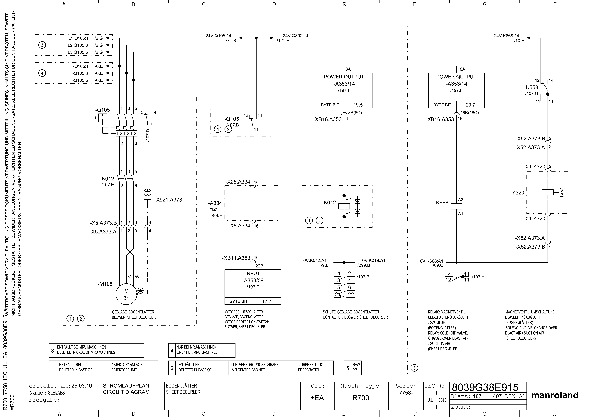

# +EA — Sheet 107 of 407 — BOGENGLÄTTER

**SHEET DECURLER**

> Part of the manroland **R700** printing press IEC/UL circuit diagrams.
> Drawing class: **Stromlaufplan / Circuit diagram** (DIN A3).
> Document `+EA` covers the **Printing unit** machine section.

## At a glance

| Field | Value |
|---|---|
| Document | `+EA`  (8039G38E915) |
| Sheet | **107** of 407 |
| Section (DE) | BOGENGLÄTTER |
| Section (EN) | SHEET DECURLER |
| Section type | CIRCUIT — Circuit diagram |
| Machine type | `R700` |
| Series | `7758` |
| Created | 25.03.10 |
| Replaces | — |
| Columns used | A, B, C, D, E, F, G, H |
| Path numbers | — |
| Labels on sheet | 188 |
| Cross-refs out | 22 |
| Cross-refs in | 41 |

**Previous:** [+EA sheet 106](SHEET_0106.md) · **Next:** [+EA sheet 108](SHEET_0108.md) · **Document TOC:** [_TOC.md](_TOC.md)  (+EA) · **Master TOC:** [all sheets](../_MASTER_TOC.md)

## Sheet image (300 DPI, exact vector render)



_Rendered directly from the PDF vector layer at 300 DPI (1-bit), no OCR and no resampling. Use it to confirm anything ambiguous in the text below._

## Cross-references on this sheet

Each entry is a wire leaving this sheet. The printed token is `/sheet.column`; the link resolves to that sheet inside the same document.

| Ref | Target sheet | Col | Path | Destination on target | Target section | From col |
|---|---|---|---|---|---|---|
| `/74.B` | [+EA sheet 74](SHEET_0074.md) | B | — | 24V.K668:14 24V.Q105:14 | AUSLEGERSTAPELSTEUERUNG | E |
| `/10.F` | [+EA sheet 10](SHEET_0010.md) | F | — | 24V.K668:14 24V.Q105:14 | SPANNUNGSVERSORGUNG: 400V, 24V | E |
| `/6.G` | [+EA sheet 6](SHEET_0006.md) | G | — | L1.Q105:1 | SPANNUNGSVERSORGUNG: 400V,24V | A |
| `/121.F` | [+EA sheet 121](SHEET_0121.md) | F | — | — | TROCKENBESTÄUBER | D |
| `/6.G` | [+EA sheet 6](SHEET_0006.md) | G | — | L2.Q105:3 | SPANNUNGSVERSORGUNG: 400V,24V | A |
| `/6.G` | [+EA sheet 6](SHEET_0006.md) | G | — | L3.Q105:5 | SPANNUNGSVERSORGUNG: 400V,24V | A |
| `/6.E` | [+EA sheet 6](SHEET_0006.md) | E | — | Q105:1 | SPANNUNGSVERSORGUNG: 400V,24V | A |
| `/6.E` | [+EA sheet 6](SHEET_0006.md) | E | — | Q105:3 | SPANNUNGSVERSORGUNG: 400V,24V | A |
| `/6.E` | [+EA sheet 6](SHEET_0006.md) | E | — | Q105:5 | SPANNUNGSVERSORGUNG: 400V,24V | A |
| `/197.F` | [+EA sheet 197](SHEET_0197.md) | F | — | — | REFERENZMODUL | E |
| `/197.F` | [+EA sheet 197](SHEET_0197.md) | F | — | — | REFERENZMODUL | G |
| `/107.G` | [+EA sheet 107](SHEET_0107.md) | G | — | — | BOGENGLÄTTER | H |
| `/107.B` | [+EA sheet 107](SHEET_0107.md) | B | — | — | BOGENGLÄTTER | C |
| `/107.D` | [+EA sheet 107](SHEET_0107.md) | D | — | — | BOGENGLÄTTER | B |
| `/107.E` | [+EA sheet 107](SHEET_0107.md) | E | — | — | BOGENGLÄTTER | B |
| `/121.F` | [+EA sheet 121](SHEET_0121.md) | F | — | — | TROCKENBESTÄUBER | C |
| `/98.E` | [+EA sheet 98](SHEET_0098.md) | E | — | — | BOGENFÜHRUNGSELEMENT | C |
| `/98.F` | [+EA sheet 98](SHEET_0098.md) | F | — | 0V.K012:A1 0V.K668:A1 | BOGENFÜHRUNGSELEMENT | E |
| `/299.B` | [+EA sheet 299](SHEET_0299.md) | B | — | 0V.K012:A1 0V.K668:A1 | OPTION: ZWISCHENSTAPEL / | E |
| `/89.C` | [+EA sheet 89](SHEET_0089.md) | C | — | 0V.K012:A1 0V.K668:A1 | BELEUCHTUNG | E |
| `/107.B` | [+EA sheet 107](SHEET_0107.md) | B | — | — | BOGENGLÄTTER | E |
| `/196.F` | [+EA sheet 196](SHEET_0196.md) | F | — | — | REFERENZMODUL | D |

### Incoming references (sheets that point here)

Every other sheet that sends a wire to this one. `Back-ref` is the token printed on *that* sheet; `Path` is its line number.

| From sheet | Cols | Back-ref | Path | Refs | What continues there |
|---|---|---|---|---|---|
| [+EA#6](SHEET_0006.md) | E, H | `/6.E`, `/6.H` | — | 6 | L1.Q105:1; L2.Q105:3; L3.Q105:5; Q105:1; Q105:3; Q105:5 |
| [+EA#10](SHEET_0010.md) | F | `/10.F` | — | 1 | — |
| [+EA#74](SHEET_0074.md) | B | `/74.B` | — | 1 | — |
| [+EA#89](SHEET_0089.md) | C | `/89.C` | — | 1 | — |
| [+EA#98](SHEET_0098.md) | E, F | `/98.E`, `/98.F` | — | 2 | 0V.K408:A1 |
| [+EA#107](SHEET_0107.md) | B, C, E, H | `/107.B`, `/107.C`, `/107.E`, `/107.H` | — | 5 | — |
| [+EA#121](SHEET_0121.md) | E | `/121.E` | — | 2 | 24V.Q302:14 |
| [+EA#196](SHEET_0196.md) | F | `/196.F` | — | 1 | — |
| [+EA#197](SHEET_0197.md) | F | `/197.F` | — | 2 | — |
| [+EA#222](SHEET_0222.md) | F | `/222.F` | — | 2 | — |
| [+EA#242](SHEET_0242.md) | A, B | `/242.A`, `/242.B` | — | 8 | — |
| [+EA#249](SHEET_0249.md) | D | `/249.D` | — | 1 | — |
| [+EA#256](SHEET_0256.md) | A | `/256.A` | — | 1 | — |
| [+EA#261](SHEET_0261.md) | G | `/261.G` | — | 2 | — |
| [+EA#267](SHEET_0267.md) | B | `/267.B` | — | 1 | — |
| [+EA#282](SHEET_0282.md) | G | `/282.G` | — | 4 | — |
| [+EA#299](SHEET_0299.md) | B | `/299.B` | — | 1 | 0V.K019:A1 |


## Devices on this sheet

| Tag | Class | Class meaning (IEC) | Col | Sub | Terminal | Sign |
|---|---|---|---|---|---|---|
| `K012` | K | Relais / relay, contactor | B | — | — | — |
| `Q105` | Q | Leistungsschalter / power switching device | B | — | — | — |
| `A2` | A | Baugruppe / assembly, module, PC board | G | — | — | — |
| `A1` | A | Baugruppe / assembly, module, PC board | G | — | — | — |
| `K668` | K | Relais / relay, contactor | F | — | — | — |
| `A353/14` | A | Baugruppe / assembly, module, PC board | G | 14 | — | — |
| `A353/09` | A | Baugruppe / assembly, module, PC board | D | 09 | — | — |
| `A334` | A | Baugruppe / assembly, module, PC board | C | — | — | — |
| `Q105` | Q | Leistungsschalter / power switching device | C | — | — | — |
| `A2` | A | Baugruppe / assembly, module, PC board | E | — | — | — |
| `A1` | A | Baugruppe / assembly, module, PC board | E | — | — | — |
| `K012` | K | Relais / relay, contactor | E | — | — | — |
| `A353/14` | A | Baugruppe / assembly, module, PC board | E | 14 | — | — |
| `K668` | K | Relais / relay, contactor | H | — | — | — |
| `Y320` | Y | Magnetventil / solenoid valve, actuator | G | — | — | — |
| `Q105:5` | Q | Leistungsschalter / power switching device | A | — | 5 | — |
| `Q105:3` | Q | Leistungsschalter / power switching device | A | — | 3 | — |
| `Q105:1` | Q | Leistungsschalter / power switching device | A | — | 1 | — |
| `X5.A373.B` | — | cross-device reference | B | — | — | — |
| `X5.A373.A` | — | cross-device reference | B | — | — | — |
| `20.7` | — | cross-device reference | G | — | — | — |
| `XB16.A353` | — | cross-device reference | F | — | — | — |
| `X8.A334` | — | cross-device reference | D | — | — | — |
| `X25.A334` | — | cross-device reference | C | — | — | — |
| `17.7` | — | cross-device reference | D | — | — | — |
| `XB11.A353` | — | cross-device reference | C | — | — | — |
| `19.5` | — | cross-device reference | E | — | — | — |
| `XB16.A353` | — | cross-device reference | E | — | — | — |
| `X52.A373.B` | — | cross-device reference | H | — | — | — |
| `X52.A373.A` | — | cross-device reference | H | — | — | — |
| `X1.Y320` | — | cross-device reference | H | — | — | — |
| `X1.Y320` | — | cross-device reference | H | — | — | — |
| `X52.A373.A` | — | cross-device reference | H | — | — | — |
| `X52.A373.B` | — | cross-device reference | H | — | — | — |
| `X921.A373` | — | cross-device reference | B | — | — | — |

## Potentials / nets

| Potential | Count | Columns | Attached devices | Terminals |
|---|---|---|---|---|
| `0V` | 3 | E, F | `K012`, `K019`, `K668` | `A1` |
| `24V` | 3 | C, D, G | `K668`, `Q105`, `Q302` | `14` |
| `L1` | 1 | A | `Q105` | `1` |
| `L2` | 1 | A | `Q105` | `3` |
| `L3` | 1 | A | `Q105` | `5` |
| `M105` | 1 | B | — | — |


A potential such as `L24+/4` or `M24+` is a named supply/return rail; every place it appears on this sheet is electrically common.

## Wire-end annotations (grouped as printed)

A wire that continues elsewhere is annotated with a small cluster: the destination description, the path/line number `#NN`, and the `/sheet.column` cross reference. Each row below is one such cluster exactly as it is grouped on the drawing.

| Col | Y | Path | Cross-ref | Text on the wire |
|---|---|---|---|---|
| E | 68.3 | — | `/74.B`, `/10.F` | `24V.Q105:14 24V.K668:14` |
| D | 68.3 | — | — | `24V.Q302:14` |
| A | 73.2 | — | `/6.G` | `L1.Q105:1` |
| D | 78.2 | — | `/121.F` | — |
| A | 87.4 | — | `/6.G` | `L2.Q105:3` |
| A | 88.2 | — | — | `3` |
| A | 101.6 | — | `/6.G` | `L3.Q105:5` |
| A | 129.9 | — | `/6.E` | `Q105:1` |
| E | 135.6 | — | — | `8A` |
| G | 135.6 | — | — | `18A` |
| A | 144.1 | — | `/6.E` | `Q105:3` |
| A | 144.9 | — | — | `4` |
| E | 150.8 | — | — | `POWER OUTPUT` |
| G | 150.8 | — | — | `POWER QUTPUT` |
| A | 158.3 | — | `/6.E` | `Q105:5` |
| H | 158.4 | — | — | `K668 14` |
| H | 158.4 | — | — | `12` |
| E | 164.7 | — | — | `A353/14` |
| G | 164.7 | — | — | `A353/14` |
| E | 178.5 | — | `/197.F` | — |
| G | 178.5 | — | `/197.F` | — |
| H | 184.9 | — | `/107.G` | — |
| H | 200.9 | — | — | `11 11` |
| E | 207.6 | — | — | `BYTE.BIT 19.5` |
| G | 207.6 | — | — | `BYTE.BIT 20.7` |
| B | 215.1 | — | — | `1` |
| B | 215.1 | — | — | `3` |
| B | 215.1 | — | — | `5` |
| B | 217.2 | — | — | `Q105` |
| E | 223.6 | — | — | `8B(8C)` |
| G | 223.6 | — | — | `18B(18C)` |
| B | 224.1 | — | — | `12 14` |
| D | 229.2 | — | — | `Q105 14` |
| D | 229.2 | — | — | `12` |
| E | 235.6 | — | — | `XB16.A353 6` |
| F | 235.6 | — | — | `XB16.A353 16` |
| B | 246.8 | — | — | `11` |
| C | 248.7 | — | `/107.B` | — |
| D | 257.6 | — | — | `11` |
| C | 257.7 | — | — | `1 2` |
| B | 260.5 | — | `/107.D` | — |
| H | 275.3 | — | — | `X52.A373.B 2` |
| B | 285.9 | — | — | `2` |
| B | 285.9 | — | — | `4` |
| B | 285.9 | — | — | `6` |
| H | 292.3 | — | — | `X52.A373.A 2` |
| H | 332.0 | — | — | `X1.Y320 2` |
| B | 342.6 | — | — | `1` |
| B | 342.6 | — | — | `3` |
| B | 342.6 | — | — | `5` |
| B | 356.1 | — | — | `K012 6` |
| D | 362.4 | — | — | `X25.A334 16` |
| B | 369.1 | — | `/107.E` | — |
| B | 370.9 | — | — | `2` |
| B | 370.9 | — | — | `4` |
| G | 384.5 | — | — | `Y320` |
| B | 398.6 | — | — | `X921.A373` |
| E | 399.2 | — | — | `A2` |
| G | 399.2 | — | — | `A2` |
| E | 404.2 | — | — | `K012` |
| F | 404.2 | — | — | `K668` |
| C | 405.7 | — | — | `A334` |
| C | 418.7 | — | `/121.F` | — |
| E | 427.6 | — | — | `A1` |
| G | 427.6 | — | — | `A1` |
| C | 431.1 | — | `/98.E` | — |
| H | 436.9 | — | — | `X1.Y320 1` |
| E | 442.0 | — | — | `1 2` |
| B | 445.4 | — | — | `X5.A373.B 1 2 3 4` |
| D | 451.0 | — | — | `X8.A334 16` |
| B | 462.4 | — | — | `X5.A373.A 1 2 3 4` |
| H | 475.8 | — | — | `X52.A373.A 1` |
| H | 493.5 | — | — | `X52.A373.B 1` |
| D | 516.2 | — | — | `XB11.A353 16` |
| E | 521.8 | — | `/98.F`, `/299.B`, `/89.C` | `0V.K012:A1 0V.K668:A1` |
| E | 521.8 | — | — | `0V.K019:A1` |
| D | 533.2 | — | — | `22B` |
| E | 547.4 | — | — | `21 3 5 1` |
| E | 547.4 | — | — | `2 4 6 22` |
| D | 547.7 | — | — | `INPUT` |
| G | 548.8 | — | — | `14 12 11 11 /107.H` |
| B | 554.9 | — | — | `U V W` |
| E | 555.1 | — | `/107.B` | — |
| D | 561.6 | — | — | `A353/09` |
| B | 568.7 | — | — | `M105` |
| D | 575.4 | — | `/196.F` | — |
| B | 583.1 | — | — | `3~ M` |
| D | 604.4 | — | — | `BYTE.BIT 17.7` |
| B | 627.1 | — | — | `BLOWER: SHEET DECURLER GEBLÄSE: BOGENGLÄTTER` |
| E | 627.1 | — | — | `SCHÜTZ: GEBLÄSE, BOGENGLÄTTER CONTACTOR: BLOWER, SHEET DECURLER` |
| F | 627.1 | — | — | `RELAIS: MAGNETVENTIL, UMSCHALTUNG BLASLUFT` |
| H | 627.1 | — | — | `BLASLUFT / SAUGLUFT BLAST AIR / SUCTION AIR MAGNETVENTIL: UMSCHALTUNG (BOGENGLÄTTER) (SHEET DECURLER) SOLENOID VALVE: CHANGE OVER` |
| D | 627.2 | — | — | `BLOWER, SHEET DECURLER MOTORSCHUTZSCHALTER: GEBLÄSE, BOGENGLÄTTER MOTOR PROTECTION SWITCH:` |
| A | 640.4 | — | — | `1 2` |
| F | 648.4 | — | — | `RELAY: SOLENOID VALVE, (BOGENGLÄTTER) / SAUGLUFT` |
| F | 680.2 | — | — | `(SHEET DECURLER) CHANGE OVER BLAST AIR / SUCTION AIR` |
| B | 698.0 | — | — | `3 ENTFÄLLT BEI MRU MASCHINEN DELETED IN CASE OF MRU MACHINES 4 NUR BEI MRU MASCHINEN` |
| C | 708.6 | — | — | `ONLY FOR MRU MACHINES` |
| F | 733.2 | — | — | `5 PP S+W 5` |
| A | 733.4 | — | — | `1 ENTFÄLLT BEI DELETED IN CASE OF "EJEKTOR" ANLAGE "EJEKTOR" UNIT` |
| C | 733.4 | — | — | `2 ENTFÄLLT BEI DELETED IN CASE OF LUFTVERSORGUNGSSCHRANK` |
| E | 733.4 | — | — | `PREPARATION VORBEREITUNG` |
| D | 744.0 | — | — | `AIR CENTER CABINET` |


## Reconstructed tables

This sheet carries tabular content (pin map / terminal assignment / index). The grid below was rebuilt from the drawing's own rule lines, so each row is exactly one physical row of the table.

### Table 1 — 0 data rows × 2 columns (at x=198.4, y=104.9) — **/6.G /6.E /6.E**

_none_


### Table 2 — 4 data rows × 7 columns (at x=453.5, y=147.4)

|  |  |  |  | POWER | OUTPUT A353/14 /197.F |  |
|---|---|---|---|---|---|---|
|  |  |  |  | `BYTE.BIT` |  | `19.5` |
| `12 Q105 /107.B 2 X25.A334 X8.A334 XB11.A353` | `11 16 16 16` | `14 22B` | `1 0V.K012:A1` | `XB16.A353 K012 2 /98.F` | `8B(8C) 6 A2 A1` | `/299.B` |
| `INPUT` | `A353/09 /196.F` |  |  | `1 3 5 21` | `2 4 6 22` | `/107.B` |
| `BYTE.BIT` |  | `17.7` |  |  |  |  |


### Table 3 — 2 data rows × 2 columns (at x=864.6, y=147.4)

| POWER | QUTPUT A353/14 /197.F |
|---|---|
| `BYTE.BIT` | `20.7` |
| `XB16.A353 K668 0V.K668:A1` | `18B(18C) 16 A2 A1` |


## Notes and free text on this sheet

| Text | Col | Y (pt) |
|---|---|---|
| `U` | B | 555.22 |
| `V` | B | 555.11 |
| `W` | B | 554.85 |
| `M` | B | 583.1 |
| `GEBLÄSE: BOGENGLÄTTER` | B | 627.08 |
| `BLOWER: SHEET DECURLER` | B | 637.7 |
| `11 /107.H` | G | 555.17 |
| `RELAIS: MAGNETVENTIL,` | F | 627.07 |
| `UMSCHALTUNG BLASLUFT` | F | 637.73 |
| `/ SAUGLUFT` | F | 648.35 |
| `(BOGENGLÄTTER)` | F | 658.98 |
| `RELAY: SOLENOID VALVE,` | F | 669.59 |
| `CHANGE OVER BLAST AIR` | F | 680.25 |
| `/ SUCTION AIR` | F | 690.88 |
| `(SHEET DECURLER)` | F | 701.52 |
| `18A` | G | 135.64 |
| `18B(18C)` | G | 223.55 |
| `POWER QUTPUT` | G | 150.8 |
| `BYTE.BIT` | F | 208.12 |
| `22B` | D | 533.2 |
| `INPUT` | D | 547.72 |
| `BYTE.BIT` | C | 604.97 |
| `MOTORSCHUTZSCHALTER:` | D | 627.21 |
| `GEBLÄSE, BOGENGLÄTTER` | D | 637.17 |
| `MOTOR PROTECTION SWITCH:` | D | 647.09 |
| `BLOWER, SHEET DECURLER` | D | 657.06 |
| `SCHÜTZ: GEBLÄSE, BOGENGLÄTTER` | E | 627.08 |
| `CONTACTOR: BLOWER, SHEET DECURLER` | E | 637.72 |
| `8A` | E | 135.62 |
| `8B(8C)` | E | 223.55 |
| `POWER OUTPUT` | E | 150.8 |
| `BYTE.BIT` | E | 208.12 |
| `MAGNETVENTIL: UMSCHALTUNG` | H | 627.1 |
| `BLASLUFT / SAUGLUFT` | H | 637.71 |
| `(BOGENGLÄTTER)` | G | 648.35 |
| `SOLENOID VALVE: CHANGE OVER` | H | 658.98 |
| `BLAST AIR / SUCTION AIR` | H | 669.59 |
| `(SHEET DECURLER)` | H | 680.26 |
| `ENTFÄLLT BEI` | A | 733.35 |
| `DELETED IN CASE OF` | A | 744 |
| `"EJEKTOR" ANLAGE` | B | 733.38 |
| `"EJEKTOR" UNIT` | B | 744.01 |
| `ENTFÄLLT BEI` | C | 733.35 |
| `DELETED IN CASE OF` | C | 744 |
| `LUFTVERSORGUNGSSCHRANK` | D | 733.4 |
| `AIR CENTER CABINET` | D | 744.01 |
| `VORBEREITUNG` | E | 733.39 |
| `PREPARATION` | E | 743.99 |
| `ENTFÄLLT BEI MRU MASCHINEN` | A | 697.95 |
| `DELETED IN CASE OF MRU MACHINES` | A | 708.58 |
| `NUR BEI MRU MASCHINEN` | C | 697.96 |
| `ONLY FOR MRU MACHINES` | C | 708.6 |
| `S+W` | E | 733.24 |
| `PP` | E | 743.87 |

## Complete label inventory (exact text from the drawing)

Every text object inside the drawing area of this sheet, in DIN reading order (column A→H, then top→bottom). This is the authoritative list: if a string is not here it is not printed on this sheet.

| Col | Y | X | Dir | Type | Text |
|---|---|---|---|---|---|
| A | 73.2 | 190.8 | → | cross-reference | `/6.G` |
| A | 73.3 | 138.0 | → | potential | `L1.Q105:1` |
| A | 87.4 | 190.8 | → | cross-reference | `/6.G` |
| A | 87.5 | 136.6 | → | potential | `L2.Q105:3` |
| A | 88.2 | 83.0 | → | number | `3` |
| A | 101.6 | 136.6 | → | potential | `L3.Q105:5` |
| A | 101.6 | 190.8 | → | cross-reference | `/6.G` |
| A | 130.0 | 147.4 | → | device tag | `Q105:1` |
| A | 144.2 | 146.0 | → | device tag | `Q105:3` |
| A | 144.9 | 83.0 | → | number | `4` |
| A | 158.3 | 146.0 | → | device tag | `Q105:5` |
| A | 640.4 | 140.0 | → | number | `1` |
| A | 640.9 | 161.0 | → | number | `2` |
| A | 698.0 | 115.4 | → | text | `ENTFÄLLT BEI MRU MASCHINEN` |
| A | 703.3 | 103.3 | → | number | `3` |
| A | 708.6 | 115.4 | → | text | `DELETED IN CASE OF MRU MACHINES` |
| A | 733.3 | 119.6 | → | text | `ENTFÄLLT BEI` |
| A | 738.7 | 103.7 | → | number | `1` |
| A | 744.0 | 119.6 | → | text | `DELETED IN CASE OF` |
| B | 129.9 | 191.6 | → | cross-reference | `/6.E` |
| B | 144.1 | 191.6 | → | cross-reference | `/6.E` |
| B | 158.3 | 191.6 | → | cross-reference | `/6.E` |
| B | 215.0 | 242.9 | → | number | `1` |
| B | 215.0 | 257.7 | → | number | `3` |
| B | 215.0 | 271.8 | → | number | `5` |
| B | 217.2 | 192.2 | → | device tag | `Q105` |
| B | 224.1 | 280.1 | → | number | `12` |
| B | 224.1 | 307.0 | → | number | `14` |
| B | 246.8 | 299.9 | → | number | `11` |
| B | 260.5 | 294.4 | ↕ | cross-reference | `/107.D` |
| B | 285.9 | 243.5 | → | number | `2` |
| B | 285.9 | 257.7 | → | number | `4` |
| B | 285.9 | 271.8 | → | number | `6` |
| B | 342.6 | 242.9 | → | number | `1` |
| B | 342.6 | 257.7 | → | number | `3` |
| B | 342.6 | 271.8 | → | number | `5` |
| B | 356.1 | 201.8 | → | device tag | `K012` |
| B | 369.1 | 204.7 | → | cross-reference | `/107.E` |
| B | 371.0 | 243.5 | → | number | `2` |
| B | 371.0 | 257.7 | → | number | `4` |
| B | 371.0 | 271.8 | → | number | `6` |
| B | 398.6 | 311.5 | → | device ref | `X921.A373` |
| B | 445.4 | 181.7 | → | device ref | `X5.A373.B` |
| B | 445.4 | 242.9 | → | number | `1` |
| B | 445.4 | 257.7 | → | number | `2` |
| B | 445.4 | 271.8 | → | number | `3` |
| B | 445.4 | 300.2 | → | number | `4` |
| B | 462.4 | 242.9 | → | number | `1` |
| B | 462.4 | 257.7 | → | number | `2` |
| B | 462.4 | 271.8 | → | number | `3` |
| B | 462.4 | 300.2 | → | number | `4` |
| B | 463.1 | 180.9 | → | device ref | `X5.A373.A` |
| B | 554.8 | 272.1 | → | text | `W` |
| B | 555.1 | 258.0 | → | text | `V` |
| B | 555.2 | 242.9 | → | text | `U` |
| B | 568.7 | 197.3 | → | potential | `M105` |
| B | 583.1 | 251.0 | → | text | `M` |
| B | 597.3 | 249.7 | → | other | `3~` |
| B | 627.1 | 226.5 | → | text | `GEBLÄSE: BOGENGLÄTTER` |
| B | 637.7 | 225.9 | → | text | `BLOWER: SHEET DECURLER` |
| B | 733.4 | 226.5 | → | text | `"EJEKTOR" ANLAGE` |
| B | 744.0 | 226.5 | → | text | `"EJEKTOR" UNIT` |
| C | 68.3 | 412.2 | → | potential | `24V.Q105:14` |
| C | 78.2 | 455.8 | → | cross-reference | `/74.B` |
| C | 235.6 | 453.0 | → | device tag | `Q105` |
| C | 248.6 | 456.7 | → | cross-reference | `/107.B` |
| C | 257.7 | 437.6 | → | number | `1` |
| C | 258.2 | 458.6 | → | number | `2` |
| C | 362.4 | 455.0 | → | device ref | `X25.A334` |
| C | 405.7 | 420.1 | → | device tag | `A334` |
| C | 418.7 | 423.2 | → | cross-reference | `/121.F` |
| C | 431.1 | 427.7 | → | cross-reference | `/98.E` |
| C | 516.2 | 447.9 | → | device ref | `XB11.A353` |
| C | 605.0 | 463.5 | → | text | `BYTE.BIT` |
| C | 698.0 | 356.3 | → | text | `NUR BEI MRU MASCHINEN` |
| C | 703.3 | 344.4 | → | number | `4` |
| C | 708.6 | 356.9 | → | text | `ONLY FOR MRU MACHINES` |
| C | 733.3 | 360.6 | → | text | `ENTFÄLLT BEI` |
| C | 738.7 | 344.4 | → | number | `2` |
| C | 744.0 | 360.6 | → | text | `DELETED IN CASE OF` |
| D | 68.3 | 568.1 | → | potential | `24V.Q302:14` |
| D | 78.2 | 558.4 | → | cross-reference | `/121.F` |
| D | 229.2 | 491.2 | → | number | `12` |
| D | 229.2 | 519.3 | → | number | `14` |
| D | 257.6 | 512.2 | → | number | `11` |
| D | 364.6 | 512.2 | → | number | `16` |
| D | 451.0 | 460.9 | → | device ref | `X8.A334` |
| D | 452.5 | 512.2 | → | number | `16` |
| D | 516.2 | 512.2 | → | number | `16` |
| D | 533.2 | 515.6 | → | text | `22B` |
| D | 547.7 | 495.4 | → | text | `INPUT` |
| D | 561.6 | 488.8 | → | device tag | `A353/09` |
| D | 575.4 | 497.9 | → | cross-reference | `/196.F` |
| D | 604.4 | 528.8 | → | device ref | `17.7` |
| D | 627.2 | 453.3 | → | text | `MOTORSCHUTZSCHALTER:` |
| D | 637.2 | 453.3 | → | text | `GEBLÄSE, BOGENGLÄTTER` |
| D | 647.1 | 453.3 | → | text | `MOTOR PROTECTION SWITCH:` |
| D | 657.1 | 453.0 | → | text | `BLOWER, SHEET DECURLER` |
| D | 733.4 | 466.9 | → | text | `LUFTVERSORGUNGSSCHRANK` |
| D | 744.0 | 467.7 | → | text | `AIR CENTER CABINET` |
| E | 135.6 | 697.0 | → | text | `8A` |
| E | 150.8 | 653.7 | → | text | `POWER OUTPUT` |
| E | 164.7 | 673.1 | → | device tag | `A353/14` |
| E | 178.5 | 682.2 | → | cross-reference | `/197.F` |
| E | 207.6 | 713.1 | → | device ref | `19.5` |
| E | 208.1 | 647.7 | → | text | `BYTE.BIT` |
| E | 223.5 | 702.7 | → | text | `8B(8C)` |
| E | 235.6 | 697.0 | → | number | `6` |
| E | 236.3 | 632.1 | → | device ref | `XB16.A353` |
| E | 399.2 | 697.3 | → | device tag | `A2` |
| E | 404.2 | 649.7 | → | device tag | `K012` |
| E | 427.6 | 697.3 | → | device tag | `A1` |
| E | 442.0 | 621.9 | → | number | `1` |
| E | 442.5 | 642.9 | → | number | `2` |
| E | 521.8 | 612.3 | → | potential | `0V.K012:A1` |
| E | 521.8 | 731.1 | → | potential | `0V.K019:A1` |
| E | 531.8 | 647.7 | → | cross-reference | `/98.F` |
| E | 531.8 | 721.4 | → | cross-reference | `/299.B` |
| E | 547.4 | 682.0 | → | number | `1` |
| E | 547.4 | 702.7 | → | number | `2` |
| E | 555.1 | 720.0 | → | cross-reference | `/107.B` |
| E | 561.5 | 680.6 | → | number | `3` |
| E | 561.5 | 702.7 | → | number | `4` |
| E | 575.7 | 680.6 | → | number | `5` |
| E | 575.7 | 702.7 | → | number | `6` |
| E | 589.9 | 676.1 | → | number | `21` |
| E | 589.9 | 702.7 | → | number | `22` |
| E | 627.1 | 651.7 | → | text | `SCHÜTZ: GEBLÄSE, BOGENGLÄTTER` |
| E | 637.7 | 651.7 | → | text | `CONTACTOR: BLOWER, SHEET DECURLER` |
| E | 733.2 | 711.9 | → | text | `S+W` |
| E | 733.4 | 602.4 | → | text | `VORBEREITUNG` |
| E | 738.7 | 698.6 | → | number | `5` |
| E | 743.9 | 711.4 | → | text | `PP` |
| E | 744.0 | 601.5 | → | text | `PREPARATION` |
| F | 208.1 | 874.5 | → | text | `BYTE.BIT` |
| F | 236.3 | 858.9 | → | device ref | `XB16.A353` |
| F | 404.2 | 876.5 | → | device tag | `K668` |
| F | 523.3 | 847.6 | → | potential | `0V.K668:A1` |
| F | 531.8 | 873.6 | → | cross-reference | `/89.C` |
| F | 548.8 | 898.6 | → | number | `14` |
| F | 560.1 | 898.6 | → | number | `12` |
| F | 627.1 | 863.7 | → | text | `RELAIS: MAGNETVENTIL,` |
| F | 637.7 | 863.7 | → | text | `UMSCHALTUNG BLASLUFT` |
| F | 648.3 | 864.6 | → | text | `/ SAUGLUFT` |
| F | 659.0 | 864.0 | → | text | `(BOGENGLÄTTER)` |
| F | 669.6 | 863.7 | → | text | `RELAY: SOLENOID VALVE,` |
| F | 680.2 | 864.3 | → | text | `CHANGE OVER BLAST AIR` |
| F | 690.9 | 864.6 | → | text | `/ SUCTION AIR` |
| F | 701.5 | 864.0 | → | text | `(SHEET DECURLER)` |
| F | 740.1 | 834.2 | → | number | `5` |
| G | 68.3 | 994.1 | → | potential | `24V.K668:14` |
| G | 78.2 | 1037.5 | → | cross-reference | `/10.F` |
| G | 135.6 | 923.2 | → | text | `18A` |
| G | 150.8 | 880.4 | → | text | `POWER QUTPUT` |
| G | 164.7 | 899.9 | → | device tag | `A353/14` |
| G | 178.5 | 908.9 | → | cross-reference | `/197.F` |
| G | 207.6 | 940.1 | → | device ref | `20.7` |
| G | 223.5 | 928.9 | → | text | `18B(18C)` |
| G | 235.6 | 923.2 | → | number | `16` |
| G | 384.5 | 1030.1 | → | device tag | `Y320` |
| G | 399.2 | 924.1 | → | device tag | `A2` |
| G | 427.6 | 924.1 | → | device tag | `A1` |
| G | 548.8 | 935.7 | → | number | `11` |
| G | 555.2 | 935.7 | → | text | `11 /107.H` |
| G | 648.4 | 1019.9 | → | text | `(BOGENGLÄTTER)` |
| H | 158.4 | 1079.4 | → | number | `12` |
| H | 158.4 | 1107.5 | → | number | `14` |
| H | 171.8 | 1057.9 | → | device tag | `K668` |
| H | 184.9 | 1059.9 | → | cross-reference | `/107.G` |
| H | 200.9 | 1080.6 | → | number | `11` |
| H | 200.9 | 1107.5 | → | number | `11` |
| H | 275.3 | 1040.3 | → | device ref | `X52.A373.B` |
| H | 275.3 | 1108.1 | → | number | `2` |
| H | 292.3 | 1108.1 | → | number | `2` |
| H | 293.0 | 1039.5 | → | device ref | `X52.A373.A` |
| H | 332.0 | 1056.8 | → | device ref | `X1.Y320` |
| H | 332.0 | 1108.1 | → | number | `2` |
| H | 436.9 | 1056.8 | → | device ref | `X1.Y320` |
| H | 438.3 | 1107.5 | → | number | `1` |
| H | 475.8 | 1039.5 | → | device ref | `X52.A373.A` |
| H | 478.0 | 1107.5 | → | number | `1` |
| H | 493.5 | 1040.3 | → | device ref | `X52.A373.B` |
| H | 495.0 | 1107.5 | → | number | `1` |
| H | 627.1 | 1019.9 | → | text | `MAGNETVENTIL: UMSCHALTUNG` |
| H | 637.7 | 1019.6 | → | text | `BLASLUFT / SAUGLUFT` |
| H | 659.0 | 1020.2 | → | text | `SOLENOID VALVE: CHANGE OVER` |
| H | 669.6 | 1019.6 | → | text | `BLAST AIR / SUCTION AIR` |
| H | 680.3 | 1019.9 | → | text | `(SHEET DECURLER)` |

## Reading-order text block

The same content as a plain block, grouped by DIN column — convenient to paste or to match against a visual description.

```text
=== Column A ===
  73.2  190.8  xref         /6.G
  73.3  138.0  net          L1.Q105:1
  87.4  190.8  xref         /6.G
  87.5  136.6  net          L2.Q105:3
  88.2   83.0  numeric      3
 101.6  136.6  net          L3.Q105:5
 101.6  190.8  xref         /6.G
 130.0  147.4  devtag       Q105:1
 144.2  146.0  devtag       Q105:3
 144.9   83.0  numeric      4
 158.3  146.0  devtag       Q105:5
 640.4  140.0  numeric      1
 640.9  161.0  numeric      2
 698.0  115.4  text         ENTFÄLLT BEI MRU MASCHINEN
 703.3  103.3  numeric      3
 708.6  115.4  text         DELETED IN CASE OF MRU MACHINES
 733.3  119.6  text         ENTFÄLLT BEI
 738.7  103.7  numeric      1
 744.0  119.6  text         DELETED IN CASE OF
=== Column B ===
 129.9  191.6  xref         /6.E
 144.1  191.6  xref         /6.E
 158.3  191.6  xref         /6.E
 215.0  242.9  numeric      1
 215.0  257.7  numeric      3
 215.0  271.8  numeric      5
 217.2  192.2  devtag       Q105
 224.1  280.1  numeric      12
 224.1  307.0  numeric      14
 246.8  299.9  numeric      11
 260.5  294.4  xref         /107.D
 285.9  243.5  numeric      2
 285.9  257.7  numeric      4
 285.9  271.8  numeric      6
 342.6  242.9  numeric      1
 342.6  257.7  numeric      3
 342.6  271.8  numeric      5
 356.1  201.8  devtag       K012
 369.1  204.7  xref         /107.E
 371.0  243.5  numeric      2
 371.0  257.7  numeric      4
 371.0  271.8  numeric      6
 398.6  311.5  devref       X921.A373
 445.4  181.7  devref       X5.A373.B
 445.4  242.9  numeric      1
 445.4  257.7  numeric      2
 445.4  271.8  numeric      3
 445.4  300.2  numeric      4
 462.4  242.9  numeric      1
 462.4  257.7  numeric      2
 462.4  271.8  numeric      3
 462.4  300.2  numeric      4
 463.1  180.9  devref       X5.A373.A
 554.8  272.1  text         W
 555.1  258.0  text         V
 555.2  242.9  text         U
 568.7  197.3  net          M105
 583.1  251.0  text         M
 597.3  249.7  other        3~
 627.1  226.5  text         GEBLÄSE: BOGENGLÄTTER
 637.7  225.9  text         BLOWER: SHEET DECURLER
 733.4  226.5  text         "EJEKTOR" ANLAGE
 744.0  226.5  text         "EJEKTOR" UNIT
=== Column C ===
  68.3  412.2  net          24V.Q105:14
  78.2  455.8  xref         /74.B
 235.6  453.0  devtag       Q105
 248.6  456.7  xref         /107.B
 257.7  437.6  numeric      1
 258.2  458.6  numeric      2
 362.4  455.0  devref       X25.A334
 405.7  420.1  devtag       A334
 418.7  423.2  xref         /121.F
 431.1  427.7  xref         /98.E
 516.2  447.9  devref       XB11.A353
 605.0  463.5  text         BYTE.BIT
 698.0  356.3  text         NUR BEI MRU MASCHINEN
 703.3  344.4  numeric      4
 708.6  356.9  text         ONLY FOR MRU MACHINES
 733.3  360.6  text         ENTFÄLLT BEI
 738.7  344.4  numeric      2
 744.0  360.6  text         DELETED IN CASE OF
=== Column D ===
  68.3  568.1  net          24V.Q302:14
  78.2  558.4  xref         /121.F
 229.2  491.2  numeric      12
 229.2  519.3  numeric      14
 257.6  512.2  numeric      11
 364.6  512.2  numeric      16
 451.0  460.9  devref       X8.A334
 452.5  512.2  numeric      16
 516.2  512.2  numeric      16
 533.2  515.6  text         22B
 547.7  495.4  text         INPUT
 561.6  488.8  devtag       A353/09
 575.4  497.9  xref         /196.F
 604.4  528.8  devref       17.7
 627.2  453.3  text         MOTORSCHUTZSCHALTER:
 637.2  453.3  text         GEBLÄSE, BOGENGLÄTTER
 647.1  453.3  text         MOTOR PROTECTION SWITCH:
 657.1  453.0  text         BLOWER, SHEET DECURLER
 733.4  466.9  text         LUFTVERSORGUNGSSCHRANK
 744.0  467.7  text         AIR CENTER CABINET
=== Column E ===
 135.6  697.0  text         8A
 150.8  653.7  text         POWER OUTPUT
 164.7  673.1  devtag       A353/14
 178.5  682.2  xref         /197.F
 207.6  713.1  devref       19.5
 208.1  647.7  text         BYTE.BIT
 223.5  702.7  text         8B(8C)
 235.6  697.0  numeric      6
 236.3  632.1  devref       XB16.A353
 399.2  697.3  devtag       A2
 404.2  649.7  devtag       K012
 427.6  697.3  devtag       A1
 442.0  621.9  numeric      1
 442.5  642.9  numeric      2
 521.8  612.3  net          0V.K012:A1
 521.8  731.1  net          0V.K019:A1
 531.8  647.7  xref         /98.F
 531.8  721.4  xref         /299.B
 547.4  682.0  numeric      1
 547.4  702.7  numeric      2
 555.1  720.0  xref         /107.B
 561.5  680.6  numeric      3
 561.5  702.7  numeric      4
 575.7  680.6  numeric      5
 575.7  702.7  numeric      6
 589.9  676.1  numeric      21
 589.9  702.7  numeric      22
 627.1  651.7  text         SCHÜTZ: GEBLÄSE, BOGENGLÄTTER
 637.7  651.7  text         CONTACTOR: BLOWER, SHEET DECURLER
 733.2  711.9  text         S+W
 733.4  602.4  text         VORBEREITUNG
 738.7  698.6  numeric      5
 743.9  711.4  text         PP
 744.0  601.5  text         PREPARATION
=== Column F ===
 208.1  874.5  text         BYTE.BIT
 236.3  858.9  devref       XB16.A353
 404.2  876.5  devtag       K668
 523.3  847.6  net          0V.K668:A1
 531.8  873.6  xref         /89.C
 548.8  898.6  numeric      14
 560.1  898.6  numeric      12
 627.1  863.7  text         RELAIS: MAGNETVENTIL,
 637.7  863.7  text         UMSCHALTUNG BLASLUFT
 648.3  864.6  text         / SAUGLUFT
 659.0  864.0  text         (BOGENGLÄTTER)
 669.6  863.7  text         RELAY: SOLENOID VALVE,
 680.2  864.3  text         CHANGE OVER BLAST AIR
 690.9  864.6  text         / SUCTION AIR
 701.5  864.0  text         (SHEET DECURLER)
 740.1  834.2  numeric      5
=== Column G ===
  68.3  994.1  net          24V.K668:14
  78.2 1037.5  xref         /10.F
 135.6  923.2  text         18A
 150.8  880.4  text         POWER QUTPUT
 164.7  899.9  devtag       A353/14
 178.5  908.9  xref         /197.F
 207.6  940.1  devref       20.7
 223.5  928.9  text         18B(18C)
 235.6  923.2  numeric      16
 384.5 1030.1  devtag       Y320
 399.2  924.1  devtag       A2
 427.6  924.1  devtag       A1
 548.8  935.7  numeric      11
 555.2  935.7  text         11 /107.H
 648.4 1019.9  text         (BOGENGLÄTTER)
=== Column H ===
 158.4 1079.4  numeric      12
 158.4 1107.5  numeric      14
 171.8 1057.9  devtag       K668
 184.9 1059.9  xref         /107.G
 200.9 1080.6  numeric      11
 200.9 1107.5  numeric      11
 275.3 1040.3  devref       X52.A373.B
 275.3 1108.1  numeric      2
 292.3 1108.1  numeric      2
 293.0 1039.5  devref       X52.A373.A
 332.0 1056.8  devref       X1.Y320
 332.0 1108.1  numeric      2
 436.9 1056.8  devref       X1.Y320
 438.3 1107.5  numeric      1
 475.8 1039.5  devref       X52.A373.A
 478.0 1107.5  numeric      1
 493.5 1040.3  devref       X52.A373.B
 495.0 1107.5  numeric      1
 627.1 1019.9  text         MAGNETVENTIL: UMSCHALTUNG
 637.7 1019.6  text         BLASLUFT / SAUGLUFT
 659.0 1020.2  text         SOLENOID VALVE: CHANGE OVER
 669.6 1019.6  text         BLAST AIR / SUCTION AIR
 680.3 1019.9  text         (SHEET DECURLER)
```

---
_Generated from the PDF vector text layer; no OCR. Source: `R700_7758_IEC_UL_EA_8039G38E915_p`, sheet 107._
