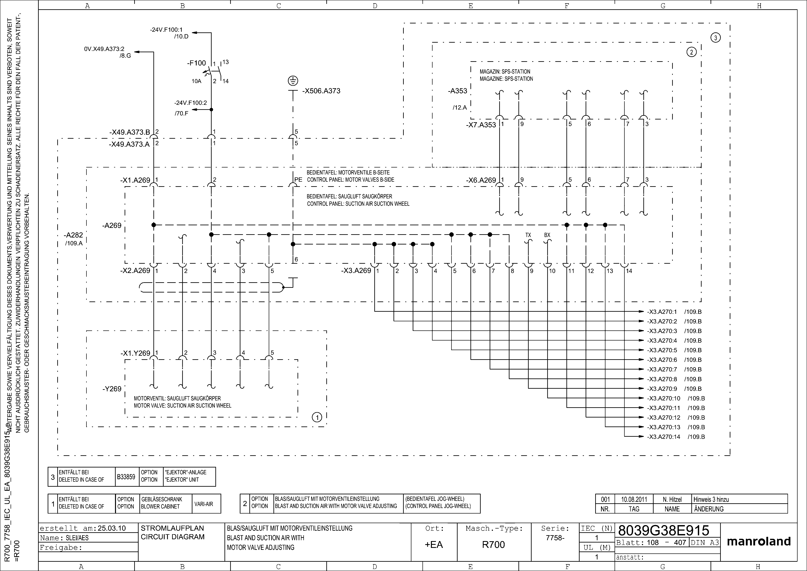

# +EA — Sheet 108 of 407 — BLAS/SAUGLUFT MIT MOTORVENTILEINSTELLUNG

**BLAST AND SUCTION AIR WITH**

> Part of the manroland **R700** printing press IEC/UL circuit diagrams.
> Drawing class: **Stromlaufplan / Circuit diagram** (DIN A3).
> Document `+EA` covers the **Printing unit** machine section.

## At a glance

| Field | Value |
|---|---|
| Document | `+EA`  (8039G38E915) |
| Sheet | **108** of 407 |
| Section (DE) | BLAS/SAUGLUFT MIT MOTORVENTILEINSTELLUNG |
| Section (EN) | BLAST AND SUCTION AIR WITH |
| Section type | CIRCUIT — Circuit diagram |
| Machine type | `R700` |
| Series | `7758` |
| Created | 25.03.10 |
| Replaces | — |
| Columns used | A, B, C, D, E, F, G, H |
| Path numbers | — |
| Labels on sheet | 145 |
| Cross-refs out | 19 |
| Cross-refs in | 64 |

**Previous:** [+EA sheet 107](SHEET_0107.md) · **Next:** [+EA sheet 109](SHEET_0109.md) · **Document TOC:** [_TOC.md](_TOC.md)  (+EA) · **Master TOC:** [all sheets](../_MASTER_TOC.md)

## Sheet image (300 DPI, exact vector render)



_Rendered directly from the PDF vector layer at 300 DPI (1-bit), no OCR and no resampling. Use it to confirm anything ambiguous in the text below._

## Cross-references on this sheet

Each entry is a wire leaving this sheet. The printed token is `/sheet.column`; the link resolves to that sheet inside the same document.

| Ref | Target sheet | Col | Path | Destination on target | Target section | From col |
|---|---|---|---|---|---|---|
| `/10.D` | [+EA sheet 10](SHEET_0010.md) | D | — | 24V.F100:1 | SPANNUNGSVERSORGUNG: 400V, 24V | B |
| `/8.G` | [+EA sheet 8](SHEET_0008.md) | G | — | 0V.X49.A373:2 | SPANNUNGSVERSORGUNG: 400V, 24V | A |
| `/12.A` | [+EA sheet 12](SHEET_0012.md) | A | — | — | SPANNUNGSVERSORGUNG: 400V, 24V | E |
| `/70.F` | [+EA sheet 70](SHEET_0070.md) | F | — | — | AUSLEGERSTAPELMOTOR | B |
| `/109.A` | [+EA sheet 109](SHEET_0109.md) | A | — | — | BLAS/SAUGLUFT MIT MOTORVENTILEINSTELLUNG | A |
| `/109.B` | [+EA sheet 109](SHEET_0109.md) | B | — | X3.A270:1 | BLAS/SAUGLUFT MIT MOTORVENTILEINSTELLUNG | G |
| `/109.B` | [+EA sheet 109](SHEET_0109.md) | B | — | X3.A270:2 | BLAS/SAUGLUFT MIT MOTORVENTILEINSTELLUNG | G |
| `/109.B` | [+EA sheet 109](SHEET_0109.md) | B | — | X3.A270:3 | BLAS/SAUGLUFT MIT MOTORVENTILEINSTELLUNG | G |
| `/109.B` | [+EA sheet 109](SHEET_0109.md) | B | — | X3.A270:4 | BLAS/SAUGLUFT MIT MOTORVENTILEINSTELLUNG | G |
| `/109.B` | [+EA sheet 109](SHEET_0109.md) | B | — | X3.A270:5 | BLAS/SAUGLUFT MIT MOTORVENTILEINSTELLUNG | G |
| `/109.B` | [+EA sheet 109](SHEET_0109.md) | B | — | X3.A270:6 | BLAS/SAUGLUFT MIT MOTORVENTILEINSTELLUNG | G |
| `/109.B` | [+EA sheet 109](SHEET_0109.md) | B | — | X3.A270:7 | BLAS/SAUGLUFT MIT MOTORVENTILEINSTELLUNG | G |
| `/109.B` | [+EA sheet 109](SHEET_0109.md) | B | — | X3.A270:8 | BLAS/SAUGLUFT MIT MOTORVENTILEINSTELLUNG | G |
| `/109.B` | [+EA sheet 109](SHEET_0109.md) | B | — | X3.A270:9 | BLAS/SAUGLUFT MIT MOTORVENTILEINSTELLUNG | G |
| `/109.B` | [+EA sheet 109](SHEET_0109.md) | B | — | X3.A270:10 | BLAS/SAUGLUFT MIT MOTORVENTILEINSTELLUNG | G |
| `/109.B` | [+EA sheet 109](SHEET_0109.md) | B | — | X3.A270:11 | BLAS/SAUGLUFT MIT MOTORVENTILEINSTELLUNG | G |
| `/109.B` | [+EA sheet 109](SHEET_0109.md) | B | — | X3.A270:12 | BLAS/SAUGLUFT MIT MOTORVENTILEINSTELLUNG | G |
| `/109.B` | [+EA sheet 109](SHEET_0109.md) | B | — | X3.A270:13 | BLAS/SAUGLUFT MIT MOTORVENTILEINSTELLUNG | G |
| `/109.B` | [+EA sheet 109](SHEET_0109.md) | B | — | X3.A270:14 | BLAS/SAUGLUFT MIT MOTORVENTILEINSTELLUNG | G |

### Incoming references (sheets that point here)

Every other sheet that sends a wire to this one. `Back-ref` is the token printed on *that* sheet; `Path` is its line number.

| From sheet | Cols | Back-ref | Path | Refs | What continues there |
|---|---|---|---|---|---|
| [+EA#8](SHEET_0008.md) | G | `/8.G` | — | 1 | 0V.X49.A373:2 |
| [+EA#10](SHEET_0010.md) | D | `/10.D` | — | 1 | — |
| [+EA#12](SHEET_0012.md) | A | `/12.A` | — | 1 | — |
| [+EA#70](SHEET_0070.md) | F | `/70.F` | — | 1 | — |
| [+EA#109](SHEET_0109.md) | A, B | `/109.A`, `/109.B` | — | 15 | X3.A270:1; X3.A270:10; X3.A270:11; X3.A270:12; X3.A270:13; X3.A270:14; X3.A270:2; X3.A270:3; X3.A270:4; X3.A270:5; X3.A270:6; X3.A270:7; X3.A270:8; X3.A270:9 |
| [+EA#207](SHEET_0207.md) | H | `/207.H` | — | 3 | — |
| [+EA#222](SHEET_0222.md) | A | `/222.A` | — | 5 | — |
| [+EA#223](SHEET_0223.md) | F | `/223.F` | — | 5 | — |
| [+EA#232](SHEET_0232.md) | A | `/232.A` | — | 14 | — |
| [+EA#244](SHEET_0244.md) | B | `/244.B` | — | 6 | — |
| [+EA#247](SHEET_0247.md) | E | `/247.E` | — | 6 | — |
| [+EA#282](SHEET_0282.md) | C | `/282.C` | — | 6 | — |


## Devices on this sheet

| Tag | Class | Class meaning (IEC) | Col | Sub | Terminal | Sign |
|---|---|---|---|---|---|---|
| `A269` | A | Baugruppe / assembly, module, PC board | A | — | — | — |
| `Y269` | Y | Magnetventil / solenoid valve, actuator | A | — | — | — |
| `A282` | A | Baugruppe / assembly, module, PC board | A | — | — | — |
| `A353` | A | Baugruppe / assembly, module, PC board | E | — | — | — |
| `F100` | F | Schutz / protection device (fuse, circuit breaker) | B | — | — | — |
| `X1.A269` | — | cross-device reference | B | — | — | — |
| `X2.A269` | — | cross-device reference | B | — | — | — |
| `X1.Y269` | — | cross-device reference | B | — | — | — |
| `X3.A269` | — | cross-device reference | D | — | — | — |
| `X6.A269` | — | cross-device reference | E | — | — | — |
| `X7.A353` | — | cross-device reference | E | — | — | — |
| `X49.A373.B` | — | cross-device reference | A | — | — | — |
| `X49.A373.A` | — | cross-device reference | A | — | — | — |
| `X3.A270:13` | — | cross-device reference | G | — | 13 | — |
| `X3.A270:12` | — | cross-device reference | G | — | 12 | — |
| `X3.A270:11` | — | cross-device reference | G | — | 11 | — |
| `X3.A270:14` | — | cross-device reference | G | — | 14 | — |
| `X3.A270:10` | — | cross-device reference | G | — | 10 | — |
| `X3.A270:9` | — | cross-device reference | G | — | 9 | — |
| `X3.A270:3` | — | cross-device reference | G | — | 3 | — |
| `X3.A270:2` | — | cross-device reference | G | — | 2 | — |
| `X3.A270:1` | — | cross-device reference | G | — | 1 | — |
| `X3.A270:4` | — | cross-device reference | G | — | 4 | — |
| `X3.A270:5` | — | cross-device reference | G | — | 5 | — |
| `X3.A270:8` | — | cross-device reference | G | — | 8 | — |
| `X3.A270:7` | — | cross-device reference | G | — | 7 | — |
| `X3.A270:6` | — | cross-device reference | G | — | 6 | — |
| `NR.` | — | cross-device reference | F | — | — | — |
| `10.08.2011` | — | cross-device reference | G | — | — | — |
| `X506.A373` | — | cross-device reference | C | — | — | — |

## Potentials / nets

| Potential | Count | Columns | Attached devices | Terminals |
|---|---|---|---|---|
| `0V` | 1 | A | `A373`, `X49` | `2` |
| `24V` | 2 | B | `F100` | `1`, `2` |
| `PE` | 1 | C | — | — |


A potential such as `L24+/4` or `M24+` is a named supply/return rail; every place it appears on this sheet is electrically common.

## Wire-end annotations (grouped as printed)

A wire that continues elsewhere is annotated with a small cluster: the destination description, the path/line number `#NN`, and the `/sheet.column` cross reference. Each row below is one such cluster exactly as it is grouped on the drawing.

| Col | Y | Path | Cross-ref | Text on the wire |
|---|---|---|---|---|
| B | 40.0 | — | `/10.D` | `24V.F100:1` |
| H | 52.7 | — | — | `3` |
| A | 68.3 | — | `/8.G` | `0V.X49.A373:2` |
| G | 74.0 | — | — | `2` |
| B | 87.5 | — | — | `13` |
| B | 88.2 | — | — | `F100` |
| B | 90.3 | — | — | `1` |
| E | 102.7 | — | — | `MAGAZIN: SPS STATION MAGAZINE: SPS STATION` |
| B | 115.8 | — | — | `10A 2` |
| B | 115.8 | — | — | `14` |
| C | 129.3 | — | — | `X506.A373` |
| E | 129.3 | — | — | `A353` |
| B | 147.7 | — | — | `24V.F100:2` |
| E | 154.7 | — | `/12.A` | — |
| B | 163.2 | — | `/70.F` | — |
| F | 178.9 | — | — | `X7.A353 1 9 5 6 7` |
| G | 178.9 | — | — | `3` |
| A | 190.2 | — | — | `X49.A373.B 2` |
| B | 190.2 | — | — | `1` |
| C | 190.2 | — | — | `5` |
| A | 207.2 | — | — | `X49.A373.A 2` |
| B | 207.2 | — | — | `1` |
| C | 207.2 | — | — | `5` |
| D | 251.5 | — | — | `BEDIENTAFEL: MOTORVENTILE B SEITE` |
| C | 261.0 | — | — | `PE` |
| B | 261.1 | — | — | `X1.A269 1` |
| B | 261.1 | — | — | `2` |
| E | 261.1 | — | — | `CONTROL PANEL: MOTOR VALVES B SIDE X6.A269 1 9 5 6 7 3` |
| D | 286.9 | — | — | `BEDIENTAFEL: SAUGLUFT SAUGKÖRPER` |
| D | 297.6 | — | — | `CONTROL PANEL: SUCTION AIR SUCTION WHEEL` |
| A | 327.7 | — | — | `A269` |
| A | 341.9 | — | — | `A282` |
| F | 343.5 | — | — | `TX BX` |
| A | 354.9 | — | `/109.A` | — |
| C | 378.8 | — | — | `6` |
| B | 394.3 | — | — | `X2.A269 1` |
| E | 394.3 | — | — | `X3.A269 1 2 3 4 5 7 8 9 10 11 12 13 14` |
| B | 395.8 | — | — | `2 4 3` |
| C | 395.8 | — | — | `5` |
| E | 395.8 | — | — | `6` |
| G | 455.9 | — | `/109.B` | `X3.A270:1` |
| G | 470.1 | — | `/109.B` | `X3.A270:2` |
| G | 484.3 | — | `/109.B` | `X3.A270:3` |
| G | 498.4 | — | `/109.B` | `X3.A270:4` |
| G | 512.6 | — | `/109.B` | `X3.A270:5` |
| B | 516.2 | — | — | `X1.Y269 1` |
| B | 516.2 | — | — | `2 3 4 5` |
| G | 526.8 | — | `/109.B` | `X3.A270:6` |
| G | 541.0 | — | `/109.B` | `X3.A270:7` |
| G | 555.1 | — | `/109.B` | `X3.A270:8` |
| A | 568.7 | — | — | `Y269` |
| G | 569.3 | — | `/109.B` | `X3.A270:9` |
| G | 583.5 | — | `/109.B` | `X3.A270:10` |
| B | 584.6 | — | — | `MOTORVENTIL: SAUGLUFT SAUGKÖRPER MOTOR VALVE: SUCTION AIR SUCTION WHEEL` |
| G | 597.7 | — | `/109.B` | `X3.A270:11` |
| G | 611.8 | — | `/109.B` | `X3.A270:12` |
| C | 612.1 | — | — | `1` |
| G | 626.0 | — | `/109.B` | `X3.A270:13` |
| G | 640.2 | — | `/109.B` | `X3.A270:14` |
| A | 693.7 | — | — | `3 ENTFÄLLT BEI DELETED IN CASE OF B33859` |
| B | 693.7 | — | — | `OPTION OPTION` |
| B | 693.7 | — | — | `"EJEKTOR" ANLAGE "EJEKTOR" UNIT` |
| C | 732.6 | — | — | `2 OPTION OPTION` |
| E | 732.6 | — | — | `(BEDIENTAFEL JOG WHEEL) (CONTROL PANEL JOG WHEEL)` |
| D | 732.7 | — | — | `ENTFÄLLT BEI DELETED IN CASE OF 001 10.08.2011 N. Hitzel Hinweis 3 hinzu` |
| D | 732.7 | — | — | `BLAS/SAUGLUFT MIT MOTORVENTILEINSTELLUNG BLAST AND SUCTION AIR WITH MOTOR VALVE ADJUSTING` |
| A | 733.4 | — | — | `1 BLOWER CABINET GEBLÄSESCHRANK VARI AIR` |
| A | 733.4 | — | — | `OPTION OPTION` |
| G | 747.0 | — | — | `NR. TAG NAME ÄNDERUNG` |


## Reconstructed tables

This sheet carries tabular content (pin map / terminal assignment / index). The grid below was rebuilt from the drawing's own rule lines, so each row is exactly one physical row of the table.

### Table 1 — 1 data rows × 5 columns (at x=226.8, y=204.1)

| 2 1 |  | 1 2 |  |  |
|---|---|---|---|---|
| `1` | `2` | `4` | `3` | `5` |


### Table 2 — 1 data rows × 2 columns (at x=552.8, y=34.0)

| B SEITE B SIDE SAUGKÖRPER SUCTION | WHEEL |
|---|---|
| `1` | `2` |


### Table 3 — 3 data rows × 14 columns (at x=609.4, y=34.0)

|  |  | A353 /12.A | X7.A353 | MAGAZIN: MAGAZINE: | 1 | SPS STATION | SPS STATION 9 |  |  | 5 | 6 |  | 7 |
|---|---|---|---|---|---|---|---|---|---|---|---|---|---|
|  |  |  | `X6.A269` |  | `1` |  | `9` |  |  | `5` | `6` |  | `7` |
|  |  |  |  |  |  |  | `TX` | `BX` |  |  |  |  |  |
| `3` | `4` | `5` | `6` | `7` |  | `8` |  | `9` | `10` | `11` | `12` | `13` | `14` |


## Notes and free text on this sheet

| Text | Col | Y (pt) |
|---|---|---|
| `BEDIENTAFEL: SAUGLUFT SAUGKÖRPER` | D | 286.92 |
| `CONTROL PANEL: SUCTION AIR SUCTION WHEEL` | D | 297.56 |
| `MOTORVENTIL: SAUGLUFT SAUGKÖRPER` | B | 584.57 |
| `MOTOR VALVE: SUCTION AIR SUCTION WHEEL` | B | 595.19 |
| `BEDIENTAFEL: MOTORVENTILE B SEITE` | D | 251.48 |
| `CONTROL PANEL: MOTOR VALVES B SIDE` | D | 262.13 |
| `MAGAZIN: SPS STATION` | E | 102.66 |
| `MAGAZINE: SPS STATION` | E | 113.29 |
| `10A` | B | 116.04 |
| `TAG` | G | 747.05 |
| `NAME` | G | 747.05 |
| `ÄNDERUNG` | G | 747.11 |
| `N. Hitzel` | G | 733.02 |
| `Hinweis 3 hinzu` | H | 732.98 |
| `ENTFÄLLT BEI` | A | 733.35 |
| `DELETED IN CASE OF` | A | 744 |
| `OPTION` | A | 733.35 |
| `GEBLÄSESCHRANK` | B | 733.39 |
| `BLOWER CABINET` | B | 743.97 |
| `VARI AIR` | B | 740.46 |
| `TX` | F | 343.58 |
| `BX` | F | 343.5 |
| `OPTION` | C | 732.64 |
| `BLAS/SAUGLUFT MIT MOTORVENTILEINSTELLUNG` | D | 732.68 |
| `BLAST AND SUCTION AIR WITH MOTOR VALVE ADJUSTING` | D | 743.3 |
| `(BEDIENTAFEL JOG WHEEL)` | E | 732.65 |
| `(CONTROL PANEL JOG WHEEL)` | E | 743.3 |
| `B33859` | A | 699.55 |
| `OPTION` | B | 693.67 |
| `"EJEKTOR" ANLAGE` | B | 693.69 |
| `"EJEKTOR" UNIT` | B | 704.32 |

## Complete label inventory (exact text from the drawing)

Every text object inside the drawing area of this sheet, in DIN reading order (column A→H, then top→bottom). This is the authoritative list: if a string is not here it is not printed on this sheet.

| Col | Y | X | Dir | Type | Text |
|---|---|---|---|---|---|
| A | 68.3 | 124.2 | → | potential | `0V.X49.A373:2` |
| A | 78.2 | 176.6 | → | cross-reference | `/8.G` |
| A | 190.2 | 161.6 | → | device ref | `X49.A373.B` |
| A | 207.9 | 160.7 | → | device ref | `X49.A373.A` |
| A | 327.7 | 150.8 | → | device tag | `A269` |
| A | 341.9 | 94.1 | → | device tag | `A282` |
| A | 354.9 | 96.4 | → | cross-reference | `/109.A` |
| A | 568.7 | 151.4 | → | device tag | `Y269` |
| A | 693.7 | 87.0 | → | text | `ENTFÄLLT BEI` |
| A | 699.0 | 75.0 | → | number | `3` |
| A | 699.5 | 172.8 | → | text | `B33859` |
| A | 704.3 | 87.0 | → | text | `DELETED IN CASE OF` |
| A | 733.3 | 87.0 | → | text | `ENTFÄLLT BEI` |
| A | 733.4 | 173.3 | → | text | `OPTION` |
| A | 738.7 | 75.4 | → | number | `1` |
| A | 744.0 | 87.0 | → | text | `DELETED IN CASE OF` |
| A | 744.0 | 173.3 | → | text | `OPTION` |
| B | 40.0 | 221.4 | → | potential | `24V.F100:1` |
| B | 49.9 | 257.1 | → | cross-reference | `/10.D` |
| B | 87.5 | 328.0 | → | number | `13` |
| B | 88.2 | 276.1 | → | device tag | `F100` |
| B | 90.3 | 313.8 | → | number | `1` |
| B | 115.8 | 314.4 | → | number | `2` |
| B | 115.8 | 328.0 | → | number | `14` |
| B | 116.0 | 282.6 | → | text | `10A` |
| B | 147.7 | 257.1 | → | potential | `24V.F100:2` |
| B | 163.3 | 258.0 | → | cross-reference | `/70.F` |
| B | 190.2 | 229.3 | → | number | `2` |
| B | 190.2 | 313.8 | → | number | `1` |
| B | 207.3 | 229.3 | → | number | `2` |
| B | 207.3 | 313.8 | → | number | `1` |
| B | 261.1 | 177.4 | → | device ref | `X1.A269` |
| B | 261.1 | 228.8 | → | number | `1` |
| B | 261.1 | 314.4 | → | number | `2` |
| B | 394.3 | 177.4 | → | device ref | `X2.A269` |
| B | 395.8 | 228.8 | → | number | `1` |
| B | 395.8 | 271.8 | → | number | `2` |
| B | 395.8 | 314.4 | → | number | `4` |
| B | 516.2 | 228.8 | → | number | `1` |
| B | 516.2 | 271.8 | → | number | `2` |
| B | 516.2 | 314.4 | → | number | `3` |
| B | 516.3 | 178.0 | → | device ref | `X1.Y269` |
| B | 584.6 | 197.9 | → | text | `MOTORVENTIL: SAUGLUFT SAUGKÖRPER` |
| B | 595.2 | 197.9 | → | text | `MOTOR VALVE: SUCTION AIR SUCTION WHEEL` |
| B | 693.7 | 208.1 | → | text | `OPTION` |
| B | 693.7 | 243.5 | → | text | `"EJEKTOR" ANLAGE` |
| B | 704.3 | 208.1 | → | text | `OPTION` |
| B | 704.3 | 243.5 | → | text | `"EJEKTOR" UNIT` |
| B | 733.4 | 208.8 | → | text | `GEBLÄSESCHRANK` |
| B | 740.5 | 287.0 | → | text | `VARI AIR` |
| B | 744.0 | 208.2 | → | text | `BLOWER CABINET` |
| C | 129.3 | 446.2 | → | device ref | `X506.A373` |
| C | 190.2 | 434.8 | → | number | `5` |
| C | 207.3 | 434.8 | → | number | `5` |
| C | 261.0 | 434.3 | → | potential | `PE` |
| C | 378.7 | 434.8 | → | number | `6` |
| C | 395.8 | 356.9 | → | number | `3` |
| C | 395.8 | 399.4 | → | number | `5` |
| C | 516.2 | 356.9 | → | number | `4` |
| C | 516.2 | 399.4 | → | number | `5` |
| C | 612.1 | 466.0 | → | number | `1` |
| C | 732.6 | 371.1 | → | text | `OPTION` |
| C | 738.0 | 358.6 | → | number | `2` |
| C | 743.3 | 371.1 | → | text | `OPTION` |
| D | 251.5 | 452.7 | → | text | `BEDIENTAFEL: MOTORVENTILE B SEITE` |
| D | 262.1 | 453.3 | → | text | `CONTROL PANEL: MOTOR VALVES B SIDE` |
| D | 286.9 | 452.7 | → | text | `BEDIENTAFEL: SAUGLUFT SAUGKÖRPER` |
| D | 297.6 | 453.3 | → | text | `CONTROL PANEL: SUCTION AIR SUCTION WHEEL` |
| D | 394.3 | 503.4 | → | device ref | `X3.A269` |
| D | 395.8 | 554.7 | → | number | `1` |
| D | 395.8 | 583.7 | → | number | `2` |
| D | 395.8 | 612.0 | → | number | `3` |
| D | 732.7 | 405.9 | → | text | `BLAS/SAUGLUFT MIT MOTORVENTILEINSTELLUNG` |
| D | 743.3 | 405.9 | → | text | `BLAST AND SUCTION AIR WITH MOTOR VALVE ADJUSTING` |
| E | 102.7 | 708.1 | → | text | `MAGAZIN: SPS STATION` |
| E | 113.3 | 708.1 | → | text | `MAGAZINE: SPS STATION` |
| E | 129.3 | 661.0 | → | device tag | `A353` |
| E | 154.7 | 668.1 | → | cross-reference | `/12.A` |
| E | 178.9 | 739.0 | → | number | `1` |
| E | 179.6 | 687.7 | → | device ref | `X7.A353` |
| E | 261.1 | 687.7 | → | device ref | `X6.A269` |
| E | 261.1 | 739.0 | → | number | `1` |
| E | 395.8 | 640.3 | → | number | `4` |
| E | 395.8 | 668.7 | → | number | `5` |
| E | 395.8 | 697.0 | → | number | `6` |
| E | 395.8 | 725.4 | → | number | `7` |
| E | 395.8 | 753.7 | → | number | `8` |
| E | 732.7 | 598.3 | → | text | `(BEDIENTAFEL JOG WHEEL)` |
| E | 743.3 | 598.3 | → | text | `(CONTROL PANEL JOG WHEEL)` |
| F | 178.9 | 767.9 | → | number | `9` |
| F | 178.9 | 838.8 | → | number | `5` |
| F | 178.9 | 867.1 | → | number | `6` |
| F | 261.1 | 767.9 | → | number | `9` |
| F | 261.1 | 838.8 | → | number | `5` |
| F | 261.1 | 867.1 | → | number | `6` |
| F | 343.5 | 803.1 | → | text | `BX` |
| F | 343.6 | 775.3 | → | text | `TX` |
| F | 395.8 | 782.1 | → | number | `9` |
| F | 395.8 | 809.9 | → | number | `10` |
| F | 395.8 | 838.2 | → | number | `11` |
| F | 395.8 | 866.6 | → | number | `12` |
| F | 395.8 | 894.9 | → | number | `13` |
| F | 732.7 | 886.9 | → | number | `001` |
| F | 747.0 | 886.3 | → | device ref | `NR.` |
| G | 74.0 | 1018.5 | → | number | `2` |
| G | 178.9 | 923.8 | → | number | `7` |
| G | 178.9 | 952.2 | → | number | `3` |
| G | 261.1 | 923.8 | → | number | `7` |
| G | 261.1 | 952.2 | → | number | `3` |
| G | 395.8 | 923.2 | → | number | `14` |
| G | 455.9 | 955.0 | → | device ref | `X3.A270:1` |
| G | 455.9 | 1009.8 | → | cross-reference | `/109.B` |
| G | 470.1 | 955.0 | → | device ref | `X3.A270:2` |
| G | 470.1 | 1009.8 | → | cross-reference | `/109.B` |
| G | 484.3 | 955.0 | → | device ref | `X3.A270:3` |
| G | 484.3 | 1009.8 | → | cross-reference | `/109.B` |
| G | 498.5 | 955.0 | → | device ref | `X3.A270:4` |
| G | 498.5 | 1009.8 | → | cross-reference | `/109.B` |
| G | 512.6 | 955.0 | → | device ref | `X3.A270:5` |
| G | 512.6 | 1009.8 | → | cross-reference | `/109.B` |
| G | 526.8 | 955.0 | → | device ref | `X3.A270:6` |
| G | 526.8 | 1009.8 | → | cross-reference | `/109.B` |
| G | 541.0 | 955.0 | → | device ref | `X3.A270:7` |
| G | 541.0 | 1009.8 | → | cross-reference | `/109.B` |
| G | 555.1 | 1009.8 | → | cross-reference | `/109.B` |
| G | 555.2 | 955.0 | → | device ref | `X3.A270:8` |
| G | 569.3 | 955.0 | → | device ref | `X3.A270:9` |
| G | 569.3 | 1009.8 | → | cross-reference | `/109.B` |
| G | 583.5 | 955.0 | → | device ref | `X3.A270:10` |
| G | 583.5 | 1014.8 | → | cross-reference | `/109.B` |
| G | 597.7 | 955.0 | → | device ref | `X3.A270:11` |
| G | 597.7 | 1014.8 | → | cross-reference | `/109.B` |
| G | 611.8 | 1014.8 | → | cross-reference | `/109.B` |
| G | 611.9 | 955.0 | → | device ref | `X3.A270:12` |
| G | 626.0 | 955.0 | → | device ref | `X3.A270:13` |
| G | 626.0 | 1014.8 | → | cross-reference | `/109.B` |
| G | 640.2 | 955.0 | → | device ref | `X3.A270:14` |
| G | 640.2 | 1014.8 | → | cross-reference | `/109.B` |
| G | 732.8 | 916.5 | → | device ref | `10.08.2011` |
| G | 733.0 | 978.1 | → | text | `N. Hitzel` |
| G | 747.0 | 980.9 | → | text | `NAME` |
| G | 747.1 | 927.7 | → | text | `TAG` |
| G | 747.1 | 1024.4 | → | text | `ÄNDERUNG` |
| H | 52.7 | 1053.9 | → | number | `3` |
| H | 733.0 | 1023.3 | → | text | `Hinweis 3 hinzu` |

## Reading-order text block

The same content as a plain block, grouped by DIN column — convenient to paste or to match against a visual description.

```text
=== Column A ===
  68.3  124.2  net          0V.X49.A373:2
  78.2  176.6  xref         /8.G
 190.2  161.6  devref       X49.A373.B
 207.9  160.7  devref       X49.A373.A
 327.7  150.8  devtag       A269
 341.9   94.1  devtag       A282
 354.9   96.4  xref         /109.A
 568.7  151.4  devtag       Y269
 693.7   87.0  text         ENTFÄLLT BEI
 699.0   75.0  numeric      3
 699.5  172.8  text         B33859
 704.3   87.0  text         DELETED IN CASE OF
 733.3   87.0  text         ENTFÄLLT BEI
 733.4  173.3  text         OPTION
 738.7   75.4  numeric      1
 744.0   87.0  text         DELETED IN CASE OF
 744.0  173.3  text         OPTION
=== Column B ===
  40.0  221.4  net          24V.F100:1
  49.9  257.1  xref         /10.D
  87.5  328.0  numeric      13
  88.2  276.1  devtag       F100
  90.3  313.8  numeric      1
 115.8  314.4  numeric      2
 115.8  328.0  numeric      14
 116.0  282.6  text         10A
 147.7  257.1  net          24V.F100:2
 163.3  258.0  xref         /70.F
 190.2  229.3  numeric      2
 190.2  313.8  numeric      1
 207.3  229.3  numeric      2
 207.3  313.8  numeric      1
 261.1  177.4  devref       X1.A269
 261.1  228.8  numeric      1
 261.1  314.4  numeric      2
 394.3  177.4  devref       X2.A269
 395.8  228.8  numeric      1
 395.8  271.8  numeric      2
 395.8  314.4  numeric      4
 516.2  228.8  numeric      1
 516.2  271.8  numeric      2
 516.2  314.4  numeric      3
 516.3  178.0  devref       X1.Y269
 584.6  197.9  text         MOTORVENTIL: SAUGLUFT SAUGKÖRPER
 595.2  197.9  text         MOTOR VALVE: SUCTION AIR SUCTION WHEEL
 693.7  208.1  text         OPTION
 693.7  243.5  text         "EJEKTOR" ANLAGE
 704.3  208.1  text         OPTION
 704.3  243.5  text         "EJEKTOR" UNIT
 733.4  208.8  text         GEBLÄSESCHRANK
 740.5  287.0  text         VARI AIR
 744.0  208.2  text         BLOWER CABINET
=== Column C ===
 129.3  446.2  devref       X506.A373
 190.2  434.8  numeric      5
 207.3  434.8  numeric      5
 261.0  434.3  net          PE
 378.7  434.8  numeric      6
 395.8  356.9  numeric      3
 395.8  399.4  numeric      5
 516.2  356.9  numeric      4
 516.2  399.4  numeric      5
 612.1  466.0  numeric      1
 732.6  371.1  text         OPTION
 738.0  358.6  numeric      2
 743.3  371.1  text         OPTION
=== Column D ===
 251.5  452.7  text         BEDIENTAFEL: MOTORVENTILE B SEITE
 262.1  453.3  text         CONTROL PANEL: MOTOR VALVES B SIDE
 286.9  452.7  text         BEDIENTAFEL: SAUGLUFT SAUGKÖRPER
 297.6  453.3  text         CONTROL PANEL: SUCTION AIR SUCTION WHEEL
 394.3  503.4  devref       X3.A269
 395.8  554.7  numeric      1
 395.8  583.7  numeric      2
 395.8  612.0  numeric      3
 732.7  405.9  text         BLAS/SAUGLUFT MIT MOTORVENTILEINSTELLUNG
 743.3  405.9  text         BLAST AND SUCTION AIR WITH MOTOR VALVE ADJUSTING
=== Column E ===
 102.7  708.1  text         MAGAZIN: SPS STATION
 113.3  708.1  text         MAGAZINE: SPS STATION
 129.3  661.0  devtag       A353
 154.7  668.1  xref         /12.A
 178.9  739.0  numeric      1
 179.6  687.7  devref       X7.A353
 261.1  687.7  devref       X6.A269
 261.1  739.0  numeric      1
 395.8  640.3  numeric      4
 395.8  668.7  numeric      5
 395.8  697.0  numeric      6
 395.8  725.4  numeric      7
 395.8  753.7  numeric      8
 732.7  598.3  text         (BEDIENTAFEL JOG WHEEL)
 743.3  598.3  text         (CONTROL PANEL JOG WHEEL)
=== Column F ===
 178.9  767.9  numeric      9
 178.9  838.8  numeric      5
 178.9  867.1  numeric      6
 261.1  767.9  numeric      9
 261.1  838.8  numeric      5
 261.1  867.1  numeric      6
 343.5  803.1  text         BX
 343.6  775.3  text         TX
 395.8  782.1  numeric      9
 395.8  809.9  numeric      10
 395.8  838.2  numeric      11
 395.8  866.6  numeric      12
 395.8  894.9  numeric      13
 732.7  886.9  numeric      001
 747.0  886.3  devref       NR.
=== Column G ===
  74.0 1018.5  numeric      2
 178.9  923.8  numeric      7
 178.9  952.2  numeric      3
 261.1  923.8  numeric      7
 261.1  952.2  numeric      3
 395.8  923.2  numeric      14
 455.9  955.0  devref       X3.A270:1
 455.9 1009.8  xref         /109.B
 470.1  955.0  devref       X3.A270:2
 470.1 1009.8  xref         /109.B
 484.3  955.0  devref       X3.A270:3
 484.3 1009.8  xref         /109.B
 498.5  955.0  devref       X3.A270:4
 498.5 1009.8  xref         /109.B
 512.6  955.0  devref       X3.A270:5
 512.6 1009.8  xref         /109.B
 526.8  955.0  devref       X3.A270:6
 526.8 1009.8  xref         /109.B
 541.0  955.0  devref       X3.A270:7
 541.0 1009.8  xref         /109.B
 555.1 1009.8  xref         /109.B
 555.2  955.0  devref       X3.A270:8
 569.3  955.0  devref       X3.A270:9
 569.3 1009.8  xref         /109.B
 583.5  955.0  devref       X3.A270:10
 583.5 1014.8  xref         /109.B
 597.7  955.0  devref       X3.A270:11
 597.7 1014.8  xref         /109.B
 611.8 1014.8  xref         /109.B
 611.9  955.0  devref       X3.A270:12
 626.0  955.0  devref       X3.A270:13
 626.0 1014.8  xref         /109.B
 640.2  955.0  devref       X3.A270:14
 640.2 1014.8  xref         /109.B
 732.8  916.5  devref       10.08.2011
 733.0  978.1  text         N. Hitzel
 747.0  980.9  text         NAME
 747.1  927.7  text         TAG
 747.1 1024.4  text         ÄNDERUNG
=== Column H ===
  52.7 1053.9  numeric      3
 733.0 1023.3  text         Hinweis 3 hinzu
```

---
_Generated from the PDF vector text layer; no OCR. Source: `R700_7758_IEC_UL_EA_8039G38E915_p`, sheet 108._
