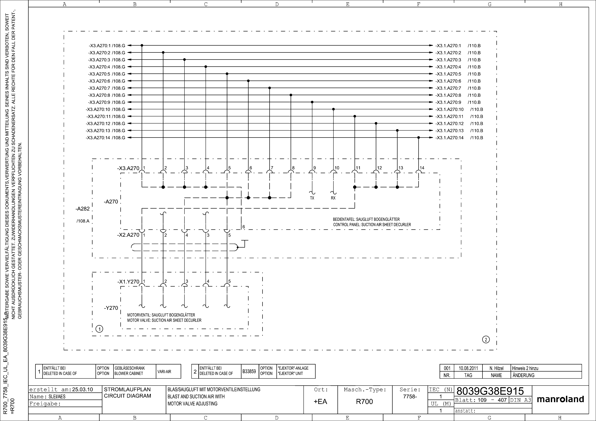

# +EA — Sheet 109 of 407 — BLAS/SAUGLUFT MIT MOTORVENTILEINSTELLUNG

**BLAST AND SUCTION AIR WITH**

> Part of the manroland **R700** printing press IEC/UL circuit diagrams.
> Drawing class: **Stromlaufplan / Circuit diagram** (DIN A3).
> Document `+EA` covers the **Printing unit** machine section.

## At a glance

| Field | Value |
|---|---|
| Document | `+EA`  (8039G38E915) |
| Sheet | **109** of 407 |
| Section (DE) | BLAS/SAUGLUFT MIT MOTORVENTILEINSTELLUNG |
| Section (EN) | BLAST AND SUCTION AIR WITH |
| Section type | CIRCUIT — Circuit diagram |
| Machine type | `R700` |
| Series | `7758` |
| Created | 25.03.10 |
| Replaces | — |
| Columns used | A, B, C, D, E, F, G, H |
| Path numbers | — |
| Labels on sheet | 120 |
| Cross-refs out | 29 |
| Cross-refs in | 53 |

**Previous:** [+EA sheet 108](SHEET_0108.md) · **Next:** [+EA sheet 110](SHEET_0110.md) · **Document TOC:** [_TOC.md](_TOC.md)  (+EA) · **Master TOC:** [all sheets](../_MASTER_TOC.md)

## Sheet image (300 DPI, exact vector render)



_Rendered directly from the PDF vector layer at 300 DPI (1-bit), no OCR and no resampling. Use it to confirm anything ambiguous in the text below._

## Cross-references on this sheet

Each entry is a wire leaving this sheet. The printed token is `/sheet.column`; the link resolves to that sheet inside the same document.

| Ref | Target sheet | Col | Path | Destination on target | Target section | From col |
|---|---|---|---|---|---|---|
| `/110.B` | [+EA sheet 110](SHEET_0110.md) | B | — | X3.1.A270:1 | BLAS/SAUGLUFT MIT MOTORVENTILEINSTELLUNG | G |
| `/108.G` | [+EA sheet 108](SHEET_0108.md) | G | — | X3.A270:1 | BLAS/SAUGLUFT MIT MOTORVENTILEINSTELLUNG | B |
| `/110.B` | [+EA sheet 110](SHEET_0110.md) | B | — | X3.1.A270:2 | BLAS/SAUGLUFT MIT MOTORVENTILEINSTELLUNG | G |
| `/108.G` | [+EA sheet 108](SHEET_0108.md) | G | — | X3.A270:2 | BLAS/SAUGLUFT MIT MOTORVENTILEINSTELLUNG | B |
| `/110.B` | [+EA sheet 110](SHEET_0110.md) | B | — | X3.1.A270:3 | BLAS/SAUGLUFT MIT MOTORVENTILEINSTELLUNG | G |
| `/108.G` | [+EA sheet 108](SHEET_0108.md) | G | — | X3.A270:3 | BLAS/SAUGLUFT MIT MOTORVENTILEINSTELLUNG | B |
| `/110.B` | [+EA sheet 110](SHEET_0110.md) | B | — | X3.1.A270:4 | BLAS/SAUGLUFT MIT MOTORVENTILEINSTELLUNG | G |
| `/108.G` | [+EA sheet 108](SHEET_0108.md) | G | — | X3.A270:4 | BLAS/SAUGLUFT MIT MOTORVENTILEINSTELLUNG | B |
| `/110.B` | [+EA sheet 110](SHEET_0110.md) | B | — | X3.1.A270:5 | BLAS/SAUGLUFT MIT MOTORVENTILEINSTELLUNG | G |
| `/108.G` | [+EA sheet 108](SHEET_0108.md) | G | — | X3.A270:5 | BLAS/SAUGLUFT MIT MOTORVENTILEINSTELLUNG | B |
| `/110.B` | [+EA sheet 110](SHEET_0110.md) | B | — | X3.1.A270:6 | BLAS/SAUGLUFT MIT MOTORVENTILEINSTELLUNG | G |
| `/108.G` | [+EA sheet 108](SHEET_0108.md) | G | — | X3.A270:6 | BLAS/SAUGLUFT MIT MOTORVENTILEINSTELLUNG | B |
| `/110.B` | [+EA sheet 110](SHEET_0110.md) | B | — | X3.1.A270:7 | BLAS/SAUGLUFT MIT MOTORVENTILEINSTELLUNG | G |
| `/108.G` | [+EA sheet 108](SHEET_0108.md) | G | — | X3.A270:7 | BLAS/SAUGLUFT MIT MOTORVENTILEINSTELLUNG | B |
| `/110.B` | [+EA sheet 110](SHEET_0110.md) | B | — | X3.1.A270:8 | BLAS/SAUGLUFT MIT MOTORVENTILEINSTELLUNG | G |
| `/108.G` | [+EA sheet 108](SHEET_0108.md) | G | — | X3.A270:8 | BLAS/SAUGLUFT MIT MOTORVENTILEINSTELLUNG | B |
| `/110.B` | [+EA sheet 110](SHEET_0110.md) | B | — | X3.1.A270:9 | BLAS/SAUGLUFT MIT MOTORVENTILEINSTELLUNG | G |
| `/108.G` | [+EA sheet 108](SHEET_0108.md) | G | — | X3.A270:9 | BLAS/SAUGLUFT MIT MOTORVENTILEINSTELLUNG | B |
| `/110.B` | [+EA sheet 110](SHEET_0110.md) | B | — | X3.1.A270:10 | BLAS/SAUGLUFT MIT MOTORVENTILEINSTELLUNG | G |
| `/108.G` | [+EA sheet 108](SHEET_0108.md) | G | — | X3.A270:10 | BLAS/SAUGLUFT MIT MOTORVENTILEINSTELLUNG | B |
| `/110.B` | [+EA sheet 110](SHEET_0110.md) | B | — | X3.1.A270:11 | BLAS/SAUGLUFT MIT MOTORVENTILEINSTELLUNG | G |
| `/108.G` | [+EA sheet 108](SHEET_0108.md) | G | — | X3.A270:11 | BLAS/SAUGLUFT MIT MOTORVENTILEINSTELLUNG | B |
| `/110.B` | [+EA sheet 110](SHEET_0110.md) | B | — | X3.1.A270:12 | BLAS/SAUGLUFT MIT MOTORVENTILEINSTELLUNG | G |
| `/108.G` | [+EA sheet 108](SHEET_0108.md) | G | — | X3.A270:12 | BLAS/SAUGLUFT MIT MOTORVENTILEINSTELLUNG | B |
| `/110.B` | [+EA sheet 110](SHEET_0110.md) | B | — | X3.1.A270:13 | BLAS/SAUGLUFT MIT MOTORVENTILEINSTELLUNG | G |
| `/108.G` | [+EA sheet 108](SHEET_0108.md) | G | — | X3.A270:13 | BLAS/SAUGLUFT MIT MOTORVENTILEINSTELLUNG | B |
| `/110.B` | [+EA sheet 110](SHEET_0110.md) | B | — | X3.1.A270:14 | BLAS/SAUGLUFT MIT MOTORVENTILEINSTELLUNG | G |
| `/108.G` | [+EA sheet 108](SHEET_0108.md) | G | — | X3.A270:14 | BLAS/SAUGLUFT MIT MOTORVENTILEINSTELLUNG | B |
| `/108.A` | [+EA sheet 108](SHEET_0108.md) | A | — | — | BLAS/SAUGLUFT MIT MOTORVENTILEINSTELLUNG | A |

### Incoming references (sheets that point here)

Every other sheet that sends a wire to this one. `Back-ref` is the token printed on *that* sheet; `Path` is its line number.

| From sheet | Cols | Back-ref | Path | Refs | What continues there |
|---|---|---|---|---|---|
| [+EA#108](SHEET_0108.md) | A, G | `/108.A`, `/108.G` | — | 15 | X3.A270:1; X3.A270:10; X3.A270:11; X3.A270:12; X3.A270:13; X3.A270:14; X3.A270:2; X3.A270:3; X3.A270:4; X3.A270:5; X3.A270:6; X3.A270:7; X3.A270:8; X3.A270:9 |
| [+EA#110](SHEET_0110.md) | B | `/110.B` | — | 14 | X3.1.A270:1; X3.1.A270:10; X3.1.A270:11; X3.1.A270:12; X3.1.A270:13; X3.1.A270:14; X3.1.A270:2; X3.1.A270:3; X3.1.A270:4; X3.1.A270:5; X3.1.A270:6; X3.1.A270:7; |
| [+EA#222](SHEET_0222.md) | B | `/222.B` | — | 5 | — |
| [+EA#223](SHEET_0223.md) | F | `/223.F` | — | 5 | — |
| [+EA#232](SHEET_0232.md) | B | `/232.B` | — | 14 | — |


## Devices on this sheet

| Tag | Class | Class meaning (IEC) | Col | Sub | Terminal | Sign |
|---|---|---|---|---|---|---|
| `A270` | A | Baugruppe / assembly, module, PC board | B | — | — | — |
| `A282` | A | Baugruppe / assembly, module, PC board | A | — | — | — |
| `Y270` | Y | Magnetventil / solenoid valve, actuator | B | — | — | — |
| `X3.A270` | — | cross-device reference | B | — | — | — |
| `X2.A270` | — | cross-device reference | B | — | — | — |
| `X1.Y270` | — | cross-device reference | B | — | — | — |
| `X3.1.A270:4` | — | cross-device reference | F | — | 4 | — |
| `X3.1.A270:3` | — | cross-device reference | F | — | 3 | — |
| `X3.1.A270:2` | — | cross-device reference | F | — | 2 | — |
| `X3.1.A270:1` | — | cross-device reference | F | — | 1 | — |
| `X3.1.A270:5` | — | cross-device reference | F | — | 5 | — |
| `X3.1.A270:9` | — | cross-device reference | F | — | 9 | — |
| `X3.1.A270:8` | — | cross-device reference | F | — | 8 | — |
| `X3.1.A270:7` | — | cross-device reference | F | — | 7 | — |
| `X3.1.A270:6` | — | cross-device reference | F | — | 6 | — |
| `X3.A270:14` | — | cross-device reference | A | — | 14 | — |
| `X3.A270:13` | — | cross-device reference | A | — | 13 | — |
| `X3.A270:12` | — | cross-device reference | A | — | 12 | — |
| `X3.A270:11` | — | cross-device reference | A | — | 11 | — |
| `X3.A270:10` | — | cross-device reference | A | — | 10 | — |
| `X3.A270:4` | — | cross-device reference | A | — | 4 | — |
| `X3.A270:3` | — | cross-device reference | A | — | 3 | — |
| `X3.A270:2` | — | cross-device reference | A | — | 2 | — |
| `X3.A270:1` | — | cross-device reference | B | — | 1 | — |
| `X3.A270:5` | — | cross-device reference | A | — | 5 | — |
| `X3.A270:9` | — | cross-device reference | A | — | 9 | — |
| `X3.A270:8` | — | cross-device reference | A | — | 8 | — |
| `X3.A270:7` | — | cross-device reference | A | — | 7 | — |
| `X3.A270:6` | — | cross-device reference | A | — | 6 | — |
| `X3.1.A270:10` | — | cross-device reference | F | — | 10 | — |
| `X3.1.A270:11` | — | cross-device reference | F | — | 11 | — |
| `X3.1.A270:14` | — | cross-device reference | F | — | 14 | — |
| `X3.1.A270:13` | — | cross-device reference | F | — | 13 | — |
| `X3.1.A270:12` | — | cross-device reference | F | — | 12 | — |
| `NR.` | — | cross-device reference | F | — | — | — |
| `10.08.2011` | — | cross-device reference | G | — | — | — |

## Potentials / nets

_No named potentials on this sheet._

## Wire-end annotations (grouped as printed)

A wire that continues elsewhere is annotated with a small cluster: the destination description, the path/line number `#NN`, and the `/sheet.column` cross reference. Each row below is one such cluster exactly as it is grouped on the drawing.

| Col | Y | Path | Cross-ref | Text on the wire |
|---|---|---|---|---|
| G | 87.4 | — | `/110.B` | `X3.1.A270:1` |
| B | 87.5 | — | `/108.G` | `X3.A270:1` |
| B | 101.6 | — | `/108.G` | `X3.A270:2` |
| G | 101.6 | — | `/110.B` | `X3.1.A270:2` |
| B | 115.8 | — | `/108.G` | `X3.A270:3` |
| G | 115.8 | — | `/110.B` | `X3.1.A270:3` |
| G | 129.9 | — | `/110.B` | `X3.1.A270:4` |
| B | 130.0 | — | `/108.G` | `X3.A270:4` |
| B | 144.1 | — | `/108.G` | `X3.A270:5` |
| G | 144.1 | — | `/110.B` | `X3.1.A270:5` |
| B | 158.3 | — | `/108.G` | `X3.A270:6` |
| G | 158.3 | — | `/110.B` | `X3.1.A270:6` |
| B | 172.5 | — | `/108.G` | `X3.A270:7` |
| G | 172.5 | — | `/110.B` | `X3.1.A270:7` |
| G | 186.6 | — | `/110.B` | `X3.1.A270:8` |
| B | 186.7 | — | `/108.G` | `X3.A270:8` |
| B | 200.8 | — | `/108.G` | `X3.A270:9` |
| G | 200.8 | — | `/110.B` | `X3.1.A270:9` |
| B | 215.0 | — | `/108.G` | `X3.A270:10` |
| G | 215.0 | — | `/110.B` | `X3.1.A270:10` |
| B | 229.2 | — | `/108.G` | `X3.A270:11` |
| G | 229.2 | — | `/110.B` | `X3.1.A270:11` |
| B | 243.3 | — | `/108.G` | `X3.A270:12` |
| G | 243.3 | — | `/110.B` | `X3.1.A270:12` |
| B | 257.5 | — | `/108.G` | `X3.A270:13` |
| G | 257.5 | — | `/110.B` | `X3.1.A270:13` |
| B | 271.7 | — | `/108.G` | `X3.A270:14` |
| G | 271.7 | — | `/110.B` | `X3.1.A270:14` |
| B | 332.0 | — | — | `X3.A270 1 2` |
| D | 332.0 | — | — | `3 4 5 6 7 8 9 10 11 12 13 14` |
| E | 393.2 | — | — | `TX RX` |
| B | 398.6 | — | — | `A270` |
| A | 412.7 | — | — | `A282` |
| E | 435.7 | — | — | `BEDIENTAFEL: SAUGLUFT BOGENGLÄTTER` |
| A | 438.2 | — | `/108.A` | — |
| E | 446.4 | — | — | `CONTROL PANEL: SUCTION AIR SHEET DECURLER` |
| D | 449.6 | — | — | `6` |
| B | 465.2 | — | — | `X2.A270 1 2 4 3` |
| C | 466.6 | — | — | `5` |
| C | 558.8 | — | — | `X1.Y270 1 2 3 4 5` |
| B | 611.2 | — | — | `Y270` |
| B | 627.1 | — | — | `MOTORVENTIL: SAUGLUFT BOGENGLÄTTER MOTOR VALVE: SUCTION AIR SHEET DECURLER` |
| A | 654.6 | — | — | `1` |
| G | 676.4 | — | — | `2` |
| D | 732.7 | — | — | `1 ENTFÄLLT BEI DELETED IN CASE OF 001 10.08.2011 N. Hitzel Hinweis 2 hinzu` |
| B | 733.4 | — | — | `OPTION OPTION` |
| B | 733.4 | — | — | `BLOWER CABINET GEBLÄSESCHRANK VARI AIR` |
| C | 733.4 | — | — | `2 ENTFÄLLT BEI DELETED IN CASE OF B33859` |
| D | 733.4 | — | — | `OPTION OPTION` |
| D | 733.4 | — | — | `"EJEKTOR" ANLAGE "EJEKTOR" UNIT` |
| G | 747.0 | — | — | `NR. TAG NAME ÄNDERUNG` |


## Reconstructed tables

This sheet carries tabular content (pin map / terminal assignment / index). The grid below was rebuilt from the drawing's own rule lines, so each row is exactly one physical row of the table.

### Table 1 — 2 data rows × 14 columns (at x=283.5, y=90.7)

| 1 | 2 | 3 | 4 | 5 |  | 6 | 7 | 8 | 9 | 10 | 11 | 12 | 13 |
|---|---|---|---|---|---|---|---|---|---|---|---|---|---|
|  |  |  |  |  |  |  |  | `TX` | `RX` |  |  |  |  |
| `1` | `2` | `4` | `3` | `5` | `6` |  |  |  |  | `BEDIENTAFEL: CONTROL` | `SAUGLUFT PANEL: SUCTION` | `BOGENGLÄTTER AIR SHEET` | `DECURLER` |


## Notes and free text on this sheet

| Text | Col | Y (pt) |
|---|---|---|
| `BEDIENTAFEL: SAUGLUFT BOGENGLÄTTER` | E | 435.74 |
| `CONTROL PANEL: SUCTION AIR SHEET DECURLER` | E | 446.39 |
| `MOTORVENTIL: SAUGLUFT BOGENGLÄTTER` | B | 627.09 |
| `MOTOR VALVE: SUCTION AIR SHEET DECURLER` | B | 637.72 |
| `TAG` | G | 747.05 |
| `NAME` | G | 747.05 |
| `ÄNDERUNG` | G | 747.11 |
| `N. Hitzel` | G | 733.02 |
| `Hinweis 2 hinzu` | H | 732.98 |
| `ENTFÄLLT BEI` | A | 733.35 |
| `DELETED IN CASE OF` | A | 744 |
| `OPTION` | B | 733.35 |
| `GEBLÄSESCHRANK` | B | 733.39 |
| `BLOWER CABINET` | B | 743.97 |
| `VARI AIR` | B | 740.46 |
| `TX` | D | 393.18 |
| `RX` | E | 393.16 |
| `ENTFÄLLT BEI` | C | 733.35 |
| `DELETED IN CASE OF` | C | 744 |
| `B33859` | D | 739.23 |
| `OPTION` | D | 733.35 |
| `"EJEKTOR" ANLAGE` | D | 733.38 |
| `"EJEKTOR" UNIT` | D | 744.01 |

## Complete label inventory (exact text from the drawing)

Every text object inside the drawing area of this sheet, in DIN reading order (column A→H, then top→bottom). This is the authoritative list: if a string is not here it is not printed on this sheet.

| Col | Y | X | Dir | Type | Text |
|---|---|---|---|---|---|
| A | 101.6 | 176.3 | → | device ref | `X3.A270:2` |
| A | 115.8 | 176.0 | → | device ref | `X3.A270:3` |
| A | 130.0 | 176.0 | → | device ref | `X3.A270:4` |
| A | 144.1 | 176.0 | → | device ref | `X3.A270:5` |
| A | 158.3 | 176.0 | → | device ref | `X3.A270:6` |
| A | 172.5 | 176.0 | → | device ref | `X3.A270:7` |
| A | 186.7 | 176.0 | → | device ref | `X3.A270:8` |
| A | 200.8 | 176.0 | → | device ref | `X3.A270:9` |
| A | 215.0 | 171.2 | → | device ref | `X3.A270:10` |
| A | 229.2 | 172.6 | → | device ref | `X3.A270:11` |
| A | 243.4 | 171.5 | → | device ref | `X3.A270:12` |
| A | 257.5 | 171.2 | → | device ref | `X3.A270:13` |
| A | 271.7 | 171.2 | → | device ref | `X3.A270:14` |
| A | 412.7 | 150.8 | → | device tag | `A282` |
| A | 438.2 | 153.1 | → | cross-reference | `/108.A` |
| A | 654.6 | 196.7 | → | number | `1` |
| A | 733.3 | 87.0 | → | text | `ENTFÄLLT BEI` |
| A | 738.7 | 75.4 | → | number | `1` |
| A | 744.0 | 87.0 | → | text | `DELETED IN CASE OF` |
| B | 87.4 | 177.4 | → | device ref | `X3.A270:1` |
| B | 87.4 | 223.7 | → | cross-reference | `/108.G` |
| B | 101.6 | 223.7 | → | cross-reference | `/108.G` |
| B | 115.8 | 223.7 | → | cross-reference | `/108.G` |
| B | 130.0 | 223.7 | → | cross-reference | `/108.G` |
| B | 144.1 | 223.7 | → | cross-reference | `/108.G` |
| B | 158.3 | 223.7 | → | cross-reference | `/108.G` |
| B | 172.5 | 223.7 | → | cross-reference | `/108.G` |
| B | 186.7 | 223.7 | → | cross-reference | `/108.G` |
| B | 200.8 | 223.7 | → | cross-reference | `/108.G` |
| B | 215.0 | 223.7 | → | cross-reference | `/108.G` |
| B | 229.2 | 223.7 | → | cross-reference | `/108.G` |
| B | 243.4 | 223.7 | → | cross-reference | `/108.G` |
| B | 257.5 | 223.7 | → | cross-reference | `/108.G` |
| B | 271.7 | 223.7 | → | cross-reference | `/108.G` |
| B | 332.0 | 234.1 | → | device ref | `X3.A270` |
| B | 332.0 | 285.4 | → | number | `1` |
| B | 332.0 | 328.5 | → | number | `2` |
| B | 398.6 | 207.5 | → | device tag | `A270` |
| B | 465.2 | 234.1 | → | device ref | `X2.A270` |
| B | 466.6 | 285.4 | → | number | `1` |
| B | 466.6 | 328.5 | → | number | `2` |
| B | 558.7 | 285.4 | → | number | `1` |
| B | 558.7 | 328.5 | → | number | `2` |
| B | 558.8 | 234.7 | → | device ref | `X1.Y270` |
| B | 611.3 | 208.1 | → | device tag | `Y270` |
| B | 627.1 | 254.6 | → | text | `MOTORVENTIL: SAUGLUFT BOGENGLÄTTER` |
| B | 637.7 | 254.6 | → | text | `MOTOR VALVE: SUCTION AIR SHEET DECURLER` |
| B | 733.4 | 193.9 | → | text | `OPTION` |
| B | 733.4 | 229.3 | → | text | `GEBLÄSESCHRANK` |
| B | 740.5 | 314.6 | → | text | `VARI AIR` |
| B | 744.0 | 193.9 | → | text | `OPTION` |
| B | 744.0 | 228.8 | → | text | `BLOWER CABINET` |
| C | 332.0 | 371.1 | → | number | `3` |
| C | 332.0 | 413.6 | → | number | `4` |
| C | 332.0 | 456.1 | → | number | `5` |
| C | 466.6 | 371.1 | → | number | `4` |
| C | 466.6 | 413.6 | → | number | `3` |
| C | 466.6 | 456.1 | → | number | `5` |
| C | 558.7 | 371.1 | → | number | `3` |
| C | 558.7 | 413.6 | → | number | `4` |
| C | 558.7 | 456.1 | → | number | `5` |
| C | 733.3 | 398.8 | → | text | `ENTFÄLLT BEI` |
| C | 738.7 | 386.9 | → | number | `2` |
| C | 744.0 | 398.8 | → | text | `DELETED IN CASE OF` |
| D | 332.0 | 498.6 | → | number | `6` |
| D | 332.0 | 541.1 | → | number | `7` |
| D | 332.0 | 583.7 | → | number | `8` |
| D | 393.2 | 619.4 | → | text | `TX` |
| D | 449.6 | 484.4 | → | number | `6` |
| D | 733.4 | 519.9 | → | text | `OPTION` |
| D | 733.4 | 555.3 | → | text | `"EJEKTOR" ANLAGE` |
| D | 739.2 | 484.6 | → | text | `B33859` |
| D | 744.0 | 519.9 | → | text | `OPTION` |
| D | 744.0 | 555.3 | → | text | `"EJEKTOR" UNIT` |
| E | 332.0 | 626.2 | → | number | `9` |
| E | 332.0 | 668.1 | → | number | `10` |
| E | 332.0 | 710.6 | → | number | `11` |
| E | 332.0 | 753.2 | → | number | `12` |
| E | 393.2 | 661.3 | → | text | `RX` |
| E | 435.7 | 665.3 | → | text | `BEDIENTAFEL: SAUGLUFT BOGENGLÄTTER` |
| E | 446.4 | 665.9 | → | text | `CONTROL PANEL: SUCTION AIR SHEET DECURLER` |
| F | 87.4 | 870.0 | → | device ref | `X3.1.A270:1` |
| F | 101.6 | 870.0 | → | device ref | `X3.1.A270:2` |
| F | 115.8 | 870.0 | → | device ref | `X3.1.A270:3` |
| F | 130.0 | 870.0 | → | device ref | `X3.1.A270:4` |
| F | 144.1 | 870.0 | → | device ref | `X3.1.A270:5` |
| F | 158.3 | 870.0 | → | device ref | `X3.1.A270:6` |
| F | 172.5 | 870.0 | → | device ref | `X3.1.A270:7` |
| F | 186.7 | 870.0 | → | device ref | `X3.1.A270:8` |
| F | 200.8 | 870.0 | → | device ref | `X3.1.A270:9` |
| F | 215.0 | 870.0 | → | device ref | `X3.1.A270:10` |
| F | 229.2 | 870.0 | → | device ref | `X3.1.A270:11` |
| F | 243.4 | 870.0 | → | device ref | `X3.1.A270:12` |
| F | 257.5 | 870.0 | → | device ref | `X3.1.A270:13` |
| F | 271.7 | 870.0 | → | device ref | `X3.1.A270:14` |
| F | 332.0 | 795.7 | → | number | `13` |
| F | 332.0 | 838.2 | → | number | `14` |
| F | 732.7 | 886.9 | → | number | `001` |
| F | 747.0 | 886.3 | → | device ref | `NR.` |
| G | 87.4 | 934.7 | → | cross-reference | `/110.B` |
| G | 101.6 | 934.7 | → | cross-reference | `/110.B` |
| G | 115.8 | 934.7 | → | cross-reference | `/110.B` |
| G | 129.9 | 934.7 | → | cross-reference | `/110.B` |
| G | 144.1 | 934.7 | → | cross-reference | `/110.B` |
| G | 158.3 | 934.7 | → | cross-reference | `/110.B` |
| G | 172.5 | 934.7 | → | cross-reference | `/110.B` |
| G | 186.6 | 934.7 | → | cross-reference | `/110.B` |
| G | 200.8 | 934.7 | → | cross-reference | `/110.B` |
| G | 215.0 | 939.7 | → | cross-reference | `/110.B` |
| G | 229.2 | 939.7 | → | cross-reference | `/110.B` |
| G | 243.3 | 939.7 | → | cross-reference | `/110.B` |
| G | 257.5 | 939.7 | → | cross-reference | `/110.B` |
| G | 271.7 | 939.7 | → | cross-reference | `/110.B` |
| G | 676.4 | 968.9 | → | number | `2` |
| G | 732.8 | 916.5 | → | device ref | `10.08.2011` |
| G | 733.0 | 978.1 | → | text | `N. Hitzel` |
| G | 747.0 | 980.9 | → | text | `NAME` |
| G | 747.1 | 927.7 | → | text | `TAG` |
| G | 747.1 | 1024.4 | → | text | `ÄNDERUNG` |
| H | 733.0 | 1023.3 | → | text | `Hinweis 2 hinzu` |

## Reading-order text block

The same content as a plain block, grouped by DIN column — convenient to paste or to match against a visual description.

```text
=== Column A ===
 101.6  176.3  devref       X3.A270:2
 115.8  176.0  devref       X3.A270:3
 130.0  176.0  devref       X3.A270:4
 144.1  176.0  devref       X3.A270:5
 158.3  176.0  devref       X3.A270:6
 172.5  176.0  devref       X3.A270:7
 186.7  176.0  devref       X3.A270:8
 200.8  176.0  devref       X3.A270:9
 215.0  171.2  devref       X3.A270:10
 229.2  172.6  devref       X3.A270:11
 243.4  171.5  devref       X3.A270:12
 257.5  171.2  devref       X3.A270:13
 271.7  171.2  devref       X3.A270:14
 412.7  150.8  devtag       A282
 438.2  153.1  xref         /108.A
 654.6  196.7  numeric      1
 733.3   87.0  text         ENTFÄLLT BEI
 738.7   75.4  numeric      1
 744.0   87.0  text         DELETED IN CASE OF
=== Column B ===
  87.4  177.4  devref       X3.A270:1
  87.4  223.7  xref         /108.G
 101.6  223.7  xref         /108.G
 115.8  223.7  xref         /108.G
 130.0  223.7  xref         /108.G
 144.1  223.7  xref         /108.G
 158.3  223.7  xref         /108.G
 172.5  223.7  xref         /108.G
 186.7  223.7  xref         /108.G
 200.8  223.7  xref         /108.G
 215.0  223.7  xref         /108.G
 229.2  223.7  xref         /108.G
 243.4  223.7  xref         /108.G
 257.5  223.7  xref         /108.G
 271.7  223.7  xref         /108.G
 332.0  234.1  devref       X3.A270
 332.0  285.4  numeric      1
 332.0  328.5  numeric      2
 398.6  207.5  devtag       A270
 465.2  234.1  devref       X2.A270
 466.6  285.4  numeric      1
 466.6  328.5  numeric      2
 558.7  285.4  numeric      1
 558.7  328.5  numeric      2
 558.8  234.7  devref       X1.Y270
 611.3  208.1  devtag       Y270
 627.1  254.6  text         MOTORVENTIL: SAUGLUFT BOGENGLÄTTER
 637.7  254.6  text         MOTOR VALVE: SUCTION AIR SHEET DECURLER
 733.4  193.9  text         OPTION
 733.4  229.3  text         GEBLÄSESCHRANK
 740.5  314.6  text         VARI AIR
 744.0  193.9  text         OPTION
 744.0  228.8  text         BLOWER CABINET
=== Column C ===
 332.0  371.1  numeric      3
 332.0  413.6  numeric      4
 332.0  456.1  numeric      5
 466.6  371.1  numeric      4
 466.6  413.6  numeric      3
 466.6  456.1  numeric      5
 558.7  371.1  numeric      3
 558.7  413.6  numeric      4
 558.7  456.1  numeric      5
 733.3  398.8  text         ENTFÄLLT BEI
 738.7  386.9  numeric      2
 744.0  398.8  text         DELETED IN CASE OF
=== Column D ===
 332.0  498.6  numeric      6
 332.0  541.1  numeric      7
 332.0  583.7  numeric      8
 393.2  619.4  text         TX
 449.6  484.4  numeric      6
 733.4  519.9  text         OPTION
 733.4  555.3  text         "EJEKTOR" ANLAGE
 739.2  484.6  text         B33859
 744.0  519.9  text         OPTION
 744.0  555.3  text         "EJEKTOR" UNIT
=== Column E ===
 332.0  626.2  numeric      9
 332.0  668.1  numeric      10
 332.0  710.6  numeric      11
 332.0  753.2  numeric      12
 393.2  661.3  text         RX
 435.7  665.3  text         BEDIENTAFEL: SAUGLUFT BOGENGLÄTTER
 446.4  665.9  text         CONTROL PANEL: SUCTION AIR SHEET DECURLER
=== Column F ===
  87.4  870.0  devref       X3.1.A270:1
 101.6  870.0  devref       X3.1.A270:2
 115.8  870.0  devref       X3.1.A270:3
 130.0  870.0  devref       X3.1.A270:4
 144.1  870.0  devref       X3.1.A270:5
 158.3  870.0  devref       X3.1.A270:6
 172.5  870.0  devref       X3.1.A270:7
 186.7  870.0  devref       X3.1.A270:8
 200.8  870.0  devref       X3.1.A270:9
 215.0  870.0  devref       X3.1.A270:10
 229.2  870.0  devref       X3.1.A270:11
 243.4  870.0  devref       X3.1.A270:12
 257.5  870.0  devref       X3.1.A270:13
 271.7  870.0  devref       X3.1.A270:14
 332.0  795.7  numeric      13
 332.0  838.2  numeric      14
 732.7  886.9  numeric      001
 747.0  886.3  devref       NR.
=== Column G ===
  87.4  934.7  xref         /110.B
 101.6  934.7  xref         /110.B
 115.8  934.7  xref         /110.B
 129.9  934.7  xref         /110.B
 144.1  934.7  xref         /110.B
 158.3  934.7  xref         /110.B
 172.5  934.7  xref         /110.B
 186.6  934.7  xref         /110.B
 200.8  934.7  xref         /110.B
 215.0  939.7  xref         /110.B
 229.2  939.7  xref         /110.B
 243.3  939.7  xref         /110.B
 257.5  939.7  xref         /110.B
 271.7  939.7  xref         /110.B
 676.4  968.9  numeric      2
 732.8  916.5  devref       10.08.2011
 733.0  978.1  text         N. Hitzel
 747.0  980.9  text         NAME
 747.1  927.7  text         TAG
 747.1 1024.4  text         ÄNDERUNG
=== Column H ===
 733.0 1023.3  text         Hinweis 2 hinzu
```

---
_Generated from the PDF vector text layer; no OCR. Source: `R700_7758_IEC_UL_EA_8039G38E915_p`, sheet 109._
