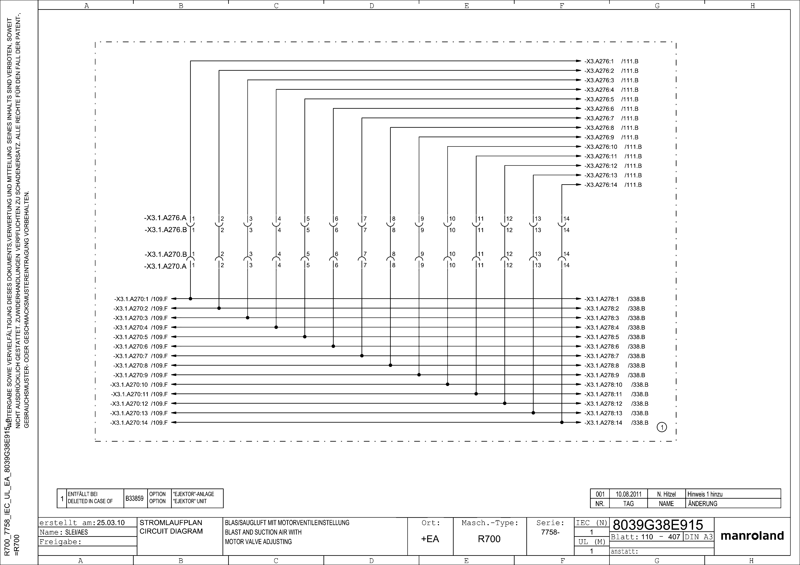

# +EA — Sheet 110 of 407 — BLAS/SAUGLUFT MIT MOTORVENTILEINSTELLUNG

**BLAST AND SUCTION AIR WITH**

> Part of the manroland **R700** printing press IEC/UL circuit diagrams.
> Drawing class: **Stromlaufplan / Circuit diagram** (DIN A3).
> Document `+EA` covers the **Printing unit** machine section.

## At a glance

| Field | Value |
|---|---|
| Document | `+EA`  (8039G38E915) |
| Sheet | **110** of 407 |
| Section (DE) | BLAS/SAUGLUFT MIT MOTORVENTILEINSTELLUNG |
| Section (EN) | BLAST AND SUCTION AIR WITH |
| Section type | CIRCUIT — Circuit diagram |
| Machine type | `R700` |
| Series | `7758` |
| Created | 25.03.10 |
| Replaces | — |
| Columns used | A, B, C, D, E, F, G, H |
| Path numbers | — |
| Labels on sheet | 161 |
| Cross-refs out | 42 |
| Cross-refs in | 98 |

**Previous:** [+EA sheet 109](SHEET_0109.md) · **Next:** [+EA sheet 111](SHEET_0111.md) · **Document TOC:** [_TOC.md](_TOC.md)  (+EA) · **Master TOC:** [all sheets](../_MASTER_TOC.md)

## Sheet image (300 DPI, exact vector render)



_Rendered directly from the PDF vector layer at 300 DPI (1-bit), no OCR and no resampling. Use it to confirm anything ambiguous in the text below._

## Cross-references on this sheet

Each entry is a wire leaving this sheet. The printed token is `/sheet.column`; the link resolves to that sheet inside the same document.

| Ref | Target sheet | Col | Path | Destination on target | Target section | From col |
|---|---|---|---|---|---|---|
| `/111.B` | [+EA sheet 111](SHEET_0111.md) | B | — | X3.A276:1 | BLAS/SAUGLUFT MIT MOTORVENTILEINSTELLUNG | G |
| `/111.B` | [+EA sheet 111](SHEET_0111.md) | B | — | X3.A276:2 | BLAS/SAUGLUFT MIT MOTORVENTILEINSTELLUNG | G |
| `/111.B` | [+EA sheet 111](SHEET_0111.md) | B | — | X3.A276:3 | BLAS/SAUGLUFT MIT MOTORVENTILEINSTELLUNG | G |
| `/111.B` | [+EA sheet 111](SHEET_0111.md) | B | — | X3.A276:4 | BLAS/SAUGLUFT MIT MOTORVENTILEINSTELLUNG | G |
| `/111.B` | [+EA sheet 111](SHEET_0111.md) | B | — | X3.A276:5 | BLAS/SAUGLUFT MIT MOTORVENTILEINSTELLUNG | G |
| `/111.B` | [+EA sheet 111](SHEET_0111.md) | B | — | X3.A276:6 | BLAS/SAUGLUFT MIT MOTORVENTILEINSTELLUNG | G |
| `/111.B` | [+EA sheet 111](SHEET_0111.md) | B | — | X3.A276:7 | BLAS/SAUGLUFT MIT MOTORVENTILEINSTELLUNG | G |
| `/111.B` | [+EA sheet 111](SHEET_0111.md) | B | — | X3.A276:8 | BLAS/SAUGLUFT MIT MOTORVENTILEINSTELLUNG | G |
| `/111.B` | [+EA sheet 111](SHEET_0111.md) | B | — | X3.A276:9 | BLAS/SAUGLUFT MIT MOTORVENTILEINSTELLUNG | G |
| `/111.B` | [+EA sheet 111](SHEET_0111.md) | B | — | X3.A276:10 | BLAS/SAUGLUFT MIT MOTORVENTILEINSTELLUNG | G |
| `/111.B` | [+EA sheet 111](SHEET_0111.md) | B | — | X3.A276:11 | BLAS/SAUGLUFT MIT MOTORVENTILEINSTELLUNG | G |
| `/111.B` | [+EA sheet 111](SHEET_0111.md) | B | — | X3.A276:12 | BLAS/SAUGLUFT MIT MOTORVENTILEINSTELLUNG | G |
| `/111.B` | [+EA sheet 111](SHEET_0111.md) | B | — | X3.A276:13 | BLAS/SAUGLUFT MIT MOTORVENTILEINSTELLUNG | G |
| `/111.B` | [+EA sheet 111](SHEET_0111.md) | B | — | X3.A276:14 | BLAS/SAUGLUFT MIT MOTORVENTILEINSTELLUNG | G |
| `/338.B` | [+EA sheet 338](SHEET_0338.md) | B | — | X3.1.A278:1 | OPTION: BOGENWEICHE | G |
| `/109.F` | [+EA sheet 109](SHEET_0109.md) | F | — | X3.1.A270:1 | BLAS/SAUGLUFT MIT MOTORVENTILEINSTELLUNG | B |
| `/338.B` | [+EA sheet 338](SHEET_0338.md) | B | — | X3.1.A278:2 | OPTION: BOGENWEICHE | G |
| `/109.F` | [+EA sheet 109](SHEET_0109.md) | F | — | X3.1.A270:2 | BLAS/SAUGLUFT MIT MOTORVENTILEINSTELLUNG | B |
| `/338.B` | [+EA sheet 338](SHEET_0338.md) | B | — | X3.1.A278:3 | OPTION: BOGENWEICHE | G |
| `/109.F` | [+EA sheet 109](SHEET_0109.md) | F | — | X3.1.A270:3 | BLAS/SAUGLUFT MIT MOTORVENTILEINSTELLUNG | B |
| `/338.B` | [+EA sheet 338](SHEET_0338.md) | B | — | X3.1.A278:4 | OPTION: BOGENWEICHE | G |
| `/109.F` | [+EA sheet 109](SHEET_0109.md) | F | — | X3.1.A270:4 | BLAS/SAUGLUFT MIT MOTORVENTILEINSTELLUNG | B |
| `/338.B` | [+EA sheet 338](SHEET_0338.md) | B | — | X3.1.A278:5 | OPTION: BOGENWEICHE | G |
| `/109.F` | [+EA sheet 109](SHEET_0109.md) | F | — | X3.1.A270:5 | BLAS/SAUGLUFT MIT MOTORVENTILEINSTELLUNG | B |
| `/338.B` | [+EA sheet 338](SHEET_0338.md) | B | — | X3.1.A278:6 | OPTION: BOGENWEICHE | G |
| `/109.F` | [+EA sheet 109](SHEET_0109.md) | F | — | X3.1.A270:6 | BLAS/SAUGLUFT MIT MOTORVENTILEINSTELLUNG | B |
| `/338.B` | [+EA sheet 338](SHEET_0338.md) | B | — | X3.1.A278:7 | OPTION: BOGENWEICHE | G |
| `/109.F` | [+EA sheet 109](SHEET_0109.md) | F | — | X3.1.A270:7 | BLAS/SAUGLUFT MIT MOTORVENTILEINSTELLUNG | B |
| `/338.B` | [+EA sheet 338](SHEET_0338.md) | B | — | X3.1.A278:8 | OPTION: BOGENWEICHE | G |
| `/109.F` | [+EA sheet 109](SHEET_0109.md) | F | — | X3.1.A270:8 | BLAS/SAUGLUFT MIT MOTORVENTILEINSTELLUNG | B |
| `/338.B` | [+EA sheet 338](SHEET_0338.md) | B | — | X3.1.A278:9 | OPTION: BOGENWEICHE | G |
| `/109.F` | [+EA sheet 109](SHEET_0109.md) | F | — | X3.1.A270:9 | BLAS/SAUGLUFT MIT MOTORVENTILEINSTELLUNG | B |
| `/338.B` | [+EA sheet 338](SHEET_0338.md) | B | — | X3.1.A278:10 | OPTION: BOGENWEICHE | G |
| `/109.F` | [+EA sheet 109](SHEET_0109.md) | F | — | X3.1.A270:10 | BLAS/SAUGLUFT MIT MOTORVENTILEINSTELLUNG | B |
| `/338.B` | [+EA sheet 338](SHEET_0338.md) | B | — | X3.1.A278:11 | OPTION: BOGENWEICHE | G |
| `/109.F` | [+EA sheet 109](SHEET_0109.md) | F | — | X3.1.A270:11 | BLAS/SAUGLUFT MIT MOTORVENTILEINSTELLUNG | B |
| `/338.B` | [+EA sheet 338](SHEET_0338.md) | B | — | X3.1.A278:12 | OPTION: BOGENWEICHE | G |
| `/109.F` | [+EA sheet 109](SHEET_0109.md) | F | — | X3.1.A270:12 | BLAS/SAUGLUFT MIT MOTORVENTILEINSTELLUNG | B |
| `/338.B` | [+EA sheet 338](SHEET_0338.md) | B | — | X3.1.A278:13 | OPTION: BOGENWEICHE | G |
| `/109.F` | [+EA sheet 109](SHEET_0109.md) | F | — | X3.1.A270:13 | BLAS/SAUGLUFT MIT MOTORVENTILEINSTELLUNG | B |
| `/338.B` | [+EA sheet 338](SHEET_0338.md) | B | — | X3.1.A278:14 | OPTION: BOGENWEICHE | G |
| `/109.F` | [+EA sheet 109](SHEET_0109.md) | F | — | X3.1.A270:14 | BLAS/SAUGLUFT MIT MOTORVENTILEINSTELLUNG | B |

### Incoming references (sheets that point here)

Every other sheet that sends a wire to this one. `Back-ref` is the token printed on *that* sheet; `Path` is its line number.

| From sheet | Cols | Back-ref | Path | Refs | What continues there |
|---|---|---|---|---|---|
| [+EA#109](SHEET_0109.md) | G | `/109.G` | — | 14 | X3.1.A270:1; X3.1.A270:10; X3.1.A270:11; X3.1.A270:12; X3.1.A270:13; X3.1.A270:14; X3.1.A270:2; X3.1.A270:3; X3.1.A270:4; X3.1.A270:5; X3.1.A270:6; X3.1.A270:7; |
| [+EA#111](SHEET_0111.md) | B, D | `/111.B`, `/111.D` | — | 14 | X3.A276:1; X3.A276:10; X3.A276:11 X3.A277:11; X3.A276:12; X3.A276:13; X3.A276:14; X3.A276:2; X3.A276:3; X3.A276:4; X3.A276:5; X3.A276:6; X3.A276:7; X3.A276:8; X |
| [+EA#232](SHEET_0232.md) | D, E | `/232.D`, `/232.E` | — | 28 | — |
| [+EA#233](SHEET_0233.md) | A | `/233.A` | — | 28 | — |
| [+EA#338](SHEET_0338.md) | B | `/338.B` | — | 14 | X3.1.A278:1; X3.1.A278:10; X3.1.A278:11; X3.1.A278:12; X3.1.A278:13; X3.1.A278:14; X3.1.A278:2; X3.1.A278:3; X3.1.A278:4; X3.1.A278:5; X3.1.A278:6; X3.1.A278:7; |


## Devices on this sheet

| Tag | Class | Class meaning (IEC) | Col | Sub | Terminal | Sign |
|---|---|---|---|---|---|---|
| `X3.1.A276.A` | — | cross-device reference | B | — | — | — |
| `X3.1.A276.B` | — | cross-device reference | B | — | — | — |
| `X3.1.A270.A` | — | cross-device reference | B | — | — | — |
| `X3.1.A270.B` | — | cross-device reference | B | — | — | — |
| `X3.1.A270:4` | — | cross-device reference | A | — | 4 | — |
| `X3.1.A270:3` | — | cross-device reference | A | — | 3 | — |
| `X3.1.A270:2` | — | cross-device reference | A | — | 2 | — |
| `X3.1.A270:1` | — | cross-device reference | A | — | 1 | — |
| `X3.1.A270:5` | — | cross-device reference | A | — | 5 | — |
| `X3.1.A270:6` | — | cross-device reference | A | — | 6 | — |
| `X3.1.A270:10` | — | cross-device reference | A | — | 10 | — |
| `X3.1.A270:9` | — | cross-device reference | A | — | 9 | — |
| `X3.1.A270:8` | — | cross-device reference | A | — | 8 | — |
| `X3.1.A270:7` | — | cross-device reference | A | — | 7 | — |
| `X3.1.A278:12` | — | cross-device reference | F | — | 12 | — |
| `X3.1.A278:11` | — | cross-device reference | F | — | 11 | — |
| `X3.1.A278:13` | — | cross-device reference | F | — | 13 | — |
| `X3.1.A278:14` | — | cross-device reference | F | — | 14 | — |
| `X3.A276:1` | — | cross-device reference | F | — | 1 | — |
| `X3.A276:4` | — | cross-device reference | F | — | 4 | — |
| `X3.A276:3` | — | cross-device reference | F | — | 3 | — |
| `X3.A276:2` | — | cross-device reference | F | — | 2 | — |
| `X3.1.A270:11` | — | cross-device reference | A | — | 11 | — |
| `X3.1.A270:12` | — | cross-device reference | A | — | 12 | — |
| `X3.1.A278:1` | — | cross-device reference | F | — | 1 | — |
| `X3.1.A270:14` | — | cross-device reference | A | — | 14 | — |
| `X3.1.A270:13` | — | cross-device reference | A | — | 13 | — |
| `X3.1.A278:10` | — | cross-device reference | F | — | 10 | — |
| `X3.1.A278:9` | — | cross-device reference | F | — | 9 | — |
| `X3.1.A278:8` | — | cross-device reference | F | — | 8 | — |
| `X3.1.A278:7` | — | cross-device reference | F | — | 7 | — |
| `X3.1.A278:2` | — | cross-device reference | F | — | 2 | — |
| `X3.1.A278:3` | — | cross-device reference | F | — | 3 | — |
| `X3.1.A278:6` | — | cross-device reference | F | — | 6 | — |
| `X3.1.A278:5` | — | cross-device reference | F | — | 5 | — |
| `X3.1.A278:4` | — | cross-device reference | F | — | 4 | — |
| `X3.A276:14` | — | cross-device reference | F | — | 14 | — |
| `X3.A276:8` | — | cross-device reference | F | — | 8 | — |
| `X3.A276:7` | — | cross-device reference | F | — | 7 | — |
| `X3.A276:6` | — | cross-device reference | F | — | 6 | — |
| `X3.A276:5` | — | cross-device reference | F | — | 5 | — |
| `X3.A276:9` | — | cross-device reference | F | — | 9 | — |
| `X3.A276:13` | — | cross-device reference | F | — | 13 | — |
| `X3.A276:12` | — | cross-device reference | F | — | 12 | — |
| `X3.A276:11` | — | cross-device reference | F | — | 11 | — |
| `X3.A276:10` | — | cross-device reference | F | — | 10 | — |
| `NR.` | — | cross-device reference | F | — | — | — |
| `10.08.2011` | — | cross-device reference | G | — | — | — |

## Potentials / nets

_No named potentials on this sheet._

## Wire-end annotations (grouped as printed)

A wire that continues elsewhere is annotated with a small cluster: the destination description, the path/line number `#NN`, and the `/sheet.column` cross reference. Each row below is one such cluster exactly as it is grouped on the drawing.

| Col | Y | Path | Cross-ref | Text on the wire |
|---|---|---|---|---|
| G | 87.4 | — | `/111.B` | `X3.A276:1` |
| G | 101.6 | — | `/111.B` | `X3.A276:2` |
| G | 115.8 | — | `/111.B` | `X3.A276:3` |
| G | 129.9 | — | `/111.B` | `X3.A276:4` |
| G | 144.1 | — | `/111.B` | `X3.A276:5` |
| G | 158.3 | — | `/111.B` | `X3.A276:6` |
| G | 172.5 | — | `/111.B` | `X3.A276:7` |
| G | 186.6 | — | `/111.B` | `X3.A276:8` |
| G | 200.8 | — | `/111.B` | `X3.A276:9` |
| G | 215.0 | — | `/111.B` | `X3.A276:10` |
| G | 229.2 | — | `/111.B` | `X3.A276:11` |
| G | 243.3 | — | `/111.B` | `X3.A276:12` |
| G | 257.5 | — | `/111.B` | `X3.A276:13` |
| G | 271.7 | — | `/111.B` | `X3.A276:14` |
| B | 319.9 | — | — | `X3.1.A276.A 1 2 3 4 5` |
| D | 322.1 | — | — | `6 7 8 9 10` |
| F | 322.1 | — | — | `11 12 13 14` |
| B | 337.6 | — | — | `X3.1.A276.B 1 2 3 5` |
| E | 339.1 | — | — | `4 11 12 13 14` |
| D | 339.1 | — | — | `6 7 8 9 10` |
| B | 374.5 | — | — | `X3.1.A270.B 1 3` |
| B | 374.5 | — | — | `2` |
| D | 374.5 | — | — | `4 5 6 13` |
| D | 374.5 | — | — | `7` |
| D | 374.5 | — | — | `8` |
| E | 374.5 | — | — | `9 11` |
| E | 374.5 | — | — | `10` |
| E | 374.5 | — | — | `12` |
| F | 374.5 | — | — | `14` |
| B | 391.5 | — | — | `X3.1.A270.A 1` |
| C | 391.5 | — | — | `2 3` |
| C | 391.5 | — | — | `4 5 6 7` |
| D | 391.5 | — | — | `8` |
| E | 391.5 | — | — | `9` |
| E | 391.5 | — | — | `10 11` |
| E | 391.5 | — | — | `12` |
| F | 391.5 | — | — | `13` |
| F | 391.5 | — | — | `14` |
| B | 441.8 | — | `/109.F` | `X3.1.A270:1` |
| G | 441.8 | — | `/338.B` | `X3.1.A278:1` |
| B | 455.9 | — | `/109.F` | `X3.1.A270:2` |
| G | 455.9 | — | `/338.B` | `X3.1.A278:2` |
| B | 470.1 | — | `/109.F` | `X3.1.A270:3` |
| G | 470.1 | — | `/338.B` | `X3.1.A278:3` |
| B | 484.3 | — | `/109.F` | `X3.1.A270:4` |
| G | 484.3 | — | `/338.B` | `X3.1.A278:4` |
| G | 498.4 | — | `/338.B` | `X3.1.A278:5` |
| B | 498.5 | — | `/109.F` | `X3.1.A270:5` |
| B | 512.6 | — | `/109.F` | `X3.1.A270:6` |
| G | 512.6 | — | `/338.B` | `X3.1.A278:6` |
| B | 526.8 | — | `/109.F` | `X3.1.A270:7` |
| G | 526.8 | — | `/338.B` | `X3.1.A278:7` |
| B | 541.0 | — | `/109.F` | `X3.1.A270:8` |
| G | 541.0 | — | `/338.B` | `X3.1.A278:8` |
| G | 555.1 | — | `/338.B` | `X3.1.A278:9` |
| B | 555.2 | — | `/109.F` | `X3.1.A270:9` |
| B | 569.3 | — | `/109.F` | `X3.1.A270:10` |
| G | 569.3 | — | `/338.B` | `X3.1.A278:10` |
| B | 583.5 | — | `/109.F` | `X3.1.A270:11` |
| G | 583.5 | — | `/338.B` | `X3.1.A278:11` |
| B | 597.7 | — | `/109.F` | `X3.1.A270:12` |
| G | 597.7 | — | `/338.B` | `X3.1.A278:12` |
| G | 611.8 | — | `/338.B` | `X3.1.A278:13` |
| B | 611.9 | — | `/109.F` | `X3.1.A270:13` |
| B | 626.0 | — | `/109.F` | `X3.1.A270:14` |
| G | 626.0 | — | `/338.B` | `X3.1.A278:14` |
| G | 633.3 | — | — | `1` |
| D | 732.7 | — | — | `1 ENTFÄLLT BEI DELETED IN CASE OF B33859 001 10.08.2011 N. Hitzel Hinweis 1 hinzu` |
| B | 733.4 | — | — | `OPTION OPTION` |
| B | 733.4 | — | — | `"EJEKTOR" ANLAGE "EJEKTOR" UNIT` |
| G | 747.0 | — | — | `NR. TAG NAME ÄNDERUNG` |


## Reconstructed tables

This sheet carries tabular content (pin map / terminal assignment / index). The grid below was rebuilt from the drawing's own rule lines, so each row is exactly one physical row of the table.

### Table 1 — 32 data rows × 21 columns (at x=204.1, y=0.0)

|  |  |  |  |  |  |  |  |  |  |  |  |  |  |  |  |  |  |  | X3.A276:1 | /111.B |
|---|---|---|---|---|---|---|---|---|---|---|---|---|---|---|---|---|---|---|---|---|
|  |  |  |  |  |  |  |  |  |  |  |  |  |  |  |  |  |  |  | `X3.A276:2` | `/111.B` |
|  |  |  |  |  |  |  |  |  |  |  |  |  |  |  |  |  |  |  | `X3.A276:3` | `/111.B` |
|  |  |  |  |  |  |  |  |  |  |  |  |  |  |  |  |  |  |  | `X3.A276:4` | `/111.B` |
|  |  |  |  |  |  |  |  |  |  |  |  |  |  |  |  |  |  |  | `X3.A276:5` | `/111.B` |
|  |  |  |  |  |  |  |  |  |  |  |  |  |  |  |  |  |  |  | `X3.A276:6` | `/111.B` |
|  |  |  |  |  |  |  |  |  |  |  |  |  |  |  |  |  |  |  | `X3.A276:7` | `/111.B` |
|  |  |  |  |  |  |  |  |  |  |  |  |  |  |  |  |  |  |  | `X3.A276:8` | `/111.B` |
|  |  |  |  |  |  |  |  |  |  |  |  |  |  |  |  |  |  |  | `X3.A276:9` | `/111.B` |
|  |  |  |  |  |  |  |  |  |  |  |  |  |  |  |  |  |  |  | `X3.A276:10` | `/111.B` |
|  |  |  |  |  |  |  |  |  |  |  |  |  |  |  |  |  |  |  | `X3.A276:11` | `/111.B` |
|  |  |  |  |  |  |  |  |  |  |  |  |  |  |  |  |  |  |  | `X3.A276:12` | `/111.B` |
| `X3.1.A276.A X3.1.A276.B X3.1.A270.B X3.1.A270.A` | `1 1 1 1` | `2 2 2 2` |  | `3 3 3 3` | `4 4 4 4` | `5 5 5 5` | `6 6 6 6` | `7 7 7 7` | `8 8 8 8` |  | `9 9 9 9` | `10 10 10 10` |  | `11 11 11 11` | `12 12 12 12` |  | `13 13 13 13` | `14 14 14 14` | `X3.A276:13 X3.A276:14` | `/111.B /111.B` |
| `/109.F` |  |  |  |  |  |  |  |  |  |  |  |  |  |  |  |  |  |  | `X3.1.A278:1` | `/338.B` |
| `/109.F` |  |  |  |  |  |  |  |  |  |  |  |  |  |  |  |  |  |  | `X3.1.A278:2` | `/338.B` |
| `/109.F` |  |  |  |  |  |  |  |  |  |  |  |  |  |  |  |  |  |  | `X3.1.A278:3` | `/338.B` |
| `/109.F` |  |  |  |  |  |  |  |  |  |  |  |  |  |  |  |  |  |  | `X3.1.A278:4` | `/338.B` |
| `/109.F` |  |  |  |  |  |  |  |  |  |  |  |  |  |  |  |  |  |  | `X3.1.A278:5` | `/338.B` |
| `/109.F` |  |  |  |  |  |  |  |  |  |  |  |  |  |  |  |  |  |  | `X3.1.A278:6` | `/338.B` |
| `/109.F` |  |  |  |  |  |  |  |  |  |  |  |  |  |  |  |  |  |  | `X3.1.A278:7` | `/338.B` |
| `/109.F` |  |  |  |  |  |  |  |  |  |  |  |  |  |  |  |  |  |  | `X3.1.A278:8` | `/338.B` |
| `/109.F` |  |  |  |  |  |  |  |  |  |  |  |  |  |  |  |  |  |  | `X3.1.A278:9` | `/338.B` |
| `/109.F` |  |  |  |  |  |  |  |  |  |  |  |  |  |  |  |  |  |  | `X3.1.A278:10` | `/338.B` |
| `/109.F` |  |  |  |  |  |  |  |  |  |  |  |  |  |  |  |  |  |  | `X3.1.A278:11` | `/338.B` |
| `/109.F` |  |  |  |  |  |  |  |  |  |  |  |  |  |  |  |  |  |  | `X3.1.A278:12` | `/338.B` |
| `/109.F` |  |  |  |  |  |  |  |  |  |  |  |  |  |  |  |  |  |  | `X3.1.A278:13` | `/338.B` |
| `/109.F OPTION OPTION "EJEKTOR"` | `"EJEKTOR" ANLAGE UNIT` |  |  |  |  |  |  |  |  |  |  |  |  |  |  |  |  |  | `X3.1.A278:14 001 NR.` | `/338.B 1 10.08.2011 Hinweis 1 N. Hitzel NAME TAG ÄNDERUNG` |
| `STROMLAUFPLAN` |  |  | `BLAS/SAUGLUFT` | `MIT` |  | `MOTORVENTILEINSTELLUNG` |  |  |  |  | `Ort:` |  |  | `Masch. Type:` |  |  | `Serie:` |  | `IEC (N)` | `8039G38E915` |
| `CIRCUIT DIAGRAM` |  |  |  |  |  |  |  |  |  |  |  |  |  |  |  |  |  |  |  |  |
|  |  |  | `BLAST` | `AND SUCTION` | `AIR WITH` |  |  |  |  |  |  |  |  |  |  |  | `7758` |  | `1` |  |
|  |  |  |  |  |  |  |  |  |  |  | `+EA` |  |  | `R700` |  |  |  |  |  | `Blatt: DIN A3 110 407` |
|  |  |  | `MOTOR` | `VALVE` | `ADJUSTING` |  |  |  |  |  |  |  |  |  |  |  |  |  | `UL (M)` |  |
|  |  |  |  |  |  |  |  |  |  |  |  |  |  |  |  |  |  |  | `1` | `anstatt:` |


## Notes and free text on this sheet

| Text | Col | Y (pt) |
|---|---|---|
| `TAG` | G | 747.05 |
| `NAME` | G | 747.05 |
| `ÄNDERUNG` | G | 747.11 |
| `N. Hitzel` | G | 733.02 |
| `Hinweis 1 hinzu` | H | 732.98 |
| `ENTFÄLLT BEI` | A | 733.35 |
| `DELETED IN CASE OF` | A | 744 |
| `B33859` | B | 739.23 |
| `OPTION` | B | 733.35 |
| `"EJEKTOR" ANLAGE` | B | 733.38 |
| `"EJEKTOR" UNIT` | B | 744.01 |

## Complete label inventory (exact text from the drawing)

Every text object inside the drawing area of this sheet, in DIN reading order (column A→H, then top→bottom). This is the authoritative list: if a string is not here it is not printed on this sheet.

| Col | Y | X | Dir | Type | Text |
|---|---|---|---|---|---|
| A | 441.8 | 170.1 | → | device ref | `X3.1.A270:1` |
| A | 455.9 | 168.9 | → | device ref | `X3.1.A270:2` |
| A | 470.1 | 168.7 | → | device ref | `X3.1.A270:3` |
| A | 484.3 | 168.7 | → | device ref | `X3.1.A270:4` |
| A | 498.5 | 168.7 | → | device ref | `X3.1.A270:5` |
| A | 512.6 | 168.7 | → | device ref | `X3.1.A270:6` |
| A | 526.8 | 168.7 | → | device ref | `X3.1.A270:7` |
| A | 541.0 | 168.7 | → | device ref | `X3.1.A270:8` |
| A | 555.2 | 168.7 | → | device ref | `X3.1.A270:9` |
| A | 569.3 | 163.8 | → | device ref | `X3.1.A270:10` |
| A | 583.5 | 165.3 | → | device ref | `X3.1.A270:11` |
| A | 597.7 | 164.1 | → | device ref | `X3.1.A270:12` |
| A | 611.9 | 163.8 | → | device ref | `X3.1.A270:13` |
| A | 626.0 | 163.8 | → | device ref | `X3.1.A270:14` |
| A | 733.3 | 101.2 | → | text | `ENTFÄLLT BEI` |
| A | 738.7 | 89.6 | → | number | `1` |
| A | 744.0 | 101.2 | → | text | `DELETED IN CASE OF` |
| B | 319.9 | 214.6 | → | device ref | `X3.1.A276.A` |
| B | 322.1 | 285.4 | → | number | `1` |
| B | 322.1 | 328.5 | → | number | `2` |
| B | 337.6 | 215.4 | → | device ref | `X3.1.A276.B` |
| B | 339.1 | 285.4 | → | number | `1` |
| B | 339.1 | 328.5 | → | number | `2` |
| B | 374.5 | 215.4 | → | device ref | `X3.1.A270.B` |
| B | 374.5 | 285.4 | → | number | `1` |
| B | 374.5 | 328.5 | → | number | `2` |
| B | 391.5 | 285.4 | → | number | `1` |
| B | 391.5 | 328.5 | → | number | `2` |
| B | 392.2 | 214.6 | → | device ref | `X3.1.A270.A` |
| B | 441.8 | 224.8 | → | cross-reference | `/109.F` |
| B | 455.9 | 224.8 | → | cross-reference | `/109.F` |
| B | 470.1 | 224.8 | → | cross-reference | `/109.F` |
| B | 484.3 | 224.8 | → | cross-reference | `/109.F` |
| B | 498.5 | 224.8 | → | cross-reference | `/109.F` |
| B | 512.6 | 224.8 | → | cross-reference | `/109.F` |
| B | 526.8 | 224.8 | → | cross-reference | `/109.F` |
| B | 541.0 | 224.8 | → | cross-reference | `/109.F` |
| B | 555.2 | 224.8 | → | cross-reference | `/109.F` |
| B | 569.3 | 224.8 | → | cross-reference | `/109.F` |
| B | 583.5 | 224.8 | → | cross-reference | `/109.F` |
| B | 597.7 | 224.8 | → | cross-reference | `/109.F` |
| B | 611.8 | 224.8 | → | cross-reference | `/109.F` |
| B | 626.0 | 224.8 | → | cross-reference | `/109.F` |
| B | 733.4 | 222.2 | → | text | `OPTION` |
| B | 733.4 | 257.7 | → | text | `"EJEKTOR" ANLAGE` |
| B | 739.2 | 186.9 | → | text | `B33859` |
| B | 744.0 | 222.2 | → | text | `OPTION` |
| B | 744.0 | 257.7 | → | text | `"EJEKTOR" UNIT` |
| C | 322.1 | 371.1 | → | number | `3` |
| C | 322.1 | 413.6 | → | number | `4` |
| C | 322.1 | 456.1 | → | number | `5` |
| C | 339.1 | 371.1 | → | number | `3` |
| C | 339.1 | 413.6 | → | number | `4` |
| C | 339.1 | 456.1 | → | number | `5` |
| C | 374.5 | 371.1 | → | number | `3` |
| C | 374.5 | 413.6 | → | number | `4` |
| C | 374.5 | 456.1 | → | number | `5` |
| C | 391.5 | 371.1 | → | number | `3` |
| C | 391.5 | 413.6 | → | number | `4` |
| C | 391.5 | 456.1 | → | number | `5` |
| D | 322.1 | 498.6 | → | number | `6` |
| D | 322.1 | 541.1 | → | number | `7` |
| D | 322.1 | 583.7 | → | number | `8` |
| D | 339.1 | 498.6 | → | number | `6` |
| D | 339.1 | 541.1 | → | number | `7` |
| D | 339.1 | 583.7 | → | number | `8` |
| D | 374.5 | 498.6 | → | number | `6` |
| D | 374.5 | 541.1 | → | number | `7` |
| D | 374.5 | 583.7 | → | number | `8` |
| D | 391.5 | 498.6 | → | number | `6` |
| D | 391.5 | 541.1 | → | number | `7` |
| D | 391.5 | 583.7 | → | number | `8` |
| E | 322.1 | 626.2 | → | number | `9` |
| E | 322.1 | 668.1 | → | number | `10` |
| E | 322.1 | 710.6 | → | number | `11` |
| E | 322.1 | 753.2 | → | number | `12` |
| E | 339.1 | 626.2 | → | number | `9` |
| E | 339.1 | 668.1 | → | number | `10` |
| E | 339.1 | 710.6 | → | number | `11` |
| E | 339.1 | 753.2 | → | number | `12` |
| E | 374.5 | 626.2 | → | number | `9` |
| E | 374.5 | 668.1 | → | number | `10` |
| E | 374.5 | 710.6 | → | number | `11` |
| E | 374.5 | 753.2 | → | number | `12` |
| E | 391.5 | 626.2 | → | number | `9` |
| E | 391.5 | 668.1 | → | number | `10` |
| E | 391.5 | 710.6 | → | number | `11` |
| E | 391.5 | 753.2 | → | number | `12` |
| F | 87.4 | 870.0 | → | device ref | `X3.A276:1` |
| F | 101.6 | 870.0 | → | device ref | `X3.A276:2` |
| F | 115.8 | 870.0 | → | device ref | `X3.A276:3` |
| F | 130.0 | 870.0 | → | device ref | `X3.A276:4` |
| F | 144.1 | 870.0 | → | device ref | `X3.A276:5` |
| F | 158.3 | 870.0 | → | device ref | `X3.A276:6` |
| F | 172.5 | 870.0 | → | device ref | `X3.A276:7` |
| F | 186.7 | 870.0 | → | device ref | `X3.A276:8` |
| F | 200.8 | 870.0 | → | device ref | `X3.A276:9` |
| F | 215.0 | 870.0 | → | device ref | `X3.A276:10` |
| F | 229.2 | 870.0 | → | device ref | `X3.A276:11` |
| F | 243.4 | 870.0 | → | device ref | `X3.A276:12` |
| F | 257.5 | 870.0 | → | device ref | `X3.A276:13` |
| F | 271.7 | 870.0 | → | device ref | `X3.A276:14` |
| F | 322.1 | 795.7 | → | number | `13` |
| F | 322.1 | 838.2 | → | number | `14` |
| F | 339.1 | 795.7 | → | number | `13` |
| F | 339.1 | 838.2 | → | number | `14` |
| F | 374.5 | 795.7 | → | number | `13` |
| F | 374.5 | 838.2 | → | number | `14` |
| F | 391.5 | 795.7 | → | number | `13` |
| F | 391.5 | 838.2 | → | number | `14` |
| F | 441.8 | 870.0 | → | device ref | `X3.1.A278:1` |
| F | 455.9 | 870.0 | → | device ref | `X3.1.A278:2` |
| F | 470.1 | 870.0 | → | device ref | `X3.1.A278:3` |
| F | 484.3 | 870.0 | → | device ref | `X3.1.A278:4` |
| F | 498.5 | 870.0 | → | device ref | `X3.1.A278:5` |
| F | 512.6 | 870.0 | → | device ref | `X3.1.A278:6` |
| F | 526.8 | 870.0 | → | device ref | `X3.1.A278:7` |
| F | 541.0 | 870.0 | → | device ref | `X3.1.A278:8` |
| F | 555.2 | 870.0 | → | device ref | `X3.1.A278:9` |
| F | 569.3 | 870.0 | → | device ref | `X3.1.A278:10` |
| F | 583.5 | 870.0 | → | device ref | `X3.1.A278:11` |
| F | 597.7 | 870.0 | → | device ref | `X3.1.A278:12` |
| F | 611.9 | 870.0 | → | device ref | `X3.1.A278:13` |
| F | 626.0 | 870.0 | → | device ref | `X3.1.A278:14` |
| F | 732.7 | 886.9 | → | number | `001` |
| F | 747.0 | 886.3 | → | device ref | `NR.` |
| G | 87.4 | 924.8 | → | cross-reference | `/111.B` |
| G | 101.6 | 924.8 | → | cross-reference | `/111.B` |
| G | 115.8 | 924.8 | → | cross-reference | `/111.B` |
| G | 129.9 | 924.8 | → | cross-reference | `/111.B` |
| G | 144.1 | 924.8 | → | cross-reference | `/111.B` |
| G | 158.3 | 924.8 | → | cross-reference | `/111.B` |
| G | 172.5 | 924.8 | → | cross-reference | `/111.B` |
| G | 186.6 | 924.8 | → | cross-reference | `/111.B` |
| G | 200.8 | 924.8 | → | cross-reference | `/111.B` |
| G | 215.0 | 929.8 | → | cross-reference | `/111.B` |
| G | 229.2 | 929.8 | → | cross-reference | `/111.B` |
| G | 243.3 | 929.8 | → | cross-reference | `/111.B` |
| G | 257.5 | 929.8 | → | cross-reference | `/111.B` |
| G | 271.7 | 929.8 | → | cross-reference | `/111.B` |
| G | 441.8 | 934.7 | → | cross-reference | `/338.B` |
| G | 455.9 | 934.7 | → | cross-reference | `/338.B` |
| G | 470.1 | 934.7 | → | cross-reference | `/338.B` |
| G | 484.3 | 934.7 | → | cross-reference | `/338.B` |
| G | 498.5 | 934.7 | → | cross-reference | `/338.B` |
| G | 512.6 | 934.7 | → | cross-reference | `/338.B` |
| G | 526.8 | 934.7 | → | cross-reference | `/338.B` |
| G | 541.0 | 934.7 | → | cross-reference | `/338.B` |
| G | 555.1 | 934.7 | → | cross-reference | `/338.B` |
| G | 569.3 | 939.7 | → | cross-reference | `/338.B` |
| G | 583.5 | 939.7 | → | cross-reference | `/338.B` |
| G | 597.7 | 939.7 | → | cross-reference | `/338.B` |
| G | 611.8 | 939.7 | → | cross-reference | `/338.B` |
| G | 626.0 | 939.7 | → | cross-reference | `/338.B` |
| G | 633.3 | 983.3 | → | number | `1` |
| G | 732.8 | 916.5 | → | device ref | `10.08.2011` |
| G | 733.0 | 978.1 | → | text | `N. Hitzel` |
| G | 747.0 | 980.9 | → | text | `NAME` |
| G | 747.1 | 927.7 | → | text | `TAG` |
| G | 747.1 | 1024.4 | → | text | `ÄNDERUNG` |
| H | 733.0 | 1023.3 | → | text | `Hinweis 1 hinzu` |

## Reading-order text block

The same content as a plain block, grouped by DIN column — convenient to paste or to match against a visual description.

```text
=== Column A ===
 441.8  170.1  devref       X3.1.A270:1
 455.9  168.9  devref       X3.1.A270:2
 470.1  168.7  devref       X3.1.A270:3
 484.3  168.7  devref       X3.1.A270:4
 498.5  168.7  devref       X3.1.A270:5
 512.6  168.7  devref       X3.1.A270:6
 526.8  168.7  devref       X3.1.A270:7
 541.0  168.7  devref       X3.1.A270:8
 555.2  168.7  devref       X3.1.A270:9
 569.3  163.8  devref       X3.1.A270:10
 583.5  165.3  devref       X3.1.A270:11
 597.7  164.1  devref       X3.1.A270:12
 611.9  163.8  devref       X3.1.A270:13
 626.0  163.8  devref       X3.1.A270:14
 733.3  101.2  text         ENTFÄLLT BEI
 738.7   89.6  numeric      1
 744.0  101.2  text         DELETED IN CASE OF
=== Column B ===
 319.9  214.6  devref       X3.1.A276.A
 322.1  285.4  numeric      1
 322.1  328.5  numeric      2
 337.6  215.4  devref       X3.1.A276.B
 339.1  285.4  numeric      1
 339.1  328.5  numeric      2
 374.5  215.4  devref       X3.1.A270.B
 374.5  285.4  numeric      1
 374.5  328.5  numeric      2
 391.5  285.4  numeric      1
 391.5  328.5  numeric      2
 392.2  214.6  devref       X3.1.A270.A
 441.8  224.8  xref         /109.F
 455.9  224.8  xref         /109.F
 470.1  224.8  xref         /109.F
 484.3  224.8  xref         /109.F
 498.5  224.8  xref         /109.F
 512.6  224.8  xref         /109.F
 526.8  224.8  xref         /109.F
 541.0  224.8  xref         /109.F
 555.2  224.8  xref         /109.F
 569.3  224.8  xref         /109.F
 583.5  224.8  xref         /109.F
 597.7  224.8  xref         /109.F
 611.8  224.8  xref         /109.F
 626.0  224.8  xref         /109.F
 733.4  222.2  text         OPTION
 733.4  257.7  text         "EJEKTOR" ANLAGE
 739.2  186.9  text         B33859
 744.0  222.2  text         OPTION
 744.0  257.7  text         "EJEKTOR" UNIT
=== Column C ===
 322.1  371.1  numeric      3
 322.1  413.6  numeric      4
 322.1  456.1  numeric      5
 339.1  371.1  numeric      3
 339.1  413.6  numeric      4
 339.1  456.1  numeric      5
 374.5  371.1  numeric      3
 374.5  413.6  numeric      4
 374.5  456.1  numeric      5
 391.5  371.1  numeric      3
 391.5  413.6  numeric      4
 391.5  456.1  numeric      5
=== Column D ===
 322.1  498.6  numeric      6
 322.1  541.1  numeric      7
 322.1  583.7  numeric      8
 339.1  498.6  numeric      6
 339.1  541.1  numeric      7
 339.1  583.7  numeric      8
 374.5  498.6  numeric      6
 374.5  541.1  numeric      7
 374.5  583.7  numeric      8
 391.5  498.6  numeric      6
 391.5  541.1  numeric      7
 391.5  583.7  numeric      8
=== Column E ===
 322.1  626.2  numeric      9
 322.1  668.1  numeric      10
 322.1  710.6  numeric      11
 322.1  753.2  numeric      12
 339.1  626.2  numeric      9
 339.1  668.1  numeric      10
 339.1  710.6  numeric      11
 339.1  753.2  numeric      12
 374.5  626.2  numeric      9
 374.5  668.1  numeric      10
 374.5  710.6  numeric      11
 374.5  753.2  numeric      12
 391.5  626.2  numeric      9
 391.5  668.1  numeric      10
 391.5  710.6  numeric      11
 391.5  753.2  numeric      12
=== Column F ===
  87.4  870.0  devref       X3.A276:1
 101.6  870.0  devref       X3.A276:2
 115.8  870.0  devref       X3.A276:3
 130.0  870.0  devref       X3.A276:4
 144.1  870.0  devref       X3.A276:5
 158.3  870.0  devref       X3.A276:6
 172.5  870.0  devref       X3.A276:7
 186.7  870.0  devref       X3.A276:8
 200.8  870.0  devref       X3.A276:9
 215.0  870.0  devref       X3.A276:10
 229.2  870.0  devref       X3.A276:11
 243.4  870.0  devref       X3.A276:12
 257.5  870.0  devref       X3.A276:13
 271.7  870.0  devref       X3.A276:14
 322.1  795.7  numeric      13
 322.1  838.2  numeric      14
 339.1  795.7  numeric      13
 339.1  838.2  numeric      14
 374.5  795.7  numeric      13
 374.5  838.2  numeric      14
 391.5  795.7  numeric      13
 391.5  838.2  numeric      14
 441.8  870.0  devref       X3.1.A278:1
 455.9  870.0  devref       X3.1.A278:2
 470.1  870.0  devref       X3.1.A278:3
 484.3  870.0  devref       X3.1.A278:4
 498.5  870.0  devref       X3.1.A278:5
 512.6  870.0  devref       X3.1.A278:6
 526.8  870.0  devref       X3.1.A278:7
 541.0  870.0  devref       X3.1.A278:8
 555.2  870.0  devref       X3.1.A278:9
 569.3  870.0  devref       X3.1.A278:10
 583.5  870.0  devref       X3.1.A278:11
 597.7  870.0  devref       X3.1.A278:12
 611.9  870.0  devref       X3.1.A278:13
 626.0  870.0  devref       X3.1.A278:14
 732.7  886.9  numeric      001
 747.0  886.3  devref       NR.
=== Column G ===
  87.4  924.8  xref         /111.B
 101.6  924.8  xref         /111.B
 115.8  924.8  xref         /111.B
 129.9  924.8  xref         /111.B
 144.1  924.8  xref         /111.B
 158.3  924.8  xref         /111.B
 172.5  924.8  xref         /111.B
 186.6  924.8  xref         /111.B
 200.8  924.8  xref         /111.B
 215.0  929.8  xref         /111.B
 229.2  929.8  xref         /111.B
 243.3  929.8  xref         /111.B
 257.5  929.8  xref         /111.B
 271.7  929.8  xref         /111.B
 441.8  934.7  xref         /338.B
 455.9  934.7  xref         /338.B
 470.1  934.7  xref         /338.B
 484.3  934.7  xref         /338.B
 498.5  934.7  xref         /338.B
 512.6  934.7  xref         /338.B
 526.8  934.7  xref         /338.B
 541.0  934.7  xref         /338.B
 555.1  934.7  xref         /338.B
 569.3  939.7  xref         /338.B
 583.5  939.7  xref         /338.B
 597.7  939.7  xref         /338.B
 611.8  939.7  xref         /338.B
 626.0  939.7  xref         /338.B
 633.3  983.3  numeric      1
 732.8  916.5  devref       10.08.2011
 733.0  978.1  text         N. Hitzel
 747.0  980.9  text         NAME
 747.1  927.7  text         TAG
 747.1 1024.4  text         ÄNDERUNG
=== Column H ===
 733.0 1023.3  text         Hinweis 1 hinzu
```

---
_Generated from the PDF vector text layer; no OCR. Source: `R700_7758_IEC_UL_EA_8039G38E915_p`, sheet 110._
