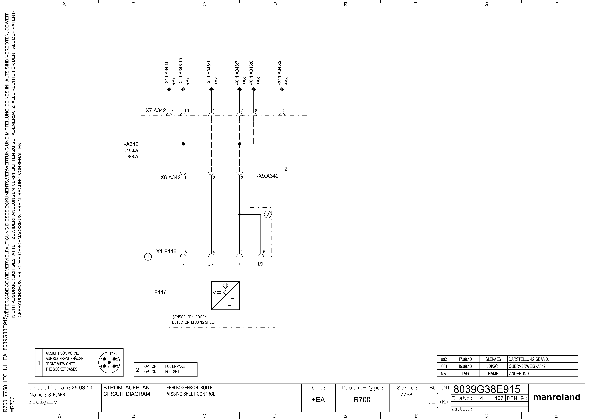

# +EA — Sheet 114 of 407 — FEHLBOGENKONTROLLE

**MISSING SHEET CONTROL**

> Part of the manroland **R700** printing press IEC/UL circuit diagrams.
> Drawing class: **Stromlaufplan / Circuit diagram** (DIN A3).
> Document `+EA` covers the **Printing unit** machine section.

## At a glance

| Field | Value |
|---|---|
| Document | `+EA`  (8039G38E915) |
| Sheet | **114** of 407 |
| Section (DE) | FEHLBOGENKONTROLLE |
| Section (EN) | MISSING SHEET CONTROL |
| Section type | CIRCUIT — Circuit diagram |
| Machine type | `R700` |
| Series | `7758` |
| Created | 25.03.10 |
| Replaces | — |
| Columns used | A, B, C, D, F, G, H |
| Path numbers | — |
| Labels on sheet | 67 |
| Cross-refs out | 2 |
| Cross-refs in | 16 |

**Previous:** [+EA sheet 113](SHEET_0113.md) · **Next:** [+EA sheet 115](SHEET_0115.md) · **Document TOC:** [_TOC.md](_TOC.md)  (+EA) · **Master TOC:** [all sheets](../_MASTER_TOC.md)

## Sheet image (300 DPI, exact vector render)



_Rendered directly from the PDF vector layer at 300 DPI (1-bit), no OCR and no resampling. Use it to confirm anything ambiguous in the text below._

## Cross-references on this sheet

Each entry is a wire leaving this sheet. The printed token is `/sheet.column`; the link resolves to that sheet inside the same document.

| Ref | Target sheet | Col | Path | Destination on target | Target section | From col |
|---|---|---|---|---|---|---|
| `/168.A` | [+EA sheet 168](SHEET_0168.md) | A | — | — | RESERVE | B |
| `/88.A` | [+EA sheet 88](SHEET_0088.md) | A | — | — | SAUGWALZE | B |

### Incoming references (sheets that point here)

Every other sheet that sends a wire to this one. `Back-ref` is the token printed on *that* sheet; `Path` is its line number.

| From sheet | Cols | Back-ref | Path | Refs | What continues there |
|---|---|---|---|---|---|
| [+EA#88](SHEET_0088.md) | A | `/88.A` | — | 1 | — |
| [+EA#168](SHEET_0168.md) | A | `/168.A` | — | 1 | — |
| [+EA#215](SHEET_0215.md) | E | `/215.E` | — | 4 | — |
| [+EA#247](SHEET_0247.md) | C | `/247.C` | — | 6 | — |
| [+EA#250](SHEET_0250.md) | A | `/250.A` | — | 3 | — |
| [+EA#252](SHEET_0252.md) | B | `/252.B` | — | 1 | — |


## Devices on this sheet

| Tag | Class | Class meaning (IEC) | Col | Sub | Terminal | Sign |
|---|---|---|---|---|---|---|
| `A342` | A | Baugruppe / assembly, module, PC board | B | — | — | — |
| `B116` | B | Umformer / transducer, sensor | B | — | — | — |
| `X7.A342` | — | cross-device reference | B | — | — | — |
| `X8.A342` | — | cross-device reference | C | — | — | — |
| `X11.A346:9` | — | cross-device reference | B | — | 9 | — |
| `X11.A346:10` | — | cross-device reference | C | — | 10 | — |
| `X11.A346:1` | — | cross-device reference | C | — | 1 | — |
| `X11.A346:7` | — | cross-device reference | C | — | 7 | — |
| `X11.A346:8` | — | cross-device reference | D | — | 8 | — |
| `X11.A346:2` | — | cross-device reference | D | — | 2 | — |
| `X1.B116` | — | cross-device reference | B | — | — | — |
| `NR.` | — | cross-device reference | F | — | — | — |
| `19.08.10` | — | cross-device reference | G | — | — | — |
| `17.09.10` | — | cross-device reference | G | — | — | — |
| `X9.A342` | — | cross-device reference | D | — | — | — |

## Potentials / nets

_No named potentials on this sheet._

## Wire-end annotations (grouped as printed)

A wire that continues elsewhere is annotated with a small cluster: the destination description, the path/line number `#NN`, and the `/sheet.column` cross reference. Each row below is one such cluster exactly as it is grouped on the drawing.

| Col | Y | Path | Cross-ref | Text on the wire |
|---|---|---|---|---|
| C | 116.8 | — | — | `X11.A346:10` |
| B | 121.6 | — | — | `X11.A346:9` |
| C | 121.6 | — | — | `X11.A346:1` |
| C | 121.6 | — | — | `X11.A346:7` |
| D | 121.6 | — | — | `X11.A346:8` |
| D | 121.6 | — | — | `X11.A346:2` |
| C | 155.3 | — | — | `+Ax` |
| C | 155.3 | — | — | `+Ax` |
| C | 155.3 | — | — | `+Ax` |
| D | 155.3 | — | — | `+Ax` |
| D | 155.3 | — | — | `+Ax` |
| D | 155.3 | — | — | `+Ax` |
| C | 217.2 | — | — | `X7.A342 9 10 1 7 8 2` |
| B | 285.2 | — | — | `A342` |
| B | 298.3 | — | `/168.A` | — |
| B | 310.6 | — | `/88.A` | — |
| D | 334.8 | — | — | `2` |
| D | 349.0 | — | — | `X9.A342` |
| C | 351.8 | — | — | `X8.A342 1 2 3` |
| D | 428.3 | — | — | `2` |
| C | 500.6 | — | — | `X1.B116 3 4 1` |
| D | 502.1 | — | — | `5` |
| B | 513.4 | — | — | `1` |
| D | 526.1 | — | — | `+ L/D` |
| B | 582.8 | — | — | `B116` |
| C | 634.2 | — | — | `DETECTOR: MISSING SHEET SENSOR: FEHLBOGEN` |
| A | 707.2 | — | — | `FRONT VIEW ONTO ANSICHT VON VORNE AUF BUCHSENGEHÄUSE` |
| A | 718.8 | — | — | `1 1 5 2 2 OPTION OPTION` |
| G | 719.0 | — | — | `002 17.09.10 SLEI/AES DARSTELLUNG GEÄND.` |
| B | 732.9 | — | — | `4 3` |
| G | 733.0 | — | — | `001 19.08.10 JDI/SCH QUERVERWEIS A342` |
| C | 733.4 | — | — | `FOLIENPAKET FOIL SET` |
| A | 739.0 | — | — | `THE SOCKET CASES` |
| G | 747.1 | — | — | `NR. TAG NAME ÄNDERUNG` |


## Reconstructed tables

This sheet carries tabular content (pin map / terminal assignment / index). The grid below was rebuilt from the drawing's own rule lines, so each row is exactly one physical row of the table.

### Table 1 — 6 data rows × 14 columns (at x=204.1, y=0.0) — **X7.A342 A342 /168.A /88.A X11.A346:9 X11.A346:10 +Ax 9 X8.A342 X11.A346:1 +Ax 10 1 X11.A346:7 +Ax 1 2 X11.A346:8 +Ax 7 3 +Ax 8 X11.A346:2 X9.A342 +Ax 2 2 1 X1.B116 3 4 1 + L/D 2 5 B116**

| 1 2 3 OPTION 5 2 OPTION | FOIL | SENSOR: DETECTOR: FOLIENPAKET SET | FEHLBOGEN MISSING SHEET |  |  |  |  |  |  |  |  | 002 001 NR. | DARSTELLUNG 17.09.10 SLEI/AES JDI/SCH QUERVERWEIS 19.08.10 NAME TAG ÄNDERUNG |
|---|---|---|---|---|---|---|---|---|---|---|---|---|---|
| `STROMLAUFPLAN` |  |  | `FEHLBOGENKONTROLLE` |  |  |  |  |  | `Ort:` | `Masch. Type:` | `Serie:` | `IEC (N)` | `8039G38E915` |
| `CIRCUIT DIAGRAM` |  |  |  |  |  |  |  |  |  |  |  |  |  |
|  |  | `MISSING` | `SHEET CONTROL` |  |  |  |  |  |  |  | `7758` | `1` |  |
|  |  |  |  |  |  |  |  |  | `+EA` | `R700` |  |  | `Blatt: DIN A3 114 407` |
|  |  |  |  |  |  |  |  |  |  |  |  | `UL (M)` |  |
|  |  |  |  |  |  |  |  |  |  |  |  | `1` | `anstatt:` |


## Notes and free text on this sheet

| Text | Col | Y (pt) |
|---|---|---|
| `+Ax` | C | 155.34 |
| `+Ax` | D | 155.34 |
| `SENSOR: FEHLBOGEN` | C | 634.16 |
| `DETECTOR: MISSING SHEET` | C | 644.8 |
| `TAG` | G | 747.27 |
| `NAME` | G | 747.25 |
| `ÄNDERUNG` | G | 747.31 |
| `JDI/SCH` | G | 733.1 |
| `QUERVERWEIS A342` | H | 733.11 |
| `SLEI/AES` | G | 718.96 |
| `DARSTELLUNG GEÄND.` | H | 718.95 |
| `ANSICHT VON VORNE` | A | 707.17 |
| `AUF BUCHSENGEHÄUSE` | A | 717.8 |
| `FRONT VIEW ONTO` | A | 728.39 |
| `THE SOCKET CASES` | A | 739.04 |
| `OPTION` | B | 733.35 |
| `FOLIENPAKET` | C | 733.36 |
| `FOIL SET` | C | 743.97 |
| `L/D` | D | 527.8 |

## Complete label inventory (exact text from the drawing)

Every text object inside the drawing area of this sheet, in DIN reading order (column A→H, then top→bottom). This is the authoritative list: if a string is not here it is not printed on this sheet.

| Col | Y | X | Dir | Type | Text |
|---|---|---|---|---|---|
| A | 707.2 | 92.1 | → | text | `ANSICHT VON VORNE` |
| A | 717.8 | 92.1 | → | text | `AUF BUCHSENGEHÄUSE` |
| A | 724.5 | 75.4 | → | number | `1` |
| A | 728.4 | 91.3 | → | text | `FRONT VIEW ONTO` |
| A | 739.0 | 91.8 | → | text | `THE SOCKET CASES` |
| B | 121.6 | 331.2 | ↕ | device ref | `X11.A346:9` |
| B | 217.2 | 289.4 | → | device ref | `X7.A342` |
| B | 285.2 | 250.0 | → | device tag | `A342` |
| B | 298.3 | 252.3 | → | cross-reference | `/168.A` |
| B | 310.6 | 257.1 | → | cross-reference | `/88.A` |
| B | 500.6 | 310.7 | → | device ref | `X1.B116` |
| B | 513.4 | 296.0 | → | number | `1` |
| B | 582.8 | 306.7 | → | device tag | `B116` |
| B | 718.8 | 203.0 | → | number | `1` |
| B | 718.8 | 233.6 | → | number | `2` |
| B | 732.9 | 201.8 | → | number | `4` |
| B | 732.9 | 233.6 | → | number | `3` |
| B | 733.4 | 290.3 | → | text | `OPTION` |
| B | 734.4 | 217.7 | → | number | `5` |
| B | 738.7 | 273.5 | → | number | `2` |
| B | 744.0 | 290.3 | → | text | `OPTION` |
| C | 116.8 | 359.6 | ↕ | device ref | `X11.A346:10` |
| C | 121.6 | 416.3 | ↕ | device ref | `X11.A346:1` |
| C | 121.6 | 473.0 | ↕ | device ref | `X11.A346:7` |
| C | 155.3 | 345.5 | ↕ | text | `+Ax` |
| C | 155.3 | 373.8 | ↕ | text | `+Ax` |
| C | 155.3 | 430.5 | ↕ | text | `+Ax` |
| C | 218.6 | 342.7 | → | number | `9` |
| C | 218.6 | 370.5 | → | number | `10` |
| C | 218.6 | 427.2 | → | number | `1` |
| C | 351.8 | 319.2 | → | device ref | `X8.A342` |
| C | 353.2 | 370.5 | → | number | `1` |
| C | 353.2 | 427.7 | → | number | `2` |
| C | 502.1 | 371.1 | → | number | `3` |
| C | 502.1 | 427.7 | → | number | `4` |
| C | 526.1 | 478.9 | → | number | `+` |
| C | 634.2 | 347.0 | → | text | `SENSOR: FEHLBOGEN` |
| C | 644.8 | 346.4 | → | text | `DETECTOR: MISSING SHEET` |
| C | 733.4 | 332.2 | → | text | `FOLIENPAKET` |
| C | 744.0 | 332.2 | → | text | `FOIL SET` |
| D | 121.6 | 501.3 | ↕ | device ref | `X11.A346:8` |
| D | 121.6 | 558.0 | ↕ | device ref | `X11.A346:2` |
| D | 155.3 | 487.2 | ↕ | text | `+Ax` |
| D | 155.3 | 515.6 | ↕ | text | `+Ax` |
| D | 155.3 | 572.2 | ↕ | text | `+Ax` |
| D | 218.6 | 484.4 | → | number | `7` |
| D | 218.6 | 512.8 | → | number | `8` |
| D | 218.6 | 569.5 | → | number | `2` |
| D | 334.8 | 572.3 | → | number | `2` |
| D | 349.0 | 516.2 | → | device ref | `X9.A342` |
| D | 353.2 | 484.4 | → | number | `3` |
| D | 428.3 | 536.6 | → | number | `2` |
| D | 502.1 | 483.9 | → | number | `1` |
| D | 502.1 | 529.1 | → | number | `5` |
| D | 527.8 | 519.1 | → | text | `L/D` |
| F | 719.0 | 887.1 | → | number | `002` |
| F | 733.0 | 887.7 | → | number | `001` |
| F | 747.1 | 886.7 | → | device ref | `NR.` |
| G | 718.9 | 921.5 | → | device ref | `17.09.10` |
| G | 719.0 | 976.6 | → | text | `SLEI/AES` |
| G | 733.1 | 921.5 | → | device ref | `19.08.10` |
| G | 733.1 | 978.7 | → | text | `JDI/SCH` |
| G | 747.3 | 928.3 | → | text | `TAG` |
| G | 747.3 | 981.7 | → | text | `NAME` |
| G | 747.3 | 1024.3 | → | text | `ÄNDERUNG` |
| H | 718.9 | 1023.2 | → | text | `DARSTELLUNG GEÄND.` |
| H | 733.1 | 1023.4 | → | text | `QUERVERWEIS A342` |

## Reading-order text block

The same content as a plain block, grouped by DIN column — convenient to paste or to match against a visual description.

```text
=== Column A ===
 707.2   92.1  text         ANSICHT VON VORNE
 717.8   92.1  text         AUF BUCHSENGEHÄUSE
 724.5   75.4  numeric      1
 728.4   91.3  text         FRONT VIEW ONTO
 739.0   91.8  text         THE SOCKET CASES
=== Column B ===
 121.6  331.2  devref       X11.A346:9
 217.2  289.4  devref       X7.A342
 285.2  250.0  devtag       A342
 298.3  252.3  xref         /168.A
 310.6  257.1  xref         /88.A
 500.6  310.7  devref       X1.B116
 513.4  296.0  numeric      1
 582.8  306.7  devtag       B116
 718.8  203.0  numeric      1
 718.8  233.6  numeric      2
 732.9  201.8  numeric      4
 732.9  233.6  numeric      3
 733.4  290.3  text         OPTION
 734.4  217.7  numeric      5
 738.7  273.5  numeric      2
 744.0  290.3  text         OPTION
=== Column C ===
 116.8  359.6  devref       X11.A346:10
 121.6  416.3  devref       X11.A346:1
 121.6  473.0  devref       X11.A346:7
 155.3  345.5  text         +Ax
 155.3  373.8  text         +Ax
 155.3  430.5  text         +Ax
 218.6  342.7  numeric      9
 218.6  370.5  numeric      10
 218.6  427.2  numeric      1
 351.8  319.2  devref       X8.A342
 353.2  370.5  numeric      1
 353.2  427.7  numeric      2
 502.1  371.1  numeric      3
 502.1  427.7  numeric      4
 526.1  478.9  numeric      +
 634.2  347.0  text         SENSOR: FEHLBOGEN
 644.8  346.4  text         DETECTOR: MISSING SHEET
 733.4  332.2  text         FOLIENPAKET
 744.0  332.2  text         FOIL SET
=== Column D ===
 121.6  501.3  devref       X11.A346:8
 121.6  558.0  devref       X11.A346:2
 155.3  487.2  text         +Ax
 155.3  515.6  text         +Ax
 155.3  572.2  text         +Ax
 218.6  484.4  numeric      7
 218.6  512.8  numeric      8
 218.6  569.5  numeric      2
 334.8  572.3  numeric      2
 349.0  516.2  devref       X9.A342
 353.2  484.4  numeric      3
 428.3  536.6  numeric      2
 502.1  483.9  numeric      1
 502.1  529.1  numeric      5
 527.8  519.1  text         L/D
=== Column F ===
 719.0  887.1  numeric      002
 733.0  887.7  numeric      001
 747.1  886.7  devref       NR.
=== Column G ===
 718.9  921.5  devref       17.09.10
 719.0  976.6  text         SLEI/AES
 733.1  921.5  devref       19.08.10
 733.1  978.7  text         JDI/SCH
 747.3  928.3  text         TAG
 747.3  981.7  text         NAME
 747.3 1024.3  text         ÄNDERUNG
=== Column H ===
 718.9 1023.2  text         DARSTELLUNG GEÄND.
 733.1 1023.4  text         QUERVERWEIS A342
```

---
_Generated from the PDF vector text layer; no OCR. Source: `R700_7758_IEC_UL_EA_8039G38E915_p`, sheet 114._
