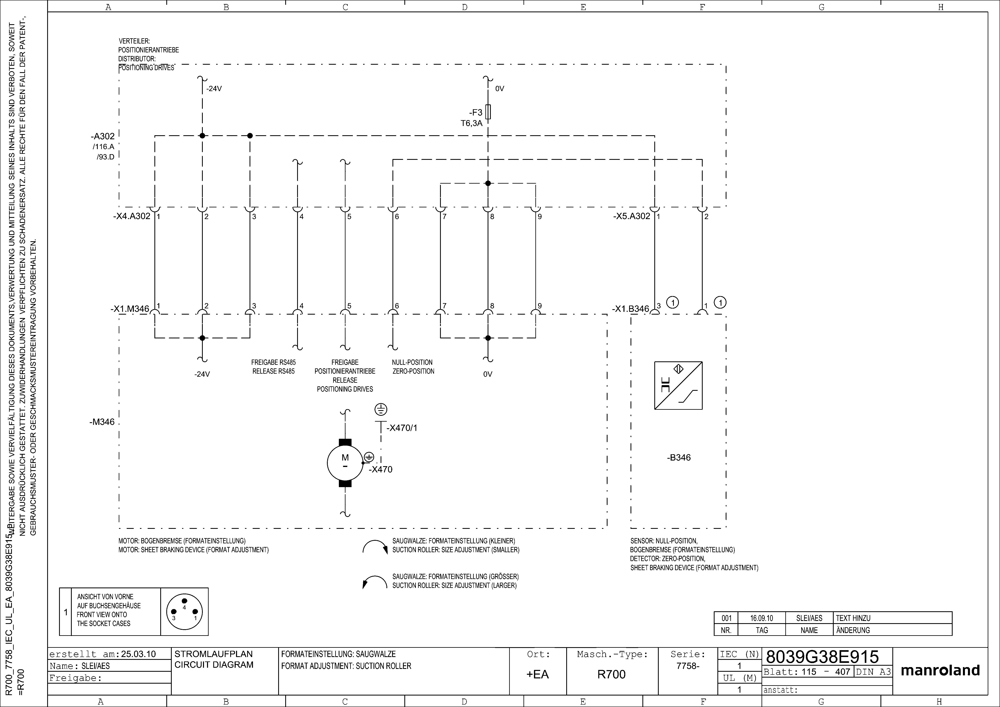

# +EA — Sheet 115 of 407 — FORMATEINSTELLUNG: SAUGWALZE

**FORMAT ADJUSTMENT: SUCTION ROLLER**

> Part of the manroland **R700** printing press IEC/UL circuit diagrams.
> Drawing class: **Stromlaufplan / Circuit diagram** (DIN A3).
> Document `+EA` covers the **Printing unit** machine section.

## At a glance

| Field | Value |
|---|---|
| Document | `+EA`  (8039G38E915) |
| Sheet | **115** of 407 |
| Section (DE) | FORMATEINSTELLUNG: SAUGWALZE |
| Section (EN) | FORMAT ADJUSTMENT: SUCTION ROLLER |
| Section type | CIRCUIT — Circuit diagram |
| Machine type | `R700` |
| Series | `7758` |
| Created | 25.03.10 |
| Replaces | — |
| Columns used | A, B, C, D, E, F, G |
| Path numbers | — |
| Labels on sheet | 80 |
| Cross-refs out | 2 |
| Cross-refs in | 24 |

**Previous:** [+EA sheet 114](SHEET_0114.md) · **Next:** [+EA sheet 116](SHEET_0116.md) · **Document TOC:** [_TOC.md](_TOC.md)  (+EA) · **Master TOC:** [all sheets](../_MASTER_TOC.md)

## Sheet image (300 DPI, exact vector render)



_Rendered directly from the PDF vector layer at 300 DPI (1-bit), no OCR and no resampling. Use it to confirm anything ambiguous in the text below._

## Cross-references on this sheet

Each entry is a wire leaving this sheet. The printed token is `/sheet.column`; the link resolves to that sheet inside the same document.

| Ref | Target sheet | Col | Path | Destination on target | Target section | From col |
|---|---|---|---|---|---|---|
| `/116.A` | [+EA sheet 116](SHEET_0116.md) | A | — | — | FORMATEINSTELLUNG: BOGENGERADESTOSSER | A |
| `/93.D` | [+EA sheet 93](SHEET_0093.md) | D | — | — | BLASRAHMEN | A |

### Incoming references (sheets that point here)

Every other sheet that sends a wire to this one. `Back-ref` is the token printed on *that* sheet; `Path` is its line number.

| From sheet | Cols | Back-ref | Path | Refs | What continues there |
|---|---|---|---|---|---|
| [+EA#93](SHEET_0093.md) | D | `/93.D` | — | 1 | — |
| [+EA#116](SHEET_0116.md) | A | `/116.A` | — | 1 | — |
| [+EA#217](SHEET_0217.md) | B | `/217.B` | — | 2 | — |
| [+EA#218](SHEET_0218.md) | F | `/218.F` | — | 9 | — |
| [+EA#236](SHEET_0236.md) | C | `/236.C` | — | 9 | — |
| [+EA#240](SHEET_0240.md) | A | `/240.A` | — | 2 | — |


## Devices on this sheet

| Tag | Class | Class meaning (IEC) | Col | Sub | Terminal | Sign |
|---|---|---|---|---|---|---|
| `B346` | B | Umformer / transducer, sensor | F | — | — | — |
| `A302` | A | Baugruppe / assembly, module, PC board | A | — | — | — |
| `F3` | F | Schutz / protection device (fuse, circuit breaker) | D | — | — | — |
| `X470/1` | X | Klemme / terminal, plug connector | C | 1 | — | — |
| `X470` | X | Klemme / terminal, plug connector | C | — | — | — |
| `X1.M346` | — | cross-device reference | A | — | — | — |
| `X1.B346` | — | cross-device reference | E | — | — | — |
| `X5.A302` | — | cross-device reference | E | — | — | — |
| `X4.A302` | — | cross-device reference | A | — | — | — |
| `NR.` | — | cross-device reference | F | — | — | — |
| `16.09.10` | — | cross-device reference | F | — | — | — |

## Potentials / nets

| Potential | Count | Columns | Attached devices | Terminals |
|---|---|---|---|---|
| `0V` | 2 | D | — | — |
| `24V` | 2 | B | — | — |
| `M346` | 1 | A | — | — |


A potential such as `L24+/4` or `M24+` is a named supply/return rail; every place it appears on this sheet is electrically common.

## Wire-end annotations (grouped as printed)

A wire that continues elsewhere is annotated with a small cluster: the destination description, the path/line number `#NN`, and the `/sheet.column` cross reference. Each row below is one such cluster exactly as it is grouped on the drawing.

| Col | Y | Path | Cross-ref | Text on the wire |
|---|---|---|---|---|
| A | 46.0 | — | — | `POSITIONIERANTRIEBE DISTRIBUTOR: POSITIONING DRIVES VERTEILER:` |
| B | 101.6 | — | — | `24V` |
| D | 101.6 | — | — | `0V` |
| D | 129.3 | — | — | `F3` |
| D | 142.3 | — | — | `T6,3A` |
| A | 157.6 | — | — | `A302` |
| A | 170.7 | — | `/116.A` | — |
| A | 183.1 | — | `/93.D` | — |
| D | 252.6 | — | — | `X4.A302 1 2 3 4 5 6 7 8 9 X5.A302 1 2` |
| F | 356.9 | — | — | `1 1` |
| D | 360.3 | — | — | `X1.M346 1 2 3 4 5 6 7 8 9 X1.B346 3 1` |
| B | 428.6 | — | — | `FREIGABE RS485` |
| C | 428.6 | — | — | `POSITIONIERANTRIEBE FREIGABE` |
| D | 428.6 | — | — | `NULL POSITION` |
| B | 439.3 | — | — | `RELEASE RS485` |
| D | 439.3 | — | — | `ZERO POSITION` |
| C | 441.8 | — | — | `24V 0V` |
| C | 449.9 | — | — | `POSITIONING DRIVES RELEASE` |
| A | 497.8 | — | — | `M346` |
| C | 504.9 | — | — | `X470/1` |
| C | 540.3 | — | — | `M` |
| F | 540.3 | — | — | `B346` |
| C | 554.5 | — | — | `X470` |
| D | 641.2 | — | — | `SAUGWALZE: FORMATEINSTELLUNG (KLEINER) SUCTION ROLLER: SIZE ADJUSTMENT (SMALLER)` |
| F | 641.2 | — | — | `BOGENBREMSE (FORMATEINSTELLUNG) DETECTOR: ZERO POSITION, SENSOR: NULL POSITION,` |
| B | 641.3 | — | — | `MOTOR: BOGENBREMSE (FORMATEINSTELLUNG) MOTOR: SHEET BRAKING DEVICE (FORMAT ADJUSTMENT)` |
| F | 673.2 | — | — | `SHEET BRAKING DEVICE (FORMAT ADJUSTMENT)` |
| D | 683.8 | — | — | `SAUGWALZE: FORMATEINSTELLUNG (GRÖSSER) SUCTION ROLLER: SIZE ADJUSTMENT (LARGER)` |
| A | 707.9 | — | — | `FRONT VIEW ONTO ANSICHT VON VORNE AUF BUCHSENGEHÄUSE` |
| A | 720.2 | — | — | `1 THE SOCKET CASES 4` |
| B | 732.9 | — | — | `3 1` |
| G | 733.0 | — | — | `001 16.09.10 SLEI/AES TEXT HINZU` |
| G | 747.1 | — | — | `NR. TAG NAME ÄNDERUNG` |


## Reconstructed tables

This sheet carries tabular content (pin map / terminal assignment / index). The grid below was rebuilt from the drawing's own rule lines, so each row is exactly one physical row of the table.

### Table 1 — 2 data rows × 8 columns (at x=85.0, y=161.6) — **A302 /116.A /93.D**

| X4.A302 X1.M346 | 1 1 |  | 2 2 |  | 3 3 | 4 4 | 5 5 |
|---|---|---|---|---|---|---|---|
| `M346 MOTOR: MOTOR: SHEET` |  | `24V BOGENBREMSE BRAKING DEVICE` |  | `(FORMATEINSTELLUNG) (FORMAT` | `FREIGABE RS485 RELEASE RS485 ADJUSTMENT)` | `FREIGABE POSITIONIERANTRIEBE RELEASE POSITIONING` | `DRIVES M X470` |
| `ANSICHT VON VORNE AUF BUCHSENGEHÄUSE FRONT VIEW ONTO THE SOCKET CASES` |  | `4 3 1` |  |  |  |  |  |


### Table 2 — 1 data rows × 3 columns (at x=467.7, y=161.6)

| 6 6 | 7 7 | 8 8 |
|---|---|---|
| `NULL POSITION ZERO POSITION X470/1 SAUGWALZE: SUCTION ROLLER: SAUGWALZE: SUCTION ROLLER:` | `FORMATEINSTELLUNG SIZE ADJUSTMENT FORMATEINSTELLUNG SIZE ADJUSTMENT` | `(KLEINER) (SMALLER) (GRÖSSER) (LARGER)` |


## Notes and free text on this sheet

| Text | Col | Y (pt) |
|---|---|---|
| `MOTOR: BOGENBREMSE (FORMATEINSTELLUNG)` | B | 641.27 |
| `MOTOR: SHEET BRAKING DEVICE (FORMAT ADJUSTMENT)` | B | 651.9 |
| `M` | C | 540.33 |
| `SENSOR: NULL POSITION,` | F | 641.25 |
| `BOGENBREMSE (FORMATEINSTELLUNG)` | F | 651.9 |
| `DETECTOR: ZERO POSITION,` | F | 662.51 |
| `SHEET BRAKING DEVICE (FORMAT ADJUSTMENT)` | F | 673.16 |
| `T6,3A` | D | 142.3 |
| `VERTEILER:` | A | 45.96 |
| `POSITIONIERANTRIEBE` | A | 56.59 |
| `DISTRIBUTOR:` | A | 67.22 |
| `POSITIONING DRIVES` | A | 77.86 |
| `TAG` | G | 747.27 |
| `NAME` | G | 747.25 |
| `ÄNDERUNG` | G | 747.31 |
| `SLEI/AES` | G | 733.13 |
| `TEXT HINZU` | G | 733.13 |
| `FREIGABE` | C | 428.61 |
| `POSITIONIERANTRIEBE` | C | 439.27 |
| `RELEASE` | C | 449.88 |
| `POSITIONING DRIVES` | C | 460.54 |
| `FREIGABE RS485` | B | 428.64 |
| `RELEASE RS485` | B | 439.28 |
| `NULL POSITION` | D | 428.65 |
| `ZERO POSITION` | D | 439.29 |
| `SAUGWALZE: FORMATEINSTELLUNG (GRÖSSER)` | D | 683.78 |
| `SUCTION ROLLER: SIZE ADJUSTMENT (LARGER)` | D | 694.42 |
| `SAUGWALZE: FORMATEINSTELLUNG (KLEINER)` | D | 641.25 |
| `SUCTION ROLLER: SIZE ADJUSTMENT (SMALLER)` | D | 651.9 |
| `ANSICHT VON VORNE` | A | 707.88 |
| `AUF BUCHSENGEHÄUSE` | A | 718.51 |
| `FRONT VIEW ONTO` | A | 729.1 |
| `THE SOCKET CASES` | A | 739.75 |

## Complete label inventory (exact text from the drawing)

Every text object inside the drawing area of this sheet, in DIN reading order (column A→H, then top→bottom). This is the authoritative list: if a string is not here it is not printed on this sheet.

| Col | Y | X | Dir | Type | Text |
|---|---|---|---|---|---|
| A | 46.0 | 141.7 | → | text | `VERTEILER:` |
| A | 56.6 | 140.9 | → | text | `POSITIONIERANTRIEBE` |
| A | 67.2 | 140.9 | → | text | `DISTRIBUTOR:` |
| A | 77.9 | 140.9 | → | text | `POSITIONING DRIVES` |
| A | 157.6 | 108.3 | → | device tag | `A302` |
| A | 170.7 | 110.6 | → | cross-reference | `/116.A` |
| A | 183.1 | 115.4 | → | cross-reference | `/93.D` |
| A | 252.6 | 134.9 | → | device ref | `X4.A302` |
| A | 254.0 | 186.2 | → | number | `1` |
| A | 360.3 | 186.2 | → | number | `1` |
| A | 363.1 | 131.8 | → | device ref | `X1.M346` |
| A | 497.8 | 106.6 | → | potential | `M346` |
| A | 707.9 | 92.1 | → | text | `ANSICHT VON VORNE` |
| A | 718.5 | 92.1 | → | text | `AUF BUCHSENGEHÄUSE` |
| A | 724.5 | 75.4 | → | number | `1` |
| A | 729.1 | 91.3 | → | text | `FRONT VIEW ONTO` |
| A | 739.8 | 91.8 | → | text | `THE SOCKET CASES` |
| B | 101.6 | 245.8 | → | potential | `24V` |
| B | 254.0 | 243.5 | → | number | `2` |
| B | 254.0 | 300.2 | → | number | `3` |
| B | 360.3 | 243.5 | → | number | `2` |
| B | 360.3 | 300.2 | → | number | `3` |
| B | 428.6 | 299.3 | → | text | `FREIGABE RS485` |
| B | 439.3 | 300.7 | → | text | `RELEASE RS485` |
| B | 441.8 | 231.6 | → | potential | `24V` |
| B | 641.3 | 141.2 | → | text | `MOTOR: BOGENBREMSE (FORMATEINSTELLUNG)` |
| B | 651.9 | 141.2 | → | text | `MOTOR: SHEET BRAKING DEVICE (FORMAT ADJUSTMENT)` |
| B | 720.2 | 217.7 | → | number | `4` |
| B | 732.9 | 204.9 | → | number | `3` |
| B | 732.9 | 230.9 | → | number | `1` |
| C | 254.0 | 356.9 | → | number | `4` |
| C | 254.0 | 413.6 | → | number | `5` |
| C | 254.0 | 470.3 | → | number | `6` |
| C | 360.3 | 356.9 | → | number | `4` |
| C | 360.3 | 413.6 | → | number | `5` |
| C | 360.3 | 470.3 | → | number | `6` |
| C | 428.6 | 394.8 | → | text | `FREIGABE` |
| C | 439.3 | 374.8 | → | text | `POSITIONIERANTRIEBE` |
| C | 449.9 | 396.2 | → | text | `RELEASE` |
| C | 460.5 | 377.6 | → | text | `POSITIONING DRIVES` |
| C | 504.9 | 460.3 | → | device tag | `X470/1` |
| C | 540.3 | 406.6 | → | text | `M` |
| C | 554.5 | 439.1 | → | device tag | `X470` |
| D | 101.6 | 589.7 | → | potential | `0V` |
| D | 129.3 | 558.7 | → | device tag | `F3` |
| D | 142.3 | 548.5 | → | text | `T6,3A` |
| D | 254.0 | 527.0 | → | number | `7` |
| D | 254.0 | 583.7 | → | number | `8` |
| D | 360.3 | 527.0 | → | number | `7` |
| D | 360.3 | 583.7 | → | number | `8` |
| D | 428.7 | 466.9 | → | text | `NULL POSITION` |
| D | 439.3 | 467.7 | → | text | `ZERO POSITION` |
| D | 441.8 | 575.6 | → | potential | `0V` |
| D | 641.3 | 467.4 | → | text | `SAUGWALZE: FORMATEINSTELLUNG (KLEINER)` |
| D | 651.9 | 467.4 | → | text | `SUCTION ROLLER: SIZE ADJUSTMENT (SMALLER)` |
| D | 683.8 | 467.4 | → | text | `SAUGWALZE: FORMATEINSTELLUNG (GRÖSSER)` |
| D | 694.4 | 467.4 | → | text | `SUCTION ROLLER: SIZE ADJUSTMENT (LARGER)` |
| E | 252.6 | 730.2 | → | device ref | `X5.A302` |
| E | 254.0 | 640.3 | → | number | `9` |
| E | 360.3 | 640.3 | → | number | `9` |
| E | 363.1 | 728.8 | → | device ref | `X1.B346` |
| F | 254.0 | 781.5 | → | number | `1` |
| F | 254.0 | 838.8 | → | number | `2` |
| F | 356.9 | 799.0 | → | number | `1` |
| F | 356.9 | 855.7 | → | number | `1` |
| F | 360.3 | 782.1 | → | number | `3` |
| F | 360.3 | 838.2 | → | number | `1` |
| F | 540.3 | 794.3 | → | device tag | `B346` |
| F | 641.3 | 750.9 | → | text | `SENSOR: NULL POSITION,` |
| F | 651.9 | 750.3 | → | text | `BOGENBREMSE (FORMATEINSTELLUNG)` |
| F | 662.5 | 750.3 | → | text | `DETECTOR: ZERO POSITION,` |
| F | 673.2 | 750.9 | → | text | `SHEET BRAKING DEVICE (FORMAT ADJUSTMENT)` |
| F | 733.0 | 859.4 | → | number | `001` |
| F | 733.1 | 893.2 | → | device ref | `16.09.10` |
| F | 747.1 | 858.4 | → | device ref | `NR.` |
| G | 733.1 | 948.2 | → | text | `SLEI/AES` |
| G | 733.1 | 995.4 | → | text | `TEXT HINZU` |
| G | 747.3 | 900.0 | → | text | `TAG` |
| G | 747.3 | 953.4 | → | text | `NAME` |
| G | 747.3 | 996.0 | → | text | `ÄNDERUNG` |

## Reading-order text block

The same content as a plain block, grouped by DIN column — convenient to paste or to match against a visual description.

```text
=== Column A ===
  46.0  141.7  text         VERTEILER:
  56.6  140.9  text         POSITIONIERANTRIEBE
  67.2  140.9  text         DISTRIBUTOR:
  77.9  140.9  text         POSITIONING DRIVES
 157.6  108.3  devtag       A302
 170.7  110.6  xref         /116.A
 183.1  115.4  xref         /93.D
 252.6  134.9  devref       X4.A302
 254.0  186.2  numeric      1
 360.3  186.2  numeric      1
 363.1  131.8  devref       X1.M346
 497.8  106.6  net          M346
 707.9   92.1  text         ANSICHT VON VORNE
 718.5   92.1  text         AUF BUCHSENGEHÄUSE
 724.5   75.4  numeric      1
 729.1   91.3  text         FRONT VIEW ONTO
 739.8   91.8  text         THE SOCKET CASES
=== Column B ===
 101.6  245.8  net          24V
 254.0  243.5  numeric      2
 254.0  300.2  numeric      3
 360.3  243.5  numeric      2
 360.3  300.2  numeric      3
 428.6  299.3  text         FREIGABE RS485
 439.3  300.7  text         RELEASE RS485
 441.8  231.6  net          24V
 641.3  141.2  text         MOTOR: BOGENBREMSE (FORMATEINSTELLUNG)
 651.9  141.2  text         MOTOR: SHEET BRAKING DEVICE (FORMAT ADJUSTMENT)
 720.2  217.7  numeric      4
 732.9  204.9  numeric      3
 732.9  230.9  numeric      1
=== Column C ===
 254.0  356.9  numeric      4
 254.0  413.6  numeric      5
 254.0  470.3  numeric      6
 360.3  356.9  numeric      4
 360.3  413.6  numeric      5
 360.3  470.3  numeric      6
 428.6  394.8  text         FREIGABE
 439.3  374.8  text         POSITIONIERANTRIEBE
 449.9  396.2  text         RELEASE
 460.5  377.6  text         POSITIONING DRIVES
 504.9  460.3  devtag       X470/1
 540.3  406.6  text         M
 554.5  439.1  devtag       X470
=== Column D ===
 101.6  589.7  net          0V
 129.3  558.7  devtag       F3
 142.3  548.5  text         T6,3A
 254.0  527.0  numeric      7
 254.0  583.7  numeric      8
 360.3  527.0  numeric      7
 360.3  583.7  numeric      8
 428.7  466.9  text         NULL POSITION
 439.3  467.7  text         ZERO POSITION
 441.8  575.6  net          0V
 641.3  467.4  text         SAUGWALZE: FORMATEINSTELLUNG (KLEINER)
 651.9  467.4  text         SUCTION ROLLER: SIZE ADJUSTMENT (SMALLER)
 683.8  467.4  text         SAUGWALZE: FORMATEINSTELLUNG (GRÖSSER)
 694.4  467.4  text         SUCTION ROLLER: SIZE ADJUSTMENT (LARGER)
=== Column E ===
 252.6  730.2  devref       X5.A302
 254.0  640.3  numeric      9
 360.3  640.3  numeric      9
 363.1  728.8  devref       X1.B346
=== Column F ===
 254.0  781.5  numeric      1
 254.0  838.8  numeric      2
 356.9  799.0  numeric      1
 356.9  855.7  numeric      1
 360.3  782.1  numeric      3
 360.3  838.2  numeric      1
 540.3  794.3  devtag       B346
 641.3  750.9  text         SENSOR: NULL POSITION,
 651.9  750.3  text         BOGENBREMSE (FORMATEINSTELLUNG)
 662.5  750.3  text         DETECTOR: ZERO POSITION,
 673.2  750.9  text         SHEET BRAKING DEVICE (FORMAT ADJUSTMENT)
 733.0  859.4  numeric      001
 733.1  893.2  devref       16.09.10
 747.1  858.4  devref       NR.
=== Column G ===
 733.1  948.2  text         SLEI/AES
 733.1  995.4  text         TEXT HINZU
 747.3  900.0  text         TAG
 747.3  953.4  text         NAME
 747.3  996.0  text         ÄNDERUNG
```

---
_Generated from the PDF vector text layer; no OCR. Source: `R700_7758_IEC_UL_EA_8039G38E915_p`, sheet 115._
