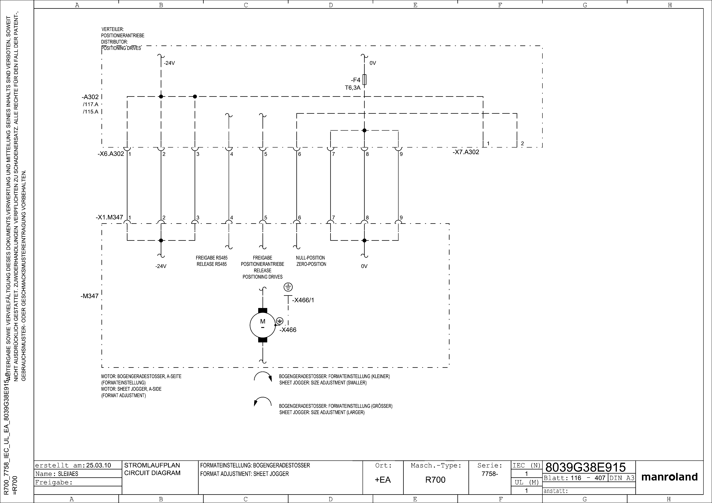

# +EA — Sheet 116 of 407 — FORMATEINSTELLUNG: BOGENGERADESTOSSER

**FORMAT ADJUSTMENT: SHEET JOGGER**

> Part of the manroland **R700** printing press IEC/UL circuit diagrams.
> Drawing class: **Stromlaufplan / Circuit diagram** (DIN A3).
> Document `+EA` covers the **Printing unit** machine section.

## At a glance

| Field | Value |
|---|---|
| Document | `+EA`  (8039G38E915) |
| Sheet | **116** of 407 |
| Section (DE) | FORMATEINSTELLUNG: BOGENGERADESTOSSER |
| Section (EN) | FORMAT ADJUSTMENT: SHEET JOGGER |
| Section type | CIRCUIT — Circuit diagram |
| Machine type | `R700` |
| Series | `7758` |
| Created | 25.03.10 |
| Replaces | — |
| Columns used | A, B, C, D, E, F |
| Path numbers | — |
| Labels on sheet | 56 |
| Cross-refs out | 2 |
| Cross-refs in | 22 |

**Previous:** [+EA sheet 115](SHEET_0115.md) · **Next:** [+EA sheet 117](SHEET_0117.md) · **Document TOC:** [_TOC.md](_TOC.md)  (+EA) · **Master TOC:** [all sheets](../_MASTER_TOC.md)

## Sheet image (300 DPI, exact vector render)



_Rendered directly from the PDF vector layer at 300 DPI (1-bit), no OCR and no resampling. Use it to confirm anything ambiguous in the text below._

## Cross-references on this sheet

Each entry is a wire leaving this sheet. The printed token is `/sheet.column`; the link resolves to that sheet inside the same document.

| Ref | Target sheet | Col | Path | Destination on target | Target section | From col |
|---|---|---|---|---|---|---|
| `/117.A` | [+EA sheet 117](SHEET_0117.md) | A | — | — | FORMATEINSTELLUNG: BOGENGERADESTOSSER | A |
| `/115.A` | [+EA sheet 115](SHEET_0115.md) | A | — | — | FORMATEINSTELLUNG: SAUGWALZE | A |

### Incoming references (sheets that point here)

Every other sheet that sends a wire to this one. `Back-ref` is the token printed on *that* sheet; `Path` is its line number.

| From sheet | Cols | Back-ref | Path | Refs | What continues there |
|---|---|---|---|---|---|
| [+EA#115](SHEET_0115.md) | A | `/115.A` | — | 1 | — |
| [+EA#117](SHEET_0117.md) | A | `/117.A` | — | 1 | — |
| [+EA#218](SHEET_0218.md) | F | `/218.F` | — | 9 | — |
| [+EA#244](SHEET_0244.md) | C | `/244.C` | — | 9 | — |
| [+EA#246](SHEET_0246.md) | C | `/246.C` | — | 2 | — |


## Devices on this sheet

| Tag | Class | Class meaning (IEC) | Col | Sub | Terminal | Sign |
|---|---|---|---|---|---|---|
| `A302` | A | Baugruppe / assembly, module, PC board | A | — | — | — |
| `F4` | F | Schutz / protection device (fuse, circuit breaker) | D | — | — | — |
| `X466/1` | X | Klemme / terminal, plug connector | D | 1 | — | — |
| `X466` | X | Klemme / terminal, plug connector | C | — | — | — |
| `X1.M347` | — | cross-device reference | A | — | — | — |
| `X6.A302` | — | cross-device reference | A | — | — | — |
| `X7.A302` | — | cross-device reference | F | — | — | — |

## Potentials / nets

| Potential | Count | Columns | Attached devices | Terminals |
|---|---|---|---|---|
| `0V` | 2 | D | — | — |
| `24V` | 2 | B | — | — |
| `M347` | 1 | A | — | — |


A potential such as `L24+/4` or `M24+` is a named supply/return rail; every place it appears on this sheet is electrically common.

## Wire-end annotations (grouped as printed)

A wire that continues elsewhere is annotated with a small cluster: the destination description, the path/line number `#NN`, and the `/sheet.column` cross reference. Each row below is one such cluster exactly as it is grouped on the drawing.

| Col | Y | Path | Cross-ref | Text on the wire |
|---|---|---|---|---|
| B | 46.0 | — | — | `POSITIONIERANTRIEBE DISTRIBUTOR: POSITIONING DRIVES VERTEILER:` |
| C | 101.6 | — | — | `24V 0V` |
| D | 129.3 | — | — | `F4` |
| D | 142.3 | — | — | `T6,3A` |
| A | 157.6 | — | — | `A302` |
| A | 170.7 | — | `/117.A`, `/115.A` | — |
| F | 236.3 | — | — | `X7.A302 1 2` |
| C | 252.6 | — | — | `X6.A302 1 2 3 4 5 6 7 8 9` |
| C | 358.9 | — | — | `X1.M347 1 2 3 4 5 6 7 8 9` |
| C | 428.6 | — | — | `FREIGABE RS485` |
| C | 428.6 | — | — | `POSITIONIERANTRIEBE FREIGABE` |
| D | 428.6 | — | — | `NULL POSITION` |
| C | 439.3 | — | — | `RELEASE RS485` |
| D | 439.3 | — | — | `ZERO POSITION` |
| C | 441.8 | — | — | `24V 0V` |
| C | 449.9 | — | — | `POSITIONING DRIVES RELEASE` |
| A | 490.7 | — | — | `M347` |
| D | 497.8 | — | — | `X466/1` |
| C | 533.2 | — | — | `M` |
| C | 547.4 | — | — | `X466` |
| B | 627.1 | — | — | `MOTOR: BOGENGERADESTOSSER, A SEITE (FORMATEINSTELLUNG) MOTOR: SHEET JOGGER, A SIDE (FORMAT ADJUSTMENT)` |
| D | 627.1 | — | — | `BOGENGERADESTOSSER: FORMATEINSTELLUNG (KLEINER)` |
| D | 637.7 | — | — | `SHEET JOGGER: SIZE ADJUSTMENT (SMALLER)` |
| D | 676.7 | — | — | `BOGENGERADESTOSSER: FORMATEINSTELLUNG (GRÖSSER)` |
| D | 687.3 | — | — | `SHEET JOGGER: SIZE ADJUSTMENT (LARGER)` |


## Reconstructed tables

This sheet carries tabular content (pin map / terminal assignment / index). The grid below was rebuilt from the drawing's own rule lines, so each row is exactly one physical row of the table.

### Table 1 — 5 data rows × 18 columns (at x=204.1, y=0.0) — **POSITIONIERANTRIEBE DRIVES 24V F4 T6,3A 0V 1 1 2 2 3 3 4 4 5 5 6 6 7 7 8 8 9 9 X7.A302 1 2 (FORMATEINSTELLUNG) SHEET 24V BOGENGERADESTOSSER, JOGGER, A SIDE ADJUSTMENT) A SEITE FREIGABE RS485 RELEASE RS485 FREIGABE POSITIONIERANTRIEBE RELEASE POSITIONING M DRIVES X466 SHEET SHEET NULL POSITION ZERO POSITION X466/1 BOGENGERADESTOSSER: JOGGER: SIZE BOGENGERADESTOSSER: JOGGER: SIZE FORMATEINSTELLUNG ADJUSTMENT (SMALLER) FORMATEINSTELLUNG ADJUSTMENT (LARGER) (KLEINER) (GRÖSSER)**

|  | STROMLAUFPLAN |  |  | FORMATEINSTELLUNG: |  | BOGENGERADESTOSSER |  |  |  | Ort: |  | Masch. Type: |  | Serie: |  | IEC (N) | 8039G38E915 |
|---|---|---|---|---|---|---|---|---|---|---|---|---|---|---|---|---|---|
|  | `CIRCUIT` | `DIAGRAM` |  |  |  |  |  |  |  |  |  |  |  |  |  |  |  |
|  |  |  |  | `FORMAT` | `ADJUSTMENT: SHEET` | `JOGGER` |  |  |  |  |  |  |  | `7758` |  | `1` |  |
|  |  |  |  |  |  |  |  |  |  | `+EA` |  | `R700` |  |  |  |  | `Blatt: DIN A3 116 407` |
|  |  |  |  |  |  |  |  |  |  |  |  |  |  |  |  | `UL (M)` |  |
|  |  |  |  |  |  |  |  |  |  |  |  |  |  |  |  | `1` | `anstatt:` |


## Notes and free text on this sheet

| Text | Col | Y (pt) |
|---|---|---|
| `MOTOR: BOGENGERADESTOSSER, A SEITE` | B | 627.08 |
| `(FORMATEINSTELLUNG)` | B | 637.73 |
| `MOTOR: SHEET JOGGER, A SIDE` | B | 648.34 |
| `(FORMAT ADJUSTMENT)` | B | 658.99 |
| `M` | C | 533.24 |
| `VERTEILER:` | A | 45.96 |
| `POSITIONIERANTRIEBE` | B | 56.59 |
| `DISTRIBUTOR:` | A | 67.22 |
| `POSITIONING DRIVES` | B | 77.86 |
| `T6,3A` | D | 142.3 |
| `FREIGABE` | C | 428.61 |
| `POSITIONIERANTRIEBE` | C | 439.27 |
| `RELEASE` | C | 449.88 |
| `POSITIONING DRIVES` | C | 460.54 |
| `FREIGABE RS485` | C | 428.64 |
| `RELEASE RS485` | C | 439.28 |
| `NULL POSITION` | D | 428.65 |
| `ZERO POSITION` | D | 439.29 |
| `BOGENGERADESTOSSER: FORMATEINSTELLUNG (KLEINER)` | D | 627.09 |
| `SHEET JOGGER: SIZE ADJUSTMENT (SMALLER)` | D | 637.72 |
| `BOGENGERADESTOSSER: FORMATEINSTELLUNG (GRÖSSER)` | D | 676.7 |
| `SHEET JOGGER: SIZE ADJUSTMENT (LARGER)` | D | 687.32 |

## Complete label inventory (exact text from the drawing)

Every text object inside the drawing area of this sheet, in DIN reading order (column A→H, then top→bottom). This is the authoritative list: if a string is not here it is not printed on this sheet.

| Col | Y | X | Dir | Type | Text |
|---|---|---|---|---|---|
| A | 46.0 | 170.1 | → | text | `VERTEILER:` |
| A | 67.2 | 169.2 | → | text | `DISTRIBUTOR:` |
| A | 157.6 | 136.6 | → | device tag | `A302` |
| A | 170.7 | 138.9 | → | cross-reference | `/117.A` |
| A | 183.1 | 138.9 | → | cross-reference | `/115.A` |
| A | 252.6 | 163.3 | → | device ref | `X6.A302` |
| A | 358.9 | 160.2 | → | device ref | `X1.M347` |
| A | 490.7 | 134.9 | → | potential | `M347` |
| B | 56.6 | 169.2 | → | text | `POSITIONIERANTRIEBE` |
| B | 77.9 | 169.2 | → | text | `POSITIONING DRIVES` |
| B | 101.6 | 274.1 | → | potential | `24V` |
| B | 254.0 | 214.6 | → | number | `1` |
| B | 254.0 | 271.8 | → | number | `2` |
| B | 254.0 | 328.5 | → | number | `3` |
| B | 360.3 | 214.6 | → | number | `1` |
| B | 360.3 | 271.8 | → | number | `2` |
| B | 360.3 | 328.5 | → | number | `3` |
| B | 441.8 | 259.9 | → | potential | `24V` |
| B | 627.1 | 169.5 | → | text | `MOTOR: BOGENGERADESTOSSER, A SEITE` |
| B | 637.7 | 169.5 | → | text | `(FORMATEINSTELLUNG)` |
| B | 648.3 | 169.5 | → | text | `MOTOR: SHEET JOGGER, A SIDE` |
| B | 659.0 | 169.5 | → | text | `(FORMAT ADJUSTMENT)` |
| C | 254.0 | 385.2 | → | number | `4` |
| C | 254.0 | 441.9 | → | number | `5` |
| C | 360.3 | 385.2 | → | number | `4` |
| C | 360.3 | 441.9 | → | number | `5` |
| C | 428.6 | 327.6 | → | text | `FREIGABE RS485` |
| C | 428.6 | 423.1 | → | text | `FREIGABE` |
| C | 439.3 | 329.0 | → | text | `RELEASE RS485` |
| C | 439.3 | 403.1 | → | text | `POSITIONIERANTRIEBE` |
| C | 449.9 | 424.5 | → | text | `RELEASE` |
| C | 460.5 | 405.9 | → | text | `POSITIONING DRIVES` |
| C | 533.2 | 435.0 | → | text | `M` |
| C | 547.4 | 467.4 | → | device tag | `X466` |
| D | 101.6 | 618.1 | → | potential | `0V` |
| D | 129.3 | 587.1 | → | device tag | `F4` |
| D | 142.3 | 576.9 | → | text | `T6,3A` |
| D | 254.0 | 498.6 | → | number | `6` |
| D | 254.0 | 555.3 | → | number | `7` |
| D | 254.0 | 612.0 | → | number | `8` |
| D | 360.3 | 498.6 | → | number | `6` |
| D | 360.3 | 555.3 | → | number | `7` |
| D | 360.3 | 612.0 | → | number | `8` |
| D | 428.7 | 495.2 | → | text | `NULL POSITION` |
| D | 439.3 | 496.1 | → | text | `ZERO POSITION` |
| D | 441.8 | 603.9 | → | potential | `0V` |
| D | 497.8 | 488.7 | → | device tag | `X466/1` |
| D | 627.1 | 466.9 | → | text | `BOGENGERADESTOSSER: FORMATEINSTELLUNG (KLEINER)` |
| D | 637.7 | 467.4 | → | text | `SHEET JOGGER: SIZE ADJUSTMENT (SMALLER)` |
| D | 676.7 | 466.9 | → | text | `BOGENGERADESTOSSER: FORMATEINSTELLUNG (GRÖSSER)` |
| D | 687.3 | 467.4 | → | text | `SHEET JOGGER: SIZE ADJUSTMENT (LARGER)` |
| E | 254.0 | 668.7 | → | number | `9` |
| E | 360.3 | 668.7 | → | number | `9` |
| F | 236.3 | 814.1 | → | number | `1` |
| F | 236.3 | 871.4 | → | number | `2` |
| F | 249.8 | 757.1 | → | device ref | `X7.A302` |

## Reading-order text block

The same content as a plain block, grouped by DIN column — convenient to paste or to match against a visual description.

```text
=== Column A ===
  46.0  170.1  text         VERTEILER:
  67.2  169.2  text         DISTRIBUTOR:
 157.6  136.6  devtag       A302
 170.7  138.9  xref         /117.A
 183.1  138.9  xref         /115.A
 252.6  163.3  devref       X6.A302
 358.9  160.2  devref       X1.M347
 490.7  134.9  net          M347
=== Column B ===
  56.6  169.2  text         POSITIONIERANTRIEBE
  77.9  169.2  text         POSITIONING DRIVES
 101.6  274.1  net          24V
 254.0  214.6  numeric      1
 254.0  271.8  numeric      2
 254.0  328.5  numeric      3
 360.3  214.6  numeric      1
 360.3  271.8  numeric      2
 360.3  328.5  numeric      3
 441.8  259.9  net          24V
 627.1  169.5  text         MOTOR: BOGENGERADESTOSSER, A SEITE
 637.7  169.5  text         (FORMATEINSTELLUNG)
 648.3  169.5  text         MOTOR: SHEET JOGGER, A SIDE
 659.0  169.5  text         (FORMAT ADJUSTMENT)
=== Column C ===
 254.0  385.2  numeric      4
 254.0  441.9  numeric      5
 360.3  385.2  numeric      4
 360.3  441.9  numeric      5
 428.6  327.6  text         FREIGABE RS485
 428.6  423.1  text         FREIGABE
 439.3  329.0  text         RELEASE RS485
 439.3  403.1  text         POSITIONIERANTRIEBE
 449.9  424.5  text         RELEASE
 460.5  405.9  text         POSITIONING DRIVES
 533.2  435.0  text         M
 547.4  467.4  devtag       X466
=== Column D ===
 101.6  618.1  net          0V
 129.3  587.1  devtag       F4
 142.3  576.9  text         T6,3A
 254.0  498.6  numeric      6
 254.0  555.3  numeric      7
 254.0  612.0  numeric      8
 360.3  498.6  numeric      6
 360.3  555.3  numeric      7
 360.3  612.0  numeric      8
 428.7  495.2  text         NULL POSITION
 439.3  496.1  text         ZERO POSITION
 441.8  603.9  net          0V
 497.8  488.7  devtag       X466/1
 627.1  466.9  text         BOGENGERADESTOSSER: FORMATEINSTELLUNG (KLEINER)
 637.7  467.4  text         SHEET JOGGER: SIZE ADJUSTMENT (SMALLER)
 676.7  466.9  text         BOGENGERADESTOSSER: FORMATEINSTELLUNG (GRÖSSER)
 687.3  467.4  text         SHEET JOGGER: SIZE ADJUSTMENT (LARGER)
=== Column E ===
 254.0  668.7  numeric      9
 360.3  668.7  numeric      9
=== Column F ===
 236.3  814.1  numeric      1
 236.3  871.4  numeric      2
 249.8  757.1  devref       X7.A302
```

---
_Generated from the PDF vector text layer; no OCR. Source: `R700_7758_IEC_UL_EA_8039G38E915_p`, sheet 116._
