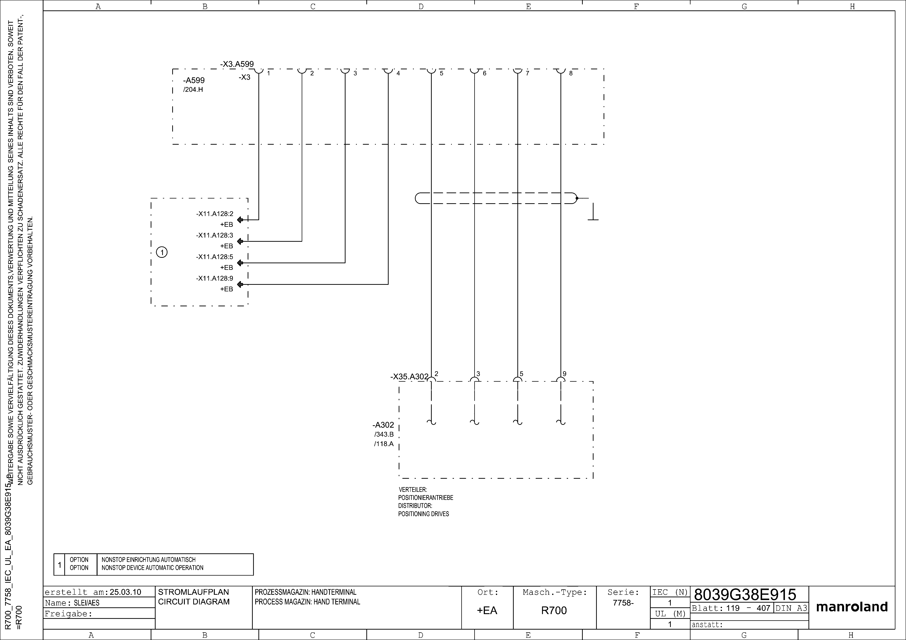

# +EA — Sheet 119 of 407 — PROZESSMAGAZIN: HANDTERMINAL

**PROCESS MAGAZIN: HAND TERMINAL**

> Part of the manroland **R700** printing press IEC/UL circuit diagrams.
> Drawing class: **Stromlaufplan / Circuit diagram** (DIN A3).
> Document `+EA` covers the **Printing unit** machine section.

## At a glance

| Field | Value |
|---|---|
| Document | `+EA`  (8039G38E915) |
| Sheet | **119** of 407 |
| Section (DE) | PROZESSMAGAZIN: HANDTERMINAL |
| Section (EN) | PROCESS MAGAZIN: HAND TERMINAL |
| Section type | CIRCUIT — Circuit diagram |
| Machine type | `R700` |
| Series | `7758` |
| Created | 25.03.10 |
| Replaces | — |
| Columns used | A, B, C, D, E |
| Path numbers | — |
| Labels on sheet | 38 |
| Cross-refs out | 3 |
| Cross-refs in | 15 |

**Previous:** [+EA sheet 118](SHEET_0118.md) · **Next:** [+EA sheet 120](SHEET_0120.md) · **Document TOC:** [_TOC.md](_TOC.md)  (+EA) · **Master TOC:** [all sheets](../_MASTER_TOC.md)

## Sheet image (300 DPI, exact vector render)



_Rendered directly from the PDF vector layer at 300 DPI (1-bit), no OCR and no resampling. Use it to confirm anything ambiguous in the text below._

## Cross-references on this sheet

Each entry is a wire leaving this sheet. The printed token is `/sheet.column`; the link resolves to that sheet inside the same document.

| Ref | Target sheet | Col | Path | Destination on target | Target section | From col |
|---|---|---|---|---|---|---|
| `/204.H` | [+EA sheet 204](SHEET_0204.md) | H | — | 1 2 3 4 5 6 7 8 X3 A599 | REFERENZMODUL | D |
| `/343.B` | [+EA sheet 343](SHEET_0343.md) | B | — | — | OPTION: TELEPRESENCE | D |
| `/118.A` | [+EA sheet 118](SHEET_0118.md) | A | — | — | FORMATEINSTELLUNG: GREIFERÖFFNUNGSKURVE | D |

### Incoming references (sheets that point here)

Every other sheet that sends a wire to this one. `Back-ref` is the token printed on *that* sheet; `Path` is its line number.

| From sheet | Cols | Back-ref | Path | Refs | What continues there |
|---|---|---|---|---|---|
| [+EA#118](SHEET_0118.md) | A | `/118.A` | — | 1 | — |
| [+EA#204](SHEET_0204.md) | H | `/204.H` | — | 1 | — |
| [+EA#235](SHEET_0235.md) | F | `/235.F` | — | 8 | — |
| [+EA#278](SHEET_0278.md) | E | `/278.E` | — | 4 | — |
| [+EA#343](SHEET_0343.md) | E | `/343.E` | — | 1 | VERTEILER: POSITIONIERANTRIEBE DISTRIBUTOR: POSITIONING DRIVES |


## Devices on this sheet

| Tag | Class | Class meaning (IEC) | Col | Sub | Terminal | Sign |
|---|---|---|---|---|---|---|
| `X3` | X | Klemme / terminal, plug connector | B | — | — | — |
| `A599` | A | Baugruppe / assembly, module, PC board | B | — | — | — |
| `A302` | A | Baugruppe / assembly, module, PC board | D | — | — | — |
| `X35.A302` | — | cross-device reference | D | — | — | — |
| `X11.A128:2` | — | cross-device reference | B | — | 2 | — |
| `X11.A128:3` | — | cross-device reference | B | — | 3 | — |
| `X11.A128:5` | — | cross-device reference | B | — | 5 | — |
| `X11.A128:9` | — | cross-device reference | B | — | 9 | — |
| `X3.A599` | — | cross-device reference | B | — | — | — |

## Potentials / nets

_No named potentials on this sheet._

## Wire-end annotations (grouped as printed)

A wire that continues elsewhere is annotated with a small cluster: the destination description, the path/line number `#NN`, and the `/sheet.column` cross reference. Each row below is one such cluster exactly as it is grouped on the drawing.

| Col | Y | Path | Cross-ref | Text on the wire |
|---|---|---|---|---|
| B | 79.7 | — | — | `X3.A599` |
| D | 92.9 | — | `/204.H` | `A599 X3 1 2 3 4 5 6 7 8` |
| B | 277.4 | — | — | `X11.A128:2` |
| B | 291.5 | — | — | `+EB` |
| B | 305.7 | — | — | `X11.A128:3` |
| B | 319.9 | — | — | `+EB` |
| B | 328.6 | — | — | `1` |
| B | 334.1 | — | — | `X11.A128:5` |
| B | 348.2 | — | — | `+EB` |
| B | 362.4 | — | — | `X11.A128:9` |
| B | 376.6 | — | — | `+EB` |
| D | 487.9 | — | — | `X35.A302 2` |
| E | 487.9 | — | — | `3 5 9` |
| D | 554.5 | — | — | `A302` |
| D | 567.5 | — | `/343.B`, `/118.A` | — |
| D | 641.2 | — | — | `POSITIONIERANTRIEBE DISTRIBUTOR: POSITIONING DRIVES VERTEILER:` |
| A | 733.4 | — | — | `1 OPTION OPTION` |
| B | 733.4 | — | — | `NONSTOP EINRICHTUNG AUTOMATISCH NONSTOP DEVICE AUTOMATIC OPERATION` |


## Reconstructed tables

This sheet carries tabular content (pin map / terminal assignment / index). The grid below was rebuilt from the drawing's own rule lines, so each row is exactly one physical row of the table.

### Table 1 — 5 data rows × 15 columns (at x=204.1, y=0.0) — **X3.A599 X3 A599 /204.H 1 2 3 4 5 6 7 8 X11.A128:2 +EB X11.A128:3 +EB 1 X11.A128:5 +EB X11.A128:9 +EB AUTOMATISCH AUTOMATIC OPERATION A302 /343.B /118.A X35.A302 VERTEILER: POSITIONIERANTRIEBE DISTRIBUTOR: POSITIONING 2 DRIVES 9**

| STROMLAUFPLAN |  | PROZESSMAGAZIN: | HANDTERMINAL |  |  |  |  | Ort: |  | Masch. Type: |  | Serie: | IEC (N) | 8039G38E915 |
|---|---|---|---|---|---|---|---|---|---|---|---|---|---|---|
| `CIRCUIT DIAGRAM` |  |  |  |  |  |  |  |  |  |  |  |  |  |  |
|  |  | `PROCESS MAGAZIN:` | `HAND` | `TERMINAL` |  |  |  |  |  |  |  | `7758` | `1` |  |
|  |  |  |  |  |  |  |  | `+EA` |  | `R700` |  |  |  | `Blatt: DIN A3 119 407` |
|  |  |  |  |  |  |  |  |  |  |  |  |  | `UL (M)` |  |
|  |  |  |  |  |  |  |  |  |  |  |  |  | `1` | `anstatt:` |


## Notes and free text on this sheet

| Text | Col | Y (pt) |
|---|---|---|
| `VERTEILER:` | D | 641.23 |
| `POSITIONIERANTRIEBE` | D | 651.87 |
| `DISTRIBUTOR:` | D | 662.5 |
| `POSITIONING DRIVES` | D | 673.14 |
| `+EB` | B | 291.51 |
| `OPTION` | A | 733.35 |
| `NONSTOP EINRICHTUNG AUTOMATISCH` | A | 733.39 |
| `NONSTOP DEVICE AUTOMATIC OPERATION` | B | 744.01 |

## Complete label inventory (exact text from the drawing)

Every text object inside the drawing area of this sheet, in DIN reading order (column A→H, then top→bottom). This is the authoritative list: if a string is not here it is not printed on this sheet.

| Col | Y | X | Dir | Type | Text |
|---|---|---|---|---|---|
| A | 733.4 | 91.8 | → | text | `OPTION` |
| A | 733.4 | 133.8 | → | text | `NONSTOP EINRICHTUNG AUTOMATISCH` |
| A | 738.7 | 75.4 | → | number | `1` |
| A | 744.0 | 91.8 | → | text | `OPTION` |
| B | 79.7 | 289.4 | → | device ref | `X3.A599` |
| B | 97.3 | 313.8 | → | device tag | `X3` |
| B | 100.9 | 240.7 | → | device tag | `A599` |
| B | 114.0 | 240.9 | → | cross-reference | `/204.H` |
| B | 277.4 | 258.0 | → | device ref | `X11.A128:2` |
| B | 291.5 | 289.4 | → | text | `+EB` |
| B | 305.7 | 257.7 | → | device ref | `X11.A128:3` |
| B | 319.9 | 289.4 | → | text | `+EB` |
| B | 328.6 | 210.8 | → | number | `1` |
| B | 334.1 | 257.7 | → | device ref | `X11.A128:5` |
| B | 348.2 | 289.4 | → | text | `+EB` |
| B | 362.4 | 257.7 | → | device ref | `X11.A128:9` |
| B | 376.5 | 289.4 | → | text | `+EB` |
| B | 744.0 | 133.8 | → | text | `NONSTOP DEVICE AUTOMATIC OPERATION` |
| C | 92.9 | 350.6 | → | number | `1` |
| C | 92.9 | 407.9 | → | number | `2` |
| C | 92.9 | 464.6 | → | number | `3` |
| D | 92.9 | 521.3 | → | number | `4` |
| D | 92.9 | 578.0 | → | number | `5` |
| D | 487.9 | 571.2 | → | number | `2` |
| D | 490.7 | 513.1 | → | device ref | `X35.A302` |
| D | 554.5 | 489.5 | → | device tag | `A302` |
| D | 567.5 | 492.1 | → | cross-reference | `/343.B` |
| D | 579.9 | 491.8 | → | cross-reference | `/118.A` |
| D | 641.2 | 524.4 | → | text | `VERTEILER:` |
| D | 651.9 | 523.6 | → | text | `POSITIONIERANTRIEBE` |
| D | 662.5 | 523.6 | → | text | `DISTRIBUTOR:` |
| D | 673.1 | 523.6 | → | text | `POSITIONING DRIVES` |
| E | 92.9 | 634.7 | → | number | `6` |
| E | 92.9 | 691.1 | → | number | `7` |
| E | 92.9 | 748.1 | → | number | `8` |
| E | 487.9 | 626.2 | → | number | `3` |
| E | 487.9 | 682.9 | → | number | `5` |
| E | 487.9 | 739.6 | → | number | `9` |

## Reading-order text block

The same content as a plain block, grouped by DIN column — convenient to paste or to match against a visual description.

```text
=== Column A ===
 733.4   91.8  text         OPTION
 733.4  133.8  text         NONSTOP EINRICHTUNG AUTOMATISCH
 738.7   75.4  numeric      1
 744.0   91.8  text         OPTION
=== Column B ===
  79.7  289.4  devref       X3.A599
  97.3  313.8  devtag       X3
 100.9  240.7  devtag       A599
 114.0  240.9  xref         /204.H
 277.4  258.0  devref       X11.A128:2
 291.5  289.4  text         +EB
 305.7  257.7  devref       X11.A128:3
 319.9  289.4  text         +EB
 328.6  210.8  numeric      1
 334.1  257.7  devref       X11.A128:5
 348.2  289.4  text         +EB
 362.4  257.7  devref       X11.A128:9
 376.5  289.4  text         +EB
 744.0  133.8  text         NONSTOP DEVICE AUTOMATIC OPERATION
=== Column C ===
  92.9  350.6  numeric      1
  92.9  407.9  numeric      2
  92.9  464.6  numeric      3
=== Column D ===
  92.9  521.3  numeric      4
  92.9  578.0  numeric      5
 487.9  571.2  numeric      2
 490.7  513.1  devref       X35.A302
 554.5  489.5  devtag       A302
 567.5  492.1  xref         /343.B
 579.9  491.8  xref         /118.A
 641.2  524.4  text         VERTEILER:
 651.9  523.6  text         POSITIONIERANTRIEBE
 662.5  523.6  text         DISTRIBUTOR:
 673.1  523.6  text         POSITIONING DRIVES
=== Column E ===
  92.9  634.7  numeric      6
  92.9  691.1  numeric      7
  92.9  748.1  numeric      8
 487.9  626.2  numeric      3
 487.9  682.9  numeric      5
 487.9  739.6  numeric      9
```

---
_Generated from the PDF vector text layer; no OCR. Source: `R700_7758_IEC_UL_EA_8039G38E915_p`, sheet 119._
