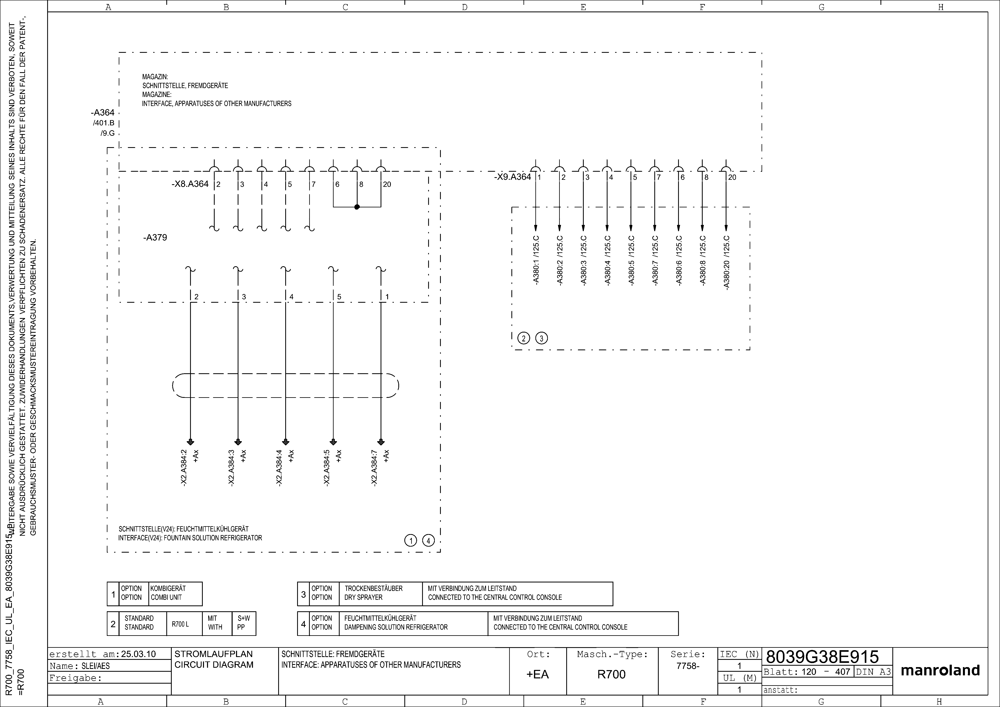

# +EA — Sheet 120 of 407 — SCHNITTSTELLE: FREMDGERÄTE

**INTERFACE: APPARATUSES OF OTHER MANUFACTURERS**

> Part of the manroland **R700** printing press IEC/UL circuit diagrams.
> Drawing class: **Stromlaufplan / Circuit diagram** (DIN A3).
> Document `+EA` covers the **Printing unit** machine section.

## At a glance

| Field | Value |
|---|---|
| Document | `+EA`  (8039G38E915) |
| Sheet | **120** of 407 |
| Section (DE) | SCHNITTSTELLE: FREMDGERÄTE |
| Section (EN) | INTERFACE: APPARATUSES OF OTHER MANUFACTURERS |
| Section type | CIRCUIT — Circuit diagram |
| Machine type | `R700` |
| Series | `7758` |
| Created | 25.03.10 |
| Replaces | — |
| Columns used | A, B, C, D, E, F |
| Path numbers | — |
| Labels on sheet | 93 |
| Cross-refs out | 11 |
| Cross-refs in | 20 |

**Previous:** [+EA sheet 119](SHEET_0119.md) · **Next:** [+EA sheet 121](SHEET_0121.md) · **Document TOC:** [_TOC.md](_TOC.md)  (+EA) · **Master TOC:** [all sheets](../_MASTER_TOC.md)

## Sheet image (300 DPI, exact vector render)



_Rendered directly from the PDF vector layer at 300 DPI (1-bit), no OCR and no resampling. Use it to confirm anything ambiguous in the text below._

## Cross-references on this sheet

Each entry is a wire leaving this sheet. The printed token is `/sheet.column`; the link resolves to that sheet inside the same document.

| Ref | Target sheet | Col | Path | Destination on target | Target section | From col |
|---|---|---|---|---|---|---|
| `/401.B` | [+EA sheet 401](SHEET_0401.md) | B | — | — | OPTION: FREMDGERÄTE ANBINDUNG ÜBER | A |
| `/9.G` | [+EA sheet 9](SHEET_0009.md) | G | — | — | SPANNUNGSVERSORGUNG: 400V, 24V | A |
| `/125.C` | [+EA sheet 125](SHEET_0125.md) | C | — | A380:1 | TROCKENBESTÄUBER | E |
| `/125.C` | [+EA sheet 125](SHEET_0125.md) | C | — | A380:2 | TROCKENBESTÄUBER | E |
| `/125.C` | [+EA sheet 125](SHEET_0125.md) | C | — | A380:3 | TROCKENBESTÄUBER | E |
| `/125.C` | [+EA sheet 125](SHEET_0125.md) | C | — | A380:4 | TROCKENBESTÄUBER | E |
| `/125.C` | [+EA sheet 125](SHEET_0125.md) | C | — | A380:5 | TROCKENBESTÄUBER | E |
| `/125.C` | [+EA sheet 125](SHEET_0125.md) | C | — | A380:7 | TROCKENBESTÄUBER | F |
| `/125.C` | [+EA sheet 125](SHEET_0125.md) | C | — | A380:6 | TROCKENBESTÄUBER | F |
| `/125.C` | [+EA sheet 125](SHEET_0125.md) | C | — | A380:8 | TROCKENBESTÄUBER | F |
| `/125.C` | [+EA sheet 125](SHEET_0125.md) | C | — | A380:20 | TROCKENBESTÄUBER | F |

### Incoming references (sheets that point here)

Every other sheet that sends a wire to this one. `Back-ref` is the token printed on *that* sheet; `Path` is its line number.

| From sheet | Cols | Back-ref | Path | Refs | What continues there |
|---|---|---|---|---|---|
| [+EA#9](SHEET_0009.md) | G | `/9.G` | — | 1 | — |
| [+EA#125](SHEET_0125.md) | B | `/125.B` | — | 9 | A380:1; A380:2; A380:20; A380:3; A380:4; A380:5; A380:6; A380:7; A380:8 |
| [+EA#252](SHEET_0252.md) | F | `/252.F` | — | 9 | — |
| [+EA#401](SHEET_0401.md) | B | `/401.B` | — | 1 | — |


## Devices on this sheet

| Tag | Class | Class meaning (IEC) | Col | Sub | Terminal | Sign |
|---|---|---|---|---|---|---|
| `A364` | A | Baugruppe / assembly, module, PC board | A | — | — | — |
| `A379` | A | Baugruppe / assembly, module, PC board | A | — | — | — |
| `A380:6` | A | Baugruppe / assembly, module, PC board | F | — | 6 | — |
| `A380:7` | A | Baugruppe / assembly, module, PC board | F | — | 7 | — |
| `A380:5` | A | Baugruppe / assembly, module, PC board | E | — | 5 | — |
| `A380:4` | A | Baugruppe / assembly, module, PC board | E | — | 4 | — |
| `A380:2` | A | Baugruppe / assembly, module, PC board | E | — | 2 | — |
| `A380:3` | A | Baugruppe / assembly, module, PC board | E | — | 3 | — |
| `A380:8` | A | Baugruppe / assembly, module, PC board | F | — | 8 | — |
| `A380:20` | A | Baugruppe / assembly, module, PC board | F | — | 20 | — |
| `A380:1` | A | Baugruppe / assembly, module, PC board | E | — | 1 | — |
| `X2.A384:2` | — | cross-device reference | B | — | 2 | — |
| `X2.A384:3` | — | cross-device reference | B | — | 3 | — |
| `X2.A384:4` | — | cross-device reference | B | — | 4 | — |
| `X2.A384:5` | — | cross-device reference | C | — | 5 | — |
| `X2.A384:7` | — | cross-device reference | C | — | 7 | — |
| `X9.A364` | — | cross-device reference | D | — | — | — |
| `X8.A364` | — | cross-device reference | B | — | — | — |

## Potentials / nets

_No named potentials on this sheet._

## Wire-end annotations (grouped as printed)

A wire that continues elsewhere is annotated with a small cluster: the destination description, the path/line number `#NN`, and the `/sheet.column` cross reference. Each row below is one such cluster exactly as it is grouped on the drawing.

| Col | Y | Path | Cross-ref | Text on the wire |
|---|---|---|---|---|
| B | 88.5 | — | — | `INTERFACE, APPARATUSES OF OTHER MANUFACTURERS MAGAZIN: MAGAZINE: SCHNITTSTELLE, FREMDGERÄTE` |
| A | 129.3 | — | — | `A364` |
| A | 142.3 | — | `/401.B` | — |
| A | 154.7 | — | `/9.G` | — |
| E | 205.8 | — | — | `X9.A364 1 2 3 4 5 7 6 8 20` |
| B | 214.3 | — | — | `X8.A364` |
| C | 215.8 | — | — | `2 3 4 5 7 6 8 20` |
| A | 278.1 | — | — | `A379` |
| E | 280.4 | — | `/125.C` | `A380:1` |
| E | 280.4 | — | `/125.C` | `A380:2` |
| E | 280.4 | — | `/125.C` | `A380:3` |
| E | 280.4 | — | `/125.C` | `A380:4` |
| E | 280.4 | — | `/125.C` | `A380:5` |
| F | 280.4 | — | `/125.C` | `A380:7` |
| F | 280.4 | — | `/125.C` | `A380:6` |
| F | 280.4 | — | `/125.C` | `A380:8` |
| F | 280.4 | — | `/125.C` | `A380:20` |
| C | 349.7 | — | — | `2 3 4 5 1` |
| E | 400.0 | — | — | `2 3` |
| B | 535.2 | — | — | `X2.A384:2` |
| B | 535.5 | — | — | `X2.A384:3` |
| B | 535.5 | — | — | `X2.A384:4` |
| C | 535.5 | — | — | `X2.A384:5` |
| C | 535.5 | — | — | `X2.A384:7` |
| B | 535.8 | — | — | `+Ax` |
| B | 535.8 | — | — | `+Ax` |
| C | 535.8 | — | — | `+Ax` |
| C | 535.8 | — | — | `+Ax` |
| C | 535.8 | — | — | `+Ax` |
| B | 627.1 | — | — | `INTERFACE(V24): FOUNTAIN SOLUTION REFRIGERATOR SCHNITTSTELLE(V24): FEUCHTMITTELKÜHLGERÄT` |
| D | 640.4 | — | — | `1 4` |
| A | 697.9 | — | — | `1 OPTION OPTION` |
| B | 697.9 | — | — | `KOMBIGERÄT` |
| C | 697.9 | — | — | `3 OPTION OPTION` |
| C | 698.0 | — | — | `DRY SPRAYER TROCKENBESTÄUBER` |
| D | 698.0 | — | — | `MIT VERBINDUNG ZUM LEITSTAND CONNECTED TO THE CENTRAL CONTROL CONSOLE` |
| A | 708.6 | — | — | `COMBI UNIT` |
| B | 733.2 | — | — | `PP S+W` |
| A | 733.4 | — | — | `2 STANDARD STANDARD R700 L` |
| B | 733.4 | — | — | `MIT` |
| C | 733.4 | — | — | `4 OPTION OPTION` |
| C | 733.4 | — | — | `FEUCHTMITTELKÜHLGERÄT DAMPENING SOLUTION REFRIGERATOR` |
| E | 733.4 | — | — | `MIT VERBINDUNG ZUM LEITSTAND CONNECTED TO THE CENTRAL CONTROL CONSOLE` |
| B | 743.9 | — | — | `WITH` |


## Reconstructed tables

This sheet carries tabular content (pin map / terminal assignment / index). The grid below was rebuilt from the drawing's own rule lines, so each row is exactly one physical row of the table.

### Table 1 — 5 data rows × 25 columns (at x=204.1, y=0.0) — **X8.A364 FREMDGERÄTE APPARATUSES OF OTHER 2 3 MANUFACTURERS 4 5 7 6 8 20 X9.A364 1 2 4 /125.C A380:1 3 /125.C A380:2 /125.C A380:3 /125.C A380:4 /125.C A380:5 /125.C A380:7 /125.C A380:6 /125.C A380:8 /125.C A380:20 X2.A384:2 FOUNTAIN UNIT R700 L +Ax FEUCHTMITTELKÜHLGERÄT SOLUTION MIT X2.A384:3 WITH +Ax REFRIGERATOR S+W PP X2.A384:4 +Ax 3 4 X2.A384:5 OPTION OPTION OPTION OPTION +Ax DRY X2.A384:7 TROCKENBESTÄUBER SPRAYER FEUCHTMITTELKÜHLGERÄT DAMPENING +Ax 1 4 MIT VERBINDUNG ZUM LEITSTAND CONNECTED TO THE CENTRAL MIT SOLUTION REFRIGERATOR CONTROL VERBINDUNG CONNECTED TO CONSOLE ZUM THE CENTRAL LEITSTAND CONTROL CONSOLE**

|  | STROMLAUFPLAN |  |  |  |  | SCHNITTSTELLE: |  |  | FREMDGERÄTE |  |  | Ort: |  |  |  | Masch. Type: |  |  |  | Serie: |  |  | IEC (N) | 8039G38E915 |
|---|---|---|---|---|---|---|---|---|---|---|---|---|---|---|---|---|---|---|---|---|---|---|---|---|
|  | `CIRCUIT` | `DIAGRAM` |  |  |  |  |  |  |  |  |  |  |  |  |  |  |  |  |  |  |  |  |  |  |
|  |  |  |  |  |  | `INTERFACE:` |  | `APPARATUSES` | `OF` | `OTHER MANUFACTURERS` |  |  |  |  |  |  |  |  |  | `7758` |  |  | `1` |  |
|  |  |  |  |  |  |  |  |  |  |  |  | `+EA` |  |  |  | `R700` |  |  |  |  |  |  |  | `Blatt: DIN A3 120 407` |
|  |  |  |  |  |  |  |  |  |  |  |  |  |  |  |  |  |  |  |  |  |  |  | `UL (M)` |  |
|  |  |  |  |  |  |  |  |  |  |  |  |  |  |  |  |  |  |  |  |  |  |  | `1` | `anstatt:` |


## Notes and free text on this sheet

| Text | Col | Y (pt) |
|---|---|---|
| `MAGAZIN:` | A | 88.47 |
| `SCHNITTSTELLE, FREMDGERÄTE` | B | 99.14 |
| `MAGAZINE:` | A | 109.74 |
| `INTERFACE, APPARATUSES OF OTHER MANUFACTURERS` | B | 120.4 |
| `+Ax` | B | 535.75 |
| `+Ax` | C | 535.75 |
| `SCHNITTSTELLE(V24): FEUCHTMITTELKÜHLGERÄT` | B | 627.1 |
| `INTERFACE(V24): FOUNTAIN SOLUTION REFRIGERATOR` | B | 637.72 |
| `OPTION` | A | 697.92 |
| `KOMBIGERÄT` | B | 697.94 |
| `COMBI UNIT` | A | 708.59 |
| `STANDARD` | A | 733.39 |
| `R700 L` | B | 740.46 |
| `MIT` | B | 733.35 |
| `WITH` | B | 743.89 |
| `S+W` | B | 733.24 |
| `PP` | B | 743.87 |
| `OPTION` | C | 697.92 |
| `TROCKENBESTÄUBER` | C | 697.95 |
| `DRY SPRAYER` | C | 708.56 |
| `MIT VERBINDUNG ZUM LEITSTAND` | D | 697.96 |
| `CONNECTED TO THE CENTRAL CONTROL CONSOLE` | D | 708.6 |
| `FEUCHTMITTELKÜHLGERÄT` | C | 733.39 |
| `DAMPENING SOLUTION REFRIGERATOR` | C | 744.03 |
| `MIT VERBINDUNG ZUM LEITSTAND` | E | 733.39 |
| `CONNECTED TO THE CENTRAL CONTROL CONSOLE` | E | 744.03 |

## Complete label inventory (exact text from the drawing)

Every text object inside the drawing area of this sheet, in DIN reading order (column A→H, then top→bottom). This is the authoritative list: if a string is not here it is not printed on this sheet.

| Col | Y | X | Dir | Type | Text |
|---|---|---|---|---|---|
| A | 88.5 | 169.5 | → | text | `MAGAZIN:` |
| A | 109.7 | 169.5 | → | text | `MAGAZINE:` |
| A | 129.3 | 108.3 | → | device tag | `A364` |
| A | 142.4 | 110.8 | → | cross-reference | `/401.B` |
| A | 154.7 | 119.9 | → | cross-reference | `/9.G` |
| A | 278.1 | 170.6 | → | device tag | `A379` |
| A | 697.9 | 144.3 | → | text | `OPTION` |
| A | 703.3 | 132.1 | → | number | `1` |
| A | 708.6 | 144.3 | → | text | `OPTION` |
| A | 708.6 | 179.7 | → | text | `COMBI UNIT` |
| A | 733.4 | 148.5 | → | text | `STANDARD` |
| A | 738.7 | 131.8 | → | number | `2` |
| A | 744.0 | 148.5 | → | text | `STANDARD` |
| B | 99.1 | 169.8 | → | text | `SCHNITTSTELLE, FREMDGERÄTE` |
| B | 120.4 | 169.2 | → | text | `INTERFACE, APPARATUSES OF OTHER MANUFACTURERS` |
| B | 214.3 | 204.4 | → | device ref | `X8.A364` |
| B | 215.8 | 257.7 | → | number | `2` |
| B | 215.8 | 286.0 | → | number | `3` |
| B | 215.8 | 314.4 | → | number | `4` |
| B | 349.7 | 231.6 | → | number | `2` |
| B | 349.7 | 288.1 | → | number | `3` |
| B | 535.2 | 215.0 | ↕ | device ref | `X2.A384:2` |
| B | 535.5 | 271.7 | ↕ | device ref | `X2.A384:3` |
| B | 535.5 | 328.4 | ↕ | device ref | `X2.A384:4` |
| B | 535.7 | 229.3 | ↕ | text | `+Ax` |
| B | 535.7 | 285.9 | ↕ | text | `+Ax` |
| B | 627.1 | 141.4 | → | text | `SCHNITTSTELLE(V24): FEUCHTMITTELKÜHLGERÄT` |
| B | 637.7 | 140.9 | → | text | `INTERFACE(V24): FOUNTAIN SOLUTION REFRIGERATOR` |
| B | 697.9 | 179.1 | → | text | `KOMBIGERÄT` |
| B | 733.2 | 283.2 | → | text | `S+W` |
| B | 733.4 | 247.5 | → | text | `MIT` |
| B | 740.5 | 204.7 | → | text | `R700 L` |
| B | 743.9 | 248.0 | → | text | `WITH` |
| B | 743.9 | 282.6 | → | text | `PP` |
| C | 215.8 | 342.7 | → | number | `5` |
| C | 215.8 | 371.1 | → | number | `7` |
| C | 215.8 | 399.4 | → | number | `6` |
| C | 215.8 | 427.7 | → | number | `8` |
| C | 215.8 | 456.1 | → | number | `20` |
| C | 349.7 | 344.8 | → | number | `4` |
| C | 349.7 | 401.5 | → | number | `5` |
| C | 349.7 | 458.6 | → | number | `1` |
| C | 535.5 | 385.1 | ↕ | device ref | `X2.A384:5` |
| C | 535.5 | 441.8 | ↕ | device ref | `X2.A384:7` |
| C | 535.7 | 342.6 | ↕ | text | `+Ax` |
| C | 535.7 | 399.3 | ↕ | text | `+Ax` |
| C | 535.7 | 456.0 | ↕ | text | `+Ax` |
| C | 697.9 | 371.1 | → | text | `OPTION` |
| C | 698.0 | 410.7 | → | text | `TROCKENBESTÄUBER` |
| C | 703.3 | 358.4 | → | number | `3` |
| C | 708.6 | 371.1 | → | text | `OPTION` |
| C | 708.6 | 410.2 | → | text | `DRY SPRAYER` |
| C | 733.4 | 371.1 | → | text | `OPTION` |
| C | 733.4 | 410.2 | → | text | `FEUCHTMITTELKÜHLGERÄT` |
| C | 738.7 | 358.6 | → | number | `4` |
| C | 744.0 | 371.1 | → | text | `OPTION` |
| C | 744.0 | 410.2 | → | text | `DAMPENING SOLUTION REFRIGERATOR` |
| D | 205.8 | 588.5 | → | device ref | `X9.A364` |
| D | 400.0 | 621.6 | → | number | `2` |
| D | 640.4 | 487.2 | → | number | `1` |
| D | 640.9 | 508.2 | → | number | `4` |
| D | 698.0 | 509.7 | → | text | `MIT VERBINDUNG ZUM LEITSTAND` |
| D | 708.6 | 510.0 | → | text | `CONNECTED TO THE CENTRAL CONTROL CONSOLE` |
| E | 207.3 | 639.8 | → | number | `1` |
| E | 207.3 | 668.7 | → | number | `2` |
| E | 207.3 | 697.0 | → | number | `3` |
| E | 207.3 | 725.4 | → | number | `4` |
| E | 207.3 | 753.7 | → | number | `5` |
| E | 280.3 | 634.5 | ↕ | cross-reference | `/125.C` |
| E | 280.3 | 662.9 | ↕ | cross-reference | `/125.C` |
| E | 280.3 | 691.2 | ↕ | cross-reference | `/125.C` |
| E | 280.3 | 719.6 | ↕ | cross-reference | `/125.C` |
| E | 280.3 | 747.9 | ↕ | cross-reference | `/125.C` |
| E | 308.7 | 634.5 | ↕ | device tag | `A380:1` |
| E | 309.8 | 662.9 | ↕ | device tag | `A380:2` |
| E | 310.1 | 691.2 | ↕ | device tag | `A380:3` |
| E | 310.1 | 719.6 | ↕ | device tag | `A380:4` |
| E | 310.1 | 747.9 | ↕ | device tag | `A380:5` |
| E | 400.0 | 642.9 | → | number | `3` |
| E | 733.4 | 587.6 | → | text | `MIT VERBINDUNG ZUM LEITSTAND` |
| E | 744.0 | 587.9 | → | text | `CONNECTED TO THE CENTRAL CONTROL CONSOLE` |
| F | 207.3 | 782.1 | → | number | `7` |
| F | 207.3 | 810.4 | → | number | `6` |
| F | 207.3 | 838.8 | → | number | `8` |
| F | 207.3 | 867.1 | → | number | `20` |
| F | 280.3 | 776.3 | ↕ | cross-reference | `/125.C` |
| F | 280.3 | 804.6 | ↕ | cross-reference | `/125.C` |
| F | 280.3 | 833.0 | ↕ | cross-reference | `/125.C` |
| F | 280.3 | 861.3 | ↕ | cross-reference | `/125.C` |
| F | 310.1 | 776.3 | ↕ | device tag | `A380:7` |
| F | 310.1 | 804.6 | ↕ | device tag | `A380:6` |
| F | 310.1 | 833.0 | ↕ | device tag | `A380:8` |
| F | 310.1 | 861.3 | ↕ | device tag | `A380:20` |

## Reading-order text block

The same content as a plain block, grouped by DIN column — convenient to paste or to match against a visual description.

```text
=== Column A ===
  88.5  169.5  text         MAGAZIN:
 109.7  169.5  text         MAGAZINE:
 129.3  108.3  devtag       A364
 142.4  110.8  xref         /401.B
 154.7  119.9  xref         /9.G
 278.1  170.6  devtag       A379
 697.9  144.3  text         OPTION
 703.3  132.1  numeric      1
 708.6  144.3  text         OPTION
 708.6  179.7  text         COMBI UNIT
 733.4  148.5  text         STANDARD
 738.7  131.8  numeric      2
 744.0  148.5  text         STANDARD
=== Column B ===
  99.1  169.8  text         SCHNITTSTELLE, FREMDGERÄTE
 120.4  169.2  text         INTERFACE, APPARATUSES OF OTHER MANUFACTURERS
 214.3  204.4  devref       X8.A364
 215.8  257.7  numeric      2
 215.8  286.0  numeric      3
 215.8  314.4  numeric      4
 349.7  231.6  numeric      2
 349.7  288.1  numeric      3
 535.2  215.0  devref       X2.A384:2
 535.5  271.7  devref       X2.A384:3
 535.5  328.4  devref       X2.A384:4
 535.7  229.3  text         +Ax
 535.7  285.9  text         +Ax
 627.1  141.4  text         SCHNITTSTELLE(V24): FEUCHTMITTELKÜHLGERÄT
 637.7  140.9  text         INTERFACE(V24): FOUNTAIN SOLUTION REFRIGERATOR
 697.9  179.1  text         KOMBIGERÄT
 733.2  283.2  text         S+W
 733.4  247.5  text         MIT
 740.5  204.7  text         R700 L
 743.9  248.0  text         WITH
 743.9  282.6  text         PP
=== Column C ===
 215.8  342.7  numeric      5
 215.8  371.1  numeric      7
 215.8  399.4  numeric      6
 215.8  427.7  numeric      8
 215.8  456.1  numeric      20
 349.7  344.8  numeric      4
 349.7  401.5  numeric      5
 349.7  458.6  numeric      1
 535.5  385.1  devref       X2.A384:5
 535.5  441.8  devref       X2.A384:7
 535.7  342.6  text         +Ax
 535.7  399.3  text         +Ax
 535.7  456.0  text         +Ax
 697.9  371.1  text         OPTION
 698.0  410.7  text         TROCKENBESTÄUBER
 703.3  358.4  numeric      3
 708.6  371.1  text         OPTION
 708.6  410.2  text         DRY SPRAYER
 733.4  371.1  text         OPTION
 733.4  410.2  text         FEUCHTMITTELKÜHLGERÄT
 738.7  358.6  numeric      4
 744.0  371.1  text         OPTION
 744.0  410.2  text         DAMPENING SOLUTION REFRIGERATOR
=== Column D ===
 205.8  588.5  devref       X9.A364
 400.0  621.6  numeric      2
 640.4  487.2  numeric      1
 640.9  508.2  numeric      4
 698.0  509.7  text         MIT VERBINDUNG ZUM LEITSTAND
 708.6  510.0  text         CONNECTED TO THE CENTRAL CONTROL CONSOLE
=== Column E ===
 207.3  639.8  numeric      1
 207.3  668.7  numeric      2
 207.3  697.0  numeric      3
 207.3  725.4  numeric      4
 207.3  753.7  numeric      5
 280.3  634.5  xref         /125.C
 280.3  662.9  xref         /125.C
 280.3  691.2  xref         /125.C
 280.3  719.6  xref         /125.C
 280.3  747.9  xref         /125.C
 308.7  634.5  devtag       A380:1
 309.8  662.9  devtag       A380:2
 310.1  691.2  devtag       A380:3
 310.1  719.6  devtag       A380:4
 310.1  747.9  devtag       A380:5
 400.0  642.9  numeric      3
 733.4  587.6  text         MIT VERBINDUNG ZUM LEITSTAND
 744.0  587.9  text         CONNECTED TO THE CENTRAL CONTROL CONSOLE
=== Column F ===
 207.3  782.1  numeric      7
 207.3  810.4  numeric      6
 207.3  838.8  numeric      8
 207.3  867.1  numeric      20
 280.3  776.3  xref         /125.C
 280.3  804.6  xref         /125.C
 280.3  833.0  xref         /125.C
 280.3  861.3  xref         /125.C
 310.1  776.3  devtag       A380:7
 310.1  804.6  devtag       A380:6
 310.1  833.0  devtag       A380:8
 310.1  861.3  devtag       A380:20
```

---
_Generated from the PDF vector text layer; no OCR. Source: `R700_7758_IEC_UL_EA_8039G38E915_p`, sheet 120._
