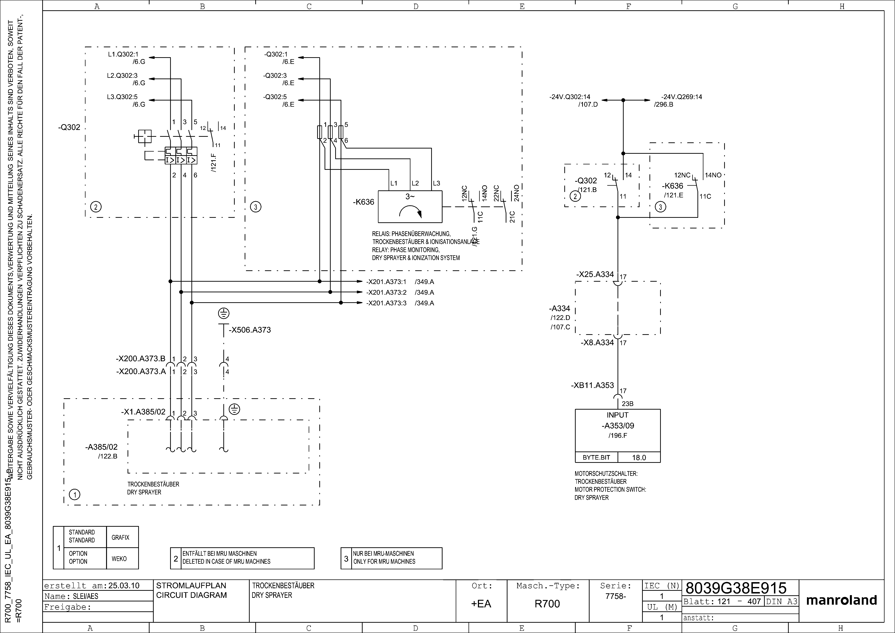

# +EA — Sheet 121 of 407 — TROCKENBESTÄUBER

**DRY SPRAYER**

> Part of the manroland **R700** printing press IEC/UL circuit diagrams.
> Drawing class: **Stromlaufplan / Circuit diagram** (DIN A3).
> Document `+EA` covers the **Printing unit** machine section.

## At a glance

| Field | Value |
|---|---|
| Document | `+EA`  (8039G38E915) |
| Sheet | **121** of 407 |
| Section (DE) | TROCKENBESTÄUBER |
| Section (EN) | DRY SPRAYER |
| Section type | CIRCUIT — Circuit diagram |
| Machine type | `R700` |
| Series | `7758` |
| Created | 25.03.10 |
| Replaces | — |
| Columns used | A, B, C, D, E, F, G |
| Path numbers | — |
| Labels on sheet | 121 |
| Cross-refs out | 19 |
| Cross-refs in | 34 |

**Previous:** [+EA sheet 120](SHEET_0120.md) · **Next:** [+EA sheet 122](SHEET_0122.md) · **Document TOC:** [_TOC.md](_TOC.md)  (+EA) · **Master TOC:** [all sheets](../_MASTER_TOC.md)

## Sheet image (300 DPI, exact vector render)



_Rendered directly from the PDF vector layer at 300 DPI (1-bit), no OCR and no resampling. Use it to confirm anything ambiguous in the text below._

## Cross-references on this sheet

Each entry is a wire leaving this sheet. The printed token is `/sheet.column`; the link resolves to that sheet inside the same document.

| Ref | Target sheet | Col | Path | Destination on target | Target section | From col |
|---|---|---|---|---|---|---|
| `/6.G` | [+EA sheet 6](SHEET_0006.md) | G | — | L1.Q302:1 | SPANNUNGSVERSORGUNG: 400V,24V | A |
| `/6.E` | [+EA sheet 6](SHEET_0006.md) | E | — | Q302:1 | SPANNUNGSVERSORGUNG: 400V,24V | C |
| `/6.G` | [+EA sheet 6](SHEET_0006.md) | G | — | L2.Q302:3 | SPANNUNGSVERSORGUNG: 400V,24V | A |
| `/6.E` | [+EA sheet 6](SHEET_0006.md) | E | — | Q302:3 | SPANNUNGSVERSORGUNG: 400V,24V | C |
| `/6.E` | [+EA sheet 6](SHEET_0006.md) | E | — | L3.Q302:5 Q302:5 | SPANNUNGSVERSORGUNG: 400V,24V | B |
| `/6.G` | [+EA sheet 6](SHEET_0006.md) | G | — | L3.Q302:5 Q302:5 | SPANNUNGSVERSORGUNG: 400V,24V | B |
| `/107.D` | [+EA sheet 107](SHEET_0107.md) | D | — | 24V.Q302:14 | BOGENGLÄTTER | E |
| `/296.B` | [+EA sheet 296](SHEET_0296.md) | B | — | — | OPTION: ZWISCHENSTAPEL / | F |
| `/121.F` | [+EA sheet 121](SHEET_0121.md) | F | — | — | TROCKENBESTÄUBER | B |
| `/121.B` | [+EA sheet 121](SHEET_0121.md) | B | — | — | TROCKENBESTÄUBER | F |
| `/121.E` | [+EA sheet 121](SHEET_0121.md) | E | — | — | TROCKENBESTÄUBER | F |
| `/121.G` | [+EA sheet 121](SHEET_0121.md) | G | — | — | TROCKENBESTÄUBER | E |
| `/349.A` | [+EA sheet 349](SHEET_0349.md) | A | — | X201.A373:1 | OPTION: VORBEREITUNG IONISATIONSANLAGE | D |
| `/349.A` | [+EA sheet 349](SHEET_0349.md) | A | — | X201.A373:2 | OPTION: VORBEREITUNG IONISATIONSANLAGE | D |
| `/349.A` | [+EA sheet 349](SHEET_0349.md) | A | — | X201.A373:3 | OPTION: VORBEREITUNG IONISATIONSANLAGE | D |
| `/122.D` | [+EA sheet 122](SHEET_0122.md) | D | — | — | TROCKENBESTÄUBER | E |
| `/107.C` | [+EA sheet 107](SHEET_0107.md) | C | — | — | BOGENGLÄTTER | E |
| `/196.F` | [+EA sheet 196](SHEET_0196.md) | F | — | — | REFERENZMODUL | F |
| `/122.B` | [+EA sheet 122](SHEET_0122.md) | B | — | — | TROCKENBESTÄUBER | A |

### Incoming references (sheets that point here)

Every other sheet that sends a wire to this one. `Back-ref` is the token printed on *that* sheet; `Path` is its line number.

| From sheet | Cols | Back-ref | Path | Refs | What continues there |
|---|---|---|---|---|---|
| [+EA#6](SHEET_0006.md) | E, H | `/6.E`, `/6.H` | — | 6 | L1.Q302:1; L2.Q302:3; L3.Q302:5; Q302:1; Q302:3; Q302:5 |
| [+EA#107](SHEET_0107.md) | C, D | `/107.C`, `/107.D` | — | 2 | — |
| [+EA#121](SHEET_0121.md) | B, E, F | `/121.B`, `/121.E`, `/121.F` | — | 4 | — |
| [+EA#122](SHEET_0122.md) | B, D | `/122.B`, `/122.D` | — | 2 | — |
| [+EA#196](SHEET_0196.md) | F | `/196.F` | — | 1 | — |
| [+EA#209](SHEET_0209.md) | H | `/209.H` | — | 4 | — |
| [+EA#249](SHEET_0249.md) | D | `/249.D` | — | 1 | — |
| [+EA#256](SHEET_0256.md) | A | `/256.A` | — | 1 | — |
| [+EA#267](SHEET_0267.md) | B | `/267.B` | — | 1 | — |
| [+EA#286](SHEET_0286.md) | B | `/286.B` | — | 8 | — |
| [+EA#296](SHEET_0296.md) | A | `/296.A` | — | 1 | 24V.Q269:14 |
| [+EA#349](SHEET_0349.md) | A | `/349.A` | — | 3 | X201.A373:1; X201.A373:2; X201.A373:3 |


## Devices on this sheet

| Tag | Class | Class meaning (IEC) | Col | Sub | Terminal | Sign |
|---|---|---|---|---|---|---|
| `Q302` | Q | Leistungsschalter / power switching device | A | — | — | — |
| `K636` | K | Relais / relay, contactor | D | — | — | — |
| `A385/02` | A | Baugruppe / assembly, module, PC board | A | 02 | — | — |
| `Q302` | Q | Leistungsschalter / power switching device | F | — | — | — |
| `A334` | A | Baugruppe / assembly, module, PC board | E | — | — | — |
| `K636` | K | Relais / relay, contactor | F | — | — | — |
| `A353/09` | A | Baugruppe / assembly, module, PC board | F | 09 | — | — |
| `Q302:3` | Q | Leistungsschalter / power switching device | C | — | 3 | — |
| `Q302:1` | Q | Leistungsschalter / power switching device | C | — | 1 | — |
| `Q302:5` | Q | Leistungsschalter / power switching device | C | — | 5 | — |
| `X200.A373.B` | — | cross-device reference | A | — | — | — |
| `X200.A373.A` | — | cross-device reference | A | — | — | — |
| `X25.A334` | — | cross-device reference | F | — | — | — |
| `X8.A334` | — | cross-device reference | F | — | — | — |
| `18.0` | — | cross-device reference | F | — | — | — |
| `XB11.A353` | — | cross-device reference | F | — | — | — |
| `X201.A373:3` | — | cross-device reference | D | — | 3 | — |
| `X201.A373:2` | — | cross-device reference | D | — | 2 | — |
| `X201.A373:1` | — | cross-device reference | D | — | 1 | — |
| `X506.A373` | — | cross-device reference | B | — | — | — |

## Potentials / nets

| Potential | Count | Columns | Attached devices | Terminals |
|---|---|---|---|---|
| `24V` | 2 | E, F | `Q269`, `Q302` | `14` |
| `L1` | 2 | A, D | `Q302` | `1` |
| `L2` | 2 | A, D | `Q302` | `3` |
| `L3` | 2 | A, D | `Q302` | `5` |


A potential such as `L24+/4` or `M24+` is a named supply/return rail; every place it appears on this sheet is electrically common.

## Wire-end annotations (grouped as printed)

A wire that continues elsewhere is annotated with a small cluster: the destination description, the path/line number `#NN`, and the `/sheet.column` cross reference. Each row below is one such cluster exactly as it is grouped on the drawing.

| Col | Y | Path | Cross-ref | Text on the wire |
|---|---|---|---|---|
| A | 68.3 | — | `/6.G` | `L1.Q302:1` |
| C | 68.3 | — | `/6.E` | `Q302:1` |
| A | 96.7 | — | `/6.G` | `L2.Q302:3` |
| C | 96.7 | — | `/6.E` | `Q302:3` |
| B | 125.0 | — | `/6.E`, `/6.G` | `L3.Q302:5 Q302:5` |
| E | 125.0 | — | `/107.D` | `24V.Q302:14` |
| F | 125.0 | — | — | `24V.Q269:14` |
| F | 134.9 | — | `/296.B` | — |
| B | 158.4 | — | — | `1` |
| B | 158.4 | — | — | `3` |
| B | 158.4 | — | — | `5` |
| C | 161.9 | — | — | `1 3 5` |
| A | 164.7 | — | — | `Q302` |
| B | 167.4 | — | — | `12 14` |
| C | 183.2 | — | — | `2 4 6` |
| B | 190.1 | — | — | `11` |
| B | 203.8 | — | `/121.F` | — |
| B | 229.2 | — | — | `2` |
| B | 229.2 | — | — | `4` |
| B | 229.2 | — | — | `6` |
| F | 229.2 | — | — | `Q302 14` |
| F | 229.2 | — | — | `12` |
| G | 229.2 | — | — | `K636 14NO` |
| G | 229.2 | — | — | `12NC` |
| D | 239.8 | — | — | `L1 L2 L3` |
| E | 245.5 | — | — | `24NO` |
| E | 246.1 | — | — | `14NO` |
| E | 246.1 | — | — | `22NC` |
| D | 246.6 | — | — | `12NC` |
| F | 248.7 | — | `/121.B` | — |
| F | 255.7 | — | `/121.E` | — |
| D | 256.8 | — | — | `3~` |
| F | 257.6 | — | — | `11` |
| G | 257.6 | — | — | `11C` |
| F | 258.2 | — | — | `2` |
| D | 263.9 | — | — | `K636` |
| A | 272.4 | — | — | `2` |
| B | 272.4 | — | — | `3` |
| F | 272.4 | — | — | `3` |
| E | 280.6 | — | — | `21C` |
| E | 281.2 | — | — | `11C` |
| E | 301.3 | — | `/121.G` | — |
| D | 308.2 | — | — | `RELAIS: PHASENÜBERWACHUNG,` |
| D | 318.8 | — | — | `RELAY: PHASE MONITORING, DRY SPRAYER & IONIZATION SYSTEM TROCKENBESTÄUBER & IONISATIONSANLAGE` |
| F | 360.3 | — | — | `X25.A334 17` |
| D | 370.9 | — | `/349.A` | `X201.A373:1` |
| D | 385.1 | — | `/349.A` | `X201.A373:2` |
| D | 399.2 | — | `/349.A` | `X201.A373:3` |
| E | 405.7 | — | — | `A334` |
| E | 418.8 | — | `/122.D`, `/107.C` | — |
| B | 434.0 | — | — | `X506.A373` |
| F | 451.0 | — | — | `X8.A334 17` |
| A | 472.3 | — | — | `X200.A373.B 1` |
| B | 473.7 | — | — | `2` |
| B | 473.7 | — | — | `3` |
| B | 473.7 | — | — | `4` |
| A | 489.3 | — | — | `X200.A373.A 1` |
| B | 490.7 | — | — | `2` |
| B | 490.7 | — | — | `3` |
| B | 490.7 | — | — | `4` |
| F | 507.7 | — | — | `XB11.A353 17` |
| F | 533.2 | — | — | `23B` |
| B | 543.1 | — | — | `X1.A385/02 1 2 3` |
| F | 547.7 | — | — | `INPUT` |
| F | 561.6 | — | — | `A353/09` |
| F | 575.4 | — | `/196.F` | — |
| A | 589.9 | — | — | `A385/02` |
| A | 603.0 | — | `/122.B` | — |
| F | 604.4 | — | — | `BYTE.BIT 18.0` |
| F | 627.1 | — | — | `DRY SPRAYER MOTORSCHUTZSCHALTER: MOTOR PROTECTION SWITCH: TROCKENBESTÄUBER` |
| B | 641.3 | — | — | `DRY SPRAYER TROCKENBESTÄUBER` |
| A | 654.6 | — | — | `1` |
| A | 705.0 | — | — | `STANDARD STANDARD` |
| B | 712.1 | — | — | `1 GRAFIX 2 ENTFÄLLT BEI MRU MASCHINEN DELETED IN CASE OF MRU MACHINES 3 NUR BEI MRU MASCHINEN` |
| A | 733.4 | — | — | `OPTION OPTION WEKO` |
| D | 744.0 | — | — | `ONLY FOR MRU MACHINES` |


## Reconstructed tables

This sheet carries tabular content (pin map / terminal assignment / index). The grid below was rebuilt from the drawing's own rule lines, so each row is exactly one physical row of the table.

### Table 1 — 2 data rows × 1 columns (at x=226.8, y=133.2)

| C1 |
|---|
| `1` |
| `2` |


### Table 2 — 2 data rows × 1 columns (at x=240.9, y=133.2)

| C1 |
|---|
| `3` |
| `4` |


### Table 3 — 3 data rows × 2 columns (at x=255.1, y=133.2)

| 5 | 12 14 |
|---|---|
|  | `11` |
|  | `/121.F` |
| `6` |  |


### Table 4 — 5 data rows × 6 columns (at x=432.3, y=133.2)

| 1 2 | 3 4 | 5 6 |  |  |  |
|---|---|---|---|---|---|
|  |  |  | `L1` | `L2` | `L3` |
|  |  | `K636` | `3~` |  |  |
|  |  | `DRY` | `RELAIS: TROCKENBESTÄUBER RELAY: PHASE SPRAYER &` | `PHASENÜBERWACHUNG, & MONITORING, IONIZATION` |  |
|  |  |  | `X201.A373:1` | `/349.A` |  |
|  |  |  | `X201.A373:2` | `/349.A` |  |


### Table 5 — 3 data rows × 4 columns (at x=765.4, y=204.1)

| 12 Q302 /121.B | 11 | 14 | 12NC K636 /121.E 3 |
|---|---|---|---|
| `X25.A334 X8.A334 XB11.A353` | `17 17 17` | `23B` |  |
| `INPUT` | `A353/09 /196.F` |  |  |
| `BYTE.BIT` |  | `18.0` |  |


## Notes and free text on this sheet

| Text | Col | Y (pt) |
|---|---|---|
| `11C` | E | 281.2 |
| `21C` | E | 280.63 |
| `14NO` | E | 246.05 |
| `24NO` | E | 245.48 |
| `22NC` | E | 246.05 |
| `12NC` | D | 246.62 |
| `RELAIS: PHASENÜBERWACHUNG,` | D | 308.17 |
| `TROCKENBESTÄUBER & IONISATIONSANLAGE` | D | 318.81 |
| `RELAY: PHASE MONITORING,` | D | 329.44 |
| `DRY SPRAYER & IONIZATION SYSTEM` | D | 340.07 |
| `TROCKENBESTÄUBER` | B | 641.26 |
| `DRY SPRAYER` | A | 651.87 |
| `X1.A385/02` | A | 543.14 |
| `12NC` | G | 229.23 |
| `11C` | G | 257.57 |
| `14NO` | G | 229.22 |
| `23B` | F | 533.2 |
| `INPUT` | F | 547.72 |
| `BYTE.BIT` | F | 604.97 |
| `MOTORSCHUTZSCHALTER:` | F | 627.1 |
| `TROCKENBESTÄUBER` | F | 637.72 |
| `MOTOR PROTECTION SWITCH:` | F | 648.34 |
| `DRY SPRAYER` | F | 658.96 |
| `STANDARD` | A | 705.04 |
| `OPTION` | A | 733.35 |
| `WEKO` | A | 740.37 |
| `GRAFIX` | A | 712.11 |
| `ENTFÄLLT BEI MRU MASCHINEN` | B | 733.38 |
| `DELETED IN CASE OF MRU MACHINES` | B | 744.02 |
| `NUR BEI MRU MASCHINEN` | D | 733.4 |
| `ONLY FOR MRU MACHINES` | D | 744.03 |

## Complete label inventory (exact text from the drawing)

Every text object inside the drawing area of this sheet, in DIN reading order (column A→H, then top→bottom). This is the authoritative list: if a string is not here it is not printed on this sheet.

| Col | Y | X | Dir | Type | Text |
|---|---|---|---|---|---|
| A | 68.3 | 143.7 | → | potential | `L1.Q302:1` |
| A | 78.2 | 176.6 | → | cross-reference | `/6.G` |
| A | 96.7 | 142.3 | → | potential | `L2.Q302:3` |
| A | 106.6 | 176.6 | → | cross-reference | `/6.G` |
| A | 125.0 | 142.3 | → | potential | `L3.Q302:5` |
| A | 134.9 | 176.6 | → | cross-reference | `/6.G` |
| A | 164.7 | 77.4 | → | device tag | `Q302` |
| A | 272.4 | 125.6 | → | number | `2` |
| A | 472.3 | 154.2 | → | device ref | `X200.A373.B` |
| A | 489.3 | 154.8 | → | device ref | `X200.A373.A` |
| A | 543.1 | 161.3 | → | text | `X1.A385/02` |
| A | 589.9 | 113.4 | → | device tag | `A385/02` |
| A | 603.0 | 130.7 | → | cross-reference | `/122.B` |
| A | 651.9 | 169.2 | → | text | `DRY SPRAYER` |
| A | 654.6 | 97.5 | → | number | `1` |
| A | 705.0 | 91.8 | → | text | `STANDARD` |
| A | 712.1 | 148.5 | → | text | `GRAFIX` |
| A | 715.7 | 91.8 | → | text | `STANDARD` |
| A | 724.5 | 75.4 | → | number | `1` |
| A | 733.4 | 91.8 | → | text | `OPTION` |
| A | 740.4 | 148.8 | → | text | `WEKO` |
| A | 744.0 | 91.8 | → | text | `OPTION` |
| B | 158.4 | 228.8 | → | number | `1` |
| B | 158.4 | 243.5 | → | number | `3` |
| B | 158.4 | 257.7 | → | number | `5` |
| B | 167.4 | 265.9 | → | number | `12` |
| B | 167.4 | 292.8 | → | number | `14` |
| B | 190.1 | 285.7 | → | number | `11` |
| B | 203.8 | 280.2 | ↕ | cross-reference | `/121.F` |
| B | 229.2 | 229.3 | → | number | `2` |
| B | 229.2 | 243.5 | → | number | `4` |
| B | 229.2 | 257.7 | → | number | `6` |
| B | 272.4 | 338.2 | → | number | `3` |
| B | 434.0 | 304.4 | → | device ref | `X506.A373` |
| B | 473.7 | 228.8 | → | number | `1` |
| B | 473.7 | 243.5 | → | number | `2` |
| B | 473.7 | 257.7 | → | number | `3` |
| B | 473.7 | 300.2 | → | number | `4` |
| B | 490.7 | 228.8 | → | number | `1` |
| B | 490.7 | 243.5 | → | number | `2` |
| B | 490.7 | 257.7 | → | number | `3` |
| B | 490.7 | 300.2 | → | number | `4` |
| B | 546.0 | 228.5 | → | number | `1` |
| B | 546.0 | 243.2 | → | number | `2` |
| B | 546.0 | 257.4 | → | number | `3` |
| B | 641.3 | 169.8 | → | text | `TROCKENBESTÄUBER` |
| B | 733.4 | 242.9 | → | text | `ENTFÄLLT BEI MRU MASCHINEN` |
| B | 738.7 | 231.0 | → | number | `2` |
| B | 744.0 | 242.9 | → | text | `DELETED IN CASE OF MRU MACHINES` |
| C | 68.3 | 351.5 | → | device tag | `Q302:1` |
| C | 78.2 | 375.9 | → | cross-reference | `/6.E` |
| C | 96.7 | 350.1 | → | device tag | `Q302:3` |
| C | 106.5 | 375.9 | → | cross-reference | `/6.E` |
| C | 125.0 | 350.1 | → | device tag | `Q302:5` |
| C | 134.9 | 375.9 | → | cross-reference | `/6.E` |
| C | 161.9 | 430.3 | → | number | `1` |
| C | 161.9 | 444.0 | → | number | `3` |
| C | 161.9 | 458.2 | → | number | `5` |
| C | 183.2 | 430.0 | → | number | `2` |
| C | 183.2 | 444.0 | → | number | `4` |
| C | 183.2 | 458.2 | → | number | `6` |
| C | 738.7 | 457.7 | → | number | `3` |
| D | 239.9 | 519.3 | → | potential | `L1` |
| D | 239.9 | 547.7 | → | potential | `L2` |
| D | 239.9 | 576.0 | → | potential | `L3` |
| D | 246.6 | 614.0 | ↕ | text | `12NC` |
| D | 256.8 | 539.4 | → | other | `3~` |
| D | 263.9 | 469.7 | → | device tag | `K636` |
| D | 308.2 | 495.2 | → | text | `RELAIS: PHASENÜBERWACHUNG,` |
| D | 318.8 | 495.8 | → | text | `TROCKENBESTÄUBER & IONISATIONSANLAGE` |
| D | 329.4 | 495.2 | → | text | `RELAY: PHASE MONITORING,` |
| D | 340.1 | 495.2 | → | text | `DRY SPRAYER & IONIZATION SYSTEM` |
| D | 370.9 | 487.3 | → | device ref | `X201.A373:1` |
| D | 370.9 | 552.0 | → | cross-reference | `/349.A` |
| D | 385.1 | 487.3 | → | device ref | `X201.A373:2` |
| D | 385.1 | 552.0 | → | cross-reference | `/349.A` |
| D | 399.2 | 552.0 | → | cross-reference | `/349.A` |
| D | 399.3 | 487.3 | → | device ref | `X201.A373:3` |
| D | 733.4 | 469.7 | → | text | `NUR BEI MRU MASCHINEN` |
| D | 744.0 | 470.3 | → | text | `ONLY FOR MRU MACHINES` |
| E | 125.0 | 731.1 | → | potential | `24V.Q302:14` |
| E | 245.5 | 683.5 | ↕ | text | `24NO` |
| E | 246.0 | 640.9 | ↕ | text | `14NO` |
| E | 246.0 | 656.6 | ↕ | text | `22NC` |
| E | 280.6 | 677.8 | ↕ | text | `21C` |
| E | 281.2 | 635.3 | ↕ | text | `11C` |
| E | 301.3 | 627.4 | ↕ | cross-reference | `/121.G` |
| E | 405.7 | 730.5 | → | device tag | `A334` |
| E | 418.8 | 732.8 | → | cross-reference | `/122.D` |
| E | 431.2 | 732.8 | → | cross-reference | `/107.C` |
| F | 125.0 | 879.9 | → | potential | `24V.Q269:14` |
| F | 134.9 | 769.6 | → | cross-reference | `/107.D` |
| F | 134.9 | 870.2 | → | cross-reference | `/296.B` |
| F | 229.2 | 803.1 | → | number | `12` |
| F | 229.2 | 831.1 | → | number | `14` |
| F | 235.6 | 764.8 | → | device tag | `Q302` |
| F | 242.7 | 880.7 | → | device tag | `K636` |
| F | 248.6 | 768.5 | → | cross-reference | `/121.B` |
| F | 255.7 | 883.6 | → | cross-reference | `/121.E` |
| F | 257.6 | 824.0 | → | number | `11` |
| F | 258.2 | 763.4 | → | number | `2` |
| F | 272.4 | 876.7 | → | number | `3` |
| F | 360.3 | 766.8 | → | device ref | `X25.A334` |
| F | 364.6 | 824.0 | → | number | `17` |
| F | 451.0 | 772.7 | → | device ref | `X8.A334` |
| F | 452.5 | 824.0 | → | number | `17` |
| F | 507.7 | 759.7 | → | device ref | `XB11.A353` |
| F | 516.2 | 824.0 | → | number | `17` |
| F | 533.2 | 827.4 | → | text | `23B` |
| F | 547.7 | 807.2 | → | text | `INPUT` |
| F | 561.6 | 800.6 | → | device tag | `A353/09` |
| F | 575.4 | 809.7 | → | cross-reference | `/196.F` |
| F | 604.4 | 840.6 | → | device ref | `18.0` |
| F | 605.0 | 775.3 | → | text | `BYTE.BIT` |
| F | 627.1 | 764.8 | → | text | `MOTORSCHUTZSCHALTER:` |
| F | 637.7 | 765.1 | → | text | `TROCKENBESTÄUBER` |
| F | 648.3 | 764.8 | → | text | `MOTOR PROTECTION SWITCH:` |
| F | 659.0 | 764.5 | → | text | `DRY SPRAYER` |
| G | 229.2 | 896.6 | → | text | `12NC` |
| G | 229.2 | 937.4 | → | text | `14NO` |
| G | 257.6 | 930.3 | → | text | `11C` |

## Reading-order text block

The same content as a plain block, grouped by DIN column — convenient to paste or to match against a visual description.

```text
=== Column A ===
  68.3  143.7  net          L1.Q302:1
  78.2  176.6  xref         /6.G
  96.7  142.3  net          L2.Q302:3
 106.6  176.6  xref         /6.G
 125.0  142.3  net          L3.Q302:5
 134.9  176.6  xref         /6.G
 164.7   77.4  devtag       Q302
 272.4  125.6  numeric      2
 472.3  154.2  devref       X200.A373.B
 489.3  154.8  devref       X200.A373.A
 543.1  161.3  text         X1.A385/02
 589.9  113.4  devtag       A385/02
 603.0  130.7  xref         /122.B
 651.9  169.2  text         DRY SPRAYER
 654.6   97.5  numeric      1
 705.0   91.8  text         STANDARD
 712.1  148.5  text         GRAFIX
 715.7   91.8  text         STANDARD
 724.5   75.4  numeric      1
 733.4   91.8  text         OPTION
 740.4  148.8  text         WEKO
 744.0   91.8  text         OPTION
=== Column B ===
 158.4  228.8  numeric      1
 158.4  243.5  numeric      3
 158.4  257.7  numeric      5
 167.4  265.9  numeric      12
 167.4  292.8  numeric      14
 190.1  285.7  numeric      11
 203.8  280.2  xref         /121.F
 229.2  229.3  numeric      2
 229.2  243.5  numeric      4
 229.2  257.7  numeric      6
 272.4  338.2  numeric      3
 434.0  304.4  devref       X506.A373
 473.7  228.8  numeric      1
 473.7  243.5  numeric      2
 473.7  257.7  numeric      3
 473.7  300.2  numeric      4
 490.7  228.8  numeric      1
 490.7  243.5  numeric      2
 490.7  257.7  numeric      3
 490.7  300.2  numeric      4
 546.0  228.5  numeric      1
 546.0  243.2  numeric      2
 546.0  257.4  numeric      3
 641.3  169.8  text         TROCKENBESTÄUBER
 733.4  242.9  text         ENTFÄLLT BEI MRU MASCHINEN
 738.7  231.0  numeric      2
 744.0  242.9  text         DELETED IN CASE OF MRU MACHINES
=== Column C ===
  68.3  351.5  devtag       Q302:1
  78.2  375.9  xref         /6.E
  96.7  350.1  devtag       Q302:3
 106.5  375.9  xref         /6.E
 125.0  350.1  devtag       Q302:5
 134.9  375.9  xref         /6.E
 161.9  430.3  numeric      1
 161.9  444.0  numeric      3
 161.9  458.2  numeric      5
 183.2  430.0  numeric      2
 183.2  444.0  numeric      4
 183.2  458.2  numeric      6
 738.7  457.7  numeric      3
=== Column D ===
 239.9  519.3  net          L1
 239.9  547.7  net          L2
 239.9  576.0  net          L3
 246.6  614.0  text         12NC
 256.8  539.4  other        3~
 263.9  469.7  devtag       K636
 308.2  495.2  text         RELAIS: PHASENÜBERWACHUNG,
 318.8  495.8  text         TROCKENBESTÄUBER & IONISATIONSANLAGE
 329.4  495.2  text         RELAY: PHASE MONITORING,
 340.1  495.2  text         DRY SPRAYER & IONIZATION SYSTEM
 370.9  487.3  devref       X201.A373:1
 370.9  552.0  xref         /349.A
 385.1  487.3  devref       X201.A373:2
 385.1  552.0  xref         /349.A
 399.2  552.0  xref         /349.A
 399.3  487.3  devref       X201.A373:3
 733.4  469.7  text         NUR BEI MRU MASCHINEN
 744.0  470.3  text         ONLY FOR MRU MACHINES
=== Column E ===
 125.0  731.1  net          24V.Q302:14
 245.5  683.5  text         24NO
 246.0  640.9  text         14NO
 246.0  656.6  text         22NC
 280.6  677.8  text         21C
 281.2  635.3  text         11C
 301.3  627.4  xref         /121.G
 405.7  730.5  devtag       A334
 418.8  732.8  xref         /122.D
 431.2  732.8  xref         /107.C
=== Column F ===
 125.0  879.9  net          24V.Q269:14
 134.9  769.6  xref         /107.D
 134.9  870.2  xref         /296.B
 229.2  803.1  numeric      12
 229.2  831.1  numeric      14
 235.6  764.8  devtag       Q302
 242.7  880.7  devtag       K636
 248.6  768.5  xref         /121.B
 255.7  883.6  xref         /121.E
 257.6  824.0  numeric      11
 258.2  763.4  numeric      2
 272.4  876.7  numeric      3
 360.3  766.8  devref       X25.A334
 364.6  824.0  numeric      17
 451.0  772.7  devref       X8.A334
 452.5  824.0  numeric      17
 507.7  759.7  devref       XB11.A353
 516.2  824.0  numeric      17
 533.2  827.4  text         23B
 547.7  807.2  text         INPUT
 561.6  800.6  devtag       A353/09
 575.4  809.7  xref         /196.F
 604.4  840.6  devref       18.0
 605.0  775.3  text         BYTE.BIT
 627.1  764.8  text         MOTORSCHUTZSCHALTER:
 637.7  765.1  text         TROCKENBESTÄUBER
 648.3  764.8  text         MOTOR PROTECTION SWITCH:
 659.0  764.5  text         DRY SPRAYER
=== Column G ===
 229.2  896.6  text         12NC
 229.2  937.4  text         14NO
 257.6  930.3  text         11C
```

---
_Generated from the PDF vector text layer; no OCR. Source: `R700_7758_IEC_UL_EA_8039G38E915_p`, sheet 121._
