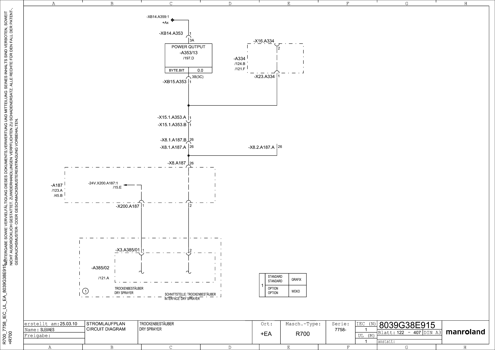

# +EA — Sheet 122 of 407 — TROCKENBESTÄUBER

**DRY SPRAYER**

> Part of the manroland **R700** printing press IEC/UL circuit diagrams.
> Drawing class: **Stromlaufplan / Circuit diagram** (DIN A3).
> Document `+EA` covers the **Printing unit** machine section.

## At a glance

| Field | Value |
|---|---|
| Document | `+EA`  (8039G38E915) |
| Sheet | **122** of 407 |
| Section (DE) | TROCKENBESTÄUBER |
| Section (EN) | DRY SPRAYER |
| Section type | CIRCUIT — Circuit diagram |
| Machine type | `R700` |
| Series | `7758` |
| Created | 25.03.10 |
| Replaces | — |
| Columns used | A, B, C, D, E |
| Path numbers | — |
| Labels on sheet | 57 |
| Cross-refs out | 7 |
| Cross-refs in | 21 |

**Previous:** [+EA sheet 121](SHEET_0121.md) · **Next:** [+EA sheet 123](SHEET_0123.md) · **Document TOC:** [_TOC.md](_TOC.md)  (+EA) · **Master TOC:** [all sheets](../_MASTER_TOC.md)

## Sheet image (300 DPI, exact vector render)



_Rendered directly from the PDF vector layer at 300 DPI (1-bit), no OCR and no resampling. Use it to confirm anything ambiguous in the text below._

## Cross-references on this sheet

Each entry is a wire leaving this sheet. The printed token is `/sheet.column`; the link resolves to that sheet inside the same document.

| Ref | Target sheet | Col | Path | Destination on target | Target section | From col |
|---|---|---|---|---|---|---|
| `/197.D` | [+EA sheet 197](SHEET_0197.md) | D | — | — | REFERENZMODUL | C |
| `/124.B` | [+EA sheet 124](SHEET_0124.md) | B | — | — | TROCKENBESTÄUBER | D |
| `/121.F` | [+EA sheet 121](SHEET_0121.md) | F | — | — | TROCKENBESTÄUBER | D |
| `/15.E` | [+EA sheet 15](SHEET_0015.md) | E | — | 24V.X200.A187:1 | SPANNUNGSVERSORGUNG: 400V, 24V | B |
| `/123.A` | [+EA sheet 123](SHEET_0123.md) | A | — | — | TROCKENBESTÄUBER | A |
| `/45.B` | [+EA sheet 45](SHEET_0045.md) | B | — | — | BUSVERBINDUNGEN: 20 mA SCHLEIFE | A |
| `/121.A` | [+EA sheet 121](SHEET_0121.md) | A | — | — | TROCKENBESTÄUBER | B |

### Incoming references (sheets that point here)

Every other sheet that sends a wire to this one. `Back-ref` is the token printed on *that* sheet; `Path` is its line number.

| From sheet | Cols | Back-ref | Path | Refs | What continues there |
|---|---|---|---|---|---|
| [+EA#15](SHEET_0015.md) | F | `/15.F` | — | 1 | 24V.X200.A187:1 |
| [+EA#45](SHEET_0045.md) | A | `/45.A` | — | 1 | — |
| [+EA#121](SHEET_0121.md) | A, E | `/121.A`, `/121.E` | — | 2 | — |
| [+EA#123](SHEET_0123.md) | A | `/123.A` | — | 1 | — |
| [+EA#124](SHEET_0124.md) | B | `/124.B` | — | 1 | — |
| [+EA#197](SHEET_0197.md) | D | `/197.D` | — | 1 | — |
| [+EA#235](SHEET_0235.md) | C | `/235.C` | — | 2 | — |
| [+EA#248](SHEET_0248.md) | C, E, F, G | `/248.C`, `/248.E`, `/248.F`, `/248.G` | — | 4 | — |
| [+EA#259](SHEET_0259.md) | F | `/259.F` | — | 1 | — |
| [+EA#260](SHEET_0260.md) | F, G, H | `/260.F`, `/260.G`, `/260.H` | — | 3 | — |
| [+EA#261](SHEET_0261.md) | F | `/261.F` | — | 1 | — |
| [+EA#265](SHEET_0265.md) | A | `/265.A` | — | 1 | — |
| [+EA#286](SHEET_0286.md) | B | `/286.B` | — | 2 | — |


## Devices on this sheet

| Tag | Class | Class meaning (IEC) | Col | Sub | Terminal | Sign |
|---|---|---|---|---|---|---|
| `A353/13` | A | Baugruppe / assembly, module, PC board | C | 13 | — | — |
| `A334` | A | Baugruppe / assembly, module, PC board | D | — | — | — |
| `A187` | A | Baugruppe / assembly, module, PC board | A | — | — | — |
| `A385/02` | A | Baugruppe / assembly, module, PC board | B | 02 | — | — |
| `0.0` | — | cross-device reference | C | — | — | — |
| `XB14.A353` | — | cross-device reference | C | — | — | — |
| `XB15.A353` | — | cross-device reference | C | — | — | — |
| `XB14.A359:1` | — | cross-device reference | C | — | 1 | — |
| `X23.A334` | — | cross-device reference | E | — | — | — |
| `X8.A187` | — | cross-device reference | C | — | — | — |
| `X200.A187` | — | cross-device reference | B | — | — | — |
| `X15.1.A353.B` | — | cross-device reference | C | — | — | — |
| `X15.1.A353.A` | — | cross-device reference | C | — | — | — |
| `X8.1.A187.A` | — | cross-device reference | C | — | — | — |
| `X8.1.A187.B` | — | cross-device reference | C | — | — | — |
| `X8.2.A187.A` | — | cross-device reference | E | — | — | — |
| `X16.A334` | — | cross-device reference | E | — | — | — |

## Potentials / nets

| Potential | Count | Columns | Attached devices | Terminals |
|---|---|---|---|---|
| `24V` | 1 | B | `A187`, `X200` | `1` |


A potential such as `L24+/4` or `M24+` is a named supply/return rail; every place it appears on this sheet is electrically common.

## Wire-end annotations (grouped as printed)

A wire that continues elsewhere is annotated with a small cluster: the destination description, the path/line number `#NN`, and the `/sheet.column` cross reference. Each row below is one such cluster exactly as it is grouped on the drawing.

| Col | Y | Path | Cross-ref | Text on the wire |
|---|---|---|---|---|
| C | 36.4 | — | — | `XB14.A359:1` |
| C | 50.7 | — | — | `+Ax` |
| C | 75.4 | — | — | `XB14.A353 1` |
| C | 93.1 | — | — | `3A` |
| E | 93.8 | — | — | `X16.A334` |
| C | 108.3 | — | — | `POWER QUTPUT` |
| E | 112.3 | — | — | `2` |
| C | 122.2 | — | — | `A353/13` |
| C | 136.0 | — | `/197.D` | — |
| D | 136.4 | — | — | `A334` |
| D | 149.4 | — | `/124.B` | — |
| D | 161.8 | — | `/121.F` | — |
| C | 165.0 | — | — | `BYTE.BIT 0.0` |
| E | 178.9 | — | — | `X23.A334 1` |
| C | 181.0 | — | — | `3B(3C)` |
| C | 191.6 | — | — | `XB15.A353 1` |
| C | 277.4 | — | — | `X15.1.A353.A 1` |
| C | 295.1 | — | — | `X15.1.A353.B 1` |
| C | 332.0 | — | — | `X8.1.A187.B 26` |
| C | 349.0 | — | — | `X8.1.A187.A 26` |
| E | 349.0 | — | — | `X8.2.A187.A 26` |
| C | 387.2 | — | — | `X8.A187 26` |
| B | 436.8 | — | `/15.E` | `24V.X200.A187:1` |
| A | 441.1 | — | — | `A187` |
| A | 454.2 | — | `/123.A` | — |
| A | 466.6 | — | `/45.B` | — |
| C | 490.7 | — | — | `X200.A187 1 2` |
| C | 596.3 | — | — | `X3.A385/01 1 2` |
| B | 639.5 | — | — | `A385/02` |
| E | 662.5 | — | — | `STANDARD STANDARD` |
| B | 665.0 | — | `/121.A` | — |
| E | 669.6 | — | — | `1 GRAFIX` |
| E | 690.8 | — | — | `OPTION OPTION WEKO` |
| B | 690.9 | — | — | `DRY SPRAYER TROCKENBESTÄUBER` |
| B | 697.1 | — | — | `1` |
| C | 705.0 | — | — | `INTERFACE: DRY SPRAYER SCHNITTSTELLE: TROCKENBESTÄUBER` |


## Reconstructed tables

This sheet carries tabular content (pin map / terminal assignment / index). The grid below was rebuilt from the drawing's own rule lines, so each row is exactly one physical row of the table.

### Table 1 — 3 data rows × 2 columns (at x=396.9, y=104.9)

| POWER | QUTPUT A353/13 /197.D |
|---|---|
| `BYTE.BIT` | `0.0` |
| `XB15.A353` | `3B(3C) 1` |
| `X15.1.A353.A X15.1.A353.B X8.1.A187.B X8.1.A187.A` | `1 1 26 26` |


## Notes and free text on this sheet

| Text | Col | Y (pt) |
|---|---|---|
| `3A` | C | 93.1 |
| `3B(3C)` | C | 181.03 |
| `POWER QUTPUT` | C | 108.28 |
| `BYTE.BIT` | C | 165.6 |
| `SCHNITTSTELLE: TROCKENBESTÄUBER` | C | 705.04 |
| `INTERFACE: DRY SPRAYER` | C | 715.66 |
| `+Ax` | C | 50.67 |
| `TROCKENBESTÄUBER` | B | 690.86 |
| `DRY SPRAYER` | B | 701.48 |
| `X3.A385/01` | B | 596.29 |
| `STANDARD` | E | 662.52 |
| `OPTION` | E | 690.83 |
| `WEKO` | E | 697.85 |
| `GRAFIX` | E | 669.59 |

## Complete label inventory (exact text from the drawing)

Every text object inside the drawing area of this sheet, in DIN reading order (column A→H, then top→bottom). This is the authoritative list: if a string is not here it is not printed on this sheet.

| Col | Y | X | Dir | Type | Text |
|---|---|---|---|---|---|
| A | 441.1 | 122.5 | → | device tag | `A187` |
| A | 454.2 | 124.7 | → | cross-reference | `/123.A` |
| A | 466.5 | 129.8 | → | cross-reference | `/45.B` |
| B | 436.8 | 212.0 | → | potential | `24V.X200.A187:1` |
| B | 446.7 | 271.8 | → | cross-reference | `/15.E` |
| B | 491.4 | 278.9 | → | device ref | `X200.A187` |
| B | 596.3 | 277.5 | → | text | `X3.A385/01` |
| B | 639.5 | 219.7 | → | device tag | `A385/02` |
| B | 665.0 | 236.7 | → | cross-reference | `/121.A` |
| B | 690.9 | 276.1 | → | text | `TROCKENBESTÄUBER` |
| B | 697.1 | 203.8 | → | number | `1` |
| B | 701.5 | 275.5 | → | text | `DRY SPRAYER` |
| C | 36.4 | 352.3 | → | device ref | `XB14.A359:1` |
| C | 50.7 | 390.3 | → | text | `+Ax` |
| C | 75.4 | 382.7 | → | device ref | `XB14.A353` |
| C | 76.9 | 455.5 | → | number | `1` |
| C | 93.1 | 456.1 | → | text | `3A` |
| C | 108.3 | 412.7 | → | text | `POWER QUTPUT` |
| C | 122.2 | 432.1 | → | device tag | `A353/13` |
| C | 136.0 | 440.8 | → | cross-reference | `/197.D` |
| C | 165.0 | 475.1 | → | device ref | `0.0` |
| C | 165.6 | 406.8 | → | text | `BYTE.BIT` |
| C | 181.0 | 461.8 | → | text | `3B(3C)` |
| C | 191.6 | 391.2 | → | device ref | `XB15.A353` |
| C | 193.1 | 455.5 | → | number | `1` |
| C | 277.4 | 378.7 | → | device ref | `X15.1.A353.A` |
| C | 279.5 | 455.5 | → | number | `1` |
| C | 295.1 | 379.6 | → | device ref | `X15.1.A353.B` |
| C | 296.5 | 455.5 | → | number | `1` |
| C | 332.0 | 385.5 | → | device ref | `X8.1.A187.B` |
| C | 332.0 | 456.1 | → | number | `26` |
| C | 349.0 | 456.1 | → | number | `26` |
| C | 349.7 | 384.7 | → | device ref | `X8.1.A187.A` |
| C | 387.2 | 402.8 | → | device ref | `X8.A187` |
| C | 388.7 | 456.1 | → | number | `26` |
| C | 490.7 | 342.1 | → | number | `1` |
| C | 490.7 | 456.1 | → | number | `2` |
| C | 598.4 | 342.1 | → | number | `1` |
| C | 598.4 | 456.1 | → | number | `2` |
| C | 705.0 | 396.6 | → | text | `SCHNITTSTELLE: TROCKENBESTÄUBER` |
| C | 715.7 | 396.0 | → | text | `INTERFACE: DRY SPRAYER` |
| D | 136.4 | 561.8 | → | device tag | `A334` |
| D | 149.4 | 564.4 | → | cross-reference | `/124.B` |
| D | 161.8 | 564.9 | → | cross-reference | `/121.F` |
| E | 93.8 | 609.4 | → | device ref | `X16.A334` |
| E | 112.3 | 668.7 | → | number | `2` |
| E | 178.9 | 668.1 | → | number | `1` |
| E | 179.6 | 610.9 | → | device ref | `X23.A334` |
| E | 349.0 | 668.7 | → | number | `26` |
| E | 349.7 | 597.3 | → | device ref | `X8.2.A187.A` |
| E | 662.5 | 644.6 | → | text | `STANDARD` |
| E | 669.6 | 701.3 | → | text | `GRAFIX` |
| E | 673.2 | 644.6 | → | text | `STANDARD` |
| E | 682.0 | 628.2 | → | number | `1` |
| E | 690.8 | 644.6 | → | text | `OPTION` |
| E | 697.9 | 701.6 | → | text | `WEKO` |
| E | 701.5 | 644.6 | → | text | `OPTION` |

## Reading-order text block

The same content as a plain block, grouped by DIN column — convenient to paste or to match against a visual description.

```text
=== Column A ===
 441.1  122.5  devtag       A187
 454.2  124.7  xref         /123.A
 466.5  129.8  xref         /45.B
=== Column B ===
 436.8  212.0  net          24V.X200.A187:1
 446.7  271.8  xref         /15.E
 491.4  278.9  devref       X200.A187
 596.3  277.5  text         X3.A385/01
 639.5  219.7  devtag       A385/02
 665.0  236.7  xref         /121.A
 690.9  276.1  text         TROCKENBESTÄUBER
 697.1  203.8  numeric      1
 701.5  275.5  text         DRY SPRAYER
=== Column C ===
  36.4  352.3  devref       XB14.A359:1
  50.7  390.3  text         +Ax
  75.4  382.7  devref       XB14.A353
  76.9  455.5  numeric      1
  93.1  456.1  text         3A
 108.3  412.7  text         POWER QUTPUT
 122.2  432.1  devtag       A353/13
 136.0  440.8  xref         /197.D
 165.0  475.1  devref       0.0
 165.6  406.8  text         BYTE.BIT
 181.0  461.8  text         3B(3C)
 191.6  391.2  devref       XB15.A353
 193.1  455.5  numeric      1
 277.4  378.7  devref       X15.1.A353.A
 279.5  455.5  numeric      1
 295.1  379.6  devref       X15.1.A353.B
 296.5  455.5  numeric      1
 332.0  385.5  devref       X8.1.A187.B
 332.0  456.1  numeric      26
 349.0  456.1  numeric      26
 349.7  384.7  devref       X8.1.A187.A
 387.2  402.8  devref       X8.A187
 388.7  456.1  numeric      26
 490.7  342.1  numeric      1
 490.7  456.1  numeric      2
 598.4  342.1  numeric      1
 598.4  456.1  numeric      2
 705.0  396.6  text         SCHNITTSTELLE: TROCKENBESTÄUBER
 715.7  396.0  text         INTERFACE: DRY SPRAYER
=== Column D ===
 136.4  561.8  devtag       A334
 149.4  564.4  xref         /124.B
 161.8  564.9  xref         /121.F
=== Column E ===
  93.8  609.4  devref       X16.A334
 112.3  668.7  numeric      2
 178.9  668.1  numeric      1
 179.6  610.9  devref       X23.A334
 349.0  668.7  numeric      26
 349.7  597.3  devref       X8.2.A187.A
 662.5  644.6  text         STANDARD
 669.6  701.3  text         GRAFIX
 673.2  644.6  text         STANDARD
 682.0  628.2  numeric      1
 690.8  644.6  text         OPTION
 697.9  701.6  text         WEKO
 701.5  644.6  text         OPTION
```

---
_Generated from the PDF vector text layer; no OCR. Source: `R700_7758_IEC_UL_EA_8039G38E915_p`, sheet 122._
