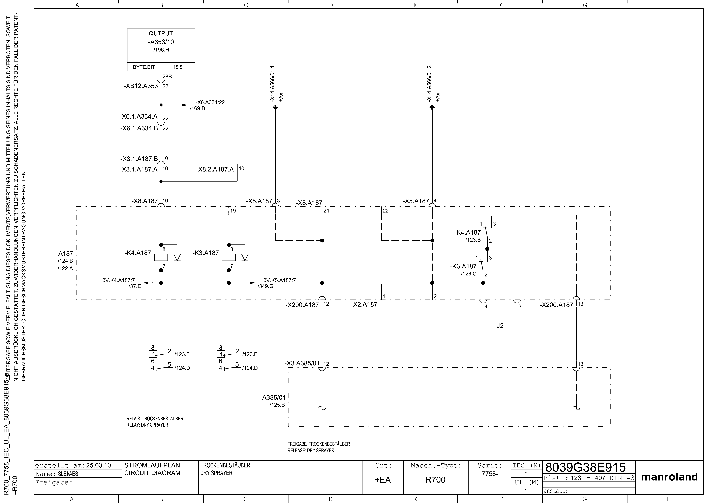

# +EA — Sheet 123 of 407 — TROCKENBESTÄUBER

**DRY SPRAYER**

> Part of the manroland **R700** printing press IEC/UL circuit diagrams.
> Drawing class: **Stromlaufplan / Circuit diagram** (DIN A3).
> Document `+EA` covers the **Printing unit** machine section.

## At a glance

| Field | Value |
|---|---|
| Document | `+EA`  (8039G38E915) |
| Sheet | **123** of 407 |
| Section (DE) | TROCKENBESTÄUBER |
| Section (EN) | DRY SPRAYER |
| Section type | CIRCUIT — Circuit diagram |
| Machine type | `R700` |
| Series | `7758` |
| Created | 25.03.10 |
| Replaces | — |
| Columns used | A, B, C, D, E, F, G |
| Path numbers | — |
| Labels on sheet | 92 |
| Cross-refs out | 13 |
| Cross-refs in | 33 |

**Previous:** [+EA sheet 122](SHEET_0122.md) · **Next:** [+EA sheet 124](SHEET_0124.md) · **Document TOC:** [_TOC.md](_TOC.md)  (+EA) · **Master TOC:** [all sheets](../_MASTER_TOC.md)

## Sheet image (300 DPI, exact vector render)



_Rendered directly from the PDF vector layer at 300 DPI (1-bit), no OCR and no resampling. Use it to confirm anything ambiguous in the text below._

## Cross-references on this sheet

Each entry is a wire leaving this sheet. The printed token is `/sheet.column`; the link resolves to that sheet inside the same document.

| Ref | Target sheet | Col | Path | Destination on target | Target section | From col |
|---|---|---|---|---|---|---|
| `/196.H` | [+EA sheet 196](SHEET_0196.md) | H | — | — | REFERENZMODUL | B |
| `/169.B` | [+EA sheet 169](SHEET_0169.md) | B | — | — | RESERVE | B |
| `/123.B` | [+EA sheet 123](SHEET_0123.md) | B | — | — | TROCKENBESTÄUBER | F |
| `/124.B` | [+EA sheet 124](SHEET_0124.md) | B | — | — | TROCKENBESTÄUBER | A |
| `/122.A` | [+EA sheet 122](SHEET_0122.md) | A | — | — | TROCKENBESTÄUBER | A |
| `/123.C` | [+EA sheet 123](SHEET_0123.md) | C | — | — | TROCKENBESTÄUBER | F |
| `/37.E` | [+EA sheet 37](SHEET_0037.md) | E | — | 0V.K4.A187:7 | BUSVERBINDUNGEN: NOT AUS | B |
| `/349.G` | [+EA sheet 349](SHEET_0349.md) | G | — | 0V.K4.A187:7 | OPTION: VORBEREITUNG IONISATIONSANLAGE | B |
| `/123.F` | [+EA sheet 123](SHEET_0123.md) | F | — | — | TROCKENBESTÄUBER | B |
| `/123.F` | [+EA sheet 123](SHEET_0123.md) | F | — | — | TROCKENBESTÄUBER | C |
| `/124.D` | [+EA sheet 124](SHEET_0124.md) | D | — | — | TROCKENBESTÄUBER | B |
| `/124.D` | [+EA sheet 124](SHEET_0124.md) | D | — | — | TROCKENBESTÄUBER | C |
| `/125.B` | [+EA sheet 125](SHEET_0125.md) | B | — | — | TROCKENBESTÄUBER | C |

### Incoming references (sheets that point here)

Every other sheet that sends a wire to this one. `Back-ref` is the token printed on *that* sheet; `Path` is its line number.

| From sheet | Cols | Back-ref | Path | Refs | What continues there |
|---|---|---|---|---|---|
| [+EA#37](SHEET_0037.md) | D | `/37.D` | — | 1 | 0V.K2.A187:13 |
| [+EA#122](SHEET_0122.md) | A | `/122.A` | — | 1 | — |
| [+EA#123](SHEET_0123.md) | B, C, F | `/123.B`, `/123.C`, `/123.F` | — | 4 | — |
| [+EA#124](SHEET_0124.md) | B, C, D | `/124.B`, `/124.C`, `/124.D` | — | 3 | — |
| [+EA#125](SHEET_0125.md) | B | `/125.B` | — | 1 | — |
| [+EA#169](SHEET_0169.md) | B | `/169.B` | — | 1 | X6.A334:22 |
| [+EA#196](SHEET_0196.md) | H | `/196.H` | — | 1 | — |
| [+EA#223](SHEET_0223.md) | C | `/223.C` | — | 4 | — |
| [+EA#235](SHEET_0235.md) | C, D | `/235.C`, `/235.D` | — | 2 | — |
| [+EA#239](SHEET_0239.md) | B | `/239.B` | — | 2 | — |
| [+EA#244](SHEET_0244.md) | G, H | `/244.G`, `/244.H` | — | 2 | — |
| [+EA#248](SHEET_0248.md) | C, E, F, G | `/248.C`, `/248.E`, `/248.F`, `/248.G` | — | 7 | — |
| [+EA#257](SHEET_0257.md) | C | `/257.C` | — | 1 | — |
| [+EA#286](SHEET_0286.md) | B | `/286.B` | — | 2 | — |
| [+EA#349](SHEET_0349.md) | G | `/349.G` | — | 1 | 0V.K5.A187:7 |


## Devices on this sheet

| Tag | Class | Class meaning (IEC) | Col | Sub | Terminal | Sign |
|---|---|---|---|---|---|---|
| `A353/10` | A | Baugruppe / assembly, module, PC board | B | 10 | — | — |
| `A385/01` | A | Baugruppe / assembly, module, PC board | C | 01 | — | — |
| `A187` | A | Baugruppe / assembly, module, PC board | A | — | — | — |
| `J2` | J |  | F | — | — | — |
| `15.5` | — | cross-device reference | B | — | — | — |
| `XB12.A353` | — | cross-device reference | B | — | — | — |
| `K4.A187` | — | cross-device reference | B | — | — | — |
| `K3.A187` | — | cross-device reference | C | — | — | — |
| `X200.A187` | — | cross-device reference | D | — | — | — |
| `X200.A187` | — | cross-device reference | G | — | — | — |
| `K3.A187` | — | cross-device reference | F | — | — | — |
| `K4.A187` | — | cross-device reference | F | — | — | — |
| `X8.A187` | — | cross-device reference | B | — | — | — |
| `X5.A187` | — | cross-device reference | C | — | — | — |
| `X5.A187` | — | cross-device reference | E | — | — | — |
| `X6.1.A334.B` | — | cross-device reference | B | — | — | — |
| `X6.1.A334.A` | — | cross-device reference | B | — | — | — |
| `X8.1.A187.A` | — | cross-device reference | B | — | — | — |
| `X8.1.A187.B` | — | cross-device reference | B | — | — | — |
| `X8.2.A187.A` | — | cross-device reference | C | — | — | — |
| `X6.A334:22` | — | cross-device reference | C | — | 22 | — |
| `X2.A187` | — | cross-device reference | D | — | — | — |
| `X8.A187` | — | cross-device reference | D | — | — | — |

## Potentials / nets

| Potential | Count | Columns | Attached devices | Terminals |
|---|---|---|---|---|
| `0V` | 2 | A, C | `A187`, `K4`, `K5` | `7` |


A potential such as `L24+/4` or `M24+` is a named supply/return rail; every place it appears on this sheet is electrically common.

## Wire-end annotations (grouped as printed)

A wire that continues elsewhere is annotated with a small cluster: the destination description, the path/line number `#NN`, and the `/sheet.column` cross reference. Each row below is one such cluster exactly as it is grouped on the drawing.

| Col | Y | Path | Cross-ref | Text on the wire |
|---|---|---|---|---|
| B | 51.6 | — | — | `QUTPUT` |
| B | 65.5 | — | — | `A353/10` |
| B | 79.3 | — | `/196.H` | — |
| B | 108.9 | — | — | `BYTE.BIT 15.5` |
| C | 109.4 | — | — | `X14.A566/01:1` |
| E | 109.4 | — | — | `X14.A566/01:2` |
| B | 124.3 | — | — | `28B` |
| B | 139.2 | — | — | `XB12.A353 22` |
| C | 155.3 | — | — | `+Ax` |
| E | 155.3 | — | — | `+Ax` |
| C | 167.5 | — | — | `X6.A334:22` |
| B | 177.4 | — | `/169.B` | — |
| B | 190.2 | — | — | `X6.1.A334.A 22` |
| B | 210.1 | — | — | `X6.1.A334.B 22` |
| B | 261.1 | — | — | `X8.1.A187.B 10` |
| B | 278.1 | — | — | `X8.1.A187.A 10` |
| C | 278.1 | — | — | `X8.2.A187.A 10` |
| B | 332.0 | — | — | `X8.A187 10` |
| C | 332.0 | — | — | `X5.A187 3` |
| E | 332.0 | — | — | `X5.A187 4` |
| D | 334.8 | — | — | `X8.A187` |
| C | 349.0 | — | — | `19 21` |
| E | 349.0 | — | — | `22` |
| F | 370.9 | — | — | `K4.A187 3` |
| F | 370.9 | — | — | `1` |
| F | 397.5 | — | `/123.B` | — |
| F | 399.3 | — | — | `2` |
| B | 413.5 | — | — | `8` |
| C | 413.5 | — | — | `8` |
| B | 418.4 | — | — | `K4.A187` |
| C | 418.4 | — | — | `K3.A187` |
| A | 419.8 | — | — | `A187` |
| F | 427.6 | — | — | `K3.A187 3` |
| F | 427.6 | — | — | `1` |
| A | 432.9 | — | `/124.B`, `/122.A` | — |
| B | 441.8 | — | — | `7` |
| C | 441.8 | — | — | `7` |
| F | 454.2 | — | `/123.C` | — |
| F | 456.0 | — | — | `2` |
| B | 465.1 | — | `/37.E`, `/349.G` | `0V.K4.A187:7` |
| C | 465.1 | — | — | `0V.K5.A187:7` |
| D | 492.1 | — | — | `X200.A187 12 1` |
| F | 492.1 | — | — | `2 4 3 X200.A187 13` |
| D | 504.9 | — | — | `X2.A187` |
| F | 540.3 | — | — | `J2` |
| B | 577.1 | — | — | `3 6 4 1` |
| C | 577.1 | — | — | `3 6 4 1` |
| B | 582.8 | — | — | `2` |
| C | 582.8 | — | — | `2` |
| B | 589.2 | — | `/123.F` | — |
| C | 589.2 | — | `/123.F` | — |
| E | 603.4 | — | — | `X3.A385/01 12 13` |
| B | 605.5 | — | — | `5` |
| C | 605.5 | — | — | `5` |
| B | 611.9 | — | `/124.D` | — |
| C | 611.9 | — | `/124.D` | — |
| C | 660.8 | — | — | `A385/01` |
| C | 673.9 | — | `/125.B` | — |
| B | 697.9 | — | — | `RELAIS: TROCKENBESTÄUBER RELAY: DRY SPRAYER` |
| D | 740.5 | — | — | `FREIGABE: TROCKENBESTÄUBER RELEASE: DRY SPRAYER` |


## Reconstructed tables

This sheet carries tabular content (pin map / terminal assignment / index). The grid below was rebuilt from the drawing's own rule lines, so each row is exactly one physical row of the table.

### Table 1 — 7 data rows × 13 columns (at x=212.6, y=48.2)

| QUTPUT | A353/10 /196.H |  |  |  |  |  |  |  |  |  |  |  |
|---|---|---|---|---|---|---|---|---|---|---|---|---|
| `BYTE.BIT` |  | `15.5` |  |  |  |  |  |  |  |  |  |  |
| `XB12.A353 X6.1.A334.A X6.1.A334.B X8.1.A187.B X8.1.A187.A` | `28B 22 22 22 10 10` |  | `X6.A334:22 /169.B X8.2.A187.A` | `10` | `X14.A566/01:1` | `+Ax` |  | `X14.A566/01:2` | `+Ax` |  |  |  |
| `X8.A187` | `10` |  |  | `19` | `X5.A187` | `3 X8.A187` | `21` | `X5.A187 22` | `4` |  |  |  |
|  |  |  |  |  |  |  |  |  | `1 K4.A187 /123.B` |  | `3` |  |
|  |  |  |  |  |  |  |  |  |  |  | `2` |  |
| `K4.A187` | `8 7` |  | `K3.A187` | `8 7` |  | `0V.K5.A187:7` |  |  | `1 K3.A187 /123.C` | `2` | `3` |  |
| `/37.E` |  |  |  |  | `/349.G` | `X200.A187` | `X2.A187 12` | `1` | `2` | `4` |  | `X200.A187 3` |


## Notes and free text on this sheet

| Text | Col | Y (pt) |
|---|---|---|
| `28B` | B | 124.3 |
| `QUTPUT` | B | 51.64 |
| `BYTE.BIT` | B | 108.91 |
| `RELAIS: TROCKENBESTÄUBER` | B | 697.94 |
| `RELAY: DRY SPRAYER` | B | 708.57 |
| `X14.A566/01:1` | C | 109.42 |
| `+Ax` | C | 155.34 |
| `X14.A566/01:2` | E | 109.42 |
| `+Ax` | E | 155.34 |
| `FREIGABE: TROCKENBESTÄUBER` | D | 740.46 |
| `RELEASE: DRY SPRAYER` | D | 751.08 |
| `X3.A385/01` | D | 603.38 |

## Complete label inventory (exact text from the drawing)

Every text object inside the drawing area of this sheet, in DIN reading order (column A→H, then top→bottom). This is the authoritative list: if a string is not here it is not printed on this sheet.

| Col | Y | X | Dir | Type | Text |
|---|---|---|---|---|---|
| A | 419.8 | 94.1 | → | device tag | `A187` |
| A | 432.9 | 96.7 | → | cross-reference | `/124.B` |
| A | 445.3 | 96.4 | → | cross-reference | `/122.A` |
| A | 465.1 | 171.2 | → | potential | `0V.K4.A187:7` |
| B | 51.6 | 249.0 | → | text | `QUTPUT` |
| B | 65.5 | 247.9 | → | device tag | `A353/10` |
| B | 79.3 | 256.8 | → | cross-reference | `/196.H` |
| B | 108.9 | 222.5 | → | text | `BYTE.BIT` |
| B | 108.9 | 289.4 | → | device ref | `15.5` |
| B | 124.3 | 271.8 | → | text | `28B` |
| B | 139.2 | 206.9 | → | device ref | `XB12.A353` |
| B | 140.6 | 271.8 | → | number | `22` |
| B | 177.4 | 317.5 | → | cross-reference | `/169.B` |
| B | 190.2 | 200.4 | → | device ref | `X6.1.A334.A` |
| B | 194.5 | 271.8 | → | number | `22` |
| B | 210.1 | 201.3 | → | device ref | `X6.1.A334.B` |
| B | 211.5 | 271.8 | → | number | `22` |
| B | 261.1 | 201.3 | → | device ref | `X8.1.A187.B` |
| B | 261.1 | 271.3 | → | number | `10` |
| B | 278.1 | 271.3 | → | number | `10` |
| B | 278.8 | 200.4 | → | device ref | `X8.1.A187.A` |
| B | 332.0 | 220.0 | → | device ref | `X8.A187` |
| B | 332.0 | 271.3 | → | number | `10` |
| B | 413.5 | 271.8 | → | number | `8` |
| B | 418.4 | 208.6 | → | device ref | `K4.A187` |
| B | 441.8 | 271.8 | → | number | `7` |
| B | 475.1 | 215.1 | → | cross-reference | `/37.E` |
| B | 577.1 | 252.6 | → | number | `3` |
| B | 582.8 | 280.3 | → | number | `2` |
| B | 588.5 | 254.0 | → | number | `1` |
| B | 589.2 | 292.0 | → | cross-reference | `/123.F` |
| B | 599.8 | 252.6 | → | number | `6` |
| B | 605.5 | 280.1 | → | number | `5` |
| B | 611.1 | 252.6 | → | number | `4` |
| B | 611.9 | 292.0 | → | cross-reference | `/124.D` |
| B | 697.9 | 211.7 | → | text | `RELAIS: TROCKENBESTÄUBER` |
| B | 708.6 | 211.7 | → | text | `RELAY: DRY SPRAYER` |
| C | 109.4 | 451.7 | ↕ | text | `X14.A566/01:1` |
| C | 155.3 | 465.9 | ↕ | text | `+Ax` |
| C | 167.5 | 327.1 | → | device ref | `X6.A334:22` |
| C | 278.1 | 398.8 | → | number | `10` |
| C | 278.8 | 328.0 | → | device ref | `X8.2.A187.A` |
| C | 332.0 | 411.3 | → | device ref | `X5.A187` |
| C | 332.0 | 463.2 | → | number | `3` |
| C | 349.0 | 384.7 | → | number | `19` |
| C | 413.5 | 385.2 | → | number | `8` |
| C | 418.4 | 322.0 | → | device ref | `K3.A187` |
| C | 441.8 | 385.2 | → | number | `7` |
| C | 465.1 | 440.5 | → | potential | `0V.K5.A187:7` |
| C | 475.1 | 430.9 | → | cross-reference | `/349.G` |
| C | 577.1 | 366.0 | → | number | `3` |
| C | 582.8 | 393.7 | → | number | `2` |
| C | 588.5 | 367.4 | → | number | `1` |
| C | 589.2 | 405.4 | → | cross-reference | `/123.F` |
| C | 599.8 | 366.0 | → | number | `6` |
| C | 605.5 | 393.4 | → | number | `5` |
| C | 611.1 | 366.0 | → | number | `4` |
| C | 611.9 | 405.4 | → | cross-reference | `/124.D` |
| C | 660.8 | 435.1 | → | device tag | `A385/01` |
| C | 673.8 | 451.0 | → | cross-reference | `/125.B` |
| D | 334.8 | 494.9 | → | device ref | `X8.A187` |
| D | 349.0 | 541.1 | → | number | `21` |
| D | 504.9 | 540.6 | → | number | `12` |
| D | 504.9 | 587.1 | → | device ref | `X2.A187` |
| D | 505.6 | 477.4 | → | device ref | `X200.A187` |
| D | 603.4 | 475.9 | → | text | `X3.A385/01` |
| D | 605.5 | 540.6 | → | number | `12` |
| D | 740.5 | 481.0 | → | text | `FREIGABE: TROCKENBESTÄUBER` |
| D | 751.1 | 481.0 | → | text | `RELEASE: DRY SPRAYER` |
| E | 109.4 | 713.9 | ↕ | text | `X14.A566/01:2` |
| E | 155.3 | 728.2 | ↕ | text | `+Ax` |
| E | 332.0 | 673.5 | → | device ref | `X5.A187` |
| E | 332.0 | 725.4 | → | number | `4` |
| E | 349.0 | 640.3 | → | number | `22` |
| E | 492.1 | 639.8 | → | number | `1` |
| E | 492.1 | 725.4 | → | number | `2` |
| F | 371.0 | 801.9 | → | number | `1` |
| F | 371.0 | 824.6 | → | number | `3` |
| F | 384.4 | 760.0 | → | device ref | `K4.A187` |
| F | 397.5 | 778.4 | → | cross-reference | `/123.B` |
| F | 399.3 | 817.5 | → | number | `2` |
| F | 427.6 | 794.8 | → | number | `1` |
| F | 427.6 | 817.5 | → | number | `3` |
| F | 441.1 | 752.9 | → | device ref | `K3.A187` |
| F | 454.2 | 771.0 | → | cross-reference | `/123.C` |
| F | 456.0 | 810.4 | → | number | `2` |
| F | 509.1 | 810.4 | → | number | `4` |
| F | 509.1 | 867.1 | → | number | `3` |
| F | 540.3 | 830.7 | → | device tag | `J2` |
| G | 504.9 | 965.8 | → | number | `13` |
| G | 505.6 | 902.6 | → | device ref | `X200.A187` |
| G | 605.5 | 965.8 | → | number | `13` |

## Reading-order text block

The same content as a plain block, grouped by DIN column — convenient to paste or to match against a visual description.

```text
=== Column A ===
 419.8   94.1  devtag       A187
 432.9   96.7  xref         /124.B
 445.3   96.4  xref         /122.A
 465.1  171.2  net          0V.K4.A187:7
=== Column B ===
  51.6  249.0  text         QUTPUT
  65.5  247.9  devtag       A353/10
  79.3  256.8  xref         /196.H
 108.9  222.5  text         BYTE.BIT
 108.9  289.4  devref       15.5
 124.3  271.8  text         28B
 139.2  206.9  devref       XB12.A353
 140.6  271.8  numeric      22
 177.4  317.5  xref         /169.B
 190.2  200.4  devref       X6.1.A334.A
 194.5  271.8  numeric      22
 210.1  201.3  devref       X6.1.A334.B
 211.5  271.8  numeric      22
 261.1  201.3  devref       X8.1.A187.B
 261.1  271.3  numeric      10
 278.1  271.3  numeric      10
 278.8  200.4  devref       X8.1.A187.A
 332.0  220.0  devref       X8.A187
 332.0  271.3  numeric      10
 413.5  271.8  numeric      8
 418.4  208.6  devref       K4.A187
 441.8  271.8  numeric      7
 475.1  215.1  xref         /37.E
 577.1  252.6  numeric      3
 582.8  280.3  numeric      2
 588.5  254.0  numeric      1
 589.2  292.0  xref         /123.F
 599.8  252.6  numeric      6
 605.5  280.1  numeric      5
 611.1  252.6  numeric      4
 611.9  292.0  xref         /124.D
 697.9  211.7  text         RELAIS: TROCKENBESTÄUBER
 708.6  211.7  text         RELAY: DRY SPRAYER
=== Column C ===
 109.4  451.7  text         X14.A566/01:1
 155.3  465.9  text         +Ax
 167.5  327.1  devref       X6.A334:22
 278.1  398.8  numeric      10
 278.8  328.0  devref       X8.2.A187.A
 332.0  411.3  devref       X5.A187
 332.0  463.2  numeric      3
 349.0  384.7  numeric      19
 413.5  385.2  numeric      8
 418.4  322.0  devref       K3.A187
 441.8  385.2  numeric      7
 465.1  440.5  net          0V.K5.A187:7
 475.1  430.9  xref         /349.G
 577.1  366.0  numeric      3
 582.8  393.7  numeric      2
 588.5  367.4  numeric      1
 589.2  405.4  xref         /123.F
 599.8  366.0  numeric      6
 605.5  393.4  numeric      5
 611.1  366.0  numeric      4
 611.9  405.4  xref         /124.D
 660.8  435.1  devtag       A385/01
 673.8  451.0  xref         /125.B
=== Column D ===
 334.8  494.9  devref       X8.A187
 349.0  541.1  numeric      21
 504.9  540.6  numeric      12
 504.9  587.1  devref       X2.A187
 505.6  477.4  devref       X200.A187
 603.4  475.9  text         X3.A385/01
 605.5  540.6  numeric      12
 740.5  481.0  text         FREIGABE: TROCKENBESTÄUBER
 751.1  481.0  text         RELEASE: DRY SPRAYER
=== Column E ===
 109.4  713.9  text         X14.A566/01:2
 155.3  728.2  text         +Ax
 332.0  673.5  devref       X5.A187
 332.0  725.4  numeric      4
 349.0  640.3  numeric      22
 492.1  639.8  numeric      1
 492.1  725.4  numeric      2
=== Column F ===
 371.0  801.9  numeric      1
 371.0  824.6  numeric      3
 384.4  760.0  devref       K4.A187
 397.5  778.4  xref         /123.B
 399.3  817.5  numeric      2
 427.6  794.8  numeric      1
 427.6  817.5  numeric      3
 441.1  752.9  devref       K3.A187
 454.2  771.0  xref         /123.C
 456.0  810.4  numeric      2
 509.1  810.4  numeric      4
 509.1  867.1  numeric      3
 540.3  830.7  devtag       J2
=== Column G ===
 504.9  965.8  numeric      13
 505.6  902.6  devref       X200.A187
 605.5  965.8  numeric      13
```

---
_Generated from the PDF vector text layer; no OCR. Source: `R700_7758_IEC_UL_EA_8039G38E915_p`, sheet 123._
