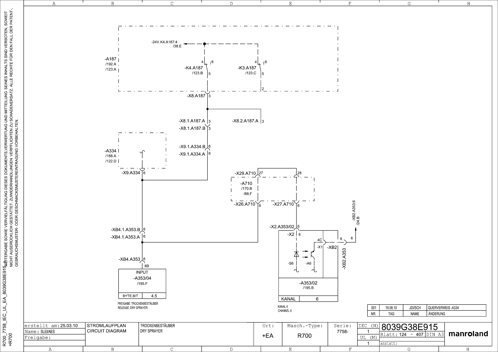

# +EA — Sheet 124 of 407 — TROCKENBESTÄUBER

**DRY SPRAYER**

> Part of the manroland **R700** printing press IEC/UL circuit diagrams.
> Drawing class: **Stromlaufplan / Circuit diagram** (DIN A3).
> Document `+EA` covers the **Printing unit** machine section.

## At a glance

| Field | Value |
|---|---|
| Document | `+EA`  (8039G38E915) |
| Sheet | **124** of 407 |
| Section (DE) | TROCKENBESTÄUBER |
| Section (EN) | DRY SPRAYER |
| Section type | CIRCUIT — Circuit diagram |
| Machine type | `R700` |
| Series | `7758` |
| Created | 25.03.10 |
| Replaces | — |
| Columns used | B, C, D, E, F, G, H |
| Path numbers | — |
| Labels on sheet | 85 |
| Cross-refs out | 12 |
| Cross-refs in | 29 |

**Previous:** [+EA sheet 123](SHEET_0123.md) · **Next:** [+EA sheet 125](SHEET_0125.md) · **Document TOC:** [_TOC.md](_TOC.md)  (+EA) · **Master TOC:** [all sheets](../_MASTER_TOC.md)

## Sheet image (300 DPI, exact vector render)



_Rendered directly from the PDF vector layer at 300 DPI (1-bit), no OCR and no resampling. Use it to confirm anything ambiguous in the text below._

## Cross-references on this sheet

Each entry is a wire leaving this sheet. The printed token is `/sheet.column`; the link resolves to that sheet inside the same document.

| Ref | Target sheet | Col | Path | Destination on target | Target section | From col |
|---|---|---|---|---|---|---|
| `/38.E` | [+EA sheet 38](SHEET_0038.md) | E | — | 24V.K4.A187:4 | BUSVERBINDUNGEN: NOT AUS | C |
| `/192.A` | [+EA sheet 192](SHEET_0192.md) | A | — | — | RESERVE | B |
| `/123.A` | [+EA sheet 123](SHEET_0123.md) | A | — | — | TROCKENBESTÄUBER | B |
| `/123.B` | [+EA sheet 123](SHEET_0123.md) | B | — | — | TROCKENBESTÄUBER | C |
| `/123.C` | [+EA sheet 123](SHEET_0123.md) | C | — | — | TROCKENBESTÄUBER | D |
| `/168.A` | [+EA sheet 168](SHEET_0168.md) | A | — | — | RESERVE | B |
| `/122.D` | [+EA sheet 122](SHEET_0122.md) | D | — | — | TROCKENBESTÄUBER | B |
| `/170.B` | [+EA sheet 170](SHEET_0170.md) | B | — | — | RESERVE | D |
| `/88.F` | [+EA sheet 88](SHEET_0088.md) | F | — | — | SAUGWALZE | D |
| `/24.B` | [+EA sheet 24](SHEET_0024.md) | B | — | XB2.A353:6 | BUSVERBINDUNGEN: SICHERHEITSBUS | F |
| `/195.F` | [+EA sheet 195](SHEET_0195.md) | F | — | — | REFERENZMODUL | B |
| `/195.B` | [+EA sheet 195](SHEET_0195.md) | B | — | — | REFERENZMODUL | E |

### Incoming references (sheets that point here)

Every other sheet that sends a wire to this one. `Back-ref` is the token printed on *that* sheet; `Path` is its line number.

| From sheet | Cols | Back-ref | Path | Refs | What continues there |
|---|---|---|---|---|---|
| [+EA#24](SHEET_0024.md) | B | `/24.B` | — | 1 | XB2.A353:6 |
| [+EA#38](SHEET_0038.md) | E | `/38.E` | — | 1 | — |
| [+EA#88](SHEET_0088.md) | E | `/88.E` | — | 1 | — |
| [+EA#122](SHEET_0122.md) | D | `/122.D` | — | 1 | — |
| [+EA#123](SHEET_0123.md) | A, B, C | `/123.A`, `/123.B`, `/123.C` | — | 3 | — |
| [+EA#168](SHEET_0168.md) | A | `/168.A` | — | 1 | — |
| [+EA#170](SHEET_0170.md) | B | `/170.B` | — | 1 | A710 |
| [+EA#192](SHEET_0192.md) | A | `/192.A` | — | 1 | — |
| [+EA#195](SHEET_0195.md) | B, F | `/195.B`, `/195.F` | — | 2 | — |
| [+EA#224](SHEET_0224.md) | G | `/224.G` | — | 1 | — |
| [+EA#225](SHEET_0225.md) | C | `/225.C` | — | 1 | — |
| [+EA#237](SHEET_0237.md) | A, B, C | `/237.A`, `/237.B`, `/237.C` | — | 3 | — |
| [+EA#248](SHEET_0248.md) | C, E, F, G | `/248.C`, `/248.E`, `/248.F`, `/248.G` | — | 5 | — |
| [+EA#251](SHEET_0251.md) | G, H | `/251.G`, `/251.H` | — | 2 | — |
| [+EA#252](SHEET_0252.md) | A | `/252.A` | — | 1 | — |
| [+EA#270](SHEET_0270.md) | C | `/270.C` | — | 1 | — |
| [+EA#271](SHEET_0271.md) | B | `/271.B` | — | 1 | — |
| [+EA#274](SHEET_0274.md) | C | `/274.C` | — | 2 | — |


## Devices on this sheet

| Tag | Class | Class meaning (IEC) | Col | Sub | Terminal | Sign |
|---|---|---|---|---|---|---|
| `A334` | A | Baugruppe / assembly, module, PC board | B | — | — | — |
| `A187` | A | Baugruppe / assembly, module, PC board | B | — | — | — |
| `A353/04` | A | Baugruppe / assembly, module, PC board | B | 04 | — | — |
| `S6` | S | Schalter / switch | E | — | — | — |
| `A6` | A | Baugruppe / assembly, module, PC board | E | — | — | — |
| `X1` | X | Klemme / terminal, plug connector | E | — | — | — |
| `X2` | X | Klemme / terminal, plug connector | E | — | — | — |
| `XB2` | XB |  | F | — | — | — |
| `A353/02` | A | Baugruppe / assembly, module, PC board | E | 02 | — | — |
| `A710` | A | Baugruppe / assembly, module, PC board | D | — | — | — |
| `X9.A334` | — | cross-device reference | B | — | — | — |
| `X9.1.A334.B` | — | cross-device reference | C | — | — | — |
| `X9.1.A334.A` | — | cross-device reference | C | — | — | — |
| `X8.A187` | — | cross-device reference | C | — | — | — |
| `K4.A187` | — | cross-device reference | C | — | — | — |
| `K3.A187` | — | cross-device reference | D | — | — | — |
| `X8.1.A187.B` | — | cross-device reference | C | — | — | — |
| `X8.1.A187.A` | — | cross-device reference | C | — | — | — |
| `X8.2.A187.A` | — | cross-device reference | D | — | — | — |
| `4.5` | — | cross-device reference | C | — | — | — |
| `XB4.A353` | — | cross-device reference | B | — | — | — |
| `XB4.1.A353.B` | — | cross-device reference | B | — | — | — |
| `XB4.1.A353.A` | — | cross-device reference | B | — | — | — |
| `XB2.A353` | — | cross-device reference | F | — | — | — |
| `X29.A710` | — | cross-device reference | D | — | — | — |
| `X27.A710` | — | cross-device reference | E | — | — | — |
| `X26.A710` | — | cross-device reference | D | — | — | — |
| `NR.` | — | cross-device reference | F | — | — | — |
| `19.08.10` | — | cross-device reference | G | — | — | — |
| `XB2.A353:6` | — | cross-device reference | F | — | 6 | — |

## Potentials / nets

| Potential | Count | Columns | Attached devices | Terminals |
|---|---|---|---|---|
| `24V` | 1 | C | `A187`, `K4` | `4` |


A potential such as `L24+/4` or `M24+` is a named supply/return rail; every place it appears on this sheet is electrically common.

## Wire-end annotations (grouped as printed)

A wire that continues elsewhere is annotated with a small cluster: the destination description, the path/line number `#NN`, and the `/sheet.column` cross reference. Each row below is one such cluster exactly as it is grouped on the drawing.

| Col | Y | Path | Cross-ref | Text on the wire |
|---|---|---|---|---|
| C | 96.7 | — | `/38.E` | `24V.K4.A187:4` |
| B | 136.4 | — | — | `A187` |
| C | 144.2 | — | — | `K4.A187 6` |
| D | 144.2 | — | — | `4` |
| D | 144.2 | — | — | `K3.A187 6` |
| D | 144.2 | — | — | `4` |
| B | 149.4 | — | `/192.A`, `/123.A` | — |
| C | 170.7 | — | `/123.B` | — |
| D | 170.7 | — | `/123.C` | — |
| D | 172.5 | — | — | `5` |
| E | 172.5 | — | — | `5` |
| E | 208.7 | — | — | `2` |
| C | 224.2 | — | — | `X8.A187 3` |
| D | 284.5 | — | — | `X8.1.A187.A 3 X8.2.A187.A 3` |
| C | 302.2 | — | — | `X8.1.A187.B 3` |
| C | 346.1 | — | — | `X9.1.A334.B 6` |
| B | 356.1 | — | — | `A334` |
| C | 363.2 | — | — | `X9.1.A334.A 6` |
| B | 369.1 | — | `/168.A`, `/122.D` | — |
| B | 408.5 | — | — | `X9.A334 6` |
| E | 409.9 | — | — | `X29.A710 27 28` |
| D | 434.0 | — | — | `A710` |
| D | 447.1 | — | `/170.B` | — |
| D | 459.5 | — | `/88.F` | — |
| F | 479.1 | — | `/24.B` | `XB2.A353:6` |
| E | 483.6 | — | — | `X26.A710 6 X27.A710 6` |
| E | 537.5 | — | — | `X2.A353/02 6` |
| B | 544.6 | — | — | `XB4.1.A353.B 6` |
| E | 555.9 | — | — | `X2` |
| D | 557.3 | — | — | `XB4.1.A353.A 6 6 6` |
| F | 565.8 | — | — | `6` |
| E | 570.1 | — | — | `4C` |
| E | 587.1 | — | — | `X1` |
| F | 587.1 | — | — | `XB2` |
| F | 593.3 | — | — | `XB2.A353` |
| B | 615.4 | — | — | `XB4.A353 6` |
| E | 626.0 | — | — | `S6 A6` |
| C | 632.4 | — | — | `8B` |
| B | 646.9 | — | — | `INPUT` |
| B | 660.8 | — | — | `A353/04` |
| E | 672.1 | — | — | `A353/02` |
| B | 674.6 | — | `/195.F` | — |
| E | 684.5 | — | `/195.B` | — |
| B | 703.6 | — | — | `BYTE.BIT 4.5` |
| E | 710.4 | — | — | `KANAL 6` |
| B | 723.6 | — | — | `FREIGABE: TROCKENBESTÄUBER RELEASE: DRY SPRAYER` |
| E | 730.7 | — | — | `KANAL 6 CHANNEL 6` |
| G | 733.0 | — | — | `001 19.08.10 JDI/SCH QUERVERWEIS A334` |
| G | 747.1 | — | — | `NR. TAG NAME ÄNDERUNG` |


## Reconstructed tables

This sheet carries tabular content (pin map / terminal assignment / index). The grid below was rebuilt from the drawing's own rule lines, so each row is exactly one physical row of the table.

### Table 1 — 4 data rows × 3 columns (at x=283.5, y=104.9) — **/38.E 4 K4.A187 /123.B X8.A187**

| X9.A334 | 6 | X8.1.A187.A X8.1.A187.B X9.1.A334.B X9.1.A334.A |
|---|---|---|
| `XB4.1.A353.B XB4.1.A353.A` | `6 6` |  |
| `XB4.A353` | `6 8B` |  |
| `INPUT` | `A353/04 /195.F` |  |
| `BYTE.BIT` | `4.5` |  |


### Table 2 — 4 data rows × 7 columns (at x=616.5, y=104.9) — **6 5 2 3**

| 6 | 27 | X27.A710 X2.A353/02 | 28 6 6 |  |  | XB2.A353:6 |
|---|---|---|---|---|---|---|
|  |  | `X2` | `6` | `4C` |  | `6 6` |
|  |  | `S6` | `A6` | `X1` | `XB2` | `XB2.A353` |
|  |  |  | `A353/02 /195.B` |  |  |  |
|  |  | `KANAL` |  | `6` |  |  |


## Notes and free text on this sheet

| Text | Col | Y (pt) |
|---|---|---|
| `8B` | C | 632.4 |
| `INPUT` | B | 646.94 |
| `BYTE.BIT` | B | 704.19 |
| `FREIGABE: TROCKENBESTÄUBER` | B | 723.62 |
| `RELEASE: DRY SPRAYER` | B | 733.58 |
| `KANAL 6` | E | 730.7 |
| `CHANNEL 6` | E | 740.65 |
| `4C` | E | 570.09 |
| `KANAL` | E | 710.38 |
| `X2.A353/02` | E | 537.47 |
| `TAG` | G | 747.27 |
| `NAME` | G | 747.25 |
| `ÄNDERUNG` | G | 747.31 |
| `JDI/SCH` | G | 733.1 |
| `QUERVERWEIS A334` | H | 733.11 |

## Complete label inventory (exact text from the drawing)

Every text object inside the drawing area of this sheet, in DIN reading order (column A→H, then top→bottom). This is the authoritative list: if a string is not here it is not printed on this sheet.

| Col | Y | X | Dir | Type | Text |
|---|---|---|---|---|---|
| B | 136.4 | 250.0 | → | device tag | `A187` |
| B | 149.4 | 252.3 | → | cross-reference | `/192.A` |
| B | 161.8 | 252.3 | → | cross-reference | `/123.A` |
| B | 356.1 | 250.0 | → | device tag | `A334` |
| B | 369.1 | 252.3 | → | cross-reference | `/168.A` |
| B | 381.5 | 252.3 | → | cross-reference | `/122.D` |
| B | 408.5 | 290.8 | → | device ref | `X9.A334` |
| B | 544.6 | 265.0 | → | device ref | `XB4.1.A353.B` |
| B | 562.3 | 264.2 | → | device ref | `XB4.1.A353.A` |
| B | 615.4 | 283.7 | → | device ref | `XB4.A353` |
| B | 646.9 | 325.3 | → | text | `INPUT` |
| B | 660.8 | 318.8 | → | device tag | `A353/04` |
| B | 674.6 | 327.8 | → | cross-reference | `/195.F` |
| B | 704.2 | 293.4 | → | text | `BYTE.BIT` |
| B | 723.6 | 281.5 | → | text | `FREIGABE: TROCKENBESTÄUBER` |
| B | 733.6 | 281.5 | → | text | `RELEASE: DRY SPRAYER` |
| C | 96.7 | 362.0 | → | potential | `24V.K4.A187:4` |
| C | 106.5 | 413.6 | → | cross-reference | `/38.E` |
| C | 157.6 | 441.1 | → | device ref | `K4.A187` |
| C | 170.7 | 459.5 | → | cross-reference | `/123.B` |
| C | 224.2 | 446.7 | → | device ref | `X8.A187` |
| C | 284.5 | 427.2 | → | device ref | `X8.1.A187.A` |
| C | 302.2 | 428.0 | → | device ref | `X8.1.A187.B` |
| C | 346.1 | 428.0 | → | device ref | `X9.1.A334.B` |
| C | 363.9 | 427.2 | → | device ref | `X9.1.A334.A` |
| C | 409.9 | 342.7 | → | number | `6` |
| C | 544.6 | 342.7 | → | number | `6` |
| C | 561.6 | 342.7 | → | number | `6` |
| C | 615.4 | 342.7 | → | number | `6` |
| C | 632.4 | 345.5 | → | text | `8B` |
| C | 703.6 | 361.7 | → | device ref | `4.5` |
| D | 144.2 | 481.6 | → | number | `4` |
| D | 144.2 | 505.7 | → | number | `6` |
| D | 144.2 | 609.2 | → | number | `4` |
| D | 157.6 | 568.6 | → | device ref | `K3.A187` |
| D | 170.7 | 586.8 | → | cross-reference | `/123.C` |
| D | 172.5 | 498.6 | → | number | `5` |
| D | 225.7 | 498.6 | → | number | `3` |
| D | 284.5 | 554.7 | → | device ref | `X8.2.A187.A` |
| D | 286.6 | 498.6 | → | number | `3` |
| D | 303.6 | 498.6 | → | number | `3` |
| D | 346.2 | 498.6 | → | number | `6` |
| D | 363.2 | 498.6 | → | number | `6` |
| D | 409.9 | 561.3 | → | device ref | `X29.A710` |
| D | 434.0 | 574.6 | → | device tag | `A710` |
| D | 447.1 | 577.1 | → | cross-reference | `/170.B` |
| D | 459.5 | 582.5 | → | cross-reference | `/88.F` |
| D | 483.6 | 559.8 | → | device ref | `X26.A710` |
| D | 487.9 | 619.1 | → | number | `6` |
| E | 144.2 | 633.3 | → | number | `6` |
| E | 172.5 | 626.2 | → | number | `5` |
| E | 208.7 | 626.2 | → | number | `2` |
| E | 286.6 | 626.2 | → | number | `3` |
| E | 409.9 | 619.1 | → | number | `27` |
| E | 409.9 | 711.2 | → | number | `28` |
| E | 483.6 | 652.0 | → | device ref | `X27.A710` |
| E | 487.9 | 711.2 | → | number | `6` |
| E | 537.5 | 644.6 | → | text | `X2.A353/02` |
| E | 537.5 | 711.2 | → | number | `6` |
| E | 555.9 | 687.1 | → | device tag | `X2` |
| E | 557.3 | 714.0 | → | number | `6` |
| E | 570.1 | 758.8 | → | text | `4C` |
| E | 587.1 | 757.7 | → | device tag | `X1` |
| E | 626.0 | 688.3 | → | device tag | `S6` |
| E | 626.0 | 730.8 | → | device tag | `A6` |
| E | 672.1 | 715.6 | → | device tag | `A353/02` |
| E | 684.5 | 724.4 | → | cross-reference | `/195.B` |
| E | 710.3 | 755.4 | → | number | `6` |
| E | 710.4 | 672.4 | → | text | `KANAL` |
| E | 730.7 | 664.2 | → | text | `KANAL 6` |
| E | 740.6 | 664.4 | → | text | `CHANNEL 6` |
| F | 479.1 | 842.2 | ↕ | device ref | `XB2.A353:6` |
| F | 517.9 | 852.1 | ↕ | cross-reference | `/24.B` |
| F | 565.8 | 838.8 | → | number | `6` |
| F | 567.3 | 813.3 | → | number | `6` |
| F | 587.1 | 782.1 | → | device tag | `XB2` |
| F | 593.3 | 818.1 | ↕ | device ref | `XB2.A353` |
| F | 733.0 | 887.7 | → | number | `001` |
| F | 747.1 | 886.7 | → | device ref | `NR.` |
| G | 733.1 | 921.5 | → | device ref | `19.08.10` |
| G | 733.1 | 978.7 | → | text | `JDI/SCH` |
| G | 747.3 | 928.3 | → | text | `TAG` |
| G | 747.3 | 981.7 | → | text | `NAME` |
| G | 747.3 | 1024.3 | → | text | `ÄNDERUNG` |
| H | 733.1 | 1023.4 | → | text | `QUERVERWEIS A334` |

## Reading-order text block

The same content as a plain block, grouped by DIN column — convenient to paste or to match against a visual description.

```text
=== Column B ===
 136.4  250.0  devtag       A187
 149.4  252.3  xref         /192.A
 161.8  252.3  xref         /123.A
 356.1  250.0  devtag       A334
 369.1  252.3  xref         /168.A
 381.5  252.3  xref         /122.D
 408.5  290.8  devref       X9.A334
 544.6  265.0  devref       XB4.1.A353.B
 562.3  264.2  devref       XB4.1.A353.A
 615.4  283.7  devref       XB4.A353
 646.9  325.3  text         INPUT
 660.8  318.8  devtag       A353/04
 674.6  327.8  xref         /195.F
 704.2  293.4  text         BYTE.BIT
 723.6  281.5  text         FREIGABE: TROCKENBESTÄUBER
 733.6  281.5  text         RELEASE: DRY SPRAYER
=== Column C ===
  96.7  362.0  net          24V.K4.A187:4
 106.5  413.6  xref         /38.E
 157.6  441.1  devref       K4.A187
 170.7  459.5  xref         /123.B
 224.2  446.7  devref       X8.A187
 284.5  427.2  devref       X8.1.A187.A
 302.2  428.0  devref       X8.1.A187.B
 346.1  428.0  devref       X9.1.A334.B
 363.9  427.2  devref       X9.1.A334.A
 409.9  342.7  numeric      6
 544.6  342.7  numeric      6
 561.6  342.7  numeric      6
 615.4  342.7  numeric      6
 632.4  345.5  text         8B
 703.6  361.7  devref       4.5
=== Column D ===
 144.2  481.6  numeric      4
 144.2  505.7  numeric      6
 144.2  609.2  numeric      4
 157.6  568.6  devref       K3.A187
 170.7  586.8  xref         /123.C
 172.5  498.6  numeric      5
 225.7  498.6  numeric      3
 284.5  554.7  devref       X8.2.A187.A
 286.6  498.6  numeric      3
 303.6  498.6  numeric      3
 346.2  498.6  numeric      6
 363.2  498.6  numeric      6
 409.9  561.3  devref       X29.A710
 434.0  574.6  devtag       A710
 447.1  577.1  xref         /170.B
 459.5  582.5  xref         /88.F
 483.6  559.8  devref       X26.A710
 487.9  619.1  numeric      6
=== Column E ===
 144.2  633.3  numeric      6
 172.5  626.2  numeric      5
 208.7  626.2  numeric      2
 286.6  626.2  numeric      3
 409.9  619.1  numeric      27
 409.9  711.2  numeric      28
 483.6  652.0  devref       X27.A710
 487.9  711.2  numeric      6
 537.5  644.6  text         X2.A353/02
 537.5  711.2  numeric      6
 555.9  687.1  devtag       X2
 557.3  714.0  numeric      6
 570.1  758.8  text         4C
 587.1  757.7  devtag       X1
 626.0  688.3  devtag       S6
 626.0  730.8  devtag       A6
 672.1  715.6  devtag       A353/02
 684.5  724.4  xref         /195.B
 710.3  755.4  numeric      6
 710.4  672.4  text         KANAL
 730.7  664.2  text         KANAL 6
 740.6  664.4  text         CHANNEL 6
=== Column F ===
 479.1  842.2  devref       XB2.A353:6
 517.9  852.1  xref         /24.B
 565.8  838.8  numeric      6
 567.3  813.3  numeric      6
 587.1  782.1  devtag       XB2
 593.3  818.1  devref       XB2.A353
 733.0  887.7  numeric      001
 747.1  886.7  devref       NR.
=== Column G ===
 733.1  921.5  devref       19.08.10
 733.1  978.7  text         JDI/SCH
 747.3  928.3  text         TAG
 747.3  981.7  text         NAME
 747.3 1024.3  text         ÄNDERUNG
=== Column H ===
 733.1 1023.4  text         QUERVERWEIS A334
```

---
_Generated from the PDF vector text layer; no OCR. Source: `R700_7758_IEC_UL_EA_8039G38E915_p`, sheet 124._
