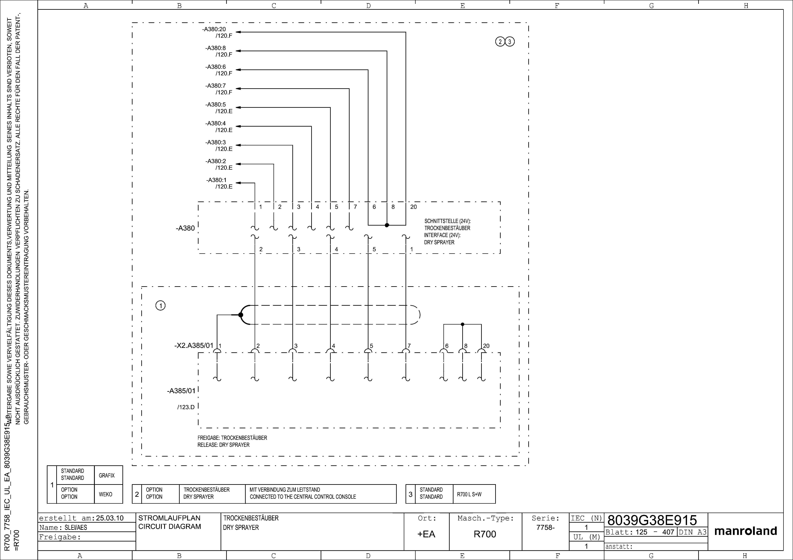

# +EA — Sheet 125 of 407 — TROCKENBESTÄUBER

**DRY SPRAYER**

> Part of the manroland **R700** printing press IEC/UL circuit diagrams.
> Drawing class: **Stromlaufplan / Circuit diagram** (DIN A3).
> Document `+EA` covers the **Printing unit** machine section.

## At a glance

| Field | Value |
|---|---|
| Document | `+EA`  (8039G38E915) |
| Sheet | **125** of 407 |
| Section (DE) | TROCKENBESTÄUBER |
| Section (EN) | DRY SPRAYER |
| Section type | CIRCUIT — Circuit diagram |
| Machine type | `R700` |
| Series | `7758` |
| Created | 25.03.10 |
| Replaces | — |
| Columns used | A, B, C, D, E, F |
| Path numbers | — |
| Labels on sheet | 72 |
| Cross-refs out | 10 |
| Cross-refs in | 19 |

**Previous:** [+EA sheet 124](SHEET_0124.md) · **Next:** [+EA sheet 126](SHEET_0126.md) · **Document TOC:** [_TOC.md](_TOC.md)  (+EA) · **Master TOC:** [all sheets](../_MASTER_TOC.md)

## Sheet image (300 DPI, exact vector render)



_Rendered directly from the PDF vector layer at 300 DPI (1-bit), no OCR and no resampling. Use it to confirm anything ambiguous in the text below._

## Cross-references on this sheet

Each entry is a wire leaving this sheet. The printed token is `/sheet.column`; the link resolves to that sheet inside the same document.

| Ref | Target sheet | Col | Path | Destination on target | Target section | From col |
|---|---|---|---|---|---|---|
| `/120.F` | [+EA sheet 120](SHEET_0120.md) | F | — | A380:20 | SCHNITTSTELLE: FREMDGERÄTE | B |
| `/120.F` | [+EA sheet 120](SHEET_0120.md) | F | — | A380:8 | SCHNITTSTELLE: FREMDGERÄTE | B |
| `/120.F` | [+EA sheet 120](SHEET_0120.md) | F | — | A380:6 | SCHNITTSTELLE: FREMDGERÄTE | B |
| `/120.F` | [+EA sheet 120](SHEET_0120.md) | F | — | A380:7 | SCHNITTSTELLE: FREMDGERÄTE | B |
| `/120.E` | [+EA sheet 120](SHEET_0120.md) | E | — | A380:5 | SCHNITTSTELLE: FREMDGERÄTE | B |
| `/120.E` | [+EA sheet 120](SHEET_0120.md) | E | — | A380:4 | SCHNITTSTELLE: FREMDGERÄTE | B |
| `/120.E` | [+EA sheet 120](SHEET_0120.md) | E | — | A380:3 | SCHNITTSTELLE: FREMDGERÄTE | B |
| `/120.E` | [+EA sheet 120](SHEET_0120.md) | E | — | A380:2 | SCHNITTSTELLE: FREMDGERÄTE | B |
| `/120.E` | [+EA sheet 120](SHEET_0120.md) | E | — | A380:1 | SCHNITTSTELLE: FREMDGERÄTE | B |
| `/123.D` | [+EA sheet 123](SHEET_0123.md) | D | — | — | TROCKENBESTÄUBER | B |

### Incoming references (sheets that point here)

Every other sheet that sends a wire to this one. `Back-ref` is the token printed on *that* sheet; `Path` is its line number.

| From sheet | Cols | Back-ref | Path | Refs | What continues there |
|---|---|---|---|---|---|
| [+EA#120](SHEET_0120.md) | E, F | `/120.E`, `/120.F` | — | 9 | A380:1; A380:2; A380:20; A380:3; A380:4; A380:5; A380:6; A380:7; A380:8 |
| [+EA#123](SHEET_0123.md) | C | `/123.C` | — | 1 | — |
| [+EA#230](SHEET_0230.md) | A | `/230.A` | — | 9 | — |


## Devices on this sheet

| Tag | Class | Class meaning (IEC) | Col | Sub | Terminal | Sign |
|---|---|---|---|---|---|---|
| `A380` | A | Baugruppe / assembly, module, PC board | B | — | — | — |
| `A385/01` | A | Baugruppe / assembly, module, PC board | B | 01 | — | — |
| `A380:5` | A | Baugruppe / assembly, module, PC board | B | — | 5 | — |
| `A380:6` | A | Baugruppe / assembly, module, PC board | B | — | 6 | — |
| `A380:7` | A | Baugruppe / assembly, module, PC board | B | — | 7 | — |
| `A380:4` | A | Baugruppe / assembly, module, PC board | B | — | 4 | — |
| `A380:1` | A | Baugruppe / assembly, module, PC board | B | — | 1 | — |
| `A380:2` | A | Baugruppe / assembly, module, PC board | B | — | 2 | — |
| `A380:3` | A | Baugruppe / assembly, module, PC board | B | — | 3 | — |
| `A380:8` | A | Baugruppe / assembly, module, PC board | B | — | 8 | — |
| `A380:20` | A | Baugruppe / assembly, module, PC board | B | — | 20 | — |

## Potentials / nets

_No named potentials on this sheet._

## Wire-end annotations (grouped as printed)

A wire that continues elsewhere is annotated with a small cluster: the destination description, the path/line number `#NN`, and the `/sheet.column` cross reference. Each row below is one such cluster exactly as it is grouped on the drawing.

| Col | Y | Path | Cross-ref | Text on the wire |
|---|---|---|---|---|
| B | 40.0 | — | `/120.F` | `A380:20` |
| E | 59.8 | — | — | `2 3` |
| B | 68.3 | — | `/120.F` | `A380:8` |
| B | 96.7 | — | `/120.F` | `A380:6` |
| B | 125.0 | — | `/120.F` | `A380:7` |
| B | 153.4 | — | `/120.E` | `A380:5` |
| B | 181.7 | — | `/120.E` | `A380:4` |
| B | 210.1 | — | `/120.E` | `A380:3` |
| B | 238.4 | — | `/120.E` | `A380:2` |
| B | 266.8 | — | `/120.E` | `A380:1` |
| D | 307.2 | — | — | `1 2 3 4 5 7 6 8 20` |
| E | 329.4 | — | — | `INTERFACE (24V): DRY SPRAYER SCHNITTSTELLE (24V): TROCKENBESTÄUBER` |
| B | 338.3 | — | — | `A380` |
| D | 370.9 | — | — | `2 3 4 5 1` |
| B | 456.1 | — | — | `1` |
| D | 514.8 | — | — | `X2.A385/01 1 2 3 4 5 7 6 8 20` |
| B | 582.8 | — | — | `A385/01` |
| B | 608.3 | — | `/123.D` | — |
| C | 655.4 | — | — | `FREIGABE: TROCKENBESTÄUBER RELEASE: DRY SPRAYER` |
| A | 705.0 | — | — | `STANDARD STANDARD` |
| A | 712.1 | — | — | `1 GRAFIX 2 OPTION OPTION` |
| A | 733.4 | — | — | `OPTION OPTION WEKO` |
| B | 733.4 | — | — | `DRY SPRAYER TROCKENBESTÄUBER` |
| C | 733.4 | — | — | `MIT VERBINDUNG ZUM LEITSTAND CONNECTED TO THE CENTRAL CONTROL CONSOLE` |
| E | 733.4 | — | — | `3 STANDARD STANDARD R700 L S+W` |


## Reconstructed tables

This sheet carries tabular content (pin map / terminal assignment / index). The grid below was rebuilt from the drawing's own rule lines, so each row is exactly one physical row of the table.

### Table 1 — 9 data rows × 12 columns (at x=326.0, y=48.2)

| C1 | C2 | C3 | C4 | C5 | C6 | C7 | C8 | C9 | C10 | C11 | C12 |
|---|---|---|---|---|---|---|---|---|---|---|---|
| `/120.F` |  |  |  |  |  |  |  |  |  |  |  |
| `/120.F` |  |  |  |  |  |  |  |  |  |  |  |
| `/120.F` |  |  |  |  |  |  |  |  |  |  |  |
| `/120.F` |  |  |  |  |  |  |  |  |  |  |  |
| `/120.E` |  |  |  |  |  |  |  |  |  |  |  |
| `/120.E` |  |  |  |  |  |  |  |  |  |  |  |
| `/120.E` |  |  |  |  |  |  |  |  |  |  |  |
| `/120.E /120.E` | `1` | `2` | `3` | `4` | `5` | `7` | `6` | `8` | `20 SCHNITTSTELLE` |  | `(24V):` |
|  | `2` |  | `3` |  | `4` |  | `5` |  | `INTERFACE DRY 1` | `TROCKENBESTÄUBER (24V): SPRAYER` |  |


## Notes and free text on this sheet

| Text | Col | Y (pt) |
|---|---|---|
| `SCHNITTSTELLE (24V):` | E | 329.44 |
| `TROCKENBESTÄUBER` | E | 340.08 |
| `INTERFACE (24V):` | E | 350.7 |
| `DRY SPRAYER` | E | 361.33 |
| `X2.A385/01` | B | 514.8 |
| `FREIGABE: TROCKENBESTÄUBER` | C | 655.42 |
| `RELEASE: DRY SPRAYER` | B | 666.05 |
| `STANDARD` | A | 705.04 |
| `OPTION` | A | 733.35 |
| `WEKO` | A | 740.37 |
| `GRAFIX` | A | 712.11 |
| `OPTION` | B | 733.35 |
| `TROCKENBESTÄUBER` | B | 733.38 |
| `DRY SPRAYER` | B | 744 |
| `MIT VERBINDUNG ZUM LEITSTAND` | C | 733.39 |
| `CONNECTED TO THE CENTRAL CONTROL CONSOLE` | C | 744.03 |
| `STANDARD` | E | 733.39 |
| `R700 L S+W` | E | 740.42 |

## Complete label inventory (exact text from the drawing)

Every text object inside the drawing area of this sheet, in DIN reading order (column A→H, then top→bottom). This is the authoritative list: if a string is not here it is not printed on this sheet.

| Col | Y | X | Dir | Type | Text |
|---|---|---|---|---|---|
| A | 705.0 | 91.8 | → | text | `STANDARD` |
| A | 712.1 | 148.5 | → | text | `GRAFIX` |
| A | 715.7 | 91.8 | → | text | `STANDARD` |
| A | 724.5 | 75.4 | → | number | `1` |
| A | 733.4 | 91.8 | → | text | `OPTION` |
| A | 740.4 | 148.8 | → | text | `WEKO` |
| A | 744.0 | 91.8 | → | text | `OPTION` |
| B | 40.0 | 303.6 | → | device tag | `A380:20` |
| B | 49.9 | 324.0 | → | cross-reference | `/120.F` |
| B | 68.3 | 308.4 | → | device tag | `A380:8` |
| B | 78.2 | 324.0 | → | cross-reference | `/120.F` |
| B | 96.7 | 308.4 | → | device tag | `A380:6` |
| B | 106.6 | 324.0 | → | cross-reference | `/120.F` |
| B | 125.0 | 308.4 | → | device tag | `A380:7` |
| B | 134.9 | 324.0 | → | cross-reference | `/120.F` |
| B | 153.4 | 308.4 | → | device tag | `A380:5` |
| B | 163.3 | 323.7 | → | cross-reference | `/120.E` |
| B | 181.7 | 308.4 | → | device tag | `A380:4` |
| B | 191.6 | 323.7 | → | cross-reference | `/120.E` |
| B | 210.1 | 308.4 | → | device tag | `A380:3` |
| B | 219.9 | 323.7 | → | cross-reference | `/120.E` |
| B | 238.4 | 308.7 | → | device tag | `A380:2` |
| B | 248.3 | 323.7 | → | cross-reference | `/120.E` |
| B | 266.8 | 309.8 | → | device tag | `A380:1` |
| B | 276.6 | 323.7 | → | cross-reference | `/120.E` |
| B | 338.3 | 264.2 | → | device tag | `A380` |
| B | 456.2 | 239.2 | → | number | `1` |
| B | 514.8 | 261.9 | → | text | `X2.A385/01` |
| B | 516.2 | 328.0 | → | number | `1` |
| B | 582.8 | 250.9 | → | device tag | `A385/01` |
| B | 608.3 | 266.5 | → | cross-reference | `/123.D` |
| B | 666.0 | 296.8 | → | text | `RELEASE: DRY SPRAYER` |
| B | 733.4 | 219.4 | → | text | `OPTION` |
| B | 733.4 | 276.1 | → | text | `TROCKENBESTÄUBER` |
| B | 738.7 | 202.7 | → | number | `2` |
| B | 744.0 | 219.4 | → | text | `OPTION` |
| B | 744.0 | 275.5 | → | text | `DRY SPRAYER` |
| C | 307.2 | 388.9 | → | number | `1` |
| C | 307.2 | 417.8 | → | number | `2` |
| C | 307.2 | 446.2 | → | number | `3` |
| C | 307.2 | 474.5 | → | number | `4` |
| C | 371.0 | 389.5 | → | number | `2` |
| C | 371.0 | 446.2 | → | number | `3` |
| C | 516.2 | 385.2 | → | number | `2` |
| C | 516.2 | 441.9 | → | number | `3` |
| C | 655.4 | 296.8 | → | text | `FREIGABE: TROCKENBESTÄUBER` |
| C | 733.4 | 375.0 | → | text | `MIT VERBINDUNG ZUM LEITSTAND` |
| C | 744.0 | 375.3 | → | text | `CONNECTED TO THE CENTRAL CONTROL CONSOLE` |
| D | 307.2 | 502.9 | → | number | `5` |
| D | 307.2 | 531.2 | → | number | `7` |
| D | 307.2 | 559.6 | → | number | `6` |
| D | 307.2 | 587.9 | → | number | `8` |
| D | 307.2 | 616.3 | → | number | `20` |
| D | 371.0 | 502.9 | → | number | `4` |
| D | 371.0 | 559.6 | → | number | `5` |
| D | 371.0 | 615.7 | → | number | `1` |
| D | 516.2 | 498.6 | → | number | `4` |
| D | 516.2 | 555.3 | → | number | `5` |
| D | 516.2 | 612.0 | → | number | `7` |
| D | 738.7 | 613.6 | → | number | `3` |
| E | 59.8 | 749.2 | → | number | `2` |
| E | 329.4 | 637.5 | → | text | `SCHNITTSTELLE (24V):` |
| E | 340.1 | 637.5 | → | text | `TROCKENBESTÄUBER` |
| E | 350.7 | 636.9 | → | text | `INTERFACE (24V):` |
| E | 361.3 | 636.9 | → | text | `DRY SPRAYER` |
| E | 516.2 | 668.7 | → | number | `6` |
| E | 516.2 | 697.0 | → | number | `8` |
| E | 516.2 | 725.4 | → | number | `20` |
| E | 733.4 | 630.4 | → | text | `STANDARD` |
| E | 740.4 | 686.6 | → | text | `R700 L S+W` |
| E | 744.0 | 630.4 | → | text | `STANDARD` |
| F | 59.8 | 763.4 | → | number | `3` |

## Reading-order text block

The same content as a plain block, grouped by DIN column — convenient to paste or to match against a visual description.

```text
=== Column A ===
 705.0   91.8  text         STANDARD
 712.1  148.5  text         GRAFIX
 715.7   91.8  text         STANDARD
 724.5   75.4  numeric      1
 733.4   91.8  text         OPTION
 740.4  148.8  text         WEKO
 744.0   91.8  text         OPTION
=== Column B ===
  40.0  303.6  devtag       A380:20
  49.9  324.0  xref         /120.F
  68.3  308.4  devtag       A380:8
  78.2  324.0  xref         /120.F
  96.7  308.4  devtag       A380:6
 106.6  324.0  xref         /120.F
 125.0  308.4  devtag       A380:7
 134.9  324.0  xref         /120.F
 153.4  308.4  devtag       A380:5
 163.3  323.7  xref         /120.E
 181.7  308.4  devtag       A380:4
 191.6  323.7  xref         /120.E
 210.1  308.4  devtag       A380:3
 219.9  323.7  xref         /120.E
 238.4  308.7  devtag       A380:2
 248.3  323.7  xref         /120.E
 266.8  309.8  devtag       A380:1
 276.6  323.7  xref         /120.E
 338.3  264.2  devtag       A380
 456.2  239.2  numeric      1
 514.8  261.9  text         X2.A385/01
 516.2  328.0  numeric      1
 582.8  250.9  devtag       A385/01
 608.3  266.5  xref         /123.D
 666.0  296.8  text         RELEASE: DRY SPRAYER
 733.4  219.4  text         OPTION
 733.4  276.1  text         TROCKENBESTÄUBER
 738.7  202.7  numeric      2
 744.0  219.4  text         OPTION
 744.0  275.5  text         DRY SPRAYER
=== Column C ===
 307.2  388.9  numeric      1
 307.2  417.8  numeric      2
 307.2  446.2  numeric      3
 307.2  474.5  numeric      4
 371.0  389.5  numeric      2
 371.0  446.2  numeric      3
 516.2  385.2  numeric      2
 516.2  441.9  numeric      3
 655.4  296.8  text         FREIGABE: TROCKENBESTÄUBER
 733.4  375.0  text         MIT VERBINDUNG ZUM LEITSTAND
 744.0  375.3  text         CONNECTED TO THE CENTRAL CONTROL CONSOLE
=== Column D ===
 307.2  502.9  numeric      5
 307.2  531.2  numeric      7
 307.2  559.6  numeric      6
 307.2  587.9  numeric      8
 307.2  616.3  numeric      20
 371.0  502.9  numeric      4
 371.0  559.6  numeric      5
 371.0  615.7  numeric      1
 516.2  498.6  numeric      4
 516.2  555.3  numeric      5
 516.2  612.0  numeric      7
 738.7  613.6  numeric      3
=== Column E ===
  59.8  749.2  numeric      2
 329.4  637.5  text         SCHNITTSTELLE (24V):
 340.1  637.5  text         TROCKENBESTÄUBER
 350.7  636.9  text         INTERFACE (24V):
 361.3  636.9  text         DRY SPRAYER
 516.2  668.7  numeric      6
 516.2  697.0  numeric      8
 516.2  725.4  numeric      20
 733.4  630.4  text         STANDARD
 740.4  686.6  text         R700 L S+W
 744.0  630.4  text         STANDARD
=== Column F ===
  59.8  763.4  numeric      3
```

---
_Generated from the PDF vector text layer; no OCR. Source: `R700_7758_IEC_UL_EA_8039G38E915_p`, sheet 125._
