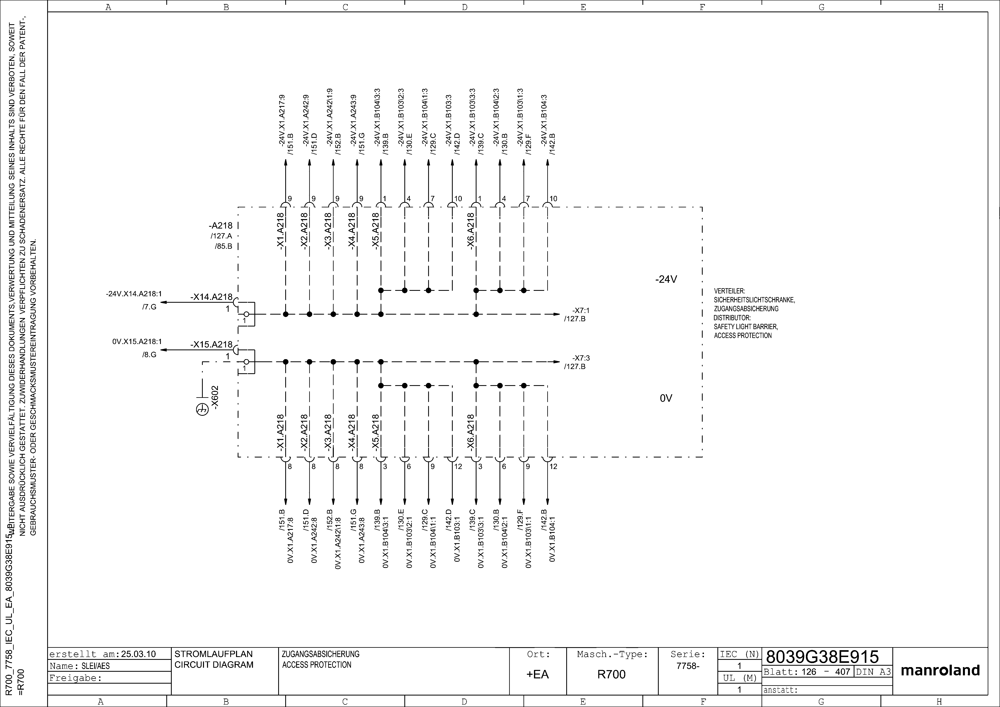

# +EA — Sheet 126 of 407 — ZUGANGSABSICHERUNG

**ACCESS PROTECTION**

> Part of the manroland **R700** printing press IEC/UL circuit diagrams.
> Drawing class: **Stromlaufplan / Circuit diagram** (DIN A3).
> Document `+EA` covers the **Printing unit** machine section.

## At a glance

| Field | Value |
|---|---|
| Document | `+EA`  (8039G38E915) |
| Sheet | **126** of 407 |
| Section (DE) | ZUGANGSABSICHERUNG |
| Section (EN) | ACCESS PROTECTION |
| Section type | CIRCUIT — Circuit diagram |
| Machine type | `R700` |
| Series | `7758` |
| Created | 25.03.10 |
| Replaces | — |
| Columns used | A, B, C, D, E, F |
| Path numbers | — |
| Labels on sheet | 110 |
| Cross-refs out | 30 |
| Cross-refs in | 54 |

**Previous:** [+EA sheet 125](SHEET_0125.md) · **Next:** [+EA sheet 127](SHEET_0127.md) · **Document TOC:** [_TOC.md](_TOC.md)  (+EA) · **Master TOC:** [all sheets](../_MASTER_TOC.md)

## Sheet image (300 DPI, exact vector render)



_Rendered directly from the PDF vector layer at 300 DPI (1-bit), no OCR and no resampling. Use it to confirm anything ambiguous in the text below._

## Cross-references on this sheet

Each entry is a wire leaving this sheet. The printed token is `/sheet.column`; the link resolves to that sheet inside the same document.

| Ref | Target sheet | Col | Path | Destination on target | Target section | From col |
|---|---|---|---|---|---|---|
| `/152.B` | [+EA sheet 152](SHEET_0152.md) | B | — | 24V.X1.A242\1:9 | ZUGANGSABSICHERUNG | C |
| `/139.B` | [+EA sheet 139](SHEET_0139.md) | B | — | 24V.X1.B104\3:3 | ZUGANGSABSICHERUNG | C |
| `/130.E` | [+EA sheet 130](SHEET_0130.md) | E | — | 24V.X1.B103\2:3 | ZUGANGSABSICHERUNG | D |
| `/129.C` | [+EA sheet 129](SHEET_0129.md) | C | — | 24V.X1.B104\1:3 | ZUGANGSABSICHERUNG | D |
| `/139.C` | [+EA sheet 139](SHEET_0139.md) | C | — | 24V.X1.B103\3:3 | ZUGANGSABSICHERUNG | D |
| `/130.B` | [+EA sheet 130](SHEET_0130.md) | B | — | 24V.X1.B104\2:3 | ZUGANGSABSICHERUNG | D |
| `/129.F` | [+EA sheet 129](SHEET_0129.md) | F | — | 24V.X1.B103\1:3 | ZUGANGSABSICHERUNG | E |
| `/151.B` | [+EA sheet 151](SHEET_0151.md) | B | — | 24V.X1.A217:9 | ZUGANGSABSICHERUNG | C |
| `/151.D` | [+EA sheet 151](SHEET_0151.md) | D | — | 24V.X1.A242:9 | ZUGANGSABSICHERUNG | C |
| `/151.G` | [+EA sheet 151](SHEET_0151.md) | G | — | 24V.X1.A243:9 | ZUGANGSABSICHERUNG | C |
| `/142.D` | [+EA sheet 142](SHEET_0142.md) | D | — | 24V.X1.B103:3 | ZUGANGSABSICHERUNG | D |
| `/142.B` | [+EA sheet 142](SHEET_0142.md) | B | — | 24V.X1.B104:3 | ZUGANGSABSICHERUNG | E |
| `/127.A` | [+EA sheet 127](SHEET_0127.md) | A | — | — | ZUGANGSABSICHERUNG | B |
| `/85.B` | [+EA sheet 85](SHEET_0085.md) | B | — | — | AUSLEGERSTAPELSTEUERUNG: PROGRAMMSCHALTWERK | B |
| `/7.G` | [+EA sheet 7](SHEET_0007.md) | G | — | X7:1 | SPANNUNGSVERSORGUNG: 400V, 24V | C |
| `/127.B` | [+EA sheet 127](SHEET_0127.md) | B | — | — | ZUGANGSABSICHERUNG | E |
| `/8.G` | [+EA sheet 8](SHEET_0008.md) | G | — | — | SPANNUNGSVERSORGUNG: 400V, 24V | A |
| `/127.B` | [+EA sheet 127](SHEET_0127.md) | B | — | — | ZUGANGSABSICHERUNG | E |
| `/151.G` | [+EA sheet 151](SHEET_0151.md) | G | — | — | ZUGANGSABSICHERUNG | C |
| `/130.E` | [+EA sheet 130](SHEET_0130.md) | E | — | — | ZUGANGSABSICHERUNG | C |
| `/151.B` | [+EA sheet 151](SHEET_0151.md) | B | — | — | ZUGANGSABSICHERUNG | B |
| `/151.D` | [+EA sheet 151](SHEET_0151.md) | D | — | — | ZUGANGSABSICHERUNG | C |
| `/152.B` | [+EA sheet 152](SHEET_0152.md) | B | — | — | ZUGANGSABSICHERUNG | C |
| `/139.B` | [+EA sheet 139](SHEET_0139.md) | B | — | — | ZUGANGSABSICHERUNG | C |
| `/129.C` | [+EA sheet 129](SHEET_0129.md) | C | — | — | ZUGANGSABSICHERUNG | D |
| `/142.D` | [+EA sheet 142](SHEET_0142.md) | D | — | — | ZUGANGSABSICHERUNG | D |
| `/139.C` | [+EA sheet 139](SHEET_0139.md) | C | — | — | ZUGANGSABSICHERUNG | D |
| `/130.B` | [+EA sheet 130](SHEET_0130.md) | B | — | — | ZUGANGSABSICHERUNG | D |
| `/129.F` | [+EA sheet 129](SHEET_0129.md) | F | — | — | ZUGANGSABSICHERUNG | D |
| `/142.B` | [+EA sheet 142](SHEET_0142.md) | B | — | — | ZUGANGSABSICHERUNG | E |

### Incoming references (sheets that point here)

Every other sheet that sends a wire to this one. `Back-ref` is the token printed on *that* sheet; `Path` is its line number.

| From sheet | Cols | Back-ref | Path | Refs | What continues there |
|---|---|---|---|---|---|
| [+EA#7](SHEET_0007.md) | H | `/7.H` | — | 1 | 24V.X14.A218:1 |
| [+EA#8](SHEET_0008.md) | G | `/8.G` | — | 1 | 0V.X15.A218:1 |
| [+EA#85](SHEET_0085.md) | A | `/85.A` | — | 1 | — |
| [+EA#127](SHEET_0127.md) | A | `/127.A` | — | 3 | X7:1; X7:3 |
| [+EA#129](SHEET_0129.md) | B, D, E | `/129.B`, `/129.D`, `/129.E` | — | 4 | 0V.X1.B104\1:1 0V.X1.B103\1:1; 24V.X1.B103\1:3; 24V.X1.B104\1:3 |
| [+EA#130](SHEET_0130.md) | B, C, E | `/130.B`, `/130.C`, `/130.E` | — | 4 | 0V.X1.B104\2:1 0V.X1.B103\2:1; 24V.X1.B103\2:3; 24V.X1.B104\2:3 |
| [+EA#139](SHEET_0139.md) | A, D | `/139.A`, `/139.D` | — | 4 | 0V.X1.B104\3:1 0V.X1.B103\3:1 0V.X1.B102\3:1 0V.X1.B101\3:1; 24V.X1.B103\3:3 24V.X1.B102\3:3; 24V.X1.B104\3:3 |
| [+EA#142](SHEET_0142.md) | A, B, C | `/142.A`, `/142.B`, `/142.C` | — | 4 | 0V.X1.B104:1 0V.X1.B103:1; 24V.X1.B103:3; 24V.X1.B104:3 |
| [+EA#151](SHEET_0151.md) | B, D, E | `/151.B`, `/151.D`, `/151.E` | — | 6 | 0V.X1.A217:8 0V.X1.A242:8 0V.X1.A243:8; 24V.X1.A217:9; 24V.X1.A242:9 24V.X1.A243:9 |
| [+EA#152](SHEET_0152.md) | A | `/152.A` | — | 2 | 0V.X1.A242\1:8; 24V.X1.A242\1:9 |
| [+EA#207](SHEET_0207.md) | E | `/207.E` | — | 2 | — |
| [+EA#223](SHEET_0223.md) | E | `/223.E` | — | 2 | — |
| [+EA#231](SHEET_0231.md) | H | `/231.H` | — | 2 | — |
| [+EA#236](SHEET_0236.md) | C | `/236.C` | — | 2 | — |
| [+EA#238](SHEET_0238.md) | G | `/238.G` | — | 8 | — |
| [+EA#244](SHEET_0244.md) | A | `/244.A` | — | 8 | — |


## Devices on this sheet

| Tag | Class | Class meaning (IEC) | Col | Sub | Terminal | Sign |
|---|---|---|---|---|---|---|
| `A218` | A | Baugruppe / assembly, module, PC board | B | — | — | — |
| `X7:3` | X | Klemme / terminal, plug connector | E | — | 3 | — |
| `X7:1` | X | Klemme / terminal, plug connector | E | — | 1 | — |
| `X602` | X | Klemme / terminal, plug connector | B | — | — | — |
| `X1.A218` | — | cross-device reference | B | — | — | — |
| `X1.A218` | — | cross-device reference | B | — | — | — |
| `X14.A218` | — | cross-device reference | B | — | — | — |
| `X15.A218` | — | cross-device reference | B | — | — | — |
| `X2.A218` | — | cross-device reference | C | — | — | — |
| `X2.A218` | — | cross-device reference | C | — | — | — |
| `X3.A218` | — | cross-device reference | C | — | — | — |
| `X3.A218` | — | cross-device reference | C | — | — | — |
| `X4.A218` | — | cross-device reference | C | — | — | — |
| `X4.A218` | — | cross-device reference | C | — | — | — |
| `X5.A218` | — | cross-device reference | C | — | — | — |
| `X6.A218` | — | cross-device reference | D | — | — | — |
| `X5.A218` | — | cross-device reference | C | — | — | — |
| `X6.A218` | — | cross-device reference | D | — | — | — |

## Potentials / nets

| Potential | Count | Columns | Attached devices | Terminals |
|---|---|---|---|---|
| `0V` | 14 | A, C, D, E, F | `A217`, `A218`, `A242`, `A242\1`, `A243`, `B103`, `B103\1`, `B103\2`, `B103\3`, `B104`, `B104\1`, `B104\2`, `B104\3`, `X1`, `X15` | `1`, `8` |
| `24V` | 14 | A, B, C, D, E, F | `A217`, `A218`, `A242`, `A242\1`, `A243`, `B103`, `B103\1`, `B103\2`, `B103\3`, `B104`, `B104\1`, `B104\2`, `B104\3`, `X1`, `X14` | `1`, `3`, `9` |


A potential such as `L24+/4` or `M24+` is a named supply/return rail; every place it appears on this sheet is electrically common.

## Wire-end annotations (grouped as printed)

A wire that continues elsewhere is annotated with a small cluster: the destination description, the path/line number `#NN`, and the `/sheet.column` cross reference. Each row below is one such cluster exactly as it is grouped on the drawing.

| Col | Y | Path | Cross-ref | Text on the wire |
|---|---|---|---|---|
| C | 105.2 | — | `/152.B` | `24V.X1.A242\1:9` |
| C | 105.2 | — | `/139.B` | `24V.X1.B104\3:3` |
| D | 105.2 | — | `/130.E` | `24V.X1.B103\2:3` |
| D | 105.2 | — | `/129.C` | `24V.X1.B104\1:3` |
| D | 105.2 | — | `/139.C` | `24V.X1.B103\3:3` |
| D | 105.2 | — | `/130.B` | `24V.X1.B104\2:3` |
| E | 105.2 | — | `/129.F` | `24V.X1.B103\1:3` |
| C | 112.5 | — | `/151.B` | `24V.X1.A217:9` |
| C | 112.5 | — | `/151.D` | `24V.X1.A242:9` |
| C | 112.5 | — | `/151.G` | `24V.X1.A243:9` |
| D | 112.5 | — | `/142.D` | `24V.X1.B103:3` |
| E | 112.5 | — | `/142.B` | `24V.X1.B104:3` |
| C | 232.8 | — | — | `9` |
| C | 232.8 | — | — | `9` |
| C | 232.8 | — | — | `9` |
| C | 232.8 | — | — | `9` |
| C | 232.8 | — | — | `1` |
| D | 232.8 | — | — | `4 7 10 1` |
| E | 232.8 | — | — | `4 7 10` |
| B | 253.1 | — | — | `X1.A218` |
| C | 253.1 | — | — | `X2.A218` |
| C | 253.1 | — | — | `X3.A218` |
| C | 253.1 | — | — | `X4.A218` |
| C | 253.1 | — | — | `X5.A218` |
| D | 253.1 | — | — | `X6.A218` |
| B | 263.9 | — | — | `A218` |
| B | 277.0 | — | `/127.A` | — |
| B | 289.4 | — | `/85.B` | — |
| F | 327.1 | — | — | `24V` |
| F | 343.6 | — | — | `DISTRIBUTOR: SICHERHEITSLICHTSCHRANKE, VERTEILER: ZUGANGSABSICHERUNG` |
| A | 346.1 | — | — | `24V.X14.A218:1` |
| B | 349.0 | — | — | `X14.A218 1` |
| C | 361.7 | — | `/7.G` | `X7:1` |
| E | 375.9 | — | `/127.B` | — |
| B | 378.0 | — | — | `1` |
| F | 386.1 | — | — | `SAFETY LIGHT BARRIER, ACCESS PROTECTION` |
| A | 402.8 | — | — | `0V.X15.A218:1` |
| B | 405.7 | — | — | `X15.A218 1` |
| A | 418.4 | — | `/8.G` | — |
| E | 422.6 | — | — | `X7:3` |
| E | 432.6 | — | `/127.B` | — |
| B | 434.7 | — | — | `1` |
| B | 459.1 | — | — | `X602` |
| F | 468.8 | — | — | `0V` |
| B | 493.2 | — | — | `X1.A218` |
| C | 493.2 | — | — | `X2.A218` |
| C | 493.2 | — | — | `X3.A218` |
| C | 493.2 | — | — | `X4.A218` |
| C | 493.2 | — | — | `X5.A218` |
| D | 493.2 | — | — | `X6.A218` |
| C | 551.7 | — | — | `8` |
| C | 551.7 | — | — | `8` |
| C | 551.7 | — | — | `8` |
| C | 551.7 | — | — | `8` |
| C | 551.7 | — | — | `3` |
| D | 551.7 | — | — | `6 9 12 3` |
| E | 551.7 | — | — | `6 9 12` |
| C | 606.0 | — | `/151.G` | — |
| C | 606.0 | — | `/130.E` | — |
| B | 606.3 | — | `/151.B` | — |
| C | 606.3 | — | `/151.D` | — |
| C | 606.3 | — | `/152.B` | — |
| C | 606.3 | — | `/139.B` | — |
| D | 606.3 | — | `/129.C` | — |
| D | 606.3 | — | `/142.D` | — |
| D | 606.3 | — | `/139.C` | — |
| D | 606.3 | — | `/130.B` | — |
| D | 606.3 | — | `/129.F` | — |
| E | 606.3 | — | `/142.B` | — |
| C | 614.8 | — | — | `0V.X1.B104\3:1` |
| D | 614.8 | — | — | `0V.X1.B103\2:1` |
| D | 614.8 | — | — | `0V.X1.B104\1:1` |
| D | 614.8 | — | — | `0V.X1.B103:1` |
| D | 614.8 | — | — | `0V.X1.B103\3:1` |
| D | 614.8 | — | — | `0V.X1.B104\2:1` |
| E | 614.8 | — | — | `0V.X1.B103\1:1` |
| E | 614.8 | — | — | `0V.X1.B104:1` |
| C | 616.2 | — | — | `0V.X1.A217:8` |
| C | 616.2 | — | — | `0V.X1.A242:8` |
| C | 616.2 | — | — | `0V.X1.A242\1:8` |
| C | 616.2 | — | — | `0V.X1.A243:8` |


## Reconstructed tables

This sheet carries tabular content (pin map / terminal assignment / index). The grid below was rebuilt from the drawing's own rule lines, so each row is exactly one physical row of the table.

### Table 1 — 5 data rows × 1 columns (at x=240.9, y=345.8)

| C1 |
|---|
| `X14.A218` |
| `1` |
| `1 X15.A218` |
| `1` |
| `1` |


## Notes and free text on this sheet

| Text | Col | Y (pt) |
|---|---|---|
| `VERTEILER:` | F | 343.6 |
| `SICHERHEITSLICHTSCHRANKE,` | F | 354.25 |
| `ZUGANGSABSICHERUNG` | F | 364.9 |
| `DISTRIBUTOR:` | F | 375.5 |
| `SAFETY LIGHT BARRIER,` | F | 386.13 |
| `ACCESS PROTECTION` | F | 396.78 |

## Complete label inventory (exact text from the drawing)

Every text object inside the drawing area of this sheet, in DIN reading order (column A→H, then top→bottom). This is the authoritative list: if a string is not here it is not printed on this sheet.

| Col | Y | X | Dir | Type | Text |
|---|---|---|---|---|---|
| A | 346.1 | 126.1 | → | potential | `24V.X14.A218:1` |
| A | 361.7 | 169.5 | → | cross-reference | `/7.G` |
| A | 402.8 | 133.8 | → | potential | `0V.X15.A218:1` |
| A | 418.4 | 169.5 | → | cross-reference | `/8.G` |
| B | 112.5 | 331.9 | ↕ | potential | `24V.X1.A217:9` |
| B | 253.1 | 329.1 | ↕ | device ref | `X1.A218` |
| B | 263.9 | 248.6 | → | device tag | `A218` |
| B | 277.0 | 250.9 | → | cross-reference | `/127.A` |
| B | 289.4 | 256.0 | → | cross-reference | `/85.B` |
| B | 349.0 | 226.8 | → | device ref | `X14.A218` |
| B | 363.1 | 268.2 | → | number | `1` |
| B | 378.0 | 288.6 | → | number | `1` |
| B | 405.7 | 226.8 | → | device ref | `X15.A218` |
| B | 419.8 | 268.2 | → | number | `1` |
| B | 434.7 | 288.6 | → | number | `1` |
| B | 459.1 | 251.2 | ↕ | device tag | `X602` |
| B | 493.2 | 329.1 | ↕ | device ref | `X1.A218` |
| B | 606.3 | 331.9 | ↕ | cross-reference | `/151.B` |
| C | 105.2 | 388.6 | ↕ | potential | `24V.X1.A242\1:9` |
| C | 105.2 | 445.3 | ↕ | potential | `24V.X1.B104\3:3` |
| C | 105.2 | 473.7 | ↕ | potential | `24V.X1.B103\2:3` |
| C | 112.5 | 360.3 | ↕ | potential | `24V.X1.A242:9` |
| C | 112.5 | 417.0 | ↕ | potential | `24V.X1.A243:9` |
| C | 157.9 | 426.9 | ↕ | cross-reference | `/151.G` |
| C | 158.5 | 370.2 | ↕ | cross-reference | `/151.D` |
| C | 158.7 | 341.8 | ↕ | cross-reference | `/151.B` |
| C | 158.7 | 398.5 | ↕ | cross-reference | `/152.B` |
| C | 158.7 | 455.2 | ↕ | cross-reference | `/139.B` |
| C | 232.8 | 342.7 | → | number | `9` |
| C | 232.8 | 371.1 | → | number | `9` |
| C | 232.8 | 399.4 | → | number | `9` |
| C | 232.8 | 427.7 | → | number | `9` |
| C | 232.8 | 455.5 | → | number | `1` |
| C | 253.1 | 357.5 | ↕ | device ref | `X2.A218` |
| C | 253.1 | 385.8 | ↕ | device ref | `X3.A218` |
| C | 253.1 | 414.2 | ↕ | device ref | `X4.A218` |
| C | 253.1 | 442.5 | ↕ | device ref | `X5.A218` |
| C | 493.2 | 357.5 | ↕ | device ref | `X2.A218` |
| C | 493.2 | 385.8 | ↕ | device ref | `X3.A218` |
| C | 493.2 | 414.2 | ↕ | device ref | `X4.A218` |
| C | 493.2 | 442.5 | ↕ | device ref | `X5.A218` |
| C | 551.7 | 342.7 | → | number | `8` |
| C | 551.7 | 371.1 | → | number | `8` |
| C | 551.7 | 399.4 | → | number | `8` |
| C | 551.7 | 427.7 | → | number | `8` |
| C | 551.7 | 456.1 | → | number | `3` |
| C | 606.0 | 417.0 | ↕ | cross-reference | `/151.G` |
| C | 606.0 | 473.6 | ↕ | cross-reference | `/130.E` |
| C | 606.3 | 360.3 | ↕ | cross-reference | `/151.D` |
| C | 606.3 | 388.6 | ↕ | cross-reference | `/152.B` |
| C | 606.3 | 445.3 | ↕ | cross-reference | `/139.B` |
| C | 614.8 | 455.2 | ↕ | potential | `0V.X1.B104\3:1` |
| C | 616.3 | 341.8 | ↕ | potential | `0V.X1.A217:8` |
| C | 616.3 | 370.2 | ↕ | potential | `0V.X1.A242:8` |
| C | 616.3 | 398.5 | ↕ | potential | `0V.X1.A242\1:8` |
| C | 616.3 | 426.9 | ↕ | potential | `0V.X1.A243:8` |
| D | 105.2 | 502.0 | ↕ | potential | `24V.X1.B104\1:3` |
| D | 105.2 | 558.7 | ↕ | potential | `24V.X1.B103\3:3` |
| D | 105.2 | 587.0 | ↕ | potential | `24V.X1.B104\2:3` |
| D | 105.2 | 615.4 | ↕ | potential | `24V.X1.B103\1:3` |
| D | 112.5 | 530.4 | ↕ | potential | `24V.X1.B103:3` |
| D | 158.5 | 511.9 | ↕ | cross-reference | `/129.C` |
| D | 158.5 | 540.3 | ↕ | cross-reference | `/142.D` |
| D | 158.5 | 568.6 | ↕ | cross-reference | `/139.C` |
| D | 158.7 | 483.6 | ↕ | cross-reference | `/130.E` |
| D | 158.7 | 597.0 | ↕ | cross-reference | `/130.B` |
| D | 232.8 | 484.4 | → | number | `4` |
| D | 232.8 | 512.8 | → | number | `7` |
| D | 232.8 | 540.6 | → | number | `10` |
| D | 232.8 | 568.9 | → | number | `1` |
| D | 232.8 | 597.8 | → | number | `4` |
| D | 253.1 | 555.9 | ↕ | device ref | `X6.A218` |
| D | 493.2 | 555.9 | ↕ | device ref | `X6.A218` |
| D | 551.7 | 484.4 | → | number | `6` |
| D | 551.7 | 512.8 | → | number | `9` |
| D | 551.7 | 540.6 | → | number | `12` |
| D | 551.7 | 569.5 | → | number | `3` |
| D | 551.7 | 597.8 | → | number | `6` |
| D | 606.3 | 502.0 | ↕ | cross-reference | `/129.C` |
| D | 606.3 | 530.4 | ↕ | cross-reference | `/142.D` |
| D | 606.3 | 558.7 | ↕ | cross-reference | `/139.C` |
| D | 606.3 | 587.0 | ↕ | cross-reference | `/130.B` |
| D | 606.3 | 615.4 | ↕ | cross-reference | `/129.F` |
| D | 614.8 | 483.6 | ↕ | potential | `0V.X1.B103\2:1` |
| D | 614.8 | 511.9 | ↕ | potential | `0V.X1.B104\1:1` |
| D | 614.8 | 540.3 | ↕ | potential | `0V.X1.B103:1` |
| D | 614.8 | 568.6 | ↕ | potential | `0V.X1.B103\3:1` |
| D | 614.8 | 597.0 | ↕ | potential | `0V.X1.B104\2:1` |
| E | 112.5 | 643.7 | ↕ | potential | `24V.X1.B104:3` |
| E | 158.7 | 653.6 | ↕ | cross-reference | `/142.B` |
| E | 159.3 | 625.3 | ↕ | cross-reference | `/129.F` |
| E | 232.8 | 626.2 | → | number | `7` |
| E | 232.8 | 654.0 | → | number | `10` |
| E | 366.0 | 681.4 | → | device tag | `X7:1` |
| E | 375.9 | 671.8 | → | cross-reference | `/127.B` |
| E | 422.6 | 681.4 | → | device tag | `X7:3` |
| E | 432.5 | 671.8 | → | cross-reference | `/127.B` |
| E | 551.7 | 626.2 | → | number | `9` |
| E | 551.7 | 654.0 | → | number | `12` |
| E | 606.3 | 643.7 | ↕ | cross-reference | `/142.B` |
| E | 614.8 | 625.3 | ↕ | potential | `0V.X1.B103\1:1` |
| E | 614.8 | 653.7 | ↕ | potential | `0V.X1.B104:1` |
| F | 327.1 | 780.5 | → | potential | `24V` |
| F | 343.6 | 850.4 | → | text | `VERTEILER:` |
| F | 354.3 | 850.1 | → | text | `SICHERHEITSLICHTSCHRANKE,` |
| F | 364.9 | 850.4 | → | text | `ZUGANGSABSICHERUNG` |
| F | 375.5 | 849.5 | → | text | `DISTRIBUTOR:` |
| F | 386.1 | 850.1 | → | text | `SAFETY LIGHT BARRIER,` |
| F | 396.8 | 850.4 | → | text | `ACCESS PROTECTION` |
| F | 468.8 | 785.8 | → | potential | `0V` |

## Reading-order text block

The same content as a plain block, grouped by DIN column — convenient to paste or to match against a visual description.

```text
=== Column A ===
 346.1  126.1  net          24V.X14.A218:1
 361.7  169.5  xref         /7.G
 402.8  133.8  net          0V.X15.A218:1
 418.4  169.5  xref         /8.G
=== Column B ===
 112.5  331.9  net          24V.X1.A217:9
 253.1  329.1  devref       X1.A218
 263.9  248.6  devtag       A218
 277.0  250.9  xref         /127.A
 289.4  256.0  xref         /85.B
 349.0  226.8  devref       X14.A218
 363.1  268.2  numeric      1
 378.0  288.6  numeric      1
 405.7  226.8  devref       X15.A218
 419.8  268.2  numeric      1
 434.7  288.6  numeric      1
 459.1  251.2  devtag       X602
 493.2  329.1  devref       X1.A218
 606.3  331.9  xref         /151.B
=== Column C ===
 105.2  388.6  net          24V.X1.A242\1:9
 105.2  445.3  net          24V.X1.B104\3:3
 105.2  473.7  net          24V.X1.B103\2:3
 112.5  360.3  net          24V.X1.A242:9
 112.5  417.0  net          24V.X1.A243:9
 157.9  426.9  xref         /151.G
 158.5  370.2  xref         /151.D
 158.7  341.8  xref         /151.B
 158.7  398.5  xref         /152.B
 158.7  455.2  xref         /139.B
 232.8  342.7  numeric      9
 232.8  371.1  numeric      9
 232.8  399.4  numeric      9
 232.8  427.7  numeric      9
 232.8  455.5  numeric      1
 253.1  357.5  devref       X2.A218
 253.1  385.8  devref       X3.A218
 253.1  414.2  devref       X4.A218
 253.1  442.5  devref       X5.A218
 493.2  357.5  devref       X2.A218
 493.2  385.8  devref       X3.A218
 493.2  414.2  devref       X4.A218
 493.2  442.5  devref       X5.A218
 551.7  342.7  numeric      8
 551.7  371.1  numeric      8
 551.7  399.4  numeric      8
 551.7  427.7  numeric      8
 551.7  456.1  numeric      3
 606.0  417.0  xref         /151.G
 606.0  473.6  xref         /130.E
 606.3  360.3  xref         /151.D
 606.3  388.6  xref         /152.B
 606.3  445.3  xref         /139.B
 614.8  455.2  net          0V.X1.B104\3:1
 616.3  341.8  net          0V.X1.A217:8
 616.3  370.2  net          0V.X1.A242:8
 616.3  398.5  net          0V.X1.A242\1:8
 616.3  426.9  net          0V.X1.A243:8
=== Column D ===
 105.2  502.0  net          24V.X1.B104\1:3
 105.2  558.7  net          24V.X1.B103\3:3
 105.2  587.0  net          24V.X1.B104\2:3
 105.2  615.4  net          24V.X1.B103\1:3
 112.5  530.4  net          24V.X1.B103:3
 158.5  511.9  xref         /129.C
 158.5  540.3  xref         /142.D
 158.5  568.6  xref         /139.C
 158.7  483.6  xref         /130.E
 158.7  597.0  xref         /130.B
 232.8  484.4  numeric      4
 232.8  512.8  numeric      7
 232.8  540.6  numeric      10
 232.8  568.9  numeric      1
 232.8  597.8  numeric      4
 253.1  555.9  devref       X6.A218
 493.2  555.9  devref       X6.A218
 551.7  484.4  numeric      6
 551.7  512.8  numeric      9
 551.7  540.6  numeric      12
 551.7  569.5  numeric      3
 551.7  597.8  numeric      6
 606.3  502.0  xref         /129.C
 606.3  530.4  xref         /142.D
 606.3  558.7  xref         /139.C
 606.3  587.0  xref         /130.B
 606.3  615.4  xref         /129.F
 614.8  483.6  net          0V.X1.B103\2:1
 614.8  511.9  net          0V.X1.B104\1:1
 614.8  540.3  net          0V.X1.B103:1
 614.8  568.6  net          0V.X1.B103\3:1
 614.8  597.0  net          0V.X1.B104\2:1
=== Column E ===
 112.5  643.7  net          24V.X1.B104:3
 158.7  653.6  xref         /142.B
 159.3  625.3  xref         /129.F
 232.8  626.2  numeric      7
 232.8  654.0  numeric      10
 366.0  681.4  devtag       X7:1
 375.9  671.8  xref         /127.B
 422.6  681.4  devtag       X7:3
 432.5  671.8  xref         /127.B
 551.7  626.2  numeric      9
 551.7  654.0  numeric      12
 606.3  643.7  xref         /142.B
 614.8  625.3  net          0V.X1.B103\1:1
 614.8  653.7  net          0V.X1.B104:1
=== Column F ===
 327.1  780.5  net          24V
 343.6  850.4  text         VERTEILER:
 354.3  850.1  text         SICHERHEITSLICHTSCHRANKE,
 364.9  850.4  text         ZUGANGSABSICHERUNG
 375.5  849.5  text         DISTRIBUTOR:
 386.1  850.1  text         SAFETY LIGHT BARRIER,
 396.8  850.4  text         ACCESS PROTECTION
 468.8  785.8  net          0V
```

---
_Generated from the PDF vector text layer; no OCR. Source: `R700_7758_IEC_UL_EA_8039G38E915_p`, sheet 126._
