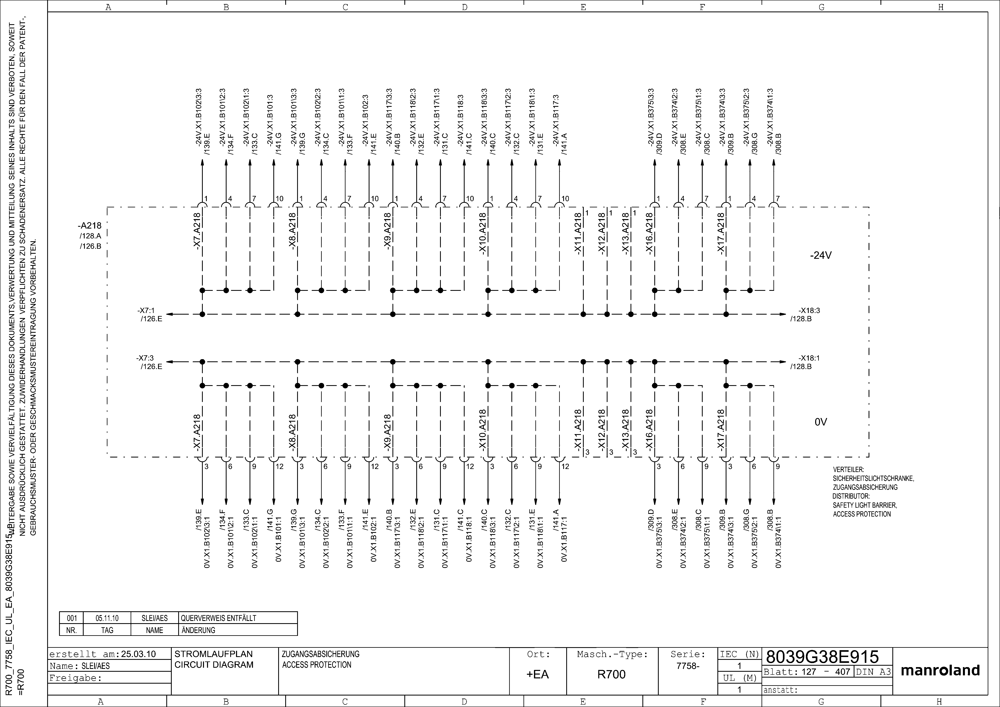

# +EA — Sheet 127 of 407 — ZUGANGSABSICHERUNG

**ACCESS PROTECTION**

> Part of the manroland **R700** printing press IEC/UL circuit diagrams.
> Drawing class: **Stromlaufplan / Circuit diagram** (DIN A3).
> Document `+EA` covers the **Printing unit** machine section.

## At a glance

| Field | Value |
|---|---|
| Document | `+EA`  (8039G38E915) |
| Sheet | **127** of 407 |
| Section (DE) | ZUGANGSABSICHERUNG |
| Section (EN) | ACCESS PROTECTION |
| Section type | CIRCUIT — Circuit diagram |
| Machine type | `R700` |
| Series | `7758` |
| Created | 25.03.10 |
| Replaces | — |
| Columns used | A, B, C, D, E, F, G |
| Path numbers | — |
| Labels on sheet | 183 |
| Cross-refs out | 50 |
| Cross-refs in | 100 |

**Previous:** [+EA sheet 126](SHEET_0126.md) · **Next:** [+EA sheet 128](SHEET_0128.md) · **Document TOC:** [_TOC.md](_TOC.md)  (+EA) · **Master TOC:** [all sheets](../_MASTER_TOC.md)

## Sheet image (300 DPI, exact vector render)



_Rendered directly from the PDF vector layer at 300 DPI (1-bit), no OCR and no resampling. Use it to confirm anything ambiguous in the text below._

## Cross-references on this sheet

Each entry is a wire leaving this sheet. The printed token is `/sheet.column`; the link resolves to that sheet inside the same document.

| Ref | Target sheet | Col | Path | Destination on target | Target section | From col |
|---|---|---|---|---|---|---|
| `/139.E` | [+EA sheet 139](SHEET_0139.md) | E | — | 24V.X1.B102\3:3 | ZUGANGSABSICHERUNG | B |
| `/134.F` | [+EA sheet 134](SHEET_0134.md) | F | — | 24V.X1.B101\2:3 | ZUGANGSABSICHERUNG | B |
| `/133.C` | [+EA sheet 133](SHEET_0133.md) | C | — | 24V.X1.B102\1:3 | ZUGANGSABSICHERUNG | B |
| `/139.G` | [+EA sheet 139](SHEET_0139.md) | G | — | 24V.X1.B101\3:3 | ZUGANGSABSICHERUNG | C |
| `/134.C` | [+EA sheet 134](SHEET_0134.md) | C | — | 24V.X1.B102\2:3 | ZUGANGSABSICHERUNG | C |
| `/133.F` | [+EA sheet 133](SHEET_0133.md) | F | — | 24V.X1.B101\1:3 | ZUGANGSABSICHERUNG | C |
| `/140.B` | [+EA sheet 140](SHEET_0140.md) | B | — | 24V.X1.B117\3:3 | ZUGANGSABSICHERUNG | C |
| `/132.E` | [+EA sheet 132](SHEET_0132.md) | E | — | 24V.X1.B118\2:3 | ZUGANGSABSICHERUNG | D |
| `/131.C` | [+EA sheet 131](SHEET_0131.md) | C | — | 24V.X1.B117\1:3 | ZUGANGSABSICHERUNG | D |
| `/140.C` | [+EA sheet 140](SHEET_0140.md) | C | — | 24V.X1.B118\3:3 | ZUGANGSABSICHERUNG | D |
| `/132.C` | [+EA sheet 132](SHEET_0132.md) | C | — | 24V.X1.B117\2:3 | ZUGANGSABSICHERUNG | D |
| `/131.E` | [+EA sheet 131](SHEET_0131.md) | E | — | 24V.X1.B118\1:3 | ZUGANGSABSICHERUNG | E |
| `/309.D` | [+EA sheet 309](SHEET_0309.md) | D | — | 24V.X1.B375\3:3 | OPTION: KLAPPPODEST B SEITE | F |
| `/308.E` | [+EA sheet 308](SHEET_0308.md) | E | — | 24V.X1.B374\2:3 | OPTION: KLAPPPODEST B SEITE | F |
| `/308.C` | [+EA sheet 308](SHEET_0308.md) | C | — | 24V.X1.B375\1:3 | OPTION: KLAPPPODEST B SEITE | F |
| `/309.B` | [+EA sheet 309](SHEET_0309.md) | B | — | 24V.X1.B374\3:3 | OPTION: KLAPPPODEST B SEITE | F |
| `/308.G` | [+EA sheet 308](SHEET_0308.md) | G | — | 24V.X1.B375\2:3 | OPTION: KLAPPPODEST B SEITE | F |
| `/308.B` | [+EA sheet 308](SHEET_0308.md) | B | — | 24V.X1.B374\1:3 | OPTION: KLAPPPODEST B SEITE | G |
| `/141.G` | [+EA sheet 141](SHEET_0141.md) | G | — | 24V.X1.B101:3 | ZUGANGSABSICHERUNG | B |
| `/141.E` | [+EA sheet 141](SHEET_0141.md) | E | — | 24V.X1.B102:3 | ZUGANGSABSICHERUNG | C |
| `/141.C` | [+EA sheet 141](SHEET_0141.md) | C | — | 24V.X1.B118:3 | ZUGANGSABSICHERUNG | D |
| `/141.A` | [+EA sheet 141](SHEET_0141.md) | A | — | 24V.X1.B117:3 | ZUGANGSABSICHERUNG | E |
| `/128.A` | [+EA sheet 128](SHEET_0128.md) | A | — | — | ZUGANGSABSICHERUNG | A |
| `/126.B` | [+EA sheet 126](SHEET_0126.md) | B | — | — | ZUGANGSABSICHERUNG | A |
| `/126.E` | [+EA sheet 126](SHEET_0126.md) | E | — | X7:1 | ZUGANGSABSICHERUNG | A |
| `/128.B` | [+EA sheet 128](SHEET_0128.md) | B | — | — | ZUGANGSABSICHERUNG | G |
| `/126.E` | [+EA sheet 126](SHEET_0126.md) | E | — | X7:3 | ZUGANGSABSICHERUNG | A |
| `/128.B` | [+EA sheet 128](SHEET_0128.md) | B | — | — | ZUGANGSABSICHERUNG | G |
| `/139.E` | [+EA sheet 139](SHEET_0139.md) | E | — | — | ZUGANGSABSICHERUNG | B |
| `/141.G` | [+EA sheet 141](SHEET_0141.md) | G | — | — | ZUGANGSABSICHERUNG | B |
| `/139.G` | [+EA sheet 139](SHEET_0139.md) | G | — | — | ZUGANGSABSICHERUNG | C |
| `/141.E` | [+EA sheet 141](SHEET_0141.md) | E | — | — | ZUGANGSABSICHERUNG | C |
| `/132.E` | [+EA sheet 132](SHEET_0132.md) | E | — | — | ZUGANGSABSICHERUNG | D |
| `/131.E` | [+EA sheet 131](SHEET_0131.md) | E | — | — | ZUGANGSABSICHERUNG | E |
| `/308.E` | [+EA sheet 308](SHEET_0308.md) | E | — | — | OPTION: KLAPPPODEST B SEITE | F |
| `/308.G` | [+EA sheet 308](SHEET_0308.md) | G | — | — | OPTION: KLAPPPODEST B SEITE | F |
| `/134.F` | [+EA sheet 134](SHEET_0134.md) | F | — | — | ZUGANGSABSICHERUNG | B |
| `/133.C` | [+EA sheet 133](SHEET_0133.md) | C | — | — | ZUGANGSABSICHERUNG | B |
| `/134.C` | [+EA sheet 134](SHEET_0134.md) | C | — | — | ZUGANGSABSICHERUNG | C |
| `/133.F` | [+EA sheet 133](SHEET_0133.md) | F | — | — | ZUGANGSABSICHERUNG | C |
| `/140.B` | [+EA sheet 140](SHEET_0140.md) | B | — | — | ZUGANGSABSICHERUNG | C |
| `/131.C` | [+EA sheet 131](SHEET_0131.md) | C | — | — | ZUGANGSABSICHERUNG | D |
| `/141.C` | [+EA sheet 141](SHEET_0141.md) | C | — | — | ZUGANGSABSICHERUNG | D |
| `/140.C` | [+EA sheet 140](SHEET_0140.md) | C | — | — | ZUGANGSABSICHERUNG | D |
| `/132.C` | [+EA sheet 132](SHEET_0132.md) | C | — | — | ZUGANGSABSICHERUNG | D |
| `/309.D` | [+EA sheet 309](SHEET_0309.md) | D | — | — | OPTION: KLAPPPODEST B SEITE | F |
| `/308.C` | [+EA sheet 308](SHEET_0308.md) | C | — | — | OPTION: KLAPPPODEST B SEITE | F |
| `/309.B` | [+EA sheet 309](SHEET_0309.md) | B | — | — | OPTION: KLAPPPODEST B SEITE | F |
| `/308.B` | [+EA sheet 308](SHEET_0308.md) | B | — | — | OPTION: KLAPPPODEST B SEITE | G |
| `/141.A` | [+EA sheet 141](SHEET_0141.md) | A | — | — | ZUGANGSABSICHERUNG | E |

### Incoming references (sheets that point here)

Every other sheet that sends a wire to this one. `Back-ref` is the token printed on *that* sheet; `Path` is its line number.

| From sheet | Cols | Back-ref | Path | Refs | What continues there |
|---|---|---|---|---|---|
| [+EA#126](SHEET_0126.md) | B, E | `/126.B`, `/126.E` | — | 3 | — |
| [+EA#128](SHEET_0128.md) | A, B | `/128.A`, `/128.B` | — | 3 | X18:1; X18:3 |
| [+EA#131](SHEET_0131.md) | D | `/131.D` | — | 4 | 0V.X1.B117\1:1 0V.X1.B118\1:1; 24V.X1.B117\1:3 24V.X1.B118\1:3 |
| [+EA#132](SHEET_0132.md) | C, D | `/132.C`, `/132.D` | — | 4 | 0V.X1.B117\2:1 0V.X1.B118\2:1; 24V.X1.B117\2:3 24V.X1.B118\2:3 |
| [+EA#133](SHEET_0133.md) | B, D, E | `/133.B`, `/133.D`, `/133.E` | — | 4 | 0V.X1.B102\1:1 0V.X1.B101\1:1; 24V.X1.B101\1:3; 24V.X1.B102\1:3 |
| [+EA#134](SHEET_0134.md) | B, D, E | `/134.B`, `/134.D`, `/134.E` | — | 4 | 0V.X1.B102\2:1 0V.X1.B101\2:1; 24V.X1.B101\2:3; 24V.X1.B102\2:3 |
| [+EA#139](SHEET_0139.md) | D, G | `/139.D`, `/139.G` | — | 4 | 0V.X1.B104\3:1 0V.X1.B103\3:1 0V.X1.B102\3:1 0V.X1.B101\3:1; 24V.X1.B101\3:3; 24V.X1.B103\3:3 24V.X1.B102\3:3 |
| [+EA#140](SHEET_0140.md) | B | `/140.B` | — | 4 | 0V.X1.B117\3:1 0V.X1.B118\3:1; 24V.X1.B117\3:3 24V.X1.B118\3:3 |
| [+EA#141](SHEET_0141.md) | A, C, E, G | `/141.A`, `/141.C`, `/141.E`, `/141.G` | — | 8 | — |
| [+EA#246](SHEET_0246.md) | C | `/246.C` | — | 8 | — |
| [+EA#249](SHEET_0249.md) | A | `/249.A` | — | 8 | — |
| [+EA#251](SHEET_0251.md) | E | `/251.E` | — | 8 | — |
| [+EA#253](SHEET_0253.md) | G | `/253.G` | — | 8 | — |
| [+EA#255](SHEET_0255.md) | F | `/255.F` | — | 2 | — |
| [+EA#257](SHEET_0257.md) | A | `/257.A` | — | 2 | — |
| [+EA#258](SHEET_0258.md) | A | `/258.A` | — | 2 | — |
| [+EA#261](SHEET_0261.md) | E | `/261.E` | — | 6 | — |
| [+EA#263](SHEET_0263.md) | A | `/263.A` | — | 6 | — |
| [+EA#308](SHEET_0308.md) | C, D, E | `/308.C`, `/308.D`, `/308.E` | — | 8 | 0V.X1.B374\1:1 0V.X1.B375\1:1 0V.X1.B374\2:1 0V.X1.B375\2:1; 24V.X1.B374\1:3 24V.X1.B374\2:3; 24V.X1.B375\1:3 24V.X1.B375\2:3 |
| [+EA#309](SHEET_0309.md) | C | `/309.C` | — | 4 | 0V.X1.B374\3:1 0V.X1.B375\3:1; 24V.X1.B374\3:3 24V.X1.B375\3:3 |


## Devices on this sheet

| Tag | Class | Class meaning (IEC) | Col | Sub | Terminal | Sign |
|---|---|---|---|---|---|---|
| `A218` | A | Baugruppe / assembly, module, PC board | A | — | — | — |
| `X7:3` | X | Klemme / terminal, plug connector | A | — | 3 | — |
| `X7:1` | X | Klemme / terminal, plug connector | A | — | 1 | — |
| `X18:1` | X | Klemme / terminal, plug connector | G | — | 1 | — |
| `X18:3` | X | Klemme / terminal, plug connector | G | — | 3 | — |
| `X7.A218` | — | cross-device reference | B | — | — | — |
| `X8.A218` | — | cross-device reference | C | — | — | — |
| `X9.A218` | — | cross-device reference | C | — | — | — |
| `X7.A218` | — | cross-device reference | B | — | — | — |
| `X8.A218` | — | cross-device reference | C | — | — | — |
| `X9.A218` | — | cross-device reference | C | — | — | — |
| `X10.A218` | — | cross-device reference | D | — | — | — |
| `X10.A218` | — | cross-device reference | D | — | — | — |
| `X16.A218` | — | cross-device reference | F | — | — | — |
| `X16.A218` | — | cross-device reference | F | — | — | — |
| `X17.A218` | — | cross-device reference | F | — | — | — |
| `X17.A218` | — | cross-device reference | F | — | — | — |
| `NR.` | — | cross-device reference | A | — | — | — |
| `05.11.10` | — | cross-device reference | A | — | — | — |
| `X11.A218` | — | cross-device reference | E | — | — | — |
| `X11.A218` | — | cross-device reference | E | — | — | — |
| `X13.A218` | — | cross-device reference | E | — | — | — |
| `X13.A218` | — | cross-device reference | E | — | — | — |
| `X12.A218` | — | cross-device reference | E | — | — | — |
| `X12.A218` | — | cross-device reference | E | — | — | — |

## Potentials / nets

| Potential | Count | Columns | Attached devices | Terminals |
|---|---|---|---|---|
| `0V` | 23 | B, C, D, E, F, G | `B101`, `B101\1`, `B101\2`, `B101\3`, `B102`, `B102\1`, `B102\2`, `B102\3`, `B117`, `B117\1`, `B117\2`, `B117\3`, `B118`, `B118\1`, `B118\2`, `B118\3`, `B374\1`, `B374\2`, `B374\3`, `B375\1`, `B375\2`, `B375\3`, `X1` | `1` |
| `24V` | 23 | B, C, D, E, F, G | `B101`, `B101\1`, `B101\2`, `B101\3`, `B102`, `B102\1`, `B102\2`, `B102\3`, `B117`, `B117\1`, `B117\2`, `B117\3`, `B118`, `B118\1`, `B118\2`, `B118\3`, `B374\1`, `B374\2`, `B374\3`, `B375\1`, `B375\2`, `B375\3`, `X1` | `3` |


A potential such as `L24+/4` or `M24+` is a named supply/return rail; every place it appears on this sheet is electrically common.

## Wire-end annotations (grouped as printed)

A wire that continues elsewhere is annotated with a small cluster: the destination description, the path/line number `#NN`, and the `/sheet.column` cross reference. Each row below is one such cluster exactly as it is grouped on the drawing.

| Col | Y | Path | Cross-ref | Text on the wire |
|---|---|---|---|---|
| B | 105.2 | — | `/139.E` | `24V.X1.B102\3:3` |
| B | 105.2 | — | `/134.F` | `24V.X1.B101\2:3` |
| B | 105.2 | — | `/133.C` | `24V.X1.B102\1:3` |
| C | 105.2 | — | `/139.G` | `24V.X1.B101\3:3` |
| C | 105.2 | — | `/134.C` | `24V.X1.B102\2:3` |
| C | 105.2 | — | `/133.F` | `24V.X1.B101\1:3` |
| C | 105.2 | — | `/140.B` | `24V.X1.B117\3:3` |
| D | 105.2 | — | `/132.E` | `24V.X1.B118\2:3` |
| D | 105.2 | — | `/131.C` | `24V.X1.B117\1:3` |
| D | 105.2 | — | `/140.C` | `24V.X1.B118\3:3` |
| D | 105.2 | — | `/132.C` | `24V.X1.B117\2:3` |
| E | 105.2 | — | `/131.E` | `24V.X1.B118\1:3` |
| F | 105.2 | — | `/309.D` | `24V.X1.B375\3:3` |
| F | 105.2 | — | `/308.E` | `24V.X1.B374\2:3` |
| F | 105.2 | — | `/308.C` | `24V.X1.B375\1:3` |
| F | 105.2 | — | `/309.B` | `24V.X1.B374\3:3` |
| F | 105.2 | — | `/308.G` | `24V.X1.B375\2:3` |
| G | 105.2 | — | `/308.B` | `24V.X1.B374\1:3` |
| B | 112.5 | — | `/141.G` | `24V.X1.B101:3` |
| C | 112.5 | — | `/141.E` | `24V.X1.B102:3` |
| D | 112.5 | — | `/141.C` | `24V.X1.B118:3` |
| E | 112.5 | — | `/141.A` | `24V.X1.B117:3` |
| B | 232.8 | — | — | `1` |
| B | 232.8 | — | — | `4 7 10 1` |
| C | 232.8 | — | — | `4 7 10 1` |
| D | 232.8 | — | — | `4 7 10` |
| D | 232.8 | — | — | `1` |
| E | 232.8 | — | — | `4 7 10` |
| F | 232.8 | — | — | `1` |
| F | 232.8 | — | — | `4 7` |
| F | 232.8 | — | — | `1` |
| G | 232.8 | — | — | `4 7` |
| E | 249.8 | — | — | `1` |
| E | 249.8 | — | — | `1` |
| E | 249.8 | — | — | `1` |
| B | 253.1 | — | — | `X7.A218` |
| C | 253.1 | — | — | `X8.A218` |
| C | 253.1 | — | — | `X9.A218` |
| D | 253.1 | — | — | `X10.A218` |
| E | 253.1 | — | — | `X11.A218 X11.A218` |
| E | 253.1 | — | — | `X12.A218` |
| E | 253.1 | — | — | `X13.A218 X13.A218` |
| F | 253.1 | — | — | `X16.A218` |
| F | 253.1 | — | — | `X17.A218` |
| A | 263.9 | — | — | `A218` |
| A | 277.0 | — | `/128.A`, `/126.B` | — |
| G | 298.8 | — | — | `24V` |
| A | 365.9 | — | `/126.E` | `X7:1` |
| G | 366.0 | — | — | `X18:3` |
| G | 375.9 | — | `/128.B` | — |
| A | 422.6 | — | `/126.E` | `X7:3` |
| G | 422.6 | — | — | `X18:1` |
| G | 432.6 | — | `/128.B` | — |
| D | 487.3 | — | — | `X10.A218` |
| E | 487.3 | — | — | `X12.A218` |
| F | 487.3 | — | — | `X16.A218` |
| F | 487.3 | — | — | `X17.A218` |
| B | 493.2 | — | — | `X7.A218` |
| C | 493.2 | — | — | `X8.A218` |
| C | 493.2 | — | — | `X9.A218` |
| G | 497.2 | — | — | `0V` |
| E | 534.7 | — | — | `3` |
| E | 534.7 | — | — | `3` |
| E | 534.7 | — | — | `3` |
| B | 551.7 | — | — | `3` |
| B | 551.7 | — | — | `6 9 12 3` |
| C | 551.7 | — | — | `6 9 12 3` |
| D | 551.7 | — | — | `6 9 12` |
| D | 551.7 | — | — | `3` |
| E | 551.7 | — | — | `6 9 12` |
| F | 551.7 | — | — | `3` |
| F | 551.7 | — | — | `6 9` |
| F | 551.7 | — | — | `3` |
| G | 551.7 | — | — | `6 9` |
| G | 556.2 | — | — | `DISTRIBUTOR: SICHERHEITSLICHTSCHRANKE, VERTEILER: ZUGANGSABSICHERUNG` |
| G | 598.7 | — | — | `SAFETY LIGHT BARRIER, ACCESS PROTECTION` |
| B | 606.0 | — | `/139.E` | — |
| B | 606.0 | — | `/141.G` | — |
| C | 606.0 | — | `/139.G` | — |
| C | 606.0 | — | `/141.E` | — |
| D | 606.0 | — | `/132.E` | — |
| E | 606.0 | — | `/131.E` | — |
| F | 606.0 | — | `/308.E` | — |
| F | 606.0 | — | `/308.G` | — |
| B | 606.3 | — | `/134.F` | — |
| B | 606.3 | — | `/133.C` | — |
| C | 606.3 | — | `/134.C` | — |
| C | 606.3 | — | `/133.F` | — |
| C | 606.3 | — | `/140.B` | — |
| D | 606.3 | — | `/131.C` | — |
| D | 606.3 | — | `/141.C` | — |
| D | 606.3 | — | `/140.C` | — |
| D | 606.3 | — | `/132.C` | — |
| F | 606.3 | — | `/309.D` | — |
| F | 606.3 | — | `/308.C` | — |
| F | 606.3 | — | `/309.B` | — |
| G | 606.3 | — | `/308.B` | — |
| E | 606.6 | — | `/141.A` | — |
| B | 614.8 | — | — | `0V.X1.B102\3:1` |
| B | 614.8 | — | — | `0V.X1.B101\2:1` |
| B | 614.8 | — | — | `0V.X1.B102\1:1` |
| B | 614.8 | — | — | `0V.X1.B101:1` |
| C | 614.8 | — | — | `0V.X1.B101\3:1` |
| C | 614.8 | — | — | `0V.X1.B102\2:1` |
| C | 614.8 | — | — | `0V.X1.B101\1:1` |
| C | 614.8 | — | — | `0V.X1.B102:1` |
| C | 614.8 | — | — | `0V.X1.B117\3:1` |
| D | 614.8 | — | — | `0V.X1.B118\2:1` |
| D | 614.8 | — | — | `0V.X1.B117\1:1` |
| D | 614.8 | — | — | `0V.X1.B118:1` |
| D | 614.8 | — | — | `0V.X1.B118\3:1` |
| D | 614.8 | — | — | `0V.X1.B117\2:1` |
| E | 614.8 | — | — | `0V.X1.B118\1:1` |
| E | 614.8 | — | — | `0V.X1.B117:1` |
| F | 614.8 | — | — | `0V.X1.B375\3:1` |
| F | 614.8 | — | — | `0V.X1.B374\2:1` |
| F | 614.8 | — | — | `0V.X1.B375\1:1` |
| F | 614.8 | — | — | `0V.X1.B374\3:1` |
| F | 614.8 | — | — | `0V.X1.B375\2:1` |
| G | 614.8 | — | — | `0V.X1.B374\1:1` |
| A | 733.0 | — | — | `001 05.11.10 SLEI/AES QUERVERWEIS ENTFÄLLT` |
| A | 747.1 | — | — | `NR. TAG NAME ÄNDERUNG` |


## Reconstructed tables

This sheet carries tabular content (pin map / terminal assignment / index). The grid below was rebuilt from the drawing's own rule lines, so each row is exactly one physical row of the table.

### Table 1 — 5 data rows × 31 columns (at x=204.1, y=0.0) — **24V.X1.B102\3:3 X7.A218 24V.X1.B101\2:3 /139.E 1 24V.X1.B102\1:3 /134.F 4 24V.X1.B101:3 /133.C 7 24V.X1.B101\3:3 /141.G 10 X8.A218 24V.X1.B102\2:3 /139.G 1 24V.X1.B101\1:3 /134.C 4 24V.X1.B102:3 /133.F 7 24V.X1.B117\3:3 /141.E 10 X9.A218 24V.X1.B118\2:3 /140.B 1 24V.X1.B117\1:3 /132.E 4 24V.X1.B118:3 /131.C 7 24V.X1.B118\3:3 /141.C 10 X10.A218 24V.X1.B117\2:3 /140.C 1 24V.X1.B118\1:3 /132.C 4 24V.X1.B117:3 /131.E 7 /141.A 10 X11.A218 1 X12.A218 1 X13.A218 24V.X1.B375\3:3 1 X16.A218 24V.X1.B374\2:3 /309.D 1 24V.X1.B375\1:3 /308.E 4 /308.C 7 24V.X1.B374\3:3 X17.A218 24V.X1.B375\2:3 /309.B 1 /308.G 4 24V.X1.B374\1:3 /308.B 7 24V X18:3 /128.B X18:1 /128.B X7.A218 /139.E ÄNDERUNG 3 /134.F 0V.X1.B102\3:1 QUERVERWEIS 6 /133.C 0V.X1.B101\2:1 ENTFÄLLT 9 /141.G 0V.X1.B102\1:1 X8.A218 12 /139.G 0V.X1.B101:1 3 /134.C 0V.X1.B101\3:1 6 /133.F 0V.X1.B102\2:1 9 /141.E 0V.X1.B101\1:1 X9.A218 12 /140.B 0V.X1.B102:1 3 /132.E 0V.X1.B117\3:1 6 /131.C 0V.X1.B118\2:1 9 /141.C 0V.X1.B117\1:1 X10.A218 12 /140.C 0V.X1.B118:1 3 /132.C 0V.X1.B118\3:1 6 /131.E 0V.X1.B117\2:1 9 /141.A 0V.X1.B118\1:1 12 0V.X1.B117:1 X12.A218 3 X13.A218 3 X16.A218 3 /309.D 3 /308.E 0V.X1.B375\3:1 6 /308.C 0V.X1.B374\2:1 9 0V.X1.B375\1:1 X17.A218 /309.B 3 /308.G 0V.X1.B374\3:1 6 0V.X1.B375\2:1 /308.B 0V 9 VERTEILER: SICHERHEITSLICHTSCHRANKE, ZUGANGSABSICHERUNG DISTRIBUTOR: SAFETY LIGHT BARRIER, ACCESS PROTECTION 0V.X1.B374\1:1**

|  | STROMLAUFPLAN |  |  |  |  | ZUGANGSABSICHERUNG |  |  |  |  |  |  |  |  |  | Ort: |  |  |  | Masch. Type: |  |  |  | Serie: |  |  | IEC | (N) |  | 8039G38E915 |
|---|---|---|---|---|---|---|---|---|---|---|---|---|---|---|---|---|---|---|---|---|---|---|---|---|---|---|---|---|---|---|
| `CIRCUIT` |  | `DIAGRAM` |  |  |  |  |  |  |  |  |  |  |  |  |  |  |  |  |  |  |  |  |  |  |  |  |  |  |  |  |
|  |  |  |  |  | `ACCESS` |  | `PROTECTION` |  |  |  |  |  |  |  |  |  |  |  |  |  |  |  |  | `7758` |  |  | `1` |  |  |  |
|  |  |  |  |  |  |  |  |  |  |  |  |  |  |  |  | `+EA` |  |  |  | `R700` |  |  |  |  |  |  |  |  |  | `Blatt: DIN A3 127 407` |
|  |  |  |  |  |  |  |  |  |  |  |  |  |  |  |  |  |  |  |  |  |  |  |  |  |  |  | `UL (M)` |  |  |  |
|  |  |  |  |  |  |  |  |  |  |  |  |  |  |  |  |  |  |  |  |  |  |  |  |  |  |  | `1` |  |  | `anstatt:` |


## Notes and free text on this sheet

| Text | Col | Y (pt) |
|---|---|---|
| `VERTEILER:` | G | 556.19 |
| `SICHERHEITSLICHTSCHRANKE,` | G | 566.85 |
| `ZUGANGSABSICHERUNG` | G | 577.5 |
| `DISTRIBUTOR:` | G | 588.09 |
| `SAFETY LIGHT BARRIER,` | G | 598.73 |
| `ACCESS PROTECTION` | G | 609.38 |
| `TAG` | A | 747.27 |
| `NAME` | A | 747.25 |
| `ÄNDERUNG` | B | 747.31 |
| `SLEI/AES` | A | 733.13 |
| `QUERVERWEIS ENTFÄLLT` | B | 733.12 |

## Complete label inventory (exact text from the drawing)

Every text object inside the drawing area of this sheet, in DIN reading order (column A→H, then top→bottom). This is the authoritative list: if a string is not here it is not printed on this sheet.

| Col | Y | X | Dir | Type | Text |
|---|---|---|---|---|---|
| A | 263.9 | 92.7 | → | device tag | `A218` |
| A | 277.0 | 95.0 | → | cross-reference | `/128.A` |
| A | 289.4 | 95.2 | → | cross-reference | `/126.B` |
| A | 366.0 | 163.6 | → | device tag | `X7:1` |
| A | 375.9 | 167.8 | → | cross-reference | `/126.E` |
| A | 422.6 | 162.1 | → | device tag | `X7:3` |
| A | 432.5 | 167.8 | → | cross-reference | `/126.E` |
| A | 733.0 | 79.8 | → | number | `001` |
| A | 733.1 | 114.0 | → | device ref | `05.11.10` |
| A | 733.1 | 168.7 | → | text | `SLEI/AES` |
| A | 747.1 | 78.9 | → | device ref | `NR.` |
| A | 747.3 | 120.4 | → | text | `TAG` |
| A | 747.3 | 173.8 | → | text | `NAME` |
| B | 105.2 | 232.7 | ↕ | potential | `24V.X1.B102\3:3` |
| B | 105.2 | 261.1 | ↕ | potential | `24V.X1.B101\2:3` |
| B | 105.2 | 289.4 | ↕ | potential | `24V.X1.B102\1:3` |
| B | 112.5 | 317.8 | ↕ | potential | `24V.X1.B101:3` |
| B | 157.9 | 327.7 | ↕ | cross-reference | `/141.G` |
| B | 158.5 | 299.3 | ↕ | cross-reference | `/133.C` |
| B | 158.7 | 242.6 | ↕ | cross-reference | `/139.E` |
| B | 159.3 | 271.0 | ↕ | cross-reference | `/134.F` |
| B | 232.8 | 242.9 | → | number | `1` |
| B | 232.8 | 271.8 | → | number | `4` |
| B | 232.8 | 300.2 | → | number | `7` |
| B | 232.8 | 328.0 | → | number | `10` |
| B | 253.1 | 229.9 | ↕ | device ref | `X7.A218` |
| B | 493.2 | 229.9 | ↕ | device ref | `X7.A218` |
| B | 551.7 | 243.5 | → | number | `3` |
| B | 551.7 | 271.8 | → | number | `6` |
| B | 551.7 | 300.2 | → | number | `9` |
| B | 551.7 | 328.0 | → | number | `12` |
| B | 606.0 | 232.7 | ↕ | cross-reference | `/139.E` |
| B | 606.0 | 317.8 | ↕ | cross-reference | `/141.G` |
| B | 606.3 | 261.1 | ↕ | cross-reference | `/134.F` |
| B | 606.3 | 289.4 | ↕ | cross-reference | `/133.C` |
| B | 614.8 | 242.6 | ↕ | potential | `0V.X1.B102\3:1` |
| B | 614.8 | 271.0 | ↕ | potential | `0V.X1.B101\2:1` |
| B | 614.8 | 299.3 | ↕ | potential | `0V.X1.B102\1:1` |
| B | 614.8 | 327.7 | ↕ | potential | `0V.X1.B101:1` |
| B | 733.1 | 215.6 | → | text | `QUERVERWEIS ENTFÄLLT` |
| B | 747.3 | 216.4 | → | text | `ÄNDERUNG` |
| C | 105.2 | 346.1 | ↕ | potential | `24V.X1.B101\3:3` |
| C | 105.2 | 374.4 | ↕ | potential | `24V.X1.B102\2:3` |
| C | 105.2 | 402.8 | ↕ | potential | `24V.X1.B101\1:3` |
| C | 105.2 | 459.5 | ↕ | potential | `24V.X1.B117\3:3` |
| C | 112.5 | 431.1 | ↕ | potential | `24V.X1.B102:3` |
| C | 157.9 | 356.0 | ↕ | cross-reference | `/139.G` |
| C | 158.5 | 384.4 | ↕ | cross-reference | `/134.C` |
| C | 158.7 | 441.1 | ↕ | cross-reference | `/141.E` |
| C | 158.7 | 469.4 | ↕ | cross-reference | `/140.B` |
| C | 159.3 | 412.7 | ↕ | cross-reference | `/133.F` |
| C | 232.8 | 356.3 | → | number | `1` |
| C | 232.8 | 385.2 | → | number | `4` |
| C | 232.8 | 413.6 | → | number | `7` |
| C | 232.8 | 441.4 | → | number | `10` |
| C | 232.8 | 469.7 | → | number | `1` |
| C | 253.1 | 343.3 | ↕ | device ref | `X8.A218` |
| C | 253.1 | 456.7 | ↕ | device ref | `X9.A218` |
| C | 493.2 | 343.3 | ↕ | device ref | `X8.A218` |
| C | 493.2 | 456.7 | ↕ | device ref | `X9.A218` |
| C | 551.7 | 356.9 | → | number | `3` |
| C | 551.7 | 385.2 | → | number | `6` |
| C | 551.7 | 413.6 | → | number | `9` |
| C | 551.7 | 441.4 | → | number | `12` |
| C | 551.7 | 470.3 | → | number | `3` |
| C | 606.0 | 346.1 | ↕ | cross-reference | `/139.G` |
| C | 606.0 | 431.1 | ↕ | cross-reference | `/141.E` |
| C | 606.3 | 374.5 | ↕ | cross-reference | `/134.C` |
| C | 606.3 | 402.8 | ↕ | cross-reference | `/133.F` |
| C | 606.3 | 459.5 | ↕ | cross-reference | `/140.B` |
| C | 614.8 | 356.0 | ↕ | potential | `0V.X1.B101\3:1` |
| C | 614.8 | 384.4 | ↕ | potential | `0V.X1.B102\2:1` |
| C | 614.8 | 412.7 | ↕ | potential | `0V.X1.B101\1:1` |
| C | 614.8 | 441.1 | ↕ | potential | `0V.X1.B102:1` |
| C | 614.8 | 469.4 | ↕ | potential | `0V.X1.B117\3:1` |
| D | 105.2 | 487.8 | ↕ | potential | `24V.X1.B118\2:3` |
| D | 105.2 | 516.2 | ↕ | potential | `24V.X1.B117\1:3` |
| D | 105.2 | 572.9 | ↕ | potential | `24V.X1.B118\3:3` |
| D | 105.2 | 601.2 | ↕ | potential | `24V.X1.B117\2:3` |
| D | 112.5 | 544.5 | ↕ | potential | `24V.X1.B118:3` |
| D | 158.5 | 526.1 | ↕ | cross-reference | `/131.C` |
| D | 158.5 | 554.5 | ↕ | cross-reference | `/141.C` |
| D | 158.5 | 582.8 | ↕ | cross-reference | `/140.C` |
| D | 158.5 | 611.2 | ↕ | cross-reference | `/132.C` |
| D | 158.7 | 497.7 | ↕ | cross-reference | `/132.E` |
| D | 232.8 | 498.6 | → | number | `4` |
| D | 232.8 | 527.0 | → | number | `7` |
| D | 232.8 | 554.7 | → | number | `10` |
| D | 232.8 | 583.1 | → | number | `1` |
| D | 232.8 | 612.0 | → | number | `4` |
| D | 253.1 | 570.1 | ↕ | device ref | `X10.A218` |
| D | 487.3 | 570.1 | ↕ | device ref | `X10.A218` |
| D | 551.7 | 498.6 | → | number | `6` |
| D | 551.7 | 527.0 | → | number | `9` |
| D | 551.7 | 554.7 | → | number | `12` |
| D | 551.7 | 583.7 | → | number | `3` |
| D | 551.7 | 612.0 | → | number | `6` |
| D | 606.0 | 487.8 | ↕ | cross-reference | `/132.E` |
| D | 606.3 | 516.2 | ↕ | cross-reference | `/131.C` |
| D | 606.3 | 544.5 | ↕ | cross-reference | `/141.C` |
| D | 606.3 | 572.9 | ↕ | cross-reference | `/140.C` |
| D | 606.3 | 601.2 | ↕ | cross-reference | `/132.C` |
| D | 614.8 | 497.7 | ↕ | potential | `0V.X1.B118\2:1` |
| D | 614.8 | 526.1 | ↕ | potential | `0V.X1.B117\1:1` |
| D | 614.8 | 554.4 | ↕ | potential | `0V.X1.B118:1` |
| D | 614.8 | 582.8 | ↕ | potential | `0V.X1.B118\3:1` |
| D | 614.8 | 611.1 | ↕ | potential | `0V.X1.B117\2:1` |
| E | 105.2 | 629.6 | ↕ | potential | `24V.X1.B118\1:3` |
| E | 112.5 | 657.9 | ↕ | potential | `24V.X1.B117:3` |
| E | 158.7 | 639.5 | ↕ | cross-reference | `/131.E` |
| E | 158.7 | 667.8 | ↕ | cross-reference | `/141.A` |
| E | 232.8 | 640.3 | → | number | `7` |
| E | 232.8 | 668.1 | → | number | `10` |
| E | 249.8 | 696.5 | → | number | `1` |
| E | 249.8 | 724.8 | → | number | `1` |
| E | 249.8 | 753.2 | → | number | `1` |
| E | 253.1 | 683.5 | ↕ | device ref | `X11.A218` |
| E | 253.1 | 711.8 | ↕ | device ref | `X12.A218` |
| E | 253.1 | 740.1 | ↕ | device ref | `X13.A218` |
| E | 487.3 | 683.5 | ↕ | device ref | `X11.A218` |
| E | 487.3 | 711.8 | ↕ | device ref | `X12.A218` |
| E | 487.3 | 740.1 | ↕ | device ref | `X13.A218` |
| E | 534.7 | 697.0 | → | number | `3` |
| E | 534.7 | 725.4 | → | number | `3` |
| E | 534.7 | 753.7 | → | number | `3` |
| E | 551.7 | 640.3 | → | number | `9` |
| E | 551.7 | 668.1 | → | number | `12` |
| E | 606.0 | 629.6 | ↕ | cross-reference | `/131.E` |
| E | 606.6 | 657.9 | ↕ | cross-reference | `/141.A` |
| E | 614.8 | 639.5 | ↕ | potential | `0V.X1.B118\1:1` |
| E | 614.8 | 667.8 | ↕ | potential | `0V.X1.B117:1` |
| F | 105.2 | 771.3 | ↕ | potential | `24V.X1.B375\3:3` |
| F | 105.2 | 799.6 | ↕ | potential | `24V.X1.B374\2:3` |
| F | 105.2 | 828.0 | ↕ | potential | `24V.X1.B375\1:3` |
| F | 105.2 | 856.3 | ↕ | potential | `24V.X1.B374\3:3` |
| F | 105.2 | 884.7 | ↕ | potential | `24V.X1.B375\2:3` |
| F | 157.9 | 894.6 | ↕ | cross-reference | `/308.G` |
| F | 158.5 | 781.2 | ↕ | cross-reference | `/309.D` |
| F | 158.5 | 837.9 | ↕ | cross-reference | `/308.C` |
| F | 158.7 | 809.6 | ↕ | cross-reference | `/308.E` |
| F | 158.7 | 866.2 | ↕ | cross-reference | `/309.B` |
| F | 232.8 | 781.5 | → | number | `1` |
| F | 232.8 | 810.4 | → | number | `4` |
| F | 232.8 | 838.8 | → | number | `7` |
| F | 232.8 | 866.6 | → | number | `1` |
| F | 232.8 | 895.5 | → | number | `4` |
| F | 253.1 | 768.5 | ↕ | device ref | `X16.A218` |
| F | 253.1 | 853.5 | ↕ | device ref | `X17.A218` |
| F | 487.3 | 768.5 | ↕ | device ref | `X16.A218` |
| F | 487.3 | 853.5 | ↕ | device ref | `X17.A218` |
| F | 551.7 | 782.1 | → | number | `3` |
| F | 551.7 | 810.4 | → | number | `6` |
| F | 551.7 | 838.8 | → | number | `9` |
| F | 551.7 | 867.1 | → | number | `3` |
| F | 551.7 | 895.5 | → | number | `6` |
| F | 606.0 | 799.6 | ↕ | cross-reference | `/308.E` |
| F | 606.0 | 884.7 | ↕ | cross-reference | `/308.G` |
| F | 606.3 | 771.3 | ↕ | cross-reference | `/309.D` |
| F | 606.3 | 828.0 | ↕ | cross-reference | `/308.C` |
| F | 606.3 | 856.3 | ↕ | cross-reference | `/309.B` |
| F | 614.8 | 781.2 | ↕ | potential | `0V.X1.B375\3:1` |
| F | 614.8 | 809.6 | ↕ | potential | `0V.X1.B374\2:1` |
| F | 614.8 | 837.9 | ↕ | potential | `0V.X1.B375\1:1` |
| F | 614.8 | 866.2 | ↕ | potential | `0V.X1.B374\3:1` |
| F | 614.8 | 894.6 | ↕ | potential | `0V.X1.B375\2:1` |
| G | 105.2 | 913.0 | ↕ | potential | `24V.X1.B374\1:3` |
| G | 158.7 | 922.9 | ↕ | cross-reference | `/308.B` |
| G | 232.8 | 923.8 | → | number | `7` |
| G | 298.8 | 964.8 | → | potential | `24V` |
| G | 366.0 | 950.7 | → | device tag | `X18:3` |
| G | 375.9 | 941.1 | → | cross-reference | `/128.B` |
| G | 422.7 | 950.7 | → | device tag | `X18:1` |
| G | 432.5 | 941.1 | → | cross-reference | `/128.B` |
| G | 497.2 | 970.0 | → | potential | `0V` |
| G | 551.7 | 923.8 | → | number | `9` |
| G | 556.2 | 992.1 | → | text | `VERTEILER:` |
| G | 566.9 | 991.8 | → | text | `SICHERHEITSLICHTSCHRANKE,` |
| G | 577.5 | 992.1 | → | text | `ZUGANGSABSICHERUNG` |
| G | 588.1 | 991.3 | → | text | `DISTRIBUTOR:` |
| G | 598.7 | 991.8 | → | text | `SAFETY LIGHT BARRIER,` |
| G | 606.3 | 913.0 | ↕ | cross-reference | `/308.B` |
| G | 609.4 | 992.1 | → | text | `ACCESS PROTECTION` |
| G | 614.8 | 922.9 | ↕ | potential | `0V.X1.B374\1:1` |

## Reading-order text block

The same content as a plain block, grouped by DIN column — convenient to paste or to match against a visual description.

```text
=== Column A ===
 263.9   92.7  devtag       A218
 277.0   95.0  xref         /128.A
 289.4   95.2  xref         /126.B
 366.0  163.6  devtag       X7:1
 375.9  167.8  xref         /126.E
 422.6  162.1  devtag       X7:3
 432.5  167.8  xref         /126.E
 733.0   79.8  numeric      001
 733.1  114.0  devref       05.11.10
 733.1  168.7  text         SLEI/AES
 747.1   78.9  devref       NR.
 747.3  120.4  text         TAG
 747.3  173.8  text         NAME
=== Column B ===
 105.2  232.7  net          24V.X1.B102\3:3
 105.2  261.1  net          24V.X1.B101\2:3
 105.2  289.4  net          24V.X1.B102\1:3
 112.5  317.8  net          24V.X1.B101:3
 157.9  327.7  xref         /141.G
 158.5  299.3  xref         /133.C
 158.7  242.6  xref         /139.E
 159.3  271.0  xref         /134.F
 232.8  242.9  numeric      1
 232.8  271.8  numeric      4
 232.8  300.2  numeric      7
 232.8  328.0  numeric      10
 253.1  229.9  devref       X7.A218
 493.2  229.9  devref       X7.A218
 551.7  243.5  numeric      3
 551.7  271.8  numeric      6
 551.7  300.2  numeric      9
 551.7  328.0  numeric      12
 606.0  232.7  xref         /139.E
 606.0  317.8  xref         /141.G
 606.3  261.1  xref         /134.F
 606.3  289.4  xref         /133.C
 614.8  242.6  net          0V.X1.B102\3:1
 614.8  271.0  net          0V.X1.B101\2:1
 614.8  299.3  net          0V.X1.B102\1:1
 614.8  327.7  net          0V.X1.B101:1
 733.1  215.6  text         QUERVERWEIS ENTFÄLLT
 747.3  216.4  text         ÄNDERUNG
=== Column C ===
 105.2  346.1  net          24V.X1.B101\3:3
 105.2  374.4  net          24V.X1.B102\2:3
 105.2  402.8  net          24V.X1.B101\1:3
 105.2  459.5  net          24V.X1.B117\3:3
 112.5  431.1  net          24V.X1.B102:3
 157.9  356.0  xref         /139.G
 158.5  384.4  xref         /134.C
 158.7  441.1  xref         /141.E
 158.7  469.4  xref         /140.B
 159.3  412.7  xref         /133.F
 232.8  356.3  numeric      1
 232.8  385.2  numeric      4
 232.8  413.6  numeric      7
 232.8  441.4  numeric      10
 232.8  469.7  numeric      1
 253.1  343.3  devref       X8.A218
 253.1  456.7  devref       X9.A218
 493.2  343.3  devref       X8.A218
 493.2  456.7  devref       X9.A218
 551.7  356.9  numeric      3
 551.7  385.2  numeric      6
 551.7  413.6  numeric      9
 551.7  441.4  numeric      12
 551.7  470.3  numeric      3
 606.0  346.1  xref         /139.G
 606.0  431.1  xref         /141.E
 606.3  374.5  xref         /134.C
 606.3  402.8  xref         /133.F
 606.3  459.5  xref         /140.B
 614.8  356.0  net          0V.X1.B101\3:1
 614.8  384.4  net          0V.X1.B102\2:1
 614.8  412.7  net          0V.X1.B101\1:1
 614.8  441.1  net          0V.X1.B102:1
 614.8  469.4  net          0V.X1.B117\3:1
=== Column D ===
 105.2  487.8  net          24V.X1.B118\2:3
 105.2  516.2  net          24V.X1.B117\1:3
 105.2  572.9  net          24V.X1.B118\3:3
 105.2  601.2  net          24V.X1.B117\2:3
 112.5  544.5  net          24V.X1.B118:3
 158.5  526.1  xref         /131.C
 158.5  554.5  xref         /141.C
 158.5  582.8  xref         /140.C
 158.5  611.2  xref         /132.C
 158.7  497.7  xref         /132.E
 232.8  498.6  numeric      4
 232.8  527.0  numeric      7
 232.8  554.7  numeric      10
 232.8  583.1  numeric      1
 232.8  612.0  numeric      4
 253.1  570.1  devref       X10.A218
 487.3  570.1  devref       X10.A218
 551.7  498.6  numeric      6
 551.7  527.0  numeric      9
 551.7  554.7  numeric      12
 551.7  583.7  numeric      3
 551.7  612.0  numeric      6
 606.0  487.8  xref         /132.E
 606.3  516.2  xref         /131.C
 606.3  544.5  xref         /141.C
 606.3  572.9  xref         /140.C
 606.3  601.2  xref         /132.C
 614.8  497.7  net          0V.X1.B118\2:1
 614.8  526.1  net          0V.X1.B117\1:1
 614.8  554.4  net          0V.X1.B118:1
 614.8  582.8  net          0V.X1.B118\3:1
 614.8  611.1  net          0V.X1.B117\2:1
=== Column E ===
 105.2  629.6  net          24V.X1.B118\1:3
 112.5  657.9  net          24V.X1.B117:3
 158.7  639.5  xref         /131.E
 158.7  667.8  xref         /141.A
 232.8  640.3  numeric      7
 232.8  668.1  numeric      10
 249.8  696.5  numeric      1
 249.8  724.8  numeric      1
 249.8  753.2  numeric      1
 253.1  683.5  devref       X11.A218
 253.1  711.8  devref       X12.A218
 253.1  740.1  devref       X13.A218
 487.3  683.5  devref       X11.A218
 487.3  711.8  devref       X12.A218
 487.3  740.1  devref       X13.A218
 534.7  697.0  numeric      3
 534.7  725.4  numeric      3
 534.7  753.7  numeric      3
 551.7  640.3  numeric      9
 551.7  668.1  numeric      12
 606.0  629.6  xref         /131.E
 606.6  657.9  xref         /141.A
 614.8  639.5  net          0V.X1.B118\1:1
 614.8  667.8  net          0V.X1.B117:1
=== Column F ===
 105.2  771.3  net          24V.X1.B375\3:3
 105.2  799.6  net          24V.X1.B374\2:3
 105.2  828.0  net          24V.X1.B375\1:3
 105.2  856.3  net          24V.X1.B374\3:3
 105.2  884.7  net          24V.X1.B375\2:3
 157.9  894.6  xref         /308.G
 158.5  781.2  xref         /309.D
 158.5  837.9  xref         /308.C
 158.7  809.6  xref         /308.E
 158.7  866.2  xref         /309.B
 232.8  781.5  numeric      1
 232.8  810.4  numeric      4
 232.8  838.8  numeric      7
 232.8  866.6  numeric      1
 232.8  895.5  numeric      4
 253.1  768.5  devref       X16.A218
 253.1  853.5  devref       X17.A218
 487.3  768.5  devref       X16.A218
 487.3  853.5  devref       X17.A218
 551.7  782.1  numeric      3
 551.7  810.4  numeric      6
 551.7  838.8  numeric      9
 551.7  867.1  numeric      3
 551.7  895.5  numeric      6
 606.0  799.6  xref         /308.E
 606.0  884.7  xref         /308.G
 606.3  771.3  xref         /309.D
 606.3  828.0  xref         /308.C
 606.3  856.3  xref         /309.B
 614.8  781.2  net          0V.X1.B375\3:1
 614.8  809.6  net          0V.X1.B374\2:1
 614.8  837.9  net          0V.X1.B375\1:1
 614.8  866.2  net          0V.X1.B374\3:1
 614.8  894.6  net          0V.X1.B375\2:1
=== Column G ===
 105.2  913.0  net          24V.X1.B374\1:3
 158.7  922.9  xref         /308.B
 232.8  923.8  numeric      7
 298.8  964.8  net          24V
 366.0  950.7  devtag       X18:3
 375.9  941.1  xref         /128.B
 422.7  950.7  devtag       X18:1
 432.5  941.1  xref         /128.B
 497.2  970.0  net          0V
 551.7  923.8  numeric      9
 556.2  992.1  text         VERTEILER:
 566.9  991.8  text         SICHERHEITSLICHTSCHRANKE,
 577.5  992.1  text         ZUGANGSABSICHERUNG
 588.1  991.3  text         DISTRIBUTOR:
 598.7  991.8  text         SAFETY LIGHT BARRIER,
 606.3  913.0  xref         /308.B
 609.4  992.1  text         ACCESS PROTECTION
 614.8  922.9  net          0V.X1.B374\1:1
```

---
_Generated from the PDF vector text layer; no OCR. Source: `R700_7758_IEC_UL_EA_8039G38E915_p`, sheet 127._
