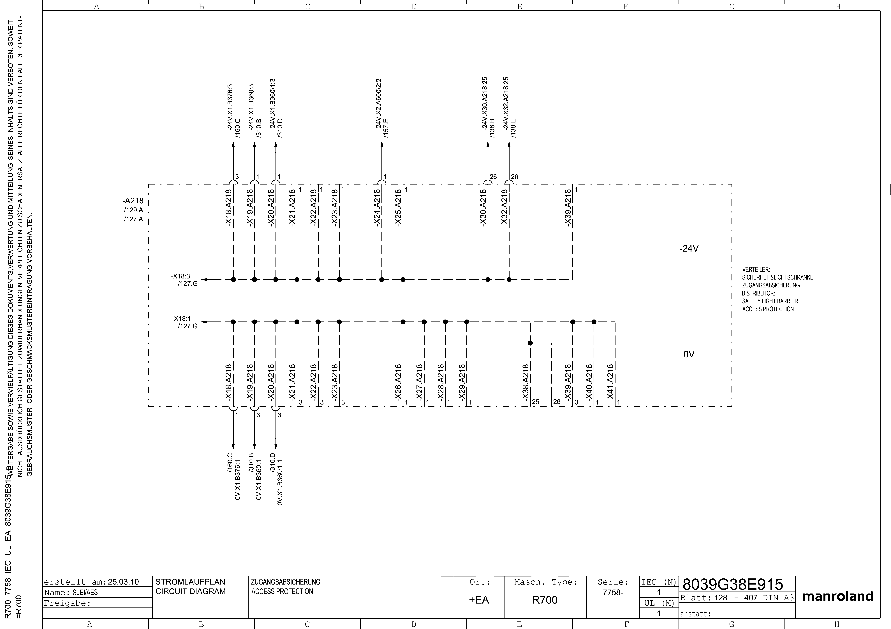

# +EA — Sheet 128 of 407 — ZUGANGSABSICHERUNG

**ACCESS PROTECTION**

> Part of the manroland **R700** printing press IEC/UL circuit diagrams.
> Drawing class: **Stromlaufplan / Circuit diagram** (DIN A3).
> Document `+EA` covers the **Printing unit** machine section.

## At a glance

| Field | Value |
|---|---|
| Document | `+EA`  (8039G38E915) |
| Sheet | **128** of 407 |
| Section (DE) | ZUGANGSABSICHERUNG |
| Section (EN) | ACCESS PROTECTION |
| Section type | CIRCUIT — Circuit diagram |
| Machine type | `R700` |
| Series | `7758` |
| Created | 25.03.10 |
| Replaces | — |
| Columns used | A, B, C, D, E, F, G |
| Path numbers | — |
| Labels on sheet | 84 |
| Cross-refs out | 13 |
| Cross-refs in | 39 |

**Previous:** [+EA sheet 127](SHEET_0127.md) · **Next:** [+EA sheet 129](SHEET_0129.md) · **Document TOC:** [_TOC.md](_TOC.md)  (+EA) · **Master TOC:** [all sheets](../_MASTER_TOC.md)

## Sheet image (300 DPI, exact vector render)



_Rendered directly from the PDF vector layer at 300 DPI (1-bit), no OCR and no resampling. Use it to confirm anything ambiguous in the text below._

## Cross-references on this sheet

Each entry is a wire leaving this sheet. The printed token is `/sheet.column`; the link resolves to that sheet inside the same document.

| Ref | Target sheet | Col | Path | Destination on target | Target section | From col |
|---|---|---|---|---|---|---|
| `/138.B` | [+EA sheet 138](SHEET_0138.md) | B | — | 24V.X30.A218:25 | ZUGANGSABSICHERUNG | E |
| `/138.E` | [+EA sheet 138](SHEET_0138.md) | E | — | 24V.X32.A218:25 | ZUGANGSABSICHERUNG | E |
| `/310.D` | [+EA sheet 310](SHEET_0310.md) | D | — | 24V.X1.B360\1:3 | OPTION: AUTOMATISCHE STAPELAUFFAHRT STOP / | C |
| `/157.E` | [+EA sheet 157](SHEET_0157.md) | E | — | 24V.X2.A600\2:2 | ZUGANGSABSICHERUNG | D |
| `/160.C` | [+EA sheet 160](SHEET_0160.md) | C | — | 24V.X1.B376:3 | ZUGANGSABSICHERUNG | B |
| `/310.B` | [+EA sheet 310](SHEET_0310.md) | B | — | 24V.X1.B360:3 | OPTION: AUTOMATISCHE STAPELAUFFAHRT STOP / | C |
| `/129.A` | [+EA sheet 129](SHEET_0129.md) | A | — | — | ZUGANGSABSICHERUNG | A |
| `/127.A` | [+EA sheet 127](SHEET_0127.md) | A | — | — | ZUGANGSABSICHERUNG | A |
| `/127.G` | [+EA sheet 127](SHEET_0127.md) | G | — | X18:3 | ZUGANGSABSICHERUNG | B |
| `/127.G` | [+EA sheet 127](SHEET_0127.md) | G | — | X18:1 | ZUGANGSABSICHERUNG | B |
| `/160.C` | [+EA sheet 160](SHEET_0160.md) | C | — | — | ZUGANGSABSICHERUNG | B |
| `/310.B` | [+EA sheet 310](SHEET_0310.md) | B | — | — | OPTION: AUTOMATISCHE STAPELAUFFAHRT STOP / | B |
| `/310.D` | [+EA sheet 310](SHEET_0310.md) | D | — | — | OPTION: AUTOMATISCHE STAPELAUFFAHRT STOP / | C |

### Incoming references (sheets that point here)

Every other sheet that sends a wire to this one. `Back-ref` is the token printed on *that* sheet; `Path` is its line number.

| From sheet | Cols | Back-ref | Path | Refs | What continues there |
|---|---|---|---|---|---|
| [+EA#127](SHEET_0127.md) | A, G | `/127.A`, `/127.G` | — | 3 | — |
| [+EA#129](SHEET_0129.md) | A | `/129.A` | — | 1 | — |
| [+EA#138](SHEET_0138.md) | A, C | `/138.A`, `/138.C` | — | 2 | 1 2 3 24V.X32.A218:25; 24V.X30.A218:25 |
| [+EA#157](SHEET_0157.md) | D | `/157.D` | — | 1 | 24V.X2.A600\2:2 |
| [+EA#160](SHEET_0160.md) | C | `/160.C` | — | 2 | 0V.X1.B376:1; 24V.X1.B376:3 |
| [+EA#263](SHEET_0263.md) | E, G | `/263.E`, `/263.G` | — | 4 | — |
| [+EA#264](SHEET_0264.md) | A, D, G | `/264.A`, `/264.D`, `/264.G` | — | 6 | — |
| [+EA#265](SHEET_0265.md) | A, F | `/265.A`, `/265.F` | — | 3 | — |
| [+EA#267](SHEET_0267.md) | A | `/267.A` | — | 1 | — |
| [+EA#269](SHEET_0269.md) | A | `/269.A` | — | 1 | — |
| [+EA#270](SHEET_0270.md) | F | `/270.F` | — | 1 | — |
| [+EA#272](SHEET_0272.md) | D | `/272.D` | — | 1 | — |
| [+EA#273](SHEET_0273.md) | H | `/273.H` | — | 1 | — |
| [+EA#275](SHEET_0275.md) | D | `/275.D` | — | 1 | — |
| [+EA#276](SHEET_0276.md) | E | `/276.E` | — | 1 | — |
| [+EA#280](SHEET_0280.md) | A, E, G | `/280.A`, `/280.E`, `/280.G` | — | 5 | — |
| [+EA#281](SHEET_0281.md) | A | `/281.A` | — | 1 | — |
| [+EA#310](SHEET_0310.md) | B, C, D | `/310.B`, `/310.C`, `/310.D` | — | 4 | 0V.X1.B360\1:1 0V.X1.B360:1; 24V.X1.B360:3; 24V.X1.B360\1:3 |


## Devices on this sheet

| Tag | Class | Class meaning (IEC) | Col | Sub | Terminal | Sign |
|---|---|---|---|---|---|---|
| `A218` | A | Baugruppe / assembly, module, PC board | A | — | — | — |
| `X18:1` | X | Klemme / terminal, plug connector | B | — | 1 | — |
| `X18:3` | X | Klemme / terminal, plug connector | B | — | 3 | — |
| `X18.A218` | — | cross-device reference | B | — | — | — |
| `X18.A218` | — | cross-device reference | B | — | — | — |
| `X19.A218` | — | cross-device reference | B | — | — | — |
| `X19.A218` | — | cross-device reference | B | — | — | — |
| `X20.A218` | — | cross-device reference | C | — | — | — |
| `X20.A218` | — | cross-device reference | C | — | — | — |
| `X30.A218` | — | cross-device reference | E | — | — | — |
| `X32.A218` | — | cross-device reference | E | — | — | — |
| `X24.A218` | — | cross-device reference | D | — | — | — |
| `X21.A218` | — | cross-device reference | C | — | — | — |
| `X21.A218` | — | cross-device reference | C | — | — | — |
| `X22.A218` | — | cross-device reference | C | — | — | — |
| `X22.A218` | — | cross-device reference | C | — | — | — |
| `X23.A218` | — | cross-device reference | C | — | — | — |
| `X23.A218` | — | cross-device reference | C | — | — | — |
| `X26.A218` | — | cross-device reference | D | — | — | — |
| `X28.A218` | — | cross-device reference | D | — | — | — |
| `X29.A218` | — | cross-device reference | D | — | — | — |
| `X27.A218` | — | cross-device reference | D | — | — | — |
| `X39.A218` | — | cross-device reference | E | — | — | — |
| `X40.A218` | — | cross-device reference | F | — | — | — |
| `X41.A218` | — | cross-device reference | F | — | — | — |
| `X39.A218` | — | cross-device reference | E | — | — | — |
| `X38.A218` | — | cross-device reference | E | — | — | — |
| `X25.A218` | — | cross-device reference | D | — | — | — |

## Potentials / nets

| Potential | Count | Columns | Attached devices | Terminals |
|---|---|---|---|---|
| `0V` | 4 | B, C, G | `B360`, `B360\1`, `B376`, `X1` | `1` |
| `24V` | 7 | B, C, D, E, G | `A218`, `A600\2`, `B360`, `B360\1`, `B376`, `X1`, `X2`, `X30`, `X32` | `2`, `25`, `3` |


A potential such as `L24+/4` or `M24+` is a named supply/return rail; every place it appears on this sheet is electrically common.

## Wire-end annotations (grouped as printed)

A wire that continues elsewhere is annotated with a small cluster: the destination description, the path/line number `#NN`, and the `/sheet.column` cross reference. Each row below is one such cluster exactly as it is grouped on the drawing.

| Col | Y | Path | Cross-ref | Text on the wire |
|---|---|---|---|---|
| E | 102.9 | — | `/138.B` | `24V.X30.A218:25` |
| E | 102.9 | — | `/138.E` | `24V.X32.A218:25` |
| C | 105.2 | — | `/310.D` | `24V.X1.B360\1:3` |
| D | 105.2 | — | `/157.E` | `24V.X2.A600\2:2` |
| B | 112.5 | — | `/160.C` | `24V.X1.B376:3` |
| C | 112.5 | — | `/310.B` | `24V.X1.B360:3` |
| B | 232.8 | — | — | `3` |
| C | 232.8 | — | — | `1` |
| C | 232.8 | — | — | `1` |
| D | 232.8 | — | — | `1` |
| E | 232.8 | — | — | `26` |
| E | 232.8 | — | — | `26` |
| C | 249.8 | — | — | `A218 1` |
| C | 249.8 | — | — | `1` |
| C | 249.8 | — | — | `1` |
| C | 249.8 | — | — | `1` |
| F | 249.8 | — | — | `1` |
| B | 253.1 | — | — | `X18.A218` |
| B | 253.1 | — | — | `X19.A218` |
| C | 253.1 | — | — | `X20.A218` |
| C | 253.1 | — | — | `X21.A218 X21.A218` |
| C | 253.1 | — | — | `X22.A218 X22.A218` |
| C | 253.1 | — | — | `X23.A218 X23.A218` |
| D | 253.1 | — | — | `X24.A218` |
| D | 253.1 | — | — | `X25.A218` |
| E | 253.1 | — | — | `X30.A218` |
| E | 253.1 | — | — | `X32.A218` |
| E | 253.1 | — | — | `X39.A218` |
| A | 277.0 | — | `/129.A`, `/127.A` | — |
| G | 327.1 | — | — | `24V` |
| G | 357.8 | — | — | `DISTRIBUTOR: SICHERHEITSLICHTSCHRANKE, VERTEILER: ZUGANGSABSICHERUNG` |
| B | 366.0 | — | `/127.G` | `X18:3` |
| G | 400.3 | — | — | `SAFETY LIGHT BARRIER, ACCESS PROTECTION` |
| B | 422.6 | — | `/127.G` | `X18:1` |
| G | 468.8 | — | — | `0V` |
| B | 487.3 | — | — | `X18.A218` |
| B | 487.3 | — | — | `X19.A218` |
| C | 487.3 | — | — | `X20.A218` |
| D | 487.3 | — | — | `X26.A218` |
| D | 487.3 | — | — | `X27.A218` |
| D | 487.3 | — | — | `X28.A218` |
| D | 487.3 | — | — | `X29.A218` |
| E | 487.3 | — | — | `X38.A218` |
| E | 487.3 | — | — | `X39.A218` |
| F | 487.3 | — | — | `X40.A218` |
| F | 487.3 | — | — | `X41.A218` |
| E | 534.0 | — | — | `25 26` |
| C | 534.7 | — | — | `3` |
| C | 534.7 | — | — | `3` |
| D | 534.7 | — | — | `3 1 1 1 1` |
| F | 534.7 | — | — | `3 1 1` |
| B | 551.7 | — | — | `1` |
| C | 551.7 | — | — | `3` |
| C | 551.7 | — | — | `3` |
| B | 606.3 | — | `/160.C` | — |
| B | 606.3 | — | `/310.B` | — |
| C | 606.3 | — | `/310.D` | — |
| B | 614.8 | — | — | `0V.X1.B376:1` |
| C | 614.8 | — | — | `0V.X1.B360:1` |
| C | 614.8 | — | — | `0V.X1.B360\1:1` |


## Reconstructed tables

This sheet carries tabular content (pin map / terminal assignment / index). The grid below was rebuilt from the drawing's own rule lines, so each row is exactly one physical row of the table.

### Table 1 — 5 data rows × 25 columns (at x=204.1, y=0.0) — **24V.X1.B376:3 X18.A218 X18:3 /160.C 3 24V.X1.B360:3 X19.A218 24V.X1.B360\1:3 /310.B 1 X20.A218 /310.D 1 X21.A218 1 X22.A218 1 X23.A218 24V.X2.A600\2:2 1 X24.A218 /157.E 1 X25.A218 1 24V.X30.A218:25 X30.A218 /138.B 26 X32.A218 24V.X32.A218:25 /138.E 26 X39.A218 24V VERTEILER: SICHERHEITSLICHTSCHRANKE, /127.G X18:1 ZUGANGSABSICHERUNG DISTRIBUTOR: SAFETY LIGHT BARRIER, ACCESS PROTECTION /127.G X18.A218 /160.C 1 0V.X1.B376:1 X19.A218 /310.B X20.A218 3 /310.D 0V.X1.B360:1 X21.A218 3 0V.X1.B360\1:1 X22.A218 3 X23.A218 3 3 X26.A218 X27.A218 1 X28.A218 1 X29.A218 X38.A218 25 X39.A218 26 X40.A218 X41.A218 1 0V**

| STROMLAUFPLAN |  |  |  | ZUGANGSABSICHERUNG |  |  |  |  |  |  |  |  | Ort: |  |  |  | Masch. Type: |  |  |  | Serie: |  | IEC (N) | 8039G38E915 |
|---|---|---|---|---|---|---|---|---|---|---|---|---|---|---|---|---|---|---|---|---|---|---|---|---|
| `CIRCUIT DIAGRAM` |  |  |  |  |  |  |  |  |  |  |  |  |  |  |  |  |  |  |  |  |  |  |  |  |
|  |  |  | `ACCESS` | `PROTECTION` |  |  |  |  |  |  |  |  |  |  |  |  |  |  |  |  | `7758` |  | `1` |  |
|  |  |  |  |  |  |  |  |  |  |  |  |  | `+EA` |  |  |  | `R700` |  |  |  |  |  |  | `Blatt: DIN A3 128 407` |
|  |  |  |  |  |  |  |  |  |  |  |  |  |  |  |  |  |  |  |  |  |  |  | `UL (M)` |  |
|  |  |  |  |  |  |  |  |  |  |  |  |  |  |  |  |  |  |  |  |  |  |  | `1` | `anstatt:` |


## Notes and free text on this sheet

| Text | Col | Y (pt) |
|---|---|---|
| `VERTEILER:` | G | 357.77 |
| `SICHERHEITSLICHTSCHRANKE,` | G | 368.43 |
| `ZUGANGSABSICHERUNG` | G | 379.07 |
| `DISTRIBUTOR:` | G | 389.67 |
| `SAFETY LIGHT BARRIER,` | G | 400.31 |
| `ACCESS PROTECTION` | G | 410.95 |

## Complete label inventory (exact text from the drawing)

Every text object inside the drawing area of this sheet, in DIN reading order (column A→H, then top→bottom). This is the authoritative list: if a string is not here it is not printed on this sheet.

| Col | Y | X | Dir | Type | Text |
|---|---|---|---|---|---|
| A | 263.9 | 163.6 | → | device tag | `A218` |
| A | 277.0 | 165.8 | → | cross-reference | `/129.A` |
| A | 289.4 | 165.8 | → | cross-reference | `/127.A` |
| B | 112.5 | 303.6 | ↕ | potential | `24V.X1.B376:3` |
| B | 112.5 | 331.9 | ↕ | potential | `24V.X1.B360:3` |
| B | 158.5 | 313.5 | ↕ | cross-reference | `/160.C` |
| B | 232.8 | 314.4 | → | number | `3` |
| B | 253.1 | 300.8 | ↕ | device ref | `X18.A218` |
| B | 253.1 | 329.1 | ↕ | device ref | `X19.A218` |
| B | 366.0 | 228.2 | → | device tag | `X18:3` |
| B | 375.9 | 237.8 | → | cross-reference | `/127.G` |
| B | 422.7 | 229.6 | → | device tag | `X18:1` |
| B | 432.6 | 237.8 | → | cross-reference | `/127.G` |
| B | 487.3 | 300.8 | ↕ | device ref | `X18.A218` |
| B | 487.3 | 329.1 | ↕ | device ref | `X19.A218` |
| B | 551.7 | 313.8 | → | number | `1` |
| B | 606.3 | 303.6 | ↕ | cross-reference | `/160.C` |
| B | 606.3 | 331.9 | ↕ | cross-reference | `/310.B` |
| B | 614.8 | 313.5 | ↕ | potential | `0V.X1.B376:1` |
| C | 105.2 | 360.3 | ↕ | potential | `24V.X1.B360\1:3` |
| C | 158.5 | 370.2 | ↕ | cross-reference | `/310.D` |
| C | 158.7 | 341.8 | ↕ | cross-reference | `/310.B` |
| C | 232.8 | 342.1 | → | number | `1` |
| C | 232.8 | 370.5 | → | number | `1` |
| C | 249.8 | 398.8 | → | number | `1` |
| C | 249.8 | 427.2 | → | number | `1` |
| C | 249.8 | 455.5 | → | number | `1` |
| C | 253.1 | 357.5 | ↕ | device ref | `X20.A218` |
| C | 253.1 | 385.8 | ↕ | device ref | `X21.A218` |
| C | 253.1 | 414.2 | ↕ | device ref | `X22.A218` |
| C | 253.1 | 442.5 | ↕ | device ref | `X23.A218` |
| C | 487.3 | 357.5 | ↕ | device ref | `X20.A218` |
| C | 487.3 | 385.8 | ↕ | device ref | `X21.A218` |
| C | 487.3 | 414.2 | ↕ | device ref | `X22.A218` |
| C | 487.3 | 442.5 | ↕ | device ref | `X23.A218` |
| C | 534.7 | 399.4 | → | number | `3` |
| C | 534.7 | 427.7 | → | number | `3` |
| C | 534.7 | 456.1 | → | number | `3` |
| C | 551.7 | 342.7 | → | number | `3` |
| C | 551.7 | 371.1 | → | number | `3` |
| C | 606.3 | 360.3 | ↕ | cross-reference | `/310.D` |
| C | 614.8 | 341.8 | ↕ | potential | `0V.X1.B360:1` |
| C | 614.8 | 370.2 | ↕ | potential | `0V.X1.B360\1:1` |
| D | 105.2 | 502.0 | ↕ | potential | `24V.X2.A600\2:2` |
| D | 158.7 | 511.9 | ↕ | cross-reference | `/157.E` |
| D | 232.8 | 512.2 | → | number | `1` |
| D | 249.8 | 540.6 | → | number | `1` |
| D | 253.1 | 499.2 | ↕ | device ref | `X24.A218` |
| D | 253.1 | 527.5 | ↕ | device ref | `X25.A218` |
| D | 487.3 | 527.5 | ↕ | device ref | `X26.A218` |
| D | 487.3 | 555.9 | ↕ | device ref | `X27.A218` |
| D | 487.3 | 584.2 | ↕ | device ref | `X28.A218` |
| D | 487.3 | 612.6 | ↕ | device ref | `X29.A218` |
| D | 534.7 | 540.6 | → | number | `1` |
| D | 534.7 | 568.9 | → | number | `1` |
| D | 534.7 | 597.3 | → | number | `1` |
| E | 102.9 | 643.7 | ↕ | potential | `24V.X30.A218:25` |
| E | 102.9 | 672.1 | ↕ | potential | `24V.X32.A218:25` |
| E | 158.7 | 653.6 | ↕ | cross-reference | `/138.B` |
| E | 158.7 | 682.0 | ↕ | cross-reference | `/138.E` |
| E | 232.8 | 654.5 | → | number | `26` |
| E | 232.8 | 682.9 | → | number | `26` |
| E | 253.1 | 640.9 | ↕ | device ref | `X30.A218` |
| E | 253.1 | 669.3 | ↕ | device ref | `X32.A218` |
| E | 253.1 | 754.3 | ↕ | device ref | `X39.A218` |
| E | 487.3 | 697.6 | ↕ | device ref | `X38.A218` |
| E | 487.3 | 754.3 | ↕ | device ref | `X39.A218` |
| E | 533.9 | 710.9 | → | number | `25` |
| E | 533.9 | 739.3 | → | number | `26` |
| E | 534.7 | 625.6 | → | number | `1` |
| F | 249.8 | 767.3 | → | number | `1` |
| F | 487.3 | 782.7 | ↕ | device ref | `X40.A218` |
| F | 487.3 | 811.0 | ↕ | device ref | `X41.A218` |
| F | 534.7 | 767.9 | → | number | `3` |
| F | 534.7 | 795.7 | → | number | `1` |
| F | 534.7 | 824.0 | → | number | `1` |
| G | 327.1 | 908.1 | → | potential | `24V` |
| G | 357.8 | 992.1 | → | text | `VERTEILER:` |
| G | 368.4 | 991.8 | → | text | `SICHERHEITSLICHTSCHRANKE,` |
| G | 379.1 | 992.1 | → | text | `ZUGANGSABSICHERUNG` |
| G | 389.7 | 991.3 | → | text | `DISTRIBUTOR:` |
| G | 400.3 | 991.8 | → | text | `SAFETY LIGHT BARRIER,` |
| G | 411.0 | 992.1 | → | text | `ACCESS PROTECTION` |
| G | 468.8 | 913.3 | → | potential | `0V` |

## Reading-order text block

The same content as a plain block, grouped by DIN column — convenient to paste or to match against a visual description.

```text
=== Column A ===
 263.9  163.6  devtag       A218
 277.0  165.8  xref         /129.A
 289.4  165.8  xref         /127.A
=== Column B ===
 112.5  303.6  net          24V.X1.B376:3
 112.5  331.9  net          24V.X1.B360:3
 158.5  313.5  xref         /160.C
 232.8  314.4  numeric      3
 253.1  300.8  devref       X18.A218
 253.1  329.1  devref       X19.A218
 366.0  228.2  devtag       X18:3
 375.9  237.8  xref         /127.G
 422.7  229.6  devtag       X18:1
 432.6  237.8  xref         /127.G
 487.3  300.8  devref       X18.A218
 487.3  329.1  devref       X19.A218
 551.7  313.8  numeric      1
 606.3  303.6  xref         /160.C
 606.3  331.9  xref         /310.B
 614.8  313.5  net          0V.X1.B376:1
=== Column C ===
 105.2  360.3  net          24V.X1.B360\1:3
 158.5  370.2  xref         /310.D
 158.7  341.8  xref         /310.B
 232.8  342.1  numeric      1
 232.8  370.5  numeric      1
 249.8  398.8  numeric      1
 249.8  427.2  numeric      1
 249.8  455.5  numeric      1
 253.1  357.5  devref       X20.A218
 253.1  385.8  devref       X21.A218
 253.1  414.2  devref       X22.A218
 253.1  442.5  devref       X23.A218
 487.3  357.5  devref       X20.A218
 487.3  385.8  devref       X21.A218
 487.3  414.2  devref       X22.A218
 487.3  442.5  devref       X23.A218
 534.7  399.4  numeric      3
 534.7  427.7  numeric      3
 534.7  456.1  numeric      3
 551.7  342.7  numeric      3
 551.7  371.1  numeric      3
 606.3  360.3  xref         /310.D
 614.8  341.8  net          0V.X1.B360:1
 614.8  370.2  net          0V.X1.B360\1:1
=== Column D ===
 105.2  502.0  net          24V.X2.A600\2:2
 158.7  511.9  xref         /157.E
 232.8  512.2  numeric      1
 249.8  540.6  numeric      1
 253.1  499.2  devref       X24.A218
 253.1  527.5  devref       X25.A218
 487.3  527.5  devref       X26.A218
 487.3  555.9  devref       X27.A218
 487.3  584.2  devref       X28.A218
 487.3  612.6  devref       X29.A218
 534.7  540.6  numeric      1
 534.7  568.9  numeric      1
 534.7  597.3  numeric      1
=== Column E ===
 102.9  643.7  net          24V.X30.A218:25
 102.9  672.1  net          24V.X32.A218:25
 158.7  653.6  xref         /138.B
 158.7  682.0  xref         /138.E
 232.8  654.5  numeric      26
 232.8  682.9  numeric      26
 253.1  640.9  devref       X30.A218
 253.1  669.3  devref       X32.A218
 253.1  754.3  devref       X39.A218
 487.3  697.6  devref       X38.A218
 487.3  754.3  devref       X39.A218
 533.9  710.9  numeric      25
 533.9  739.3  numeric      26
 534.7  625.6  numeric      1
=== Column F ===
 249.8  767.3  numeric      1
 487.3  782.7  devref       X40.A218
 487.3  811.0  devref       X41.A218
 534.7  767.9  numeric      3
 534.7  795.7  numeric      1
 534.7  824.0  numeric      1
=== Column G ===
 327.1  908.1  net          24V
 357.8  992.1  text         VERTEILER:
 368.4  991.8  text         SICHERHEITSLICHTSCHRANKE,
 379.1  992.1  text         ZUGANGSABSICHERUNG
 389.7  991.3  text         DISTRIBUTOR:
 400.3  991.8  text         SAFETY LIGHT BARRIER,
 411.0  992.1  text         ACCESS PROTECTION
 468.8  913.3  net          0V
```

---
_Generated from the PDF vector text layer; no OCR. Source: `R700_7758_IEC_UL_EA_8039G38E915_p`, sheet 128._
