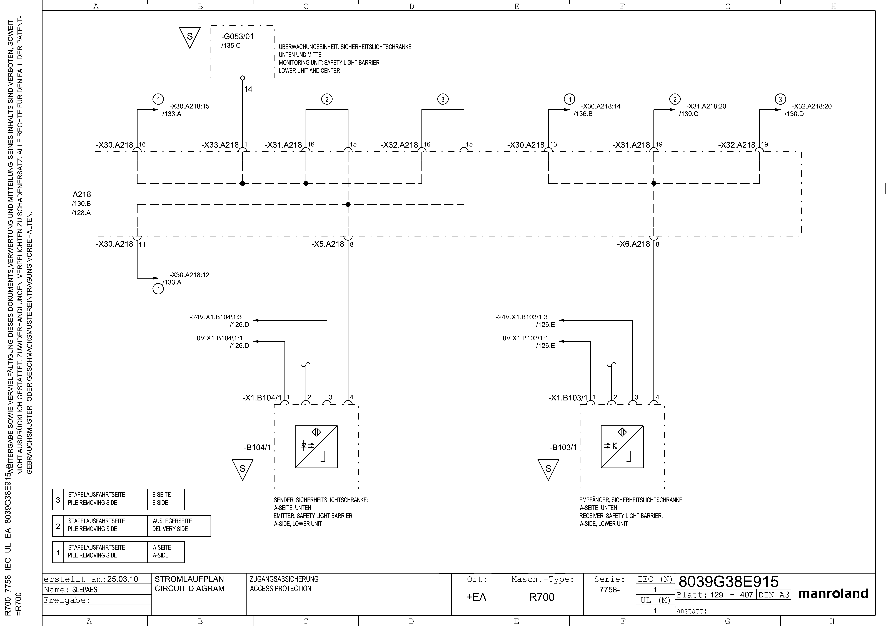

# +EA — Sheet 129 of 407 — ZUGANGSABSICHERUNG

**ACCESS PROTECTION**

> Part of the manroland **R700** printing press IEC/UL circuit diagrams.
> Drawing class: **Stromlaufplan / Circuit diagram** (DIN A3).
> Document `+EA` covers the **Printing unit** machine section.

## At a glance

| Field | Value |
|---|---|
| Document | `+EA`  (8039G38E915) |
| Sheet | **129** of 407 |
| Section (DE) | ZUGANGSABSICHERUNG |
| Section (EN) | ACCESS PROTECTION |
| Section type | CIRCUIT — Circuit diagram |
| Machine type | `R700` |
| Series | `7758` |
| Created | 25.03.10 |
| Replaces | — |
| Columns used | A, B, C, D, E, F, G, H |
| Path numbers | — |
| Labels on sheet | 95 |
| Cross-refs out | 12 |
| Cross-refs in | 32 |

**Previous:** [+EA sheet 128](SHEET_0128.md) · **Next:** [+EA sheet 130](SHEET_0130.md) · **Document TOC:** [_TOC.md](_TOC.md)  (+EA) · **Master TOC:** [all sheets](../_MASTER_TOC.md)

## Sheet image (300 DPI, exact vector render)



_Rendered directly from the PDF vector layer at 300 DPI (1-bit), no OCR and no resampling. Use it to confirm anything ambiguous in the text below._

## Cross-references on this sheet

Each entry is a wire leaving this sheet. The printed token is `/sheet.column`; the link resolves to that sheet inside the same document.

| Ref | Target sheet | Col | Path | Destination on target | Target section | From col |
|---|---|---|---|---|---|---|
| `/135.C` | [+EA sheet 135](SHEET_0135.md) | C | — | G053/01 ÜBERWACHUNGSEINHEIT: SICHERHEITSLICHTSCHRANKE, UNTEN UND MITTE MONITORING UNIT: SAFETY LIGHT BARRIER, LOWER UNIT AND CENTER | ZUGANGSABSICHERUNG | C |
| `/133.A` | [+EA sheet 133](SHEET_0133.md) | A | — | X30.A218:14 | ZUGANGSABSICHERUNG | D |
| `/130.C` | [+EA sheet 130](SHEET_0130.md) | C | — | X32.A218:20 | ZUGANGSABSICHERUNG | G |
| `/136.B` | [+EA sheet 136](SHEET_0136.md) | B | — | — | ZUGANGSABSICHERUNG | F |
| `/130.D` | [+EA sheet 130](SHEET_0130.md) | D | — | — | ZUGANGSABSICHERUNG | H |
| `/130.B` | [+EA sheet 130](SHEET_0130.md) | B | — | — | ZUGANGSABSICHERUNG | A |
| `/128.A` | [+EA sheet 128](SHEET_0128.md) | A | — | — | ZUGANGSABSICHERUNG | A |
| `/133.A` | [+EA sheet 133](SHEET_0133.md) | A | — | — | ZUGANGSABSICHERUNG | B |
| `/126.D` | [+EA sheet 126](SHEET_0126.md) | D | — | 24V.X1.B104\1:3 | ZUGANGSABSICHERUNG | B |
| `/126.E` | [+EA sheet 126](SHEET_0126.md) | E | — | 24V.X1.B103\1:3 | ZUGANGSABSICHERUNG | E |
| `/126.E` | [+EA sheet 126](SHEET_0126.md) | E | — | 0V.X1.B104\1:1 0V.X1.B103\1:1 | ZUGANGSABSICHERUNG | D |
| `/126.D` | [+EA sheet 126](SHEET_0126.md) | D | — | 0V.X1.B104\1:1 0V.X1.B103\1:1 | ZUGANGSABSICHERUNG | D |

### Incoming references (sheets that point here)

Every other sheet that sends a wire to this one. `Back-ref` is the token printed on *that* sheet; `Path` is its line number.

| From sheet | Cols | Back-ref | Path | Refs | What continues there |
|---|---|---|---|---|---|
| [+EA#126](SHEET_0126.md) | D, E | `/126.D`, `/126.E` | — | 4 | 24V.X1.B103\1:3; 24V.X1.B104\1:3 |
| [+EA#128](SHEET_0128.md) | A | `/128.A` | — | 1 | — |
| [+EA#130](SHEET_0130.md) | B, C | `/130.B`, `/130.C` | — | 3 | X31.A218:20 X32.A218:20 |
| [+EA#133](SHEET_0133.md) | A | `/133.A` | — | 2 | X30.A218:12; X30.A218:15 |
| [+EA#135](SHEET_0135.md) | D | `/135.D` | — | 1 | G053/01 |
| [+EA#136](SHEET_0136.md) | C | `/136.C` | — | 1 | X30.A218:14 X31.A218:14 X32.A218:14 |
| [+EA#215](SHEET_0215.md) | C, D | `/215.C`, `/215.D` | — | 8 | — |
| [+EA#238](SHEET_0238.md) | G | `/238.G` | — | 1 | — |
| [+EA#244](SHEET_0244.md) | A | `/244.A` | — | 1 | — |
| [+EA#275](SHEET_0275.md) | D, G | `/275.D`, `/275.G` | — | 6 | — |
| [+EA#276](SHEET_0276.md) | E | `/276.E` | — | 3 | — |
| [+EA#277](SHEET_0277.md) | A | `/277.A` | — | 1 | — |


## Devices on this sheet

| Tag | Class | Class meaning (IEC) | Col | Sub | Terminal | Sign |
|---|---|---|---|---|---|---|
| `G053/01` | G | Stromversorgung / power supply | B | 01 | — | — |
| `A218` | A | Baugruppe / assembly, module, PC board | A | — | — | — |
| `B104/1` | B | Umformer / transducer, sensor | C | 1 | — | — |
| `B103/1` | B | Umformer / transducer, sensor | E | 1 | — | — |
| `X5.A218` | — | cross-device reference | C | — | — | — |
| `X30.A218` | — | cross-device reference | A | — | — | — |
| `X31.A218` | — | cross-device reference | C | — | — | — |
| `X32.A218` | — | cross-device reference | D | — | — | — |
| `X33.A218` | — | cross-device reference | B | — | — | — |
| `X30.A218` | — | cross-device reference | A | — | — | — |
| `X30.A218` | — | cross-device reference | E | — | — | — |
| `X31.A218` | — | cross-device reference | F | — | — | — |
| `X32.A218` | — | cross-device reference | G | — | — | — |
| `X6.A218` | — | cross-device reference | F | — | — | — |
| `X32.A218:20` | — | cross-device reference | H | — | 20 | — |
| `X31.A218:20` | — | cross-device reference | G | — | 20 | — |
| `X30.A218:12` | — | cross-device reference | B | — | 12 | — |
| `X30.A218:14` | — | cross-device reference | F | — | 14 | — |
| `X30.A218:15` | — | cross-device reference | B | — | 15 | — |

## Potentials / nets

| Potential | Count | Columns | Attached devices | Terminals |
|---|---|---|---|---|
| `0V` | 2 | B, E | `B103\1`, `B104\1`, `X1` | `1` |
| `24V` | 2 | B, E | `B103\1`, `B104\1`, `X1` | `3` |


A potential such as `L24+/4` or `M24+` is a named supply/return rail; every place it appears on this sheet is electrically common.

## Wire-end annotations (grouped as printed)

A wire that continues elsewhere is annotated with a small cluster: the destination description, the path/line number `#NN`, and the `/sheet.column` cross reference. Each row below is one such cluster exactly as it is grouped on the drawing.

| Col | Y | Path | Cross-ref | Text on the wire |
|---|---|---|---|---|
| B | 43.6 | — | — | `S` |
| C | 44.2 | — | `/135.C` | `G053/01 ÜBERWACHUNGSEINHEIT: SICHERHEITSLICHTSCHRANKE, UNTEN UND MITTE LOWER UNIT AND CENTER MONITORING UNIT: SAFETY LIGHT BARRIER,` |
| B | 115.1 | — | — | `14` |
| E | 130.2 | — | — | `1 2 3 1 2 3` |
| D | 139.2 | — | `/133.A` | `X30.A218:14` |
| B | 139.2 | — | — | `X30.A218:15` |
| G | 139.2 | — | `/130.C` | `X32.A218:20` |
| G | 139.2 | — | — | `X31.A218:20` |
| F | 149.1 | — | `/136.B` | — |
| H | 149.1 | — | `/130.D` | — |
| C | 190.2 | — | — | `X30.A218 16 X33.A218 1 X31.A218 16 15 X32.A218 16 15` |
| F | 190.2 | — | — | `X30.A218 13 X31.A218 19 X32.A218 19` |
| A | 256.8 | — | — | `A218` |
| A | 269.9 | — | `/130.B`, `/128.A` | — |
| B | 323.4 | — | — | `X30.A218 11 X5.A218 8` |
| F | 323.5 | — | — | `X6.A218 8` |
| B | 366.0 | — | — | `X30.A218:12` |
| B | 375.9 | — | `/133.A` | — |
| B | 385.3 | — | — | `1` |
| B | 422.6 | — | `/126.D` | `24V.X1.B104\1:3` |
| E | 422.6 | — | `/126.E` | `24V.X1.B103\1:3` |
| D | 451.0 | — | `/126.E`, `/126.D` | `0V.X1.B104\1:1 0V.X1.B103\1:1` |
| C | 530.4 | — | — | `X1.B104/1 1 2 3 4` |
| F | 530.4 | — | — | `X1.B103/1 1 2 3 4` |
| C | 597.0 | — | — | `B104/1` |
| E | 597.0 | — | — | `B103/1` |
| D | 624.7 | — | — | `S S` |
| A | 662.5 | — | — | `3 B SEITE B SIDE` |
| A | 662.5 | — | — | `PILE REMOVING SIDE STAPELAUSFAHRTSEITE` |
| C | 669.6 | — | — | `EMITTER, SAFETY LIGHT BARRIER: SENDER, SICHERHEITSLICHTSCHRANKE: A SEITE, UNTEN` |
| F | 669.6 | — | — | `EMPFÄNGER, SICHERHEITSLICHTSCHRANKE:` |
| F | 680.2 | — | — | `RECEIVER, SAFETY LIGHT BARRIER: A SEITE, UNTEN` |
| A | 697.9 | — | — | `2 DELIVERY SIDE AUSLEGERSEITE` |
| A | 697.9 | — | — | `PILE REMOVING SIDE STAPELAUSFAHRTSEITE` |
| C | 701.5 | — | — | `A SIDE, LOWER UNIT` |
| F | 701.5 | — | — | `A SIDE, LOWER UNIT` |
| A | 733.3 | — | — | `1 A SEITE A SIDE` |
| A | 733.4 | — | — | `PILE REMOVING SIDE STAPELAUSFAHRTSEITE` |


## Reconstructed tables

This sheet carries tabular content (pin map / terminal assignment / index). The grid below was rebuilt from the drawing's own rule lines, so each row is exactly one physical row of the table.

### Table 1 — 1 data rows × 2 columns (at x=326.0, y=147.4) — **X31.A218 1**

| X1.B104/1 | 1 |
|---|---|
| `B104/1` |  |


### Table 2 — 0 data rows × 2 columns (at x=411.0, y=147.4) — **16 X5.A218**

_none_


### Table 3 — 2 data rows × 2 columns (at x=467.7, y=147.4)

| X32.A218 15 | 16 |
|---|---|
| `8` |  |
| `4` |  |


### Table 4 — 1 data rows × 2 columns (at x=737.0, y=246.6)

| X1.B103/1 | 1 |
|---|---|
| `B103/1` |  |


### Table 5 — 0 data rows × 2 columns (at x=822.0, y=246.6) — **X6.A218**

_none_


## Notes and free text on this sheet

| Text | Col | Y (pt) |
|---|---|---|
| `ÜBERWACHUNGSEINHEIT: SICHERHEITSLICHTSCHRANKE,` | C | 60.15 |
| `UNTEN UND MITTE` | C | 70.79 |
| `MONITORING UNIT: SAFETY LIGHT BARRIER,` | C | 81.42 |
| `LOWER UNIT AND CENTER` | C | 92.04 |
| `SENDER, SICHERHEITSLICHTSCHRANKE:` | C | 669.61 |
| `A SEITE, UNTEN` | C | 680.22 |
| `EMITTER, SAFETY LIGHT BARRIER:` | C | 690.85 |
| `A SIDE, LOWER UNIT` | C | 701.48 |
| `X1.B104/1` | C | 530.39 |
| `EMPFÄNGER, SICHERHEITSLICHTSCHRANKE:` | F | 669.6 |
| `A SEITE, UNTEN` | F | 680.22 |
| `RECEIVER, SAFETY LIGHT BARRIER:` | F | 690.85 |
| `A SIDE, LOWER UNIT` | F | 701.48 |
| `X1.B103/1` | E | 530.39 |
| `STAPELAUSFAHRTSEITE` | A | 733.37 |
| `PILE REMOVING SIDE` | A | 744 |
| `A SEITE` | B | 733.34 |
| `A SIDE` | B | 743.99 |
| `AUSLEGERSEITE` | B | 697.94 |
| `DELIVERY SIDE` | B | 708.55 |
| `B SEITE` | B | 662.45 |
| `B SIDE` | B | 673.09 |
| `S` | B | 624.71 |
| `S` | E | 624.71 |

## Complete label inventory (exact text from the drawing)

Every text object inside the drawing area of this sheet, in DIN reading order (column A→H, then top→bottom). This is the authoritative list: if a string is not here it is not printed on this sheet.

| Col | Y | X | Dir | Type | Text |
|---|---|---|---|---|---|
| A | 190.2 | 129.0 | → | device ref | `X30.A218` |
| A | 190.2 | 186.2 | → | number | `16` |
| A | 256.8 | 94.1 | → | device tag | `A218` |
| A | 269.9 | 96.7 | → | cross-reference | `/130.B` |
| A | 282.3 | 96.4 | → | cross-reference | `/128.A` |
| A | 323.5 | 129.0 | → | device ref | `X30.A218` |
| A | 324.9 | 186.2 | → | number | `11` |
| A | 662.5 | 91.8 | → | text | `STAPELAUSFAHRTSEITE` |
| A | 667.8 | 75.0 | → | number | `3` |
| A | 673.1 | 91.3 | → | text | `PILE REMOVING SIDE` |
| A | 697.9 | 91.8 | → | text | `STAPELAUSFAHRTSEITE` |
| A | 703.3 | 75.1 | → | number | `2` |
| A | 708.6 | 91.3 | → | text | `PILE REMOVING SIDE` |
| A | 733.4 | 91.8 | → | text | `STAPELAUSFAHRTSEITE` |
| A | 738.7 | 75.4 | → | number | `1` |
| A | 744.0 | 91.3 | → | text | `PILE REMOVING SIDE` |
| B | 43.6 | 251.0 | → | text | `S` |
| B | 44.2 | 297.4 | → | device tag | `G053/01` |
| B | 57.3 | 297.6 | → | cross-reference | `/135.C` |
| B | 115.1 | 327.7 | → | number | `14` |
| B | 130.2 | 210.8 | → | number | `1` |
| B | 139.2 | 227.9 | → | device ref | `X30.A218:15` |
| B | 149.1 | 218.3 | → | cross-reference | `/133.A` |
| B | 190.2 | 270.7 | → | device ref | `X33.A218` |
| B | 190.2 | 328.0 | → | number | `1` |
| B | 366.0 | 227.9 | → | device ref | `X30.A218:12` |
| B | 375.9 | 218.3 | → | cross-reference | `/133.A` |
| B | 385.3 | 210.8 | → | number | `1` |
| B | 422.6 | 255.4 | → | potential | `24V.X1.B104\1:3` |
| B | 432.6 | 309.0 | → | cross-reference | `/126.D` |
| B | 451.0 | 264.5 | → | potential | `0V.X1.B104\1:1` |
| B | 460.9 | 309.0 | → | cross-reference | `/126.D` |
| B | 624.7 | 321.9 | → | text | `S` |
| B | 662.4 | 204.7 | → | text | `B SEITE` |
| B | 673.1 | 204.7 | → | text | `B SIDE` |
| B | 697.9 | 205.5 | → | text | `AUSLEGERSEITE` |
| B | 708.6 | 204.7 | → | text | `DELIVERY SIDE` |
| B | 733.3 | 205.5 | → | text | `A SEITE` |
| B | 744.0 | 205.5 | → | text | `A SIDE` |
| C | 60.1 | 374.7 | → | text | `ÜBERWACHUNGSEINHEIT: SICHERHEITSLICHTSCHRANKE,` |
| C | 70.8 | 374.7 | → | text | `UNTEN UND MITTE` |
| C | 81.4 | 375.0 | → | text | `MONITORING UNIT: SAFETY LIGHT BARRIER,` |
| C | 92.0 | 374.7 | → | text | `LOWER UNIT AND CENTER` |
| C | 130.7 | 437.4 | → | number | `2` |
| C | 190.2 | 355.7 | → | device ref | `X31.A218` |
| C | 190.2 | 413.0 | → | number | `16` |
| C | 190.2 | 469.7 | → | number | `15` |
| C | 323.5 | 418.4 | → | device ref | `X5.A218` |
| C | 324.9 | 470.3 | → | number | `8` |
| C | 530.4 | 326.0 | → | text | `X1.B104/1` |
| C | 530.4 | 384.7 | → | number | `1` |
| C | 530.4 | 413.6 | → | number | `2` |
| C | 530.4 | 441.9 | → | number | `3` |
| C | 530.4 | 470.3 | → | number | `4` |
| C | 597.0 | 327.7 | → | device tag | `B104/1` |
| C | 669.6 | 368.2 | → | text | `SENDER, SICHERHEITSLICHTSCHRANKE:` |
| C | 680.2 | 368.5 | → | text | `A SEITE, UNTEN` |
| C | 690.9 | 367.7 | → | text | `EMITTER, SAFETY LIGHT BARRIER:` |
| C | 701.5 | 368.5 | → | text | `A SIDE, LOWER UNIT` |
| D | 130.7 | 593.3 | → | number | `3` |
| D | 190.2 | 511.7 | → | device ref | `X32.A218` |
| D | 190.2 | 568.9 | → | number | `16` |
| E | 190.2 | 625.6 | → | number | `15` |
| E | 190.2 | 681.7 | → | device ref | `X30.A218` |
| E | 190.2 | 739.0 | → | number | `13` |
| E | 422.6 | 666.4 | → | potential | `24V.X1.B103\1:3` |
| E | 432.5 | 720.6 | → | cross-reference | `/126.E` |
| E | 451.0 | 675.5 | → | potential | `0V.X1.B103\1:1` |
| E | 460.9 | 720.6 | → | cross-reference | `/126.E` |
| E | 530.4 | 737.0 | → | text | `X1.B103/1` |
| E | 597.0 | 738.7 | → | device tag | `B103/1` |
| E | 624.7 | 732.9 | → | text | `S` |
| F | 130.2 | 763.6 | → | number | `1` |
| F | 130.7 | 905.1 | → | number | `2` |
| F | 139.2 | 780.7 | → | device ref | `X30.A218:14` |
| F | 149.1 | 771.0 | → | cross-reference | `/136.B` |
| F | 190.2 | 823.5 | → | device ref | `X31.A218` |
| F | 190.2 | 880.7 | → | number | `19` |
| F | 323.5 | 829.4 | → | device ref | `X6.A218` |
| F | 324.9 | 881.3 | → | number | `8` |
| F | 530.4 | 795.7 | → | number | `1` |
| F | 530.4 | 824.6 | → | number | `2` |
| F | 530.4 | 852.9 | → | number | `3` |
| F | 530.4 | 881.3 | → | number | `4` |
| F | 669.6 | 778.7 | → | text | `EMPFÄNGER, SICHERHEITSLICHTSCHRANKE:` |
| F | 680.2 | 779.5 | → | text | `A SEITE, UNTEN` |
| F | 690.9 | 778.7 | → | text | `RECEIVER, SAFETY LIGHT BARRIER:` |
| F | 701.5 | 779.5 | → | text | `A SIDE, LOWER UNIT` |
| G | 130.7 | 1046.8 | → | number | `3` |
| G | 139.2 | 922.4 | → | device ref | `X31.A218:20` |
| G | 149.1 | 912.8 | → | cross-reference | `/130.C` |
| G | 190.2 | 965.2 | → | device ref | `X32.A218` |
| G | 190.2 | 1022.5 | → | number | `19` |
| H | 139.2 | 1064.1 | → | device ref | `X32.A218:20` |
| H | 149.1 | 1054.5 | → | cross-reference | `/130.D` |

## Reading-order text block

The same content as a plain block, grouped by DIN column — convenient to paste or to match against a visual description.

```text
=== Column A ===
 190.2  129.0  devref       X30.A218
 190.2  186.2  numeric      16
 256.8   94.1  devtag       A218
 269.9   96.7  xref         /130.B
 282.3   96.4  xref         /128.A
 323.5  129.0  devref       X30.A218
 324.9  186.2  numeric      11
 662.5   91.8  text         STAPELAUSFAHRTSEITE
 667.8   75.0  numeric      3
 673.1   91.3  text         PILE REMOVING SIDE
 697.9   91.8  text         STAPELAUSFAHRTSEITE
 703.3   75.1  numeric      2
 708.6   91.3  text         PILE REMOVING SIDE
 733.4   91.8  text         STAPELAUSFAHRTSEITE
 738.7   75.4  numeric      1
 744.0   91.3  text         PILE REMOVING SIDE
=== Column B ===
  43.6  251.0  text         S
  44.2  297.4  devtag       G053/01
  57.3  297.6  xref         /135.C
 115.1  327.7  numeric      14
 130.2  210.8  numeric      1
 139.2  227.9  devref       X30.A218:15
 149.1  218.3  xref         /133.A
 190.2  270.7  devref       X33.A218
 190.2  328.0  numeric      1
 366.0  227.9  devref       X30.A218:12
 375.9  218.3  xref         /133.A
 385.3  210.8  numeric      1
 422.6  255.4  net          24V.X1.B104\1:3
 432.6  309.0  xref         /126.D
 451.0  264.5  net          0V.X1.B104\1:1
 460.9  309.0  xref         /126.D
 624.7  321.9  text         S
 662.4  204.7  text         B SEITE
 673.1  204.7  text         B SIDE
 697.9  205.5  text         AUSLEGERSEITE
 708.6  204.7  text         DELIVERY SIDE
 733.3  205.5  text         A SEITE
 744.0  205.5  text         A SIDE
=== Column C ===
  60.1  374.7  text         ÜBERWACHUNGSEINHEIT: SICHERHEITSLICHTSCHRANKE,
  70.8  374.7  text         UNTEN UND MITTE
  81.4  375.0  text         MONITORING UNIT: SAFETY LIGHT BARRIER,
  92.0  374.7  text         LOWER UNIT AND CENTER
 130.7  437.4  numeric      2
 190.2  355.7  devref       X31.A218
 190.2  413.0  numeric      16
 190.2  469.7  numeric      15
 323.5  418.4  devref       X5.A218
 324.9  470.3  numeric      8
 530.4  326.0  text         X1.B104/1
 530.4  384.7  numeric      1
 530.4  413.6  numeric      2
 530.4  441.9  numeric      3
 530.4  470.3  numeric      4
 597.0  327.7  devtag       B104/1
 669.6  368.2  text         SENDER, SICHERHEITSLICHTSCHRANKE:
 680.2  368.5  text         A SEITE, UNTEN
 690.9  367.7  text         EMITTER, SAFETY LIGHT BARRIER:
 701.5  368.5  text         A SIDE, LOWER UNIT
=== Column D ===
 130.7  593.3  numeric      3
 190.2  511.7  devref       X32.A218
 190.2  568.9  numeric      16
=== Column E ===
 190.2  625.6  numeric      15
 190.2  681.7  devref       X30.A218
 190.2  739.0  numeric      13
 422.6  666.4  net          24V.X1.B103\1:3
 432.5  720.6  xref         /126.E
 451.0  675.5  net          0V.X1.B103\1:1
 460.9  720.6  xref         /126.E
 530.4  737.0  text         X1.B103/1
 597.0  738.7  devtag       B103/1
 624.7  732.9  text         S
=== Column F ===
 130.2  763.6  numeric      1
 130.7  905.1  numeric      2
 139.2  780.7  devref       X30.A218:14
 149.1  771.0  xref         /136.B
 190.2  823.5  devref       X31.A218
 190.2  880.7  numeric      19
 323.5  829.4  devref       X6.A218
 324.9  881.3  numeric      8
 530.4  795.7  numeric      1
 530.4  824.6  numeric      2
 530.4  852.9  numeric      3
 530.4  881.3  numeric      4
 669.6  778.7  text         EMPFÄNGER, SICHERHEITSLICHTSCHRANKE:
 680.2  779.5  text         A SEITE, UNTEN
 690.9  778.7  text         RECEIVER, SAFETY LIGHT BARRIER:
 701.5  779.5  text         A SIDE, LOWER UNIT
=== Column G ===
 130.7 1046.8  numeric      3
 139.2  922.4  devref       X31.A218:20
 149.1  912.8  xref         /130.C
 190.2  965.2  devref       X32.A218
 190.2 1022.5  numeric      19
=== Column H ===
 139.2 1064.1  devref       X32.A218:20
 149.1 1054.5  xref         /130.D
```

---
_Generated from the PDF vector text layer; no OCR. Source: `R700_7758_IEC_UL_EA_8039G38E915_p`, sheet 129._
