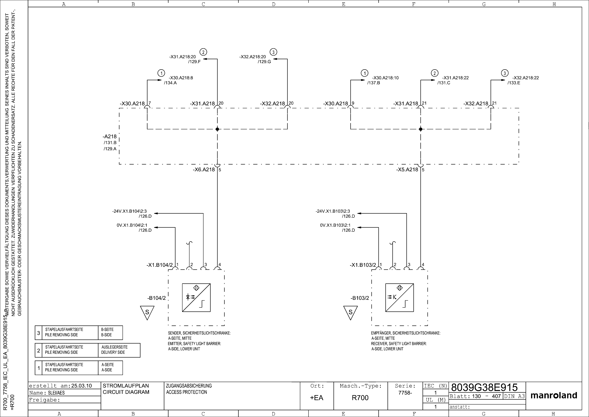

# +EA — Sheet 130 of 407 — ZUGANGSABSICHERUNG

**ACCESS PROTECTION**

> Part of the manroland **R700** printing press IEC/UL circuit diagrams.
> Drawing class: **Stromlaufplan / Circuit diagram** (DIN A3).
> Document `+EA` covers the **Printing unit** machine section.

## At a glance

| Field | Value |
|---|---|
| Document | `+EA`  (8039G38E915) |
| Sheet | **130** of 407 |
| Section (DE) | ZUGANGSABSICHERUNG |
| Section (EN) | ACCESS PROTECTION |
| Section type | CIRCUIT — Circuit diagram |
| Machine type | `R700` |
| Series | `7758` |
| Created | 25.03.10 |
| Replaces | — |
| Columns used | A, B, C, D, E, F, G, H |
| Path numbers | — |
| Labels on sheet | 82 |
| Cross-refs out | 12 |
| Cross-refs in | 28 |

**Previous:** [+EA sheet 129](SHEET_0129.md) · **Next:** [+EA sheet 131](SHEET_0131.md) · **Document TOC:** [_TOC.md](_TOC.md)  (+EA) · **Master TOC:** [all sheets](../_MASTER_TOC.md)

## Sheet image (300 DPI, exact vector render)



_Rendered directly from the PDF vector layer at 300 DPI (1-bit), no OCR and no resampling. Use it to confirm anything ambiguous in the text below._

## Cross-references on this sheet

Each entry is a wire leaving this sheet. The printed token is `/sheet.column`; the link resolves to that sheet inside the same document.

| Ref | Target sheet | Col | Path | Destination on target | Target section | From col |
|---|---|---|---|---|---|---|
| `/129.F` | [+EA sheet 129](SHEET_0129.md) | F | — | X31.A218:20 X32.A218:20 | ZUGANGSABSICHERUNG | C |
| `/129.G` | [+EA sheet 129](SHEET_0129.md) | G | — | X31.A218:20 X32.A218:20 | ZUGANGSABSICHERUNG | C |
| `/134.A` | [+EA sheet 134](SHEET_0134.md) | A | — | X30.A218:10 | ZUGANGSABSICHERUNG | D |
| `/137.B` | [+EA sheet 137](SHEET_0137.md) | B | — | X31.A218:22 | ZUGANGSABSICHERUNG | F |
| `/133.E` | [+EA sheet 133](SHEET_0133.md) | E | — | — | ZUGANGSABSICHERUNG | G |
| `/131.C` | [+EA sheet 131](SHEET_0131.md) | C | — | — | ZUGANGSABSICHERUNG | F |
| `/131.B` | [+EA sheet 131](SHEET_0131.md) | B | — | — | ZUGANGSABSICHERUNG | B |
| `/129.A` | [+EA sheet 129](SHEET_0129.md) | A | — | — | ZUGANGSABSICHERUNG | B |
| `/126.D` | [+EA sheet 126](SHEET_0126.md) | D | — | 24V.X1.B104\2:3 | ZUGANGSABSICHERUNG | B |
| `/126.D` | [+EA sheet 126](SHEET_0126.md) | D | — | 24V.X1.B103\2:3 | ZUGANGSABSICHERUNG | E |
| `/126.D` | [+EA sheet 126](SHEET_0126.md) | D | — | 0V.X1.B104\2:1 0V.X1.B103\2:1 | ZUGANGSABSICHERUNG | C |
| `/126.D` | [+EA sheet 126](SHEET_0126.md) | D | — | 0V.X1.B104\2:1 0V.X1.B103\2:1 | ZUGANGSABSICHERUNG | C |

### Incoming references (sheets that point here)

Every other sheet that sends a wire to this one. `Back-ref` is the token printed on *that* sheet; `Path` is its line number.

| From sheet | Cols | Back-ref | Path | Refs | What continues there |
|---|---|---|---|---|---|
| [+EA#126](SHEET_0126.md) | C, D | `/126.C`, `/126.D` | — | 4 | 24V.X1.B103\2:3; 24V.X1.B104\2:3 |
| [+EA#129](SHEET_0129.md) | A, G, H | `/129.A`, `/129.G`, `/129.H` | — | 3 | X32.A218:20 |
| [+EA#131](SHEET_0131.md) | B, C | `/131.B`, `/131.C` | — | 2 | X31.A218:22 |
| [+EA#133](SHEET_0133.md) | D | `/133.D` | — | 1 | X32.A218:22 |
| [+EA#134](SHEET_0134.md) | A | `/134.A` | — | 1 | X30.A218:8 |
| [+EA#137](SHEET_0137.md) | C | `/137.C` | — | 1 | X30.A218:10 X32.A218:10 |
| [+EA#215](SHEET_0215.md) | C, D | `/215.C`, `/215.D` | — | 8 | — |
| [+EA#238](SHEET_0238.md) | G | `/238.G` | — | 1 | — |
| [+EA#244](SHEET_0244.md) | A | `/244.A` | — | 1 | — |
| [+EA#275](SHEET_0275.md) | D, G | `/275.D`, `/275.G` | — | 4 | — |
| [+EA#276](SHEET_0276.md) | E | `/276.E` | — | 2 | — |


## Devices on this sheet

| Tag | Class | Class meaning (IEC) | Col | Sub | Terminal | Sign |
|---|---|---|---|---|---|---|
| `B104/2` | B | Umformer / transducer, sensor | B | 2 | — | — |
| `B103/2` | B | Umformer / transducer, sensor | E | 2 | — | — |
| `A218` | A | Baugruppe / assembly, module, PC board | B | — | — | — |
| `X30.A218` | — | cross-device reference | E | — | — | — |
| `X31.A218` | — | cross-device reference | F | — | — | — |
| `X32.A218` | — | cross-device reference | G | — | — | — |
| `X5.A218` | — | cross-device reference | F | — | — | — |
| `X30.A218` | — | cross-device reference | B | — | — | — |
| `X31.A218` | — | cross-device reference | C | — | — | — |
| `X32.A218` | — | cross-device reference | D | — | — | — |
| `X6.A218` | — | cross-device reference | C | — | — | — |
| `X32.A218:22` | — | cross-device reference | H | — | 22 | — |
| `X32.A218:20` | — | cross-device reference | D | — | 20 | — |
| `X31.A218:20` | — | cross-device reference | C | — | 20 | — |
| `X31.A218:22` | — | cross-device reference | G | — | 22 | — |
| `X30.A218:10` | — | cross-device reference | F | — | 10 | — |
| `X30.A218:8` | — | cross-device reference | C | — | 8 | — |

## Potentials / nets

| Potential | Count | Columns | Attached devices | Terminals |
|---|---|---|---|---|
| `0V` | 2 | B, E | `B103\2`, `B104\2`, `X1` | `1` |
| `24V` | 2 | B, E | `B103\2`, `B104\2`, `X1` | `3` |


A potential such as `L24+/4` or `M24+` is a named supply/return rail; every place it appears on this sheet is electrically common.

## Wire-end annotations (grouped as printed)

A wire that continues elsewhere is annotated with a small cluster: the destination description, the path/line number `#NN`, and the `/sheet.column` cross reference. Each row below is one such cluster exactly as it is grouped on the drawing.

| Col | Y | Path | Cross-ref | Text on the wire |
|---|---|---|---|---|
| C | 102.3 | — | — | `2 3` |
| C | 110.8 | — | `/129.F`, `/129.G` | `X31.A218:20 X32.A218:20` |
| E | 144.3 | — | — | `1 1 2 3` |
| C | 153.3 | — | — | `X30.A218:8` |
| D | 153.4 | — | `/134.A` | `X30.A218:10` |
| F | 153.4 | — | `/137.B` | `X31.A218:22` |
| H | 153.4 | — | — | `X32.A218:22` |
| F | 163.3 | — | `/131.C` | — |
| G | 163.3 | — | `/133.E` | — |
| C | 204.4 | — | — | `X30.A218 7 X31.A218 20 X32.A218 20` |
| F | 204.4 | — | — | `X30.A218 9 X31.A218 21 X32.A218 21` |
| B | 271.0 | — | — | `A218` |
| B | 284.1 | — | `/131.B`, `/129.A` | — |
| C | 337.6 | — | — | `X6.A218 5` |
| F | 337.6 | — | — | `X5.A218 5` |
| B | 422.6 | — | `/126.D` | `24V.X1.B104\2:3` |
| E | 422.6 | — | `/126.D` | `24V.X1.B103\2:3` |
| C | 451.0 | — | `/126.D`, `/126.D` | `0V.X1.B104\2:1 0V.X1.B103\2:1` |
| C | 530.4 | — | — | `X1.B104/2 1 2 3 4` |
| F | 530.4 | — | — | `X1.B103/2 1 2 3 4` |
| B | 597.0 | — | — | `B104/2` |
| E | 597.0 | — | — | `B103/2` |
| D | 624.7 | — | — | `S S` |
| A | 662.5 | — | — | `3 B SEITE B SIDE` |
| A | 662.5 | — | — | `PILE REMOVING SIDE STAPELAUSFAHRTSEITE` |
| C | 669.6 | — | — | `EMITTER, SAFETY LIGHT BARRIER: SENDER, SICHERHEITSLICHTSCHRANKE: A SEITE, MITTE` |
| F | 669.6 | — | — | `EMPFÄNGER, SICHERHEITSLICHTSCHRANKE:` |
| F | 680.2 | — | — | `RECEIVER, SAFETY LIGHT BARRIER: A SEITE, MITTE` |
| A | 697.9 | — | — | `2 DELIVERY SIDE AUSLEGERSEITE` |
| A | 697.9 | — | — | `PILE REMOVING SIDE STAPELAUSFAHRTSEITE` |
| C | 701.5 | — | — | `A SIDE, LOWER UNIT` |
| F | 701.5 | — | — | `A SIDE, LOWER UNIT` |
| A | 733.3 | — | — | `1 A SEITE A SIDE` |
| A | 733.4 | — | — | `PILE REMOVING SIDE STAPELAUSFAHRTSEITE` |


## Reconstructed tables

This sheet carries tabular content (pin map / terminal assignment / index). The grid below was rebuilt from the drawing's own rule lines, so each row is exactly one physical row of the table.

### Table 1 — 1 data rows × 2 columns (at x=297.6, y=260.8)

| X1.B104/2 | 1 |
|---|---|
| `B104/2` |  |


### Table 2 — 0 data rows × 2 columns (at x=382.7, y=260.8) — **X6.A218**

_none_


### Table 3 — 1 data rows × 2 columns (at x=708.7, y=260.8)

| X1.B103/2 | 1 |
|---|---|
| `B103/2` |  |


### Table 4 — 0 data rows × 2 columns (at x=793.7, y=260.8) — **X5.A218**

_none_


## Notes and free text on this sheet

| Text | Col | Y (pt) |
|---|---|---|
| `SENDER, SICHERHEITSLICHTSCHRANKE:` | C | 669.61 |
| `A SEITE, MITTE` | C | 680.21 |
| `EMITTER, SAFETY LIGHT BARRIER:` | C | 690.85 |
| `A SIDE, LOWER UNIT` | C | 701.48 |
| `X1.B104/2` | B | 530.39 |
| `EMPFÄNGER, SICHERHEITSLICHTSCHRANKE:` | F | 669.6 |
| `A SEITE, MITTE` | F | 680.21 |
| `RECEIVER, SAFETY LIGHT BARRIER:` | F | 690.85 |
| `A SIDE, LOWER UNIT` | F | 701.48 |
| `X1.B103/2` | E | 530.39 |
| `S` | B | 624.71 |
| `S` | E | 624.71 |
| `STAPELAUSFAHRTSEITE` | A | 733.37 |
| `PILE REMOVING SIDE` | A | 744 |
| `A SEITE` | B | 733.34 |
| `A SIDE` | B | 743.99 |
| `AUSLEGERSEITE` | B | 697.94 |
| `DELIVERY SIDE` | B | 708.55 |
| `B SEITE` | B | 662.45 |
| `B SIDE` | B | 673.09 |

## Complete label inventory (exact text from the drawing)

Every text object inside the drawing area of this sheet, in DIN reading order (column A→H, then top→bottom). This is the authoritative list: if a string is not here it is not printed on this sheet.

| Col | Y | X | Dir | Type | Text |
|---|---|---|---|---|---|
| A | 662.5 | 91.8 | → | text | `STAPELAUSFAHRTSEITE` |
| A | 667.8 | 75.0 | → | number | `3` |
| A | 673.1 | 91.3 | → | text | `PILE REMOVING SIDE` |
| A | 697.9 | 91.8 | → | text | `STAPELAUSFAHRTSEITE` |
| A | 703.3 | 75.1 | → | number | `2` |
| A | 708.6 | 91.3 | → | text | `PILE REMOVING SIDE` |
| A | 733.4 | 91.8 | → | text | `STAPELAUSFAHRTSEITE` |
| A | 738.7 | 75.4 | → | number | `1` |
| A | 744.0 | 91.3 | → | text | `PILE REMOVING SIDE` |
| B | 144.3 | 324.2 | → | number | `1` |
| B | 204.4 | 242.4 | → | device ref | `X30.A218` |
| B | 204.4 | 300.2 | → | number | `7` |
| B | 271.0 | 207.5 | → | device tag | `A218` |
| B | 284.1 | 210.0 | → | cross-reference | `/131.B` |
| B | 296.5 | 209.8 | → | cross-reference | `/129.A` |
| B | 422.6 | 227.1 | → | potential | `24V.X1.B104\2:3` |
| B | 432.6 | 280.6 | → | cross-reference | `/126.D` |
| B | 451.0 | 236.1 | → | potential | `0V.X1.B104\2:1` |
| B | 460.9 | 280.6 | → | cross-reference | `/126.D` |
| B | 530.4 | 296.2 | → | text | `X1.B104/2` |
| B | 597.0 | 297.9 | → | device tag | `B104/2` |
| B | 624.7 | 293.5 | → | text | `S` |
| B | 662.4 | 204.7 | → | text | `B SEITE` |
| B | 673.1 | 204.7 | → | text | `B SIDE` |
| B | 697.9 | 205.5 | → | text | `AUSLEGERSEITE` |
| B | 708.6 | 204.7 | → | text | `DELIVERY SIDE` |
| B | 733.3 | 205.5 | → | text | `A SEITE` |
| B | 744.0 | 205.5 | → | text | `A SIDE` |
| C | 102.3 | 409.0 | → | number | `2` |
| C | 110.8 | 342.1 | → | device ref | `X31.A218:20` |
| C | 120.7 | 380.7 | → | cross-reference | `/129.F` |
| C | 153.4 | 341.3 | → | device ref | `X30.A218:8` |
| C | 163.3 | 331.7 | → | cross-reference | `/134.A` |
| C | 204.4 | 384.1 | → | device ref | `X31.A218` |
| C | 204.4 | 441.9 | → | number | `20` |
| C | 337.6 | 390.0 | → | device ref | `X6.A218` |
| C | 339.1 | 441.9 | → | number | `5` |
| C | 530.4 | 356.3 | → | number | `1` |
| C | 530.4 | 385.2 | → | number | `2` |
| C | 530.4 | 413.6 | → | number | `3` |
| C | 530.4 | 441.9 | → | number | `4` |
| C | 669.6 | 339.9 | → | text | `SENDER, SICHERHEITSLICHTSCHRANKE:` |
| C | 680.2 | 340.2 | → | text | `A SEITE, MITTE` |
| C | 690.9 | 339.3 | → | text | `EMITTER, SAFETY LIGHT BARRIER:` |
| C | 701.5 | 340.2 | → | text | `A SIDE, LOWER UNIT` |
| D | 102.3 | 550.8 | → | number | `3` |
| D | 110.8 | 483.9 | → | device ref | `X32.A218:20` |
| D | 120.8 | 521.3 | → | cross-reference | `/129.G` |
| D | 204.4 | 525.8 | → | device ref | `X32.A218` |
| D | 204.4 | 583.7 | → | number | `20` |
| E | 144.3 | 735.3 | → | number | `1` |
| E | 163.3 | 742.7 | → | cross-reference | `/137.B` |
| E | 204.4 | 653.4 | → | device ref | `X30.A218` |
| E | 204.4 | 711.2 | → | number | `9` |
| E | 422.6 | 638.1 | → | potential | `24V.X1.B103\2:3` |
| E | 432.6 | 691.7 | → | cross-reference | `/126.D` |
| E | 451.0 | 647.1 | → | potential | `0V.X1.B103\2:1` |
| E | 460.9 | 691.7 | → | cross-reference | `/126.D` |
| E | 530.4 | 707.2 | → | text | `X1.B103/2` |
| E | 597.0 | 708.9 | → | device tag | `B103/2` |
| E | 624.7 | 704.6 | → | text | `S` |
| F | 144.9 | 876.7 | → | number | `2` |
| F | 153.4 | 752.3 | → | device ref | `X30.A218:10` |
| F | 163.3 | 884.4 | → | cross-reference | `/131.C` |
| F | 204.4 | 795.1 | → | device ref | `X31.A218` |
| F | 204.4 | 852.9 | → | number | `21` |
| F | 337.6 | 801.1 | → | device ref | `X5.A218` |
| F | 339.1 | 852.9 | → | number | `5` |
| F | 530.4 | 767.3 | → | number | `1` |
| F | 530.4 | 796.3 | → | number | `2` |
| F | 530.4 | 824.6 | → | number | `3` |
| F | 530.4 | 852.9 | → | number | `4` |
| F | 669.6 | 750.3 | → | text | `EMPFÄNGER, SICHERHEITSLICHTSCHRANKE:` |
| F | 680.2 | 751.2 | → | text | `A SEITE, MITTE` |
| F | 690.9 | 750.3 | → | text | `RECEIVER, SAFETY LIGHT BARRIER:` |
| F | 701.5 | 751.2 | → | text | `A SIDE, LOWER UNIT` |
| G | 144.9 | 1018.5 | → | number | `3` |
| G | 153.4 | 894.0 | → | device ref | `X31.A218:22` |
| G | 163.3 | 1026.1 | → | cross-reference | `/133.E` |
| G | 204.4 | 936.9 | → | device ref | `X32.A218` |
| G | 204.4 | 994.7 | → | number | `21` |
| H | 153.4 | 1035.8 | → | device ref | `X32.A218:22` |

## Reading-order text block

The same content as a plain block, grouped by DIN column — convenient to paste or to match against a visual description.

```text
=== Column A ===
 662.5   91.8  text         STAPELAUSFAHRTSEITE
 667.8   75.0  numeric      3
 673.1   91.3  text         PILE REMOVING SIDE
 697.9   91.8  text         STAPELAUSFAHRTSEITE
 703.3   75.1  numeric      2
 708.6   91.3  text         PILE REMOVING SIDE
 733.4   91.8  text         STAPELAUSFAHRTSEITE
 738.7   75.4  numeric      1
 744.0   91.3  text         PILE REMOVING SIDE
=== Column B ===
 144.3  324.2  numeric      1
 204.4  242.4  devref       X30.A218
 204.4  300.2  numeric      7
 271.0  207.5  devtag       A218
 284.1  210.0  xref         /131.B
 296.5  209.8  xref         /129.A
 422.6  227.1  net          24V.X1.B104\2:3
 432.6  280.6  xref         /126.D
 451.0  236.1  net          0V.X1.B104\2:1
 460.9  280.6  xref         /126.D
 530.4  296.2  text         X1.B104/2
 597.0  297.9  devtag       B104/2
 624.7  293.5  text         S
 662.4  204.7  text         B SEITE
 673.1  204.7  text         B SIDE
 697.9  205.5  text         AUSLEGERSEITE
 708.6  204.7  text         DELIVERY SIDE
 733.3  205.5  text         A SEITE
 744.0  205.5  text         A SIDE
=== Column C ===
 102.3  409.0  numeric      2
 110.8  342.1  devref       X31.A218:20
 120.7  380.7  xref         /129.F
 153.4  341.3  devref       X30.A218:8
 163.3  331.7  xref         /134.A
 204.4  384.1  devref       X31.A218
 204.4  441.9  numeric      20
 337.6  390.0  devref       X6.A218
 339.1  441.9  numeric      5
 530.4  356.3  numeric      1
 530.4  385.2  numeric      2
 530.4  413.6  numeric      3
 530.4  441.9  numeric      4
 669.6  339.9  text         SENDER, SICHERHEITSLICHTSCHRANKE:
 680.2  340.2  text         A SEITE, MITTE
 690.9  339.3  text         EMITTER, SAFETY LIGHT BARRIER:
 701.5  340.2  text         A SIDE, LOWER UNIT
=== Column D ===
 102.3  550.8  numeric      3
 110.8  483.9  devref       X32.A218:20
 120.8  521.3  xref         /129.G
 204.4  525.8  devref       X32.A218
 204.4  583.7  numeric      20
=== Column E ===
 144.3  735.3  numeric      1
 163.3  742.7  xref         /137.B
 204.4  653.4  devref       X30.A218
 204.4  711.2  numeric      9
 422.6  638.1  net          24V.X1.B103\2:3
 432.6  691.7  xref         /126.D
 451.0  647.1  net          0V.X1.B103\2:1
 460.9  691.7  xref         /126.D
 530.4  707.2  text         X1.B103/2
 597.0  708.9  devtag       B103/2
 624.7  704.6  text         S
=== Column F ===
 144.9  876.7  numeric      2
 153.4  752.3  devref       X30.A218:10
 163.3  884.4  xref         /131.C
 204.4  795.1  devref       X31.A218
 204.4  852.9  numeric      21
 337.6  801.1  devref       X5.A218
 339.1  852.9  numeric      5
 530.4  767.3  numeric      1
 530.4  796.3  numeric      2
 530.4  824.6  numeric      3
 530.4  852.9  numeric      4
 669.6  750.3  text         EMPFÄNGER, SICHERHEITSLICHTSCHRANKE:
 680.2  751.2  text         A SEITE, MITTE
 690.9  750.3  text         RECEIVER, SAFETY LIGHT BARRIER:
 701.5  751.2  text         A SIDE, LOWER UNIT
=== Column G ===
 144.9 1018.5  numeric      3
 153.4  894.0  devref       X31.A218:22
 163.3 1026.1  xref         /133.E
 204.4  936.9  devref       X32.A218
 204.4  994.7  numeric      21
=== Column H ===
 153.4 1035.8  devref       X32.A218:22
```

---
_Generated from the PDF vector text layer; no OCR. Source: `R700_7758_IEC_UL_EA_8039G38E915_p`, sheet 130._
