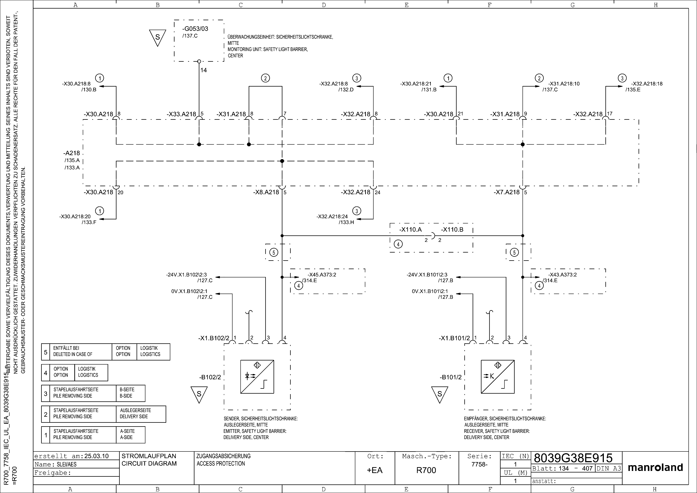

# +EA — Sheet 134 of 407 — ZUGANGSABSICHERUNG

**ACCESS PROTECTION**

> Part of the manroland **R700** printing press IEC/UL circuit diagrams.
> Drawing class: **Stromlaufplan / Circuit diagram** (DIN A3).
> Document `+EA` covers the **Printing unit** machine section.

## At a glance

| Field | Value |
|---|---|
| Document | `+EA`  (8039G38E915) |
| Sheet | **134** of 407 |
| Section (DE) | ZUGANGSABSICHERUNG |
| Section (EN) | ACCESS PROTECTION |
| Section type | CIRCUIT — Circuit diagram |
| Machine type | `R700` |
| Series | `7758` |
| Created | 25.03.10 |
| Replaces | — |
| Columns used | A, B, C, D, E, F, G, H |
| Path numbers | — |
| Labels on sheet | 126 |
| Cross-refs out | 16 |
| Cross-refs in | 38 |

**Previous:** [+EA sheet 133](SHEET_0133.md) · **Next:** [+EA sheet 135](SHEET_0135.md) · **Document TOC:** [_TOC.md](_TOC.md)  (+EA) · **Master TOC:** [all sheets](../_MASTER_TOC.md)

## Sheet image (300 DPI, exact vector render)



_Rendered directly from the PDF vector layer at 300 DPI (1-bit), no OCR and no resampling. Use it to confirm anything ambiguous in the text below._

## Cross-references on this sheet

Each entry is a wire leaving this sheet. The printed token is `/sheet.column`; the link resolves to that sheet inside the same document.

| Ref | Target sheet | Col | Path | Destination on target | Target section | From col |
|---|---|---|---|---|---|---|
| `/137.C` | [+EA sheet 137](SHEET_0137.md) | C | — | G053/03 ÜBERWACHUNGSEINHEIT: SICHERHEITSLICHTSCHRANKE, MITTE MONITORING UNIT: SAFETY LIGHT BARRIER, CENTER | ZUGANGSABSICHERUNG | C |
| `/130.B` | [+EA sheet 130](SHEET_0130.md) | B | — | X30.A218:8 | ZUGANGSABSICHERUNG | A |
| `/132.D` | [+EA sheet 132](SHEET_0132.md) | D | — | X32.A218:8 X31.A218:10 | ZUGANGSABSICHERUNG | F |
| `/131.B` | [+EA sheet 131](SHEET_0131.md) | B | — | X30.A218:21 | ZUGANGSABSICHERUNG | E |
| `/137.C` | [+EA sheet 137](SHEET_0137.md) | C | — | X32.A218:18 | ZUGANGSABSICHERUNG | G |
| `/135.E` | [+EA sheet 135](SHEET_0135.md) | E | — | — | ZUGANGSABSICHERUNG | H |
| `/135.A` | [+EA sheet 135](SHEET_0135.md) | A | — | — | ZUGANGSABSICHERUNG | A |
| `/133.A` | [+EA sheet 133](SHEET_0133.md) | A | — | — | ZUGANGSABSICHERUNG | A |
| `/133.F` | [+EA sheet 133](SHEET_0133.md) | F | — | X30.A218:20 | ZUGANGSABSICHERUNG | A |
| `/133.H` | [+EA sheet 133](SHEET_0133.md) | H | — | X32.A218:24 | ZUGANGSABSICHERUNG | D |
| `/127.C` | [+EA sheet 127](SHEET_0127.md) | C | — | 24V.X1.B102\2:3 | ZUGANGSABSICHERUNG | B |
| `/127.B` | [+EA sheet 127](SHEET_0127.md) | B | — | 24V.X1.B101\2:3 | ZUGANGSABSICHERUNG | E |
| `/314.E` | [+EA sheet 314](SHEET_0314.md) | E | — | — | OPTION: LOGISTIK, AUSLEGER | D |
| `/314.E` | [+EA sheet 314](SHEET_0314.md) | E | — | — | OPTION: LOGISTIK, AUSLEGER | G |
| `/127.B` | [+EA sheet 127](SHEET_0127.md) | B | — | 0V.X1.B102\2:1 0V.X1.B101\2:1 | ZUGANGSABSICHERUNG | D |
| `/127.C` | [+EA sheet 127](SHEET_0127.md) | C | — | 0V.X1.B102\2:1 0V.X1.B101\2:1 | ZUGANGSABSICHERUNG | D |

### Incoming references (sheets that point here)

Every other sheet that sends a wire to this one. `Back-ref` is the token printed on *that* sheet; `Path` is its line number.

| From sheet | Cols | Back-ref | Path | Refs | What continues there |
|---|---|---|---|---|---|
| [+EA#127](SHEET_0127.md) | B, C | `/127.B`, `/127.C` | — | 4 | 24V.X1.B101\2:3; 24V.X1.B102\2:3 |
| [+EA#130](SHEET_0130.md) | D | `/130.D` | — | 1 | X30.A218:10 |
| [+EA#131](SHEET_0131.md) | E | `/131.E` | — | 1 | X31.A218:24 |
| [+EA#132](SHEET_0132.md) | F | `/132.F` | — | 1 | X32.A218:10 |
| [+EA#133](SHEET_0133.md) | A, F, H | `/133.A`, `/133.F`, `/133.H` | — | 3 | — |
| [+EA#135](SHEET_0135.md) | A, C | `/135.A`, `/135.C` | — | 2 | X30.A218:18 X31.A218:18 X32.A218:18 |
| [+EA#137](SHEET_0137.md) | B, D | `/137.B`, `/137.D` | — | 2 | G053/03; X31.A218:10 |
| [+EA#214](SHEET_0214.md) | H | `/214.H` | — | 4 | — |
| [+EA#215](SHEET_0215.md) | A | `/215.A` | — | 4 | — |
| [+EA#246](SHEET_0246.md) | C | `/246.C` | — | 1 | — |
| [+EA#249](SHEET_0249.md) | A | `/249.A` | — | 1 | — |
| [+EA#275](SHEET_0275.md) | D, G | `/275.D`, `/275.G` | — | 6 | — |
| [+EA#276](SHEET_0276.md) | E | `/276.E` | — | 3 | — |
| [+EA#277](SHEET_0277.md) | A | `/277.A` | — | 1 | — |
| [+EA#285](SHEET_0285.md) | G | `/285.G` | — | 2 | — |
| [+EA#314](SHEET_0314.md) | E | `/314.E` | — | 2 | X43.A373:2; X45.A373:2 |


## Devices on this sheet

| Tag | Class | Class meaning (IEC) | Col | Sub | Terminal | Sign |
|---|---|---|---|---|---|---|
| `B102/2` | B | Umformer / transducer, sensor | C | 2 | — | — |
| `G053/03` | G | Stromversorgung / power supply | B | 03 | — | — |
| `B101/2` | B | Umformer / transducer, sensor | F | 2 | — | — |
| `A218` | A | Baugruppe / assembly, module, PC board | A | — | — | — |
| `X8.A218` | — | cross-device reference | C | — | — | — |
| `X30.A218` | — | cross-device reference | A | — | — | — |
| `X31.A218` | — | cross-device reference | C | — | — | — |
| `X33.A218` | — | cross-device reference | B | — | — | — |
| `X30.A218` | — | cross-device reference | A | — | — | — |
| `X31.A218` | — | cross-device reference | F | — | — | — |
| `X32.A218` | — | cross-device reference | G | — | — | — |
| `X7.A218` | — | cross-device reference | F | — | — | — |
| `X32.A218` | — | cross-device reference | D | — | — | — |
| `X32.A218` | — | cross-device reference | D | — | — | — |
| `X30.A218` | — | cross-device reference | E | — | — | — |
| `X110.B` | — | cross-device reference | F | — | — | — |
| `X110.A` | — | cross-device reference | E | — | — | — |
| `X32.A218:24` | — | cross-device reference | D | — | 24 | — |
| `X32.A218:18` | — | cross-device reference | H | — | 18 | — |
| `X31.A218:10` | — | cross-device reference | G | — | 10 | — |
| `X32.A218:8` | — | cross-device reference | D | — | 8 | — |
| `X45.A373:2` | — | cross-device reference | D | — | 2 | — |
| `X43.A373:2` | — | cross-device reference | G | — | 2 | — |
| `X30.A218:8` | — | cross-device reference | A | — | 8 | — |
| `X30.A218:21` | — | cross-device reference | E | — | 21 | — |
| `X30.A218:20` | — | cross-device reference | A | — | 20 | — |

## Potentials / nets

| Potential | Count | Columns | Attached devices | Terminals |
|---|---|---|---|---|
| `0V` | 2 | B, E | `B101\2`, `B102\2`, `X1` | `1` |
| `24V` | 2 | B, E | `B101\2`, `B102\2`, `X1` | `3` |


A potential such as `L24+/4` or `M24+` is a named supply/return rail; every place it appears on this sheet is electrically common.

## Wire-end annotations (grouped as printed)

A wire that continues elsewhere is annotated with a small cluster: the destination description, the path/line number `#NN`, and the `/sheet.column` cross reference. Each row below is one such cluster exactly as it is grouped on the drawing.

| Col | Y | Path | Cross-ref | Text on the wire |
|---|---|---|---|---|
| C | 44.2 | — | `/137.C` | `G053/03 ÜBERWACHUNGSEINHEIT: SICHERHEITSLICHTSCHRANKE, MITTE MONITORING UNIT: SAFETY LIGHT BARRIER, CENTER` |
| B | 57.8 | — | — | `S` |
| C | 115.1 | — | — | `14` |
| D | 130.2 | — | — | `1 2 3 2 3` |
| F | 130.2 | — | — | `1` |
| A | 139.2 | — | `/130.B` | `X30.A218:8` |
| F | 139.2 | — | `/132.D` | `X32.A218:8 X31.A218:10` |
| E | 139.2 | — | `/131.B` | `X30.A218:21` |
| G | 139.2 | — | `/137.C` | `X32.A218:18` |
| H | 149.1 | — | `/135.E` | — |
| B | 190.2 | — | — | `X30.A218 8 X33.A218 5 X31.A218 8 7` |
| D | 190.2 | — | — | `X32.A218 8` |
| E | 190.2 | — | — | `X30.A218 21` |
| G | 190.2 | — | — | `X31.A218 9 X32.A218 17` |
| A | 256.8 | — | — | `A218` |
| A | 269.9 | — | `/135.A`, `/133.A` | — |
| B | 323.4 | — | — | `X30.A218 20 X8.A218 5` |
| D | 323.4 | — | — | `X32.A218 24` |
| F | 323.5 | — | — | `X7.A218 5` |
| C | 356.9 | — | — | `1 3` |
| A | 366.0 | — | `/133.F` | `X30.A218:20` |
| D | 366.0 | — | `/133.H` | `X32.A218:24` |
| E | 387.2 | — | — | `X110.A` |
| F | 387.2 | — | — | `X110.B` |
| E | 406.4 | — | — | `2` |
| E | 406.4 | — | — | `2` |
| E | 414.1 | — | — | `4` |
| E | 428.3 | — | — | `5 5` |
| B | 465.2 | — | `/127.C` | `24V.X1.B102\2:3` |
| D | 465.2 | — | — | `X45.A373:2` |
| E | 465.2 | — | `/127.B` | `24V.X1.B101\2:3` |
| G | 465.2 | — | — | `X43.A373:2` |
| D | 475.1 | — | `/314.E` | — |
| G | 475.1 | — | `/314.E` | — |
| E | 485.0 | — | — | `4 4` |
| D | 493.5 | — | `/127.B`, `/127.C` | `0V.X1.B102\2:1 0V.X1.B101\2:1` |
| C | 572.9 | — | — | `X1.B102/2 1 2 3 4` |
| F | 572.9 | — | — | `X1.B101/2 1 2 3 4` |
| A | 591.6 | — | — | `5 ENTFÄLLT BEI DELETED IN CASE OF OPTION OPTION` |
| B | 591.6 | — | — | `LOGISTIK LOGISTICS` |
| A | 627.0 | — | — | `4 OPTION OPTION LOGISTIK LOGISTICS` |
| C | 639.5 | — | — | `B102/2` |
| F | 639.5 | — | — | `B101/2` |
| A | 662.5 | — | — | `3 B SEITE B SIDE` |
| A | 662.5 | — | — | `PILE REMOVING SIDE STAPELAUSFAHRTSEITE` |
| D | 667.2 | — | — | `S S` |
| A | 697.9 | — | — | `2 DELIVERY SIDE AUSLEGERSEITE` |
| A | 697.9 | — | — | `PILE REMOVING SIDE STAPELAUSFAHRTSEITE` |
| C | 712.1 | — | — | `EMITTER, SAFETY LIGHT BARRIER: DELIVERY SIDE, CENTER SENDER, SICHERHEITSLICHTSCHRANKE: AUSLEGERSEITE, MITTE` |
| F | 712.1 | — | — | `EMPFÄNGER, SICHERHEITSLICHTSCHRANKE:` |
| F | 722.7 | — | — | `RECEIVER, SAFETY LIGHT BARRIER: DELIVERY SIDE, CENTER AUSLEGERSEITE, MITTE` |
| A | 733.3 | — | — | `1 A SEITE A SIDE` |
| A | 733.4 | — | — | `PILE REMOVING SIDE STAPELAUSFAHRTSEITE` |


## Reconstructed tables

This sheet carries tabular content (pin map / terminal assignment / index). The grid below was rebuilt from the drawing's own rule lines, so each row is exactly one physical row of the table.

### Table 1 — 1 data rows × 2 columns (at x=340.2, y=147.4) — **X31.A218 5**

| /127.C /127.C X1.B102/2 | 1 |
|---|---|
| `B102/2` |  |


### Table 2 — 0 data rows × 3 columns (at x=425.2, y=147.4) — **8 X8.A218 5**

_none_


### Table 3 — 0 data rows × 3 columns (at x=836.2, y=246.6) — **X7.A218 5**

_none_


## Notes and free text on this sheet

| Text | Col | Y (pt) |
|---|---|---|
| `SENDER, SICHERHEITSLICHTSCHRANKE:` | C | 712.13 |
| `AUSLEGERSEITE, MITTE` | C | 722.74 |
| `EMITTER, SAFETY LIGHT BARRIER:` | C | 733.37 |
| `DELIVERY SIDE, CENTER` | C | 744.01 |
| `X1.B102/2` | C | 572.91 |
| `ÜBERWACHUNGSEINHEIT: SICHERHEITSLICHTSCHRANKE,` | C | 60.15 |
| `MITTE` | C | 70.75 |
| `MONITORING UNIT: SAFETY LIGHT BARRIER,` | C | 81.42 |
| `CENTER` | C | 92.06 |
| `EMPFÄNGER, SICHERHEITSLICHTSCHRANKE:` | F | 712.12 |
| `AUSLEGERSEITE, MITTE` | F | 722.74 |
| `RECEIVER, SAFETY LIGHT BARRIER:` | F | 733.37 |
| `DELIVERY SIDE, CENTER` | F | 744.01 |
| `X1.B101/2` | F | 572.91 |
| `S` | B | 667.23 |
| `S` | E | 667.23 |
| `STAPELAUSFAHRTSEITE` | A | 733.37 |
| `PILE REMOVING SIDE` | A | 744 |
| `A SEITE` | B | 733.34 |
| `A SIDE` | B | 743.99 |
| `AUSLEGERSEITE` | B | 697.94 |
| `DELIVERY SIDE` | B | 708.55 |
| `B SEITE` | B | 662.45 |
| `B SIDE` | B | 673.09 |
| `OPTION` | A | 627.05 |
| `LOGISTIK` | A | 627.05 |
| `LOGISTICS` | A | 637.68 |
| `ENTFÄLLT BEI` | A | 591.61 |
| `DELETED IN CASE OF` | A | 602.27 |
| `OPTION` | B | 591.62 |
| `LOGISTIK` | B | 591.62 |
| `LOGISTICS` | B | 602.25 |

## Complete label inventory (exact text from the drawing)

Every text object inside the drawing area of this sheet, in DIN reading order (column A→H, then top→bottom). This is the authoritative list: if a string is not here it is not printed on this sheet.

| Col | Y | X | Dir | Type | Text |
|---|---|---|---|---|---|
| A | 130.2 | 168.3 | → | number | `1` |
| A | 139.2 | 106.0 | → | device ref | `X30.A218:8` |
| A | 149.1 | 139.2 | → | cross-reference | `/130.B` |
| A | 190.2 | 143.1 | → | device ref | `X30.A218` |
| A | 256.8 | 108.3 | → | device tag | `A218` |
| A | 269.9 | 110.6 | → | cross-reference | `/135.A` |
| A | 282.3 | 110.6 | → | cross-reference | `/133.A` |
| A | 323.5 | 143.1 | → | device ref | `X30.A218` |
| A | 356.9 | 168.3 | → | number | `1` |
| A | 366.0 | 101.2 | → | device ref | `X30.A218:20` |
| A | 375.9 | 139.7 | → | cross-reference | `/133.F` |
| A | 591.6 | 91.3 | → | text | `ENTFÄLLT BEI` |
| A | 597.0 | 75.0 | → | number | `5` |
| A | 602.3 | 91.3 | → | text | `DELETED IN CASE OF` |
| A | 627.1 | 91.8 | → | text | `OPTION` |
| A | 627.1 | 133.8 | → | text | `LOGISTIK` |
| A | 632.4 | 75.1 | → | number | `4` |
| A | 637.7 | 91.8 | → | text | `OPTION` |
| A | 637.7 | 133.8 | → | text | `LOGISTICS` |
| A | 662.5 | 91.8 | → | text | `STAPELAUSFAHRTSEITE` |
| A | 667.8 | 75.0 | → | number | `3` |
| A | 673.1 | 91.3 | → | text | `PILE REMOVING SIDE` |
| A | 697.9 | 91.8 | → | text | `STAPELAUSFAHRTSEITE` |
| A | 703.3 | 75.1 | → | number | `2` |
| A | 708.6 | 91.3 | → | text | `PILE REMOVING SIDE` |
| A | 733.4 | 91.8 | → | text | `STAPELAUSFAHRTSEITE` |
| A | 738.7 | 75.4 | → | number | `1` |
| A | 744.0 | 91.3 | → | text | `PILE REMOVING SIDE` |
| B | 44.2 | 311.5 | → | device tag | `G053/03` |
| B | 57.3 | 311.8 | → | cross-reference | `/137.C` |
| B | 57.8 | 265.2 | → | text | `S` |
| B | 190.2 | 201.0 | → | number | `8` |
| B | 190.2 | 284.9 | → | device ref | `X33.A218` |
| B | 324.9 | 201.0 | → | number | `20` |
| B | 465.2 | 283.7 | → | potential | `24V.X1.B102\2:3` |
| B | 493.5 | 292.8 | → | potential | `0V.X1.B102\2:1` |
| B | 591.6 | 198.1 | → | text | `OPTION` |
| B | 591.6 | 240.1 | → | text | `LOGISTIK` |
| B | 602.3 | 198.1 | → | text | `OPTION` |
| B | 602.3 | 240.1 | → | text | `LOGISTICS` |
| B | 662.4 | 204.7 | → | text | `B SEITE` |
| B | 667.2 | 336.0 | → | text | `S` |
| B | 673.1 | 204.7 | → | text | `B SIDE` |
| B | 697.9 | 205.5 | → | text | `AUSLEGERSEITE` |
| B | 708.6 | 204.7 | → | text | `DELIVERY SIDE` |
| B | 733.3 | 205.5 | → | text | `A SEITE` |
| B | 744.0 | 205.5 | → | text | `A SIDE` |
| C | 60.1 | 388.9 | → | text | `ÜBERWACHUNGSEINHEIT: SICHERHEITSLICHTSCHRANKE,` |
| C | 70.8 | 389.2 | → | text | `MITTE` |
| C | 81.4 | 389.2 | → | text | `MONITORING UNIT: SAFETY LIGHT BARRIER,` |
| C | 92.1 | 389.5 | → | text | `CENTER` |
| C | 115.1 | 341.9 | → | number | `14` |
| C | 130.7 | 451.5 | → | number | `2` |
| C | 190.2 | 342.7 | → | number | `5` |
| C | 190.2 | 369.9 | → | device ref | `X31.A218` |
| C | 190.2 | 427.7 | → | number | `8` |
| C | 323.5 | 432.6 | → | device ref | `X8.A218` |
| C | 428.3 | 465.7 | → | number | `5` |
| C | 475.1 | 337.3 | → | cross-reference | `/127.C` |
| C | 503.4 | 337.3 | → | cross-reference | `/127.C` |
| C | 572.9 | 338.7 | → | text | `X1.B102/2` |
| C | 572.9 | 398.8 | → | number | `1` |
| C | 572.9 | 427.7 | → | number | `2` |
| C | 572.9 | 456.1 | → | number | `3` |
| C | 639.5 | 340.4 | → | device tag | `B102/2` |
| C | 712.1 | 382.4 | → | text | `SENDER, SICHERHEITSLICHTSCHRANKE:` |
| C | 722.7 | 382.7 | → | text | `AUSLEGERSEITE, MITTE` |
| C | 733.4 | 381.8 | → | text | `EMITTER, SAFETY LIGHT BARRIER:` |
| C | 744.0 | 381.8 | → | text | `DELIVERY SIDE, CENTER` |
| D | 130.7 | 607.5 | → | number | `3` |
| D | 139.2 | 545.4 | → | device ref | `X32.A218:8` |
| D | 149.1 | 578.3 | → | cross-reference | `/132.D` |
| D | 190.2 | 484.4 | → | number | `7` |
| D | 190.2 | 582.5 | → | device ref | `X32.A218` |
| D | 323.5 | 582.5 | → | device ref | `X32.A218` |
| D | 324.9 | 484.4 | → | number | `5` |
| D | 357.5 | 607.5 | → | number | `3` |
| D | 366.0 | 540.6 | → | device ref | `X32.A218:24` |
| D | 375.9 | 578.8 | → | cross-reference | `/133.H` |
| D | 465.2 | 525.5 | → | device ref | `X45.A373:2` |
| D | 475.1 | 515.9 | → | cross-reference | `/314.E` |
| D | 485.0 | 508.2 | → | number | `4` |
| D | 572.9 | 484.4 | → | number | `4` |
| E | 139.2 | 683.7 | → | device ref | `X30.A218:21` |
| E | 149.1 | 720.3 | → | cross-reference | `/131.B` |
| E | 190.2 | 640.3 | → | number | `8` |
| E | 190.2 | 724.3 | → | device ref | `X30.A218` |
| E | 324.9 | 640.3 | → | number | `24` |
| E | 387.2 | 682.2 | → | device ref | `X110.A` |
| E | 406.4 | 725.7 | → | number | `2` |
| E | 406.4 | 748.9 | → | number | `2` |
| E | 414.2 | 678.3 | → | number | `4` |
| E | 465.2 | 694.8 | → | potential | `24V.X1.B101\2:3` |
| E | 475.1 | 748.6 | → | cross-reference | `/127.B` |
| E | 493.5 | 703.8 | → | potential | `0V.X1.B101\2:1` |
| E | 503.4 | 748.6 | → | cross-reference | `/127.B` |
| E | 667.2 | 747.1 | → | text | `S` |
| F | 130.2 | 763.6 | → | number | `1` |
| F | 190.2 | 782.1 | → | number | `21` |
| F | 190.2 | 837.6 | → | device ref | `X31.A218` |
| F | 190.2 | 895.5 | → | number | `9` |
| F | 323.5 | 843.6 | → | device ref | `X7.A218` |
| F | 324.9 | 895.5 | → | number | `5` |
| F | 387.2 | 753.4 | → | device ref | `X110.B` |
| F | 428.3 | 876.7 | → | number | `5` |
| F | 572.9 | 749.8 | → | text | `X1.B101/2` |
| F | 572.9 | 809.9 | → | number | `1` |
| F | 572.9 | 838.8 | → | number | `2` |
| F | 572.9 | 867.1 | → | number | `3` |
| F | 572.9 | 895.5 | → | number | `4` |
| F | 639.5 | 751.5 | → | device tag | `B101/2` |
| F | 712.1 | 792.9 | → | text | `EMPFÄNGER, SICHERHEITSLICHTSCHRANKE:` |
| F | 722.7 | 793.7 | → | text | `AUSLEGERSEITE, MITTE` |
| F | 733.4 | 792.9 | → | text | `RECEIVER, SAFETY LIGHT BARRIER:` |
| F | 744.0 | 792.9 | → | text | `DELIVERY SIDE, CENTER` |
| G | 130.7 | 919.3 | → | number | `2` |
| G | 139.2 | 936.6 | → | device ref | `X31.A218:10` |
| G | 149.1 | 926.9 | → | cross-reference | `/137.C` |
| G | 190.2 | 979.4 | → | device ref | `X32.A218` |
| G | 190.2 | 1036.6 | → | number | `17` |
| G | 465.2 | 936.6 | → | device ref | `X43.A373:2` |
| G | 475.1 | 926.9 | → | cross-reference | `/314.E` |
| G | 485.0 | 919.3 | → | number | `4` |
| H | 130.7 | 1061.0 | → | number | `3` |
| H | 139.2 | 1078.3 | → | device ref | `X32.A218:18` |
| H | 149.1 | 1068.7 | → | cross-reference | `/135.E` |

## Reading-order text block

The same content as a plain block, grouped by DIN column — convenient to paste or to match against a visual description.

```text
=== Column A ===
 130.2  168.3  numeric      1
 139.2  106.0  devref       X30.A218:8
 149.1  139.2  xref         /130.B
 190.2  143.1  devref       X30.A218
 256.8  108.3  devtag       A218
 269.9  110.6  xref         /135.A
 282.3  110.6  xref         /133.A
 323.5  143.1  devref       X30.A218
 356.9  168.3  numeric      1
 366.0  101.2  devref       X30.A218:20
 375.9  139.7  xref         /133.F
 591.6   91.3  text         ENTFÄLLT BEI
 597.0   75.0  numeric      5
 602.3   91.3  text         DELETED IN CASE OF
 627.1   91.8  text         OPTION
 627.1  133.8  text         LOGISTIK
 632.4   75.1  numeric      4
 637.7   91.8  text         OPTION
 637.7  133.8  text         LOGISTICS
 662.5   91.8  text         STAPELAUSFAHRTSEITE
 667.8   75.0  numeric      3
 673.1   91.3  text         PILE REMOVING SIDE
 697.9   91.8  text         STAPELAUSFAHRTSEITE
 703.3   75.1  numeric      2
 708.6   91.3  text         PILE REMOVING SIDE
 733.4   91.8  text         STAPELAUSFAHRTSEITE
 738.7   75.4  numeric      1
 744.0   91.3  text         PILE REMOVING SIDE
=== Column B ===
  44.2  311.5  devtag       G053/03
  57.3  311.8  xref         /137.C
  57.8  265.2  text         S
 190.2  201.0  numeric      8
 190.2  284.9  devref       X33.A218
 324.9  201.0  numeric      20
 465.2  283.7  net          24V.X1.B102\2:3
 493.5  292.8  net          0V.X1.B102\2:1
 591.6  198.1  text         OPTION
 591.6  240.1  text         LOGISTIK
 602.3  198.1  text         OPTION
 602.3  240.1  text         LOGISTICS
 662.4  204.7  text         B SEITE
 667.2  336.0  text         S
 673.1  204.7  text         B SIDE
 697.9  205.5  text         AUSLEGERSEITE
 708.6  204.7  text         DELIVERY SIDE
 733.3  205.5  text         A SEITE
 744.0  205.5  text         A SIDE
=== Column C ===
  60.1  388.9  text         ÜBERWACHUNGSEINHEIT: SICHERHEITSLICHTSCHRANKE,
  70.8  389.2  text         MITTE
  81.4  389.2  text         MONITORING UNIT: SAFETY LIGHT BARRIER,
  92.1  389.5  text         CENTER
 115.1  341.9  numeric      14
 130.7  451.5  numeric      2
 190.2  342.7  numeric      5
 190.2  369.9  devref       X31.A218
 190.2  427.7  numeric      8
 323.5  432.6  devref       X8.A218
 428.3  465.7  numeric      5
 475.1  337.3  xref         /127.C
 503.4  337.3  xref         /127.C
 572.9  338.7  text         X1.B102/2
 572.9  398.8  numeric      1
 572.9  427.7  numeric      2
 572.9  456.1  numeric      3
 639.5  340.4  devtag       B102/2
 712.1  382.4  text         SENDER, SICHERHEITSLICHTSCHRANKE:
 722.7  382.7  text         AUSLEGERSEITE, MITTE
 733.4  381.8  text         EMITTER, SAFETY LIGHT BARRIER:
 744.0  381.8  text         DELIVERY SIDE, CENTER
=== Column D ===
 130.7  607.5  numeric      3
 139.2  545.4  devref       X32.A218:8
 149.1  578.3  xref         /132.D
 190.2  484.4  numeric      7
 190.2  582.5  devref       X32.A218
 323.5  582.5  devref       X32.A218
 324.9  484.4  numeric      5
 357.5  607.5  numeric      3
 366.0  540.6  devref       X32.A218:24
 375.9  578.8  xref         /133.H
 465.2  525.5  devref       X45.A373:2
 475.1  515.9  xref         /314.E
 485.0  508.2  numeric      4
 572.9  484.4  numeric      4
=== Column E ===
 139.2  683.7  devref       X30.A218:21
 149.1  720.3  xref         /131.B
 190.2  640.3  numeric      8
 190.2  724.3  devref       X30.A218
 324.9  640.3  numeric      24
 387.2  682.2  devref       X110.A
 406.4  725.7  numeric      2
 406.4  748.9  numeric      2
 414.2  678.3  numeric      4
 465.2  694.8  net          24V.X1.B101\2:3
 475.1  748.6  xref         /127.B
 493.5  703.8  net          0V.X1.B101\2:1
 503.4  748.6  xref         /127.B
 667.2  747.1  text         S
=== Column F ===
 130.2  763.6  numeric      1
 190.2  782.1  numeric      21
 190.2  837.6  devref       X31.A218
 190.2  895.5  numeric      9
 323.5  843.6  devref       X7.A218
 324.9  895.5  numeric      5
 387.2  753.4  devref       X110.B
 428.3  876.7  numeric      5
 572.9  749.8  text         X1.B101/2
 572.9  809.9  numeric      1
 572.9  838.8  numeric      2
 572.9  867.1  numeric      3
 572.9  895.5  numeric      4
 639.5  751.5  devtag       B101/2
 712.1  792.9  text         EMPFÄNGER, SICHERHEITSLICHTSCHRANKE:
 722.7  793.7  text         AUSLEGERSEITE, MITTE
 733.4  792.9  text         RECEIVER, SAFETY LIGHT BARRIER:
 744.0  792.9  text         DELIVERY SIDE, CENTER
=== Column G ===
 130.7  919.3  numeric      2
 139.2  936.6  devref       X31.A218:10
 149.1  926.9  xref         /137.C
 190.2  979.4  devref       X32.A218
 190.2 1036.6  numeric      17
 465.2  936.6  devref       X43.A373:2
 475.1  926.9  xref         /314.E
 485.0  919.3  numeric      4
=== Column H ===
 130.7 1061.0  numeric      3
 139.2 1078.3  devref       X32.A218:18
 149.1 1068.7  xref         /135.E
```

---
_Generated from the PDF vector text layer; no OCR. Source: `R700_7758_IEC_UL_EA_8039G38E915_p`, sheet 134._
