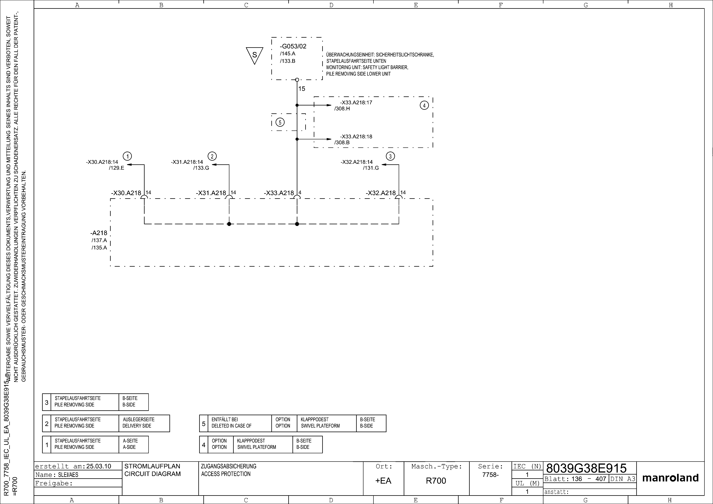

# +EA — Sheet 136 of 407 — ZUGANGSABSICHERUNG

**ACCESS PROTECTION**

> Part of the manroland **R700** printing press IEC/UL circuit diagrams.
> Drawing class: **Stromlaufplan / Circuit diagram** (DIN A3).
> Document `+EA` covers the **Printing unit** machine section.

## At a glance

| Field | Value |
|---|---|
| Document | `+EA`  (8039G38E915) |
| Sheet | **136** of 407 |
| Section (DE) | ZUGANGSABSICHERUNG |
| Section (EN) | ACCESS PROTECTION |
| Section type | CIRCUIT — Circuit diagram |
| Machine type | `R700` |
| Series | `7758` |
| Created | 25.03.10 |
| Replaces | — |
| Columns used | A, B, C, D, E |
| Path numbers | — |
| Labels on sheet | 66 |
| Cross-refs out | 9 |
| Cross-refs in | 13 |

**Previous:** [+EA sheet 135](SHEET_0135.md) · **Next:** [+EA sheet 137](SHEET_0137.md) · **Document TOC:** [_TOC.md](_TOC.md)  (+EA) · **Master TOC:** [all sheets](../_MASTER_TOC.md)

## Sheet image (300 DPI, exact vector render)



_Rendered directly from the PDF vector layer at 300 DPI (1-bit), no OCR and no resampling. Use it to confirm anything ambiguous in the text below._

## Cross-references on this sheet

Each entry is a wire leaving this sheet. The printed token is `/sheet.column`; the link resolves to that sheet inside the same document.

| Ref | Target sheet | Col | Path | Destination on target | Target section | From col |
|---|---|---|---|---|---|---|
| `/145.A` | [+EA sheet 145](SHEET_0145.md) | A | — | G053/02 | ZUGANGSABSICHERUNG | D |
| `/133.B` | [+EA sheet 133](SHEET_0133.md) | B | — | G053/02 | ZUGANGSABSICHERUNG | D |
| `/308.H` | [+EA sheet 308](SHEET_0308.md) | H | — | — | OPTION: KLAPPPODEST B SEITE | D |
| `/308.B` | [+EA sheet 308](SHEET_0308.md) | B | — | — | OPTION: KLAPPPODEST B SEITE | D |
| `/129.E` | [+EA sheet 129](SHEET_0129.md) | E | — | X30.A218:14 X31.A218:14 X32.A218:14 | ZUGANGSABSICHERUNG | C |
| `/133.G` | [+EA sheet 133](SHEET_0133.md) | G | — | X30.A218:14 X31.A218:14 X32.A218:14 | ZUGANGSABSICHERUNG | C |
| `/131.G` | [+EA sheet 131](SHEET_0131.md) | G | — | X30.A218:14 X31.A218:14 X32.A218:14 | ZUGANGSABSICHERUNG | C |
| `/137.A` | [+EA sheet 137](SHEET_0137.md) | A | — | — | ZUGANGSABSICHERUNG | A |
| `/135.A` | [+EA sheet 135](SHEET_0135.md) | A | — | — | ZUGANGSABSICHERUNG | A |

### Incoming references (sheets that point here)

Every other sheet that sends a wire to this one. `Back-ref` is the token printed on *that* sheet; `Path` is its line number.

| From sheet | Cols | Back-ref | Path | Refs | What continues there |
|---|---|---|---|---|---|
| [+EA#129](SHEET_0129.md) | F | `/129.F` | — | 1 | — |
| [+EA#131](SHEET_0131.md) | G | `/131.G` | — | 1 | — |
| [+EA#133](SHEET_0133.md) | C, G | `/133.C`, `/133.G` | — | 2 | G053/02 ÜBERWACHUNGSEINHEIT: SICHERHEITSLICHTSCHRANKE, |
| [+EA#135](SHEET_0135.md) | A | `/135.A` | — | 1 | — |
| [+EA#137](SHEET_0137.md) | A | `/137.A` | — | 1 | — |
| [+EA#145](SHEET_0145.md) | A | `/145.A` | — | 1 | — |
| [+EA#275](SHEET_0275.md) | D, G | `/275.D`, `/275.G` | — | 2 | — |
| [+EA#276](SHEET_0276.md) | E | `/276.E` | — | 1 | — |
| [+EA#277](SHEET_0277.md) | A | `/277.A` | — | 1 | — |
| [+EA#308](SHEET_0308.md) | D | `/308.D` | — | 2 | X33.A218:18 X33.A218:17 |


## Devices on this sheet

| Tag | Class | Class meaning (IEC) | Col | Sub | Terminal | Sign |
|---|---|---|---|---|---|---|
| `A218` | A | Baugruppe / assembly, module, PC board | A | — | — | — |
| `G053/02` | G | Stromversorgung / power supply | D | 02 | — | — |
| `X30.A218` | — | cross-device reference | B | — | — | — |
| `X31.A218` | — | cross-device reference | C | — | — | — |
| `X33.A218` | — | cross-device reference | C | — | — | — |
| `X32.A218` | — | cross-device reference | E | — | — | — |
| `X33.A218:17` | — | cross-device reference | D | — | 17 | — |
| `X33.A218:18` | — | cross-device reference | D | — | 18 | — |
| `X32.A218:14` | — | cross-device reference | D | — | 14 | — |
| `X31.A218:14` | — | cross-device reference | B | — | 14 | — |
| `X30.A218:14` | — | cross-device reference | A | — | 14 | — |

## Potentials / nets

_No named potentials on this sheet._

## Wire-end annotations (grouped as printed)

A wire that continues elsewhere is annotated with a small cluster: the destination description, the path/line number `#NN`, and the `/sheet.column` cross reference. Each row below is one such cluster exactly as it is grouped on the drawing.

| Col | Y | Path | Cross-ref | Text on the wire |
|---|---|---|---|---|
| D | 72.6 | — | `/145.A`, `/133.B` | `G053/02` |
| C | 86.1 | — | — | `S` |
| E | 88.5 | — | — | `ÜBERWACHUNGSEINHEIT: SICHERHEITSLICHTSCHRANKE,` |
| D | 99.1 | — | — | `PILE REMOVING SIDE LOWER UNIT MONITORING UNIT: SAFETY LIGHT BARRIER, STAPELAUSFAHRTSEITE UNTEN` |
| D | 143.4 | — | — | `15` |
| D | 167.5 | — | — | `X33.A218:17` |
| E | 173.2 | — | — | `4` |
| D | 177.5 | — | `/308.H` | — |
| C | 201.6 | — | — | `5` |
| D | 224.2 | — | — | `X33.A218:18` |
| D | 234.1 | — | `/308.B` | — |
| C | 257.7 | — | — | `1 2 3` |
| C | 266.7 | — | `/129.E`, `/133.G`, `/131.G` | `X30.A218:14 X31.A218:14 X32.A218:14` |
| C | 317.8 | — | — | `X30.A218 14 X31.A218 14 X33.A218 4 X32.A218 14` |
| A | 384.4 | — | — | `A218` |
| A | 397.5 | — | `/137.A`, `/135.A` | — |
| A | 662.5 | — | — | `3 B SEITE B SIDE` |
| A | 662.5 | — | — | `PILE REMOVING SIDE STAPELAUSFAHRTSEITE` |
| A | 697.9 | — | — | `2 DELIVERY SIDE AUSLEGERSEITE` |
| A | 697.9 | — | — | `PILE REMOVING SIDE STAPELAUSFAHRTSEITE` |
| C | 697.9 | — | — | `5 ENTFÄLLT BEI DELETED IN CASE OF` |
| C | 697.9 | — | — | `OPTION OPTION` |
| D | 697.9 | — | — | `KLAPPPODEST` |
| D | 697.9 | — | — | `B SEITE B SIDE` |
| D | 708.5 | — | — | `SWIVEL PLATEFORM` |
| A | 733.3 | — | — | `1 A SEITE A SIDE` |
| D | 733.3 | — | — | `B SEITE B SIDE` |
| A | 733.4 | — | — | `PILE REMOVING SIDE STAPELAUSFAHRTSEITE` |
| C | 733.4 | — | — | `4 OPTION OPTION` |
| C | 733.4 | — | — | `KLAPPPODEST` |
| C | 744.0 | — | — | `SWIVEL PLATEFORM` |


## Reconstructed tables

This sheet carries tabular content (pin map / terminal assignment / index). The grid below was rebuilt from the drawing's own rule lines, so each row is exactly one physical row of the table.

### Table 1 — 5 data rows × 11 columns (at x=204.1, y=0.0) — **G053/02 /145.A S /133.B ÜBERWACHUNGSEINHEIT: STAPELAUSFAHRTSEITE MONITORING UNIT: PILE REMOVING SIDE 15 X33.A218:17 UNTEN SAFETY LIGHT LOWER UNIT BARRIER, SICHERHEITSLICHTSCHRANKE, 5 /308.H X33.A218:18 4 1 X30.A218 X31.A218:14 14 2 /133.G X31.A218 X33.A218 14 /308.B X32.A218:14 4 3 /131.G X32.A218 14 B SEITE B SIDE AUSLEGERSEITE DELIVERY A SEITE A SIDE SIDE ENTFÄLLT 5 DELETED OPTION 4 OPTION BEI OPTION OPTION IN CASE OF KLAPPPODEST SWIVEL PLATEFORM KLAPPPODEST SWIVEL PLATEFORM B SEITE B SIDE B SEITE B SIDE**

|  | STROMLAUFPLAN | ZUGANGSABSICHERUNG |  |  | Ort: |  | Masch. Type: | Serie: | IEC (N) | 8039G38E915 |
|---|---|---|---|---|---|---|---|---|---|---|
| `CIRCUIT` | `DIAGRAM` |  |  |  |  |  |  |  |  |  |
|  |  | `ACCESS` | `PROTECTION` |  |  |  |  | `7758` | `1` |  |
|  |  |  |  |  | `+EA` |  | `R700` |  |  | `Blatt: DIN A3 136 407` |
|  |  |  |  |  |  |  |  |  | `UL (M)` |  |
|  |  |  |  |  |  |  |  |  | `1` | `anstatt:` |


## Notes and free text on this sheet

| Text | Col | Y (pt) |
|---|---|---|
| `ÜBERWACHUNGSEINHEIT: SICHERHEITSLICHTSCHRANKE,` | E | 88.5 |
| `STAPELAUSFAHRTSEITE UNTEN` | D | 99.13 |
| `MONITORING UNIT: SAFETY LIGHT BARRIER,` | D | 109.76 |
| `PILE REMOVING SIDE LOWER UNIT` | D | 120.38 |
| `STAPELAUSFAHRTSEITE` | A | 733.37 |
| `PILE REMOVING SIDE` | A | 744 |
| `A SEITE` | B | 733.34 |
| `A SIDE` | B | 743.99 |
| `AUSLEGERSEITE` | B | 697.94 |
| `DELIVERY SIDE` | B | 708.55 |
| `B SEITE` | B | 662.45 |
| `B SIDE` | B | 673.09 |
| `S` | C | 86.13 |
| `ENTFÄLLT BEI` | C | 697.91 |
| `DELETED IN CASE OF` | C | 708.57 |
| `OPTION` | C | 697.92 |
| `KLAPPPODEST` | D | 697.92 |
| `SWIVEL PLATEFORM` | D | 708.55 |
| `B SEITE` | D | 697.88 |
| `B SIDE` | D | 708.52 |
| `KLAPPPODEST` | C | 733.36 |
| `SWIVEL PLATEFORM` | C | 743.98 |

## Complete label inventory (exact text from the drawing)

Every text object inside the drawing area of this sheet, in DIN reading order (column A→H, then top→bottom). This is the authoritative list: if a string is not here it is not printed on this sheet.

| Col | Y | X | Dir | Type | Text |
|---|---|---|---|---|---|
| A | 266.7 | 143.7 | → | device ref | `X30.A218:14` |
| A | 276.6 | 182.0 | → | cross-reference | `/129.E` |
| A | 384.4 | 150.8 | → | device tag | `A218` |
| A | 397.5 | 153.1 | → | cross-reference | `/137.A` |
| A | 409.9 | 153.1 | → | cross-reference | `/135.A` |
| A | 662.5 | 91.8 | → | text | `STAPELAUSFAHRTSEITE` |
| A | 667.8 | 75.0 | → | number | `3` |
| A | 673.1 | 91.3 | → | text | `PILE REMOVING SIDE` |
| A | 697.9 | 91.8 | → | text | `STAPELAUSFAHRTSEITE` |
| A | 703.3 | 75.1 | → | number | `2` |
| A | 708.6 | 91.3 | → | text | `PILE REMOVING SIDE` |
| A | 733.4 | 91.8 | → | text | `STAPELAUSFAHRTSEITE` |
| A | 738.7 | 75.4 | → | number | `1` |
| A | 744.0 | 91.3 | → | text | `PILE REMOVING SIDE` |
| B | 257.7 | 210.8 | → | number | `1` |
| B | 266.7 | 285.4 | → | device ref | `X31.A218:14` |
| B | 276.7 | 322.9 | → | cross-reference | `/133.G` |
| B | 317.8 | 185.7 | → | device ref | `X30.A218` |
| B | 317.8 | 242.9 | → | number | `14` |
| B | 662.4 | 204.7 | → | text | `B SEITE` |
| B | 673.1 | 204.7 | → | text | `B SIDE` |
| B | 697.9 | 205.5 | → | text | `AUSLEGERSEITE` |
| B | 703.3 | 337.2 | → | number | `5` |
| B | 708.6 | 204.7 | → | text | `DELIVERY SIDE` |
| B | 733.3 | 205.5 | → | text | `A SEITE` |
| B | 738.7 | 337.3 | → | number | `4` |
| B | 744.0 | 205.5 | → | text | `A SIDE` |
| C | 85.7 | 467.7 | → | cross-reference | `/145.A` |
| C | 86.1 | 421.1 | → | text | `S` |
| C | 98.1 | 467.7 | → | cross-reference | `/133.B` |
| C | 201.6 | 465.7 | → | number | `5` |
| C | 258.2 | 352.3 | → | number | `2` |
| C | 317.8 | 327.4 | → | device ref | `X31.A218` |
| C | 317.8 | 384.7 | → | number | `14` |
| C | 317.8 | 440.8 | → | device ref | `X33.A218` |
| C | 697.9 | 353.5 | → | text | `ENTFÄLLT BEI` |
| C | 697.9 | 460.3 | → | text | `OPTION` |
| C | 708.6 | 353.5 | → | text | `DELETED IN CASE OF` |
| C | 708.6 | 460.3 | → | text | `OPTION` |
| C | 733.4 | 354.0 | → | text | `OPTION` |
| C | 733.4 | 396.0 | → | text | `KLAPPPODEST` |
| C | 744.0 | 354.0 | → | text | `OPTION` |
| C | 744.0 | 396.6 | → | text | `SWIVEL PLATEFORM` |
| D | 72.6 | 467.4 | → | device tag | `G053/02` |
| D | 99.1 | 545.4 | → | text | `STAPELAUSFAHRTSEITE UNTEN` |
| D | 109.8 | 545.1 | → | text | `MONITORING UNIT: SAFETY LIGHT BARRIER,` |
| D | 120.4 | 544.8 | → | text | `PILE REMOVING SIDE LOWER UNIT` |
| D | 143.4 | 497.8 | → | number | `15` |
| D | 167.5 | 568.1 | → | device ref | `X33.A218:17` |
| D | 177.5 | 558.4 | → | cross-reference | `/308.H` |
| D | 224.2 | 568.1 | → | device ref | `X33.A218:18` |
| D | 234.1 | 558.4 | → | cross-reference | `/308.B` |
| D | 266.7 | 568.9 | → | device ref | `X32.A218:14` |
| D | 276.7 | 606.3 | → | cross-reference | `/131.G` |
| D | 317.8 | 498.6 | → | number | `4` |
| D | 697.9 | 502.3 | → | text | `KLAPPPODEST` |
| D | 697.9 | 601.5 | → | text | `B SEITE` |
| D | 708.5 | 601.5 | → | text | `B SIDE` |
| D | 708.6 | 502.9 | → | text | `SWIVEL PLATEFORM` |
| D | 733.3 | 495.2 | → | text | `B SEITE` |
| D | 744.0 | 495.2 | → | text | `B SIDE` |
| E | 88.5 | 544.8 | → | text | `ÜBERWACHUNGSEINHEIT: SICHERHEITSLICHTSCHRANKE,` |
| E | 173.2 | 706.7 | → | number | `4` |
| E | 258.2 | 650.0 | → | number | `3` |
| E | 317.8 | 610.9 | → | device ref | `X32.A218` |
| E | 317.8 | 668.1 | → | number | `14` |

## Reading-order text block

The same content as a plain block, grouped by DIN column — convenient to paste or to match against a visual description.

```text
=== Column A ===
 266.7  143.7  devref       X30.A218:14
 276.6  182.0  xref         /129.E
 384.4  150.8  devtag       A218
 397.5  153.1  xref         /137.A
 409.9  153.1  xref         /135.A
 662.5   91.8  text         STAPELAUSFAHRTSEITE
 667.8   75.0  numeric      3
 673.1   91.3  text         PILE REMOVING SIDE
 697.9   91.8  text         STAPELAUSFAHRTSEITE
 703.3   75.1  numeric      2
 708.6   91.3  text         PILE REMOVING SIDE
 733.4   91.8  text         STAPELAUSFAHRTSEITE
 738.7   75.4  numeric      1
 744.0   91.3  text         PILE REMOVING SIDE
=== Column B ===
 257.7  210.8  numeric      1
 266.7  285.4  devref       X31.A218:14
 276.7  322.9  xref         /133.G
 317.8  185.7  devref       X30.A218
 317.8  242.9  numeric      14
 662.4  204.7  text         B SEITE
 673.1  204.7  text         B SIDE
 697.9  205.5  text         AUSLEGERSEITE
 703.3  337.2  numeric      5
 708.6  204.7  text         DELIVERY SIDE
 733.3  205.5  text         A SEITE
 738.7  337.3  numeric      4
 744.0  205.5  text         A SIDE
=== Column C ===
  85.7  467.7  xref         /145.A
  86.1  421.1  text         S
  98.1  467.7  xref         /133.B
 201.6  465.7  numeric      5
 258.2  352.3  numeric      2
 317.8  327.4  devref       X31.A218
 317.8  384.7  numeric      14
 317.8  440.8  devref       X33.A218
 697.9  353.5  text         ENTFÄLLT BEI
 697.9  460.3  text         OPTION
 708.6  353.5  text         DELETED IN CASE OF
 708.6  460.3  text         OPTION
 733.4  354.0  text         OPTION
 733.4  396.0  text         KLAPPPODEST
 744.0  354.0  text         OPTION
 744.0  396.6  text         SWIVEL PLATEFORM
=== Column D ===
  72.6  467.4  devtag       G053/02
  99.1  545.4  text         STAPELAUSFAHRTSEITE UNTEN
 109.8  545.1  text         MONITORING UNIT: SAFETY LIGHT BARRIER,
 120.4  544.8  text         PILE REMOVING SIDE LOWER UNIT
 143.4  497.8  numeric      15
 167.5  568.1  devref       X33.A218:17
 177.5  558.4  xref         /308.H
 224.2  568.1  devref       X33.A218:18
 234.1  558.4  xref         /308.B
 266.7  568.9  devref       X32.A218:14
 276.7  606.3  xref         /131.G
 317.8  498.6  numeric      4
 697.9  502.3  text         KLAPPPODEST
 697.9  601.5  text         B SEITE
 708.5  601.5  text         B SIDE
 708.6  502.9  text         SWIVEL PLATEFORM
 733.3  495.2  text         B SEITE
 744.0  495.2  text         B SIDE
=== Column E ===
  88.5  544.8  text         ÜBERWACHUNGSEINHEIT: SICHERHEITSLICHTSCHRANKE,
 173.2  706.7  numeric      4
 258.2  650.0  numeric      3
 317.8  610.9  devref       X32.A218
 317.8  668.1  numeric      14
```

---
_Generated from the PDF vector text layer; no OCR. Source: `R700_7758_IEC_UL_EA_8039G38E915_p`, sheet 136._
