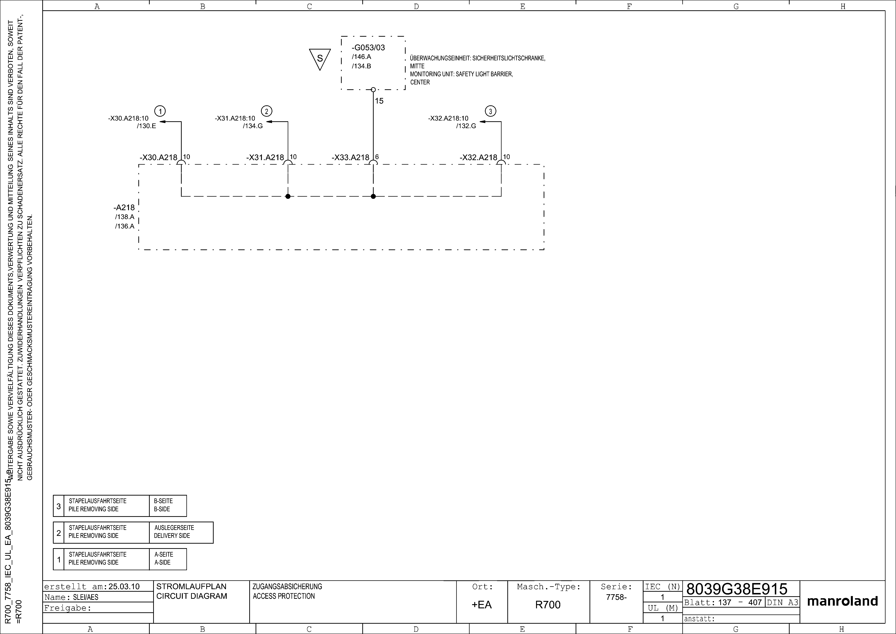

# +EA — Sheet 137 of 407 — ZUGANGSABSICHERUNG

**ACCESS PROTECTION**

> Part of the manroland **R700** printing press IEC/UL circuit diagrams.
> Drawing class: **Stromlaufplan / Circuit diagram** (DIN A3).
> Document `+EA` covers the **Printing unit** machine section.

## At a glance

| Field | Value |
|---|---|
| Document | `+EA`  (8039G38E915) |
| Sheet | **137** of 407 |
| Section (DE) | ZUGANGSABSICHERUNG |
| Section (EN) | ACCESS PROTECTION |
| Section type | CIRCUIT — Circuit diagram |
| Machine type | `R700` |
| Series | `7758` |
| Created | 25.03.10 |
| Replaces | — |
| Columns used | A, B, C, D, E |
| Path numbers | — |
| Labels on sheet | 44 |
| Cross-refs out | 7 |
| Cross-refs in | 11 |

**Previous:** [+EA sheet 136](SHEET_0136.md) · **Next:** [+EA sheet 138](SHEET_0138.md) · **Document TOC:** [_TOC.md](_TOC.md)  (+EA) · **Master TOC:** [all sheets](../_MASTER_TOC.md)

## Sheet image (300 DPI, exact vector render)



_Rendered directly from the PDF vector layer at 300 DPI (1-bit), no OCR and no resampling. Use it to confirm anything ambiguous in the text below._

## Cross-references on this sheet

Each entry is a wire leaving this sheet. The printed token is `/sheet.column`; the link resolves to that sheet inside the same document.

| Ref | Target sheet | Col | Path | Destination on target | Target section | From col |
|---|---|---|---|---|---|---|
| `/146.A` | [+EA sheet 146](SHEET_0146.md) | A | — | G053/03 | ZUGANGSABSICHERUNG | D |
| `/134.B` | [+EA sheet 134](SHEET_0134.md) | B | — | G053/03 | ZUGANGSABSICHERUNG | D |
| `/130.E` | [+EA sheet 130](SHEET_0130.md) | E | — | X30.A218:10 X32.A218:10 | ZUGANGSABSICHERUNG | C |
| `/132.G` | [+EA sheet 132](SHEET_0132.md) | G | — | X30.A218:10 X32.A218:10 | ZUGANGSABSICHERUNG | C |
| `/134.G` | [+EA sheet 134](SHEET_0134.md) | G | — | X31.A218:10 | ZUGANGSABSICHERUNG | B |
| `/138.A` | [+EA sheet 138](SHEET_0138.md) | A | — | — | ZUGANGSABSICHERUNG | A |
| `/136.A` | [+EA sheet 136](SHEET_0136.md) | A | — | — | ZUGANGSABSICHERUNG | A |

### Incoming references (sheets that point here)

Every other sheet that sends a wire to this one. `Back-ref` is the token printed on *that* sheet; `Path` is its line number.

| From sheet | Cols | Back-ref | Path | Refs | What continues there |
|---|---|---|---|---|---|
| [+EA#130](SHEET_0130.md) | F | `/130.F` | — | 1 | X31.A218:22 |
| [+EA#132](SHEET_0132.md) | G | `/132.G` | — | 1 | — |
| [+EA#134](SHEET_0134.md) | C, G | `/134.C`, `/134.G` | — | 2 | G053/03 ÜBERWACHUNGSEINHEIT: SICHERHEITSLICHTSCHRANKE, MITTE MONITORING UNIT: SAFETY LIGHT BARRIER, CENTER; X32.A218:18 |
| [+EA#136](SHEET_0136.md) | A | `/136.A` | — | 1 | — |
| [+EA#138](SHEET_0138.md) | A | `/138.A` | — | 1 | — |
| [+EA#146](SHEET_0146.md) | A | `/146.A` | — | 1 | — |
| [+EA#275](SHEET_0275.md) | D, G | `/275.D`, `/275.G` | — | 2 | — |
| [+EA#276](SHEET_0276.md) | E | `/276.E` | — | 1 | — |
| [+EA#277](SHEET_0277.md) | A | `/277.A` | — | 1 | — |


## Devices on this sheet

| Tag | Class | Class meaning (IEC) | Col | Sub | Terminal | Sign |
|---|---|---|---|---|---|---|
| `G053/03` | G | Stromversorgung / power supply | D | 03 | — | — |
| `A218` | A | Baugruppe / assembly, module, PC board | A | — | — | — |
| `X30.A218` | — | cross-device reference | B | — | — | — |
| `X31.A218` | — | cross-device reference | C | — | — | — |
| `X33.A218` | — | cross-device reference | C | — | — | — |
| `X32.A218` | — | cross-device reference | E | — | — | — |
| `X31.A218:10` | — | cross-device reference | B | — | 10 | — |
| `X32.A218:10` | — | cross-device reference | D | — | 10 | — |
| `X30.A218:10` | — | cross-device reference | A | — | 10 | — |

## Potentials / nets

_No named potentials on this sheet._

## Wire-end annotations (grouped as printed)

A wire that continues elsewhere is annotated with a small cluster: the destination description, the path/line number `#NN`, and the `/sheet.column` cross reference. Each row below is one such cluster exactly as it is grouped on the drawing.

| Col | Y | Path | Cross-ref | Text on the wire |
|---|---|---|---|---|
| D | 58.4 | — | `/146.A`, `/134.B` | `G053/03` |
| C | 72.0 | — | — | `S` |
| E | 74.3 | — | — | `ÜBERWACHUNGSEINHEIT: SICHERHEITSLICHTSCHRANKE, MITTE MONITORING UNIT: SAFETY LIGHT BARRIER, CENTER` |
| D | 129.2 | — | — | `15` |
| C | 144.3 | — | — | `1 2 3` |
| C | 153.4 | — | `/130.E`, `/132.G` | `X30.A218:10 X32.A218:10` |
| B | 153.4 | — | `/134.G` | `X31.A218:10` |
| C | 204.4 | — | — | `X30.A218 10 X31.A218 10 X33.A218 6` |
| E | 204.4 | — | — | `X32.A218 10` |
| A | 271.0 | — | — | `A218` |
| A | 284.1 | — | `/138.A`, `/136.A` | — |
| A | 662.5 | — | — | `3 B SEITE B SIDE` |
| A | 662.5 | — | — | `PILE REMOVING SIDE STAPELAUSFAHRTSEITE` |
| A | 697.9 | — | — | `2 DELIVERY SIDE AUSLEGERSEITE` |
| A | 697.9 | — | — | `PILE REMOVING SIDE STAPELAUSFAHRTSEITE` |
| A | 733.3 | — | — | `1 A SEITE A SIDE` |
| A | 733.4 | — | — | `PILE REMOVING SIDE STAPELAUSFAHRTSEITE` |


## Reconstructed tables

This sheet carries tabular content (pin map / terminal assignment / index). The grid below was rebuilt from the drawing's own rule lines, so each row is exactly one physical row of the table.

### Table 1 — 5 data rows × 11 columns (at x=204.1, y=0.0) — **1 X30.A218 X31.A218:10 10 2 /134.G X31.A218 G053/03 /146.A S /134.B X33.A218 10 ÜBERWACHUNGSEINHEIT: MITTE MONITORING UNIT: CENTER 15 X32.A218:10 6 SAFETY LIGHT 3 /132.G X32.A218 BARRIER, 10 SICHERHEITSLICHTSCHRANKE, B SEITE B SIDE AUSLEGERSEITE DELIVERY A SEITE A SIDE SIDE**

|  | STROMLAUFPLAN | ZUGANGSABSICHERUNG |  |  | Ort: |  | Masch. Type: | Serie: | IEC (N) | 8039G38E915 |
|---|---|---|---|---|---|---|---|---|---|---|
| `CIRCUIT` | `DIAGRAM` |  |  |  |  |  |  |  |  |  |
|  |  | `ACCESS` | `PROTECTION` |  |  |  |  | `7758` | `1` |  |
|  |  |  |  |  | `+EA` |  | `R700` |  |  | `Blatt: DIN A3 137 407` |
|  |  |  |  |  |  |  |  |  | `UL (M)` |  |
|  |  |  |  |  |  |  |  |  | `1` | `anstatt:` |


## Notes and free text on this sheet

| Text | Col | Y (pt) |
|---|---|---|
| `ÜBERWACHUNGSEINHEIT: SICHERHEITSLICHTSCHRANKE,` | E | 74.32 |
| `MITTE` | D | 84.92 |
| `MONITORING UNIT: SAFETY LIGHT BARRIER,` | D | 95.59 |
| `CENTER` | D | 106.23 |
| `STAPELAUSFAHRTSEITE` | A | 733.37 |
| `PILE REMOVING SIDE` | A | 744 |
| `A SEITE` | B | 733.34 |
| `A SIDE` | B | 743.99 |
| `AUSLEGERSEITE` | B | 697.94 |
| `DELIVERY SIDE` | B | 708.55 |
| `B SEITE` | B | 662.45 |
| `B SIDE` | B | 673.09 |
| `S` | C | 71.95 |

## Complete label inventory (exact text from the drawing)

Every text object inside the drawing area of this sheet, in DIN reading order (column A→H, then top→bottom). This is the authoritative list: if a string is not here it is not printed on this sheet.

| Col | Y | X | Dir | Type | Text |
|---|---|---|---|---|---|
| A | 153.4 | 143.7 | → | device ref | `X30.A218:10` |
| A | 163.3 | 182.0 | → | cross-reference | `/130.E` |
| A | 271.0 | 150.8 | → | device tag | `A218` |
| A | 284.1 | 153.1 | → | cross-reference | `/138.A` |
| A | 296.5 | 153.1 | → | cross-reference | `/136.A` |
| A | 662.5 | 91.8 | → | text | `STAPELAUSFAHRTSEITE` |
| A | 667.8 | 75.0 | → | number | `3` |
| A | 673.1 | 91.3 | → | text | `PILE REMOVING SIDE` |
| A | 697.9 | 91.8 | → | text | `STAPELAUSFAHRTSEITE` |
| A | 703.3 | 75.1 | → | number | `2` |
| A | 708.6 | 91.3 | → | text | `PILE REMOVING SIDE` |
| A | 733.4 | 91.8 | → | text | `STAPELAUSFAHRTSEITE` |
| A | 738.7 | 75.4 | → | number | `1` |
| A | 744.0 | 91.3 | → | text | `PILE REMOVING SIDE` |
| B | 144.3 | 210.8 | → | number | `1` |
| B | 153.4 | 285.4 | → | device ref | `X31.A218:10` |
| B | 163.3 | 322.9 | → | cross-reference | `/134.G` |
| B | 204.4 | 185.7 | → | device ref | `X30.A218` |
| B | 204.4 | 242.9 | → | number | `10` |
| B | 662.4 | 204.7 | → | text | `B SEITE` |
| B | 673.1 | 204.7 | → | text | `B SIDE` |
| B | 697.9 | 205.5 | → | text | `AUSLEGERSEITE` |
| B | 708.6 | 204.7 | → | text | `DELIVERY SIDE` |
| B | 733.3 | 205.5 | → | text | `A SEITE` |
| B | 744.0 | 205.5 | → | text | `A SIDE` |
| C | 71.5 | 467.7 | → | cross-reference | `/146.A` |
| C | 72.0 | 421.1 | → | text | `S` |
| C | 83.9 | 467.7 | → | cross-reference | `/134.B` |
| C | 144.9 | 352.3 | → | number | `2` |
| C | 204.4 | 327.4 | → | device ref | `X31.A218` |
| C | 204.4 | 384.7 | → | number | `10` |
| C | 204.4 | 440.8 | → | device ref | `X33.A218` |
| D | 58.4 | 467.4 | → | device tag | `G053/03` |
| D | 84.9 | 545.1 | → | text | `MITTE` |
| D | 95.6 | 545.1 | → | text | `MONITORING UNIT: SAFETY LIGHT BARRIER,` |
| D | 106.2 | 545.4 | → | text | `CENTER` |
| D | 129.2 | 497.8 | → | number | `15` |
| D | 153.4 | 568.9 | → | device ref | `X32.A218:10` |
| D | 163.3 | 606.3 | → | cross-reference | `/132.G` |
| D | 204.4 | 498.6 | → | number | `6` |
| E | 74.3 | 544.8 | → | text | `ÜBERWACHUNGSEINHEIT: SICHERHEITSLICHTSCHRANKE,` |
| E | 144.9 | 650.0 | → | number | `3` |
| E | 204.4 | 610.9 | → | device ref | `X32.A218` |
| E | 204.4 | 668.1 | → | number | `10` |

## Reading-order text block

The same content as a plain block, grouped by DIN column — convenient to paste or to match against a visual description.

```text
=== Column A ===
 153.4  143.7  devref       X30.A218:10
 163.3  182.0  xref         /130.E
 271.0  150.8  devtag       A218
 284.1  153.1  xref         /138.A
 296.5  153.1  xref         /136.A
 662.5   91.8  text         STAPELAUSFAHRTSEITE
 667.8   75.0  numeric      3
 673.1   91.3  text         PILE REMOVING SIDE
 697.9   91.8  text         STAPELAUSFAHRTSEITE
 703.3   75.1  numeric      2
 708.6   91.3  text         PILE REMOVING SIDE
 733.4   91.8  text         STAPELAUSFAHRTSEITE
 738.7   75.4  numeric      1
 744.0   91.3  text         PILE REMOVING SIDE
=== Column B ===
 144.3  210.8  numeric      1
 153.4  285.4  devref       X31.A218:10
 163.3  322.9  xref         /134.G
 204.4  185.7  devref       X30.A218
 204.4  242.9  numeric      10
 662.4  204.7  text         B SEITE
 673.1  204.7  text         B SIDE
 697.9  205.5  text         AUSLEGERSEITE
 708.6  204.7  text         DELIVERY SIDE
 733.3  205.5  text         A SEITE
 744.0  205.5  text         A SIDE
=== Column C ===
  71.5  467.7  xref         /146.A
  72.0  421.1  text         S
  83.9  467.7  xref         /134.B
 144.9  352.3  numeric      2
 204.4  327.4  devref       X31.A218
 204.4  384.7  numeric      10
 204.4  440.8  devref       X33.A218
=== Column D ===
  58.4  467.4  devtag       G053/03
  84.9  545.1  text         MITTE
  95.6  545.1  text         MONITORING UNIT: SAFETY LIGHT BARRIER,
 106.2  545.4  text         CENTER
 129.2  497.8  numeric      15
 153.4  568.9  devref       X32.A218:10
 163.3  606.3  xref         /132.G
 204.4  498.6  numeric      6
=== Column E ===
  74.3  544.8  text         ÜBERWACHUNGSEINHEIT: SICHERHEITSLICHTSCHRANKE,
 144.9  650.0  numeric      3
 204.4  610.9  devref       X32.A218
 204.4  668.1  numeric      10
```

---
_Generated from the PDF vector text layer; no OCR. Source: `R700_7758_IEC_UL_EA_8039G38E915_p`, sheet 137._
