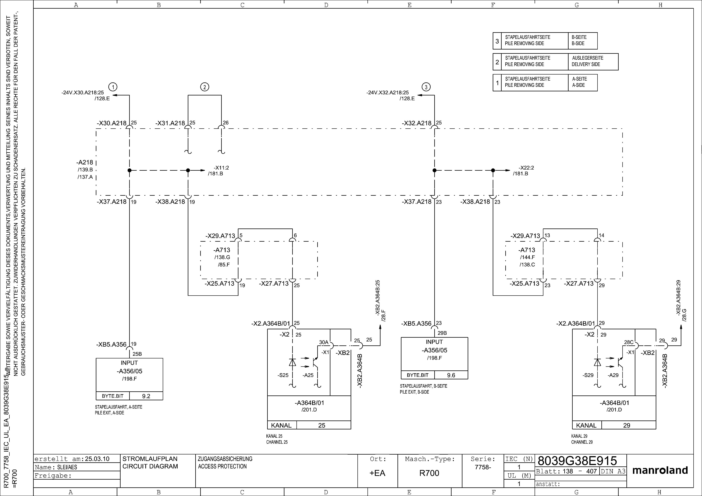

# +EA — Sheet 138 of 407 — ZUGANGSABSICHERUNG

**ACCESS PROTECTION**

> Part of the manroland **R700** printing press IEC/UL circuit diagrams.
> Drawing class: **Stromlaufplan / Circuit diagram** (DIN A3).
> Document `+EA` covers the **Printing unit** machine section.

## At a glance

| Field | Value |
|---|---|
| Document | `+EA`  (8039G38E915) |
| Sheet | **138** of 407 |
| Section (DE) | ZUGANGSABSICHERUNG |
| Section (EN) | ACCESS PROTECTION |
| Section type | CIRCUIT — Circuit diagram |
| Machine type | `R700` |
| Series | `7758` |
| Created | 25.03.10 |
| Replaces | — |
| Columns used | A, B, C, D, E, F, G, H |
| Path numbers | — |
| Labels on sheet | 124 |
| Cross-refs out | 16 |
| Cross-refs in | 38 |

**Previous:** [+EA sheet 137](SHEET_0137.md) · **Next:** [+EA sheet 139](SHEET_0139.md) · **Document TOC:** [_TOC.md](_TOC.md)  (+EA) · **Master TOC:** [all sheets](../_MASTER_TOC.md)

## Sheet image (300 DPI, exact vector render)



_Rendered directly from the PDF vector layer at 300 DPI (1-bit), no OCR and no resampling. Use it to confirm anything ambiguous in the text below._

## Cross-references on this sheet

Each entry is a wire leaving this sheet. The printed token is `/sheet.column`; the link resolves to that sheet inside the same document.

| Ref | Target sheet | Col | Path | Destination on target | Target section | From col |
|---|---|---|---|---|---|---|
| `/128.E` | [+EA sheet 128](SHEET_0128.md) | E | — | 1 2 3 24V.X32.A218:25 | ZUGANGSABSICHERUNG | C |
| `/128.E` | [+EA sheet 128](SHEET_0128.md) | E | — | 24V.X30.A218:25 | ZUGANGSABSICHERUNG | A |
| `/139.B` | [+EA sheet 139](SHEET_0139.md) | B | — | — | ZUGANGSABSICHERUNG | A |
| `/137.A` | [+EA sheet 137](SHEET_0137.md) | A | — | — | ZUGANGSABSICHERUNG | A |
| `/181.B` | [+EA sheet 181](SHEET_0181.md) | B | — | — | RESERVE | C |
| `/181.B` | [+EA sheet 181](SHEET_0181.md) | B | — | — | RESERVE | F |
| `/144.F` | [+EA sheet 144](SHEET_0144.md) | F | — | — | ZUGANGSABSICHERUNG | F |
| `/138.C` | [+EA sheet 138](SHEET_0138.md) | C | — | — | ZUGANGSABSICHERUNG | F |
| `/138.G` | [+EA sheet 138](SHEET_0138.md) | G | — | — | ZUGANGSABSICHERUNG | C |
| `/85.F` | [+EA sheet 85](SHEET_0085.md) | F | — | — | AUSLEGERSTAPELSTEUERUNG: PROGRAMMSCHALTWERK | C |
| `/28.F` | [+EA sheet 28](SHEET_0028.md) | F | — | XB2.A364B:25 | BUSVERBINDUNGEN: SICHERHEITSBUS | E |
| `/28.G` | [+EA sheet 28](SHEET_0028.md) | G | — | XB2.A364B:29 | BUSVERBINDUNGEN: SICHERHEITSBUS | H |
| `/198.F` | [+EA sheet 198](SHEET_0198.md) | F | — | — | REFERENZMODUL | E |
| `/198.F` | [+EA sheet 198](SHEET_0198.md) | F | — | — | REFERENZMODUL | B |
| `/201.D` | [+EA sheet 201](SHEET_0201.md) | D | — | — | REFERENZMODUL | D |
| `/201.D` | [+EA sheet 201](SHEET_0201.md) | D | — | — | REFERENZMODUL | G |

### Incoming references (sheets that point here)

Every other sheet that sends a wire to this one. `Back-ref` is the token printed on *that* sheet; `Path` is its line number.

| From sheet | Cols | Back-ref | Path | Refs | What continues there |
|---|---|---|---|---|---|
| [+EA#28](SHEET_0028.md) | F, G | `/28.F`, `/28.G` | — | 2 | — |
| [+EA#85](SHEET_0085.md) | E | `/85.E` | — | 1 | — |
| [+EA#128](SHEET_0128.md) | E | `/128.E` | — | 2 | 24V.X30.A218:25; 24V.X32.A218:25 |
| [+EA#137](SHEET_0137.md) | A | `/137.A` | — | 1 | — |
| [+EA#138](SHEET_0138.md) | C, F | `/138.C`, `/138.F` | — | 2 | — |
| [+EA#139](SHEET_0139.md) | B | `/139.B` | — | 1 | — |
| [+EA#144](SHEET_0144.md) | F | `/144.F` | — | 1 | — |
| [+EA#181](SHEET_0181.md) | A, B | `/181.A`, `/181.B` | — | 2 | X11:2; X22:2 |
| [+EA#198](SHEET_0198.md) | F | `/198.F` | — | 2 | — |
| [+EA#201](SHEET_0201.md) | D | `/201.D` | — | 2 | — |
| [+EA#227](SHEET_0227.md) | C, E | `/227.C`, `/227.E` | — | 4 | — |
| [+EA#241](SHEET_0241.md) | H | `/241.H` | — | 2 | — |
| [+EA#268](SHEET_0268.md) | G | `/268.G` | — | 2 | — |
| [+EA#272](SHEET_0272.md) | B | `/272.B` | — | 2 | — |
| [+EA#275](SHEET_0275.md) | A, D, G | `/275.A`, `/275.D`, `/275.G` | — | 7 | — |
| [+EA#276](SHEET_0276.md) | E | `/276.E` | — | 1 | — |
| [+EA#279](SHEET_0279.md) | E | `/279.E` | — | 2 | — |
| [+EA#280](SHEET_0280.md) | A | `/280.A` | — | 2 | — |


## Devices on this sheet

| Tag | Class | Class meaning (IEC) | Col | Sub | Terminal | Sign |
|---|---|---|---|---|---|---|
| `A218` | A | Baugruppe / assembly, module, PC board | A | — | — | — |
| `A356/05` | A | Baugruppe / assembly, module, PC board | B | 05 | — | — |
| `A713` | A | Baugruppe / assembly, module, PC board | C | — | — | — |
| `A356/05` | A | Baugruppe / assembly, module, PC board | E | 05 | — | — |
| `S29` | S | Schalter / switch | G | — | — | — |
| `A29` | A | Baugruppe / assembly, module, PC board | G | — | — | — |
| `X1` | X | Klemme / terminal, plug connector | H | — | — | — |
| `X2` | X | Klemme / terminal, plug connector | G | — | — | — |
| `XB2` | XB |  | H | — | — | — |
| `A713` | A | Baugruppe / assembly, module, PC board | F | — | — | — |
| `S25` | S | Schalter / switch | C | — | — | — |
| `A25` | A | Baugruppe / assembly, module, PC board | D | — | — | — |
| `X1` | X | Klemme / terminal, plug connector | D | — | — | — |
| `X2` | X | Klemme / terminal, plug connector | D | — | — | — |
| `XB2` | XB |  | D | — | — | — |
| `X11:2` | X | Klemme / terminal, plug connector | C | — | 2 | — |
| `X22:2` | X | Klemme / terminal, plug connector | F | — | 2 | — |
| `X30.A218` | — | cross-device reference | A | — | — | — |
| `X37.A218` | — | cross-device reference | A | — | — | — |
| `X31.A218` | — | cross-device reference | B | — | — | — |
| `X38.A218` | — | cross-device reference | B | — | — | — |
| `9.2` | — | cross-device reference | B | — | — | — |
| `XB5.A356` | — | cross-device reference | A | — | — | — |
| `X29.A713` | — | cross-device reference | C | — | — | — |
| `X32.A218` | — | cross-device reference | E | — | — | — |
| `X37.A218` | — | cross-device reference | E | — | — | — |
| `X38.A218` | — | cross-device reference | F | — | — | — |
| `9.6` | — | cross-device reference | F | — | — | — |
| `XB5.A356` | — | cross-device reference | E | — | — | — |
| `XB2.A364B` | — | cross-device reference | H | — | — | — |
| `X29.A713` | — | cross-device reference | F | — | — | — |
| `X27.A713` | — | cross-device reference | G | — | — | — |
| `X25.A713` | — | cross-device reference | F | — | — | — |
| `X27.A713` | — | cross-device reference | C | — | — | — |
| `X25.A713` | — | cross-device reference | C | — | — | — |
| `XB2.A364B` | — | cross-device reference | D | — | — | — |
| `XB2.A364B:29` | — | cross-device reference | H | — | 29 | — |
| `XB2.A364B:25` | — | cross-device reference | E | — | 25 | — |

## Potentials / nets

| Potential | Count | Columns | Attached devices | Terminals |
|---|---|---|---|---|
| `24V` | 2 | A, E | `A218`, `X30`, `X32` | `25` |


A potential such as `L24+/4` or `M24+` is a named supply/return rail; every place it appears on this sheet is electrically common.

## Wire-end annotations (grouped as printed)

A wire that continues elsewhere is annotated with a small cluster: the destination description, the path/line number `#NN`, and the `/sheet.column` cross reference. Each row below is one such cluster exactly as it is grouped on the drawing.

| Col | Y | Path | Cross-ref | Text on the wire |
|---|---|---|---|---|
| G | 60.1 | — | — | `3 B SEITE B SIDE` |
| F | 60.1 | — | — | `PILE REMOVING SIDE STAPELAUSFAHRTSEITE` |
| G | 95.6 | — | — | `2 DELIVERY SIDE AUSLEGERSEITE` |
| F | 95.6 | — | — | `PILE REMOVING SIDE STAPELAUSFAHRTSEITE` |
| G | 131.0 | — | — | `1 A SEITE A SIDE` |
| F | 131.0 | — | — | `PILE REMOVING SIDE STAPELAUSFAHRTSEITE` |
| C | 144.3 | — | `/128.E` | `1 2 24V.X32.A218:25 3` |
| A | 153.3 | — | `/128.E` | `24V.X30.A218:25` |
| A | 204.4 | — | — | `X30.A218 25` |
| B | 204.4 | — | — | `X31.A218 25 26` |
| E | 204.4 | — | — | `X32.A218 25` |
| A | 271.0 | — | — | `A218` |
| C | 280.9 | — | — | `X11:2` |
| F | 280.9 | — | — | `X22:2` |
| A | 284.1 | — | `/139.B`, `/137.A` | — |
| C | 290.8 | — | `/181.B` | — |
| F | 290.8 | — | `/181.B` | — |
| A | 337.6 | — | — | `X37.A218 19` |
| B | 337.6 | — | — | `X38.A218 19` |
| E | 337.6 | — | — | `X37.A218 23 X38.A218 23` |
| C | 395.7 | — | — | `X29.A713 5 6` |
| G | 395.7 | — | — | `X29.A713 13 14` |
| C | 419.8 | — | — | `A713` |
| F | 419.8 | — | — | `A713` |
| C | 432.9 | — | `/138.G` | — |
| F | 432.9 | — | `/144.F`, `/138.C` | — |
| C | 445.3 | — | `/85.F` | — |
| E | 475.4 | — | `/28.F` | `XB2.A364B:25` |
| H | 475.4 | — | `/28.G` | `XB2.A364B:29` |
| E | 476.5 | — | — | `X25.A713 19 X27.A713 25 X25.A713 23 X27.A713 29` |
| C | 544.6 | — | — | `X2.A364B/01 25` |
| E | 544.6 | — | — | `XB5.A356 23` |
| G | 544.6 | — | — | `X2.A364B/01 29` |
| E | 561.5 | — | — | `29B` |
| D | 563.0 | — | — | `X2` |
| G | 563.0 | — | — | `X2` |
| D | 564.4 | — | — | `25 25` |
| H | 564.4 | — | — | `29 29` |
| E | 572.9 | — | — | `25` |
| H | 572.9 | — | — | `29` |
| E | 576.1 | — | — | `INPUT` |
| D | 577.1 | — | — | `30A` |
| H | 577.2 | — | — | `28C` |
| A | 580.0 | — | — | `XB5.A356 19` |
| E | 589.9 | — | — | `A356/05` |
| D | 594.1 | — | — | `X1` |
| H | 594.1 | — | — | `X1` |
| D | 594.2 | — | — | `XB2` |
| H | 594.2 | — | — | `XB2` |
| B | 597.0 | — | — | `25B` |
| D | 600.4 | — | — | `XB2.A364B` |
| H | 600.4 | — | — | `XB2.A364B` |
| E | 603.7 | — | `/198.F` | — |
| B | 611.5 | — | — | `INPUT` |
| B | 625.3 | — | — | `A356/05` |
| E | 632.7 | — | — | `BYTE.BIT 9.6` |
| D | 633.1 | — | — | `S25 A25` |
| G | 633.1 | — | — | `S29 A29` |
| B | 639.1 | — | `/198.F` | — |
| E | 652.7 | — | — | `PILE EXIT, B SIDE STAPELAUSFAHRT, B SEITE` |
| B | 668.2 | — | — | `BYTE.BIT 9.2` |
| D | 679.2 | — | — | `A364B/01` |
| G | 679.2 | — | — | `A364B/01` |
| B | 688.2 | — | — | `PILE EXIT, A SIDE STAPELAUSFAHRT, A SEITE` |
| D | 691.6 | — | `/201.D` | — |
| G | 691.6 | — | `/201.D` | — |
| D | 717.4 | — | — | `KANAL 25` |
| G | 717.4 | — | — | `KANAL 29` |
| C | 737.8 | — | — | `KANAL 25 CHANNEL 25` |
| G | 737.8 | — | — | `KANAL 29 CHANNEL 29` |


## Reconstructed tables

This sheet carries tabular content (pin map / terminal assignment / index). The grid below was rebuilt from the drawing's own rule lines, so each row is exactly one physical row of the table.

### Table 1 — 12 data rows × 22 columns (at x=163.0, y=161.6)

| /128.E X30.A218 | 25 | X31.A218 | 25 X11:2 | 26 |  |  |  |  |  |  |  | /128.E X32.A218 | 25 |  | X22:2 |  |  |  |  |  |  |
|---|---|---|---|---|---|---|---|---|---|---|---|---|---|---|---|---|---|---|---|---|---|
| `X37.A218` | `19` | `X38.A218` | `/181.B 19` |  |  |  |  |  |  |  |  | `X37.A218` | `23` | `X38.A218` | `/181.B 23` |  |  |  |  |  |  |
|  |  |  | `X29.A713 X25.A713` | `A713 /138.G /85.F` | `5 19` | `X27.A713` | `6 25` |  |  |  |  |  |  |  | `X29.A713 A713 /144.F /138.C X25.A713` | `13 23` | `X27.A713` | `14 29` |  |  |  |
|  |  |  |  |  |  | `X2.A364B/01` | `25` |  |  | `XB2.A364B:25` | `/28.F` | `XB5.A356` | `23` |  |  |  | `X2.A364B/01` | `29` |  |  | `XB2.A364B:29` |
|  |  |  |  |  |  | `X2` | `25` |  |  |  |  |  | `29B` |  |  |  | `X2` | `29` |  |  |  |
| `XB5.A356` | `19 25B` |  |  |  |  |  |  | `30A X1` | `XB2` | `25 25` |  | `INPUT` | `A356/05` |  |  |  |  |  | `28C X1` | `XB2` | `29 29` |
| `INPUT` |  |  |  |  |  |  |  |  |  |  |  |  | `/198.F` |  |  |  |  |  |  |  |  |
|  | `A356/05` |  |  |  |  | `S25` | `A25` |  |  | `XB2.A364B` |  | `BYTE.BIT` | `9.6` |  |  |  | `S29` | `A29` |  |  | `XB2.A364B` |
|  | `/198.F` |  |  |  |  |  |  |  |  |  |  | `STAPELAUSFAHRT,` | `B SEITE` |  |  |  |  |  |  |  |  |
|  |  |  |  |  |  |  |  |  |  |  |  | `PILE EXIT, B SIDE` |  |  |  |  |  |  |  |  |  |
| `BYTE.BIT` | `9.2` |  |  |  |  |  |  |  |  |  |  |  |  |  |  |  |  |  |  |  |  |
| `STAPELAUSFAHRT, PILE EXIT, A SIDE` | `A SEITE` |  |  |  |  |  | `A364B/01 /201.D` |  |  |  |  |  |  |  |  |  |  | `A364B/01 /201.D` |  |  |  |
|  |  |  |  |  |  | `KANAL` |  | `25` |  |  |  |  |  |  |  |  | `KANAL` |  | `29` |  |  |


## Notes and free text on this sheet

| Text | Col | Y (pt) |
|---|---|---|
| `25B` | B | 596.98 |
| `INPUT` | B | 611.5 |
| `BYTE.BIT` | A | 668.75 |
| `STAPELAUSFAHRT, A SEITE` | B | 688.18 |
| `PILE EXIT, A SIDE` | A | 698.16 |
| `29B` | E | 561.55 |
| `INPUT` | E | 576.07 |
| `BYTE.BIT` | E | 633.32 |
| `STAPELAUSFAHRT, B SEITE` | E | 652.74 |
| `PILE EXIT, B SIDE` | E | 662.72 |
| `KANAL 29` | G | 737.79 |
| `CHANNEL 29` | G | 747.74 |
| `28C` | H | 577.18 |
| `KANAL` | G | 717.46 |
| `A364B/01` | G | 679.2 |
| `X2.A364B/01` | G | 544.56 |
| `KANAL 25` | C | 737.79 |
| `CHANNEL 25` | C | 747.74 |
| `30A` | D | 577.14 |
| `KANAL` | C | 717.46 |
| `A364B/01` | D | 679.2 |
| `X2.A364B/01` | C | 544.56 |
| `STAPELAUSFAHRTSEITE` | F | 131.01 |
| `PILE REMOVING SIDE` | F | 141.64 |
| `A SEITE` | G | 130.98 |
| `A SIDE` | G | 141.63 |
| `AUSLEGERSEITE` | G | 95.57 |
| `DELIVERY SIDE` | G | 106.19 |
| `B SEITE` | G | 60.09 |
| `B SIDE` | G | 70.73 |

## Complete label inventory (exact text from the drawing)

Every text object inside the drawing area of this sheet, in DIN reading order (column A→H, then top→bottom). This is the authoritative list: if a string is not here it is not printed on this sheet.

| Col | Y | X | Dir | Type | Text |
|---|---|---|---|---|---|
| A | 144.3 | 189.6 | → | number | `1` |
| A | 153.4 | 104.3 | → | potential | `24V.X30.A218:25` |
| A | 163.3 | 160.7 | → | cross-reference | `/128.E` |
| A | 204.4 | 164.4 | → | device ref | `X30.A218` |
| A | 271.0 | 129.5 | → | device tag | `A218` |
| A | 284.1 | 132.1 | → | cross-reference | `/139.B` |
| A | 296.5 | 131.8 | → | cross-reference | `/137.A` |
| A | 337.6 | 164.4 | → | device ref | `X37.A218` |
| A | 580.0 | 163.3 | → | device ref | `XB5.A356` |
| A | 668.8 | 172.9 | → | text | `BYTE.BIT` |
| A | 698.2 | 161.0 | → | text | `PILE EXIT, A SIDE` |
| B | 204.4 | 222.2 | → | number | `25` |
| B | 204.4 | 263.6 | → | device ref | `X31.A218` |
| B | 204.4 | 321.4 | → | number | `25` |
| B | 337.6 | 263.6 | → | device ref | `X38.A218` |
| B | 339.1 | 221.7 | → | number | `19` |
| B | 339.1 | 320.9 | → | number | `19` |
| B | 580.0 | 221.7 | → | number | `19` |
| B | 597.0 | 225.1 | → | text | `25B` |
| B | 611.5 | 204.8 | → | text | `INPUT` |
| B | 625.3 | 198.3 | → | device tag | `A356/05` |
| B | 639.1 | 207.4 | → | cross-reference | `/198.F` |
| B | 668.2 | 241.2 | → | device ref | `9.2` |
| B | 688.2 | 161.3 | → | text | `STAPELAUSFAHRT, A SEITE` |
| C | 144.9 | 345.2 | → | number | `2` |
| C | 204.4 | 378.1 | → | number | `26` |
| C | 280.9 | 362.6 | → | device tag | `X11:2` |
| C | 290.8 | 352.9 | → | cross-reference | `/181.B` |
| C | 395.7 | 348.7 | → | device ref | `X29.A713` |
| C | 395.8 | 406.5 | → | number | `5` |
| C | 419.8 | 362.0 | → | device tag | `A713` |
| C | 432.9 | 364.0 | → | cross-reference | `/138.G` |
| C | 445.3 | 369.9 | → | cross-reference | `/85.F` |
| C | 476.5 | 347.2 | → | device ref | `X25.A713` |
| C | 476.5 | 439.4 | → | device ref | `X27.A713` |
| C | 480.8 | 405.9 | → | number | `19` |
| C | 544.6 | 426.3 | → | text | `X2.A364B/01` |
| C | 633.1 | 470.8 | → | device tag | `S25` |
| C | 717.5 | 459.8 | → | text | `KANAL` |
| C | 737.8 | 451.6 | → | text | `KANAL 25` |
| C | 747.7 | 451.8 | → | text | `CHANNEL 25` |
| D | 395.8 | 498.6 | → | number | `6` |
| D | 480.8 | 498.6 | → | number | `25` |
| D | 544.6 | 498.6 | → | number | `25` |
| D | 563.0 | 474.5 | → | device tag | `X2` |
| D | 564.4 | 501.4 | → | number | `25` |
| D | 574.3 | 600.7 | → | number | `25` |
| D | 577.1 | 541.4 | → | text | `30A` |
| D | 594.2 | 545.1 | → | device tag | `X1` |
| D | 594.2 | 569.5 | → | device tag | `XB2` |
| D | 600.4 | 605.5 | ↕ | device ref | `XB2.A364B` |
| D | 633.1 | 513.4 | → | device tag | `A25` |
| D | 679.2 | 500.2 | → | text | `A364B/01` |
| D | 691.6 | 511.7 | → | cross-reference | `/201.D` |
| D | 717.4 | 539.9 | → | number | `25` |
| E | 144.9 | 720.8 | → | number | `3` |
| E | 153.4 | 621.6 | → | potential | `24V.X32.A218:25` |
| E | 163.3 | 678.0 | → | cross-reference | `/128.E` |
| E | 204.4 | 681.7 | → | device ref | `X32.A218` |
| E | 204.4 | 739.6 | → | number | `25` |
| E | 337.6 | 681.7 | → | device ref | `X37.A218` |
| E | 339.1 | 739.6 | → | number | `23` |
| E | 475.4 | 636.7 | ↕ | device ref | `XB2.A364B:25` |
| E | 525.5 | 646.6 | ↕ | cross-reference | `/28.F` |
| E | 544.6 | 680.6 | → | device ref | `XB5.A356` |
| E | 544.6 | 739.6 | → | number | `23` |
| E | 561.5 | 742.4 | → | text | `29B` |
| E | 572.9 | 621.4 | → | number | `25` |
| E | 576.1 | 722.1 | → | text | `INPUT` |
| E | 589.9 | 715.6 | → | device tag | `A356/05` |
| E | 603.7 | 724.7 | → | cross-reference | `/198.F` |
| E | 633.3 | 690.2 | → | text | `BYTE.BIT` |
| E | 652.7 | 678.6 | → | text | `STAPELAUSFAHRT, B SEITE` |
| E | 662.7 | 678.3 | → | text | `PILE EXIT, B SIDE` |
| F | 60.1 | 857.2 | → | text | `STAPELAUSFAHRTSEITE` |
| F | 65.5 | 840.3 | → | number | `3` |
| F | 70.8 | 856.6 | → | text | `PILE REMOVING SIDE` |
| F | 95.6 | 857.2 | → | text | `STAPELAUSFAHRTSEITE` |
| F | 100.9 | 840.5 | → | number | `2` |
| F | 106.2 | 856.6 | → | text | `PILE REMOVING SIDE` |
| F | 131.0 | 857.2 | → | text | `STAPELAUSFAHRTSEITE` |
| F | 136.3 | 840.8 | → | number | `1` |
| F | 141.6 | 856.6 | → | text | `PILE REMOVING SIDE` |
| F | 280.9 | 879.9 | → | device tag | `X22:2` |
| F | 290.8 | 870.2 | → | cross-reference | `/181.B` |
| F | 337.6 | 780.9 | → | device ref | `X38.A218` |
| F | 339.1 | 838.8 | → | number | `23` |
| F | 395.7 | 866.0 | → | device ref | `X29.A713` |
| F | 419.8 | 879.3 | → | device tag | `A713` |
| F | 432.9 | 882.4 | → | cross-reference | `/144.F` |
| F | 445.3 | 881.6 | → | cross-reference | `/138.C` |
| F | 476.5 | 864.6 | → | device ref | `X25.A713` |
| F | 632.7 | 758.6 | → | device ref | `9.6` |
| G | 60.1 | 970.0 | → | text | `B SEITE` |
| G | 70.7 | 970.0 | → | text | `B SIDE` |
| G | 95.6 | 970.9 | → | text | `AUSLEGERSEITE` |
| G | 106.2 | 970.0 | → | text | `DELIVERY SIDE` |
| G | 131.0 | 970.9 | → | text | `A SEITE` |
| G | 141.6 | 970.9 | → | text | `A SIDE` |
| G | 395.8 | 923.2 | → | number | `13` |
| G | 395.8 | 1015.4 | → | number | `14` |
| G | 476.5 | 956.7 | → | device ref | `X27.A713` |
| G | 480.8 | 923.8 | → | number | `23` |
| G | 480.8 | 1015.9 | → | number | `29` |
| G | 544.6 | 943.7 | → | text | `X2.A364B/01` |
| G | 544.6 | 1015.9 | → | number | `29` |
| G | 563.0 | 991.8 | → | device tag | `X2` |
| G | 564.4 | 1018.8 | → | number | `29` |
| G | 633.1 | 988.2 | → | device tag | `S29` |
| G | 633.1 | 1030.7 | → | device tag | `A29` |
| G | 679.2 | 1017.5 | → | text | `A364B/01` |
| G | 691.6 | 1029.0 | → | cross-reference | `/201.D` |
| G | 717.5 | 977.1 | → | text | `KANAL` |
| G | 737.8 | 968.9 | → | text | `KANAL 29` |
| G | 747.7 | 969.2 | → | text | `CHANNEL 29` |
| H | 475.4 | 1146.9 | ↕ | device ref | `XB2.A364B:29` |
| H | 524.1 | 1156.8 | ↕ | cross-reference | `/28.G` |
| H | 572.9 | 1138.7 | → | number | `29` |
| H | 574.3 | 1118.0 | → | number | `29` |
| H | 577.2 | 1058.7 | → | text | `28C` |
| H | 594.2 | 1062.4 | → | device tag | `X1` |
| H | 594.2 | 1086.8 | → | device tag | `XB2` |
| H | 600.4 | 1122.8 | ↕ | device ref | `XB2.A364B` |
| H | 717.4 | 1057.2 | → | number | `29` |

## Reading-order text block

The same content as a plain block, grouped by DIN column — convenient to paste or to match against a visual description.

```text
=== Column A ===
 144.3  189.6  numeric      1
 153.4  104.3  net          24V.X30.A218:25
 163.3  160.7  xref         /128.E
 204.4  164.4  devref       X30.A218
 271.0  129.5  devtag       A218
 284.1  132.1  xref         /139.B
 296.5  131.8  xref         /137.A
 337.6  164.4  devref       X37.A218
 580.0  163.3  devref       XB5.A356
 668.8  172.9  text         BYTE.BIT
 698.2  161.0  text         PILE EXIT, A SIDE
=== Column B ===
 204.4  222.2  numeric      25
 204.4  263.6  devref       X31.A218
 204.4  321.4  numeric      25
 337.6  263.6  devref       X38.A218
 339.1  221.7  numeric      19
 339.1  320.9  numeric      19
 580.0  221.7  numeric      19
 597.0  225.1  text         25B
 611.5  204.8  text         INPUT
 625.3  198.3  devtag       A356/05
 639.1  207.4  xref         /198.F
 668.2  241.2  devref       9.2
 688.2  161.3  text         STAPELAUSFAHRT, A SEITE
=== Column C ===
 144.9  345.2  numeric      2
 204.4  378.1  numeric      26
 280.9  362.6  devtag       X11:2
 290.8  352.9  xref         /181.B
 395.7  348.7  devref       X29.A713
 395.8  406.5  numeric      5
 419.8  362.0  devtag       A713
 432.9  364.0  xref         /138.G
 445.3  369.9  xref         /85.F
 476.5  347.2  devref       X25.A713
 476.5  439.4  devref       X27.A713
 480.8  405.9  numeric      19
 544.6  426.3  text         X2.A364B/01
 633.1  470.8  devtag       S25
 717.5  459.8  text         KANAL
 737.8  451.6  text         KANAL 25
 747.7  451.8  text         CHANNEL 25
=== Column D ===
 395.8  498.6  numeric      6
 480.8  498.6  numeric      25
 544.6  498.6  numeric      25
 563.0  474.5  devtag       X2
 564.4  501.4  numeric      25
 574.3  600.7  numeric      25
 577.1  541.4  text         30A
 594.2  545.1  devtag       X1
 594.2  569.5  devtag       XB2
 600.4  605.5  devref       XB2.A364B
 633.1  513.4  devtag       A25
 679.2  500.2  text         A364B/01
 691.6  511.7  xref         /201.D
 717.4  539.9  numeric      25
=== Column E ===
 144.9  720.8  numeric      3
 153.4  621.6  net          24V.X32.A218:25
 163.3  678.0  xref         /128.E
 204.4  681.7  devref       X32.A218
 204.4  739.6  numeric      25
 337.6  681.7  devref       X37.A218
 339.1  739.6  numeric      23
 475.4  636.7  devref       XB2.A364B:25
 525.5  646.6  xref         /28.F
 544.6  680.6  devref       XB5.A356
 544.6  739.6  numeric      23
 561.5  742.4  text         29B
 572.9  621.4  numeric      25
 576.1  722.1  text         INPUT
 589.9  715.6  devtag       A356/05
 603.7  724.7  xref         /198.F
 633.3  690.2  text         BYTE.BIT
 652.7  678.6  text         STAPELAUSFAHRT, B SEITE
 662.7  678.3  text         PILE EXIT, B SIDE
=== Column F ===
  60.1  857.2  text         STAPELAUSFAHRTSEITE
  65.5  840.3  numeric      3
  70.8  856.6  text         PILE REMOVING SIDE
  95.6  857.2  text         STAPELAUSFAHRTSEITE
 100.9  840.5  numeric      2
 106.2  856.6  text         PILE REMOVING SIDE
 131.0  857.2  text         STAPELAUSFAHRTSEITE
 136.3  840.8  numeric      1
 141.6  856.6  text         PILE REMOVING SIDE
 280.9  879.9  devtag       X22:2
 290.8  870.2  xref         /181.B
 337.6  780.9  devref       X38.A218
 339.1  838.8  numeric      23
 395.7  866.0  devref       X29.A713
 419.8  879.3  devtag       A713
 432.9  882.4  xref         /144.F
 445.3  881.6  xref         /138.C
 476.5  864.6  devref       X25.A713
 632.7  758.6  devref       9.6
=== Column G ===
  60.1  970.0  text         B SEITE
  70.7  970.0  text         B SIDE
  95.6  970.9  text         AUSLEGERSEITE
 106.2  970.0  text         DELIVERY SIDE
 131.0  970.9  text         A SEITE
 141.6  970.9  text         A SIDE
 395.8  923.2  numeric      13
 395.8 1015.4  numeric      14
 476.5  956.7  devref       X27.A713
 480.8  923.8  numeric      23
 480.8 1015.9  numeric      29
 544.6  943.7  text         X2.A364B/01
 544.6 1015.9  numeric      29
 563.0  991.8  devtag       X2
 564.4 1018.8  numeric      29
 633.1  988.2  devtag       S29
 633.1 1030.7  devtag       A29
 679.2 1017.5  text         A364B/01
 691.6 1029.0  xref         /201.D
 717.5  977.1  text         KANAL
 737.8  968.9  text         KANAL 29
 747.7  969.2  text         CHANNEL 29
=== Column H ===
 475.4 1146.9  devref       XB2.A364B:29
 524.1 1156.8  xref         /28.G
 572.9 1138.7  numeric      29
 574.3 1118.0  numeric      29
 577.2 1058.7  text         28C
 594.2 1062.4  devtag       X1
 594.2 1086.8  devtag       XB2
 600.4 1122.8  devref       XB2.A364B
 717.4 1057.2  numeric      29
```

---
_Generated from the PDF vector text layer; no OCR. Source: `R700_7758_IEC_UL_EA_8039G38E915_p`, sheet 138._
