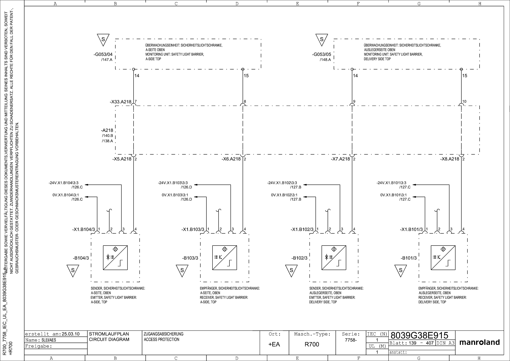

# +EA — Sheet 139 of 407 — ZUGANGSABSICHERUNG

**ACCESS PROTECTION**

> Part of the manroland **R700** printing press IEC/UL circuit diagrams.
> Drawing class: **Stromlaufplan / Circuit diagram** (DIN A3).
> Document `+EA` covers the **Printing unit** machine section.

## At a glance

| Field | Value |
|---|---|
| Document | `+EA`  (8039G38E915) |
| Sheet | **139** of 407 |
| Section (DE) | ZUGANGSABSICHERUNG |
| Section (EN) | ACCESS PROTECTION |
| Section type | CIRCUIT — Circuit diagram |
| Machine type | `R700` |
| Series | `7758` |
| Created | 25.03.10 |
| Replaces | — |
| Columns used | A, B, C, D, E, F, G, H |
| Path numbers | — |
| Labels on sheet | 94 |
| Cross-refs out | 12 |
| Cross-refs in | 36 |

**Previous:** [+EA sheet 138](SHEET_0138.md) · **Next:** [+EA sheet 140](SHEET_0140.md) · **Document TOC:** [_TOC.md](_TOC.md)  (+EA) · **Master TOC:** [all sheets](../_MASTER_TOC.md)

## Sheet image (300 DPI, exact vector render)



_Rendered directly from the PDF vector layer at 300 DPI (1-bit), no OCR and no resampling. Use it to confirm anything ambiguous in the text below._

## Cross-references on this sheet

Each entry is a wire leaving this sheet. The printed token is `/sheet.column`; the link resolves to that sheet inside the same document.

| Ref | Target sheet | Col | Path | Destination on target | Target section | From col |
|---|---|---|---|---|---|---|
| `/147.A` | [+EA sheet 147](SHEET_0147.md) | A | — | — | ZUGANGSABSICHERUNG | B |
| `/148.A` | [+EA sheet 148](SHEET_0148.md) | A | — | — | ZUGANGSABSICHERUNG | E |
| `/140.B` | [+EA sheet 140](SHEET_0140.md) | B | — | — | ZUGANGSABSICHERUNG | B |
| `/138.A` | [+EA sheet 138](SHEET_0138.md) | A | — | — | ZUGANGSABSICHERUNG | B |
| `/126.C` | [+EA sheet 126](SHEET_0126.md) | C | — | 24V.X1.B104\3:3 | ZUGANGSABSICHERUNG | A |
| `/127.B` | [+EA sheet 127](SHEET_0127.md) | B | — | 24V.X1.B103\3:3 24V.X1.B102\3:3 | ZUGANGSABSICHERUNG | D |
| `/126.D` | [+EA sheet 126](SHEET_0126.md) | D | — | 24V.X1.B103\3:3 24V.X1.B102\3:3 | ZUGANGSABSICHERUNG | D |
| `/127.C` | [+EA sheet 127](SHEET_0127.md) | C | — | 24V.X1.B101\3:3 | ZUGANGSABSICHERUNG | G |
| `/127.B` | [+EA sheet 127](SHEET_0127.md) | B | — | 0V.X1.B104\3:1 0V.X1.B103\3:1 0V.X1.B102\3:1 0V.X1.B101\3:1 | ZUGANGSABSICHERUNG | D |
| `/126.C` | [+EA sheet 126](SHEET_0126.md) | C | — | 0V.X1.B104\3:1 0V.X1.B103\3:1 0V.X1.B102\3:1 0V.X1.B101\3:1 | ZUGANGSABSICHERUNG | D |
| `/126.D` | [+EA sheet 126](SHEET_0126.md) | D | — | 0V.X1.B104\3:1 0V.X1.B103\3:1 0V.X1.B102\3:1 0V.X1.B101\3:1 | ZUGANGSABSICHERUNG | D |
| `/127.C` | [+EA sheet 127](SHEET_0127.md) | C | — | 0V.X1.B104\3:1 0V.X1.B103\3:1 0V.X1.B102\3:1 0V.X1.B101\3:1 | ZUGANGSABSICHERUNG | D |

### Incoming references (sheets that point here)

Every other sheet that sends a wire to this one. `Back-ref` is the token printed on *that* sheet; `Path` is its line number.

| From sheet | Cols | Back-ref | Path | Refs | What continues there |
|---|---|---|---|---|---|
| [+EA#126](SHEET_0126.md) | C, D | `/126.C`, `/126.D` | — | 4 | 24V.X1.B103\3:3; 24V.X1.B104\3:3 |
| [+EA#127](SHEET_0127.md) | B, C | `/127.B`, `/127.C` | — | 4 | 24V.X1.B101\3:3; 24V.X1.B102\3:3 |
| [+EA#138](SHEET_0138.md) | A | `/138.A` | — | 1 | — |
| [+EA#140](SHEET_0140.md) | B | `/140.B` | — | 1 | — |
| [+EA#147](SHEET_0147.md) | A | `/147.A` | — | 1 | — |
| [+EA#148](SHEET_0148.md) | A | `/148.A` | — | 1 | — |
| [+EA#214](SHEET_0214.md) | H | `/214.H` | — | 4 | — |
| [+EA#215](SHEET_0215.md) | A, C, D | `/215.A`, `/215.C`, `/215.D` | — | 12 | — |
| [+EA#238](SHEET_0238.md) | G | `/238.G` | — | 1 | — |
| [+EA#244](SHEET_0244.md) | A | `/244.A` | — | 1 | — |
| [+EA#246](SHEET_0246.md) | C | `/246.C` | — | 1 | — |
| [+EA#249](SHEET_0249.md) | A | `/249.A` | — | 1 | — |
| [+EA#277](SHEET_0277.md) | A | `/277.A` | — | 4 | — |


## Devices on this sheet

| Tag | Class | Class meaning (IEC) | Col | Sub | Terminal | Sign |
|---|---|---|---|---|---|---|
| `B104/3` | B | Umformer / transducer, sensor | A | 3 | — | — |
| `B103/3` | B | Umformer / transducer, sensor | C | 3 | — | — |
| `B102/3` | B | Umformer / transducer, sensor | E | 3 | — | — |
| `B101/3` | B | Umformer / transducer, sensor | G | 3 | — | — |
| `A218` | A | Baugruppe / assembly, module, PC board | B | — | — | — |
| `G053/04` | G | Stromversorgung / power supply | B | 04 | — | — |
| `G053/05` | G | Stromversorgung / power supply | E | 05 | — | — |
| `X5.A218` | — | cross-device reference | B | — | — | — |
| `X33.A218` | — | cross-device reference | B | — | — | — |
| `X6.A218` | — | cross-device reference | D | — | — | — |
| `X7.A218` | — | cross-device reference | F | — | — | — |
| `X8.A218` | — | cross-device reference | H | — | — | — |

## Potentials / nets

| Potential | Count | Columns | Attached devices | Terminals |
|---|---|---|---|---|
| `0V` | 4 | A, C, E, G | `B101\3`, `B102\3`, `B103\3`, `B104\3`, `X1` | `1` |
| `24V` | 4 | A, C, E, G | `B101\3`, `B102\3`, `B103\3`, `B104\3`, `X1` | `3` |


A potential such as `L24+/4` or `M24+` is a named supply/return rail; every place it appears on this sheet is electrically common.

## Wire-end annotations (grouped as printed)

A wire that continues elsewhere is annotated with a small cluster: the destination description, the path/line number `#NN`, and the `/sheet.column` cross reference. Each row below is one such cluster exactly as it is grouped on the drawing.

| Col | Y | Path | Cross-ref | Text on the wire |
|---|---|---|---|---|
| D | 86.1 | — | — | `S S` |
| C | 102.7 | — | — | `ÜBERWACHUNGSEINHEIT: SICHERHEITSLICHTSCHRANKE,` |
| G | 102.7 | — | — | `ÜBERWACHUNGSEINHEIT: SICHERHEITSLICHTSCHRANKE,` |
| C | 113.3 | — | — | `MONITORING UNIT: SAFETY LIGHT BARRIER, A SEITE OBEN` |
| G | 113.3 | — | — | `DELIVERY SIDE TOP MONITORING UNIT: SAFETY LIGHT BARRIER, AUSLEGERSEITE OBEN` |
| B | 122.2 | — | — | `G053/04` |
| E | 122.2 | — | — | `G053/05` |
| C | 134.6 | — | — | `A SIDE TOP` |
| B | 135.3 | — | `/147.A` | — |
| E | 135.3 | — | `/148.A` | — |
| B | 171.8 | — | — | `14` |
| E | 171.8 | — | — | `15 14` |
| H | 171.8 | — | — | `15` |
| B | 232.8 | — | — | `X33.A218 7` |
| D | 232.8 | — | — | `8` |
| F | 232.8 | — | — | `9` |
| H | 232.8 | — | — | `10` |
| B | 299.4 | — | — | `A218` |
| B | 312.4 | — | `/140.B`, `/138.A` | — |
| B | 366.0 | — | — | `X5.A218 2` |
| D | 366.0 | — | — | `X6.A218 2` |
| F | 366.0 | — | — | `X7.A218 2` |
| H | 366.0 | — | — | `X8.A218 2` |
| A | 422.6 | — | `/126.C` | `24V.X1.B104\3:3` |
| D | 422.6 | — | `/127.B`, `/126.D` | `24V.X1.B103\3:3 24V.X1.B102\3:3` |
| G | 422.6 | — | `/127.C` | `24V.X1.B101\3:3` |
| D | 451.0 | — | `/127.B`, `/126.C`, `/126.D`, `/127.C` | `0V.X1.B104\3:1 0V.X1.B103\3:1 0V.X1.B102\3:1 0V.X1.B101\3:1` |
| B | 530.4 | — | — | `X1.B104/3 1 2 3 4` |
| D | 530.4 | — | — | `X1.B103/3 1 2 3 4` |
| E | 530.4 | — | — | `X1.B102/3 1 2 3 4` |
| G | 530.4 | — | — | `X1.B101/3 1 2 3 4` |
| A | 597.0 | — | — | `B104/3` |
| C | 597.0 | — | — | `B103/3` |
| E | 597.0 | — | — | `B102/3` |
| G | 597.0 | — | — | `B101/3` |
| D | 624.7 | — | — | `S S S S` |
| B | 669.6 | — | — | `EMITTER, SAFETY LIGHT BARRIER: SENDER, SICHERHEITSLICHTSCHRANKE: A SEITE, OBEN` |
| D | 669.6 | — | — | `EMPFÄNGER, SICHERHEITSLICHTSCHRANKE:` |
| F | 669.6 | — | — | `EMITTER, SAFETY LIGHT BARRIER: DELIVERY SIDE, TOP SENDER, SICHERHEITSLICHTSCHRANKE: AUSLEGERSEITE, OBEN` |
| G | 669.6 | — | — | `EMPFÄNGER, SICHERHEITSLICHTSCHRANKE:` |
| D | 680.2 | — | — | `RECEIVER, SAFETY LIGHT BARRIER: A SEITE, OBEN` |
| G | 680.2 | — | — | `RECEIVER, SAFETY LIGHT BARRIER: DELIVERY SIDE, TOP AUSLEGERSEITE, OBEN` |
| B | 701.5 | — | — | `A SIDE, TOP` |
| D | 701.5 | — | — | `A SIDE, TOP` |


## Reconstructed tables

This sheet carries tabular content (pin map / terminal assignment / index). The grid below was rebuilt from the drawing's own rule lines, so each row is exactly one physical row of the table.

### Table 1 — 5 data rows × 30 columns (at x=204.1, y=0.0) — **G053/04 S /147.A A218 /140.B /138.A X33.A218 X5.A218 14 7 2 ÜBERWACHUNGSEINHEIT: SICHERHEITSLICHTSCHRANKE, A SEITE OBEN MONITORING UNIT: SAFETY LIGHT BARRIER, A SIDE TOP 24V.X1.B103\3:3 X6.A218 15 8 2 24V.X1.B102\3:3 S G053/05 /148.A X7.A218 14 9 2 ÜBERWACHUNGSEINHEIT: AUSLEGERSEITE MONITORING UNIT: DELIVERY SIDE TOP SICHERHEITSLICHTSCHRANKE, OBEN SAFETY LIGHT BARRIER, 24V.X1.B101\3:3 X8.A218 1 2 3 4 /126.D 0V.X1.B103\3:1 /126.D X1.B103/3 0V.X1.B102\3:1 /127.B /127.B X1.B102/3 /127.C 0V.X1.B101\3:1 /127.C X1.B101/3 B103/3 B102/3 B101/3 SENDER, A SEITE, EMITTER, A SIDE, OBEN TOP SAFETY LIGHT SICHERHEITSLICHTSCHRANKE: BARRIER: S A SEITE, A SIDE, EMPFÄNGER, RECEIVER, SICHERHEITSLICHTSCHRANKE: BARRIER: S SENDER, EMITTER, AUSLEGERSEITE, DELIVERY SIDE, SAFETY TOP OBEN LIGHT S EMPFÄNGER, AUSLEGERSEITE, RECEIVER, DELIVERY OBEN SAFETY LIGHT TOP**

|  |  | STROMLAUFPLAN |  |  |  |  | ZUGANGSABSICHERUNG |  |  |  |  |  |  | Ort: | Masch. Type: |  |  |  |  |  | Serie: |  | IEC (N) | 8039G38E915 |  |  |  |  |  |
|---|---|---|---|---|---|---|---|---|---|---|---|---|---|---|---|---|---|---|---|---|---|---|---|---|---|---|---|---|---|
|  | `CIRCUIT` |  | `DIAGRAM` |  |  |  |  |  |  |  |  |  |  |  |  |  |  |  |  |  |  |  |  |  |  |  |  |  |  |
|  |  |  |  |  |  |  | `ACCESS PROTECTION` |  |  |  |  |  |  |  |  |  |  |  |  |  | `7758` |  | `1` |  |  |  |  |  |  |
|  |  |  |  |  |  |  |  |  |  |  |  |  |  | `+EA` | `R700` |  |  |  |  |  |  |  |  | `Blatt: 139` | `407` |  | `DIN` | `A3` |  |
|  |  |  |  |  |  |  |  |  |  |  |  |  |  |  |  |  |  |  |  |  |  |  | `UL (M)` |  |  |  |  |  |  |
|  |  |  |  |  |  |  |  |  |  |  |  |  |  |  |  |  |  |  |  |  |  |  | `1` | `anstatt:` |  |  |  |  |  |


## Notes and free text on this sheet

| Text | Col | Y (pt) |
|---|---|---|
| `SENDER, SICHERHEITSLICHTSCHRANKE:` | B | 669.61 |
| `A SEITE, OBEN` | B | 680.2 |
| `EMITTER, SAFETY LIGHT BARRIER:` | B | 690.85 |
| `A SIDE, TOP` | B | 701.48 |
| `X1.B104/3` | A | 530.39 |
| `EMPFÄNGER, SICHERHEITSLICHTSCHRANKE:` | D | 669.6 |
| `A SEITE, OBEN` | D | 680.2 |
| `RECEIVER, SAFETY LIGHT BARRIER:` | D | 690.85 |
| `A SIDE, TOP` | D | 701.48 |
| `X1.B103/3` | C | 530.39 |
| `SENDER, SICHERHEITSLICHTSCHRANKE:` | F | 669.61 |
| `AUSLEGERSEITE, OBEN` | E | 680.22 |
| `EMITTER, SAFETY LIGHT BARRIER:` | F | 690.85 |
| `DELIVERY SIDE, TOP` | E | 701.48 |
| `X1.B102/3` | E | 530.39 |
| `EMPFÄNGER, SICHERHEITSLICHTSCHRANKE:` | G | 669.6 |
| `AUSLEGERSEITE, OBEN` | G | 680.22 |
| `RECEIVER, SAFETY LIGHT BARRIER:` | G | 690.85 |
| `DELIVERY SIDE, TOP` | G | 701.48 |
| `X1.B101/3` | G | 530.39 |
| `ÜBERWACHUNGSEINHEIT: SICHERHEITSLICHTSCHRANKE,` | C | 102.67 |
| `A SEITE OBEN` | C | 113.28 |
| `MONITORING UNIT: SAFETY LIGHT BARRIER,` | C | 123.94 |
| `A SIDE TOP` | C | 134.56 |
| `ÜBERWACHUNGSEINHEIT: SICHERHEITSLICHTSCHRANKE,` | G | 102.67 |
| `AUSLEGERSEITE OBEN` | F | 113.29 |
| `MONITORING UNIT: SAFETY LIGHT BARRIER,` | G | 123.94 |
| `DELIVERY SIDE TOP` | F | 134.55 |
| `S` | A | 624.71 |
| `S` | C | 624.71 |
| `S` | E | 624.71 |
| `S` | G | 624.71 |
| `S` | B | 86.13 |

## Complete label inventory (exact text from the drawing)

Every text object inside the drawing area of this sheet, in DIN reading order (column A→H, then top→bottom). This is the authoritative list: if a string is not here it is not printed on this sheet.

| Col | Y | X | Dir | Type | Text |
|---|---|---|---|---|---|
| A | 422.6 | 113.7 | → | potential | `24V.X1.B104\3:3` |
| A | 432.6 | 167.2 | → | cross-reference | `/126.C` |
| A | 451.0 | 122.7 | → | potential | `0V.X1.B104\3:1` |
| A | 460.9 | 167.2 | → | cross-reference | `/126.C` |
| A | 530.4 | 168.7 | → | text | `X1.B104/3` |
| A | 597.0 | 170.4 | → | device tag | `B104/3` |
| A | 624.7 | 166.0 | → | text | `S` |
| B | 86.1 | 236.8 | → | text | `S` |
| B | 122.2 | 218.6 | → | device tag | `G053/04` |
| B | 135.3 | 236.7 | → | cross-reference | `/147.A` |
| B | 171.8 | 313.5 | → | number | `14` |
| B | 232.7 | 256.5 | → | device ref | `X33.A218` |
| B | 232.8 | 314.4 | → | number | `7` |
| B | 299.4 | 235.8 | → | device tag | `A218` |
| B | 312.4 | 238.4 | → | cross-reference | `/140.B` |
| B | 324.8 | 238.1 | → | cross-reference | `/138.A` |
| B | 366.0 | 262.5 | → | device ref | `X5.A218` |
| B | 367.4 | 314.4 | → | number | `2` |
| B | 530.4 | 228.8 | → | number | `1` |
| B | 530.4 | 257.7 | → | number | `2` |
| B | 530.4 | 286.0 | → | number | `3` |
| B | 530.4 | 314.4 | → | number | `4` |
| B | 669.6 | 212.3 | → | text | `SENDER, SICHERHEITSLICHTSCHRANKE:` |
| B | 680.2 | 212.6 | → | text | `A SEITE, OBEN` |
| B | 690.9 | 211.7 | → | text | `EMITTER, SAFETY LIGHT BARRIER:` |
| B | 701.5 | 212.6 | → | text | `A SIDE, TOP` |
| C | 102.7 | 339.3 | → | text | `ÜBERWACHUNGSEINHEIT: SICHERHEITSLICHTSCHRANKE,` |
| C | 113.3 | 340.2 | → | text | `A SEITE OBEN` |
| C | 123.9 | 339.6 | → | text | `MONITORING UNIT: SAFETY LIGHT BARRIER,` |
| C | 134.6 | 340.2 | → | text | `A SIDE TOP` |
| C | 422.6 | 368.8 | → | potential | `24V.X1.B103\3:3` |
| C | 432.6 | 422.4 | → | cross-reference | `/126.D` |
| C | 451.0 | 377.9 | → | potential | `0V.X1.B103\3:1` |
| C | 460.9 | 422.4 | → | cross-reference | `/126.D` |
| C | 530.4 | 423.8 | → | text | `X1.B103/3` |
| C | 597.0 | 425.5 | → | device tag | `B103/3` |
| C | 624.7 | 421.1 | → | text | `S` |
| D | 171.8 | 568.6 | → | number | `15` |
| D | 232.8 | 569.5 | → | number | `8` |
| D | 366.0 | 517.6 | → | device ref | `X6.A218` |
| D | 367.4 | 569.5 | → | number | `2` |
| D | 530.4 | 483.9 | → | number | `1` |
| D | 530.4 | 512.8 | → | number | `2` |
| D | 530.4 | 541.1 | → | number | `3` |
| D | 530.4 | 569.5 | → | number | `4` |
| D | 669.6 | 466.9 | → | text | `EMPFÄNGER, SICHERHEITSLICHTSCHRANKE:` |
| D | 680.2 | 467.7 | → | text | `A SEITE, OBEN` |
| D | 690.9 | 466.9 | → | text | `RECEIVER, SAFETY LIGHT BARRIER:` |
| D | 701.5 | 467.7 | → | text | `A SIDE, TOP` |
| E | 86.1 | 747.1 | → | text | `S` |
| E | 122.2 | 728.8 | → | device tag | `G053/05` |
| E | 135.3 | 746.9 | → | cross-reference | `/148.A` |
| E | 422.6 | 623.9 | → | potential | `24V.X1.B102\3:3` |
| E | 432.5 | 677.8 | → | cross-reference | `/127.B` |
| E | 451.0 | 633.0 | → | potential | `0V.X1.B102\3:1` |
| E | 460.9 | 677.8 | → | cross-reference | `/127.B` |
| E | 530.4 | 678.9 | → | text | `X1.B102/3` |
| E | 530.4 | 739.0 | → | number | `1` |
| E | 597.0 | 680.6 | → | device tag | `B102/3` |
| E | 624.7 | 676.2 | → | text | `S` |
| E | 680.2 | 722.8 | → | text | `AUSLEGERSEITE, OBEN` |
| E | 701.5 | 722.0 | → | text | `DELIVERY SIDE, TOP` |
| F | 113.3 | 850.4 | → | text | `AUSLEGERSEITE OBEN` |
| F | 134.5 | 849.5 | → | text | `DELIVERY SIDE TOP` |
| F | 171.8 | 823.7 | → | number | `14` |
| F | 232.8 | 824.6 | → | number | `9` |
| F | 366.0 | 772.7 | → | device ref | `X7.A218` |
| F | 367.4 | 824.6 | → | number | `2` |
| F | 530.4 | 767.9 | → | number | `2` |
| F | 530.4 | 796.3 | → | number | `3` |
| F | 530.4 | 824.6 | → | number | `4` |
| F | 669.6 | 722.6 | → | text | `SENDER, SICHERHEITSLICHTSCHRANKE:` |
| F | 690.9 | 722.0 | → | text | `EMITTER, SAFETY LIGHT BARRIER:` |
| G | 102.7 | 849.5 | → | text | `ÜBERWACHUNGSEINHEIT: SICHERHEITSLICHTSCHRANKE,` |
| G | 123.9 | 849.8 | → | text | `MONITORING UNIT: SAFETY LIGHT BARRIER,` |
| G | 422.6 | 879.0 | → | potential | `24V.X1.B101\3:3` |
| G | 432.6 | 932.6 | → | cross-reference | `/127.C` |
| G | 451.0 | 888.1 | → | potential | `0V.X1.B101\3:1` |
| G | 460.9 | 932.6 | → | cross-reference | `/127.C` |
| G | 530.4 | 934.0 | → | text | `X1.B101/3` |
| G | 530.4 | 994.1 | → | number | `1` |
| G | 530.4 | 1023.0 | → | number | `2` |
| G | 597.0 | 935.7 | → | device tag | `B101/3` |
| G | 624.7 | 931.3 | → | text | `S` |
| G | 669.6 | 977.1 | → | text | `EMPFÄNGER, SICHERHEITSLICHTSCHRANKE:` |
| G | 680.2 | 978.0 | → | text | `AUSLEGERSEITE, OBEN` |
| G | 690.9 | 977.1 | → | text | `RECEIVER, SAFETY LIGHT BARRIER:` |
| G | 701.5 | 977.1 | → | text | `DELIVERY SIDE, TOP` |
| H | 171.8 | 1078.9 | → | number | `15` |
| H | 232.8 | 1079.1 | → | number | `10` |
| H | 366.0 | 1027.8 | → | device ref | `X8.A218` |
| H | 367.4 | 1079.7 | → | number | `2` |
| H | 530.4 | 1051.4 | → | number | `3` |
| H | 530.4 | 1079.7 | → | number | `4` |

## Reading-order text block

The same content as a plain block, grouped by DIN column — convenient to paste or to match against a visual description.

```text
=== Column A ===
 422.6  113.7  net          24V.X1.B104\3:3
 432.6  167.2  xref         /126.C
 451.0  122.7  net          0V.X1.B104\3:1
 460.9  167.2  xref         /126.C
 530.4  168.7  text         X1.B104/3
 597.0  170.4  devtag       B104/3
 624.7  166.0  text         S
=== Column B ===
  86.1  236.8  text         S
 122.2  218.6  devtag       G053/04
 135.3  236.7  xref         /147.A
 171.8  313.5  numeric      14
 232.7  256.5  devref       X33.A218
 232.8  314.4  numeric      7
 299.4  235.8  devtag       A218
 312.4  238.4  xref         /140.B
 324.8  238.1  xref         /138.A
 366.0  262.5  devref       X5.A218
 367.4  314.4  numeric      2
 530.4  228.8  numeric      1
 530.4  257.7  numeric      2
 530.4  286.0  numeric      3
 530.4  314.4  numeric      4
 669.6  212.3  text         SENDER, SICHERHEITSLICHTSCHRANKE:
 680.2  212.6  text         A SEITE, OBEN
 690.9  211.7  text         EMITTER, SAFETY LIGHT BARRIER:
 701.5  212.6  text         A SIDE, TOP
=== Column C ===
 102.7  339.3  text         ÜBERWACHUNGSEINHEIT: SICHERHEITSLICHTSCHRANKE,
 113.3  340.2  text         A SEITE OBEN
 123.9  339.6  text         MONITORING UNIT: SAFETY LIGHT BARRIER,
 134.6  340.2  text         A SIDE TOP
 422.6  368.8  net          24V.X1.B103\3:3
 432.6  422.4  xref         /126.D
 451.0  377.9  net          0V.X1.B103\3:1
 460.9  422.4  xref         /126.D
 530.4  423.8  text         X1.B103/3
 597.0  425.5  devtag       B103/3
 624.7  421.1  text         S
=== Column D ===
 171.8  568.6  numeric      15
 232.8  569.5  numeric      8
 366.0  517.6  devref       X6.A218
 367.4  569.5  numeric      2
 530.4  483.9  numeric      1
 530.4  512.8  numeric      2
 530.4  541.1  numeric      3
 530.4  569.5  numeric      4
 669.6  466.9  text         EMPFÄNGER, SICHERHEITSLICHTSCHRANKE:
 680.2  467.7  text         A SEITE, OBEN
 690.9  466.9  text         RECEIVER, SAFETY LIGHT BARRIER:
 701.5  467.7  text         A SIDE, TOP
=== Column E ===
  86.1  747.1  text         S
 122.2  728.8  devtag       G053/05
 135.3  746.9  xref         /148.A
 422.6  623.9  net          24V.X1.B102\3:3
 432.5  677.8  xref         /127.B
 451.0  633.0  net          0V.X1.B102\3:1
 460.9  677.8  xref         /127.B
 530.4  678.9  text         X1.B102/3
 530.4  739.0  numeric      1
 597.0  680.6  devtag       B102/3
 624.7  676.2  text         S
 680.2  722.8  text         AUSLEGERSEITE, OBEN
 701.5  722.0  text         DELIVERY SIDE, TOP
=== Column F ===
 113.3  850.4  text         AUSLEGERSEITE OBEN
 134.5  849.5  text         DELIVERY SIDE TOP
 171.8  823.7  numeric      14
 232.8  824.6  numeric      9
 366.0  772.7  devref       X7.A218
 367.4  824.6  numeric      2
 530.4  767.9  numeric      2
 530.4  796.3  numeric      3
 530.4  824.6  numeric      4
 669.6  722.6  text         SENDER, SICHERHEITSLICHTSCHRANKE:
 690.9  722.0  text         EMITTER, SAFETY LIGHT BARRIER:
=== Column G ===
 102.7  849.5  text         ÜBERWACHUNGSEINHEIT: SICHERHEITSLICHTSCHRANKE,
 123.9  849.8  text         MONITORING UNIT: SAFETY LIGHT BARRIER,
 422.6  879.0  net          24V.X1.B101\3:3
 432.6  932.6  xref         /127.C
 451.0  888.1  net          0V.X1.B101\3:1
 460.9  932.6  xref         /127.C
 530.4  934.0  text         X1.B101/3
 530.4  994.1  numeric      1
 530.4 1023.0  numeric      2
 597.0  935.7  devtag       B101/3
 624.7  931.3  text         S
 669.6  977.1  text         EMPFÄNGER, SICHERHEITSLICHTSCHRANKE:
 680.2  978.0  text         AUSLEGERSEITE, OBEN
 690.9  977.1  text         RECEIVER, SAFETY LIGHT BARRIER:
 701.5  977.1  text         DELIVERY SIDE, TOP
=== Column H ===
 171.8 1078.9  numeric      15
 232.8 1079.1  numeric      10
 366.0 1027.8  devref       X8.A218
 367.4 1079.7  numeric      2
 530.4 1051.4  numeric      3
 530.4 1079.7  numeric      4
```

---
_Generated from the PDF vector text layer; no OCR. Source: `R700_7758_IEC_UL_EA_8039G38E915_p`, sheet 139._
