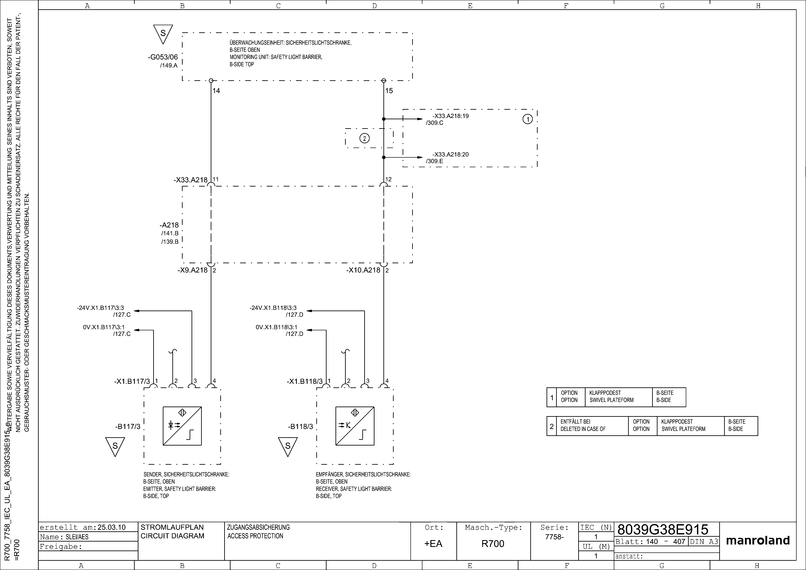

# +EA — Sheet 140 of 407 — ZUGANGSABSICHERUNG

**ACCESS PROTECTION**

> Part of the manroland **R700** printing press IEC/UL circuit diagrams.
> Drawing class: **Stromlaufplan / Circuit diagram** (DIN A3).
> Document `+EA` covers the **Printing unit** machine section.

## At a glance

| Field | Value |
|---|---|
| Document | `+EA`  (8039G38E915) |
| Sheet | **140** of 407 |
| Section (DE) | ZUGANGSABSICHERUNG |
| Section (EN) | ACCESS PROTECTION |
| Section type | CIRCUIT — Circuit diagram |
| Machine type | `R700` |
| Series | `7758` |
| Created | 25.03.10 |
| Replaces | — |
| Columns used | A, B, C, D, E, F, G, H |
| Path numbers | — |
| Labels on sheet | 71 |
| Cross-refs out | 9 |
| Cross-refs in | 21 |

**Previous:** [+EA sheet 139](SHEET_0139.md) · **Next:** [+EA sheet 141](SHEET_0141.md) · **Document TOC:** [_TOC.md](_TOC.md)  (+EA) · **Master TOC:** [all sheets](../_MASTER_TOC.md)

## Sheet image (300 DPI, exact vector render)



_Rendered directly from the PDF vector layer at 300 DPI (1-bit), no OCR and no resampling. Use it to confirm anything ambiguous in the text below._

## Cross-references on this sheet

Each entry is a wire leaving this sheet. The printed token is `/sheet.column`; the link resolves to that sheet inside the same document.

| Ref | Target sheet | Col | Path | Destination on target | Target section | From col |
|---|---|---|---|---|---|---|
| `/149.A` | [+EA sheet 149](SHEET_0149.md) | A | — | — | ZUGANGSABSICHERUNG | B |
| `/309.C` | [+EA sheet 309](SHEET_0309.md) | C | — | — | OPTION: KLAPPPODEST B SEITE | E |
| `/309.E` | [+EA sheet 309](SHEET_0309.md) | E | — | — | OPTION: KLAPPPODEST B SEITE | E |
| `/141.B` | [+EA sheet 141](SHEET_0141.md) | B | — | — | ZUGANGSABSICHERUNG | B |
| `/139.B` | [+EA sheet 139](SHEET_0139.md) | B | — | — | ZUGANGSABSICHERUNG | B |
| `/127.C` | [+EA sheet 127](SHEET_0127.md) | C | — | 24V.X1.B117\3:3 24V.X1.B118\3:3 | ZUGANGSABSICHERUNG | B |
| `/127.D` | [+EA sheet 127](SHEET_0127.md) | D | — | 24V.X1.B117\3:3 24V.X1.B118\3:3 | ZUGANGSABSICHERUNG | B |
| `/127.C` | [+EA sheet 127](SHEET_0127.md) | C | — | 0V.X1.B117\3:1 0V.X1.B118\3:1 | ZUGANGSABSICHERUNG | B |
| `/127.D` | [+EA sheet 127](SHEET_0127.md) | D | — | 0V.X1.B117\3:1 0V.X1.B118\3:1 | ZUGANGSABSICHERUNG | B |

### Incoming references (sheets that point here)

Every other sheet that sends a wire to this one. `Back-ref` is the token printed on *that* sheet; `Path` is its line number.

| From sheet | Cols | Back-ref | Path | Refs | What continues there |
|---|---|---|---|---|---|
| [+EA#127](SHEET_0127.md) | C, D | `/127.C`, `/127.D` | — | 4 | 24V.X1.B117\3:3; 24V.X1.B118\3:3 |
| [+EA#139](SHEET_0139.md) | B | `/139.B` | — | 1 | — |
| [+EA#141](SHEET_0141.md) | B | `/141.B` | — | 1 | — |
| [+EA#149](SHEET_0149.md) | A | `/149.A` | — | 1 | — |
| [+EA#215](SHEET_0215.md) | F | `/215.F` | — | 4 | — |
| [+EA#216](SHEET_0216.md) | A | `/216.A` | — | 4 | — |
| [+EA#251](SHEET_0251.md) | E | `/251.E` | — | 1 | — |
| [+EA#253](SHEET_0253.md) | G | `/253.G` | — | 1 | — |
| [+EA#277](SHEET_0277.md) | A | `/277.A` | — | 2 | — |
| [+EA#309](SHEET_0309.md) | C | `/309.C` | — | 2 | X33.A218:19 X33.A218:20 |


## Devices on this sheet

| Tag | Class | Class meaning (IEC) | Col | Sub | Terminal | Sign |
|---|---|---|---|---|---|---|
| `B117/3` | B | Umformer / transducer, sensor | A | 3 | — | — |
| `B118/3` | B | Umformer / transducer, sensor | C | 3 | — | — |
| `A218` | A | Baugruppe / assembly, module, PC board | B | — | — | — |
| `G053/06` | G | Stromversorgung / power supply | B | 06 | — | — |
| `X9.A218` | — | cross-device reference | B | — | — | — |
| `X33.A218` | — | cross-device reference | B | — | — | — |
| `X10.A218` | — | cross-device reference | D | — | — | — |
| `X33.A218:20` | — | cross-device reference | E | — | 20 | — |
| `X33.A218:19` | — | cross-device reference | E | — | 19 | — |

## Potentials / nets

| Potential | Count | Columns | Attached devices | Terminals |
|---|---|---|---|---|
| `0V` | 2 | A, C | `B117\3`, `B118\3`, `X1` | `1` |
| `24V` | 2 | A, C | `B117\3`, `B118\3`, `X1` | `3` |


A potential such as `L24+/4` or `M24+` is a named supply/return rail; every place it appears on this sheet is electrically common.

## Wire-end annotations (grouped as printed)

A wire that continues elsewhere is annotated with a small cluster: the destination description, the path/line number `#NN`, and the `/sheet.column` cross reference. Each row below is one such cluster exactly as it is grouped on the drawing.

| Col | Y | Path | Cross-ref | Text on the wire |
|---|---|---|---|---|
| B | 43.6 | — | — | `S` |
| C | 60.1 | — | — | `ÜBERWACHUNGSEINHEIT: SICHERHEITSLICHTSCHRANKE, B SEITE OBEN B SIDE TOP MONITORING UNIT: SAFETY LIGHT BARRIER,` |
| B | 79.7 | — | — | `G053/06` |
| B | 92.7 | — | `/149.A` | — |
| B | 129.2 | — | — | `14` |
| D | 129.2 | — | — | `15` |
| E | 167.5 | — | — | `X33.A218:19` |
| F | 172.7 | — | — | `1` |
| E | 177.5 | — | `/309.C` | — |
| D | 201.6 | — | — | `2` |
| E | 224.2 | — | — | `X33.A218:20` |
| E | 234.1 | — | `/309.E` | — |
| B | 261.1 | — | — | `X33.A218 11` |
| D | 261.1 | — | — | `12` |
| B | 327.7 | — | — | `A218` |
| B | 340.8 | — | `/141.B`, `/139.B` | — |
| B | 394.3 | — | — | `X9.A218 2` |
| D | 394.3 | — | — | `X10.A218 2` |
| B | 451.0 | — | `/127.C`, `/127.D` | `24V.X1.B117\3:3 24V.X1.B118\3:3` |
| B | 479.3 | — | `/127.C`, `/127.D` | `0V.X1.B117\3:1 0V.X1.B118\3:1` |
| B | 558.7 | — | — | `X1.B117/3 1 2 3 4` |
| D | 558.7 | — | — | `X1.B118/3 1 2 3 4` |
| G | 577.4 | — | — | `B SEITE B SIDE` |
| F | 577.5 | — | — | `1 OPTION OPTION` |
| F | 577.5 | — | — | `KLAPPPODEST` |
| F | 588.1 | — | — | `SWIVEL PLATEFORM` |
| H | 619.9 | — | — | `B SEITE B SIDE` |
| F | 620.0 | — | — | `2 ENTFÄLLT BEI DELETED IN CASE OF` |
| G | 620.0 | — | — | `OPTION OPTION` |
| G | 620.0 | — | — | `KLAPPPODEST` |
| A | 625.4 | — | — | `B117/3` |
| C | 625.4 | — | — | `B118/3` |
| G | 630.6 | — | — | `SWIVEL PLATEFORM` |
| B | 653.1 | — | — | `S S` |
| B | 698.0 | — | — | `B SEITE, OBEN EMITTER, SAFETY LIGHT BARRIER: B SIDE, TOP SENDER, SICHERHEITSLICHTSCHRANKE:` |
| D | 698.0 | — | — | `EMPFÄNGER, SICHERHEITSLICHTSCHRANKE: B SEITE, OBEN RECEIVER, SAFETY LIGHT BARRIER: B SIDE, TOP` |


## Reconstructed tables

This sheet carries tabular content (pin map / terminal assignment / index). The grid below was rebuilt from the drawing's own rule lines, so each row is exactly one physical row of the table.

### Table 1 — 0 data rows × 2 columns (at x=510.2, y=175.7) — **2 X10.A218**

_none_


## Notes and free text on this sheet

| Text | Col | Y (pt) |
|---|---|---|
| `SENDER, SICHERHEITSLICHTSCHRANKE:` | B | 697.95 |
| `B SEITE, OBEN` | B | 708.54 |
| `EMITTER, SAFETY LIGHT BARRIER:` | B | 719.2 |
| `B SIDE, TOP` | B | 729.81 |
| `X1.B117/3` | A | 558.74 |
| `EMPFÄNGER, SICHERHEITSLICHTSCHRANKE:` | D | 697.95 |
| `B SEITE, OBEN` | D | 708.54 |
| `RECEIVER, SAFETY LIGHT BARRIER:` | D | 719.2 |
| `B SIDE, TOP` | D | 729.81 |
| `X1.B118/3` | C | 558.74 |
| `ÜBERWACHUNGSEINHEIT: SICHERHEITSLICHTSCHRANKE,` | C | 60.15 |
| `B SEITE OBEN` | C | 70.74 |
| `MONITORING UNIT: SAFETY LIGHT BARRIER,` | C | 81.42 |
| `B SIDE TOP` | C | 92.02 |
| `S` | A | 653.06 |
| `S` | C | 653.06 |
| `OPTION` | F | 577.45 |
| `KLAPPPODEST` | F | 577.45 |
| `SWIVEL PLATEFORM` | F | 588.08 |
| `B SEITE` | G | 577.41 |
| `B SIDE` | G | 588.05 |
| `ENTFÄLLT BEI` | F | 619.96 |
| `DELETED IN CASE OF` | F | 630.61 |
| `OPTION` | G | 619.97 |
| `KLAPPPODEST` | G | 619.97 |
| `SWIVEL PLATEFORM` | G | 630.6 |
| `B SEITE` | H | 619.93 |
| `B SIDE` | H | 630.57 |
| `S` | B | 43.61 |

## Complete label inventory (exact text from the drawing)

Every text object inside the drawing area of this sheet, in DIN reading order (column A→H, then top→bottom). This is the authoritative list: if a string is not here it is not printed on this sheet.

| Col | Y | X | Dir | Type | Text |
|---|---|---|---|---|---|
| A | 451.0 | 113.7 | → | potential | `24V.X1.B117\3:3` |
| A | 460.9 | 167.2 | → | cross-reference | `/127.C` |
| A | 479.3 | 122.7 | → | potential | `0V.X1.B117\3:1` |
| A | 489.3 | 167.2 | → | cross-reference | `/127.C` |
| A | 558.7 | 168.7 | → | text | `X1.B117/3` |
| A | 625.3 | 170.4 | → | device tag | `B117/3` |
| A | 653.1 | 166.0 | → | text | `S` |
| B | 43.6 | 236.8 | → | text | `S` |
| B | 79.7 | 218.6 | → | device tag | `G053/06` |
| B | 92.7 | 236.7 | → | cross-reference | `/149.A` |
| B | 129.2 | 313.5 | → | number | `14` |
| B | 261.1 | 256.5 | → | device ref | `X33.A218` |
| B | 261.1 | 313.8 | → | number | `11` |
| B | 327.7 | 235.8 | → | device tag | `A218` |
| B | 340.8 | 238.4 | → | cross-reference | `/141.B` |
| B | 353.2 | 238.4 | → | cross-reference | `/139.B` |
| B | 394.3 | 262.5 | → | device ref | `X9.A218` |
| B | 395.8 | 314.4 | → | number | `2` |
| B | 558.7 | 228.8 | → | number | `1` |
| B | 558.7 | 257.7 | → | number | `2` |
| B | 558.7 | 286.0 | → | number | `3` |
| B | 558.7 | 314.4 | → | number | `4` |
| B | 698.0 | 212.3 | → | text | `SENDER, SICHERHEITSLICHTSCHRANKE:` |
| B | 708.5 | 211.7 | → | text | `B SEITE, OBEN` |
| B | 719.2 | 211.7 | → | text | `EMITTER, SAFETY LIGHT BARRIER:` |
| B | 729.8 | 211.7 | → | text | `B SIDE, TOP` |
| C | 60.1 | 339.3 | → | text | `ÜBERWACHUNGSEINHEIT: SICHERHEITSLICHTSCHRANKE,` |
| C | 70.7 | 339.3 | → | text | `B SEITE OBEN` |
| C | 81.4 | 339.6 | → | text | `MONITORING UNIT: SAFETY LIGHT BARRIER,` |
| C | 92.0 | 339.3 | → | text | `B SIDE TOP` |
| C | 451.0 | 368.8 | → | potential | `24V.X1.B118\3:3` |
| C | 460.9 | 422.4 | → | cross-reference | `/127.D` |
| C | 479.3 | 377.9 | → | potential | `0V.X1.B118\3:1` |
| C | 489.3 | 422.4 | → | cross-reference | `/127.D` |
| C | 558.7 | 423.8 | → | text | `X1.B118/3` |
| C | 625.3 | 425.5 | → | device tag | `B118/3` |
| C | 653.1 | 421.1 | → | text | `S` |
| D | 129.2 | 568.6 | → | number | `15` |
| D | 201.6 | 536.6 | → | number | `2` |
| D | 261.1 | 568.9 | → | number | `12` |
| D | 394.3 | 511.7 | → | device ref | `X10.A218` |
| D | 395.8 | 569.5 | → | number | `2` |
| D | 558.7 | 483.9 | → | number | `1` |
| D | 558.7 | 512.8 | → | number | `2` |
| D | 558.7 | 541.1 | → | number | `3` |
| D | 558.7 | 569.5 | → | number | `4` |
| D | 698.0 | 466.9 | → | text | `EMPFÄNGER, SICHERHEITSLICHTSCHRANKE:` |
| D | 708.5 | 466.9 | → | text | `B SEITE, OBEN` |
| D | 719.2 | 466.9 | → | text | `RECEIVER, SAFETY LIGHT BARRIER:` |
| D | 729.8 | 466.9 | → | text | `B SIDE, TOP` |
| E | 167.5 | 638.9 | → | device ref | `X33.A218:19` |
| E | 177.5 | 629.3 | → | cross-reference | `/309.C` |
| E | 224.2 | 638.9 | → | device ref | `X33.A218:20` |
| E | 234.1 | 629.3 | → | cross-reference | `/309.E` |
| F | 172.7 | 777.8 | → | number | `1` |
| F | 577.4 | 828.9 | → | text | `OPTION` |
| F | 577.5 | 870.8 | → | text | `KLAPPPODEST` |
| F | 582.8 | 812.4 | → | number | `1` |
| F | 588.1 | 828.9 | → | text | `OPTION` |
| F | 588.1 | 871.4 | → | text | `SWIVEL PLATEFORM` |
| F | 620.0 | 828.3 | → | text | `ENTFÄLLT BEI` |
| F | 625.3 | 812.1 | → | number | `2` |
| F | 630.6 | 828.3 | → | text | `DELETED IN CASE OF` |
| G | 577.4 | 970.0 | → | text | `B SEITE` |
| G | 588.0 | 970.0 | → | text | `B SIDE` |
| G | 620.0 | 935.1 | → | text | `OPTION` |
| G | 620.0 | 977.1 | → | text | `KLAPPPODEST` |
| G | 630.6 | 935.1 | → | text | `OPTION` |
| G | 630.6 | 977.7 | → | text | `SWIVEL PLATEFORM` |
| H | 619.9 | 1076.3 | → | text | `B SEITE` |
| H | 630.6 | 1076.3 | → | text | `B SIDE` |

## Reading-order text block

The same content as a plain block, grouped by DIN column — convenient to paste or to match against a visual description.

```text
=== Column A ===
 451.0  113.7  net          24V.X1.B117\3:3
 460.9  167.2  xref         /127.C
 479.3  122.7  net          0V.X1.B117\3:1
 489.3  167.2  xref         /127.C
 558.7  168.7  text         X1.B117/3
 625.3  170.4  devtag       B117/3
 653.1  166.0  text         S
=== Column B ===
  43.6  236.8  text         S
  79.7  218.6  devtag       G053/06
  92.7  236.7  xref         /149.A
 129.2  313.5  numeric      14
 261.1  256.5  devref       X33.A218
 261.1  313.8  numeric      11
 327.7  235.8  devtag       A218
 340.8  238.4  xref         /141.B
 353.2  238.4  xref         /139.B
 394.3  262.5  devref       X9.A218
 395.8  314.4  numeric      2
 558.7  228.8  numeric      1
 558.7  257.7  numeric      2
 558.7  286.0  numeric      3
 558.7  314.4  numeric      4
 698.0  212.3  text         SENDER, SICHERHEITSLICHTSCHRANKE:
 708.5  211.7  text         B SEITE, OBEN
 719.2  211.7  text         EMITTER, SAFETY LIGHT BARRIER:
 729.8  211.7  text         B SIDE, TOP
=== Column C ===
  60.1  339.3  text         ÜBERWACHUNGSEINHEIT: SICHERHEITSLICHTSCHRANKE,
  70.7  339.3  text         B SEITE OBEN
  81.4  339.6  text         MONITORING UNIT: SAFETY LIGHT BARRIER,
  92.0  339.3  text         B SIDE TOP
 451.0  368.8  net          24V.X1.B118\3:3
 460.9  422.4  xref         /127.D
 479.3  377.9  net          0V.X1.B118\3:1
 489.3  422.4  xref         /127.D
 558.7  423.8  text         X1.B118/3
 625.3  425.5  devtag       B118/3
 653.1  421.1  text         S
=== Column D ===
 129.2  568.6  numeric      15
 201.6  536.6  numeric      2
 261.1  568.9  numeric      12
 394.3  511.7  devref       X10.A218
 395.8  569.5  numeric      2
 558.7  483.9  numeric      1
 558.7  512.8  numeric      2
 558.7  541.1  numeric      3
 558.7  569.5  numeric      4
 698.0  466.9  text         EMPFÄNGER, SICHERHEITSLICHTSCHRANKE:
 708.5  466.9  text         B SEITE, OBEN
 719.2  466.9  text         RECEIVER, SAFETY LIGHT BARRIER:
 729.8  466.9  text         B SIDE, TOP
=== Column E ===
 167.5  638.9  devref       X33.A218:19
 177.5  629.3  xref         /309.C
 224.2  638.9  devref       X33.A218:20
 234.1  629.3  xref         /309.E
=== Column F ===
 172.7  777.8  numeric      1
 577.4  828.9  text         OPTION
 577.5  870.8  text         KLAPPPODEST
 582.8  812.4  numeric      1
 588.1  828.9  text         OPTION
 588.1  871.4  text         SWIVEL PLATEFORM
 620.0  828.3  text         ENTFÄLLT BEI
 625.3  812.1  numeric      2
 630.6  828.3  text         DELETED IN CASE OF
=== Column G ===
 577.4  970.0  text         B SEITE
 588.0  970.0  text         B SIDE
 620.0  935.1  text         OPTION
 620.0  977.1  text         KLAPPPODEST
 630.6  935.1  text         OPTION
 630.6  977.7  text         SWIVEL PLATEFORM
=== Column H ===
 619.9 1076.3  text         B SEITE
 630.6 1076.3  text         B SIDE
```

---
_Generated from the PDF vector text layer; no OCR. Source: `R700_7758_IEC_UL_EA_8039G38E915_p`, sheet 140._
