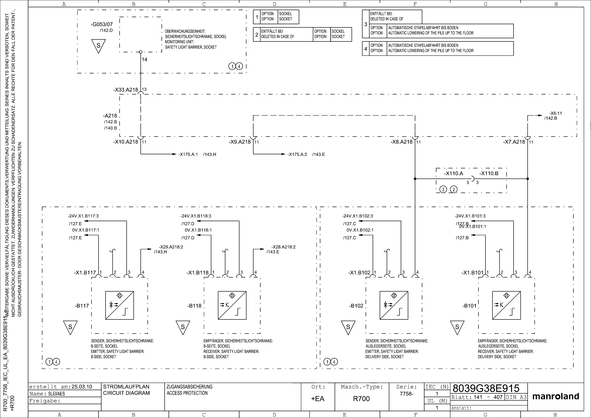

# +EA — Sheet 141 of 407 — ZUGANGSABSICHERUNG

**ACCESS PROTECTION**

> Part of the manroland **R700** printing press IEC/UL circuit diagrams.
> Drawing class: **Stromlaufplan / Circuit diagram** (DIN A3).
> Document `+EA` covers the **Printing unit** machine section.

## At a glance

| Field | Value |
|---|---|
| Document | `+EA`  (8039G38E915) |
| Sheet | **141** of 407 |
| Section (DE) | ZUGANGSABSICHERUNG |
| Section (EN) | ACCESS PROTECTION |
| Section type | CIRCUIT — Circuit diagram |
| Machine type | `R700` |
| Series | `7758` |
| Created | 25.03.10 |
| Replaces | — |
| Columns used | A, B, C, D, E, F, G, H |
| Path numbers | — |
| Labels on sheet | 127 |
| Cross-refs out | 16 |
| Cross-refs in | 39 |

**Previous:** [+EA sheet 140](SHEET_0140.md) · **Next:** [+EA sheet 142](SHEET_0142.md) · **Document TOC:** [_TOC.md](_TOC.md)  (+EA) · **Master TOC:** [all sheets](../_MASTER_TOC.md)

## Sheet image (300 DPI, exact vector render)



_Rendered directly from the PDF vector layer at 300 DPI (1-bit), no OCR and no resampling. Use it to confirm anything ambiguous in the text below._

## Cross-references on this sheet

Each entry is a wire leaving this sheet. The printed token is `/sheet.column`; the link resolves to that sheet inside the same document.

| Ref | Target sheet | Col | Path | Destination on target | Target section | From col |
|---|---|---|---|---|---|---|
| `/142.D` | [+EA sheet 142](SHEET_0142.md) | D | — | ÜBERWACHUNGSEINHEIT: | ZUGANGSABSICHERUNG | B |
| `/142.B` | [+EA sheet 142](SHEET_0142.md) | B | — | — | ZUGANGSABSICHERUNG | H |
| `/142.B` | [+EA sheet 142](SHEET_0142.md) | B | — | — | ZUGANGSABSICHERUNG | B |
| `/140.B` | [+EA sheet 140](SHEET_0140.md) | B | — | — | ZUGANGSABSICHERUNG | B |
| `/143.E` | [+EA sheet 143](SHEET_0143.md) | E | — | X175.A:1 X175.A:2 | ZUGANGSABSICHERUNG | D |
| `/143.H` | [+EA sheet 143](SHEET_0143.md) | H | — | X175.A:1 X175.A:2 | ZUGANGSABSICHERUNG | D |
| `/127.E` | [+EA sheet 127](SHEET_0127.md) | E | — | — | ZUGANGSABSICHERUNG | A |
| `/127.B` | [+EA sheet 127](SHEET_0127.md) | B | — | — | ZUGANGSABSICHERUNG | G |
| `/127.D` | [+EA sheet 127](SHEET_0127.md) | D | — | — | ZUGANGSABSICHERUNG | C |
| `/127.C` | [+EA sheet 127](SHEET_0127.md) | C | — | — | ZUGANGSABSICHERUNG | E |
| `/127.E` | [+EA sheet 127](SHEET_0127.md) | E | — | — | ZUGANGSABSICHERUNG | A |
| `/127.B` | [+EA sheet 127](SHEET_0127.md) | B | — | — | ZUGANGSABSICHERUNG | G |
| `/127.D` | [+EA sheet 127](SHEET_0127.md) | D | — | — | ZUGANGSABSICHERUNG | C |
| `/127.C` | [+EA sheet 127](SHEET_0127.md) | C | — | — | ZUGANGSABSICHERUNG | E |
| `/143.E` | [+EA sheet 143](SHEET_0143.md) | E | — | — | ZUGANGSABSICHERUNG | D |
| `/143.H` | [+EA sheet 143](SHEET_0143.md) | H | — | — | ZUGANGSABSICHERUNG | B |

### Incoming references (sheets that point here)

Every other sheet that sends a wire to this one. `Back-ref` is the token printed on *that* sheet; `Path` is its line number.

| From sheet | Cols | Back-ref | Path | Refs | What continues there |
|---|---|---|---|---|---|
| [+EA#127](SHEET_0127.md) | B, C, D, E | `/127.B`, `/127.C`, `/127.D`, `/127.E` | — | 8 | 24V.X1.B101:3; 24V.X1.B102:3; 24V.X1.B117:3; 24V.X1.B118:3 |
| [+EA#140](SHEET_0140.md) | B | `/140.B` | — | 1 | — |
| [+EA#142](SHEET_0142.md) | A, B, D | `/142.A`, `/142.B`, `/142.D` | — | 3 | X6:11 |
| [+EA#143](SHEET_0143.md) | E, F, G | `/143.E`, `/143.F`, `/143.G` | — | 4 | X175.A:1; X175.A:2; X28.A218:2 X29.A218:2 |
| [+EA#214](SHEET_0214.md) | G | `/214.G` | — | 4 | — |
| [+EA#215](SHEET_0215.md) | A, F, G | `/215.A`, `/215.F`, `/215.G` | — | 12 | — |
| [+EA#246](SHEET_0246.md) | C | `/246.C` | — | 1 | — |
| [+EA#249](SHEET_0249.md) | A | `/249.A` | — | 1 | — |
| [+EA#251](SHEET_0251.md) | E | `/251.E` | — | 1 | — |
| [+EA#253](SHEET_0253.md) | G | `/253.G` | — | 1 | — |
| [+EA#277](SHEET_0277.md) | A | `/277.A` | — | 1 | — |
| [+EA#285](SHEET_0285.md) | G | `/285.G` | — | 2 | — |


## Devices on this sheet

| Tag | Class | Class meaning (IEC) | Col | Sub | Terminal | Sign |
|---|---|---|---|---|---|---|
| `B117` | B | Umformer / transducer, sensor | A | — | — | — |
| `B118` | B | Umformer / transducer, sensor | C | — | — | — |
| `G053/07` | G | Stromversorgung / power supply | B | 07 | — | — |
| `A218` | A | Baugruppe / assembly, module, PC board | B | — | — | — |
| `B102` | B | Umformer / transducer, sensor | E | — | — | — |
| `B101` | B | Umformer / transducer, sensor | G | — | — | — |
| `X6:11` | X | Klemme / terminal, plug connector | H | — | 11 | — |
| `X1.B117` | — | cross-device reference | A | — | — | — |
| `X1.B118` | — | cross-device reference | C | — | — | — |
| `X10.A218` | — | cross-device reference | B | — | — | — |
| `X33.A218` | — | cross-device reference | B | — | — | — |
| `X9.A218` | — | cross-device reference | D | — | — | — |
| `X1.B102` | — | cross-device reference | E | — | — | — |
| `X1.B101` | — | cross-device reference | G | — | — | — |
| `X110.A` | — | cross-device reference | G | — | — | — |
| `X110.B` | — | cross-device reference | G | — | — | — |
| `X8.A218` | — | cross-device reference | F | — | — | — |
| `X7.A218` | — | cross-device reference | G | — | — | — |
| `X175.A:2` | — | cross-device reference | D | — | 2 | — |
| `X175.A:1` | — | cross-device reference | C | — | 1 | — |
| `X29.A218:2` | — | cross-device reference | C | — | 2 | — |
| `X28.A218:2` | — | cross-device reference | D | — | 2 | — |

## Potentials / nets

| Potential | Count | Columns | Attached devices | Terminals |
|---|---|---|---|---|
| `0V` | 4 | A, C, E, G | `B101`, `B102`, `B117`, `B118`, `X1` | `1` |
| `24V` | 4 | A, C, E, G | `B101`, `B102`, `B117`, `B118`, `X1` | `3` |


A potential such as `L24+/4` or `M24+` is a named supply/return rail; every place it appears on this sheet is electrically common.

## Wire-end annotations (grouped as printed)

A wire that continues elsewhere is annotated with a small cluster: the destination description, the path/line number `#NN`, and the `/sheet.column` cross reference. Each row below is one such cluster exactly as it is grouped on the drawing.

| Col | Y | Path | Cross-ref | Text on the wire |
|---|---|---|---|---|
| D | 24.7 | — | — | `1 OPTION OPTION` |
| D | 24.7 | — | — | `SOCKEL SOCKET` |
| F | 24.7 | — | — | `ENTFÄLLT BEI DELETED IN CASE OF` |
| B | 44.2 | — | — | `G053/07` |
| E | 44.2 | — | — | `3` |
| E | 53.0 | — | — | `OPTION OPTION` |
| F | 53.1 | — | — | `AUTOMATISCHE STAPELABFAHRT BIS BODEN AUTOMATIC LOWERING OF THE PILE UP TO THE FLOOR` |
| B | 57.3 | — | `/142.D` | `ÜBERWACHUNGSEINHEIT:` |
| D | 60.1 | — | — | `2 ENTFÄLLT BEI DELETED IN CASE OF OPTION OPTION` |
| E | 60.1 | — | — | `SOCKEL SOCKET` |
| C | 70.8 | — | — | `MONITORING UNIT: SICHERHEITSLICHTSCHRANKE, SOCKEL SAFETY LIGHT BARRIER, SOCKET` |
| A | 86.1 | — | — | `S` |
| F | 88.5 | — | — | `4 AUTOMATISCHE STAPELABFAHRT BIS BODEN AUTOMATIC LOWERING OF THE PILE UP TO THE FLOOR` |
| E | 88.5 | — | — | `OPTION OPTION` |
| B | 115.1 | — | — | `14` |
| C | 130.2 | — | — | `1` |
| C | 130.7 | — | — | `4` |
| B | 176.1 | — | — | `X33.A218 13` |
| H | 224.2 | — | — | `X6:11` |
| B | 228.5 | — | — | `A218` |
| H | 234.1 | — | `/142.B` | — |
| B | 241.6 | — | `/142.B`, `/140.B` | — |
| B | 280.9 | — | — | `X10.A218 11` |
| D | 280.9 | — | — | `X9.A218 11` |
| G | 280.9 | — | — | `X8.A218 11 X7.A218 11` |
| D | 307.1 | — | `/143.E`, `/143.H` | `X175.A:1 X175.A:2` |
| G | 344.7 | — | — | `X110.A` |
| G | 344.7 | — | — | `X110.B` |
| G | 363.9 | — | — | `3` |
| G | 363.9 | — | — | `3` |
| F | 378.7 | — | — | `3` |
| G | 378.7 | — | — | `2` |
| A | 431.1 | — | — | `24V.X1.B117:3` |
| C | 431.1 | — | — | `24V.X1.B118:3` |
| E | 431.1 | — | — | `24V.X1.B102:3` |
| G | 431.1 | — | — | `24V.X1.B101:3` |
| A | 446.7 | — | `/127.E` | — |
| G | 446.7 | — | `/127.B` | — |
| C | 446.8 | — | `/127.D` | — |
| E | 446.8 | — | `/127.C` | — |
| G | 452.4 | — | — | `0V.X1.B101:1` |
| A | 459.5 | — | — | `0V.X1.B117:1` |
| C | 459.5 | — | — | `0V.X1.B118:1` |
| E | 459.5 | — | — | `0V.X1.B102:1` |
| A | 475.1 | — | `/127.E` | — |
| C | 475.1 | — | `/127.D` | — |
| E | 475.1 | — | `/127.C` | — |
| G | 475.1 | — | `/127.B` | — |
| C | 493.5 | — | — | `X29.A218:2` |
| D | 493.5 | — | — | `X28.A218:2` |
| B | 503.4 | — | `/143.H` | — |
| D | 503.4 | — | `/143.E` | — |
| B | 544.6 | — | — | `X1.B117 1 2 3 4 4` |
| C | 544.6 | — | — | `X1.B118 1 2 3` |
| F | 544.6 | — | — | `X1.B102 1 2 3 4` |
| G | 544.6 | — | — | `X1.B101 1 2 3 4` |
| A | 611.2 | — | — | `B117` |
| C | 611.2 | — | — | `B118` |
| E | 611.2 | — | — | `B102` |
| G | 611.2 | — | — | `B101` |
| A | 653.1 | — | — | `S` |
| C | 653.1 | — | — | `S` |
| F | 653.1 | — | — | `S S` |
| B | 683.8 | — | — | `B SEITE, SOCKEL EMITTER, SAFETY LIGHT BARRIER: B SIDE, SOCKET SENDER, SICHERHEITSLICHTSCHRANKE:` |
| C | 683.8 | — | — | `EMPFÄNGER, SICHERHEITSLICHTSCHRANKE: B SEITE, SOCKEL RECEIVER, SAFETY LIGHT BARRIER: B SIDE, SOCKET` |
| F | 683.8 | — | — | `EMITTER, SAFETY LIGHT BARRIER: DELIVERY SIDE, SOCKET SENDER, SICHERHEITSLICHTSCHRANKE: AUSLEGERSEITE, SOCKEL` |
| G | 683.8 | — | — | `EMPFÄNGER, SICHERHEITSLICHTSCHRANKE:` |
| G | 694.4 | — | — | `RECEIVER, SAFETY LIGHT BARRIER: DELIVERY SIDE, SOCKET AUSLEGERSEITE, SOCKEL` |
| A | 725.5 | — | — | `1 4` |
| E | 725.5 | — | — | `1 4` |


## Reconstructed tables

This sheet carries tabular content (pin map / terminal assignment / index). The grid below was rebuilt from the drawing's own rule lines, so each row is exactly one physical row of the table.

### Table 1 — 0 data rows × 2 columns (at x=453.5, y=232.4) — **X9.A218**

_none_


### Table 2 — 0 data rows × 2 columns (at x=779.5, y=232.4) — **X8.A218**

_none_


## Notes and free text on this sheet

| Text | Col | Y (pt) |
|---|---|---|
| `SENDER, SICHERHEITSLICHTSCHRANKE:` | B | 683.78 |
| `B SEITE, SOCKEL` | B | 694.38 |
| `EMITTER, SAFETY LIGHT BARRIER:` | B | 705.03 |
| `B SIDE, SOCKET` | B | 715.65 |
| `EMPFÄNGER, SICHERHEITSLICHTSCHRANKE:` | C | 683.78 |
| `B SEITE, SOCKEL` | C | 694.38 |
| `RECEIVER, SAFETY LIGHT BARRIER:` | C | 705.02 |
| `B SIDE, SOCKET` | C | 715.65 |
| `ÜBERWACHUNGSEINHEIT:` | C | 60.13 |
| `SICHERHEITSLICHTSCHRANKE, SOCKEL` | C | 70.79 |
| `MONITORING UNIT:` | C | 81.42 |
| `SAFETY LIGHT BARRIER, SOCKET` | C | 92.04 |
| `SENDER, SICHERHEITSLICHTSCHRANKE:` | F | 683.78 |
| `AUSLEGERSEITE, SOCKEL` | F | 694.4 |
| `EMITTER, SAFETY LIGHT BARRIER:` | F | 705.03 |
| `DELIVERY SIDE, SOCKET` | F | 715.65 |
| `EMPFÄNGER, SICHERHEITSLICHTSCHRANKE:` | G | 683.78 |
| `AUSLEGERSEITE, SOCKEL` | G | 694.4 |
| `RECEIVER, SAFETY LIGHT BARRIER:` | G | 705.02 |
| `DELIVERY SIDE, SOCKET` | G | 715.65 |
| `S` | A | 653.06 |
| `S` | C | 653.06 |
| `S` | E | 653.06 |
| `S` | G | 653.06 |
| `OPTION` | D | 24.69 |
| `SOCKEL` | D | 24.71 |
| `SOCKET` | D | 35.34 |
| `ENTFÄLLT BEI` | D | 60.12 |
| `DELETED IN CASE OF` | D | 70.77 |
| `OPTION` | E | 60.13 |
| `SOCKEL` | E | 60.14 |
| `SOCKET` | E | 70.77 |
| `ENTFÄLLT BEI` | F | 24.68 |
| `DELETED IN CASE OF` | F | 35.34 |
| `AUTOMATISCHE STAPELABFAHRT BIS BODEN` | F | 53.06 |
| `AUTOMATIC LOWERING OF THE PILE UP TO THE FLOOR` | F | 63.7 |

## Complete label inventory (exact text from the drawing)

Every text object inside the drawing area of this sheet, in DIN reading order (column A→H, then top→bottom). This is the authoritative list: if a string is not here it is not printed on this sheet.

| Col | Y | X | Dir | Type | Text |
|---|---|---|---|---|---|
| A | 86.1 | 194.3 | → | text | `S` |
| A | 431.1 | 136.6 | → | potential | `24V.X1.B117:3` |
| A | 446.7 | 139.5 | → | cross-reference | `/127.E` |
| A | 459.5 | 145.7 | → | potential | `0V.X1.B117:1` |
| A | 475.1 | 139.5 | → | cross-reference | `/127.E` |
| A | 544.6 | 149.1 | → | device ref | `X1.B117` |
| A | 611.2 | 150.8 | → | device tag | `B117` |
| A | 653.1 | 137.6 | → | text | `S` |
| A | 725.4 | 97.5 | → | number | `1` |
| A | 726.0 | 111.4 | → | number | `4` |
| B | 44.2 | 183.1 | → | device tag | `G053/07` |
| B | 57.3 | 201.3 | → | cross-reference | `/142.D` |
| B | 115.1 | 285.2 | → | number | `14` |
| B | 176.1 | 228.2 | → | device ref | `X33.A218` |
| B | 176.1 | 285.4 | → | number | `13` |
| B | 228.5 | 207.5 | → | device tag | `A218` |
| B | 241.6 | 210.0 | → | cross-reference | `/142.B` |
| B | 254.0 | 210.0 | → | cross-reference | `/140.B` |
| B | 280.9 | 228.2 | → | device ref | `X10.A218` |
| B | 282.4 | 285.4 | → | number | `11` |
| B | 503.4 | 310.4 | → | cross-reference | `/143.H` |
| B | 544.6 | 200.4 | → | number | `1` |
| B | 544.6 | 229.3 | → | number | `2` |
| B | 544.6 | 257.7 | → | number | `3` |
| B | 544.6 | 286.0 | → | number | `4` |
| B | 683.8 | 184.0 | → | text | `SENDER, SICHERHEITSLICHTSCHRANKE:` |
| B | 694.4 | 183.4 | → | text | `B SEITE, SOCKEL` |
| B | 705.0 | 183.4 | → | text | `EMITTER, SAFETY LIGHT BARRIER:` |
| B | 715.6 | 183.4 | → | text | `B SIDE, SOCKET` |
| C | 60.1 | 332.2 | → | text | `ÜBERWACHUNGSEINHEIT:` |
| C | 70.8 | 332.8 | → | text | `SICHERHEITSLICHTSCHRANKE, SOCKEL` |
| C | 81.4 | 332.5 | → | text | `MONITORING UNIT:` |
| C | 92.0 | 332.8 | → | text | `SAFETY LIGHT BARRIER, SOCKET` |
| C | 130.2 | 466.0 | → | number | `1` |
| C | 130.7 | 479.9 | → | number | `4` |
| C | 307.1 | 359.7 | → | device ref | `X175.A:1` |
| C | 307.1 | 409.6 | → | cross-reference | `/143.H` |
| C | 431.1 | 363.4 | → | potential | `24V.X1.B118:3` |
| C | 446.7 | 365.7 | → | cross-reference | `/127.D` |
| C | 459.5 | 372.5 | → | potential | `0V.X1.B118:1` |
| C | 475.1 | 365.7 | → | cross-reference | `/127.D` |
| C | 493.5 | 320.0 | → | device ref | `X29.A218:2` |
| C | 544.6 | 375.9 | → | device ref | `X1.B118` |
| C | 544.6 | 427.2 | → | number | `1` |
| C | 544.6 | 456.1 | → | number | `2` |
| C | 611.2 | 377.6 | → | device tag | `B118` |
| C | 653.1 | 364.4 | → | text | `S` |
| C | 683.8 | 410.2 | → | text | `EMPFÄNGER, SICHERHEITSLICHTSCHRANKE:` |
| C | 694.4 | 410.2 | → | text | `B SEITE, SOCKEL` |
| C | 705.0 | 410.2 | → | text | `RECEIVER, SAFETY LIGHT BARRIER:` |
| C | 715.6 | 410.2 | → | text | `B SIDE, SOCKET` |
| D | 24.7 | 527.0 | → | text | `OPTION` |
| D | 24.7 | 562.4 | → | text | `SOCKEL` |
| D | 30.0 | 514.8 | → | number | `1` |
| D | 35.3 | 527.0 | → | text | `OPTION` |
| D | 35.3 | 562.4 | → | text | `SOCKET` |
| D | 60.1 | 526.4 | → | text | `ENTFÄLLT BEI` |
| D | 65.5 | 514.5 | → | number | `2` |
| D | 70.8 | 526.4 | → | text | `DELETED IN CASE OF` |
| D | 280.9 | 460.9 | → | device ref | `X9.A218` |
| D | 282.4 | 512.2 | → | number | `11` |
| D | 307.1 | 579.4 | → | device ref | `X175.A:2` |
| D | 493.5 | 546.8 | → | device ref | `X28.A218:2` |
| D | 503.4 | 537.2 | → | cross-reference | `/143.E` |
| D | 544.6 | 484.4 | → | number | `3` |
| D | 544.6 | 512.8 | → | number | `4` |
| E | 44.2 | 734.0 | → | number | `3` |
| E | 53.0 | 746.6 | → | text | `OPTION` |
| E | 60.1 | 633.3 | → | text | `OPTION` |
| E | 60.1 | 668.7 | → | text | `SOCKEL` |
| E | 63.7 | 746.6 | → | text | `OPTION` |
| E | 70.8 | 633.3 | → | text | `OPTION` |
| E | 70.8 | 668.7 | → | text | `SOCKET` |
| E | 88.5 | 746.6 | → | text | `OPTION` |
| E | 93.8 | 734.2 | → | number | `4` |
| E | 99.1 | 746.6 | → | text | `OPTION` |
| E | 307.1 | 629.3 | → | cross-reference | `/143.E` |
| E | 431.1 | 689.4 | → | potential | `24V.X1.B102:3` |
| E | 446.7 | 691.7 | → | cross-reference | `/127.C` |
| E | 459.5 | 698.5 | → | potential | `0V.X1.B102:1` |
| E | 475.1 | 691.7 | → | cross-reference | `/127.C` |
| E | 544.6 | 701.9 | → | device ref | `X1.B102` |
| E | 544.6 | 753.2 | → | number | `1` |
| E | 611.2 | 703.6 | → | device tag | `B102` |
| E | 653.1 | 697.5 | → | text | `S` |
| E | 725.4 | 657.3 | → | number | `1` |
| E | 726.0 | 671.2 | → | number | `4` |
| F | 24.7 | 746.1 | → | text | `ENTFÄLLT BEI` |
| F | 35.3 | 746.1 | → | text | `DELETED IN CASE OF` |
| F | 53.1 | 782.4 | → | text | `AUTOMATISCHE STAPELABFAHRT BIS BODEN` |
| F | 63.7 | 782.4 | → | text | `AUTOMATIC LOWERING OF THE PILE UP TO THE FLOOR` |
| F | 88.5 | 782.4 | → | text | `AUTOMATISCHE STAPELABFAHRT BIS BODEN` |
| F | 99.1 | 782.4 | → | text | `AUTOMATIC LOWERING OF THE PILE UP TO THE FLOOR` |
| F | 280.9 | 786.9 | → | device ref | `X8.A218` |
| F | 282.4 | 838.2 | → | number | `11` |
| F | 378.7 | 890.9 | → | number | `3` |
| F | 544.6 | 782.1 | → | number | `2` |
| F | 544.6 | 810.4 | → | number | `3` |
| F | 544.6 | 838.8 | → | number | `4` |
| F | 683.8 | 736.7 | → | text | `SENDER, SICHERHEITSLICHTSCHRANKE:` |
| F | 694.4 | 737.0 | → | text | `AUSLEGERSEITE, SOCKEL` |
| F | 705.0 | 736.2 | → | text | `EMITTER, SAFETY LIGHT BARRIER:` |
| F | 715.7 | 736.2 | → | text | `DELIVERY SIDE, SOCKET` |
| G | 280.9 | 1013.7 | → | device ref | `X7.A218` |
| G | 344.7 | 894.8 | → | device ref | `X110.A` |
| G | 344.7 | 966.0 | → | device ref | `X110.B` |
| G | 363.9 | 940.1 | → | number | `3` |
| G | 363.9 | 959.2 | → | number | `3` |
| G | 378.7 | 912.2 | → | number | `2` |
| G | 431.1 | 916.2 | → | potential | `24V.X1.B101:3` |
| G | 446.7 | 918.7 | → | cross-reference | `/127.B` |
| G | 452.4 | 925.2 | → | potential | `0V.X1.B101:1` |
| G | 475.1 | 918.7 | → | cross-reference | `/127.B` |
| G | 544.6 | 930.0 | → | device ref | `X1.B101` |
| G | 544.6 | 979.9 | → | number | `1` |
| G | 544.6 | 1008.9 | → | number | `2` |
| G | 544.6 | 1037.2 | → | number | `3` |
| G | 611.2 | 931.7 | → | device tag | `B101` |
| G | 653.1 | 917.1 | → | text | `S` |
| G | 683.8 | 962.9 | → | text | `EMPFÄNGER, SICHERHEITSLICHTSCHRANKE:` |
| G | 694.4 | 963.8 | → | text | `AUSLEGERSEITE, SOCKEL` |
| G | 705.0 | 962.9 | → | text | `RECEIVER, SAFETY LIGHT BARRIER:` |
| G | 715.7 | 962.9 | → | text | `DELIVERY SIDE, SOCKET` |
| H | 224.2 | 1106.6 | → | device tag | `X6:11` |
| H | 234.1 | 1097.0 | → | cross-reference | `/142.B` |
| H | 282.4 | 1065.0 | → | number | `11` |
| H | 544.6 | 1065.5 | → | number | `4` |

## Reading-order text block

The same content as a plain block, grouped by DIN column — convenient to paste or to match against a visual description.

```text
=== Column A ===
  86.1  194.3  text         S
 431.1  136.6  net          24V.X1.B117:3
 446.7  139.5  xref         /127.E
 459.5  145.7  net          0V.X1.B117:1
 475.1  139.5  xref         /127.E
 544.6  149.1  devref       X1.B117
 611.2  150.8  devtag       B117
 653.1  137.6  text         S
 725.4   97.5  numeric      1
 726.0  111.4  numeric      4
=== Column B ===
  44.2  183.1  devtag       G053/07
  57.3  201.3  xref         /142.D
 115.1  285.2  numeric      14
 176.1  228.2  devref       X33.A218
 176.1  285.4  numeric      13
 228.5  207.5  devtag       A218
 241.6  210.0  xref         /142.B
 254.0  210.0  xref         /140.B
 280.9  228.2  devref       X10.A218
 282.4  285.4  numeric      11
 503.4  310.4  xref         /143.H
 544.6  200.4  numeric      1
 544.6  229.3  numeric      2
 544.6  257.7  numeric      3
 544.6  286.0  numeric      4
 683.8  184.0  text         SENDER, SICHERHEITSLICHTSCHRANKE:
 694.4  183.4  text         B SEITE, SOCKEL
 705.0  183.4  text         EMITTER, SAFETY LIGHT BARRIER:
 715.6  183.4  text         B SIDE, SOCKET
=== Column C ===
  60.1  332.2  text         ÜBERWACHUNGSEINHEIT:
  70.8  332.8  text         SICHERHEITSLICHTSCHRANKE, SOCKEL
  81.4  332.5  text         MONITORING UNIT:
  92.0  332.8  text         SAFETY LIGHT BARRIER, SOCKET
 130.2  466.0  numeric      1
 130.7  479.9  numeric      4
 307.1  359.7  devref       X175.A:1
 307.1  409.6  xref         /143.H
 431.1  363.4  net          24V.X1.B118:3
 446.7  365.7  xref         /127.D
 459.5  372.5  net          0V.X1.B118:1
 475.1  365.7  xref         /127.D
 493.5  320.0  devref       X29.A218:2
 544.6  375.9  devref       X1.B118
 544.6  427.2  numeric      1
 544.6  456.1  numeric      2
 611.2  377.6  devtag       B118
 653.1  364.4  text         S
 683.8  410.2  text         EMPFÄNGER, SICHERHEITSLICHTSCHRANKE:
 694.4  410.2  text         B SEITE, SOCKEL
 705.0  410.2  text         RECEIVER, SAFETY LIGHT BARRIER:
 715.6  410.2  text         B SIDE, SOCKET
=== Column D ===
  24.7  527.0  text         OPTION
  24.7  562.4  text         SOCKEL
  30.0  514.8  numeric      1
  35.3  527.0  text         OPTION
  35.3  562.4  text         SOCKET
  60.1  526.4  text         ENTFÄLLT BEI
  65.5  514.5  numeric      2
  70.8  526.4  text         DELETED IN CASE OF
 280.9  460.9  devref       X9.A218
 282.4  512.2  numeric      11
 307.1  579.4  devref       X175.A:2
 493.5  546.8  devref       X28.A218:2
 503.4  537.2  xref         /143.E
 544.6  484.4  numeric      3
 544.6  512.8  numeric      4
=== Column E ===
  44.2  734.0  numeric      3
  53.0  746.6  text         OPTION
  60.1  633.3  text         OPTION
  60.1  668.7  text         SOCKEL
  63.7  746.6  text         OPTION
  70.8  633.3  text         OPTION
  70.8  668.7  text         SOCKET
  88.5  746.6  text         OPTION
  93.8  734.2  numeric      4
  99.1  746.6  text         OPTION
 307.1  629.3  xref         /143.E
 431.1  689.4  net          24V.X1.B102:3
 446.7  691.7  xref         /127.C
 459.5  698.5  net          0V.X1.B102:1
 475.1  691.7  xref         /127.C
 544.6  701.9  devref       X1.B102
 544.6  753.2  numeric      1
 611.2  703.6  devtag       B102
 653.1  697.5  text         S
 725.4  657.3  numeric      1
 726.0  671.2  numeric      4
=== Column F ===
  24.7  746.1  text         ENTFÄLLT BEI
  35.3  746.1  text         DELETED IN CASE OF
  53.1  782.4  text         AUTOMATISCHE STAPELABFAHRT BIS BODEN
  63.7  782.4  text         AUTOMATIC LOWERING OF THE PILE UP TO THE FLOOR
  88.5  782.4  text         AUTOMATISCHE STAPELABFAHRT BIS BODEN
  99.1  782.4  text         AUTOMATIC LOWERING OF THE PILE UP TO THE FLOOR
 280.9  786.9  devref       X8.A218
 282.4  838.2  numeric      11
 378.7  890.9  numeric      3
 544.6  782.1  numeric      2
 544.6  810.4  numeric      3
 544.6  838.8  numeric      4
 683.8  736.7  text         SENDER, SICHERHEITSLICHTSCHRANKE:
 694.4  737.0  text         AUSLEGERSEITE, SOCKEL
 705.0  736.2  text         EMITTER, SAFETY LIGHT BARRIER:
 715.7  736.2  text         DELIVERY SIDE, SOCKET
=== Column G ===
 280.9 1013.7  devref       X7.A218
 344.7  894.8  devref       X110.A
 344.7  966.0  devref       X110.B
 363.9  940.1  numeric      3
 363.9  959.2  numeric      3
 378.7  912.2  numeric      2
 431.1  916.2  net          24V.X1.B101:3
 446.7  918.7  xref         /127.B
 452.4  925.2  net          0V.X1.B101:1
 475.1  918.7  xref         /127.B
 544.6  930.0  devref       X1.B101
 544.6  979.9  numeric      1
 544.6 1008.9  numeric      2
 544.6 1037.2  numeric      3
 611.2  931.7  devtag       B101
 653.1  917.1  text         S
 683.8  962.9  text         EMPFÄNGER, SICHERHEITSLICHTSCHRANKE:
 694.4  963.8  text         AUSLEGERSEITE, SOCKEL
 705.0  962.9  text         RECEIVER, SAFETY LIGHT BARRIER:
 715.7  962.9  text         DELIVERY SIDE, SOCKET
=== Column H ===
 224.2 1106.6  devtag       X6:11
 234.1 1097.0  xref         /142.B
 282.4 1065.0  numeric      11
 544.6 1065.5  numeric      4
```

---
_Generated from the PDF vector text layer; no OCR. Source: `R700_7758_IEC_UL_EA_8039G38E915_p`, sheet 141._
