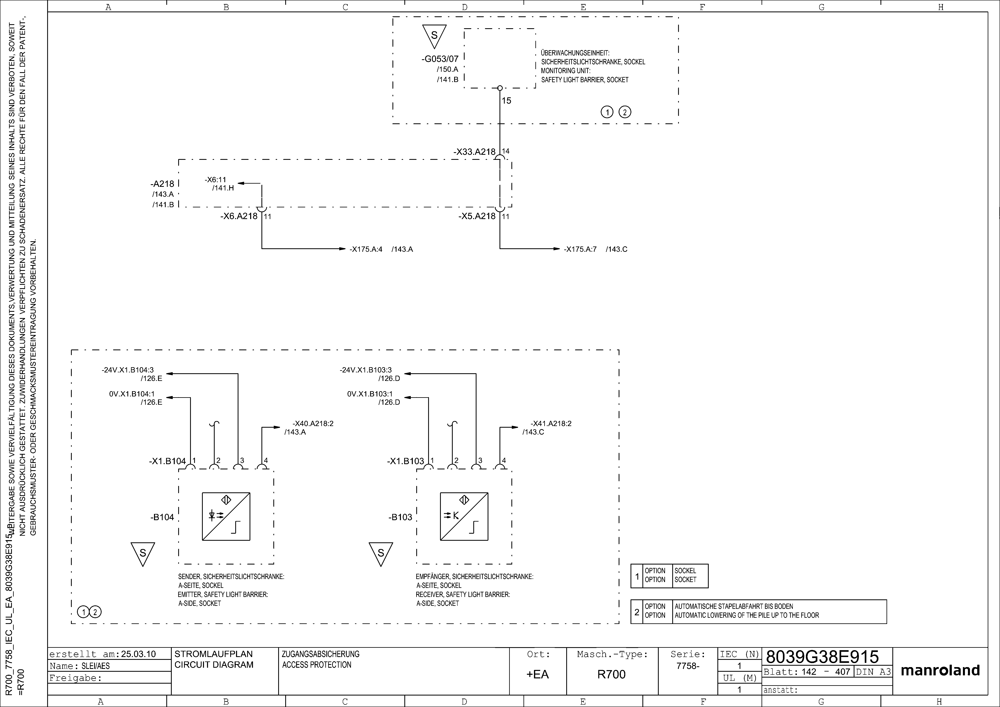

# +EA — Sheet 142 of 407 — ZUGANGSABSICHERUNG

**ACCESS PROTECTION**

> Part of the manroland **R700** printing press IEC/UL circuit diagrams.
> Drawing class: **Stromlaufplan / Circuit diagram** (DIN A3).
> Document `+EA` covers the **Printing unit** machine section.

## At a glance

| Field | Value |
|---|---|
| Document | `+EA`  (8039G38E915) |
| Sheet | **142** of 407 |
| Section (DE) | ZUGANGSABSICHERUNG |
| Section (EN) | ACCESS PROTECTION |
| Section type | CIRCUIT — Circuit diagram |
| Machine type | `R700` |
| Series | `7758` |
| Created | 25.03.10 |
| Replaces | — |
| Columns used | A, B, C, D, E, F |
| Path numbers | — |
| Labels on sheet | 72 |
| Cross-refs out | 13 |
| Cross-refs in | 24 |

**Previous:** [+EA sheet 141](SHEET_0141.md) · **Next:** [+EA sheet 143](SHEET_0143.md) · **Document TOC:** [_TOC.md](_TOC.md)  (+EA) · **Master TOC:** [all sheets](../_MASTER_TOC.md)

## Sheet image (300 DPI, exact vector render)



_Rendered directly from the PDF vector layer at 300 DPI (1-bit), no OCR and no resampling. Use it to confirm anything ambiguous in the text below._

## Cross-references on this sheet

Each entry is a wire leaving this sheet. The printed token is `/sheet.column`; the link resolves to that sheet inside the same document.

| Ref | Target sheet | Col | Path | Destination on target | Target section | From col |
|---|---|---|---|---|---|---|
| `/150.A` | [+EA sheet 150](SHEET_0150.md) | A | — | — | ZUGANGSABSICHERUNG | D |
| `/141.B` | [+EA sheet 141](SHEET_0141.md) | B | — | — | ZUGANGSABSICHERUNG | D |
| `/141.H` | [+EA sheet 141](SHEET_0141.md) | H | — | X6:11 | ZUGANGSABSICHERUNG | B |
| `/143.A` | [+EA sheet 143](SHEET_0143.md) | A | — | — | ZUGANGSABSICHERUNG | A |
| `/141.B` | [+EA sheet 141](SHEET_0141.md) | B | — | — | ZUGANGSABSICHERUNG | A |
| `/143.A` | [+EA sheet 143](SHEET_0143.md) | A | — | X175.A:4 X175.A:7 | ZUGANGSABSICHERUNG | D |
| `/143.C` | [+EA sheet 143](SHEET_0143.md) | C | — | X175.A:4 X175.A:7 | ZUGANGSABSICHERUNG | D |
| `/126.E` | [+EA sheet 126](SHEET_0126.md) | E | — | 24V.X1.B104:3 | ZUGANGSABSICHERUNG | A |
| `/126.D` | [+EA sheet 126](SHEET_0126.md) | D | — | 24V.X1.B103:3 | ZUGANGSABSICHERUNG | C |
| `/126.E` | [+EA sheet 126](SHEET_0126.md) | E | — | 0V.X1.B104:1 0V.X1.B103:1 | ZUGANGSABSICHERUNG | B |
| `/126.D` | [+EA sheet 126](SHEET_0126.md) | D | — | 0V.X1.B104:1 0V.X1.B103:1 | ZUGANGSABSICHERUNG | B |
| `/143.A` | [+EA sheet 143](SHEET_0143.md) | A | — | — | ZUGANGSABSICHERUNG | C |
| `/143.C` | [+EA sheet 143](SHEET_0143.md) | C | — | — | ZUGANGSABSICHERUNG | E |

### Incoming references (sheets that point here)

Every other sheet that sends a wire to this one. `Back-ref` is the token printed on *that* sheet; `Path` is its line number.

| From sheet | Cols | Back-ref | Path | Refs | What continues there |
|---|---|---|---|---|---|
| [+EA#126](SHEET_0126.md) | D, E | `/126.D`, `/126.E` | — | 4 | 24V.X1.B103:3; 24V.X1.B104:3 |
| [+EA#141](SHEET_0141.md) | B, H | `/141.B`, `/141.H` | — | 3 | ÜBERWACHUNGSEINHEIT: |
| [+EA#143](SHEET_0143.md) | A, B | `/143.A`, `/143.B` | — | 5 | X175.A:4 X175.A:7; X40.A218:2; X41.A218:2 |
| [+EA#150](SHEET_0150.md) | A | `/150.A` | — | 1 | — |
| [+EA#215](SHEET_0215.md) | C, D | `/215.C`, `/215.D` | — | 8 | — |
| [+EA#238](SHEET_0238.md) | G | `/238.G` | — | 1 | — |
| [+EA#244](SHEET_0244.md) | A | `/244.A` | — | 1 | — |
| [+EA#277](SHEET_0277.md) | A | `/277.A` | — | 1 | — |


## Devices on this sheet

| Tag | Class | Class meaning (IEC) | Col | Sub | Terminal | Sign |
|---|---|---|---|---|---|---|
| `B104` | B | Umformer / transducer, sensor | A | — | — | — |
| `A218` | A | Baugruppe / assembly, module, PC board | A | — | — | — |
| `B103` | B | Umformer / transducer, sensor | C | — | — | — |
| `G053/07` | G | Stromversorgung / power supply | D | 07 | — | — |
| `X6:11` | X | Klemme / terminal, plug connector | B | — | 11 | — |
| `X1.B104` | — | cross-device reference | B | — | — | — |
| `X6.A218` | — | cross-device reference | B | — | — | — |
| `X1.B103` | — | cross-device reference | D | — | — | — |
| `X5.A218` | — | cross-device reference | D | — | — | — |
| `X33.A218` | — | cross-device reference | D | — | — | — |
| `X175.A:4` | — | cross-device reference | C | — | 4 | — |
| `X175.A:7` | — | cross-device reference | E | — | 7 | — |
| `X40.A218:2` | — | cross-device reference | C | — | 2 | — |
| `X41.A218:2` | — | cross-device reference | E | — | 2 | — |

## Potentials / nets

| Potential | Count | Columns | Attached devices | Terminals |
|---|---|---|---|---|
| `0V` | 2 | A, C | `B103`, `B104`, `X1` | `1` |
| `24V` | 2 | A, C | `B103`, `B104`, `X1` | `3` |


A potential such as `L24+/4` or `M24+` is a named supply/return rail; every place it appears on this sheet is electrically common.

## Wire-end annotations (grouped as printed)

A wire that continues elsewhere is annotated with a small cluster: the destination description, the path/line number `#NN`, and the `/sheet.column` cross reference. Each row below is one such cluster exactly as it is grouped on the drawing.

| Col | Y | Path | Cross-ref | Text on the wire |
|---|---|---|---|---|
| D | 36.5 | — | — | `S` |
| E | 60.1 | — | — | `ÜBERWACHUNGSEINHEIT:` |
| D | 65.5 | — | — | `G053/07` |
| E | 70.8 | — | — | `MONITORING UNIT: SICHERHEITSLICHTSCHRANKE, SOCKEL SAFETY LIGHT BARRIER, SOCKET` |
| D | 78.6 | — | `/150.A`, `/141.B` | — |
| D | 115.1 | — | — | `15` |
| E | 130.2 | — | — | `1 2` |
| D | 176.1 | — | — | `X33.A218 14` |
| B | 210.1 | — | `/141.H` | `X6:11` |
| A | 214.3 | — | — | `A218` |
| A | 227.4 | — | `/143.A`, `/141.B` | — |
| B | 252.6 | — | — | `X6.A218 11` |
| D | 252.6 | — | — | `X5.A218 11` |
| D | 292.9 | — | `/143.A`, `/143.C` | `X175.A:4 X175.A:7` |
| A | 436.8 | — | `/126.E` | `24V.X1.B104:3` |
| C | 436.8 | — | `/126.D` | `24V.X1.B103:3` |
| B | 465.1 | — | `/126.E`, `/126.D` | `0V.X1.B104:1 0V.X1.B103:1` |
| C | 500.6 | — | — | `X40.A218:2` |
| E | 500.6 | — | — | `X41.A218:2` |
| C | 510.5 | — | `/143.A` | — |
| E | 510.5 | — | `/143.C` | — |
| B | 544.6 | — | — | `X1.B104 1 2 3 4` |
| D | 544.6 | — | — | `X1.B103 1 2 3 4` |
| A | 611.2 | — | — | `B104` |
| C | 611.2 | — | — | `B103` |
| A | 653.1 | — | — | `S` |
| C | 653.1 | — | — | `S` |
| F | 676.7 | — | — | `1 OPTION OPTION` |
| F | 676.7 | — | — | `SOCKEL SOCKET` |
| B | 683.8 | — | — | `EMITTER, SAFETY LIGHT BARRIER: SENDER, SICHERHEITSLICHTSCHRANKE: A SEITE, SOCKEL` |
| D | 683.8 | — | — | `EMPFÄNGER, SICHERHEITSLICHTSCHRANKE:` |
| D | 694.4 | — | — | `RECEIVER, SAFETY LIGHT BARRIER: A SEITE, SOCKEL` |
| B | 715.7 | — | — | `A SIDE, SOCKET` |
| D | 715.7 | — | — | `A SIDE, SOCKET` |
| F | 719.2 | — | — | `2 OPTION OPTION` |
| F | 719.2 | — | — | `AUTOMATISCHE STAPELABFAHRT BIS BODEN AUTOMATIC LOWERING OF THE PILE UP TO THE FLOOR` |
| A | 725.5 | — | — | `1 2` |


## Reconstructed tables

This sheet carries tabular content (pin map / terminal assignment / index). The grid below was rebuilt from the drawing's own rule lines, so each row is exactly one physical row of the table.

### Table 1 — 5 data rows × 19 columns (at x=204.1, y=0.0) — **X6:11 /141.H X6.A218 11 S G053/07 /150.A /141.B X33.A218 X5.A218 15 14 11 MONITORING SAFETY ÜBERWACHUNGSEINHEIT: SICHERHEITSLICHTSCHRANKE, SOCKEL UNIT: LIGHT BARRIER, SOCKET 1 2 /143.A X175.A:4 24V.X1.B103:3 X175.A:7 /143.C 1 2 3 4 /126.D 0V.X1.B103:1 /126.D X40.A218:2 /143.A X1.B103 X41.A218:2 /143.C B103 SENDER, A SEITE, EMITTER, A SIDE, SOCKEL SOCKET SAFETY LIGHT SICHERHEITSLICHTSCHRANKE: BARRIER: S A SEITE, A SIDE, EMPFÄNGER, RECEIVER, SICHERHEITSLICHTSCHRANKE: BARRIER: OPTION 1 OPTION OPTION 2 OPTION SOCKEL SOCKET AUTOMATISCHE AUTOMATIC STAPELABFAHRT LOWERING OF THE BIS BODEN PILE UP TO THE FLOOR**

|  |  | STROMLAUFPLAN |  |  |  |  | ZUGANGSABSICHERUNG |  |  |  |  |  |  | Ort: | Masch. Type: | Serie: | IEC (N) | 8039G38E915 |
|---|---|---|---|---|---|---|---|---|---|---|---|---|---|---|---|---|---|---|
|  | `CIRCUIT` |  | `DIAGRAM` |  |  |  |  |  |  |  |  |  |  |  |  |  |  |  |
|  |  |  |  |  |  |  | `ACCESS PROTECTION` |  |  |  |  |  |  |  |  | `7758` | `1` |  |
|  |  |  |  |  |  |  |  |  |  |  |  |  |  | `+EA` | `R700` |  |  | `Blatt: DIN A3 142 407` |
|  |  |  |  |  |  |  |  |  |  |  |  |  |  |  |  |  | `UL (M)` |  |
|  |  |  |  |  |  |  |  |  |  |  |  |  |  |  |  |  | `1` | `anstatt:` |


## Notes and free text on this sheet

| Text | Col | Y (pt) |
|---|---|---|
| `SENDER, SICHERHEITSLICHTSCHRANKE:` | B | 683.78 |
| `A SEITE, SOCKEL` | B | 694.39 |
| `EMITTER, SAFETY LIGHT BARRIER:` | B | 705.03 |
| `A SIDE, SOCKET` | B | 715.66 |
| `EMPFÄNGER, SICHERHEITSLICHTSCHRANKE:` | D | 683.78 |
| `A SEITE, SOCKEL` | D | 694.39 |
| `RECEIVER, SAFETY LIGHT BARRIER:` | D | 705.02 |
| `A SIDE, SOCKET` | D | 715.66 |
| `ÜBERWACHUNGSEINHEIT:` | E | 60.13 |
| `SICHERHEITSLICHTSCHRANKE, SOCKEL` | E | 70.79 |
| `MONITORING UNIT:` | E | 81.42 |
| `SAFETY LIGHT BARRIER, SOCKET` | E | 92.04 |
| `S` | A | 653.06 |
| `S` | C | 653.06 |
| `S` | D | 36.52 |
| `OPTION` | F | 676.66 |
| `SOCKEL` | F | 676.68 |
| `SOCKET` | F | 687.31 |
| `AUTOMATISCHE STAPELABFAHRT BIS BODEN` | F | 719.21 |
| `AUTOMATIC LOWERING OF THE PILE UP TO THE FLOOR` | F | 729.84 |

## Complete label inventory (exact text from the drawing)

Every text object inside the drawing area of this sheet, in DIN reading order (column A→H, then top→bottom). This is the authoritative list: if a string is not here it is not printed on this sheet.

| Col | Y | X | Dir | Type | Text |
|---|---|---|---|---|---|
| A | 214.3 | 179.1 | → | device tag | `A218` |
| A | 227.4 | 181.4 | → | cross-reference | `/143.A` |
| A | 239.8 | 181.7 | → | cross-reference | `/141.B` |
| A | 436.8 | 121.0 | → | potential | `24V.X1.B104:3` |
| A | 446.7 | 167.8 | → | cross-reference | `/126.E` |
| A | 465.1 | 130.1 | → | potential | `0V.X1.B104:1` |
| A | 475.1 | 167.8 | → | cross-reference | `/126.E` |
| A | 611.2 | 179.1 | → | device tag | `B104` |
| A | 653.1 | 166.0 | → | text | `S` |
| A | 725.4 | 97.5 | → | number | `1` |
| A | 726.0 | 111.4 | → | number | `2` |
| B | 210.1 | 243.8 | → | device tag | `X6:11` |
| B | 220.0 | 252.9 | → | cross-reference | `/141.H` |
| B | 252.6 | 262.5 | → | device ref | `X6.A218` |
| B | 254.0 | 313.8 | → | number | `11` |
| B | 544.6 | 177.4 | → | device ref | `X1.B104` |
| B | 544.6 | 228.8 | → | number | `1` |
| B | 544.6 | 257.7 | → | number | `2` |
| B | 544.6 | 286.0 | → | number | `3` |
| B | 544.6 | 314.4 | → | number | `4` |
| B | 683.8 | 212.3 | → | text | `SENDER, SICHERHEITSLICHTSCHRANKE:` |
| B | 694.4 | 212.6 | → | text | `A SEITE, SOCKEL` |
| B | 705.0 | 211.7 | → | text | `EMITTER, SAFETY LIGHT BARRIER:` |
| B | 715.7 | 212.6 | → | text | `A SIDE, SOCKET` |
| C | 292.9 | 466.3 | → | cross-reference | `/143.A` |
| C | 293.0 | 416.4 | → | device ref | `X175.A:4` |
| C | 436.8 | 404.5 | → | potential | `24V.X1.B103:3` |
| C | 446.7 | 450.7 | → | cross-reference | `/126.D` |
| C | 465.1 | 413.6 | → | potential | `0V.X1.B103:1` |
| C | 475.1 | 450.7 | → | cross-reference | `/126.D` |
| C | 500.6 | 348.4 | → | device ref | `X40.A218:2` |
| C | 510.5 | 338.7 | → | cross-reference | `/143.A` |
| C | 611.2 | 462.6 | → | device tag | `B103` |
| C | 653.1 | 449.4 | → | text | `S` |
| D | 36.5 | 513.2 | → | text | `S` |
| D | 65.5 | 502.0 | → | device tag | `G053/07` |
| D | 78.6 | 520.2 | → | cross-reference | `/150.A` |
| D | 91.0 | 520.4 | → | cross-reference | `/141.B` |
| D | 115.1 | 597.0 | → | number | `15` |
| D | 176.1 | 540.0 | → | device ref | `X33.A218` |
| D | 176.1 | 597.3 | → | number | `14` |
| D | 252.6 | 546.0 | → | device ref | `X5.A218` |
| D | 254.0 | 597.3 | → | number | `11` |
| D | 544.6 | 460.9 | → | device ref | `X1.B103` |
| D | 544.6 | 512.2 | → | number | `1` |
| D | 544.6 | 541.1 | → | number | `2` |
| D | 544.6 | 569.5 | → | number | `3` |
| D | 544.6 | 597.8 | → | number | `4` |
| D | 683.8 | 495.2 | → | text | `EMPFÄNGER, SICHERHEITSLICHTSCHRANKE:` |
| D | 694.4 | 496.1 | → | text | `A SEITE, SOCKEL` |
| D | 705.0 | 495.2 | → | text | `RECEIVER, SAFETY LIGHT BARRIER:` |
| D | 715.7 | 496.1 | → | text | `A SIDE, SOCKET` |
| E | 60.1 | 644.0 | → | text | `ÜBERWACHUNGSEINHEIT:` |
| E | 70.8 | 644.6 | → | text | `SICHERHEITSLICHTSCHRANKE, SOCKEL` |
| E | 81.4 | 644.3 | → | text | `MONITORING UNIT:` |
| E | 92.0 | 644.6 | → | text | `SAFETY LIGHT BARRIER, SOCKET` |
| E | 130.2 | 721.1 | → | number | `1` |
| E | 130.7 | 742.1 | → | number | `2` |
| E | 293.0 | 671.5 | → | device ref | `X175.A:7` |
| E | 293.0 | 721.4 | → | cross-reference | `/143.C` |
| E | 500.6 | 631.8 | → | device ref | `X41.A218:2` |
| E | 510.5 | 622.2 | → | cross-reference | `/143.C` |
| E | 682.0 | 755.7 | → | number | `1` |
| E | 724.5 | 755.4 | → | number | `2` |
| F | 676.7 | 767.9 | → | text | `OPTION` |
| F | 676.7 | 803.3 | → | text | `SOCKEL` |
| F | 687.3 | 767.9 | → | text | `OPTION` |
| F | 687.3 | 803.3 | → | text | `SOCKET` |
| F | 719.2 | 767.9 | → | text | `OPTION` |
| F | 719.2 | 803.6 | → | text | `AUTOMATISCHE STAPELABFAHRT BIS BODEN` |
| F | 729.8 | 767.9 | → | text | `OPTION` |
| F | 729.8 | 803.6 | → | text | `AUTOMATIC LOWERING OF THE PILE UP TO THE FLOOR` |

## Reading-order text block

The same content as a plain block, grouped by DIN column — convenient to paste or to match against a visual description.

```text
=== Column A ===
 214.3  179.1  devtag       A218
 227.4  181.4  xref         /143.A
 239.8  181.7  xref         /141.B
 436.8  121.0  net          24V.X1.B104:3
 446.7  167.8  xref         /126.E
 465.1  130.1  net          0V.X1.B104:1
 475.1  167.8  xref         /126.E
 611.2  179.1  devtag       B104
 653.1  166.0  text         S
 725.4   97.5  numeric      1
 726.0  111.4  numeric      2
=== Column B ===
 210.1  243.8  devtag       X6:11
 220.0  252.9  xref         /141.H
 252.6  262.5  devref       X6.A218
 254.0  313.8  numeric      11
 544.6  177.4  devref       X1.B104
 544.6  228.8  numeric      1
 544.6  257.7  numeric      2
 544.6  286.0  numeric      3
 544.6  314.4  numeric      4
 683.8  212.3  text         SENDER, SICHERHEITSLICHTSCHRANKE:
 694.4  212.6  text         A SEITE, SOCKEL
 705.0  211.7  text         EMITTER, SAFETY LIGHT BARRIER:
 715.7  212.6  text         A SIDE, SOCKET
=== Column C ===
 292.9  466.3  xref         /143.A
 293.0  416.4  devref       X175.A:4
 436.8  404.5  net          24V.X1.B103:3
 446.7  450.7  xref         /126.D
 465.1  413.6  net          0V.X1.B103:1
 475.1  450.7  xref         /126.D
 500.6  348.4  devref       X40.A218:2
 510.5  338.7  xref         /143.A
 611.2  462.6  devtag       B103
 653.1  449.4  text         S
=== Column D ===
  36.5  513.2  text         S
  65.5  502.0  devtag       G053/07
  78.6  520.2  xref         /150.A
  91.0  520.4  xref         /141.B
 115.1  597.0  numeric      15
 176.1  540.0  devref       X33.A218
 176.1  597.3  numeric      14
 252.6  546.0  devref       X5.A218
 254.0  597.3  numeric      11
 544.6  460.9  devref       X1.B103
 544.6  512.2  numeric      1
 544.6  541.1  numeric      2
 544.6  569.5  numeric      3
 544.6  597.8  numeric      4
 683.8  495.2  text         EMPFÄNGER, SICHERHEITSLICHTSCHRANKE:
 694.4  496.1  text         A SEITE, SOCKEL
 705.0  495.2  text         RECEIVER, SAFETY LIGHT BARRIER:
 715.7  496.1  text         A SIDE, SOCKET
=== Column E ===
  60.1  644.0  text         ÜBERWACHUNGSEINHEIT:
  70.8  644.6  text         SICHERHEITSLICHTSCHRANKE, SOCKEL
  81.4  644.3  text         MONITORING UNIT:
  92.0  644.6  text         SAFETY LIGHT BARRIER, SOCKET
 130.2  721.1  numeric      1
 130.7  742.1  numeric      2
 293.0  671.5  devref       X175.A:7
 293.0  721.4  xref         /143.C
 500.6  631.8  devref       X41.A218:2
 510.5  622.2  xref         /143.C
 682.0  755.7  numeric      1
 724.5  755.4  numeric      2
=== Column F ===
 676.7  767.9  text         OPTION
 676.7  803.3  text         SOCKEL
 687.3  767.9  text         OPTION
 687.3  803.3  text         SOCKET
 719.2  767.9  text         OPTION
 719.2  803.6  text         AUTOMATISCHE STAPELABFAHRT BIS BODEN
 729.8  767.9  text         OPTION
 729.8  803.6  text         AUTOMATIC LOWERING OF THE PILE UP TO THE FLOOR
```

---
_Generated from the PDF vector text layer; no OCR. Source: `R700_7758_IEC_UL_EA_8039G38E915_p`, sheet 142._
