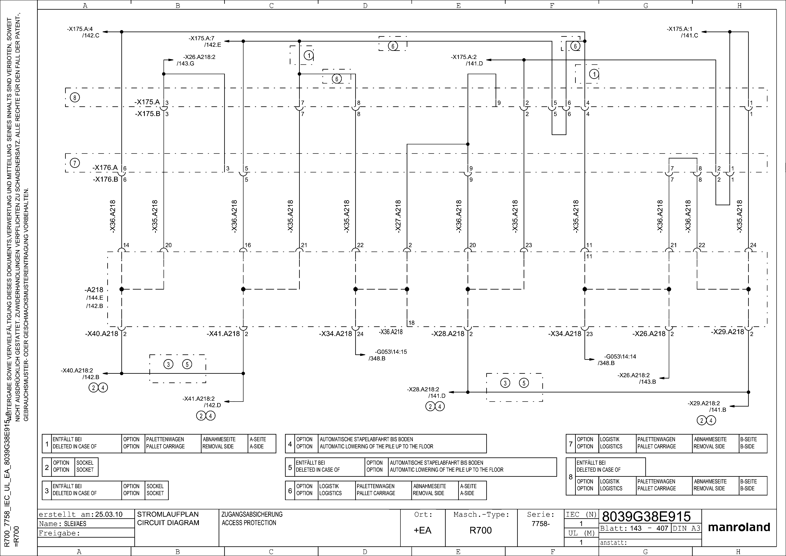

# +EA — Sheet 143 of 407 — ZUGANGSABSICHERUNG

**ACCESS PROTECTION**

> Part of the manroland **R700** printing press IEC/UL circuit diagrams.
> Drawing class: **Stromlaufplan / Circuit diagram** (DIN A3).
> Document `+EA` covers the **Printing unit** machine section.

## At a glance

| Field | Value |
|---|---|
| Document | `+EA`  (8039G38E915) |
| Sheet | **143** of 407 |
| Section (DE) | ZUGANGSABSICHERUNG |
| Section (EN) | ACCESS PROTECTION |
| Section type | CIRCUIT — Circuit diagram |
| Machine type | `R700` |
| Series | `7758` |
| Created | 25.03.10 |
| Replaces | — |
| Columns used | A, B, C, D, E, F, G, H |
| Path numbers | — |
| Labels on sheet | 193 |
| Cross-refs out | 14 |
| Cross-refs in | 66 |

**Previous:** [+EA sheet 142](SHEET_0142.md) · **Next:** [+EA sheet 144](SHEET_0144.md) · **Document TOC:** [_TOC.md](_TOC.md)  (+EA) · **Master TOC:** [all sheets](../_MASTER_TOC.md)

## Sheet image (300 DPI, exact vector render)



_Rendered directly from the PDF vector layer at 300 DPI (1-bit), no OCR and no resampling. Use it to confirm anything ambiguous in the text below._

## Cross-references on this sheet

Each entry is a wire leaving this sheet. The printed token is `/sheet.column`; the link resolves to that sheet inside the same document.

| Ref | Target sheet | Col | Path | Destination on target | Target section | From col |
|---|---|---|---|---|---|---|
| `/142.C` | [+EA sheet 142](SHEET_0142.md) | C | — | X175.A:4 X175.A:7 | ZUGANGSABSICHERUNG | B |
| `/142.E` | [+EA sheet 142](SHEET_0142.md) | E | — | X175.A:4 X175.A:7 | ZUGANGSABSICHERUNG | B |
| `/141.C` | [+EA sheet 141](SHEET_0141.md) | C | — | X175.A:1 | ZUGANGSABSICHERUNG | G |
| `/141.D` | [+EA sheet 141](SHEET_0141.md) | D | — | X175.A:2 | ZUGANGSABSICHERUNG | E |
| `/143.G` | [+EA sheet 143](SHEET_0143.md) | G | — | — | ZUGANGSABSICHERUNG | B |
| `/144.E` | [+EA sheet 144](SHEET_0144.md) | E | — | — | ZUGANGSABSICHERUNG | A |
| `/142.B` | [+EA sheet 142](SHEET_0142.md) | B | — | — | ZUGANGSABSICHERUNG | A |
| `/348.B` | [+EA sheet 348](SHEET_0348.md) | B | — | — | OPTION: LOGISTIK PALETTENWAGEN | D |
| `/348.B` | [+EA sheet 348](SHEET_0348.md) | B | — | — | OPTION: LOGISTIK PALETTENWAGEN | G |
| `/142.B` | [+EA sheet 142](SHEET_0142.md) | B | — | X40.A218:2 | ZUGANGSABSICHERUNG | A |
| `/143.B` | [+EA sheet 143](SHEET_0143.md) | B | — | X26.A218:2 | ZUGANGSABSICHERUNG | G |
| `/141.D` | [+EA sheet 141](SHEET_0141.md) | D | — | X28.A218:2 X29.A218:2 | ZUGANGSABSICHERUNG | F |
| `/141.B` | [+EA sheet 141](SHEET_0141.md) | B | — | X28.A218:2 X29.A218:2 | ZUGANGSABSICHERUNG | F |
| `/142.D` | [+EA sheet 142](SHEET_0142.md) | D | — | X41.A218:2 | ZUGANGSABSICHERUNG | B |

### Incoming references (sheets that point here)

Every other sheet that sends a wire to this one. `Back-ref` is the token printed on *that* sheet; `Path` is its line number.

| From sheet | Cols | Back-ref | Path | Refs | What continues there |
|---|---|---|---|---|---|
| [+EA#141](SHEET_0141.md) | B, D | `/141.B`, `/141.D` | — | 4 | X175.A:1 X175.A:2 |
| [+EA#142](SHEET_0142.md) | A, C, D, E | `/142.A`, `/142.C`, `/142.D`, `/142.E` | — | 5 | X175.A:4 X175.A:7 |
| [+EA#143](SHEET_0143.md) | B, G | `/143.B`, `/143.G` | — | 2 | X26.A218:2 |
| [+EA#144](SHEET_0144.md) | E | `/144.E` | — | 1 | — |
| [+EA#269](SHEET_0269.md) | A | `/269.A` | — | 1 | — |
| [+EA#270](SHEET_0270.md) | F | `/270.F` | — | 1 | — |
| [+EA#272](SHEET_0272.md) | D | `/272.D` | — | 1 | — |
| [+EA#273](SHEET_0273.md) | H | `/273.H` | — | 1 | — |
| [+EA#277](SHEET_0277.md) | G | `/277.G` | — | 2 | — |
| [+EA#278](SHEET_0278.md) | C, H | `/278.C`, `/278.H` | — | 12 | — |
| [+EA#280](SHEET_0280.md) | G | `/280.G` | — | 1 | — |
| [+EA#281](SHEET_0281.md) | A | `/281.A` | — | 1 | — |
| [+EA#285](SHEET_0285.md) | H | `/285.H` | — | 17 | — |
| [+EA#286](SHEET_0286.md) | A | `/286.A` | — | 15 | — |
| [+EA#348](SHEET_0348.md) | B | `/348.B` | — | 2 | G053\14:14; G053\14:15 |


## Devices on this sheet

| Tag | Class | Class meaning (IEC) | Col | Sub | Terminal | Sign |
|---|---|---|---|---|---|---|
| `A218` | A | Baugruppe / assembly, module, PC board | A | — | — | — |
| `X36.A218` | — | cross-device reference | C | — | — | — |
| `X41.A218` | — | cross-device reference | B | — | — | — |
| `X35.A218` | — | cross-device reference | C | — | — | — |
| `X35.A218` | — | cross-device reference | H | — | — | — |
| `X36.A218` | — | cross-device reference | E | — | — | — |
| `X28.A218` | — | cross-device reference | E | — | — | — |
| `X35.A218` | — | cross-device reference | F | — | — | — |
| `X35.A218` | — | cross-device reference | D | — | — | — |
| `X34.A218` | — | cross-device reference | D | — | — | — |
| `X27.A218` | — | cross-device reference | D | — | — | — |
| `X36.A218` | — | cross-device reference | G | — | — | — |
| `X35.A218` | — | cross-device reference | F | — | — | — |
| `X34.A218` | — | cross-device reference | F | — | — | — |
| `X35.A218` | — | cross-device reference | B | — | — | — |
| `X175.B` | — | cross-device reference | B | — | — | — |
| `X175.A` | — | cross-device reference | B | — | — | — |
| `X36.A218` | — | cross-device reference | A | — | — | — |
| `X40.A218` | — | cross-device reference | A | — | — | — |
| `X176.B` | — | cross-device reference | A | — | — | — |
| `X176.A` | — | cross-device reference | A | — | — | — |
| `X36.A218` | — | cross-device reference | G | — | — | — |
| `X26.A218` | — | cross-device reference | G | — | — | — |
| `X29.A218` | — | cross-device reference | H | — | — | — |
| `X175.A:1` | — | cross-device reference | G | — | 1 | — |
| `X175.A:2` | — | cross-device reference | E | — | 2 | — |
| `X175.A:7` | — | cross-device reference | B | — | 7 | — |
| `X175.A:4` | — | cross-device reference | A | — | 4 | — |
| `X40.A218:2` | — | cross-device reference | A | — | 2 | — |
| `X41.A218:2` | — | cross-device reference | B | — | 2 | — |
| `X29.A218:2` | — | cross-device reference | H | — | 2 | — |
| `X28.A218:2` | — | cross-device reference | E | — | 2 | — |
| `X26.A218:2` | — | cross-device reference | G | — | 2 | — |
| `X26.A218:2` | — | cross-device reference | B | — | 2 | — |
| `X36.A218` | — | cross-device reference | D | — | — | — |

## Potentials / nets

_No named potentials on this sheet._

## Wire-end annotations (grouped as printed)

A wire that continues elsewhere is annotated with a small cluster: the destination description, the path/line number `#NN`, and the `/sheet.column` cross reference. Each row below is one such cluster exactly as it is grouped on the drawing.

| Col | Y | Path | Cross-ref | Text on the wire |
|---|---|---|---|---|
| B | 40.0 | — | `/142.C`, `/142.E` | `X175.A:4 X175.A:7` |
| G | 40.0 | — | `/141.C` | `X175.A:1` |
| D | 66.9 | — | — | `6` |
| F | 66.9 | — | — | `6` |
| C | 80.6 | — | — | `1` |
| B | 82.5 | — | — | `X26.A218:2` |
| E | 82.5 | — | `/141.D` | `X175.A:2` |
| B | 92.4 | — | `/143.G` | — |
| F | 108.9 | — | — | `1` |
| D | 116.5 | — | — | `6` |
| A | 144.9 | — | — | `8` |
| B | 149.8 | — | — | `X175.A 3` |
| C | 152.0 | — | — | `7` |
| D | 152.0 | — | — | `8` |
| F | 152.0 | — | — | `9 5` |
| F | 152.0 | — | — | `2` |
| F | 152.0 | — | — | `6` |
| F | 152.0 | — | — | `4` |
| H | 152.0 | — | — | `1` |
| B | 167.6 | — | — | `X175.B 3` |
| C | 169.0 | — | — | `7` |
| D | 169.0 | — | — | `8` |
| F | 169.0 | — | — | `2` |
| F | 169.0 | — | — | `5` |
| F | 169.0 | — | — | `6` |
| F | 169.0 | — | — | `4` |
| H | 169.0 | — | — | `1` |
| A | 244.1 | — | — | `7` |
| A | 249.1 | — | — | `X176.A 6` |
| C | 251.2 | — | — | `3` |
| C | 251.2 | — | — | `5` |
| E | 251.2 | — | — | `9` |
| G | 251.2 | — | — | `7` |
| H | 251.2 | — | — | `8` |
| H | 251.2 | — | — | `2` |
| H | 251.2 | — | — | `1` |
| A | 266.8 | — | — | `X176.B 6` |
| C | 268.2 | — | — | `5` |
| E | 268.2 | — | — | `9` |
| G | 268.2 | — | — | `7` |
| H | 268.2 | — | — | `8` |
| H | 268.2 | — | — | `2` |
| H | 268.2 | — | — | `1` |
| A | 302.7 | — | — | `X36.A218` |
| B | 302.7 | — | — | `X35.A218` |
| C | 302.7 | — | — | `X36.A218` |
| C | 302.7 | — | — | `X35.A218` |
| D | 302.7 | — | — | `X35.A218` |
| D | 302.7 | — | — | `X27.A218` |
| E | 302.7 | — | — | `X36.A218` |
| F | 302.7 | — | — | `X35.A218` |
| F | 302.7 | — | — | `X35.A218` |
| G | 302.7 | — | — | `X36.A218` |
| G | 302.7 | — | — | `X36.A218` |
| H | 302.7 | — | — | `X35.A218` |
| A | 367.4 | — | — | `14` |
| B | 367.4 | — | — | `20` |
| C | 367.4 | — | — | `16` |
| C | 367.4 | — | — | `21` |
| D | 367.4 | — | — | `22` |
| D | 367.4 | — | — | `2` |
| E | 367.4 | — | — | `20` |
| F | 367.4 | — | — | `23` |
| F | 367.4 | — | — | `11` |
| G | 367.4 | — | — | `21` |
| H | 367.4 | — | — | `22` |
| H | 367.4 | — | — | `24` |
| F | 384.4 | — | — | `11` |
| A | 434.0 | — | — | `A218` |
| A | 447.1 | — | `/144.E`, `/142.B` | — |
| D | 485.1 | — | — | `18` |
| H | 497.8 | — | — | `X29.A218 2` |
| D | 499.1 | — | — | `X36.A218` |
| A | 500.6 | — | — | `X40.A218 2` |
| C | 500.6 | — | — | `X41.A218 2` |
| D | 500.6 | — | — | `X34.A218 24` |
| E | 500.6 | — | — | `X28.A218 2` |
| F | 500.6 | — | — | `X34.A218 23` |
| G | 500.6 | — | — | `X26.A218 2` |
| D | 529.0 | — | — | `G053\14:15` |
| G | 536.0 | — | — | `G053\14:14` |
| D | 538.9 | — | `/348.B` | — |
| G | 545.9 | — | `/348.B` | — |
| B | 548.8 | — | — | `3 5` |
| A | 557.3 | — | `/142.B` | `X40.A218:2` |
| G | 564.4 | — | `/143.B` | `X26.A218:2` |
| C | 577.1 | — | — | `2 4 3 5` |
| F | 585.6 | — | `/141.D`, `/141.B` | `X28.A218:2 X29.A218:2` |
| B | 599.8 | — | `/142.D` | `X41.A218:2` |
| E | 612.6 | — | — | `2 4` |
| B | 626.8 | — | — | `2 4` |
| H | 633.8 | — | — | `2 4` |
| A | 662.5 | — | — | `1 ENTFÄLLT BEI DELETED IN CASE OF` |
| A | 662.5 | — | — | `OPTION OPTION` |
| B | 662.5 | — | — | `PALETTENWAGEN PALLET CARRIAGE` |
| B | 662.5 | — | — | `REMOVAL SIDE ABNAHMESEITE` |
| C | 662.5 | — | — | `A SEITE A SIDE` |
| D | 662.5 | — | — | `4 OPTION OPTION AUTOMATISCHE STAPELABFAHRT BIS BODEN AUTOMATIC LOWERING OF THE PILE UP TO THE FLOOR` |
| F | 662.5 | — | — | `7 OPTION OPTION LOGISTIK LOGISTICS` |
| G | 662.5 | — | — | `PALETTENWAGEN PALLET CARRIAGE` |
| H | 662.5 | — | — | `REMOVAL SIDE ABNAHMESEITE` |
| H | 662.5 | — | — | `B SEITE B SIDE` |
| A | 697.9 | — | — | `2 OPTION OPTION` |
| A | 697.9 | — | — | `SOCKEL SOCKET` |
| C | 697.9 | — | — | `5 ENTFÄLLT BEI DELETED IN CASE OF` |
| D | 697.9 | — | — | `OPTION OPTION` |
| F | 697.9 | — | — | `ENTFÄLLT BEI DELETED IN CASE OF` |
| E | 698.0 | — | — | `AUTOMATISCHE STAPELABFAHRT BIS BODEN AUTOMATIC LOWERING OF THE PILE UP TO THE FLOOR` |
| F | 717.4 | — | — | `8` |
| G | 726.2 | — | — | `PALETTENWAGEN PALLET CARRIAGE` |
| H | 726.2 | — | — | `B SEITE B SIDE` |
| F | 726.3 | — | — | `OPTION OPTION` |
| G | 726.3 | — | — | `LOGISTIK LOGISTICS` |
| H | 726.3 | — | — | `REMOVAL SIDE ABNAHMESEITE` |
| D | 733.3 | — | — | `PALETTENWAGEN PALLET CARRIAGE` |
| E | 733.3 | — | — | `A SEITE A SIDE` |
| A | 733.4 | — | — | `3 ENTFÄLLT BEI DELETED IN CASE OF` |
| A | 733.4 | — | — | `OPTION OPTION` |
| B | 733.4 | — | — | `SOCKEL SOCKET` |
| C | 733.4 | — | — | `6 OPTION OPTION LOGISTIK LOGISTICS` |
| E | 733.4 | — | — | `REMOVAL SIDE ABNAHMESEITE` |


## Reconstructed tables

This sheet carries tabular content (pin map / terminal assignment / index). The grid below was rebuilt from the drawing's own rule lines, so each row is exactly one physical row of the table.

### Table 1 — 5 data rows × 12 columns (at x=184.3, y=48.2) — **X175.A:7**

|  | /142.E X26.A218:2 |  |  | 1 | 6 | X175.A:2 |  |  |  |  | 6 |
|---|---|---|---|---|---|---|---|---|---|---|---|
|  | `/143.G` |  |  |  |  |  | `/141.D` |  |  |  |  |
| `X175.A X175.B` | `3 3` |  |  | `6 7 7` | `8 8` |  |  | `9` | `2 2` | `5 5` | `6 6` |
| `6 6 X35.A218 14` | `20` | `3 X36.A218` | `5 5 X35.A218 16` | `X35.A218 21` | `X27.A218 22` | `X36.A218 2` | `9 9 20` | `X35.A218` | `23` |  | `X35.A218` |
| `2` | `X41.A218 3 5` |  | `2` | `X34.A218` | `X36.A218 24 G053\14:15 /348.B` | `18 X28.A218` | `2` |  |  | `X34.A218` |  |
|  |  |  |  |  |  | `X28.A218:2` |  | `3` | `5` |  |  |


### Table 2 — 1 data rows × 4 columns (at x=1013.4, y=90.7)

| 7 7 X36.A218 21 | 8 8 22 | 2 2 | 1 1 X35.A218 |
|---|---|---|---|
| `2` |  | `X29.A218` |  |


## Notes and free text on this sheet

| Text | Col | Y (pt) |
|---|---|---|
| `G053\14:15` | D | 528.97 |
| `G053\14:14` | G | 536.05 |
| `ENTFÄLLT BEI` | A | 662.48 |
| `DELETED IN CASE OF` | A | 673.13 |
| `OPTION` | A | 662.49 |
| `PALETTENWAGEN` | B | 662.47 |
| `PALLET CARRIAGE` | B | 673.13 |
| `ABNAHMESEITE` | B | 662.51 |
| `REMOVAL SIDE` | B | 673.13 |
| `A SEITE` | C | 662.48 |
| `A SIDE` | C | 673.12 |
| `SOCKEL` | A | 697.94 |
| `SOCKET` | A | 708.57 |
| `SOCKEL` | B | 733.37 |
| `SOCKET` | B | 744 |
| `OPTION` | C | 662.49 |
| `AUTOMATISCHE STAPELABFAHRT BIS BODEN` | D | 662.51 |
| `AUTOMATIC LOWERING OF THE PILE UP TO THE FLOOR` | D | 673.15 |
| `ENTFÄLLT BEI` | C | 697.91 |
| `DELETED IN CASE OF` | C | 708.57 |
| `OPTION` | D | 697.92 |
| `AUTOMATISCHE STAPELABFAHRT BIS BODEN` | E | 697.95 |
| `AUTOMATIC LOWERING OF THE PILE UP TO THE FLOOR` | E | 708.58 |
| `LOGISTIK` | D | 733.35 |
| `LOGISTICS` | D | 743.98 |
| `PALETTENWAGEN` | D | 733.33 |
| `PALLET CARRIAGE` | D | 744 |
| `ABNAHMESEITE` | E | 733.37 |
| `REMOVAL SIDE` | E | 744 |
| `A SEITE` | E | 733.34 |
| `A SIDE` | E | 743.99 |
| `OPTION` | F | 662.49 |
| `LOGISTIK` | G | 662.49 |
| `LOGISTICS` | G | 673.12 |
| `PALETTENWAGEN` | G | 662.47 |
| `PALLET CARRIAGE` | G | 673.13 |
| `ABNAHMESEITE` | H | 662.51 |
| `REMOVAL SIDE` | H | 673.13 |
| `B SEITE` | H | 662.45 |
| `B SIDE` | H | 673.09 |
| `ENTFÄLLT BEI` | F | 697.91 |
| `DELETED IN CASE OF` | F | 708.57 |

## Complete label inventory (exact text from the drawing)

Every text object inside the drawing area of this sheet, in DIN reading order (column A→H, then top→bottom). This is the authoritative list: if a string is not here it is not printed on this sheet.

| Col | Y | X | Dir | Type | Text |
|---|---|---|---|---|---|
| A | 40.0 | 101.5 | → | device ref | `X175.A:4` |
| A | 49.9 | 124.7 | → | cross-reference | `/142.C` |
| A | 144.9 | 111.4 | → | number | `8` |
| A | 244.1 | 111.4 | → | number | `7` |
| A | 249.1 | 140.0 | → | device ref | `X176.A` |
| A | 251.2 | 186.8 | → | number | `6` |
| A | 266.8 | 140.9 | → | device ref | `X176.B` |
| A | 268.2 | 186.8 | → | number | `6` |
| A | 302.7 | 166.1 | ↕ | device ref | `X36.A218` |
| A | 367.4 | 186.2 | → | number | `14` |
| A | 434.0 | 128.1 | → | device tag | `A218` |
| A | 447.1 | 131.0 | → | cross-reference | `/144.E` |
| A | 459.5 | 130.7 | → | cross-reference | `/142.B` |
| A | 500.6 | 129.0 | → | device ref | `X40.A218` |
| A | 502.1 | 186.8 | → | number | `2` |
| A | 557.3 | 92.1 | → | device ref | `X40.A218:2` |
| A | 567.2 | 125.0 | → | cross-reference | `/142.B` |
| A | 584.2 | 139.7 | → | number | `2` |
| A | 584.2 | 153.9 | → | number | `4` |
| A | 662.5 | 79.9 | → | text | `ENTFÄLLT BEI` |
| A | 662.5 | 186.8 | → | text | `OPTION` |
| A | 667.8 | 68.3 | → | number | `1` |
| A | 673.1 | 79.9 | → | text | `DELETED IN CASE OF` |
| A | 673.1 | 186.8 | → | text | `OPTION` |
| A | 697.9 | 80.5 | → | text | `OPTION` |
| A | 697.9 | 115.9 | → | text | `SOCKEL` |
| A | 703.3 | 68.0 | → | number | `2` |
| A | 708.6 | 80.5 | → | text | `OPTION` |
| A | 708.6 | 115.9 | → | text | `SOCKET` |
| A | 733.3 | 79.9 | → | text | `ENTFÄLLT BEI` |
| A | 733.4 | 186.8 | → | text | `OPTION` |
| A | 738.7 | 67.9 | → | number | `3` |
| A | 744.0 | 79.9 | → | text | `DELETED IN CASE OF` |
| A | 744.0 | 186.8 | → | text | `OPTION` |
| B | 54.1 | 285.7 | → | device ref | `X175.A:7` |
| B | 64.0 | 309.5 | → | cross-reference | `/142.E` |
| B | 82.5 | 277.5 | → | device ref | `X26.A218:2` |
| B | 92.4 | 267.9 | → | cross-reference | `/143.G` |
| B | 149.8 | 203.8 | → | device ref | `X175.A` |
| B | 152.0 | 250.6 | → | number | `3` |
| B | 167.6 | 204.7 | → | device ref | `X175.B` |
| B | 169.0 | 250.6 | → | number | `3` |
| B | 302.7 | 229.9 | ↕ | device ref | `X35.A218` |
| B | 367.4 | 250.6 | → | number | `20` |
| B | 500.6 | 313.2 | → | device ref | `X41.A218` |
| B | 548.8 | 253.1 | → | number | `3` |
| B | 548.8 | 281.5 | → | number | `5` |
| B | 599.8 | 276.4 | → | device ref | `X41.A218:2` |
| B | 609.7 | 309.0 | → | cross-reference | `/142.D` |
| B | 626.7 | 302.7 | → | number | `2` |
| B | 626.7 | 316.9 | → | number | `4` |
| B | 662.5 | 221.7 | → | text | `PALETTENWAGEN` |
| B | 662.5 | 307.6 | → | text | `ABNAHMESEITE` |
| B | 673.1 | 221.7 | → | text | `PALLET CARRIAGE` |
| B | 673.1 | 306.7 | → | text | `REMOVAL SIDE` |
| B | 733.4 | 222.2 | → | text | `SOCKEL` |
| B | 744.0 | 222.2 | → | text | `SOCKET` |
| C | 80.6 | 466.0 | → | number | `1` |
| C | 152.0 | 456.1 | → | number | `7` |
| C | 169.0 | 456.1 | → | number | `7` |
| C | 251.2 | 342.7 | → | number | `3` |
| C | 251.2 | 371.1 | → | number | `5` |
| C | 268.2 | 371.1 | → | number | `5` |
| C | 302.7 | 350.4 | ↕ | device ref | `X36.A218` |
| C | 302.7 | 435.4 | ↕ | device ref | `X35.A218` |
| C | 367.4 | 370.5 | → | number | `16` |
| C | 367.4 | 456.1 | → | number | `21` |
| C | 502.1 | 371.1 | → | number | `2` |
| C | 662.5 | 378.4 | → | text | `A SEITE` |
| C | 662.5 | 449.0 | → | text | `OPTION` |
| C | 667.8 | 436.5 | → | number | `4` |
| C | 673.1 | 378.4 | → | text | `A SIDE` |
| C | 673.1 | 449.0 | → | text | `OPTION` |
| C | 697.9 | 448.4 | → | text | `ENTFÄLLT BEI` |
| C | 703.3 | 436.4 | → | number | `5` |
| C | 708.6 | 448.4 | → | text | `DELETED IN CASE OF` |
| C | 733.4 | 449.0 | → | text | `OPTION` |
| C | 738.7 | 436.5 | → | number | `6` |
| C | 744.0 | 449.0 | → | text | `OPTION` |
| D | 66.9 | 593.3 | → | number | `6` |
| D | 116.5 | 508.2 | → | number | `6` |
| D | 152.0 | 541.1 | → | number | `8` |
| D | 169.0 | 541.1 | → | number | `8` |
| D | 302.7 | 520.5 | ↕ | device ref | `X35.A218` |
| D | 302.7 | 598.4 | ↕ | device ref | `X27.A218` |
| D | 367.4 | 541.1 | → | number | `22` |
| D | 367.4 | 619.1 | → | number | `2` |
| D | 485.0 | 618.5 | → | number | `18` |
| D | 499.1 | 574.1 | → | device ref | `X36.A218` |
| D | 500.6 | 483.3 | → | device ref | `X34.A218` |
| D | 502.1 | 541.1 | → | number | `24` |
| D | 529.0 | 568.1 | → | text | `G053\14:15` |
| D | 538.8 | 558.4 | → | cross-reference | `/348.B` |
| D | 662.5 | 484.7 | → | text | `AUTOMATISCHE STAPELABFAHRT BIS BODEN` |
| D | 673.1 | 484.7 | → | text | `AUTOMATIC LOWERING OF THE PILE UP TO THE FLOOR` |
| D | 697.9 | 555.3 | → | text | `OPTION` |
| D | 708.6 | 555.3 | → | text | `OPTION` |
| D | 733.3 | 540.6 | → | text | `PALETTENWAGEN` |
| D | 733.4 | 483.9 | → | text | `LOGISTIK` |
| D | 744.0 | 483.9 | → | text | `LOGISTICS` |
| D | 744.0 | 540.6 | → | text | `PALLET CARRIAGE` |
| E | 82.5 | 682.9 | → | device ref | `X175.A:2` |
| E | 92.4 | 705.8 | → | cross-reference | `/141.D` |
| E | 152.0 | 753.7 | → | number | `9` |
| E | 251.2 | 711.2 | → | number | `9` |
| E | 268.2 | 711.2 | → | number | `9` |
| E | 302.7 | 690.5 | ↕ | device ref | `X36.A218` |
| E | 367.4 | 711.2 | → | number | `20` |
| E | 500.6 | 653.4 | → | device ref | `X28.A218` |
| E | 502.1 | 711.2 | → | number | `2` |
| E | 585.6 | 616.5 | → | device ref | `X28.A218:2` |
| E | 595.6 | 649.1 | → | cross-reference | `/141.D` |
| E | 612.6 | 650.0 | → | number | `2` |
| E | 612.6 | 664.1 | → | number | `4` |
| E | 697.9 | 591.0 | → | text | `AUTOMATISCHE STAPELABFAHRT BIS BODEN` |
| E | 708.6 | 591.0 | → | text | `AUTOMATIC LOWERING OF THE PILE UP TO THE FLOOR` |
| E | 733.3 | 697.3 | → | text | `A SEITE` |
| E | 733.4 | 626.5 | → | text | `ABNAHMESEITE` |
| E | 744.0 | 625.6 | → | text | `REMOVAL SIDE` |
| E | 744.0 | 697.3 | → | text | `A SIDE` |
| F | 66.9 | 869.7 | → | number | `6` |
| F | 108.9 | 898.2 | → | number | `1` |
| F | 152.0 | 796.3 | → | number | `2` |
| F | 152.0 | 838.8 | → | number | `5` |
| F | 152.0 | 860.0 | → | number | `6` |
| F | 152.0 | 888.4 | → | number | `4` |
| F | 169.0 | 796.3 | → | number | `2` |
| F | 169.0 | 838.8 | → | number | `5` |
| F | 169.0 | 860.0 | → | number | `6` |
| F | 169.0 | 888.4 | → | number | `4` |
| F | 302.7 | 775.6 | ↕ | device ref | `X35.A218` |
| F | 302.7 | 867.7 | ↕ | device ref | `X35.A218` |
| F | 367.4 | 796.3 | → | number | `23` |
| F | 367.4 | 887.8 | → | number | `11` |
| F | 384.4 | 887.8 | → | number | `11` |
| F | 500.6 | 830.6 | → | device ref | `X34.A218` |
| F | 502.1 | 888.4 | → | number | `23` |
| F | 577.1 | 763.4 | → | number | `3` |
| F | 577.1 | 791.7 | → | number | `5` |
| F | 662.5 | 874.2 | → | text | `OPTION` |
| F | 667.8 | 861.7 | → | number | `7` |
| F | 673.1 | 874.2 | → | text | `OPTION` |
| F | 697.9 | 873.6 | → | text | `ENTFÄLLT BEI` |
| F | 708.6 | 873.6 | → | text | `DELETED IN CASE OF` |
| F | 717.4 | 861.6 | → | number | `8` |
| F | 726.3 | 874.2 | → | text | `OPTION` |
| F | 736.9 | 874.2 | → | text | `OPTION` |
| G | 40.0 | 1010.0 | → | device ref | `X175.A:1` |
| G | 49.9 | 1031.8 | → | cross-reference | `/141.C` |
| G | 251.2 | 1015.9 | → | number | `7` |
| G | 268.2 | 1015.9 | → | number | `7` |
| G | 302.7 | 995.3 | ↕ | device ref | `X36.A218` |
| G | 302.7 | 1037.8 | ↕ | device ref | `X36.A218` |
| G | 367.4 | 1015.9 | → | number | `21` |
| G | 500.6 | 958.1 | → | device ref | `X26.A218` |
| G | 502.1 | 1015.9 | → | number | `2` |
| G | 536.1 | 915.3 | → | text | `G053\14:14` |
| G | 545.9 | 905.7 | → | cross-reference | `/348.B` |
| G | 564.4 | 935.4 | → | device ref | `X26.A218:2` |
| G | 574.3 | 968.3 | → | cross-reference | `/143.B` |
| G | 662.5 | 909.1 | → | text | `LOGISTIK` |
| G | 662.5 | 965.8 | → | text | `PALETTENWAGEN` |
| G | 673.1 | 909.1 | → | text | `LOGISTICS` |
| G | 673.1 | 965.8 | → | text | `PALLET CARRIAGE` |
| G | 726.2 | 965.8 | → | text | `PALETTENWAGEN` |
| G | 726.3 | 909.1 | → | text | `LOGISTIK` |
| G | 736.9 | 909.1 | → | text | `LOGISTICS` |
| G | 736.9 | 965.8 | → | text | `PALLET CARRIAGE` |
| H | 152.0 | 1135.8 | → | number | `1` |
| H | 169.0 | 1135.8 | → | number | `1` |
| H | 251.2 | 1058.5 | → | number | `8` |
| H | 251.2 | 1086.8 | → | number | `2` |
| H | 251.2 | 1107.5 | → | number | `1` |
| H | 268.2 | 1058.5 | → | number | `8` |
| H | 268.2 | 1086.8 | → | number | `2` |
| H | 268.2 | 1107.5 | → | number | `1` |
| H | 302.7 | 1115.7 | ↕ | device ref | `X35.A218` |
| H | 367.4 | 1058.5 | → | number | `22` |
| H | 367.4 | 1136.4 | → | number | `24` |
| H | 497.8 | 1077.2 | → | device ref | `X29.A218` |
| H | 502.1 | 1136.4 | → | number | `2` |
| H | 606.9 | 1041.7 | → | device ref | `X29.A218:2` |
| H | 616.8 | 1074.6 | → | cross-reference | `/141.B` |
| H | 633.8 | 1061.0 | → | number | `2` |
| H | 633.8 | 1075.2 | → | number | `4` |
| H | 662.4 | 1121.7 | → | text | `B SEITE` |
| H | 662.5 | 1051.7 | → | text | `ABNAHMESEITE` |
| H | 673.1 | 1050.8 | → | text | `REMOVAL SIDE` |
| H | 673.1 | 1121.7 | → | text | `B SIDE` |
| H | 726.2 | 1121.7 | → | text | `B SEITE` |
| H | 726.3 | 1051.7 | → | text | `ABNAHMESEITE` |
| H | 736.9 | 1050.8 | → | text | `REMOVAL SIDE` |
| H | 736.9 | 1121.7 | → | text | `B SIDE` |

## Reading-order text block

The same content as a plain block, grouped by DIN column — convenient to paste or to match against a visual description.

```text
=== Column A ===
  40.0  101.5  devref       X175.A:4
  49.9  124.7  xref         /142.C
 144.9  111.4  numeric      8
 244.1  111.4  numeric      7
 249.1  140.0  devref       X176.A
 251.2  186.8  numeric      6
 266.8  140.9  devref       X176.B
 268.2  186.8  numeric      6
 302.7  166.1  devref       X36.A218
 367.4  186.2  numeric      14
 434.0  128.1  devtag       A218
 447.1  131.0  xref         /144.E
 459.5  130.7  xref         /142.B
 500.6  129.0  devref       X40.A218
 502.1  186.8  numeric      2
 557.3   92.1  devref       X40.A218:2
 567.2  125.0  xref         /142.B
 584.2  139.7  numeric      2
 584.2  153.9  numeric      4
 662.5   79.9  text         ENTFÄLLT BEI
 662.5  186.8  text         OPTION
 667.8   68.3  numeric      1
 673.1   79.9  text         DELETED IN CASE OF
 673.1  186.8  text         OPTION
 697.9   80.5  text         OPTION
 697.9  115.9  text         SOCKEL
 703.3   68.0  numeric      2
 708.6   80.5  text         OPTION
 708.6  115.9  text         SOCKET
 733.3   79.9  text         ENTFÄLLT BEI
 733.4  186.8  text         OPTION
 738.7   67.9  numeric      3
 744.0   79.9  text         DELETED IN CASE OF
 744.0  186.8  text         OPTION
=== Column B ===
  54.1  285.7  devref       X175.A:7
  64.0  309.5  xref         /142.E
  82.5  277.5  devref       X26.A218:2
  92.4  267.9  xref         /143.G
 149.8  203.8  devref       X175.A
 152.0  250.6  numeric      3
 167.6  204.7  devref       X175.B
 169.0  250.6  numeric      3
 302.7  229.9  devref       X35.A218
 367.4  250.6  numeric      20
 500.6  313.2  devref       X41.A218
 548.8  253.1  numeric      3
 548.8  281.5  numeric      5
 599.8  276.4  devref       X41.A218:2
 609.7  309.0  xref         /142.D
 626.7  302.7  numeric      2
 626.7  316.9  numeric      4
 662.5  221.7  text         PALETTENWAGEN
 662.5  307.6  text         ABNAHMESEITE
 673.1  221.7  text         PALLET CARRIAGE
 673.1  306.7  text         REMOVAL SIDE
 733.4  222.2  text         SOCKEL
 744.0  222.2  text         SOCKET
=== Column C ===
  80.6  466.0  numeric      1
 152.0  456.1  numeric      7
 169.0  456.1  numeric      7
 251.2  342.7  numeric      3
 251.2  371.1  numeric      5
 268.2  371.1  numeric      5
 302.7  350.4  devref       X36.A218
 302.7  435.4  devref       X35.A218
 367.4  370.5  numeric      16
 367.4  456.1  numeric      21
 502.1  371.1  numeric      2
 662.5  378.4  text         A SEITE
 662.5  449.0  text         OPTION
 667.8  436.5  numeric      4
 673.1  378.4  text         A SIDE
 673.1  449.0  text         OPTION
 697.9  448.4  text         ENTFÄLLT BEI
 703.3  436.4  numeric      5
 708.6  448.4  text         DELETED IN CASE OF
 733.4  449.0  text         OPTION
 738.7  436.5  numeric      6
 744.0  449.0  text         OPTION
=== Column D ===
  66.9  593.3  numeric      6
 116.5  508.2  numeric      6
 152.0  541.1  numeric      8
 169.0  541.1  numeric      8
 302.7  520.5  devref       X35.A218
 302.7  598.4  devref       X27.A218
 367.4  541.1  numeric      22
 367.4  619.1  numeric      2
 485.0  618.5  numeric      18
 499.1  574.1  devref       X36.A218
 500.6  483.3  devref       X34.A218
 502.1  541.1  numeric      24
 529.0  568.1  text         G053\14:15
 538.8  558.4  xref         /348.B
 662.5  484.7  text         AUTOMATISCHE STAPELABFAHRT BIS BODEN
 673.1  484.7  text         AUTOMATIC LOWERING OF THE PILE UP TO THE FLOOR
 697.9  555.3  text         OPTION
 708.6  555.3  text         OPTION
 733.3  540.6  text         PALETTENWAGEN
 733.4  483.9  text         LOGISTIK
 744.0  483.9  text         LOGISTICS
 744.0  540.6  text         PALLET CARRIAGE
=== Column E ===
  82.5  682.9  devref       X175.A:2
  92.4  705.8  xref         /141.D
 152.0  753.7  numeric      9
 251.2  711.2  numeric      9
 268.2  711.2  numeric      9
 302.7  690.5  devref       X36.A218
 367.4  711.2  numeric      20
 500.6  653.4  devref       X28.A218
 502.1  711.2  numeric      2
 585.6  616.5  devref       X28.A218:2
 595.6  649.1  xref         /141.D
 612.6  650.0  numeric      2
 612.6  664.1  numeric      4
 697.9  591.0  text         AUTOMATISCHE STAPELABFAHRT BIS BODEN
 708.6  591.0  text         AUTOMATIC LOWERING OF THE PILE UP TO THE FLOOR
 733.3  697.3  text         A SEITE
 733.4  626.5  text         ABNAHMESEITE
 744.0  625.6  text         REMOVAL SIDE
 744.0  697.3  text         A SIDE
=== Column F ===
  66.9  869.7  numeric      6
 108.9  898.2  numeric      1
 152.0  796.3  numeric      2
 152.0  838.8  numeric      5
 152.0  860.0  numeric      6
 152.0  888.4  numeric      4
 169.0  796.3  numeric      2
 169.0  838.8  numeric      5
 169.0  860.0  numeric      6
 169.0  888.4  numeric      4
 302.7  775.6  devref       X35.A218
 302.7  867.7  devref       X35.A218
 367.4  796.3  numeric      23
 367.4  887.8  numeric      11
 384.4  887.8  numeric      11
 500.6  830.6  devref       X34.A218
 502.1  888.4  numeric      23
 577.1  763.4  numeric      3
 577.1  791.7  numeric      5
 662.5  874.2  text         OPTION
 667.8  861.7  numeric      7
 673.1  874.2  text         OPTION
 697.9  873.6  text         ENTFÄLLT BEI
 708.6  873.6  text         DELETED IN CASE OF
 717.4  861.6  numeric      8
 726.3  874.2  text         OPTION
 736.9  874.2  text         OPTION
=== Column G ===
  40.0 1010.0  devref       X175.A:1
  49.9 1031.8  xref         /141.C
 251.2 1015.9  numeric      7
 268.2 1015.9  numeric      7
 302.7  995.3  devref       X36.A218
 302.7 1037.8  devref       X36.A218
 367.4 1015.9  numeric      21
 500.6  958.1  devref       X26.A218
 502.1 1015.9  numeric      2
 536.1  915.3  text         G053\14:14
 545.9  905.7  xref         /348.B
 564.4  935.4  devref       X26.A218:2
 574.3  968.3  xref         /143.B
 662.5  909.1  text         LOGISTIK
 662.5  965.8  text         PALETTENWAGEN
 673.1  909.1  text         LOGISTICS
 673.1  965.8  text         PALLET CARRIAGE
 726.2  965.8  text         PALETTENWAGEN
 726.3  909.1  text         LOGISTIK
 736.9  909.1  text         LOGISTICS
 736.9  965.8  text         PALLET CARRIAGE
=== Column H ===
 152.0 1135.8  numeric      1
 169.0 1135.8  numeric      1
 251.2 1058.5  numeric      8
 251.2 1086.8  numeric      2
 251.2 1107.5  numeric      1
 268.2 1058.5  numeric      8
 268.2 1086.8  numeric      2
 268.2 1107.5  numeric      1
 302.7 1115.7  devref       X35.A218
 367.4 1058.5  numeric      22
 367.4 1136.4  numeric      24
 497.8 1077.2  devref       X29.A218
 502.1 1136.4  numeric      2
 606.9 1041.7  devref       X29.A218:2
 616.8 1074.6  xref         /141.B
 633.8 1061.0  numeric      2
 633.8 1075.2  numeric      4
 662.4 1121.7  text         B SEITE
 662.5 1051.7  text         ABNAHMESEITE
 673.1 1050.8  text         REMOVAL SIDE
 673.1 1121.7  text         B SIDE
 726.2 1121.7  text         B SEITE
 726.3 1051.7  text         ABNAHMESEITE
 736.9 1050.8  text         REMOVAL SIDE
 736.9 1121.7  text         B SIDE
```

---
_Generated from the PDF vector text layer; no OCR. Source: `R700_7758_IEC_UL_EA_8039G38E915_p`, sheet 143._
