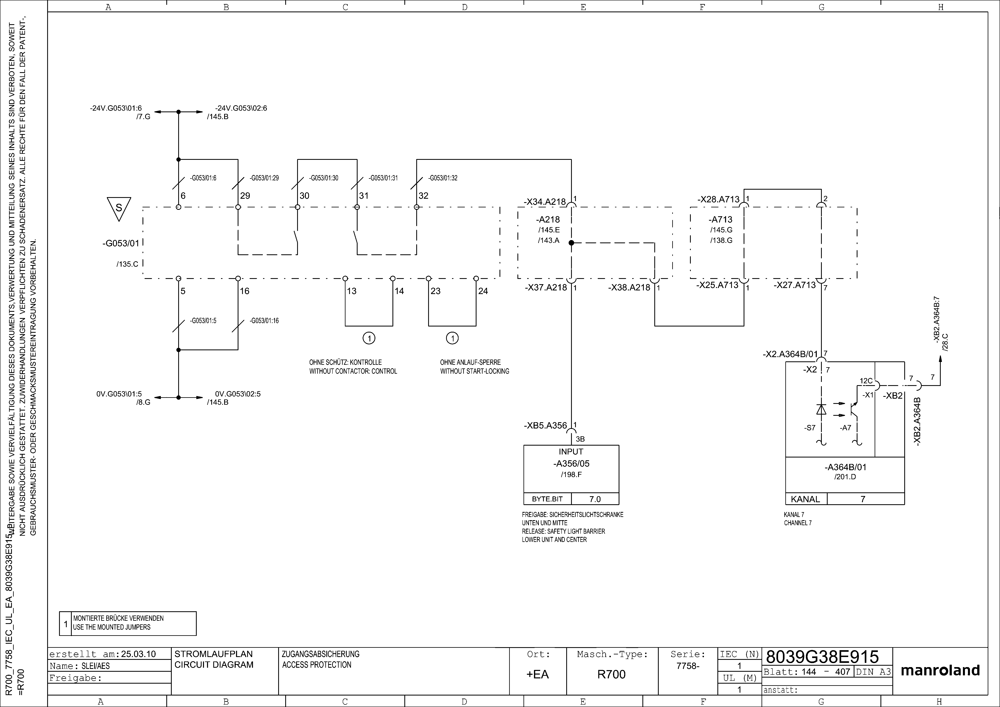

# +EA — Sheet 144 of 407 — ZUGANGSABSICHERUNG

**ACCESS PROTECTION**

> Part of the manroland **R700** printing press IEC/UL circuit diagrams.
> Drawing class: **Stromlaufplan / Circuit diagram** (DIN A3).
> Document `+EA` covers the **Printing unit** machine section.

## At a glance

| Field | Value |
|---|---|
| Document | `+EA`  (8039G38E915) |
| Sheet | **144** of 407 |
| Section (DE) | ZUGANGSABSICHERUNG |
| Section (EN) | ACCESS PROTECTION |
| Section type | CIRCUIT — Circuit diagram |
| Machine type | `R700` |
| Series | `7758` |
| Created | 25.03.10 |
| Replaces | — |
| Columns used | A, B, C, D, E, F, G, H |
| Path numbers | — |
| Labels on sheet | 89 |
| Cross-refs out | 12 |
| Cross-refs in | 22 |

**Previous:** [+EA sheet 143](SHEET_0143.md) · **Next:** [+EA sheet 145](SHEET_0145.md) · **Document TOC:** [_TOC.md](_TOC.md)  (+EA) · **Master TOC:** [all sheets](../_MASTER_TOC.md)

## Sheet image (300 DPI, exact vector render)



_Rendered directly from the PDF vector layer at 300 DPI (1-bit), no OCR and no resampling. Use it to confirm anything ambiguous in the text below._

## Cross-references on this sheet

Each entry is a wire leaving this sheet. The printed token is `/sheet.column`; the link resolves to that sheet inside the same document.

| Ref | Target sheet | Col | Path | Destination on target | Target section | From col |
|---|---|---|---|---|---|---|
| `/7.G` | [+EA sheet 7](SHEET_0007.md) | G | — | 24V.G053\01:6 24V.G053\02:6 | SPANNUNGSVERSORGUNG: 400V, 24V | B |
| `/145.B` | [+EA sheet 145](SHEET_0145.md) | B | — | — | ZUGANGSABSICHERUNG | B |
| `/145.E` | [+EA sheet 145](SHEET_0145.md) | E | — | — | ZUGANGSABSICHERUNG | E |
| `/143.A` | [+EA sheet 143](SHEET_0143.md) | A | — | — | ZUGANGSABSICHERUNG | E |
| `/145.G` | [+EA sheet 145](SHEET_0145.md) | G | — | — | ZUGANGSABSICHERUNG | F |
| `/138.G` | [+EA sheet 138](SHEET_0138.md) | G | — | — | ZUGANGSABSICHERUNG | F |
| `/135.C` | [+EA sheet 135](SHEET_0135.md) | C | — | — | ZUGANGSABSICHERUNG | A |
| `/28.C` | [+EA sheet 28](SHEET_0028.md) | C | — | XB2.A364B:7 | BUSVERBINDUNGEN: SICHERHEITSBUS | H |
| `/8.G` | [+EA sheet 8](SHEET_0008.md) | G | — | 0V.G053\01:5 | SPANNUNGSVERSORGUNG: 400V, 24V | A |
| `/145.B` | [+EA sheet 145](SHEET_0145.md) | B | — | 0V.G053\01:5 | ZUGANGSABSICHERUNG | A |
| `/198.F` | [+EA sheet 198](SHEET_0198.md) | F | — | — | REFERENZMODUL | E |
| `/201.D` | [+EA sheet 201](SHEET_0201.md) | D | — | — | REFERENZMODUL | G |

### Incoming references (sheets that point here)

Every other sheet that sends a wire to this one. `Back-ref` is the token printed on *that* sheet; `Path` is its line number.

| From sheet | Cols | Back-ref | Path | Refs | What continues there |
|---|---|---|---|---|---|
| [+EA#7](SHEET_0007.md) | H | `/7.H` | — | 1 | 24V.G053\01:6 |
| [+EA#8](SHEET_0008.md) | G | `/8.G` | — | 1 | 0V.G053\01:5 |
| [+EA#28](SHEET_0028.md) | C | `/28.C` | — | 1 | — |
| [+EA#135](SHEET_0135.md) | D | `/135.D` | — | 1 | G053/01 |
| [+EA#138](SHEET_0138.md) | F | `/138.F` | — | 1 | — |
| [+EA#143](SHEET_0143.md) | A | `/143.A` | — | 1 | — |
| [+EA#145](SHEET_0145.md) | B, E, F | `/145.B`, `/145.E`, `/145.F` | — | 4 | 0V.G053\02:5; 24V.G053\02:6 24V.G053\03:6 |
| [+EA#198](SHEET_0198.md) | F | `/198.F` | — | 1 | — |
| [+EA#201](SHEET_0201.md) | D | `/201.D` | — | 1 | — |
| [+EA#227](SHEET_0227.md) | B, D | `/227.B`, `/227.D` | — | 2 | — |
| [+EA#241](SHEET_0241.md) | H | `/241.H` | — | 1 | — |
| [+EA#268](SHEET_0268.md) | G | `/268.G` | — | 1 | — |
| [+EA#272](SHEET_0272.md) | A | `/272.A` | — | 1 | — |
| [+EA#273](SHEET_0273.md) | F | `/273.F` | — | 2 | — |
| [+EA#277](SHEET_0277.md) | G | `/277.G` | — | 1 | — |
| [+EA#279](SHEET_0279.md) | E | `/279.E` | — | 1 | — |
| [+EA#280](SHEET_0280.md) | A | `/280.A` | — | 1 | — |


## Devices on this sheet

| Tag | Class | Class meaning (IEC) | Col | Sub | Terminal | Sign |
|---|---|---|---|---|---|---|
| `A356/05` | A | Baugruppe / assembly, module, PC board | E | 05 | — | — |
| `G053/01` | G | Stromversorgung / power supply | A | 01 | — | — |
| `A218` | A | Baugruppe / assembly, module, PC board | E | — | — | — |
| `A713` | A | Baugruppe / assembly, module, PC board | F | — | — | — |
| `S7` | S | Schalter / switch | G | — | — | — |
| `A7` | A | Baugruppe / assembly, module, PC board | G | — | — | — |
| `X1` | X | Klemme / terminal, plug connector | G | — | — | — |
| `X2` | X | Klemme / terminal, plug connector | G | — | — | — |
| `XB2` | XB |  | H | — | — | — |
| `G053/01:6` | G | Stromversorgung / power supply | B | 01 | 6 | — |
| `G053/01:29` | G | Stromversorgung / power supply | B | 01 | 29 | — |
| `G053/01:30` | G | Stromversorgung / power supply | C | 01 | 30 | — |
| `G053/01:32` | G | Stromversorgung / power supply | D | 01 | 32 | — |
| `G053/01:31` | G | Stromversorgung / power supply | C | 01 | 31 | — |
| `G053/01:5` | G | Stromversorgung / power supply | B | 01 | 5 | — |
| `G053/01:16` | G | Stromversorgung / power supply | B | 01 | 16 | — |
| `X37.A218` | — | cross-device reference | E | — | — | — |
| `X34.A218` | — | cross-device reference | E | — | — | — |
| `7.0` | — | cross-device reference | E | — | — | — |
| `XB5.A356` | — | cross-device reference | E | — | — | — |
| `X38.A218` | — | cross-device reference | E | — | — | — |
| `X28.A713` | — | cross-device reference | F | — | — | — |
| `XB2.A364B` | — | cross-device reference | H | — | — | — |
| `X27.A713` | — | cross-device reference | G | — | — | — |
| `X25.A713` | — | cross-device reference | F | — | — | — |
| `XB2.A364B:7` | — | cross-device reference | H | — | 7 | — |

## Potentials / nets

| Potential | Count | Columns | Attached devices | Terminals |
|---|---|---|---|---|
| `0V` | 2 | A, B | `G053\01`, `G053\02` | `5` |
| `24V` | 2 | A, B | `G053\01`, `G053\02` | `6` |


A potential such as `L24+/4` or `M24+` is a named supply/return rail; every place it appears on this sheet is electrically common.

## Wire-end annotations (grouped as printed)

A wire that continues elsewhere is annotated with a small cluster: the destination description, the path/line number `#NN`, and the `/sheet.column` cross reference. Each row below is one such cluster exactly as it is grouped on the drawing.

| Col | Y | Path | Cross-ref | Text on the wire |
|---|---|---|---|---|
| B | 125.0 | — | `/7.G` | `24V.G053\01:6 24V.G053\02:6` |
| B | 134.9 | — | `/145.B` | — |
| C | 209.0 | — | — | `G053/01:6 G053/01:29 G053/01:30 G053/01:31 G053/01:32` |
| C | 228.5 | — | — | `6 29 30 31 32` |
| E | 232.8 | — | — | `X34.A218 1` |
| G | 232.8 | — | — | `X28.A713 1 2` |
| A | 242.0 | — | — | `S` |
| E | 256.8 | — | — | `A218` |
| F | 256.8 | — | — | `A713` |
| E | 269.9 | — | `/145.E`, `/143.A` | — |
| F | 269.9 | — | `/145.G`, `/138.G` | — |
| A | 285.2 | — | — | `G053/01` |
| A | 310.7 | — | `/135.C` | — |
| G | 334.8 | — | — | `X25.A713 1 X27.A713 7` |
| E | 337.6 | — | — | `X37.A218 1` |
| E | 337.6 | — | — | `X38.A218 1` |
| B | 341.9 | — | — | `5` |
| B | 341.9 | — | — | `16` |
| D | 341.9 | — | — | `13 14 23 24` |
| H | 352.6 | — | `/28.C` | `XB2.A364B:7` |
| B | 379.1 | — | — | `G053/01:5` |
| B | 379.1 | — | — | `G053/01:16` |
| D | 399.5 | — | — | `1 1` |
| G | 417.0 | — | — | `X2.A364B/01 7` |
| C | 428.7 | — | — | `OHNE SCHÜTZ: KONTROLLE WITHOUT CONTACTOR: CONTROL` |
| D | 428.7 | — | — | `OHNE ANLAUF SPERRE WITHOUT START LOCKING` |
| G | 435.4 | — | — | `X2` |
| G | 436.9 | — | — | `7 7` |
| H | 445.4 | — | — | `7` |
| G | 449.6 | — | — | `12C` |
| A | 465.2 | — | `/8.G`, `/145.B` | `0V.G053\01:5` |
| B | 465.2 | — | — | `0V.G053\02:5` |
| G | 466.6 | — | — | `X1` |
| H | 466.6 | — | — | `XB2` |
| H | 472.8 | — | — | `XB2.A364B` |
| E | 502.0 | — | — | `XB5.A356 1` |
| G | 505.6 | — | — | `S7 A7` |
| E | 519.0 | — | — | `3B` |
| E | 533.5 | — | — | `INPUT` |
| E | 547.4 | — | — | `A356/05` |
| G | 551.6 | — | — | `A364B/01` |
| E | 561.2 | — | `/198.F` | — |
| G | 564.0 | — | `/201.D` | — |
| G | 589.9 | — | — | `KANAL 7` |
| E | 590.2 | — | — | `BYTE.BIT 7.0` |
| E | 610.2 | — | — | `FREIGABE: SICHERHEITSLICHTSCHRANKE UNTEN UND MITTE RELEASE: SAFETY LIGHT BARRIER LOWER UNIT AND CENTER` |
| G | 610.2 | — | — | `KANAL 7 CHANNEL 7` |
| A | 733.4 | — | — | `1 USE THE MOUNTED JUMPERS MONTIERTE BRÜCKE VERWENDEN` |


## Reconstructed tables

This sheet carries tabular content (pin map / terminal assignment / index). The grid below was rebuilt from the drawing's own rule lines, so each row is exactly one physical row of the table.

### Table 1 — 8 data rows × 19 columns (at x=212.6, y=189.9)

| G053/01:6 | G053/01:29 | G053/01:30 |  | G053/01:31 |  |  | G053/01:32 |  |  |  |  |  |  |  |  |  |  |  |
|---|---|---|---|---|---|---|---|---|---|---|---|---|---|---|---|---|---|---|
| `6` | `29` | `30` |  | `31` |  | `32` |  |  | `X34.A218 A218 /145.E /143.A` | `1` |  | `X28.A713 A713 /145.G /138.G` | `1` |  | `2` |  |  |  |
| `5 G053/01:5` | `16 G053/01:16` |  | `13` |  | `14` |  | `23` | `24` | `X37.A218` | `1` | `X38.A218` | `X25.A713 1` | `1` | `X27.A713` | `7` |  |  | `XB2.A364B:7` |
|  |  |  |  | `1` |  |  | `1` |  |  |  |  |  |  |  |  |  |  |  |
|  |  |  |  |  |  |  |  |  |  |  |  |  |  | `X2.A364B/01` | `7` |  |  |  |
| `0V.G053\02:5 /145.B` |  | `OHNE SCHÜTZ: WITHOUT` | `CONTACTOR:` | `KONTROLLE CONTROL` |  |  | `OHNE WITHOUT` | `ANLAUF SPERRE START LOCKING` | `XB5.A356` | `1 3B` |  |  |  | `X2 S7` | `7 A7` | `12C X1` | `XB2` | `7 7 XB2.A364B` |
|  |  |  |  |  |  |  |  |  | `INPUT` |  |  |  |  |  |  |  |  |  |
|  |  |  |  |  |  |  |  |  |  | `A356/05 /198.F` |  |  |  |  | `A364B/01 /201.D` |  |  |  |
|  |  |  |  |  |  |  |  |  | `BYTE.BIT` | `7.0` |  |  |  | `KANAL` |  | `7` |  |  |


## Notes and free text on this sheet

| Text | Col | Y (pt) |
|---|---|---|
| `3B` | E | 519.01 |
| `INPUT` | E | 533.55 |
| `BYTE.BIT` | E | 590.8 |
| `FREIGABE: SICHERHEITSLICHTSCHRANKE` | E | 610.24 |
| `UNTEN UND MITTE` | E | 620.15 |
| `RELEASE: SAFETY LIGHT BARRIER` | E | 630.14 |
| `LOWER UNIT AND CENTER` | E | 640.04 |
| `KANAL 7` | G | 610.23 |
| `CHANNEL 7` | G | 620.18 |
| `12C` | G | 449.62 |
| `KANAL` | G | 589.91 |
| `A364B/01` | G | 551.64 |
| `X2.A364B/01` | G | 417 |
| `MONTIERTE BRÜCKE VERWENDEN` | A | 733.37 |
| `USE THE MOUNTED JUMPERS` | A | 744.02 |
| `OHNE ANLAUF SPERRE` | D | 428.66 |
| `WITHOUT START LOCKING` | D | 439.28 |
| `OHNE SCHÜTZ: KONTROLLE` | C | 428.67 |
| `WITHOUT CONTACTOR: CONTROL` | C | 439.3 |
| `S` | A | 242.03 |

## Complete label inventory (exact text from the drawing)

Every text object inside the drawing area of this sheet, in DIN reading order (column A→H, then top→bottom). This is the authoritative list: if a string is not here it is not printed on this sheet.

| Col | Y | X | Dir | Type | Text |
|---|---|---|---|---|---|
| A | 125.0 | 107.1 | → | potential | `24V.G053\01:6` |
| A | 134.9 | 162.4 | → | cross-reference | `/7.G` |
| A | 242.0 | 137.6 | → | text | `S` |
| A | 285.2 | 122.2 | → | device tag | `G053/01` |
| A | 310.7 | 138.9 | → | cross-reference | `/135.C` |
| A | 465.2 | 114.8 | → | potential | `0V.G053\01:5` |
| A | 475.1 | 162.4 | → | cross-reference | `/8.G` |
| A | 733.4 | 87.3 | → | text | `MONTIERTE BRÜCKE VERWENDEN` |
| A | 738.7 | 75.4 | → | number | `1` |
| A | 744.0 | 87.0 | → | text | `USE THE MOUNTED JUMPERS` |
| B | 125.0 | 256.3 | → | potential | `24V.G053\02:6` |
| B | 134.9 | 246.6 | → | cross-reference | `/145.B` |
| B | 209.0 | 226.5 | → | device tag | `G053/01:6` |
| B | 209.0 | 297.4 | → | device tag | `G053/01:29` |
| B | 228.5 | 215.1 | → | number | `6` |
| B | 228.5 | 286.0 | → | number | `29` |
| B | 341.8 | 214.9 | → | number | `5` |
| B | 341.8 | 285.2 | → | number | `16` |
| B | 379.1 | 226.5 | → | device tag | `G053/01:5` |
| B | 379.1 | 297.4 | → | device tag | `G053/01:16` |
| B | 465.2 | 256.3 | → | potential | `0V.G053\02:5` |
| B | 475.1 | 246.6 | → | cross-reference | `/145.B` |
| C | 209.0 | 368.2 | → | device tag | `G053/01:30` |
| C | 209.0 | 439.1 | → | device tag | `G053/01:31` |
| C | 228.5 | 356.6 | → | number | `30` |
| C | 228.5 | 427.5 | → | number | `31` |
| C | 341.8 | 412.7 | → | number | `13` |
| C | 341.8 | 469.4 | → | number | `14` |
| C | 399.5 | 437.6 | → | number | `1` |
| C | 428.7 | 368.2 | → | text | `OHNE SCHÜTZ: KONTROLLE` |
| C | 439.3 | 368.5 | → | text | `WITHOUT CONTACTOR: CONTROL` |
| D | 209.0 | 510.0 | → | device tag | `G053/01:32` |
| D | 228.5 | 498.3 | → | number | `32` |
| D | 341.8 | 512.8 | → | number | `23` |
| D | 341.8 | 569.5 | → | number | `24` |
| D | 399.5 | 536.8 | → | number | `1` |
| D | 428.7 | 524.1 | → | text | `OHNE ANLAUF SPERRE` |
| D | 439.3 | 524.4 | → | text | `WITHOUT START LOCKING` |
| E | 232.8 | 682.3 | → | number | `1` |
| E | 235.6 | 623.6 | → | device ref | `X34.A218` |
| E | 256.8 | 638.4 | → | device tag | `A218` |
| E | 269.9 | 641.2 | → | cross-reference | `/145.E` |
| E | 282.3 | 640.6 | → | cross-reference | `/143.A` |
| E | 337.6 | 625.0 | → | device ref | `X37.A218` |
| E | 337.6 | 724.3 | → | device ref | `X38.A218` |
| E | 339.1 | 682.3 | → | number | `1` |
| E | 502.0 | 623.9 | → | device ref | `XB5.A356` |
| E | 502.1 | 682.3 | → | number | `1` |
| E | 519.0 | 685.7 | → | text | `3B` |
| E | 533.6 | 665.4 | → | text | `INPUT` |
| E | 547.4 | 658.9 | → | device tag | `A356/05` |
| E | 561.2 | 668.0 | → | cross-reference | `/198.F` |
| E | 590.2 | 701.9 | → | device ref | `7.0` |
| E | 590.8 | 633.5 | → | text | `BYTE.BIT` |
| E | 610.2 | 621.6 | → | text | `FREIGABE: SICHERHEITSLICHTSCHRANKE` |
| E | 620.1 | 621.6 | → | text | `UNTEN UND MITTE` |
| E | 630.1 | 621.6 | → | text | `RELEASE: SAFETY LIGHT BARRIER` |
| E | 640.0 | 621.6 | → | text | `LOWER UNIT AND CENTER` |
| F | 232.7 | 830.6 | → | device ref | `X28.A713` |
| F | 232.8 | 887.8 | → | number | `1` |
| F | 256.8 | 843.9 | → | device tag | `A713` |
| F | 269.9 | 845.9 | → | cross-reference | `/145.G` |
| F | 282.3 | 845.9 | → | cross-reference | `/138.G` |
| F | 334.8 | 829.1 | → | device ref | `X25.A713` |
| F | 339.1 | 781.5 | → | number | `1` |
| F | 339.1 | 887.8 | → | number | `1` |
| G | 232.8 | 980.5 | → | number | `2` |
| G | 334.8 | 921.3 | → | device ref | `X27.A713` |
| G | 339.1 | 980.5 | → | number | `7` |
| G | 417.0 | 908.2 | → | text | `X2.A364B/01` |
| G | 417.0 | 980.5 | → | number | `7` |
| G | 435.4 | 956.4 | → | device tag | `X2` |
| G | 436.9 | 983.3 | → | number | `7` |
| G | 449.6 | 1023.3 | → | text | `12C` |
| G | 466.6 | 1027.0 | → | device tag | `X1` |
| G | 505.6 | 957.5 | → | device tag | `S7` |
| G | 505.6 | 1000.1 | → | device tag | `A7` |
| G | 551.6 | 982.1 | → | text | `A364B/01` |
| G | 564.0 | 993.5 | → | cross-reference | `/201.D` |
| G | 589.9 | 941.7 | → | text | `KANAL` |
| G | 589.9 | 1024.7 | → | number | `7` |
| G | 610.2 | 933.4 | → | text | `KANAL 7` |
| G | 620.2 | 933.7 | → | text | `CHANNEL 7` |
| H | 352.6 | 1111.4 | ↕ | device ref | `XB2.A364B:7` |
| H | 397.1 | 1121.4 | ↕ | cross-reference | `/28.C` |
| H | 445.4 | 1108.1 | → | number | `7` |
| H | 446.8 | 1082.6 | → | number | `7` |
| H | 466.6 | 1051.4 | → | device tag | `XB2` |
| H | 472.8 | 1087.4 | ↕ | device ref | `XB2.A364B` |

## Reading-order text block

The same content as a plain block, grouped by DIN column — convenient to paste or to match against a visual description.

```text
=== Column A ===
 125.0  107.1  net          24V.G053\01:6
 134.9  162.4  xref         /7.G
 242.0  137.6  text         S
 285.2  122.2  devtag       G053/01
 310.7  138.9  xref         /135.C
 465.2  114.8  net          0V.G053\01:5
 475.1  162.4  xref         /8.G
 733.4   87.3  text         MONTIERTE BRÜCKE VERWENDEN
 738.7   75.4  numeric      1
 744.0   87.0  text         USE THE MOUNTED JUMPERS
=== Column B ===
 125.0  256.3  net          24V.G053\02:6
 134.9  246.6  xref         /145.B
 209.0  226.5  devtag       G053/01:6
 209.0  297.4  devtag       G053/01:29
 228.5  215.1  numeric      6
 228.5  286.0  numeric      29
 341.8  214.9  numeric      5
 341.8  285.2  numeric      16
 379.1  226.5  devtag       G053/01:5
 379.1  297.4  devtag       G053/01:16
 465.2  256.3  net          0V.G053\02:5
 475.1  246.6  xref         /145.B
=== Column C ===
 209.0  368.2  devtag       G053/01:30
 209.0  439.1  devtag       G053/01:31
 228.5  356.6  numeric      30
 228.5  427.5  numeric      31
 341.8  412.7  numeric      13
 341.8  469.4  numeric      14
 399.5  437.6  numeric      1
 428.7  368.2  text         OHNE SCHÜTZ: KONTROLLE
 439.3  368.5  text         WITHOUT CONTACTOR: CONTROL
=== Column D ===
 209.0  510.0  devtag       G053/01:32
 228.5  498.3  numeric      32
 341.8  512.8  numeric      23
 341.8  569.5  numeric      24
 399.5  536.8  numeric      1
 428.7  524.1  text         OHNE ANLAUF SPERRE
 439.3  524.4  text         WITHOUT START LOCKING
=== Column E ===
 232.8  682.3  numeric      1
 235.6  623.6  devref       X34.A218
 256.8  638.4  devtag       A218
 269.9  641.2  xref         /145.E
 282.3  640.6  xref         /143.A
 337.6  625.0  devref       X37.A218
 337.6  724.3  devref       X38.A218
 339.1  682.3  numeric      1
 502.0  623.9  devref       XB5.A356
 502.1  682.3  numeric      1
 519.0  685.7  text         3B
 533.6  665.4  text         INPUT
 547.4  658.9  devtag       A356/05
 561.2  668.0  xref         /198.F
 590.2  701.9  devref       7.0
 590.8  633.5  text         BYTE.BIT
 610.2  621.6  text         FREIGABE: SICHERHEITSLICHTSCHRANKE
 620.1  621.6  text         UNTEN UND MITTE
 630.1  621.6  text         RELEASE: SAFETY LIGHT BARRIER
 640.0  621.6  text         LOWER UNIT AND CENTER
=== Column F ===
 232.7  830.6  devref       X28.A713
 232.8  887.8  numeric      1
 256.8  843.9  devtag       A713
 269.9  845.9  xref         /145.G
 282.3  845.9  xref         /138.G
 334.8  829.1  devref       X25.A713
 339.1  781.5  numeric      1
 339.1  887.8  numeric      1
=== Column G ===
 232.8  980.5  numeric      2
 334.8  921.3  devref       X27.A713
 339.1  980.5  numeric      7
 417.0  908.2  text         X2.A364B/01
 417.0  980.5  numeric      7
 435.4  956.4  devtag       X2
 436.9  983.3  numeric      7
 449.6 1023.3  text         12C
 466.6 1027.0  devtag       X1
 505.6  957.5  devtag       S7
 505.6 1000.1  devtag       A7
 551.6  982.1  text         A364B/01
 564.0  993.5  xref         /201.D
 589.9  941.7  text         KANAL
 589.9 1024.7  numeric      7
 610.2  933.4  text         KANAL 7
 620.2  933.7  text         CHANNEL 7
=== Column H ===
 352.6 1111.4  devref       XB2.A364B:7
 397.1 1121.4  xref         /28.C
 445.4 1108.1  numeric      7
 446.8 1082.6  numeric      7
 466.6 1051.4  devtag       XB2
 472.8 1087.4  devref       XB2.A364B
```

---
_Generated from the PDF vector text layer; no OCR. Source: `R700_7758_IEC_UL_EA_8039G38E915_p`, sheet 144._
