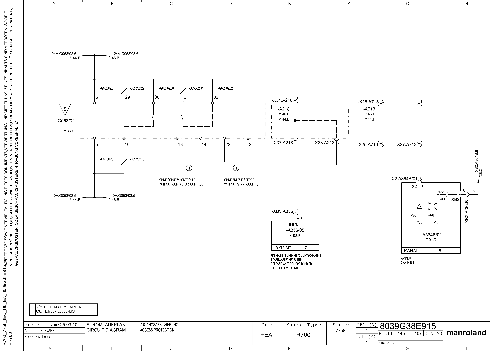

# +EA — Sheet 145 of 407 — ZUGANGSABSICHERUNG

**ACCESS PROTECTION**

> Part of the manroland **R700** printing press IEC/UL circuit diagrams.
> Drawing class: **Stromlaufplan / Circuit diagram** (DIN A3).
> Document `+EA` covers the **Printing unit** machine section.

## At a glance

| Field | Value |
|---|---|
| Document | `+EA`  (8039G38E915) |
| Sheet | **145** of 407 |
| Section (DE) | ZUGANGSABSICHERUNG |
| Section (EN) | ACCESS PROTECTION |
| Section type | CIRCUIT — Circuit diagram |
| Machine type | `R700` |
| Series | `7758` |
| Created | 25.03.10 |
| Replaces | — |
| Columns used | A, B, C, D, E, F, G, H |
| Path numbers | — |
| Labels on sheet | 89 |
| Cross-refs out | 12 |
| Cross-refs in | 22 |

**Previous:** [+EA sheet 144](SHEET_0144.md) · **Next:** [+EA sheet 146](SHEET_0146.md) · **Document TOC:** [_TOC.md](_TOC.md)  (+EA) · **Master TOC:** [all sheets](../_MASTER_TOC.md)

## Sheet image (300 DPI, exact vector render)



_Rendered directly from the PDF vector layer at 300 DPI (1-bit), no OCR and no resampling. Use it to confirm anything ambiguous in the text below._

## Cross-references on this sheet

Each entry is a wire leaving this sheet. The printed token is `/sheet.column`; the link resolves to that sheet inside the same document.

| Ref | Target sheet | Col | Path | Destination on target | Target section | From col |
|---|---|---|---|---|---|---|
| `/144.B` | [+EA sheet 144](SHEET_0144.md) | B | — | 24V.G053\02:6 24V.G053\03:6 | ZUGANGSABSICHERUNG | B |
| `/146.B` | [+EA sheet 146](SHEET_0146.md) | B | — | — | ZUGANGSABSICHERUNG | B |
| `/146.E` | [+EA sheet 146](SHEET_0146.md) | E | — | — | ZUGANGSABSICHERUNG | E |
| `/144.E` | [+EA sheet 144](SHEET_0144.md) | E | — | — | ZUGANGSABSICHERUNG | E |
| `/146.F` | [+EA sheet 146](SHEET_0146.md) | F | — | — | ZUGANGSABSICHERUNG | F |
| `/144.F` | [+EA sheet 144](SHEET_0144.md) | F | — | — | ZUGANGSABSICHERUNG | F |
| `/136.C` | [+EA sheet 136](SHEET_0136.md) | C | — | — | ZUGANGSABSICHERUNG | A |
| `/28.C` | [+EA sheet 28](SHEET_0028.md) | C | — | XB2.A364B:8 | BUSVERBINDUNGEN: SICHERHEITSBUS | H |
| `/144.B` | [+EA sheet 144](SHEET_0144.md) | B | — | 0V.G053\02:5 | ZUGANGSABSICHERUNG | B |
| `/146.B` | [+EA sheet 146](SHEET_0146.md) | B | — | 0V.G053\02:5 | ZUGANGSABSICHERUNG | B |
| `/198.F` | [+EA sheet 198](SHEET_0198.md) | F | — | — | REFERENZMODUL | E |
| `/201.D` | [+EA sheet 201](SHEET_0201.md) | D | — | — | REFERENZMODUL | G |

### Incoming references (sheets that point here)

Every other sheet that sends a wire to this one. `Back-ref` is the token printed on *that* sheet; `Path` is its line number.

| From sheet | Cols | Back-ref | Path | Refs | What continues there |
|---|---|---|---|---|---|
| [+EA#28](SHEET_0028.md) | C | `/28.C` | — | 1 | — |
| [+EA#136](SHEET_0136.md) | D | `/136.D` | — | 1 | G053/02 |
| [+EA#144](SHEET_0144.md) | A, B, E, F | `/144.A`, `/144.B`, `/144.E`, `/144.F` | — | 4 | 0V.G053\01:5 |
| [+EA#146](SHEET_0146.md) | B, E, F | `/146.B`, `/146.E`, `/146.F` | — | 4 | 0V.G053\03:5; 24V.G053\03:6 24V.G053\04:6 |
| [+EA#198](SHEET_0198.md) | F | `/198.F` | — | 1 | — |
| [+EA#201](SHEET_0201.md) | D | `/201.D` | — | 1 | — |
| [+EA#227](SHEET_0227.md) | B, D | `/227.B`, `/227.D` | — | 2 | — |
| [+EA#241](SHEET_0241.md) | H | `/241.H` | — | 1 | — |
| [+EA#268](SHEET_0268.md) | G | `/268.G` | — | 1 | — |
| [+EA#272](SHEET_0272.md) | A | `/272.A` | — | 1 | — |
| [+EA#273](SHEET_0273.md) | F | `/273.F` | — | 2 | — |
| [+EA#277](SHEET_0277.md) | G | `/277.G` | — | 1 | — |
| [+EA#279](SHEET_0279.md) | E | `/279.E` | — | 1 | — |
| [+EA#280](SHEET_0280.md) | A | `/280.A` | — | 1 | — |


## Devices on this sheet

| Tag | Class | Class meaning (IEC) | Col | Sub | Terminal | Sign |
|---|---|---|---|---|---|---|
| `G053/02` | G | Stromversorgung / power supply | A | 02 | — | — |
| `A218` | A | Baugruppe / assembly, module, PC board | E | — | — | — |
| `A356/05` | A | Baugruppe / assembly, module, PC board | E | 05 | — | — |
| `A713` | A | Baugruppe / assembly, module, PC board | F | — | — | — |
| `S8` | S | Schalter / switch | G | — | — | — |
| `A8` | A | Baugruppe / assembly, module, PC board | G | — | — | — |
| `X1` | X | Klemme / terminal, plug connector | H | — | — | — |
| `X2` | X | Klemme / terminal, plug connector | G | — | — | — |
| `XB2` | XB |  | H | — | — | — |
| `G053/02:6` | G | Stromversorgung / power supply | B | 02 | 6 | — |
| `G053/02:29` | G | Stromversorgung / power supply | B | 02 | 29 | — |
| `G053/02:30` | G | Stromversorgung / power supply | C | 02 | 30 | — |
| `G053/02:32` | G | Stromversorgung / power supply | D | 02 | 32 | — |
| `G053/02:31` | G | Stromversorgung / power supply | C | 02 | 31 | — |
| `G053/02:5` | G | Stromversorgung / power supply | B | 02 | 5 | — |
| `G053/02:16` | G | Stromversorgung / power supply | B | 02 | 16 | — |
| `X37.A218` | — | cross-device reference | E | — | — | — |
| `X34.A218` | — | cross-device reference | E | — | — | — |
| `7.1` | — | cross-device reference | E | — | — | — |
| `XB5.A356` | — | cross-device reference | E | — | — | — |
| `X38.A218` | — | cross-device reference | F | — | — | — |
| `X28.A713` | — | cross-device reference | F | — | — | — |
| `XB2.A364B` | — | cross-device reference | H | — | — | — |
| `X27.A713` | — | cross-device reference | G | — | — | — |
| `X25.A713` | — | cross-device reference | F | — | — | — |
| `XB2.A364B:8` | — | cross-device reference | H | — | 8 | — |

## Potentials / nets

| Potential | Count | Columns | Attached devices | Terminals |
|---|---|---|---|---|
| `0V` | 2 | A, B | `G053\02`, `G053\03` | `5` |
| `24V` | 2 | A, B | `G053\02`, `G053\03` | `6` |


A potential such as `L24+/4` or `M24+` is a named supply/return rail; every place it appears on this sheet is electrically common.

## Wire-end annotations (grouped as printed)

A wire that continues elsewhere is annotated with a small cluster: the destination description, the path/line number `#NN`, and the `/sheet.column` cross reference. Each row below is one such cluster exactly as it is grouped on the drawing.

| Col | Y | Path | Cross-ref | Text on the wire |
|---|---|---|---|---|
| B | 125.0 | — | `/144.B` | `24V.G053\02:6 24V.G053\03:6` |
| B | 134.9 | — | `/146.B` | — |
| C | 209.0 | — | — | `G053/02:6 G053/02:29 G053/02:30 G053/02:31 G053/02:32` |
| C | 228.5 | — | — | `6 29 30 31 32` |
| E | 232.8 | — | — | `X34.A218 2` |
| G | 239.8 | — | — | `X28.A713 3 4` |
| A | 256.2 | — | — | `S` |
| E | 256.8 | — | — | `A218` |
| F | 256.8 | — | — | `A713` |
| E | 269.9 | — | `/146.E`, `/144.E` | — |
| F | 269.9 | — | `/146.F`, `/144.F` | — |
| A | 285.2 | — | — | `G053/02` |
| A | 310.7 | — | `/136.C` | — |
| D | 337.6 | — | — | `16 X37.A218 2` |
| F | 337.6 | — | — | `X38.A218 2` |
| B | 341.9 | — | — | `5` |
| D | 341.9 | — | — | `13 14 23 24` |
| G | 341.9 | — | — | `X25.A713 2 X27.A713 8` |
| H | 359.7 | — | `/28.C` | `XB2.A364B:8` |
| B | 379.1 | — | — | `G053/02:5` |
| B | 379.1 | — | — | `G053/02:16` |
| C | 399.5 | — | — | `1` |
| D | 399.5 | — | — | `1` |
| G | 424.1 | — | — | `X2.A364B/01 8` |
| C | 428.7 | — | — | `OHNE SCHÜTZ: KONTROLLE WITHOUT CONTACTOR: CONTROL` |
| D | 428.7 | — | — | `OHNE ANLAUF SPERRE WITHOUT START LOCKING` |
| G | 442.5 | — | — | `X2` |
| H | 443.9 | — | — | `8 8` |
| H | 452.4 | — | — | `8` |
| H | 456.7 | — | — | `12A` |
| B | 465.2 | — | `/144.B`, `/146.B` | `0V.G053\02:5` |
| B | 465.2 | — | — | `0V.G053\03:5` |
| H | 473.7 | — | — | `X1` |
| H | 473.7 | — | — | `XB2` |
| H | 479.9 | — | — | `XB2.A364B` |
| E | 502.0 | — | — | `XB5.A356 2` |
| G | 512.7 | — | — | `S8 A8` |
| E | 519.0 | — | — | `4B` |
| E | 533.5 | — | — | `INPUT` |
| E | 547.4 | — | — | `A356/05` |
| G | 558.7 | — | — | `A364B/01` |
| E | 561.2 | — | `/198.F` | — |
| G | 571.1 | — | `/201.D` | — |
| E | 590.2 | — | — | `BYTE.BIT 7.1` |
| G | 597.0 | — | — | `KANAL 8` |
| E | 610.2 | — | — | `FREIGABE: SICHERHEITSLICHTSCHRANKE RELEASE: SAFETY LIGHT BARRIER PILE EXIT LOWER UNIT STAPELAUSFAHRT UNTEN` |
| G | 617.3 | — | — | `KANAL 8 CHANNEL 8` |
| A | 733.4 | — | — | `1 USE THE MOUNTED JUMPERS MONTIERTE BRÜCKE VERWENDEN` |


## Reconstructed tables

This sheet carries tabular content (pin map / terminal assignment / index). The grid below was rebuilt from the drawing's own rule lines, so each row is exactly one physical row of the table.

### Table 1 — 9 data rows × 19 columns (at x=226.8, y=189.9)

| G053/02:6 | G053/02:29 | G053/02:30 |  | G053/02:31 |  |  | G053/02:32 |  |  |  |  |  |  |  |  |  |  |  |
|---|---|---|---|---|---|---|---|---|---|---|---|---|---|---|---|---|---|---|
| `6` | `29` | `30` |  | `31` |  | `32` |  |  | `X34.A218 A218 /146.E /144.E` | `2` |  | `X28.A713 A713 /146.F /144.F` | `3` |  | `4` |  |  |  |
| `5 G053/02:5` | `16 G053/02:16` |  | `13` |  | `14` |  | `23` | `24` | `X37.A218` | `2` | `X38.A218` | `2 X25.A713` | `2` | `X27.A713` | `8` |  |  | `XB2.A364B:8` |
|  |  |  |  | `1` |  |  | `1` |  |  |  |  |  |  |  |  |  |  |  |
|  |  | `OHNE SCHÜTZ:` |  | `KONTROLLE` |  |  | `OHNE ANLAUF SPERRE` |  |  |  |  |  |  | `X2.A364B/01` | `8` |  |  |  |
| `0V.G053\03:5 /146.B` |  | `WITHOUT` | `CONTACTOR:` | `CONTROL` |  |  | `WITHOUT START LOCKING` |  | `XB5.A356` | `2 4B` |  |  |  | `X2 S8` | `8 A8` | `12A X1` | `XB2` | `8 8 XB2.A364B` |
|  |  |  |  |  |  |  |  |  | `INPUT` |  |  |  |  |  |  |  |  |  |
|  |  |  |  |  |  |  |  |  |  | `A356/05 /198.F` |  |  |  |  | `A364B/01 /201.D` |  |  |  |
|  |  |  |  |  |  |  |  |  | `BYTE.BIT` | `7.1` |  |  |  |  |  |  |  |  |
|  |  |  |  |  |  |  |  |  |  |  |  |  |  | `KANAL` |  | `8` |  |  |


## Notes and free text on this sheet

| Text | Col | Y (pt) |
|---|---|---|
| `4B` | E | 519.01 |
| `INPUT` | E | 533.55 |
| `BYTE.BIT` | E | 590.8 |
| `FREIGABE: SICHERHEITSLICHTSCHRANKE` | E | 610.24 |
| `STAPELAUSFAHRT UNTEN` | E | 620.16 |
| `RELEASE: SAFETY LIGHT BARRIER` | E | 630.14 |
| `PILE EXIT LOWER UNIT` | E | 640.06 |
| `KANAL 8` | G | 617.32 |
| `CHANNEL 8` | G | 627.26 |
| `12A` | H | 456.66 |
| `KANAL` | G | 596.99 |
| `A364B/01` | G | 558.73 |
| `X2.A364B/01` | G | 424.09 |
| `MONTIERTE BRÜCKE VERWENDEN` | A | 733.37 |
| `USE THE MOUNTED JUMPERS` | A | 744.02 |
| `OHNE ANLAUF SPERRE` | D | 428.66 |
| `WITHOUT START LOCKING` | D | 439.28 |
| `OHNE SCHÜTZ: KONTROLLE` | C | 428.67 |
| `WITHOUT CONTACTOR: CONTROL` | C | 439.3 |
| `S` | A | 256.21 |

## Complete label inventory (exact text from the drawing)

Every text object inside the drawing area of this sheet, in DIN reading order (column A→H, then top→bottom). This is the authoritative list: if a string is not here it is not printed on this sheet.

| Col | Y | X | Dir | Type | Text |
|---|---|---|---|---|---|
| A | 125.0 | 121.3 | → | potential | `24V.G053\02:6` |
| A | 134.9 | 167.5 | → | cross-reference | `/144.B` |
| A | 256.2 | 151.8 | → | text | `S` |
| A | 285.2 | 134.9 | → | device tag | `G053/02` |
| A | 310.7 | 153.1 | → | cross-reference | `/136.C` |
| A | 465.2 | 129.0 | → | potential | `0V.G053\02:5` |
| A | 475.1 | 167.5 | → | cross-reference | `/144.B` |
| A | 733.4 | 87.3 | → | text | `MONTIERTE BRÜCKE VERWENDEN` |
| A | 738.7 | 75.4 | → | number | `1` |
| A | 744.0 | 87.0 | → | text | `USE THE MOUNTED JUMPERS` |
| B | 125.0 | 270.4 | → | potential | `24V.G053\03:6` |
| B | 134.9 | 260.8 | → | cross-reference | `/146.B` |
| B | 209.0 | 240.7 | → | device tag | `G053/02:6` |
| B | 209.0 | 311.5 | → | device tag | `G053/02:29` |
| B | 228.5 | 229.3 | → | number | `6` |
| B | 228.5 | 300.2 | → | number | `29` |
| B | 341.8 | 229.0 | → | number | `5` |
| B | 341.8 | 299.3 | → | number | `16` |
| B | 379.1 | 240.7 | → | device tag | `G053/02:5` |
| B | 379.1 | 311.5 | → | device tag | `G053/02:16` |
| B | 465.2 | 270.4 | → | potential | `0V.G053\03:5` |
| B | 475.1 | 260.8 | → | cross-reference | `/146.B` |
| C | 209.0 | 382.4 | → | device tag | `G053/02:30` |
| C | 209.0 | 453.3 | → | device tag | `G053/02:31` |
| C | 228.5 | 370.8 | → | number | `30` |
| C | 228.5 | 441.6 | → | number | `31` |
| C | 341.8 | 426.9 | → | number | `13` |
| C | 399.5 | 451.8 | → | number | `1` |
| C | 428.7 | 382.4 | → | text | `OHNE SCHÜTZ: KONTROLLE` |
| C | 439.3 | 382.7 | → | text | `WITHOUT CONTACTOR: CONTROL` |
| D | 209.0 | 524.1 | → | device tag | `G053/02:32` |
| D | 228.5 | 512.5 | → | number | `32` |
| D | 341.8 | 483.6 | → | number | `14` |
| D | 341.8 | 541.1 | → | number | `23` |
| D | 341.8 | 597.8 | → | number | `24` |
| D | 399.5 | 565.2 | → | number | `1` |
| D | 428.7 | 538.3 | → | text | `OHNE ANLAUF SPERRE` |
| D | 439.3 | 538.6 | → | text | `WITHOUT START LOCKING` |
| E | 232.8 | 711.2 | → | number | `2` |
| E | 235.6 | 652.0 | → | device ref | `X34.A218` |
| E | 256.8 | 666.7 | → | device tag | `A218` |
| E | 269.9 | 669.5 | → | cross-reference | `/146.E` |
| E | 282.3 | 669.5 | → | cross-reference | `/144.E` |
| E | 337.6 | 653.4 | → | device ref | `X37.A218` |
| E | 339.1 | 711.2 | → | number | `2` |
| E | 502.0 | 652.3 | → | device ref | `XB5.A356` |
| E | 502.1 | 711.2 | → | number | `2` |
| E | 519.0 | 714.0 | → | text | `4B` |
| E | 533.6 | 693.8 | → | text | `INPUT` |
| E | 547.4 | 687.3 | → | device tag | `A356/05` |
| E | 561.2 | 696.3 | → | cross-reference | `/198.F` |
| E | 590.2 | 731.1 | → | device ref | `7.1` |
| E | 590.8 | 661.9 | → | text | `BYTE.BIT` |
| E | 610.2 | 650.0 | → | text | `FREIGABE: SICHERHEITSLICHTSCHRANKE` |
| E | 620.2 | 650.3 | → | text | `STAPELAUSFAHRT UNTEN` |
| E | 630.1 | 650.0 | → | text | `RELEASE: SAFETY LIGHT BARRIER` |
| E | 640.1 | 650.0 | → | text | `PILE EXIT LOWER UNIT` |
| F | 239.8 | 858.9 | → | device ref | `X28.A713` |
| F | 256.8 | 872.2 | → | device tag | `A713` |
| F | 269.9 | 875.3 | → | cross-reference | `/146.F` |
| F | 282.3 | 875.3 | → | cross-reference | `/144.F` |
| F | 337.6 | 752.6 | → | device ref | `X38.A218` |
| F | 339.1 | 810.4 | → | number | `2` |
| F | 341.9 | 857.5 | → | device ref | `X25.A713` |
| G | 239.9 | 916.7 | → | number | `3` |
| G | 239.9 | 1008.9 | → | number | `4` |
| G | 341.9 | 949.6 | → | device ref | `X27.A713` |
| G | 346.2 | 916.7 | → | number | `2` |
| G | 346.2 | 1008.9 | → | number | `8` |
| G | 424.1 | 936.6 | → | text | `X2.A364B/01` |
| G | 424.1 | 1008.9 | → | number | `8` |
| G | 442.5 | 984.8 | → | device tag | `X2` |
| G | 443.9 | 1011.7 | → | number | `8` |
| G | 512.7 | 985.9 | → | device tag | `S8` |
| G | 512.7 | 1028.4 | → | device tag | `A8` |
| G | 558.7 | 1010.4 | → | text | `A364B/01` |
| G | 571.1 | 1021.9 | → | cross-reference | `/201.D` |
| G | 597.0 | 970.0 | → | text | `KANAL` |
| G | 617.3 | 961.8 | → | text | `KANAL 8` |
| G | 627.3 | 962.1 | → | text | `CHANNEL 8` |
| H | 359.7 | 1139.8 | ↕ | device ref | `XB2.A364B:8` |
| H | 404.2 | 1149.7 | ↕ | cross-reference | `/28.C` |
| H | 452.5 | 1136.4 | → | number | `8` |
| H | 453.9 | 1110.9 | → | number | `8` |
| H | 456.7 | 1051.7 | → | text | `12A` |
| H | 473.7 | 1055.3 | → | device tag | `X1` |
| H | 473.7 | 1079.7 | → | device tag | `XB2` |
| H | 479.9 | 1115.7 | ↕ | device ref | `XB2.A364B` |
| H | 597.0 | 1052.9 | → | number | `8` |

## Reading-order text block

The same content as a plain block, grouped by DIN column — convenient to paste or to match against a visual description.

```text
=== Column A ===
 125.0  121.3  net          24V.G053\02:6
 134.9  167.5  xref         /144.B
 256.2  151.8  text         S
 285.2  134.9  devtag       G053/02
 310.7  153.1  xref         /136.C
 465.2  129.0  net          0V.G053\02:5
 475.1  167.5  xref         /144.B
 733.4   87.3  text         MONTIERTE BRÜCKE VERWENDEN
 738.7   75.4  numeric      1
 744.0   87.0  text         USE THE MOUNTED JUMPERS
=== Column B ===
 125.0  270.4  net          24V.G053\03:6
 134.9  260.8  xref         /146.B
 209.0  240.7  devtag       G053/02:6
 209.0  311.5  devtag       G053/02:29
 228.5  229.3  numeric      6
 228.5  300.2  numeric      29
 341.8  229.0  numeric      5
 341.8  299.3  numeric      16
 379.1  240.7  devtag       G053/02:5
 379.1  311.5  devtag       G053/02:16
 465.2  270.4  net          0V.G053\03:5
 475.1  260.8  xref         /146.B
=== Column C ===
 209.0  382.4  devtag       G053/02:30
 209.0  453.3  devtag       G053/02:31
 228.5  370.8  numeric      30
 228.5  441.6  numeric      31
 341.8  426.9  numeric      13
 399.5  451.8  numeric      1
 428.7  382.4  text         OHNE SCHÜTZ: KONTROLLE
 439.3  382.7  text         WITHOUT CONTACTOR: CONTROL
=== Column D ===
 209.0  524.1  devtag       G053/02:32
 228.5  512.5  numeric      32
 341.8  483.6  numeric      14
 341.8  541.1  numeric      23
 341.8  597.8  numeric      24
 399.5  565.2  numeric      1
 428.7  538.3  text         OHNE ANLAUF SPERRE
 439.3  538.6  text         WITHOUT START LOCKING
=== Column E ===
 232.8  711.2  numeric      2
 235.6  652.0  devref       X34.A218
 256.8  666.7  devtag       A218
 269.9  669.5  xref         /146.E
 282.3  669.5  xref         /144.E
 337.6  653.4  devref       X37.A218
 339.1  711.2  numeric      2
 502.0  652.3  devref       XB5.A356
 502.1  711.2  numeric      2
 519.0  714.0  text         4B
 533.6  693.8  text         INPUT
 547.4  687.3  devtag       A356/05
 561.2  696.3  xref         /198.F
 590.2  731.1  devref       7.1
 590.8  661.9  text         BYTE.BIT
 610.2  650.0  text         FREIGABE: SICHERHEITSLICHTSCHRANKE
 620.2  650.3  text         STAPELAUSFAHRT UNTEN
 630.1  650.0  text         RELEASE: SAFETY LIGHT BARRIER
 640.1  650.0  text         PILE EXIT LOWER UNIT
=== Column F ===
 239.8  858.9  devref       X28.A713
 256.8  872.2  devtag       A713
 269.9  875.3  xref         /146.F
 282.3  875.3  xref         /144.F
 337.6  752.6  devref       X38.A218
 339.1  810.4  numeric      2
 341.9  857.5  devref       X25.A713
=== Column G ===
 239.9  916.7  numeric      3
 239.9 1008.9  numeric      4
 341.9  949.6  devref       X27.A713
 346.2  916.7  numeric      2
 346.2 1008.9  numeric      8
 424.1  936.6  text         X2.A364B/01
 424.1 1008.9  numeric      8
 442.5  984.8  devtag       X2
 443.9 1011.7  numeric      8
 512.7  985.9  devtag       S8
 512.7 1028.4  devtag       A8
 558.7 1010.4  text         A364B/01
 571.1 1021.9  xref         /201.D
 597.0  970.0  text         KANAL
 617.3  961.8  text         KANAL 8
 627.3  962.1  text         CHANNEL 8
=== Column H ===
 359.7 1139.8  devref       XB2.A364B:8
 404.2 1149.7  xref         /28.C
 452.5 1136.4  numeric      8
 453.9 1110.9  numeric      8
 456.7 1051.7  text         12A
 473.7 1055.3  devtag       X1
 473.7 1079.7  devtag       XB2
 479.9 1115.7  devref       XB2.A364B
 597.0 1052.9  numeric      8
```

---
_Generated from the PDF vector text layer; no OCR. Source: `R700_7758_IEC_UL_EA_8039G38E915_p`, sheet 145._
