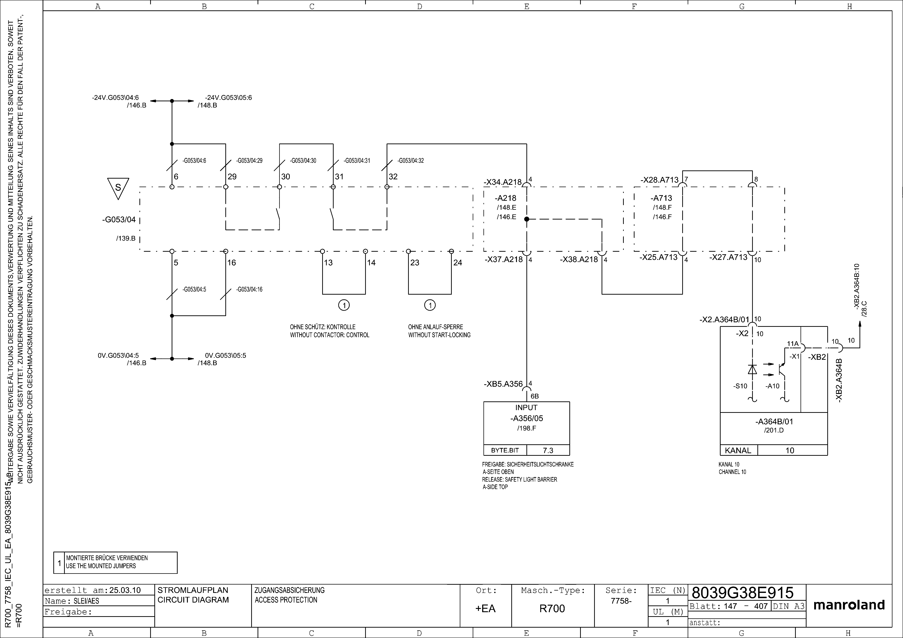

# +EA — Sheet 147 of 407 — ZUGANGSABSICHERUNG

**ACCESS PROTECTION**

> Part of the manroland **R700** printing press IEC/UL circuit diagrams.
> Drawing class: **Stromlaufplan / Circuit diagram** (DIN A3).
> Document `+EA` covers the **Printing unit** machine section.

## At a glance

| Field | Value |
|---|---|
| Document | `+EA`  (8039G38E915) |
| Sheet | **147** of 407 |
| Section (DE) | ZUGANGSABSICHERUNG |
| Section (EN) | ACCESS PROTECTION |
| Section type | CIRCUIT — Circuit diagram |
| Machine type | `R700` |
| Series | `7758` |
| Created | 25.03.10 |
| Replaces | — |
| Columns used | A, B, C, D, E, F, G, H |
| Path numbers | — |
| Labels on sheet | 89 |
| Cross-refs out | 12 |
| Cross-refs in | 22 |

**Previous:** [+EA sheet 146](SHEET_0146.md) · **Next:** [+EA sheet 148](SHEET_0148.md) · **Document TOC:** [_TOC.md](_TOC.md)  (+EA) · **Master TOC:** [all sheets](../_MASTER_TOC.md)

## Sheet image (300 DPI, exact vector render)



_Rendered directly from the PDF vector layer at 300 DPI (1-bit), no OCR and no resampling. Use it to confirm anything ambiguous in the text below._

## Cross-references on this sheet

Each entry is a wire leaving this sheet. The printed token is `/sheet.column`; the link resolves to that sheet inside the same document.

| Ref | Target sheet | Col | Path | Destination on target | Target section | From col |
|---|---|---|---|---|---|---|
| `/146.B` | [+EA sheet 146](SHEET_0146.md) | B | — | 24V.G053\04:6 | ZUGANGSABSICHERUNG | A |
| `/148.B` | [+EA sheet 148](SHEET_0148.md) | B | — | — | ZUGANGSABSICHERUNG | B |
| `/148.E` | [+EA sheet 148](SHEET_0148.md) | E | — | — | ZUGANGSABSICHERUNG | E |
| `/146.E` | [+EA sheet 146](SHEET_0146.md) | E | — | — | ZUGANGSABSICHERUNG | E |
| `/148.F` | [+EA sheet 148](SHEET_0148.md) | F | — | — | ZUGANGSABSICHERUNG | F |
| `/146.F` | [+EA sheet 146](SHEET_0146.md) | F | — | — | ZUGANGSABSICHERUNG | F |
| `/139.B` | [+EA sheet 139](SHEET_0139.md) | B | — | — | ZUGANGSABSICHERUNG | A |
| `/28.C` | [+EA sheet 28](SHEET_0028.md) | C | — | XB2.A364B:10 | BUSVERBINDUNGEN: SICHERHEITSBUS | H |
| `/146.B` | [+EA sheet 146](SHEET_0146.md) | B | — | 0V.G053\04:5 | ZUGANGSABSICHERUNG | B |
| `/148.B` | [+EA sheet 148](SHEET_0148.md) | B | — | 0V.G053\04:5 | ZUGANGSABSICHERUNG | B |
| `/198.F` | [+EA sheet 198](SHEET_0198.md) | F | — | — | REFERENZMODUL | E |
| `/201.D` | [+EA sheet 201](SHEET_0201.md) | D | — | — | REFERENZMODUL | G |

### Incoming references (sheets that point here)

Every other sheet that sends a wire to this one. `Back-ref` is the token printed on *that* sheet; `Path` is its line number.

| From sheet | Cols | Back-ref | Path | Refs | What continues there |
|---|---|---|---|---|---|
| [+EA#28](SHEET_0028.md) | C | `/28.C` | — | 1 | — |
| [+EA#139](SHEET_0139.md) | B | `/139.B` | — | 1 | — |
| [+EA#146](SHEET_0146.md) | B, E, F | `/146.B`, `/146.E`, `/146.F` | — | 4 | 0V.G053\03:5 |
| [+EA#148](SHEET_0148.md) | A, B, E, F | `/148.A`, `/148.B`, `/148.E`, `/148.F` | — | 4 | 0V.G053\05:5; 24V.G053\05:6 |
| [+EA#198](SHEET_0198.md) | F | `/198.F` | — | 1 | — |
| [+EA#201](SHEET_0201.md) | D | `/201.D` | — | 1 | — |
| [+EA#227](SHEET_0227.md) | B, D | `/227.B`, `/227.D` | — | 2 | — |
| [+EA#241](SHEET_0241.md) | H | `/241.H` | — | 1 | — |
| [+EA#268](SHEET_0268.md) | G | `/268.G` | — | 1 | — |
| [+EA#272](SHEET_0272.md) | A | `/272.A` | — | 1 | — |
| [+EA#273](SHEET_0273.md) | F | `/273.F` | — | 2 | — |
| [+EA#277](SHEET_0277.md) | G | `/277.G` | — | 1 | — |
| [+EA#279](SHEET_0279.md) | E | `/279.E` | — | 1 | — |
| [+EA#280](SHEET_0280.md) | A | `/280.A` | — | 1 | — |


## Devices on this sheet

| Tag | Class | Class meaning (IEC) | Col | Sub | Terminal | Sign |
|---|---|---|---|---|---|---|
| `G053/04` | G | Stromversorgung / power supply | A | 04 | — | — |
| `A218` | A | Baugruppe / assembly, module, PC board | E | — | — | — |
| `A356/05` | A | Baugruppe / assembly, module, PC board | E | 05 | — | — |
| `A713` | A | Baugruppe / assembly, module, PC board | F | — | — | — |
| `S10` | S | Schalter / switch | G | — | — | — |
| `A10` | A | Baugruppe / assembly, module, PC board | G | — | — | — |
| `X1` | X | Klemme / terminal, plug connector | G | — | — | — |
| `X2` | X | Klemme / terminal, plug connector | G | — | — | — |
| `XB2` | XB |  | H | — | — | — |
| `G053/04:6` | G | Stromversorgung / power supply | B | 04 | 6 | — |
| `G053/04:29` | G | Stromversorgung / power supply | B | 04 | 29 | — |
| `G053/04:30` | G | Stromversorgung / power supply | C | 04 | 30 | — |
| `G053/04:32` | G | Stromversorgung / power supply | D | 04 | 32 | — |
| `G053/04:31` | G | Stromversorgung / power supply | C | 04 | 31 | — |
| `G053/04:5` | G | Stromversorgung / power supply | B | 04 | 5 | — |
| `G053/04:16` | G | Stromversorgung / power supply | B | 04 | 16 | — |
| `X37.A218` | — | cross-device reference | E | — | — | — |
| `X34.A218` | — | cross-device reference | E | — | — | — |
| `7.3` | — | cross-device reference | E | — | — | — |
| `XB5.A356` | — | cross-device reference | E | — | — | — |
| `X38.A218` | — | cross-device reference | E | — | — | — |
| `X28.A713` | — | cross-device reference | F | — | — | — |
| `XB2.A364B` | — | cross-device reference | H | — | — | — |
| `X27.A713` | — | cross-device reference | G | — | — | — |
| `X25.A713` | — | cross-device reference | F | — | — | — |
| `XB2.A364B:10` | — | cross-device reference | H | — | 10 | — |

## Potentials / nets

| Potential | Count | Columns | Attached devices | Terminals |
|---|---|---|---|---|
| `0V` | 2 | A, B | `G053\04`, `G053\05` | `5` |
| `24V` | 2 | A, B | `G053\04`, `G053\05` | `6` |


A potential such as `L24+/4` or `M24+` is a named supply/return rail; every place it appears on this sheet is electrically common.

## Wire-end annotations (grouped as printed)

A wire that continues elsewhere is annotated with a small cluster: the destination description, the path/line number `#NN`, and the `/sheet.column` cross reference. Each row below is one such cluster exactly as it is grouped on the drawing.

| Col | Y | Path | Cross-ref | Text on the wire |
|---|---|---|---|---|
| A | 125.0 | — | `/146.B` | `24V.G053\04:6` |
| B | 125.0 | — | — | `24V.G053\05:6` |
| B | 134.9 | — | `/148.B` | — |
| C | 209.0 | — | — | `G053/04:6 G053/04:29 G053/04:30 G053/04:31 G053/04:32` |
| C | 228.5 | — | — | `6 29 30 31 32` |
| E | 232.8 | — | — | `X34.A218 4` |
| G | 232.8 | — | — | `X28.A713 7 8` |
| A | 242.0 | — | — | `S` |
| E | 256.8 | — | — | `A218` |
| F | 256.8 | — | — | `A713` |
| E | 269.9 | — | `/148.E`, `/146.E` | — |
| F | 269.9 | — | `/148.F`, `/146.F` | — |
| A | 285.2 | — | — | `G053/04` |
| A | 310.7 | — | `/139.B` | — |
| G | 334.8 | — | — | `X25.A713 4 X27.A713 10` |
| D | 337.6 | — | — | `16 X37.A218 4` |
| F | 337.6 | — | — | `X38.A218 4` |
| B | 341.9 | — | — | `5` |
| D | 341.9 | — | — | `13 14 23 24` |
| H | 347.8 | — | `/28.C` | `XB2.A364B:10` |
| B | 379.1 | — | — | `G053/04:5` |
| B | 379.1 | — | — | `G053/04:16` |
| C | 399.5 | — | — | `1` |
| D | 399.5 | — | — | `1` |
| G | 417.0 | — | — | `X2.A364B/01 10` |
| C | 428.7 | — | — | `OHNE SCHÜTZ: KONTROLLE WITHOUT CONTACTOR: CONTROL` |
| D | 428.7 | — | — | `OHNE ANLAUF SPERRE WITHOUT START LOCKING` |
| G | 435.4 | — | — | `X2` |
| H | 436.9 | — | — | `10 10` |
| H | 445.4 | — | — | `10` |
| G | 449.6 | — | — | `11A` |
| B | 465.2 | — | `/146.B`, `/148.B` | `0V.G053\04:5` |
| B | 465.2 | — | — | `0V.G053\05:5` |
| G | 466.6 | — | — | `X1` |
| H | 466.6 | — | — | `XB2` |
| H | 472.8 | — | — | `XB2.A364B` |
| E | 502.0 | — | — | `XB5.A356 4` |
| G | 505.6 | — | — | `S10 A10` |
| E | 519.0 | — | — | `6B` |
| E | 533.5 | — | — | `INPUT` |
| E | 547.4 | — | — | `A356/05` |
| G | 551.6 | — | — | `A364B/01` |
| E | 561.2 | — | `/198.F` | — |
| G | 564.0 | — | `/201.D` | — |
| G | 589.9 | — | — | `KANAL 10` |
| E | 590.2 | — | — | `BYTE.BIT 7.3` |
| E | 610.2 | — | — | `FREIGABE: SICHERHEITSLICHTSCHRANKE` |
| G | 610.2 | — | — | `KANAL 10 CHANNEL 10` |
| E | 620.2 | — | — | `RELEASE: SAFETY LIGHT BARRIER A SEITE OBEN` |
| E | 640.1 | — | — | `A SIDE TOP` |
| A | 733.4 | — | — | `1 USE THE MOUNTED JUMPERS MONTIERTE BRÜCKE VERWENDEN` |


## Reconstructed tables

This sheet carries tabular content (pin map / terminal assignment / index). The grid below was rebuilt from the drawing's own rule lines, so each row is exactly one physical row of the table.

### Table 1 — 8 data rows × 19 columns (at x=226.8, y=189.9)

| G053/04:6 | G053/04:29 | G053/04:30 |  | G053/04:31 |  |  | G053/04:32 |  |  |  |  |  |  |  |  |  |  |  |
|---|---|---|---|---|---|---|---|---|---|---|---|---|---|---|---|---|---|---|
| `6` | `29` | `30` |  | `31` |  | `32` |  |  | `X34.A218 A218 /148.E /146.E` | `4` |  | `X28.A713 A713 /148.F /146.F` | `7` |  | `8` |  |  |  |
| `5 G053/04:5` | `16 G053/04:16` |  | `13` |  | `14` |  | `23` | `24` | `X37.A218` | `4` | `X38.A218` | `X25.A713 4` | `4` | `X27.A713` | `10` |  |  | `XB2.A364B:10` |
|  |  |  |  | `1` |  |  | `1` |  |  |  |  |  |  |  |  |  |  |  |
|  |  |  |  |  |  |  |  |  |  |  |  |  |  | `X2.A364B/01` | `10` |  |  |  |
| `0V.G053\05:5 /148.B` |  | `OHNE SCHÜTZ: WITHOUT` | `CONTACTOR:` | `KONTROLLE CONTROL` |  |  | `OHNE ANLAUF SPERRE WITHOUT START LOCKING` |  | `XB5.A356` | `4 6B` |  |  |  | `X2 S10` | `10 A10` | `11A X1` | `XB2` | `10 10 XB2.A364B` |
|  |  |  |  |  |  |  |  |  | `INPUT` |  |  |  |  |  |  |  |  |  |
|  |  |  |  |  |  |  |  |  |  | `A356/05 /198.F` |  |  |  |  | `A364B/01 /201.D` |  |  |  |
|  |  |  |  |  |  |  |  |  | `BYTE.BIT` | `7.3` |  |  |  | `KANAL` |  | `10` |  |  |


## Notes and free text on this sheet

| Text | Col | Y (pt) |
|---|---|---|
| `6B` | E | 519.01 |
| `INPUT` | E | 533.55 |
| `BYTE.BIT` | E | 590.8 |
| `FREIGABE: SICHERHEITSLICHTSCHRANKE` | E | 610.24 |
| `A SEITE OBEN` | E | 620.18 |
| `RELEASE: SAFETY LIGHT BARRIER` | E | 630.14 |
| `A SIDE TOP` | E | 640.08 |
| `KANAL 10` | G | 610.23 |
| `CHANNEL 10` | G | 620.18 |
| `11A` | G | 449.58 |
| `KANAL` | G | 589.91 |
| `A364B/01` | G | 551.64 |
| `X2.A364B/01` | G | 417 |
| `MONTIERTE BRÜCKE VERWENDEN` | A | 733.37 |
| `USE THE MOUNTED JUMPERS` | A | 744.02 |
| `OHNE ANLAUF SPERRE` | D | 428.66 |
| `WITHOUT START LOCKING` | D | 439.28 |
| `OHNE SCHÜTZ: KONTROLLE` | C | 428.67 |
| `WITHOUT CONTACTOR: CONTROL` | C | 439.3 |
| `S` | A | 242.03 |

## Complete label inventory (exact text from the drawing)

Every text object inside the drawing area of this sheet, in DIN reading order (column A→H, then top→bottom). This is the authoritative list: if a string is not here it is not printed on this sheet.

| Col | Y | X | Dir | Type | Text |
|---|---|---|---|---|---|
| A | 125.0 | 121.3 | → | potential | `24V.G053\04:6` |
| A | 134.9 | 167.5 | → | cross-reference | `/146.B` |
| A | 242.0 | 151.8 | → | text | `S` |
| A | 285.2 | 134.9 | → | device tag | `G053/04` |
| A | 310.7 | 153.4 | → | cross-reference | `/139.B` |
| A | 465.2 | 129.0 | → | potential | `0V.G053\04:5` |
| A | 475.1 | 167.5 | → | cross-reference | `/146.B` |
| A | 733.4 | 87.3 | → | text | `MONTIERTE BRÜCKE VERWENDEN` |
| A | 738.7 | 75.4 | → | number | `1` |
| A | 744.0 | 87.0 | → | text | `USE THE MOUNTED JUMPERS` |
| B | 125.0 | 270.4 | → | potential | `24V.G053\05:6` |
| B | 134.9 | 260.8 | → | cross-reference | `/148.B` |
| B | 209.0 | 240.7 | → | device tag | `G053/04:6` |
| B | 209.0 | 311.5 | → | device tag | `G053/04:29` |
| B | 228.5 | 229.3 | → | number | `6` |
| B | 228.5 | 300.2 | → | number | `29` |
| B | 341.8 | 229.0 | → | number | `5` |
| B | 341.8 | 299.3 | → | number | `16` |
| B | 379.1 | 240.7 | → | device tag | `G053/04:5` |
| B | 379.1 | 311.5 | → | device tag | `G053/04:16` |
| B | 465.2 | 270.4 | → | potential | `0V.G053\05:5` |
| B | 475.1 | 260.8 | → | cross-reference | `/148.B` |
| C | 209.0 | 382.4 | → | device tag | `G053/04:30` |
| C | 209.0 | 453.3 | → | device tag | `G053/04:31` |
| C | 228.5 | 370.8 | → | number | `30` |
| C | 228.5 | 441.6 | → | number | `31` |
| C | 341.8 | 426.9 | → | number | `13` |
| C | 399.5 | 451.8 | → | number | `1` |
| C | 428.7 | 382.4 | → | text | `OHNE SCHÜTZ: KONTROLLE` |
| C | 439.3 | 382.7 | → | text | `WITHOUT CONTACTOR: CONTROL` |
| D | 209.0 | 524.1 | → | device tag | `G053/04:32` |
| D | 228.5 | 512.5 | → | number | `32` |
| D | 341.8 | 483.6 | → | number | `14` |
| D | 341.8 | 541.1 | → | number | `23` |
| D | 341.8 | 597.8 | → | number | `24` |
| D | 399.5 | 565.2 | → | number | `1` |
| D | 428.7 | 538.3 | → | text | `OHNE ANLAUF SPERRE` |
| D | 439.3 | 538.6 | → | text | `WITHOUT START LOCKING` |
| E | 232.8 | 697.0 | → | number | `4` |
| E | 235.6 | 637.8 | → | device ref | `X34.A218` |
| E | 256.8 | 652.5 | → | device tag | `A218` |
| E | 269.9 | 655.4 | → | cross-reference | `/148.E` |
| E | 282.3 | 655.4 | → | cross-reference | `/146.E` |
| E | 337.6 | 639.2 | → | device ref | `X37.A218` |
| E | 337.6 | 738.4 | → | device ref | `X38.A218` |
| E | 339.1 | 697.0 | → | number | `4` |
| E | 502.0 | 638.1 | → | device ref | `XB5.A356` |
| E | 502.1 | 697.0 | → | number | `4` |
| E | 519.0 | 699.9 | → | text | `6B` |
| E | 533.6 | 679.6 | → | text | `INPUT` |
| E | 547.4 | 673.1 | → | device tag | `A356/05` |
| E | 561.2 | 682.2 | → | cross-reference | `/198.F` |
| E | 590.2 | 716.0 | → | device ref | `7.3` |
| E | 590.8 | 647.7 | → | text | `BYTE.BIT` |
| E | 610.2 | 635.8 | → | text | `FREIGABE: SICHERHEITSLICHTSCHRANKE` |
| E | 620.2 | 636.7 | → | text | `A SEITE OBEN` |
| E | 630.1 | 635.8 | → | text | `RELEASE: SAFETY LIGHT BARRIER` |
| E | 640.1 | 636.7 | → | text | `A SIDE TOP` |
| F | 232.7 | 844.7 | → | device ref | `X28.A713` |
| F | 232.8 | 902.6 | → | number | `7` |
| F | 256.8 | 858.0 | → | device tag | `A713` |
| F | 269.9 | 861.2 | → | cross-reference | `/148.F` |
| F | 282.3 | 861.2 | → | cross-reference | `/146.F` |
| F | 334.8 | 843.3 | → | device ref | `X25.A713` |
| F | 339.1 | 796.3 | → | number | `4` |
| F | 339.1 | 902.6 | → | number | `4` |
| G | 232.8 | 994.7 | → | number | `8` |
| G | 334.8 | 935.4 | → | device ref | `X27.A713` |
| G | 339.1 | 994.1 | → | number | `10` |
| G | 417.0 | 922.4 | → | text | `X2.A364B/01` |
| G | 417.0 | 994.1 | → | number | `10` |
| G | 435.4 | 970.6 | → | device tag | `X2` |
| G | 436.9 | 996.9 | → | number | `10` |
| G | 449.6 | 1037.5 | → | text | `11A` |
| G | 466.6 | 1041.2 | → | device tag | `X1` |
| G | 505.6 | 966.9 | → | device tag | `S10` |
| G | 505.6 | 1009.4 | → | device tag | `A10` |
| G | 551.6 | 996.2 | → | text | `A364B/01` |
| G | 564.0 | 1007.7 | → | cross-reference | `/201.D` |
| G | 589.9 | 955.8 | → | text | `KANAL` |
| G | 589.9 | 1035.5 | → | number | `10` |
| G | 610.2 | 947.6 | → | text | `KANAL 10` |
| G | 620.2 | 947.9 | → | text | `CHANNEL 10` |
| H | 347.8 | 1125.6 | ↕ | device ref | `XB2.A364B:10` |
| H | 397.1 | 1135.6 | ↕ | cross-reference | `/28.C` |
| H | 445.4 | 1117.4 | → | number | `10` |
| H | 446.8 | 1096.2 | → | number | `10` |
| H | 466.6 | 1065.5 | → | device tag | `XB2` |
| H | 472.8 | 1101.6 | ↕ | device ref | `XB2.A364B` |

## Reading-order text block

The same content as a plain block, grouped by DIN column — convenient to paste or to match against a visual description.

```text
=== Column A ===
 125.0  121.3  net          24V.G053\04:6
 134.9  167.5  xref         /146.B
 242.0  151.8  text         S
 285.2  134.9  devtag       G053/04
 310.7  153.4  xref         /139.B
 465.2  129.0  net          0V.G053\04:5
 475.1  167.5  xref         /146.B
 733.4   87.3  text         MONTIERTE BRÜCKE VERWENDEN
 738.7   75.4  numeric      1
 744.0   87.0  text         USE THE MOUNTED JUMPERS
=== Column B ===
 125.0  270.4  net          24V.G053\05:6
 134.9  260.8  xref         /148.B
 209.0  240.7  devtag       G053/04:6
 209.0  311.5  devtag       G053/04:29
 228.5  229.3  numeric      6
 228.5  300.2  numeric      29
 341.8  229.0  numeric      5
 341.8  299.3  numeric      16
 379.1  240.7  devtag       G053/04:5
 379.1  311.5  devtag       G053/04:16
 465.2  270.4  net          0V.G053\05:5
 475.1  260.8  xref         /148.B
=== Column C ===
 209.0  382.4  devtag       G053/04:30
 209.0  453.3  devtag       G053/04:31
 228.5  370.8  numeric      30
 228.5  441.6  numeric      31
 341.8  426.9  numeric      13
 399.5  451.8  numeric      1
 428.7  382.4  text         OHNE SCHÜTZ: KONTROLLE
 439.3  382.7  text         WITHOUT CONTACTOR: CONTROL
=== Column D ===
 209.0  524.1  devtag       G053/04:32
 228.5  512.5  numeric      32
 341.8  483.6  numeric      14
 341.8  541.1  numeric      23
 341.8  597.8  numeric      24
 399.5  565.2  numeric      1
 428.7  538.3  text         OHNE ANLAUF SPERRE
 439.3  538.6  text         WITHOUT START LOCKING
=== Column E ===
 232.8  697.0  numeric      4
 235.6  637.8  devref       X34.A218
 256.8  652.5  devtag       A218
 269.9  655.4  xref         /148.E
 282.3  655.4  xref         /146.E
 337.6  639.2  devref       X37.A218
 337.6  738.4  devref       X38.A218
 339.1  697.0  numeric      4
 502.0  638.1  devref       XB5.A356
 502.1  697.0  numeric      4
 519.0  699.9  text         6B
 533.6  679.6  text         INPUT
 547.4  673.1  devtag       A356/05
 561.2  682.2  xref         /198.F
 590.2  716.0  devref       7.3
 590.8  647.7  text         BYTE.BIT
 610.2  635.8  text         FREIGABE: SICHERHEITSLICHTSCHRANKE
 620.2  636.7  text         A SEITE OBEN
 630.1  635.8  text         RELEASE: SAFETY LIGHT BARRIER
 640.1  636.7  text         A SIDE TOP
=== Column F ===
 232.7  844.7  devref       X28.A713
 232.8  902.6  numeric      7
 256.8  858.0  devtag       A713
 269.9  861.2  xref         /148.F
 282.3  861.2  xref         /146.F
 334.8  843.3  devref       X25.A713
 339.1  796.3  numeric      4
 339.1  902.6  numeric      4
=== Column G ===
 232.8  994.7  numeric      8
 334.8  935.4  devref       X27.A713
 339.1  994.1  numeric      10
 417.0  922.4  text         X2.A364B/01
 417.0  994.1  numeric      10
 435.4  970.6  devtag       X2
 436.9  996.9  numeric      10
 449.6 1037.5  text         11A
 466.6 1041.2  devtag       X1
 505.6  966.9  devtag       S10
 505.6 1009.4  devtag       A10
 551.6  996.2  text         A364B/01
 564.0 1007.7  xref         /201.D
 589.9  955.8  text         KANAL
 589.9 1035.5  numeric      10
 610.2  947.6  text         KANAL 10
 620.2  947.9  text         CHANNEL 10
=== Column H ===
 347.8 1125.6  devref       XB2.A364B:10
 397.1 1135.6  xref         /28.C
 445.4 1117.4  numeric      10
 446.8 1096.2  numeric      10
 466.6 1065.5  devtag       XB2
 472.8 1101.6  devref       XB2.A364B
```

---
_Generated from the PDF vector text layer; no OCR. Source: `R700_7758_IEC_UL_EA_8039G38E915_p`, sheet 147._
