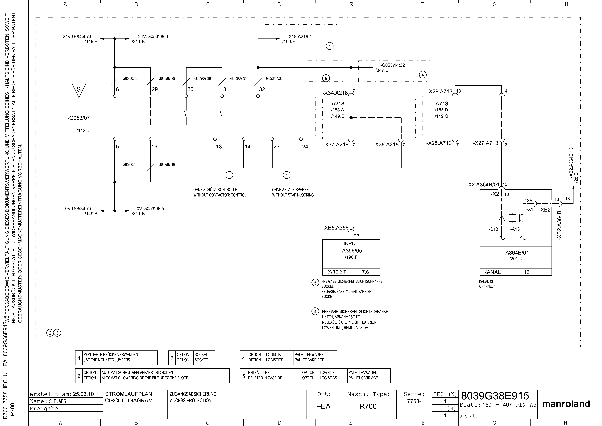

# +EA — Sheet 150 of 407 — ZUGANGSABSICHERUNG

**ACCESS PROTECTION**

> Part of the manroland **R700** printing press IEC/UL circuit diagrams.
> Drawing class: **Stromlaufplan / Circuit diagram** (DIN A3).
> Document `+EA` covers the **Printing unit** machine section.

## At a glance

| Field | Value |
|---|---|
| Document | `+EA`  (8039G38E915) |
| Sheet | **150** of 407 |
| Section (DE) | ZUGANGSABSICHERUNG |
| Section (EN) | ACCESS PROTECTION |
| Section type | CIRCUIT — Circuit diagram |
| Machine type | `R700` |
| Series | `7758` |
| Created | 25.03.10 |
| Replaces | — |
| Columns used | A, B, C, D, E, F, G, H |
| Path numbers | — |
| Labels on sheet | 130 |
| Cross-refs out | 14 |
| Cross-refs in | 24 |

**Previous:** [+EA sheet 149](SHEET_0149.md) · **Next:** [+EA sheet 151](SHEET_0151.md) · **Document TOC:** [_TOC.md](_TOC.md)  (+EA) · **Master TOC:** [all sheets](../_MASTER_TOC.md)

## Sheet image (300 DPI, exact vector render)



_Rendered directly from the PDF vector layer at 300 DPI (1-bit), no OCR and no resampling. Use it to confirm anything ambiguous in the text below._

## Cross-references on this sheet

Each entry is a wire leaving this sheet. The printed token is `/sheet.column`; the link resolves to that sheet inside the same document.

| Ref | Target sheet | Col | Path | Destination on target | Target section | From col |
|---|---|---|---|---|---|---|
| `/149.B` | [+EA sheet 149](SHEET_0149.md) | B | — | 24V.G053\07:6 24V.G053\08:6 | ZUGANGSABSICHERUNG | B |
| `/311.B` | [+EA sheet 311](SHEET_0311.md) | B | — | X18.A218:4 | OPTION: AUTOMATISCHE STAPELAUFFAHRT STOP / | C |
| `/160.F` | [+EA sheet 160](SHEET_0160.md) | F | — | — | ZUGANGSABSICHERUNG | D |
| `/347.D` | [+EA sheet 347](SHEET_0347.md) | D | — | — | OPTION: LOGISTIK PALETTENWAGEN | E |
| `/153.A` | [+EA sheet 153](SHEET_0153.md) | A | — | — | ZUGANGSABSICHERUNG | E |
| `/153.D` | [+EA sheet 153](SHEET_0153.md) | D | — | — | ZUGANGSABSICHERUNG | F |
| `/149.G` | [+EA sheet 149](SHEET_0149.md) | G | — | — | ZUGANGSABSICHERUNG | F |
| `/149.E` | [+EA sheet 149](SHEET_0149.md) | E | — | — | ZUGANGSABSICHERUNG | E |
| `/142.D` | [+EA sheet 142](SHEET_0142.md) | D | — | — | ZUGANGSABSICHERUNG | A |
| `/28.D` | [+EA sheet 28](SHEET_0028.md) | D | — | XB2.A364B:13 | BUSVERBINDUNGEN: SICHERHEITSBUS | H |
| `/149.B` | [+EA sheet 149](SHEET_0149.md) | B | — | 0V.G053\07:5 | ZUGANGSABSICHERUNG | B |
| `/311.B` | [+EA sheet 311](SHEET_0311.md) | B | — | 0V.G053\07:5 | OPTION: AUTOMATISCHE STAPELAUFFAHRT STOP / | B |
| `/198.F` | [+EA sheet 198](SHEET_0198.md) | F | — | — | REFERENZMODUL | E |
| `/201.D` | [+EA sheet 201](SHEET_0201.md) | D | — | — | REFERENZMODUL | G |

### Incoming references (sheets that point here)

Every other sheet that sends a wire to this one. `Back-ref` is the token printed on *that* sheet; `Path` is its line number.

| From sheet | Cols | Back-ref | Path | Refs | What continues there |
|---|---|---|---|---|---|
| [+EA#28](SHEET_0028.md) | D | `/28.D` | — | 1 | — |
| [+EA#142](SHEET_0142.md) | D | `/142.D` | — | 1 | — |
| [+EA#149](SHEET_0149.md) | B, E, F | `/149.B`, `/149.E`, `/149.F` | — | 4 | 0V.G053\06:5 |
| [+EA#153](SHEET_0153.md) | A, D | `/153.A`, `/153.D` | — | 2 | — |
| [+EA#160](SHEET_0160.md) | E | `/160.E` | — | 1 | X18.A218:4 |
| [+EA#198](SHEET_0198.md) | F | `/198.F` | — | 1 | — |
| [+EA#201](SHEET_0201.md) | D | `/201.D` | — | 1 | — |
| [+EA#227](SHEET_0227.md) | B, D | `/227.B`, `/227.D` | — | 2 | — |
| [+EA#241](SHEET_0241.md) | H | `/241.H` | — | 1 | — |
| [+EA#268](SHEET_0268.md) | G | `/268.G` | — | 1 | — |
| [+EA#272](SHEET_0272.md) | A | `/272.A` | — | 1 | — |
| [+EA#273](SHEET_0273.md) | F | `/273.F` | — | 2 | — |
| [+EA#277](SHEET_0277.md) | G | `/277.G` | — | 1 | — |
| [+EA#279](SHEET_0279.md) | E | `/279.E` | — | 1 | — |
| [+EA#280](SHEET_0280.md) | A | `/280.A` | — | 1 | — |
| [+EA#311](SHEET_0311.md) | A, B | `/311.A`, `/311.B` | — | 2 | 0V.G053\08:5; 24V.G053\08:6 |
| [+EA#347](SHEET_0347.md) | C | `/347.C` | — | 1 | 24V.G053\14:6 G053\14:32 |


## Devices on this sheet

| Tag | Class | Class meaning (IEC) | Col | Sub | Terminal | Sign |
|---|---|---|---|---|---|---|
| `G053/07` | G | Stromversorgung / power supply | A | 07 | — | — |
| `A356/05` | A | Baugruppe / assembly, module, PC board | E | 05 | — | — |
| `A218` | A | Baugruppe / assembly, module, PC board | E | — | — | — |
| `A713` | A | Baugruppe / assembly, module, PC board | F | — | — | — |
| `S13` | S | Schalter / switch | G | — | — | — |
| `A13` | A | Baugruppe / assembly, module, PC board | G | — | — | — |
| `X1` | X | Klemme / terminal, plug connector | G | — | — | — |
| `X2` | X | Klemme / terminal, plug connector | G | — | — | — |
| `XB2` | XB |  | H | — | — | — |
| `G053/07:32` | G | Stromversorgung / power supply | D | 07 | 32 | — |
| `G053/07:31` | G | Stromversorgung / power supply | C | 07 | 31 | — |
| `G053/07:6` | G | Stromversorgung / power supply | B | 07 | 6 | — |
| `G053/07:29` | G | Stromversorgung / power supply | B | 07 | 29 | — |
| `G053/07:30` | G | Stromversorgung / power supply | C | 07 | 30 | — |
| `G053/07:5` | G | Stromversorgung / power supply | B | 07 | 5 | — |
| `G053/07:16` | G | Stromversorgung / power supply | B | 07 | 16 | — |
| `7.6` | — | cross-device reference | E | — | — | — |
| `XB5.A356` | — | cross-device reference | E | — | — | — |
| `X37.A218` | — | cross-device reference | E | — | — | — |
| `X34.A218` | — | cross-device reference | E | — | — | — |
| `X38.A218` | — | cross-device reference | E | — | — | — |
| `X28.A713` | — | cross-device reference | F | — | — | — |
| `XB2.A364B` | — | cross-device reference | H | — | — | — |
| `X27.A713` | — | cross-device reference | G | — | — | — |
| `X25.A713` | — | cross-device reference | F | — | — | — |
| `XB2.A364B:13` | — | cross-device reference | H | — | 13 | — |
| `X18.A218:4` | — | cross-device reference | D | — | 4 | — |

## Potentials / nets

| Potential | Count | Columns | Attached devices | Terminals |
|---|---|---|---|---|
| `0V` | 2 | A, B | `G053\07`, `G053\08` | `5` |
| `24V` | 2 | A, B | `G053\07`, `G053\08` | `6` |


A potential such as `L24+/4` or `M24+` is a named supply/return rail; every place it appears on this sheet is electrically common.

## Wire-end annotations (grouped as printed)

A wire that continues elsewhere is annotated with a small cluster: the destination description, the path/line number `#NN`, and the `/sheet.column` cross reference. Each row below is one such cluster exactly as it is grouped on the drawing.

| Col | Y | Path | Cross-ref | Text on the wire |
|---|---|---|---|---|
| B | 68.3 | — | `/149.B` | `24V.G053\07:6 24V.G053\08:6` |
| C | 68.3 | — | `/311.B` | `X18.A218:4` |
| D | 78.2 | — | `/160.F` | — |
| E | 88.2 | — | — | `4` |
| F | 125.0 | — | — | `G053\14:32` |
| E | 134.9 | — | `/347.D` | — |
| F | 144.9 | — | — | `4` |
| E | 151.9 | — | — | `5` |
| B | 152.3 | — | — | `G053/07:6 G053/07:29 G053/07:30` |
| D | 152.3 | — | — | `G053/07:31 G053/07:32` |
| A | 171.2 | — | — | `S` |
| B | 171.8 | — | — | `6 29 30` |
| D | 171.8 | — | — | `31 32` |
| E | 176.1 | — | — | `X34.A218 7` |
| G | 176.1 | — | — | `X28.A713 13 14` |
| E | 200.1 | — | — | `A218` |
| F | 200.1 | — | — | `A713` |
| E | 213.2 | — | `/153.A` | — |
| F | 213.2 | — | `/153.D`, `/149.G` | — |
| E | 225.6 | — | `/149.E` | — |
| A | 228.5 | — | — | `G053/07` |
| A | 254.0 | — | `/142.D` | — |
| G | 278.1 | — | — | `X25.A713 7 X27.A713 13` |
| E | 280.9 | — | — | `X37.A218 7` |
| F | 280.9 | — | — | `X38.A218 7` |
| C | 285.1 | — | — | `5 13 14 23 24` |
| B | 285.1 | — | — | `16` |
| H | 291.1 | — | `/28.D` | `XB2.A364B:13` |
| B | 322.4 | — | — | `G053/07:5` |
| B | 322.4 | — | — | `G053/07:16` |
| C | 342.8 | — | — | `1` |
| D | 342.8 | — | — | `1` |
| G | 360.3 | — | — | `X2.A364B/01 13` |
| C | 372.0 | — | — | `OHNE SCHÜTZ: KONTROLLE WITHOUT CONTACTOR: CONTROL` |
| D | 372.0 | — | — | `OHNE ANLAUF SPERRE WITHOUT START LOCKING` |
| G | 378.8 | — | — | `X2` |
| H | 380.2 | — | — | `13 13` |
| H | 388.7 | — | — | `13` |
| G | 392.9 | — | — | `18A` |
| B | 408.5 | — | `/149.B`, `/311.B` | `0V.G053\07:5` |
| B | 408.5 | — | — | `0V.G053\08:5` |
| G | 409.9 | — | — | `X1` |
| H | 409.9 | — | — | `XB2` |
| H | 416.1 | — | — | `XB2.A364B` |
| E | 445.4 | — | — | `XB5.A356 7` |
| G | 448.9 | — | — | `S13 A13` |
| E | 462.3 | — | — | `9B` |
| E | 476.9 | — | — | `INPUT` |
| E | 490.7 | — | — | `A356/05` |
| G | 494.9 | — | — | `A364B/01` |
| E | 504.5 | — | `/198.F` | — |
| G | 507.3 | — | `/201.D` | — |
| G | 533.2 | — | — | `KANAL 13` |
| E | 533.5 | — | — | `BYTE.BIT 7.6` |
| E | 553.5 | — | — | `FREIGABE: SICHERHEITSLICHTSCHRANKE RELEASE: SAFETY LIGHT BARRIER SOCKEL SOCKET` |
| G | 553.5 | — | — | `KANAL 13 CHANNEL 13` |
| D | 555.9 | — | — | `5` |
| E | 612.6 | — | — | `4 FREIGABE: SICHERHEITSLICHTSCHRANKE UNTEN, ABNAHMESEITE RELEASE: SAFETY LIGHT BARRIER LOWER UNIT, REMOVAL SIDE` |
| A | 655.1 | — | — | `2 3` |
| B | 697.9 | — | — | `1 USE THE MOUNTED JUMPERS MONTIERTE BRÜCKE VERWENDEN 3 OPTION OPTION` |
| C | 697.9 | — | — | `SOCKEL SOCKET` |
| D | 697.9 | — | — | `4 OPTION OPTION LOGISTIK LOGISTICS` |
| D | 697.9 | — | — | `PALETTENWAGEN PALLET CARRIAGE` |
| E | 733.3 | — | — | `PALETTENWAGEN PALLET CARRIAGE` |
| B | 733.4 | — | — | `2 OPTION OPTION AUTOMATISCHE STAPELABFAHRT BIS BODEN AUTOMATIC LOWERING OF THE PILE UP TO THE FLOOR` |
| D | 733.4 | — | — | `5 ENTFÄLLT BEI DELETED IN CASE OF` |
| D | 733.4 | — | — | `OPTION OPTION` |
| E | 733.4 | — | — | `LOGISTIK LOGISTICS` |


## Reconstructed tables

This sheet carries tabular content (pin map / terminal assignment / index). The grid below was rebuilt from the drawing's own rule lines, so each row is exactly one physical row of the table.

### Table 1 — 8 data rows × 19 columns (at x=226.8, y=133.2)

| G053/07:6 | G053/07:29 | G053/07:30 |  | G053/07:31 |  |  | G053/07:32 |  | 5 |  | /347.D | 4 |  |  |  |  |  |  |
|---|---|---|---|---|---|---|---|---|---|---|---|---|---|---|---|---|---|---|
| `6` | `29` | `30` |  | `31` |  | `32` |  |  | `X34.A218 A218 /153.A /149.E` | `7` |  | `X28.A713 A713 /153.D /149.G` | `13` |  | `14` |  |  |  |
| `5 G053/07:5` | `16 G053/07:16` |  | `13` |  | `14` |  | `23` | `24` | `X37.A218` | `7` | `X38.A218` | `X25.A713 7` | `7` | `X27.A713` | `13` |  |  | `XB2.A364B:13` |
|  |  |  |  | `1` |  |  | `1` |  |  |  |  |  |  |  |  |  |  |  |
|  |  |  |  |  |  |  |  |  |  |  |  |  |  | `X2.A364B/01` | `13` |  |  |  |
| `0V.G053\08:5 /311.B` |  | `OHNE SCHÜTZ: WITHOUT` | `CONTACTOR:` | `KONTROLLE CONTROL` |  |  | `OHNE ANLAUF SPERRE WITHOUT START LOCKING` |  | `XB5.A356` | `7 9B` |  |  |  | `X2 S13` | `13 A13` | `18A X1` | `XB2` | `13 13 XB2.A364B` |
|  |  |  |  |  |  |  |  |  | `INPUT` |  |  |  |  |  |  |  |  |  |
|  |  |  |  |  |  |  |  |  |  | `A356/05 /198.F` |  |  |  |  | `A364B/01 /201.D` |  |  |  |
|  |  |  |  |  |  |  |  |  | `BYTE.BIT` | `7.6` |  |  |  | `KANAL` |  | `13` |  |  |


## Notes and free text on this sheet

| Text | Col | Y (pt) |
|---|---|---|
| `9B` | E | 462.32 |
| `INPUT` | E | 476.86 |
| `BYTE.BIT` | E | 534.11 |
| `FREIGABE: SICHERHEITSLICHTSCHRANKE` | E | 553.55 |
| `SOCKEL` | E | 563.48 |
| `RELEASE: SAFETY LIGHT BARRIER` | E | 573.44 |
| `SOCKET` | E | 583.34 |
| `KANAL 13` | G | 553.54 |
| `CHANNEL 13` | G | 563.48 |
| `18A` | G | 392.89 |
| `KANAL` | G | 533.21 |
| `A364B/01` | G | 494.95 |
| `X2.A364B/01` | G | 360.31 |
| `G053\14:32` | F | 125.03 |
| `MONTIERTE BRÜCKE VERWENDEN` | B | 697.94 |
| `USE THE MOUNTED JUMPERS` | B | 708.59 |
| `OPTION` | C | 697.92 |
| `SOCKEL` | C | 697.94 |
| `SOCKET` | C | 708.57 |
| `OPTION` | A | 733.35 |
| `AUTOMATISCHE STAPELABFAHRT BIS BODEN` | B | 733.38 |
| `AUTOMATIC LOWERING OF THE PILE UP TO THE FLOOR` | B | 744.01 |
| `OPTION` | D | 697.92 |
| `LOGISTIK` | D | 697.92 |
| `LOGISTICS` | D | 708.55 |
| `PALETTENWAGEN` | D | 697.9 |
| `PALLET CARRIAGE` | D | 708.57 |
| `ENTFÄLLT BEI` | D | 733.35 |
| `DELETED IN CASE OF` | D | 744 |
| `LOGISTIK` | E | 733.35 |
| `LOGISTICS` | E | 743.98 |
| `PALETTENWAGEN` | E | 733.33 |
| `PALLET CARRIAGE` | E | 744 |
| `OHNE ANLAUF SPERRE` | D | 371.97 |
| `WITHOUT START LOCKING` | D | 382.59 |
| `OHNE SCHÜTZ: KONTROLLE` | C | 371.98 |
| `WITHOUT CONTACTOR: CONTROL` | C | 382.61 |
| `S` | A | 171.17 |
| `UNTEN, ABNAHMESEITE` | E | 623.53 |
| `LOWER UNIT, REMOVAL SIDE` | E | 644.79 |

## Complete label inventory (exact text from the drawing)

Every text object inside the drawing area of this sheet, in DIN reading order (column A→H, then top→bottom). This is the authoritative list: if a string is not here it is not printed on this sheet.

| Col | Y | X | Dir | Type | Text |
|---|---|---|---|---|---|
| A | 68.3 | 121.3 | → | potential | `24V.G053\07:6` |
| A | 78.2 | 167.5 | → | cross-reference | `/149.B` |
| A | 171.2 | 151.8 | → | text | `S` |
| A | 228.5 | 133.5 | → | device tag | `G053/07` |
| A | 254.0 | 151.7 | → | cross-reference | `/142.D` |
| A | 408.5 | 129.0 | → | potential | `0V.G053\07:5` |
| A | 418.4 | 167.5 | → | cross-reference | `/149.B` |
| A | 655.1 | 97.2 | → | number | `2` |
| A | 655.1 | 111.4 | → | number | `3` |
| A | 703.3 | 153.4 | → | number | `1` |
| A | 733.4 | 165.5 | → | text | `OPTION` |
| A | 738.7 | 153.1 | → | number | `2` |
| A | 744.0 | 165.5 | → | text | `OPTION` |
| B | 68.3 | 270.4 | → | potential | `24V.G053\08:6` |
| B | 78.2 | 260.8 | → | cross-reference | `/311.B` |
| B | 152.3 | 240.7 | → | device tag | `G053/07:6` |
| B | 152.3 | 311.5 | → | device tag | `G053/07:29` |
| B | 171.8 | 229.3 | → | number | `6` |
| B | 171.8 | 300.2 | → | number | `29` |
| B | 285.2 | 229.0 | → | number | `5` |
| B | 285.2 | 299.3 | → | number | `16` |
| B | 322.4 | 240.7 | → | device tag | `G053/07:5` |
| B | 322.4 | 311.5 | → | device tag | `G053/07:16` |
| B | 408.5 | 270.4 | → | potential | `0V.G053\08:5` |
| B | 418.4 | 260.8 | → | cross-reference | `/311.B` |
| B | 697.9 | 165.3 | → | text | `MONTIERTE BRÜCKE VERWENDEN` |
| B | 703.3 | 337.2 | → | number | `3` |
| B | 708.6 | 165.0 | → | text | `USE THE MOUNTED JUMPERS` |
| B | 733.4 | 201.3 | → | text | `AUTOMATISCHE STAPELABFAHRT BIS BODEN` |
| B | 744.0 | 201.3 | → | text | `AUTOMATIC LOWERING OF THE PILE UP TO THE FLOOR` |
| C | 152.3 | 382.4 | → | device tag | `G053/07:30` |
| C | 152.3 | 453.3 | → | device tag | `G053/07:31` |
| C | 171.8 | 370.8 | → | number | `30` |
| C | 171.8 | 441.6 | → | number | `31` |
| C | 285.2 | 426.9 | → | number | `13` |
| C | 342.8 | 451.8 | → | number | `1` |
| C | 372.0 | 382.4 | → | text | `OHNE SCHÜTZ: KONTROLLE` |
| C | 382.6 | 382.7 | → | text | `WITHOUT CONTACTOR: CONTROL` |
| C | 697.9 | 349.8 | → | text | `OPTION` |
| C | 697.9 | 385.2 | → | text | `SOCKEL` |
| C | 703.3 | 479.1 | → | number | `4` |
| C | 708.6 | 349.8 | → | text | `OPTION` |
| C | 708.6 | 385.2 | → | text | `SOCKET` |
| C | 738.7 | 478.9 | → | number | `5` |
| D | 68.3 | 568.1 | → | device ref | `X18.A218:4` |
| D | 78.2 | 558.4 | → | cross-reference | `/160.F` |
| D | 152.3 | 524.1 | → | device tag | `G053/07:32` |
| D | 171.8 | 512.5 | → | number | `32` |
| D | 285.2 | 483.6 | → | number | `14` |
| D | 285.2 | 541.1 | → | number | `23` |
| D | 285.2 | 597.8 | → | number | `24` |
| D | 342.8 | 565.2 | → | number | `1` |
| D | 372.0 | 538.3 | → | text | `OHNE ANLAUF SPERRE` |
| D | 382.6 | 538.6 | → | text | `WITHOUT START LOCKING` |
| D | 555.9 | 621.6 | → | number | `5` |
| D | 612.6 | 621.6 | → | number | `4` |
| D | 697.9 | 491.5 | → | text | `OPTION` |
| D | 697.9 | 526.4 | → | text | `LOGISTIK` |
| D | 697.9 | 583.1 | → | text | `PALETTENWAGEN` |
| D | 708.6 | 491.5 | → | text | `OPTION` |
| D | 708.6 | 526.4 | → | text | `LOGISTICS` |
| D | 708.6 | 583.1 | → | text | `PALLET CARRIAGE` |
| D | 733.3 | 491.0 | → | text | `ENTFÄLLT BEI` |
| D | 733.4 | 597.8 | → | text | `OPTION` |
| D | 744.0 | 491.0 | → | text | `DELETED IN CASE OF` |
| D | 744.0 | 597.8 | → | text | `OPTION` |
| E | 88.2 | 650.0 | → | number | `4` |
| E | 134.9 | 742.7 | → | cross-reference | `/347.D` |
| E | 151.9 | 642.9 | → | number | `5` |
| E | 176.1 | 697.0 | → | number | `7` |
| E | 178.9 | 637.8 | → | device ref | `X34.A218` |
| E | 200.1 | 652.5 | → | device tag | `A218` |
| E | 213.2 | 654.8 | → | cross-reference | `/153.A` |
| E | 225.6 | 655.4 | → | cross-reference | `/149.E` |
| E | 280.9 | 639.2 | → | device ref | `X37.A218` |
| E | 280.9 | 738.4 | → | device ref | `X38.A218` |
| E | 282.4 | 697.0 | → | number | `7` |
| E | 445.3 | 638.1 | → | device ref | `XB5.A356` |
| E | 445.4 | 697.0 | → | number | `7` |
| E | 462.3 | 699.9 | → | text | `9B` |
| E | 476.9 | 679.6 | → | text | `INPUT` |
| E | 490.7 | 673.1 | → | device tag | `A356/05` |
| E | 504.5 | 682.2 | → | cross-reference | `/198.F` |
| E | 533.5 | 716.0 | → | device ref | `7.6` |
| E | 534.1 | 647.7 | → | text | `BYTE.BIT` |
| E | 553.5 | 635.8 | → | text | `FREIGABE: SICHERHEITSLICHTSCHRANKE` |
| E | 563.5 | 636.1 | → | text | `SOCKEL` |
| E | 573.4 | 635.8 | → | text | `RELEASE: SAFETY LIGHT BARRIER` |
| E | 583.3 | 636.1 | → | text | `SOCKET` |
| E | 612.9 | 636.9 | → | text | `FREIGABE: SICHERHEITSLICHTSCHRANKE` |
| E | 623.5 | 636.9 | → | text | `UNTEN, ABNAHMESEITE` |
| E | 634.2 | 636.9 | → | text | `RELEASE: SAFETY LIGHT BARRIER` |
| E | 644.8 | 636.9 | → | text | `LOWER UNIT, REMOVAL SIDE` |
| E | 733.3 | 689.4 | → | text | `PALETTENWAGEN` |
| E | 733.4 | 632.7 | → | text | `LOGISTIK` |
| E | 744.0 | 632.7 | → | text | `LOGISTICS` |
| E | 744.0 | 689.4 | → | text | `PALLET CARRIAGE` |
| F | 125.0 | 752.3 | → | text | `G053\14:32` |
| F | 144.9 | 834.2 | → | number | `4` |
| F | 176.1 | 844.7 | → | device ref | `X28.A713` |
| F | 176.1 | 902.0 | → | number | `13` |
| F | 200.1 | 858.0 | → | device tag | `A713` |
| F | 213.2 | 860.3 | → | cross-reference | `/153.D` |
| F | 225.6 | 860.0 | → | cross-reference | `/149.G` |
| F | 278.1 | 843.3 | → | device ref | `X25.A713` |
| F | 282.4 | 796.3 | → | number | `7` |
| F | 282.4 | 902.6 | → | number | `7` |
| G | 176.1 | 994.1 | → | number | `14` |
| G | 278.1 | 935.4 | → | device ref | `X27.A713` |
| G | 282.4 | 994.1 | → | number | `13` |
| G | 360.3 | 922.4 | → | text | `X2.A364B/01` |
| G | 360.3 | 994.1 | → | number | `13` |
| G | 378.8 | 970.6 | → | device tag | `X2` |
| G | 380.2 | 996.9 | → | number | `13` |
| G | 392.9 | 1037.5 | → | text | `18A` |
| G | 409.9 | 1041.2 | → | device tag | `X1` |
| G | 448.9 | 966.9 | → | device tag | `S13` |
| G | 448.9 | 1009.4 | → | device tag | `A13` |
| G | 495.0 | 996.2 | → | text | `A364B/01` |
| G | 507.3 | 1007.7 | → | cross-reference | `/201.D` |
| G | 533.2 | 955.8 | → | text | `KANAL` |
| G | 533.2 | 1035.5 | → | number | `13` |
| G | 553.5 | 947.6 | → | text | `KANAL 13` |
| G | 563.5 | 947.9 | → | text | `CHANNEL 13` |
| H | 291.1 | 1125.6 | ↕ | device ref | `XB2.A364B:13` |
| H | 340.4 | 1135.6 | ↕ | cross-reference | `/28.D` |
| H | 388.7 | 1117.4 | → | number | `13` |
| H | 390.1 | 1096.2 | → | number | `13` |
| H | 409.9 | 1065.5 | → | device tag | `XB2` |
| H | 416.1 | 1101.6 | ↕ | device ref | `XB2.A364B` |

## Reading-order text block

The same content as a plain block, grouped by DIN column — convenient to paste or to match against a visual description.

```text
=== Column A ===
  68.3  121.3  net          24V.G053\07:6
  78.2  167.5  xref         /149.B
 171.2  151.8  text         S
 228.5  133.5  devtag       G053/07
 254.0  151.7  xref         /142.D
 408.5  129.0  net          0V.G053\07:5
 418.4  167.5  xref         /149.B
 655.1   97.2  numeric      2
 655.1  111.4  numeric      3
 703.3  153.4  numeric      1
 733.4  165.5  text         OPTION
 738.7  153.1  numeric      2
 744.0  165.5  text         OPTION
=== Column B ===
  68.3  270.4  net          24V.G053\08:6
  78.2  260.8  xref         /311.B
 152.3  240.7  devtag       G053/07:6
 152.3  311.5  devtag       G053/07:29
 171.8  229.3  numeric      6
 171.8  300.2  numeric      29
 285.2  229.0  numeric      5
 285.2  299.3  numeric      16
 322.4  240.7  devtag       G053/07:5
 322.4  311.5  devtag       G053/07:16
 408.5  270.4  net          0V.G053\08:5
 418.4  260.8  xref         /311.B
 697.9  165.3  text         MONTIERTE BRÜCKE VERWENDEN
 703.3  337.2  numeric      3
 708.6  165.0  text         USE THE MOUNTED JUMPERS
 733.4  201.3  text         AUTOMATISCHE STAPELABFAHRT BIS BODEN
 744.0  201.3  text         AUTOMATIC LOWERING OF THE PILE UP TO THE FLOOR
=== Column C ===
 152.3  382.4  devtag       G053/07:30
 152.3  453.3  devtag       G053/07:31
 171.8  370.8  numeric      30
 171.8  441.6  numeric      31
 285.2  426.9  numeric      13
 342.8  451.8  numeric      1
 372.0  382.4  text         OHNE SCHÜTZ: KONTROLLE
 382.6  382.7  text         WITHOUT CONTACTOR: CONTROL
 697.9  349.8  text         OPTION
 697.9  385.2  text         SOCKEL
 703.3  479.1  numeric      4
 708.6  349.8  text         OPTION
 708.6  385.2  text         SOCKET
 738.7  478.9  numeric      5
=== Column D ===
  68.3  568.1  devref       X18.A218:4
  78.2  558.4  xref         /160.F
 152.3  524.1  devtag       G053/07:32
 171.8  512.5  numeric      32
 285.2  483.6  numeric      14
 285.2  541.1  numeric      23
 285.2  597.8  numeric      24
 342.8  565.2  numeric      1
 372.0  538.3  text         OHNE ANLAUF SPERRE
 382.6  538.6  text         WITHOUT START LOCKING
 555.9  621.6  numeric      5
 612.6  621.6  numeric      4
 697.9  491.5  text         OPTION
 697.9  526.4  text         LOGISTIK
 697.9  583.1  text         PALETTENWAGEN
 708.6  491.5  text         OPTION
 708.6  526.4  text         LOGISTICS
 708.6  583.1  text         PALLET CARRIAGE
 733.3  491.0  text         ENTFÄLLT BEI
 733.4  597.8  text         OPTION
 744.0  491.0  text         DELETED IN CASE OF
 744.0  597.8  text         OPTION
=== Column E ===
  88.2  650.0  numeric      4
 134.9  742.7  xref         /347.D
 151.9  642.9  numeric      5
 176.1  697.0  numeric      7
 178.9  637.8  devref       X34.A218
 200.1  652.5  devtag       A218
 213.2  654.8  xref         /153.A
 225.6  655.4  xref         /149.E
 280.9  639.2  devref       X37.A218
 280.9  738.4  devref       X38.A218
 282.4  697.0  numeric      7
 445.3  638.1  devref       XB5.A356
 445.4  697.0  numeric      7
 462.3  699.9  text         9B
 476.9  679.6  text         INPUT
 490.7  673.1  devtag       A356/05
 504.5  682.2  xref         /198.F
 533.5  716.0  devref       7.6
 534.1  647.7  text         BYTE.BIT
 553.5  635.8  text         FREIGABE: SICHERHEITSLICHTSCHRANKE
 563.5  636.1  text         SOCKEL
 573.4  635.8  text         RELEASE: SAFETY LIGHT BARRIER
 583.3  636.1  text         SOCKET
 612.9  636.9  text         FREIGABE: SICHERHEITSLICHTSCHRANKE
 623.5  636.9  text         UNTEN, ABNAHMESEITE
 634.2  636.9  text         RELEASE: SAFETY LIGHT BARRIER
 644.8  636.9  text         LOWER UNIT, REMOVAL SIDE
 733.3  689.4  text         PALETTENWAGEN
 733.4  632.7  text         LOGISTIK
 744.0  632.7  text         LOGISTICS
 744.0  689.4  text         PALLET CARRIAGE
=== Column F ===
 125.0  752.3  text         G053\14:32
 144.9  834.2  numeric      4
 176.1  844.7  devref       X28.A713
 176.1  902.0  numeric      13
 200.1  858.0  devtag       A713
 213.2  860.3  xref         /153.D
 225.6  860.0  xref         /149.G
 278.1  843.3  devref       X25.A713
 282.4  796.3  numeric      7
 282.4  902.6  numeric      7
=== Column G ===
 176.1  994.1  numeric      14
 278.1  935.4  devref       X27.A713
 282.4  994.1  numeric      13
 360.3  922.4  text         X2.A364B/01
 360.3  994.1  numeric      13
 378.8  970.6  devtag       X2
 380.2  996.9  numeric      13
 392.9 1037.5  text         18A
 409.9 1041.2  devtag       X1
 448.9  966.9  devtag       S13
 448.9 1009.4  devtag       A13
 495.0  996.2  text         A364B/01
 507.3 1007.7  xref         /201.D
 533.2  955.8  text         KANAL
 533.2 1035.5  numeric      13
 553.5  947.6  text         KANAL 13
 563.5  947.9  text         CHANNEL 13
=== Column H ===
 291.1 1125.6  devref       XB2.A364B:13
 340.4 1135.6  xref         /28.D
 388.7 1117.4  numeric      13
 390.1 1096.2  numeric      13
 409.9 1065.5  devtag       XB2
 416.1 1101.6  devref       XB2.A364B
```

---
_Generated from the PDF vector text layer; no OCR. Source: `R700_7758_IEC_UL_EA_8039G38E915_p`, sheet 150._
