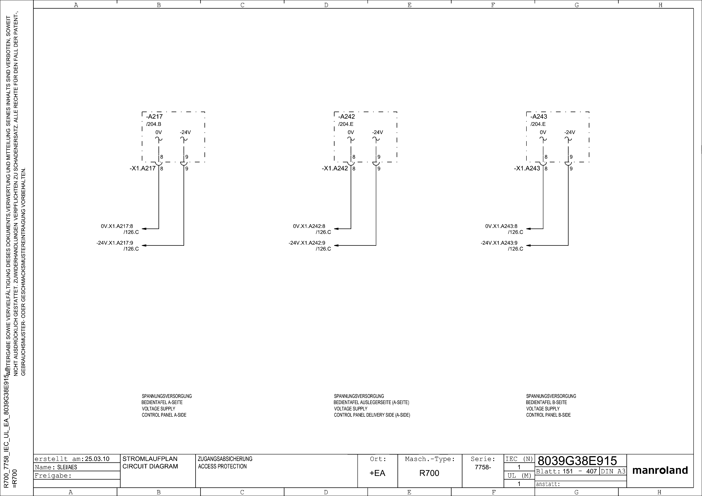

# +EA — Sheet 151 of 407 — ZUGANGSABSICHERUNG

**ACCESS PROTECTION**

> Part of the manroland **R700** printing press IEC/UL circuit diagrams.
> Drawing class: **Stromlaufplan / Circuit diagram** (DIN A3).
> Document `+EA` covers the **Printing unit** machine section.

## At a glance

| Field | Value |
|---|---|
| Document | `+EA`  (8039G38E915) |
| Sheet | **151** of 407 |
| Section (DE) | ZUGANGSABSICHERUNG |
| Section (EN) | ACCESS PROTECTION |
| Section type | CIRCUIT — Circuit diagram |
| Machine type | `R700` |
| Series | `7758` |
| Created | 25.03.10 |
| Replaces | — |
| Columns used | A, B, D, E, F, G |
| Path numbers | — |
| Labels on sheet | 51 |
| Cross-refs out | 9 |
| Cross-refs in | 15 |

**Previous:** [+EA sheet 150](SHEET_0150.md) · **Next:** [+EA sheet 152](SHEET_0152.md) · **Document TOC:** [_TOC.md](_TOC.md)  (+EA) · **Master TOC:** [all sheets](../_MASTER_TOC.md)

## Sheet image (300 DPI, exact vector render)



_Rendered directly from the PDF vector layer at 300 DPI (1-bit), no OCR and no resampling. Use it to confirm anything ambiguous in the text below._

## Cross-references on this sheet

Each entry is a wire leaving this sheet. The printed token is `/sheet.column`; the link resolves to that sheet inside the same document.

| Ref | Target sheet | Col | Path | Destination on target | Target section | From col |
|---|---|---|---|---|---|---|
| `/204.B` | [+EA sheet 204](SHEET_0204.md) | B | — | A217 | REFERENZMODUL | B |
| `/204.E` | [+EA sheet 204](SHEET_0204.md) | E | — | A242 | REFERENZMODUL | D |
| `/204.E` | [+EA sheet 204](SHEET_0204.md) | E | — | A243 | REFERENZMODUL | G |
| `/126.C` | [+EA sheet 126](SHEET_0126.md) | C | — | 0V.X1.A217:8 0V.X1.A242:8 0V.X1.A243:8 | ZUGANGSABSICHERUNG | D |
| `/126.C` | [+EA sheet 126](SHEET_0126.md) | C | — | 0V.X1.A217:8 0V.X1.A242:8 0V.X1.A243:8 | ZUGANGSABSICHERUNG | D |
| `/126.C` | [+EA sheet 126](SHEET_0126.md) | C | — | 0V.X1.A217:8 0V.X1.A242:8 0V.X1.A243:8 | ZUGANGSABSICHERUNG | D |
| `/126.C` | [+EA sheet 126](SHEET_0126.md) | C | — | 24V.X1.A217:9 | ZUGANGSABSICHERUNG | B |
| `/126.C` | [+EA sheet 126](SHEET_0126.md) | C | — | 24V.X1.A242:9 24V.X1.A243:9 | ZUGANGSABSICHERUNG | E |
| `/126.C` | [+EA sheet 126](SHEET_0126.md) | C | — | 24V.X1.A242:9 24V.X1.A243:9 | ZUGANGSABSICHERUNG | E |

### Incoming references (sheets that point here)

Every other sheet that sends a wire to this one. `Back-ref` is the token printed on *that* sheet; `Path` is its line number.

| From sheet | Cols | Back-ref | Path | Refs | What continues there |
|---|---|---|---|---|---|
| [+EA#126](SHEET_0126.md) | B, C | `/126.B`, `/126.C` | — | 6 | 24V.X1.A217:9; 24V.X1.A242:9; 24V.X1.A243:9 |
| [+EA#204](SHEET_0204.md) | B, E | `/204.B`, `/204.E` | — | 3 | — |
| [+EA#207](SHEET_0207.md) | C, F, H | `/207.C`, `/207.F`, `/207.H` | — | 6 | — |


## Devices on this sheet

| Tag | Class | Class meaning (IEC) | Col | Sub | Terminal | Sign |
|---|---|---|---|---|---|---|
| `A217` | A | Baugruppe / assembly, module, PC board | B | — | — | — |
| `A242` | A | Baugruppe / assembly, module, PC board | D | — | — | — |
| `A243` | A | Baugruppe / assembly, module, PC board | G | — | — | — |
| `X1.A242` | — | cross-device reference | D | — | — | — |
| `X1.A217` | — | cross-device reference | B | — | — | — |
| `X1.A243` | — | cross-device reference | F | — | — | — |

## Potentials / nets

| Potential | Count | Columns | Attached devices | Terminals |
|---|---|---|---|---|
| `0V` | 6 | A, B, D, F, G | `A217`, `A242`, `A243`, `X1` | `8` |
| `24V` | 6 | A, B, D, E, F, G | `A217`, `A242`, `A243`, `X1` | `9` |


A potential such as `L24+/4` or `M24+` is a named supply/return rail; every place it appears on this sheet is electrically common.

## Wire-end annotations (grouped as printed)

A wire that continues elsewhere is annotated with a small cluster: the destination description, the path/line number `#NN`, and the `/sheet.column` cross reference. Each row below is one such cluster exactly as it is grouped on the drawing.

| Col | Y | Path | Cross-ref | Text on the wire |
|---|---|---|---|---|
| B | 193.1 | — | `/204.B` | `A217` |
| D | 193.1 | — | `/204.E` | `A242` |
| G | 193.1 | — | `/204.E` | `A243` |
| B | 220.7 | — | — | `0V 24V` |
| D | 220.7 | — | — | `0V 24V` |
| G | 220.7 | — | — | `0V 24V` |
| B | 262.5 | — | — | `8 9` |
| D | 262.5 | — | — | `8 9` |
| G | 262.5 | — | — | `8 9` |
| C | 280.9 | — | — | `X1.A217 8 9 X1.A242 8` |
| F | 280.9 | — | — | `X1.A243 8` |
| E | 282.4 | — | — | `9` |
| G | 282.4 | — | — | `9` |
| D | 380.1 | — | `/126.C`, `/126.C`, `/126.C` | `0V.X1.A217:8 0V.X1.A242:8 0V.X1.A243:8` |
| B | 408.5 | — | `/126.C` | `24V.X1.A217:9` |
| E | 408.5 | — | `/126.C`, `/126.C` | `24V.X1.A242:9 24V.X1.A243:9` |
| B | 669.6 | — | — | `BEDIENTAFEL A SEITE SPANNUNGSVERSORGUNG` |
| E | 669.6 | — | — | `BEDIENTAFEL AUSLEGERSEITE (A SEITE) SPANNUNGSVERSORGUNG` |
| G | 669.6 | — | — | `BEDIENTAFEL B SEITE SPANNUNGSVERSORGUNG` |
| B | 690.9 | — | — | `CONTROL PANEL A SIDE VOLTAGE SUPPLY` |
| E | 690.9 | — | — | `CONTROL PANEL DELIVERY SIDE (A SIDE) VOLTAGE SUPPLY` |
| G | 690.9 | — | — | `CONTROL PANEL B SIDE VOLTAGE SUPPLY` |


## Reconstructed tables

This sheet carries tabular content (pin map / terminal assignment / index). The grid below was rebuilt from the drawing's own rule lines, so each row is exactly one physical row of the table.

### Table 1 — 5 data rows × 13 columns (at x=204.1, y=0.0) — **A217 /204.B 0V X1.A217 /126.C 8 8 24V 9 9 A242 /204.E 0V X1.A242 0V.X1.A242:8 /126.C 24V.X1.A242:9 0V.X1.A243:8 24V.X1.A243:9 X1.A243 /126.C A243 /204.E 0V /126.C BEDIENTAFEL VOLTAGE CONTROL SPANNUNGSVERSORGUNG A SEITE SUPPLY PANEL A SIDE SPANNUNGSVERSORGUNG AUSLEGERSEITE SUPPLY PANEL DELIVERY SIDE (A SEITE) (A SIDE) /126.C BEDIENTAFEL VOLTAGE CONTROL SPANNUNGSVERSORGUNG B SEITE SUPPLY PANEL B SIDE**

| STROMLAUFPLAN |  |  | ZUGANGSABSICHERUNG |  |  | Ort: | Masch. Type: | Serie: | IEC (N) |  |  | 8039G38E915 |
|---|---|---|---|---|---|---|---|---|---|---|---|---|
| `CIRCUIT` | `DIAGRAM` |  |  |  |  |  |  |  |  |  |  |  |
|  |  |  | `ACCESS PROTECTION` |  |  |  |  | `7758` | `1` |  |  |  |
|  |  |  |  |  |  | `+EA` | `R700` |  |  |  | `Blatt: 151` | `DIN A3 407` |
|  |  |  |  |  |  |  |  |  | `UL (M)` |  |  |  |
|  |  |  |  |  |  |  |  |  | `1` |  | `anstatt:` |  |


## Notes and free text on this sheet

| Text | Col | Y (pt) |
|---|---|---|
| `SPANNUNGSVERSORGUNG` | B | 669.62 |
| `BEDIENTAFEL A SEITE` | B | 680.21 |
| `VOLTAGE SUPPLY` | B | 690.87 |
| `CONTROL PANEL A SIDE` | B | 701.5 |
| `SPANNUNGSVERSORGUNG` | D | 669.62 |
| `BEDIENTAFEL AUSLEGERSEITE (A SEITE)` | E | 680.22 |
| `VOLTAGE SUPPLY` | D | 690.87 |
| `CONTROL PANEL DELIVERY SIDE (A SIDE)` | E | 701.5 |
| `SPANNUNGSVERSORGUNG` | G | 669.62 |
| `BEDIENTAFEL B SEITE` | G | 680.21 |
| `VOLTAGE SUPPLY` | G | 690.87 |
| `CONTROL PANEL B SIDE` | G | 701.5 |

## Complete label inventory (exact text from the drawing)

Every text object inside the drawing area of this sheet, in DIN reading order (column A→H, then top→bottom). This is the authoritative list: if a string is not here it is not printed on this sheet.

| Col | Y | X | Dir | Type | Text |
|---|---|---|---|---|---|
| A | 380.1 | 171.2 | → | potential | `0V.X1.A217:8` |
| A | 408.5 | 163.6 | → | potential | `24V.X1.A217:9` |
| B | 193.1 | 247.7 | → | device tag | `A217` |
| B | 206.8 | 248.0 | → | cross-reference | `/204.B` |
| B | 220.7 | 263.8 | → | potential | `0V` |
| B | 220.7 | 305.3 | → | potential | `24V` |
| B | 262.5 | 271.8 | → | number | `8` |
| B | 262.5 | 314.4 | → | number | `9` |
| B | 280.9 | 220.0 | → | device ref | `X1.A217` |
| B | 282.4 | 271.8 | → | number | `8` |
| B | 282.4 | 314.4 | → | number | `9` |
| B | 390.1 | 209.8 | → | cross-reference | `/126.C` |
| B | 418.4 | 209.8 | → | cross-reference | `/126.C` |
| B | 669.6 | 240.7 | → | text | `SPANNUNGSVERSORGUNG` |
| B | 680.2 | 240.1 | → | text | `BEDIENTAFEL A SEITE` |
| B | 690.9 | 240.9 | → | text | `VOLTAGE SUPPLY` |
| B | 701.5 | 240.7 | → | text | `CONTROL PANEL A SIDE` |
| D | 193.1 | 573.7 | → | device tag | `A242` |
| D | 206.8 | 574.0 | → | cross-reference | `/204.E` |
| D | 220.7 | 589.7 | → | potential | `0V` |
| D | 262.5 | 597.8 | → | number | `8` |
| D | 280.9 | 546.0 | → | device ref | `X1.A242` |
| D | 282.4 | 597.8 | → | number | `8` |
| D | 380.1 | 497.2 | → | potential | `0V.X1.A242:8` |
| D | 390.1 | 535.7 | → | cross-reference | `/126.C` |
| D | 408.5 | 489.5 | → | potential | `24V.X1.A242:9` |
| D | 418.4 | 535.7 | → | cross-reference | `/126.C` |
| D | 669.6 | 566.6 | → | text | `SPANNUNGSVERSORGUNG` |
| D | 690.9 | 566.9 | → | text | `VOLTAGE SUPPLY` |
| E | 220.7 | 631.3 | → | potential | `24V` |
| E | 262.5 | 640.3 | → | number | `9` |
| E | 282.4 | 640.3 | → | number | `9` |
| E | 680.2 | 566.1 | → | text | `BEDIENTAFEL AUSLEGERSEITE (A SEITE)` |
| E | 701.5 | 566.6 | → | text | `CONTROL PANEL DELIVERY SIDE (A SIDE)` |
| F | 280.9 | 871.9 | → | device ref | `X1.A243` |
| F | 380.1 | 823.2 | → | potential | `0V.X1.A243:8` |
| F | 390.1 | 861.7 | → | cross-reference | `/126.C` |
| F | 408.5 | 815.5 | → | potential | `24V.X1.A243:9` |
| F | 418.4 | 861.7 | → | cross-reference | `/126.C` |
| G | 193.1 | 899.7 | → | device tag | `A243` |
| G | 206.8 | 900.0 | → | cross-reference | `/204.E` |
| G | 220.7 | 915.7 | → | potential | `0V` |
| G | 220.7 | 957.3 | → | potential | `24V` |
| G | 262.5 | 923.8 | → | number | `8` |
| G | 262.5 | 966.3 | → | number | `9` |
| G | 282.4 | 923.8 | → | number | `8` |
| G | 282.4 | 966.3 | → | number | `9` |
| G | 669.6 | 892.6 | → | text | `SPANNUNGSVERSORGUNG` |
| G | 680.2 | 892.1 | → | text | `BEDIENTAFEL B SEITE` |
| G | 690.9 | 892.9 | → | text | `VOLTAGE SUPPLY` |
| G | 701.5 | 892.6 | → | text | `CONTROL PANEL B SIDE` |

## Reading-order text block

The same content as a plain block, grouped by DIN column — convenient to paste or to match against a visual description.

```text
=== Column A ===
 380.1  171.2  net          0V.X1.A217:8
 408.5  163.6  net          24V.X1.A217:9
=== Column B ===
 193.1  247.7  devtag       A217
 206.8  248.0  xref         /204.B
 220.7  263.8  net          0V
 220.7  305.3  net          24V
 262.5  271.8  numeric      8
 262.5  314.4  numeric      9
 280.9  220.0  devref       X1.A217
 282.4  271.8  numeric      8
 282.4  314.4  numeric      9
 390.1  209.8  xref         /126.C
 418.4  209.8  xref         /126.C
 669.6  240.7  text         SPANNUNGSVERSORGUNG
 680.2  240.1  text         BEDIENTAFEL A SEITE
 690.9  240.9  text         VOLTAGE SUPPLY
 701.5  240.7  text         CONTROL PANEL A SIDE
=== Column D ===
 193.1  573.7  devtag       A242
 206.8  574.0  xref         /204.E
 220.7  589.7  net          0V
 262.5  597.8  numeric      8
 280.9  546.0  devref       X1.A242
 282.4  597.8  numeric      8
 380.1  497.2  net          0V.X1.A242:8
 390.1  535.7  xref         /126.C
 408.5  489.5  net          24V.X1.A242:9
 418.4  535.7  xref         /126.C
 669.6  566.6  text         SPANNUNGSVERSORGUNG
 690.9  566.9  text         VOLTAGE SUPPLY
=== Column E ===
 220.7  631.3  net          24V
 262.5  640.3  numeric      9
 282.4  640.3  numeric      9
 680.2  566.1  text         BEDIENTAFEL AUSLEGERSEITE (A SEITE)
 701.5  566.6  text         CONTROL PANEL DELIVERY SIDE (A SIDE)
=== Column F ===
 280.9  871.9  devref       X1.A243
 380.1  823.2  net          0V.X1.A243:8
 390.1  861.7  xref         /126.C
 408.5  815.5  net          24V.X1.A243:9
 418.4  861.7  xref         /126.C
=== Column G ===
 193.1  899.7  devtag       A243
 206.8  900.0  xref         /204.E
 220.7  915.7  net          0V
 220.7  957.3  net          24V
 262.5  923.8  numeric      8
 262.5  966.3  numeric      9
 282.4  923.8  numeric      8
 282.4  966.3  numeric      9
 669.6  892.6  text         SPANNUNGSVERSORGUNG
 680.2  892.1  text         BEDIENTAFEL B SEITE
 690.9  892.9  text         VOLTAGE SUPPLY
 701.5  892.6  text         CONTROL PANEL B SIDE
```

---
_Generated from the PDF vector text layer; no OCR. Source: `R700_7758_IEC_UL_EA_8039G38E915_p`, sheet 151._
