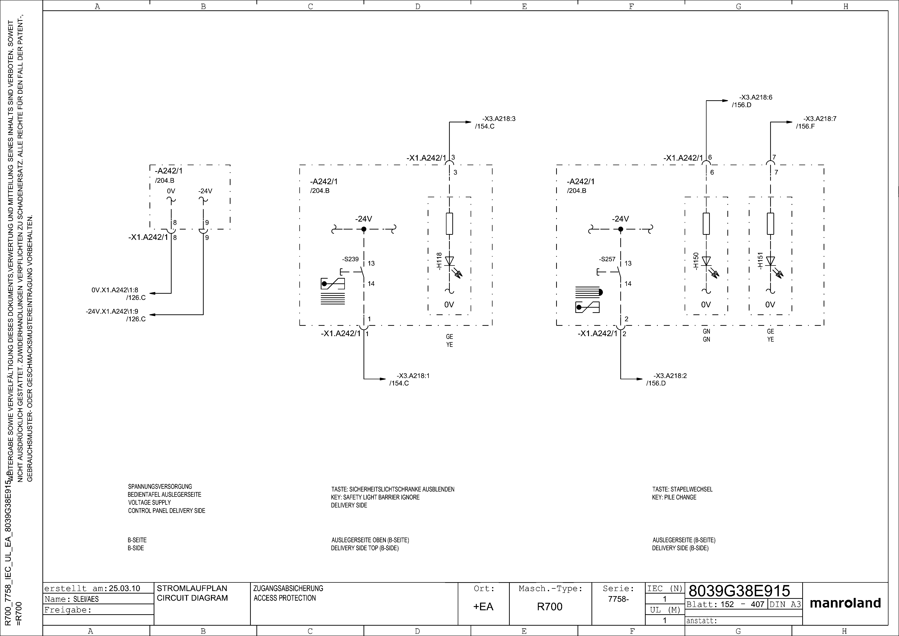

# +EA — Sheet 152 of 407 — ZUGANGSABSICHERUNG

**ACCESS PROTECTION**

> Part of the manroland **R700** printing press IEC/UL circuit diagrams.
> Drawing class: **Stromlaufplan / Circuit diagram** (DIN A3).
> Document `+EA` covers the **Printing unit** machine section.

## At a glance

| Field | Value |
|---|---|
| Document | `+EA`  (8039G38E915) |
| Sheet | **152** of 407 |
| Section (DE) | ZUGANGSABSICHERUNG |
| Section (EN) | ACCESS PROTECTION |
| Section type | CIRCUIT — Circuit diagram |
| Machine type | `R700` |
| Series | `7758` |
| Created | 25.03.10 |
| Replaces | — |
| Columns used | A, B, C, D, E, F, G, H |
| Path numbers | — |
| Labels on sheet | 76 |
| Cross-refs out | 10 |
| Cross-refs in | 17 |

**Previous:** [+EA sheet 151](SHEET_0151.md) · **Next:** [+EA sheet 153](SHEET_0153.md) · **Document TOC:** [_TOC.md](_TOC.md)  (+EA) · **Master TOC:** [all sheets](../_MASTER_TOC.md)

## Sheet image (300 DPI, exact vector render)



_Rendered directly from the PDF vector layer at 300 DPI (1-bit), no OCR and no resampling. Use it to confirm anything ambiguous in the text below._

## Cross-references on this sheet

Each entry is a wire leaving this sheet. The printed token is `/sheet.column`; the link resolves to that sheet inside the same document.

| Ref | Target sheet | Col | Path | Destination on target | Target section | From col |
|---|---|---|---|---|---|---|
| `/156.D` | [+EA sheet 156](SHEET_0156.md) | D | — | — | ZUGANGSABSICHERUNG | G |
| `/156.F` | [+EA sheet 156](SHEET_0156.md) | F | — | — | ZUGANGSABSICHERUNG | H |
| `/154.C` | [+EA sheet 154](SHEET_0154.md) | C | — | — | ZUGANGSABSICHERUNG | E |
| `/204.B` | [+EA sheet 204](SHEET_0204.md) | B | — | A242/1 | REFERENZMODUL | B |
| `/204.B` | [+EA sheet 204](SHEET_0204.md) | B | — | A242/1 | REFERENZMODUL | C |
| `/204.B` | [+EA sheet 204](SHEET_0204.md) | B | — | A242/1 | REFERENZMODUL | F |
| `/126.C` | [+EA sheet 126](SHEET_0126.md) | C | — | 0V.X1.A242\1:8 | ZUGANGSABSICHERUNG | A |
| `/126.C` | [+EA sheet 126](SHEET_0126.md) | C | — | 24V.X1.A242\1:9 | ZUGANGSABSICHERUNG | A |
| `/154.C` | [+EA sheet 154](SHEET_0154.md) | C | — | X3.A218:2 | ZUGANGSABSICHERUNG | E |
| `/156.D` | [+EA sheet 156](SHEET_0156.md) | D | — | — | ZUGANGSABSICHERUNG | F |

### Incoming references (sheets that point here)

Every other sheet that sends a wire to this one. `Back-ref` is the token printed on *that* sheet; `Path` is its line number.

| From sheet | Cols | Back-ref | Path | Refs | What continues there |
|---|---|---|---|---|---|
| [+EA#126](SHEET_0126.md) | C | `/126.C` | — | 2 | 24V.X1.A242\1:9 |
| [+EA#154](SHEET_0154.md) | C | `/154.C` | — | 2 | X3.A218:1 |
| [+EA#156](SHEET_0156.md) | D, F | `/156.D`, `/156.F` | — | 3 | X3.A218:2; X3.A218:6; X3.A218:7 |
| [+EA#204](SHEET_0204.md) | B | `/204.B` | — | 3 | — |
| [+EA#207](SHEET_0207.md) | G | `/207.G` | — | 7 | — |


## Devices on this sheet

| Tag | Class | Class meaning (IEC) | Col | Sub | Terminal | Sign |
|---|---|---|---|---|---|---|
| `A242/1` | A | Baugruppe / assembly, module, PC board | B | 1 | — | — |
| `S239` | S | Schalter / switch | C | — | — | — |
| `A242/1` | A | Baugruppe / assembly, module, PC board | C | 1 | — | — |
| `S257` | S | Schalter / switch | F | — | — | — |
| `A242/1` | A | Baugruppe / assembly, module, PC board | F | 1 | — | — |
| `X3.A218:3` | — | cross-device reference | E | — | 3 | — |
| `X3.A218:2` | — | cross-device reference | F | — | 2 | — |
| `X3.A218:1` | — | cross-device reference | D | — | 1 | — |
| `X3.A218:6` | — | cross-device reference | G | — | 6 | — |
| `X3.A218:7` | — | cross-device reference | H | — | 7 | — |

## Potentials / nets

| Potential | Count | Columns | Attached devices | Terminals |
|---|---|---|---|---|
| `0V` | 5 | A, B, D, G | `A242\1`, `X1` | `8` |
| `24V` | 4 | A, B, C, F | `A242\1`, `X1` | `9` |
| `H118` | 1 | D | — | — |
| `H150` | 1 | G | — | — |
| `H151` | 1 | G | — | — |


A potential such as `L24+/4` or `M24+` is a named supply/return rail; every place it appears on this sheet is electrically common.

## Wire-end annotations (grouped as printed)

A wire that continues elsewhere is annotated with a small cluster: the destination description, the path/line number `#NN`, and the `/sheet.column` cross reference. Each row below is one such cluster exactly as it is grouped on the drawing.

| Col | Y | Path | Cross-ref | Text on the wire |
|---|---|---|---|---|
| G | 125.0 | — | — | `X3.A218:6` |
| G | 134.9 | — | `/156.D` | — |
| E | 153.3 | — | — | `X3.A218:3` |
| H | 153.3 | — | — | `X3.A218:7` |
| E | 163.3 | — | `/154.C` | — |
| H | 163.3 | — | `/156.F` | — |
| D | 204.4 | — | — | `X1.A242/1 3` |
| G | 204.4 | — | — | `X1.A242/1 6` |
| G | 204.4 | — | — | `7` |
| B | 221.4 | — | `/204.B` | `A242/1` |
| D | 224.3 | — | — | `3` |
| G | 224.3 | — | — | `6 7` |
| C | 235.6 | — | `/204.B` | `A242/1` |
| F | 235.6 | — | `/204.B` | `A242/1` |
| B | 249.0 | — | — | `0V 24V` |
| C | 285.2 | — | — | `24V` |
| F | 285.2 | — | — | `24V` |
| B | 290.9 | — | — | `8 9` |
| B | 309.3 | — | — | `X1.A242/1 8 9` |
| G | 333.4 | — | — | `H151` |
| D | 334.1 | — | — | `H118` |
| G | 334.1 | — | — | `H150` |
| C | 339.5 | — | — | `S239` |
| F | 339.5 | — | — | `S257` |
| D | 344.7 | — | — | `13` |
| F | 344.7 | — | — | `13` |
| D | 371.7 | — | — | `14` |
| F | 371.7 | — | — | `14` |
| A | 380.1 | — | `/126.C` | `0V.X1.A242\1:8` |
| D | 398.6 | — | — | `0V` |
| G | 398.6 | — | — | `0V` |
| G | 398.6 | — | — | `0V` |
| A | 408.5 | — | `/126.C` | `24V.X1.A242\1:9` |
| D | 418.4 | — | — | `1` |
| F | 418.4 | — | — | `2` |
| G | 435.7 | — | — | `GN GN` |
| G | 435.7 | — | — | `GE YE` |
| C | 436.9 | — | — | `X1.A242/1 1` |
| F | 436.9 | — | — | `X1.A242/1 2` |
| D | 442.8 | — | — | `GE YE` |
| E | 493.5 | — | `/154.C` | `X3.A218:2` |
| D | 493.5 | — | — | `X3.A218:1` |
| F | 503.4 | — | `/156.D` | — |
| B | 641.3 | — | — | `BEDIENTAFEL AUSLEGERSEITE SPANNUNGSVERSORGUNG` |
| D | 644.8 | — | — | `KEY: SAFETY LIGHT BARRIER IGNORE DELIVERY SIDE TASTE: SICHERHEITSLICHTSCHRANKE AUSBLENDEN` |
| F | 644.8 | — | — | `KEY: PILE CHANGE TASTE: STAPELWECHSEL` |
| B | 662.5 | — | — | `CONTROL PANEL DELIVERY SIDE VOLTAGE SUPPLY` |
| A | 712.1 | — | — | `B SEITE B SIDE` |
| D | 712.1 | — | — | `DELIVERY SIDE TOP (B SIDE) AUSLEGERSEITE OBEN (B SEITE)` |
| F | 712.1 | — | — | `DELIVERY SIDE (B SIDE) AUSLEGERSEITE (B SEITE)` |


## Reconstructed tables

This sheet carries tabular content (pin map / terminal assignment / index). The grid below was rebuilt from the drawing's own rule lines, so each row is exactly one physical row of the table.

### Table 1 — 0 data rows × 3 columns (at x=396.9, y=218.3) — **A242/1 /204.B 24V**

_none_


### Table 2 — 0 data rows × 3 columns (at x=737.0, y=218.3) — **A242/1 /204.B 24V**

_none_


### Table 3 — 0 data rows × 2 columns (at x=939.7, y=218.3) — **6**

_none_


## Notes and free text on this sheet

| Text | Col | Y (pt) |
|---|---|---|
| `X1.A242/1` | A | 309.29 |
| `SPANNUNGSVERSORGUNG` | B | 641.27 |
| `BEDIENTAFEL AUSLEGERSEITE` | B | 651.87 |
| `VOLTAGE SUPPLY` | A | 662.52 |
| `CONTROL PANEL DELIVERY SIDE` | B | 673.15 |
| `X1.A242/1` | C | 436.85 |
| `X1.A242/1` | D | 204.41 |
| `TASTE: SICHERHEITSLICHTSCHRANKE AUSBLENDEN` | D | 644.8 |
| `KEY: SAFETY LIGHT BARRIER IGNORE` | D | 655.42 |
| `DELIVERY SIDE` | C | 666.03 |
| `X1.A242/1` | F | 204.41 |
| `TASTE: STAPELWECHSEL` | F | 644.77 |
| `KEY: PILE CHANGE` | F | 655.4 |
| `B SEITE` | A | 712.06 |
| `B SIDE` | A | 722.7 |
| `GE` | D | 442.75 |
| `YE` | D | 453.38 |
| `GN` | G | 435.69 |
| `GE` | G | 435.67 |
| `YE` | G | 446.29 |
| `AUSLEGERSEITE OBEN (B SEITE)` | D | 712.11 |
| `DELIVERY SIDE TOP (B SIDE)` | D | 722.74 |
| `AUSLEGERSEITE (B SEITE)` | F | 712.11 |
| `DELIVERY SIDE (B SIDE)` | F | 722.74 |

## Complete label inventory (exact text from the drawing)

Every text object inside the drawing area of this sheet, in DIN reading order (column A→H, then top→bottom). This is the authoritative list: if a string is not here it is not printed on this sheet.

| Col | Y | X | Dir | Type | Text |
|---|---|---|---|---|---|
| A | 309.3 | 170.1 | → | text | `X1.A242/1` |
| A | 380.1 | 121.3 | → | potential | `0V.X1.A242\1:8` |
| A | 390.1 | 167.2 | → | cross-reference | `/126.C` |
| A | 408.5 | 113.7 | → | potential | `24V.X1.A242\1:9` |
| A | 418.4 | 167.2 | → | cross-reference | `/126.C` |
| A | 662.5 | 170.1 | → | text | `VOLTAGE SUPPLY` |
| A | 712.1 | 169.2 | → | text | `B SEITE` |
| A | 722.7 | 169.2 | → | text | `B SIDE` |
| B | 221.4 | 205.2 | → | device tag | `A242/1` |
| B | 235.2 | 205.5 | → | cross-reference | `/204.B` |
| B | 249.0 | 221.2 | → | potential | `0V` |
| B | 249.0 | 262.8 | → | potential | `24V` |
| B | 290.9 | 229.3 | → | number | `8` |
| B | 290.9 | 271.8 | → | number | `9` |
| B | 310.7 | 229.3 | → | number | `8` |
| B | 310.7 | 271.8 | → | number | `9` |
| B | 641.3 | 169.8 | → | text | `SPANNUNGSVERSORGUNG` |
| B | 651.9 | 169.2 | → | text | `BEDIENTAFEL AUSLEGERSEITE` |
| B | 673.2 | 169.8 | → | text | `CONTROL PANEL DELIVERY SIDE` |
| C | 235.6 | 410.7 | → | device tag | `A242/1` |
| C | 248.6 | 411.0 | → | cross-reference | `/204.B` |
| C | 285.2 | 470.6 | → | potential | `24V` |
| C | 339.5 | 453.3 | → | device tag | `S239` |
| C | 436.8 | 425.2 | → | text | `X1.A242/1` |
| C | 666.0 | 438.5 | → | text | `DELIVERY SIDE` |
| D | 204.4 | 538.6 | → | text | `X1.A242/1` |
| D | 204.4 | 597.8 | → | number | `3` |
| D | 224.3 | 600.7 | → | number | `3` |
| D | 334.1 | 577.9 | ↕ | potential | `H118` |
| D | 344.7 | 486.7 | → | number | `13` |
| D | 371.7 | 486.7 | → | number | `14` |
| D | 398.6 | 588.5 | → | potential | `0V` |
| D | 418.4 | 486.7 | → | number | `1` |
| D | 438.3 | 483.9 | → | number | `1` |
| D | 442.8 | 590.8 | → | text | `GE` |
| D | 453.4 | 591.3 | → | text | `YE` |
| D | 493.5 | 525.5 | → | device ref | `X3.A218:1` |
| D | 503.4 | 515.9 | → | cross-reference | `/154.C` |
| D | 644.8 | 439.1 | → | text | `TASTE: SICHERHEITSLICHTSCHRANKE AUSBLENDEN` |
| D | 655.4 | 438.5 | → | text | `KEY: SAFETY LIGHT BARRIER IGNORE` |
| D | 712.1 | 439.4 | → | text | `AUSLEGERSEITE OBEN (B SEITE)` |
| D | 722.7 | 438.5 | → | text | `DELIVERY SIDE TOP (B SIDE)` |
| E | 153.4 | 638.9 | → | device ref | `X3.A218:3` |
| E | 163.3 | 629.3 | → | cross-reference | `/154.C` |
| E | 248.6 | 751.2 | → | cross-reference | `/204.B` |
| F | 204.4 | 878.7 | → | text | `X1.A242/1` |
| F | 235.6 | 750.9 | → | device tag | `A242/1` |
| F | 285.2 | 810.7 | → | potential | `24V` |
| F | 339.5 | 793.4 | → | device tag | `S257` |
| F | 344.7 | 826.9 | → | number | `13` |
| F | 371.7 | 826.9 | → | number | `14` |
| F | 418.4 | 827.4 | → | number | `2` |
| F | 436.8 | 765.4 | → | text | `X1.A242/1` |
| F | 438.3 | 824.6 | → | number | `2` |
| F | 493.5 | 865.7 | → | device ref | `X3.A218:2` |
| F | 503.4 | 856.1 | → | cross-reference | `/156.D` |
| F | 644.8 | 864.3 | → | text | `TASTE: STAPELWECHSEL` |
| F | 655.4 | 863.7 | → | text | `KEY: PILE CHANGE` |
| F | 712.1 | 864.6 | → | text | `AUSLEGERSEITE (B SEITE)` |
| F | 722.7 | 863.7 | → | text | `DELIVERY SIDE (B SIDE)` |
| G | 125.0 | 979.1 | → | device ref | `X3.A218:6` |
| G | 134.9 | 969.4 | → | cross-reference | `/156.D` |
| G | 204.4 | 938.0 | → | number | `6` |
| G | 204.4 | 1023.0 | → | number | `7` |
| G | 224.3 | 940.8 | → | number | `6` |
| G | 224.3 | 1025.9 | → | number | `7` |
| G | 333.4 | 1003.1 | ↕ | potential | `H151` |
| G | 334.1 | 918.1 | ↕ | potential | `H150` |
| G | 398.6 | 928.6 | → | potential | `0V` |
| G | 398.6 | 1013.7 | → | potential | `0V` |
| G | 435.7 | 930.9 | → | text | `GN` |
| G | 435.7 | 1016.0 | → | text | `GE` |
| G | 446.3 | 930.9 | → | text | `GN` |
| G | 446.3 | 1016.4 | → | text | `YE` |
| H | 153.4 | 1064.1 | → | device ref | `X3.A218:7` |
| H | 163.3 | 1054.5 | → | cross-reference | `/156.F` |

## Reading-order text block

The same content as a plain block, grouped by DIN column — convenient to paste or to match against a visual description.

```text
=== Column A ===
 309.3  170.1  text         X1.A242/1
 380.1  121.3  net          0V.X1.A242\1:8
 390.1  167.2  xref         /126.C
 408.5  113.7  net          24V.X1.A242\1:9
 418.4  167.2  xref         /126.C
 662.5  170.1  text         VOLTAGE SUPPLY
 712.1  169.2  text         B SEITE
 722.7  169.2  text         B SIDE
=== Column B ===
 221.4  205.2  devtag       A242/1
 235.2  205.5  xref         /204.B
 249.0  221.2  net          0V
 249.0  262.8  net          24V
 290.9  229.3  numeric      8
 290.9  271.8  numeric      9
 310.7  229.3  numeric      8
 310.7  271.8  numeric      9
 641.3  169.8  text         SPANNUNGSVERSORGUNG
 651.9  169.2  text         BEDIENTAFEL AUSLEGERSEITE
 673.2  169.8  text         CONTROL PANEL DELIVERY SIDE
=== Column C ===
 235.6  410.7  devtag       A242/1
 248.6  411.0  xref         /204.B
 285.2  470.6  net          24V
 339.5  453.3  devtag       S239
 436.8  425.2  text         X1.A242/1
 666.0  438.5  text         DELIVERY SIDE
=== Column D ===
 204.4  538.6  text         X1.A242/1
 204.4  597.8  numeric      3
 224.3  600.7  numeric      3
 334.1  577.9  net          H118
 344.7  486.7  numeric      13
 371.7  486.7  numeric      14
 398.6  588.5  net          0V
 418.4  486.7  numeric      1
 438.3  483.9  numeric      1
 442.8  590.8  text         GE
 453.4  591.3  text         YE
 493.5  525.5  devref       X3.A218:1
 503.4  515.9  xref         /154.C
 644.8  439.1  text         TASTE: SICHERHEITSLICHTSCHRANKE AUSBLENDEN
 655.4  438.5  text         KEY: SAFETY LIGHT BARRIER IGNORE
 712.1  439.4  text         AUSLEGERSEITE OBEN (B SEITE)
 722.7  438.5  text         DELIVERY SIDE TOP (B SIDE)
=== Column E ===
 153.4  638.9  devref       X3.A218:3
 163.3  629.3  xref         /154.C
 248.6  751.2  xref         /204.B
=== Column F ===
 204.4  878.7  text         X1.A242/1
 235.6  750.9  devtag       A242/1
 285.2  810.7  net          24V
 339.5  793.4  devtag       S257
 344.7  826.9  numeric      13
 371.7  826.9  numeric      14
 418.4  827.4  numeric      2
 436.8  765.4  text         X1.A242/1
 438.3  824.6  numeric      2
 493.5  865.7  devref       X3.A218:2
 503.4  856.1  xref         /156.D
 644.8  864.3  text         TASTE: STAPELWECHSEL
 655.4  863.7  text         KEY: PILE CHANGE
 712.1  864.6  text         AUSLEGERSEITE (B SEITE)
 722.7  863.7  text         DELIVERY SIDE (B SIDE)
=== Column G ===
 125.0  979.1  devref       X3.A218:6
 134.9  969.4  xref         /156.D
 204.4  938.0  numeric      6
 204.4 1023.0  numeric      7
 224.3  940.8  numeric      6
 224.3 1025.9  numeric      7
 333.4 1003.1  net          H151
 334.1  918.1  net          H150
 398.6  928.6  net          0V
 398.6 1013.7  net          0V
 435.7  930.9  text         GN
 435.7 1016.0  text         GE
 446.3  930.9  text         GN
 446.3 1016.4  text         YE
=== Column H ===
 153.4 1064.1  devref       X3.A218:7
 163.3 1054.5  xref         /156.F
```

---
_Generated from the PDF vector text layer; no OCR. Source: `R700_7758_IEC_UL_EA_8039G38E915_p`, sheet 152._
