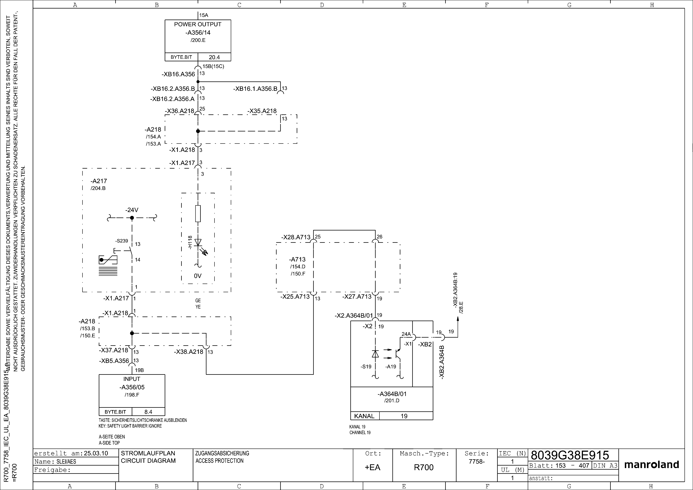

# +EA — Sheet 153 of 407 — ZUGANGSABSICHERUNG

**ACCESS PROTECTION**

> Part of the manroland **R700** printing press IEC/UL circuit diagrams.
> Drawing class: **Stromlaufplan / Circuit diagram** (DIN A3).
> Document `+EA` covers the **Printing unit** machine section.

## At a glance

| Field | Value |
|---|---|
| Document | `+EA`  (8039G38E915) |
| Sheet | **153** of 407 |
| Section (DE) | ZUGANGSABSICHERUNG |
| Section (EN) | ACCESS PROTECTION |
| Section type | CIRCUIT — Circuit diagram |
| Machine type | `R700` |
| Series | `7758` |
| Created | 25.03.10 |
| Replaces | — |
| Columns used | A, B, C, D, E, F |
| Path numbers | — |
| Labels on sheet | 91 |
| Cross-refs out | 11 |
| Cross-refs in | 30 |

**Previous:** [+EA sheet 152](SHEET_0152.md) · **Next:** [+EA sheet 154](SHEET_0154.md) · **Document TOC:** [_TOC.md](_TOC.md)  (+EA) · **Master TOC:** [all sheets](../_MASTER_TOC.md)

## Sheet image (300 DPI, exact vector render)



_Rendered directly from the PDF vector layer at 300 DPI (1-bit), no OCR and no resampling. Use it to confirm anything ambiguous in the text below._

## Cross-references on this sheet

Each entry is a wire leaving this sheet. The printed token is `/sheet.column`; the link resolves to that sheet inside the same document.

| Ref | Target sheet | Col | Path | Destination on target | Target section | From col |
|---|---|---|---|---|---|---|
| `/200.E` | [+EA sheet 200](SHEET_0200.md) | E | — | — | REFERENZMODUL | C |
| `/154.A` | [+EA sheet 154](SHEET_0154.md) | A | — | — | ZUGANGSABSICHERUNG | B |
| `/153.A` | [+EA sheet 153](SHEET_0153.md) | A | — | — | ZUGANGSABSICHERUNG | B |
| `/204.B` | [+EA sheet 204](SHEET_0204.md) | B | — | A217 | REFERENZMODUL | A |
| `/154.D` | [+EA sheet 154](SHEET_0154.md) | D | — | — | ZUGANGSABSICHERUNG | D |
| `/150.F` | [+EA sheet 150](SHEET_0150.md) | F | — | — | ZUGANGSABSICHERUNG | D |
| `/28.E` | [+EA sheet 28](SHEET_0028.md) | E | — | XB2.A364B:19 | BUSVERBINDUNGEN: SICHERHEITSBUS | F |
| `/153.B` | [+EA sheet 153](SHEET_0153.md) | B | — | — | ZUGANGSABSICHERUNG | A |
| `/150.E` | [+EA sheet 150](SHEET_0150.md) | E | — | — | ZUGANGSABSICHERUNG | A |
| `/198.F` | [+EA sheet 198](SHEET_0198.md) | F | — | — | REFERENZMODUL | B |
| `/201.D` | [+EA sheet 201](SHEET_0201.md) | D | — | — | REFERENZMODUL | E |

### Incoming references (sheets that point here)

Every other sheet that sends a wire to this one. `Back-ref` is the token printed on *that* sheet; `Path` is its line number.

| From sheet | Cols | Back-ref | Path | Refs | What continues there |
|---|---|---|---|---|---|
| [+EA#28](SHEET_0028.md) | E | `/28.E` | — | 1 | — |
| [+EA#150](SHEET_0150.md) | E, F | `/150.E`, `/150.F` | — | 2 | — |
| [+EA#153](SHEET_0153.md) | A, B | `/153.A`, `/153.B` | — | 2 | — |
| [+EA#154](SHEET_0154.md) | A, D | `/154.A`, `/154.D` | — | 2 | — |
| [+EA#198](SHEET_0198.md) | F | `/198.F` | — | 1 | — |
| [+EA#200](SHEET_0200.md) | E | `/200.E` | — | 1 | — |
| [+EA#201](SHEET_0201.md) | D | `/201.D` | — | 1 | — |
| [+EA#204](SHEET_0204.md) | B | `/204.B` | — | 1 | — |
| [+EA#207](SHEET_0207.md) | C, E | `/207.C`, `/207.E` | — | 4 | — |
| [+EA#227](SHEET_0227.md) | C, E | `/227.C`, `/227.E` | — | 2 | — |
| [+EA#241](SHEET_0241.md) | H | `/241.H` | — | 1 | — |
| [+EA#261](SHEET_0261.md) | H | `/261.H` | — | 1 | — |
| [+EA#262](SHEET_0262.md) | B, C, E | `/262.B`, `/262.C`, `/262.E` | — | 3 | — |
| [+EA#268](SHEET_0268.md) | G | `/268.G` | — | 1 | — |
| [+EA#272](SHEET_0272.md) | B | `/272.B` | — | 1 | — |
| [+EA#273](SHEET_0273.md) | F, G | `/273.F`, `/273.G` | — | 2 | — |
| [+EA#278](SHEET_0278.md) | C, H | `/278.C`, `/278.H` | — | 2 | — |
| [+EA#279](SHEET_0279.md) | E | `/279.E` | — | 1 | — |
| [+EA#280](SHEET_0280.md) | A | `/280.A` | — | 1 | — |


## Devices on this sheet

| Tag | Class | Class meaning (IEC) | Col | Sub | Terminal | Sign |
|---|---|---|---|---|---|---|
| `A356/05` | A | Baugruppe / assembly, module, PC board | B | 05 | — | — |
| `A356/14` | A | Baugruppe / assembly, module, PC board | B | 14 | — | — |
| `A218` | A | Baugruppe / assembly, module, PC board | A | — | — | — |
| `S239` | S | Schalter / switch | B | — | — | — |
| `A217` | A | Baugruppe / assembly, module, PC board | A | — | — | — |
| `A218` | A | Baugruppe / assembly, module, PC board | B | — | — | — |
| `S19` | S | Schalter / switch | E | — | — | — |
| `A19` | A | Baugruppe / assembly, module, PC board | E | — | — | — |
| `X1` | X | Klemme / terminal, plug connector | E | — | — | — |
| `X2` | X | Klemme / terminal, plug connector | E | — | — | — |
| `XB2` | XB |  | E | — | — | — |
| `A713` | A | Baugruppe / assembly, module, PC board | D | — | — | — |
| `8.4` | — | cross-device reference | B | — | — | — |
| `XB5.A356` | — | cross-device reference | A | — | — | — |
| `20.4` | — | cross-device reference | C | — | — | — |
| `XB16.A356` | — | cross-device reference | B | — | — | — |
| `XB16.2.A356.B` | — | cross-device reference | B | — | — | — |
| `XB16.1.A356.B` | — | cross-device reference | C | — | — | — |
| `X37.A218` | — | cross-device reference | A | — | — | — |
| `X38.A218` | — | cross-device reference | B | — | — | — |
| `X1.A218` | — | cross-device reference | A | — | — | — |
| `X1.A217` | — | cross-device reference | B | — | — | — |
| `X1.A217` | — | cross-device reference | B | — | — | — |
| `X1.A218` | — | cross-device reference | B | — | — | — |
| `X36.A218` | — | cross-device reference | B | — | — | — |
| `XB16.2.A356.A` | — | cross-device reference | B | — | — | — |
| `XB2.A364B` | — | cross-device reference | E | — | — | — |
| `X27.A713` | — | cross-device reference | D | — | — | — |
| `X28.A713` | — | cross-device reference | D | — | — | — |
| `X25.A713` | — | cross-device reference | D | — | — | — |
| `XB2.A364B:19` | — | cross-device reference | F | — | 19 | — |
| `X35.A218` | — | cross-device reference | C | — | — | — |

## Potentials / nets

| Potential | Count | Columns | Attached devices | Terminals |
|---|---|---|---|---|
| `0V` | 1 | B | — | — |
| `24V` | 1 | B | — | — |
| `H118` | 1 | B | — | — |


A potential such as `L24+/4` or `M24+` is a named supply/return rail; every place it appears on this sheet is electrically common.

## Wire-end annotations (grouped as printed)

A wire that continues elsewhere is annotated with a small cluster: the destination description, the path/line number `#NN`, and the `/sheet.column` cross reference. Each row below is one such cluster exactly as it is grouped on the drawing.

| Col | Y | Path | Cross-ref | Text on the wire |
|---|---|---|---|---|
| C | 22.3 | — | — | `15A` |
| B | 37.4 | — | — | `POWER OUTPUT` |
| B | 51.3 | — | — | `A356/14` |
| C | 65.1 | — | `/200.E` | — |
| B | 94.2 | — | — | `BYTE.BIT 20.4` |
| C | 110.2 | — | — | `15B(15C)` |
| B | 122.2 | — | — | `XB16.A356 13` |
| C | 147.7 | — | — | `XB16.2.A356.B 13 XB16.1.A356.B 13` |
| B | 164.7 | — | — | `XB16.2.A356.A 13` |
| B | 183.2 | — | — | `X36.A218 25` |
| C | 186.0 | — | — | `X35.A218` |
| D | 200.2 | — | — | `13` |
| B | 217.9 | — | — | `A218` |
| B | 230.9 | — | `/154.A`, `/153.A` | — |
| B | 252.6 | — | — | `X1.A218 3` |
| B | 275.3 | — | — | `X1.A217 3` |
| C | 295.1 | — | — | `3` |
| A | 306.4 | — | `/204.B` | `A217` |
| B | 356.1 | — | — | `24V` |
| D | 402.8 | — | — | `X28.A713 25` |
| E | 402.8 | — | — | `26` |
| B | 404.9 | — | — | `H118` |
| B | 410.4 | — | — | `S239` |
| B | 415.6 | — | — | `13` |
| D | 441.1 | — | — | `A713` |
| B | 442.5 | — | — | `14` |
| D | 454.2 | — | `/154.D` | — |
| D | 466.6 | — | `/150.F` | — |
| F | 468.3 | — | `/28.E` | `XB2.A364B:19` |
| B | 469.4 | — | — | `0V` |
| B | 489.3 | — | — | `1` |
| D | 504.9 | — | — | `X25.A713 13` |
| D | 504.9 | — | — | `X27.A713 19` |
| B | 507.7 | — | — | `X1.A217 1` |
| B | 513.6 | — | — | `GE YE` |
| A | 530.4 | — | — | `A218 X1.A218 1` |
| D | 537.5 | — | — | `X2.A364B/01 19` |
| E | 555.9 | — | — | `X2` |
| E | 557.3 | — | — | `19 19` |
| A | 560.5 | — | `/153.B`, `/150.E` | — |
| F | 565.8 | — | — | `19` |
| E | 570.0 | — | — | `24A` |
| E | 587.1 | — | — | `X1` |
| E | 587.1 | — | — | `XB2` |
| E | 593.3 | — | — | `XB2.A364B` |
| B | 597.0 | — | — | `X37.A218 13 X38.A218 13` |
| B | 615.4 | — | — | `XB5.A356 13` |
| E | 626.0 | — | — | `S19 A19` |
| B | 632.4 | — | — | `19B` |
| B | 646.9 | — | — | `INPUT` |
| B | 660.8 | — | — | `A356/05` |
| E | 672.1 | — | — | `A364B/01` |
| B | 674.6 | — | `/198.F` | — |
| E | 684.5 | — | `/201.D` | — |
| B | 703.6 | — | — | `BYTE.BIT 8.4` |
| E | 710.4 | — | — | `KANAL 19` |
| B | 719.4 | — | — | `KEY: SAFETY LIGHT BARRIER IGNORE TASTE: SICHERHEITSLICHTSCHRANKE AUSBLENDEN` |
| D | 730.7 | — | — | `KANAL 19 CHANNEL 19` |
| A | 747.5 | — | — | `A SEITE OBEN A SIDE TOP` |


## Reconstructed tables

This sheet carries tabular content (pin map / terminal assignment / index). The grid below was rebuilt from the drawing's own rule lines, so each row is exactly one physical row of the table.

### Table 1 — 13 data rows × 16 columns (at x=141.7, y=34.0)

|  |  |  | POWER |  | A356/14 /200.E |  | OUTPUT |  |  |  |  |  |  |  |  |
|---|---|---|---|---|---|---|---|---|---|---|---|---|---|---|---|
|  |  |  | `BYTE.BIT` |  |  |  | `20.4` |  |  |  |  |  |  |  |  |
|  |  |  | `XB16.A356` |  |  | `13` | `15B(15C)` |  |  |  |  |  |  |  |  |
|  |  | `A218` | `XB16.2.A356.B XB16.2.A356.A X36.A218` |  |  | `13 13 25` |  | `XB16.1.A356.B X35.A218` | `13 13` |  |  |  |  |  |  |
|  |  | `/154.A /153.A` | `X1.A218 X1.A217` |  |  | `3 3` |  |  |  |  |  |  |  |  |  |
| `A217 /204.B` | `24V` |  |  |  |  | `3` |  |  |  |  |  |  |  |  |  |
|  | `S239` | `13 14 1` | `H118` | `0V` |  |  |  |  | `X28.A713 A713 /154.D /150.F` | `25` |  | `26` |  |  | `XB2.A364B:19` |
|  | `X1.A217 X1.A218` | `1 1` |  |  | `GE YE` |  |  |  | `X25.A713` | `13` | `X27.A713 X2.A364B/01` | `19 19` |  |  |  |
| `A218 /153.B` |  |  |  |  |  |  |  |  |  |  | `X2` | `19` |  |  | `19 19` |
| `/150.E` | `X37.A218 XB5.A356` | `13 13 19B` | `X38.A218` |  |  |  | `13` |  |  |  | `S19` | `A19` | `24A X1` | `XB2` | `XB2.A364B` |
|  | `INPUT` |  |  |  |  |  |  |  |  |  |  |  |  |  |  |
|  |  | `A356/05 /198.F` |  |  |  |  |  |  |  |  |  | `A364B/01 /201.D` |  |  |  |
|  | `BYTE.BIT` | `8.4` |  |  |  |  |  |  |  |  |  |  |  |  |  |
|  |  |  |  |  |  |  |  |  |  |  | `KANAL` |  | `19` |  |  |


## Notes and free text on this sheet

| Text | Col | Y (pt) |
|---|---|---|
| `19B` | B | 632.41 |
| `INPUT` | B | 646.94 |
| `BYTE.BIT` | A | 704.19 |
| `TASTE: SICHERHEITSLICHTSCHRANKE AUSBLENDEN` | B | 719.37 |
| `KEY: SAFETY LIGHT BARRIER IGNORE` | B | 729.32 |
| `15A` | C | 22.26 |
| `15B(15C)` | C | 110.16 |
| `POWER OUTPUT` | B | 37.41 |
| `BYTE.BIT` | B | 94.74 |
| `KANAL 19` | D | 730.71 |
| `CHANNEL 19` | D | 740.65 |
| `24A` | E | 570.05 |
| `KANAL` | E | 710.38 |
| `A364B/01` | E | 672.12 |
| `X2.A364B/01` | D | 537.47 |
| `GE` | B | 513.62 |
| `YE` | C | 524.24 |
| `A SEITE OBEN` | A | 747.53 |
| `A SIDE TOP` | A | 758.17 |

## Complete label inventory (exact text from the drawing)

Every text object inside the drawing area of this sheet, in DIN reading order (column A→H, then top→bottom). This is the authoritative list: if a string is not here it is not printed on this sheet.

| Col | Y | X | Dir | Type | Text |
|---|---|---|---|---|---|
| A | 306.4 | 155.6 | → | device tag | `A217` |
| A | 319.5 | 155.9 | → | cross-reference | `/204.B` |
| A | 533.2 | 176.0 | → | device ref | `X1.A218` |
| A | 547.4 | 135.2 | → | device tag | `A218` |
| A | 560.5 | 137.8 | → | cross-reference | `/153.B` |
| A | 572.9 | 138.0 | → | cross-reference | `/150.E` |
| A | 597.0 | 170.1 | → | device ref | `X37.A218` |
| A | 615.4 | 170.4 | → | device ref | `XB5.A356` |
| A | 704.2 | 180.0 | → | text | `BYTE.BIT` |
| A | 747.5 | 170.1 | → | text | `A SEITE OBEN` |
| A | 758.2 | 170.1 | → | text | `A SIDE TOP` |
| B | 37.4 | 299.3 | → | text | `POWER OUTPUT` |
| B | 51.3 | 318.8 | → | device tag | `A356/14` |
| B | 94.7 | 293.4 | → | text | `BYTE.BIT` |
| B | 122.9 | 277.8 | → | device ref | `XB16.A356` |
| B | 147.7 | 259.1 | → | device ref | `XB16.2.A356.B` |
| B | 165.4 | 258.2 | → | device ref | `XB16.2.A356.A` |
| B | 186.0 | 283.5 | → | device ref | `X36.A218` |
| B | 217.9 | 248.6 | → | device tag | `A218` |
| B | 230.9 | 250.9 | → | cross-reference | `/154.A` |
| B | 243.3 | 250.9 | → | cross-reference | `/153.A` |
| B | 252.6 | 290.8 | → | device ref | `X1.A218` |
| B | 275.3 | 290.8 | → | device ref | `X1.A217` |
| B | 356.1 | 215.4 | → | potential | `24V` |
| B | 404.9 | 322.8 | ↕ | potential | `H118` |
| B | 410.3 | 198.1 | → | device tag | `S239` |
| B | 415.6 | 231.6 | → | number | `13` |
| B | 442.5 | 231.6 | → | number | `14` |
| B | 469.4 | 333.4 | → | potential | `0V` |
| B | 489.3 | 231.6 | → | number | `1` |
| B | 507.7 | 177.4 | → | device ref | `X1.A217` |
| B | 509.1 | 228.8 | → | number | `1` |
| B | 513.6 | 335.6 | → | text | `GE` |
| B | 530.4 | 228.8 | → | number | `1` |
| B | 599.8 | 299.1 | → | device ref | `X38.A218` |
| B | 601.3 | 228.8 | → | number | `13` |
| B | 615.4 | 228.8 | → | number | `13` |
| B | 632.4 | 231.6 | → | text | `19B` |
| B | 646.9 | 211.9 | → | text | `INPUT` |
| B | 660.8 | 205.4 | → | device tag | `A356/05` |
| B | 674.6 | 214.4 | → | cross-reference | `/198.F` |
| B | 703.6 | 248.3 | → | device ref | `8.4` |
| B | 719.4 | 169.8 | → | text | `TASTE: SICHERHEITSLICHTSCHRANKE AUSBLENDEN` |
| B | 729.3 | 169.5 | → | text | `KEY: SAFETY LIGHT BARRIER IGNORE` |
| C | 22.3 | 342.1 | → | text | `15A` |
| C | 65.1 | 327.7 | → | cross-reference | `/200.E` |
| C | 94.2 | 359.0 | → | device ref | `20.4` |
| C | 110.2 | 347.8 | → | text | `15B(15C)` |
| C | 122.2 | 342.1 | → | number | `13` |
| C | 147.7 | 342.1 | → | number | `13` |
| C | 147.7 | 400.8 | → | device ref | `XB16.1.A356.B` |
| C | 164.7 | 342.1 | → | number | `13` |
| C | 183.2 | 342.7 | → | number | `25` |
| C | 186.0 | 425.2 | → | device ref | `X35.A218` |
| C | 254.0 | 342.7 | → | number | `3` |
| C | 275.3 | 342.7 | → | number | `3` |
| C | 295.1 | 345.5 | → | number | `3` |
| C | 524.2 | 336.1 | → | text | `YE` |
| C | 601.3 | 356.3 | → | number | `13` |
| D | 147.7 | 483.9 | → | number | `13` |
| D | 200.2 | 483.9 | → | number | `13` |
| D | 402.8 | 483.3 | → | device ref | `X28.A713` |
| D | 402.8 | 541.1 | → | number | `25` |
| D | 441.1 | 496.6 | → | device tag | `A713` |
| D | 454.2 | 498.9 | → | cross-reference | `/154.D` |
| D | 466.6 | 499.7 | → | cross-reference | `/150.F` |
| D | 504.9 | 481.9 | → | device ref | `X25.A713` |
| D | 504.9 | 588.2 | → | device ref | `X27.A713` |
| D | 509.1 | 540.6 | → | number | `13` |
| D | 537.5 | 575.1 | → | text | `X2.A364B/01` |
| D | 730.7 | 600.4 | → | text | `KANAL 19` |
| D | 740.6 | 600.7 | → | text | `CHANNEL 19` |
| E | 402.8 | 647.4 | → | number | `26` |
| E | 509.1 | 646.9 | → | number | `19` |
| E | 537.5 | 646.9 | → | number | `19` |
| E | 555.9 | 623.3 | → | device tag | `X2` |
| E | 557.3 | 649.7 | → | number | `19` |
| E | 567.3 | 748.9 | → | number | `19` |
| E | 570.1 | 690.2 | → | text | `24A` |
| E | 587.1 | 693.9 | → | device tag | `X1` |
| E | 587.1 | 718.3 | → | device tag | `XB2` |
| E | 593.3 | 754.3 | ↕ | device ref | `XB2.A364B` |
| E | 626.1 | 619.7 | → | device tag | `S19` |
| E | 626.1 | 662.2 | → | device tag | `A19` |
| E | 672.1 | 649.0 | → | text | `A364B/01` |
| E | 684.5 | 660.5 | → | cross-reference | `/201.D` |
| E | 710.3 | 688.3 | → | number | `19` |
| E | 710.4 | 608.6 | → | text | `KANAL` |
| F | 468.3 | 778.4 | ↕ | device ref | `XB2.A364B:19` |
| F | 517.9 | 788.3 | ↕ | cross-reference | `/28.E` |
| F | 565.8 | 770.2 | → | number | `19` |

## Reading-order text block

The same content as a plain block, grouped by DIN column — convenient to paste or to match against a visual description.

```text
=== Column A ===
 306.4  155.6  devtag       A217
 319.5  155.9  xref         /204.B
 533.2  176.0  devref       X1.A218
 547.4  135.2  devtag       A218
 560.5  137.8  xref         /153.B
 572.9  138.0  xref         /150.E
 597.0  170.1  devref       X37.A218
 615.4  170.4  devref       XB5.A356
 704.2  180.0  text         BYTE.BIT
 747.5  170.1  text         A SEITE OBEN
 758.2  170.1  text         A SIDE TOP
=== Column B ===
  37.4  299.3  text         POWER OUTPUT
  51.3  318.8  devtag       A356/14
  94.7  293.4  text         BYTE.BIT
 122.9  277.8  devref       XB16.A356
 147.7  259.1  devref       XB16.2.A356.B
 165.4  258.2  devref       XB16.2.A356.A
 186.0  283.5  devref       X36.A218
 217.9  248.6  devtag       A218
 230.9  250.9  xref         /154.A
 243.3  250.9  xref         /153.A
 252.6  290.8  devref       X1.A218
 275.3  290.8  devref       X1.A217
 356.1  215.4  net          24V
 404.9  322.8  net          H118
 410.3  198.1  devtag       S239
 415.6  231.6  numeric      13
 442.5  231.6  numeric      14
 469.4  333.4  net          0V
 489.3  231.6  numeric      1
 507.7  177.4  devref       X1.A217
 509.1  228.8  numeric      1
 513.6  335.6  text         GE
 530.4  228.8  numeric      1
 599.8  299.1  devref       X38.A218
 601.3  228.8  numeric      13
 615.4  228.8  numeric      13
 632.4  231.6  text         19B
 646.9  211.9  text         INPUT
 660.8  205.4  devtag       A356/05
 674.6  214.4  xref         /198.F
 703.6  248.3  devref       8.4
 719.4  169.8  text         TASTE: SICHERHEITSLICHTSCHRANKE AUSBLENDEN
 729.3  169.5  text         KEY: SAFETY LIGHT BARRIER IGNORE
=== Column C ===
  22.3  342.1  text         15A
  65.1  327.7  xref         /200.E
  94.2  359.0  devref       20.4
 110.2  347.8  text         15B(15C)
 122.2  342.1  numeric      13
 147.7  342.1  numeric      13
 147.7  400.8  devref       XB16.1.A356.B
 164.7  342.1  numeric      13
 183.2  342.7  numeric      25
 186.0  425.2  devref       X35.A218
 254.0  342.7  numeric      3
 275.3  342.7  numeric      3
 295.1  345.5  numeric      3
 524.2  336.1  text         YE
 601.3  356.3  numeric      13
=== Column D ===
 147.7  483.9  numeric      13
 200.2  483.9  numeric      13
 402.8  483.3  devref       X28.A713
 402.8  541.1  numeric      25
 441.1  496.6  devtag       A713
 454.2  498.9  xref         /154.D
 466.6  499.7  xref         /150.F
 504.9  481.9  devref       X25.A713
 504.9  588.2  devref       X27.A713
 509.1  540.6  numeric      13
 537.5  575.1  text         X2.A364B/01
 730.7  600.4  text         KANAL 19
 740.6  600.7  text         CHANNEL 19
=== Column E ===
 402.8  647.4  numeric      26
 509.1  646.9  numeric      19
 537.5  646.9  numeric      19
 555.9  623.3  devtag       X2
 557.3  649.7  numeric      19
 567.3  748.9  numeric      19
 570.1  690.2  text         24A
 587.1  693.9  devtag       X1
 587.1  718.3  devtag       XB2
 593.3  754.3  devref       XB2.A364B
 626.1  619.7  devtag       S19
 626.1  662.2  devtag       A19
 672.1  649.0  text         A364B/01
 684.5  660.5  xref         /201.D
 710.3  688.3  numeric      19
 710.4  608.6  text         KANAL
=== Column F ===
 468.3  778.4  devref       XB2.A364B:19
 517.9  788.3  xref         /28.E
 565.8  770.2  numeric      19
```

---
_Generated from the PDF vector text layer; no OCR. Source: `R700_7758_IEC_UL_EA_8039G38E915_p`, sheet 153._
