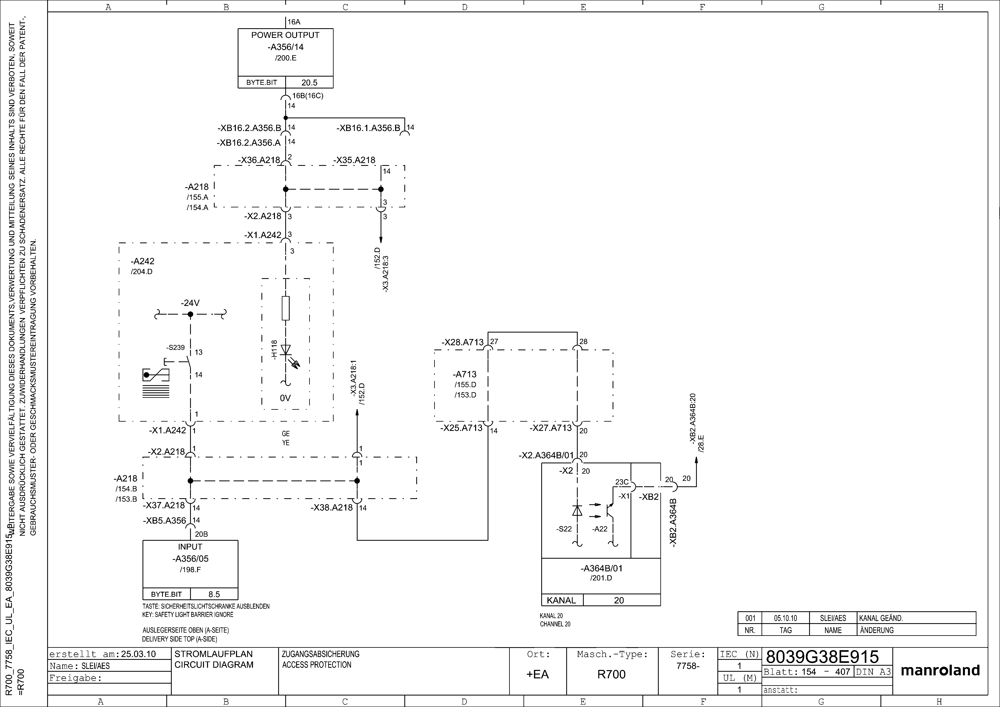

# +EA — Sheet 154 of 407 — ZUGANGSABSICHERUNG

**ACCESS PROTECTION**

> Part of the manroland **R700** printing press IEC/UL circuit diagrams.
> Drawing class: **Stromlaufplan / Circuit diagram** (DIN A3).
> Document `+EA` covers the **Printing unit** machine section.

## At a glance

| Field | Value |
|---|---|
| Document | `+EA`  (8039G38E915) |
| Sheet | **154** of 407 |
| Section (DE) | ZUGANGSABSICHERUNG |
| Section (EN) | ACCESS PROTECTION |
| Section type | CIRCUIT — Circuit diagram |
| Machine type | `R700` |
| Series | `7758` |
| Created | 25.03.10 |
| Replaces | — |
| Columns used | A, B, C, D, E, F, G, H |
| Path numbers | — |
| Labels on sheet | 106 |
| Cross-refs out | 13 |
| Cross-refs in | 34 |

**Previous:** [+EA sheet 153](SHEET_0153.md) · **Next:** [+EA sheet 155](SHEET_0155.md) · **Document TOC:** [_TOC.md](_TOC.md)  (+EA) · **Master TOC:** [all sheets](../_MASTER_TOC.md)

## Sheet image (300 DPI, exact vector render)



_Rendered directly from the PDF vector layer at 300 DPI (1-bit), no OCR and no resampling. Use it to confirm anything ambiguous in the text below._

## Cross-references on this sheet

Each entry is a wire leaving this sheet. The printed token is `/sheet.column`; the link resolves to that sheet inside the same document.

| Ref | Target sheet | Col | Path | Destination on target | Target section | From col |
|---|---|---|---|---|---|---|
| `/200.E` | [+EA sheet 200](SHEET_0200.md) | E | — | — | REFERENZMODUL | C |
| `/155.A` | [+EA sheet 155](SHEET_0155.md) | A | — | — | ZUGANGSABSICHERUNG | B |
| `/154.A` | [+EA sheet 154](SHEET_0154.md) | A | — | — | ZUGANGSABSICHERUNG | B |
| `/152.D` | [+EA sheet 152](SHEET_0152.md) | D | — | — | ZUGANGSABSICHERUNG | C |
| `/204.D` | [+EA sheet 204](SHEET_0204.md) | D | — | A242 | REFERENZMODUL | A |
| `/152.D` | [+EA sheet 152](SHEET_0152.md) | D | — | X3.A218:1 | ZUGANGSABSICHERUNG | C |
| `/155.D` | [+EA sheet 155](SHEET_0155.md) | D | — | — | ZUGANGSABSICHERUNG | D |
| `/153.D` | [+EA sheet 153](SHEET_0153.md) | D | — | — | ZUGANGSABSICHERUNG | D |
| `/28.E` | [+EA sheet 28](SHEET_0028.md) | E | — | XB2.A364B:20 | BUSVERBINDUNGEN: SICHERHEITSBUS | F |
| `/154.B` | [+EA sheet 154](SHEET_0154.md) | B | — | — | ZUGANGSABSICHERUNG | A |
| `/153.B` | [+EA sheet 153](SHEET_0153.md) | B | — | — | ZUGANGSABSICHERUNG | A |
| `/198.F` | [+EA sheet 198](SHEET_0198.md) | F | — | — | REFERENZMODUL | B |
| `/201.D` | [+EA sheet 201](SHEET_0201.md) | D | — | — | REFERENZMODUL | E |

### Incoming references (sheets that point here)

Every other sheet that sends a wire to this one. `Back-ref` is the token printed on *that* sheet; `Path` is its line number.

| From sheet | Cols | Back-ref | Path | Refs | What continues there |
|---|---|---|---|---|---|
| [+EA#28](SHEET_0028.md) | E | `/28.E` | — | 1 | — |
| [+EA#152](SHEET_0152.md) | E | `/152.E` | — | 2 | X3.A218:2 |
| [+EA#153](SHEET_0153.md) | B, D | `/153.B`, `/153.D` | — | 2 | — |
| [+EA#154](SHEET_0154.md) | A, B | `/154.A`, `/154.B` | — | 2 | — |
| [+EA#155](SHEET_0155.md) | A, D | `/155.A`, `/155.D` | — | 2 | — |
| [+EA#198](SHEET_0198.md) | F | `/198.F` | — | 1 | — |
| [+EA#200](SHEET_0200.md) | E | `/200.E` | — | 1 | — |
| [+EA#201](SHEET_0201.md) | D | `/201.D` | — | 1 | — |
| [+EA#204](SHEET_0204.md) | D | `/204.D` | — | 1 | — |
| [+EA#207](SHEET_0207.md) | F | `/207.F` | — | 2 | — |
| [+EA#223](SHEET_0223.md) | E | `/223.E` | — | 2 | — |
| [+EA#227](SHEET_0227.md) | C, E | `/227.C`, `/227.E` | — | 2 | — |
| [+EA#231](SHEET_0231.md) | H | `/231.H` | — | 2 | — |
| [+EA#241](SHEET_0241.md) | H | `/241.H` | — | 1 | — |
| [+EA#261](SHEET_0261.md) | H | `/261.H` | — | 1 | — |
| [+EA#262](SHEET_0262.md) | B, C, E | `/262.B`, `/262.C`, `/262.E` | — | 3 | — |
| [+EA#268](SHEET_0268.md) | G | `/268.G` | — | 1 | — |
| [+EA#272](SHEET_0272.md) | B | `/272.B` | — | 1 | — |
| [+EA#273](SHEET_0273.md) | G | `/273.G` | — | 2 | — |
| [+EA#278](SHEET_0278.md) | C, H | `/278.C`, `/278.H` | — | 2 | — |
| [+EA#279](SHEET_0279.md) | E | `/279.E` | — | 1 | — |
| [+EA#280](SHEET_0280.md) | A | `/280.A` | — | 1 | — |


## Devices on this sheet

| Tag | Class | Class meaning (IEC) | Col | Sub | Terminal | Sign |
|---|---|---|---|---|---|---|
| `A356/05` | A | Baugruppe / assembly, module, PC board | B | 05 | — | — |
| `A356/14` | A | Baugruppe / assembly, module, PC board | B | 14 | — | — |
| `S239` | S | Schalter / switch | B | — | — | — |
| `A242` | A | Baugruppe / assembly, module, PC board | A | — | — | — |
| `A218` | A | Baugruppe / assembly, module, PC board | A | — | — | — |
| `S22` | S | Schalter / switch | E | — | — | — |
| `A22` | A | Baugruppe / assembly, module, PC board | E | — | — | — |
| `X1` | X | Klemme / terminal, plug connector | E | — | — | — |
| `X2` | X | Klemme / terminal, plug connector | E | — | — | — |
| `XB2` | XB |  | F | — | — | — |
| `A713` | A | Baugruppe / assembly, module, PC board | D | — | — | — |
| `A218` | A | Baugruppe / assembly, module, PC board | B | — | — | — |
| `8.5` | — | cross-device reference | B | — | — | — |
| `XB5.A356` | — | cross-device reference | A | — | — | — |
| `20.5` | — | cross-device reference | C | — | — | — |
| `X37.A218` | — | cross-device reference | A | — | — | — |
| `X38.A218` | — | cross-device reference | C | — | — | — |
| `X2.A218` | — | cross-device reference | A | — | — | — |
| `X1.A242` | — | cross-device reference | B | — | — | — |
| `X1.A242` | — | cross-device reference | B | — | — | — |
| `X2.A218` | — | cross-device reference | B | — | — | — |
| `X36.A218` | — | cross-device reference | B | — | — | — |
| `XB16.2.A356.B` | — | cross-device reference | B | — | — | — |
| `XB16.1.A356.B` | — | cross-device reference | C | — | — | — |
| `XB16.2.A356.A` | — | cross-device reference | B | — | — | — |
| `XB2.A364B` | — | cross-device reference | F | — | — | — |
| `X27.A713` | — | cross-device reference | E | — | — | — |
| `X28.A713` | — | cross-device reference | D | — | — | — |
| `X25.A713` | — | cross-device reference | D | — | — | — |
| `NR.` | — | cross-device reference | F | — | — | — |
| `05.10.10` | — | cross-device reference | G | — | — | — |
| `X3.A218:3` | — | cross-device reference | C | — | 3 | — |
| `X3.A218:1` | — | cross-device reference | C | — | 1 | — |
| `XB2.A364B:20` | — | cross-device reference | F | — | 20 | — |
| `X35.A218` | — | cross-device reference | C | — | — | — |

## Potentials / nets

| Potential | Count | Columns | Attached devices | Terminals |
|---|---|---|---|---|
| `0V` | 1 | B | — | — |
| `24V` | 1 | B | — | — |
| `H118` | 1 | B | — | — |


A potential such as `L24+/4` or `M24+` is a named supply/return rail; every place it appears on this sheet is electrically common.

## Wire-end annotations (grouped as printed)

A wire that continues elsewhere is annotated with a small cluster: the destination description, the path/line number `#NN`, and the `/sheet.column` cross reference. Each row below is one such cluster exactly as it is grouped on the drawing.

| Col | Y | Path | Cross-ref | Text on the wire |
|---|---|---|---|---|
| C | 22.3 | — | — | `16A` |
| B | 37.4 | — | — | `POWER OUTPUT` |
| B | 51.3 | — | — | `A356/14` |
| C | 65.1 | — | `/200.E` | — |
| B | 94.2 | — | — | `BYTE.BIT 20.5` |
| C | 110.2 | — | — | `16B(16C)` |
| C | 122.2 | — | — | `14` |
| C | 147.7 | — | — | `XB16.2.A356.B 14 XB16.1.A356.B 14` |
| B | 164.7 | — | — | `XB16.2.A356.A 14` |
| B | 183.2 | — | — | `X36.A218 2` |
| C | 186.0 | — | — | `X35.A218` |
| C | 200.2 | — | — | `14` |
| B | 217.9 | — | — | `A218` |
| B | 230.9 | — | `/155.A`, `/154.A` | — |
| C | 237.0 | — | — | `3` |
| C | 252.6 | — | — | `X2.A218 3 3` |
| B | 275.3 | — | — | `X1.A242 3` |
| C | 294.5 | — | `/152.D` | — |
| C | 295.1 | — | — | `3` |
| C | 304.4 | — | — | `X3.A218:3` |
| A | 306.4 | — | `/204.D` | `A242` |
| B | 356.1 | — | — | `24V` |
| D | 402.8 | — | — | `X28.A713 27` |
| E | 402.8 | — | — | `28` |
| B | 404.9 | — | — | `H118` |
| B | 410.4 | — | — | `S239` |
| B | 415.6 | — | — | `13` |
| C | 428.3 | — | `/152.D` | `X3.A218:1` |
| D | 441.1 | — | — | `A713` |
| B | 442.5 | — | — | `14` |
| D | 454.2 | — | `/155.D`, `/153.D` | — |
| F | 468.3 | — | `/28.E` | `XB2.A364B:20` |
| B | 469.4 | — | — | `0V` |
| B | 489.3 | — | — | `1` |
| D | 504.9 | — | — | `X25.A713 14` |
| E | 504.9 | — | — | `X27.A713 20` |
| B | 507.7 | — | — | `X1.A242 1` |
| B | 513.6 | — | — | `GE YE` |
| B | 530.4 | — | — | `X2.A218 1 1` |
| E | 537.5 | — | — | `X2.A364B/01 20` |
| C | 547.4 | — | — | `1` |
| E | 555.9 | — | — | `X2` |
| E | 557.3 | — | — | `20 20` |
| A | 565.1 | — | — | `A218` |
| F | 565.8 | — | — | `20` |
| E | 570.1 | — | — | `23C` |
| A | 578.2 | — | `/154.B`, `/153.B` | — |
| E | 587.1 | — | — | `X1` |
| F | 587.1 | — | — | `XB2` |
| F | 593.3 | — | — | `XB2.A364B` |
| B | 597.0 | — | — | `X37.A218 14 X38.A218 14` |
| B | 615.4 | — | — | `XB5.A356 14` |
| E | 626.0 | — | — | `S22 A22` |
| B | 632.4 | — | — | `20B` |
| B | 646.9 | — | — | `INPUT` |
| B | 660.8 | — | — | `A356/05` |
| E | 672.1 | — | — | `A364B/01` |
| B | 674.6 | — | `/198.F` | — |
| E | 684.5 | — | `/201.D` | — |
| B | 703.6 | — | — | `BYTE.BIT 8.5` |
| E | 710.4 | — | — | `KANAL 20` |
| B | 719.4 | — | — | `KEY: SAFETY LIGHT BARRIER IGNORE TASTE: SICHERHEITSLICHTSCHRANKE AUSBLENDEN` |
| E | 730.7 | — | — | `KANAL 20 CHANNEL 20` |
| G | 733.0 | — | — | `001 05.10.10 SLEI/AES KANAL GEÄND.` |
| G | 747.1 | — | — | `NR. TAG NAME ÄNDERUNG` |
| B | 747.5 | — | — | `DELIVERY SIDE TOP (A SIDE) AUSLEGERSEITE OBEN (A SEITE)` |


## Reconstructed tables

This sheet carries tabular content (pin map / terminal assignment / index). The grid below was rebuilt from the drawing's own rule lines, so each row is exactly one physical row of the table.

### Table 1 — 10 data rows × 9 columns (at x=141.7, y=34.0)

|  |  |  | POWER |  | A356/14 /200.E | OUTPUT |  |  |
|---|---|---|---|---|---|---|---|---|
|  |  |  | `BYTE.BIT` |  |  | `20.5` |  |  |
|  |  |  |  |  |  | `16B(16C) 14` |  |  |
|  |  | `A218` | `XB16.2.A356.B XB16.2.A356.A X36.A218` |  |  | `14 14 2` | `X35.A218` | `XB16.1.A356.B` |
|  |  | `/155.A /154.A` | `X2.A218 X1.A242` |  |  | `3 3` |  |  |
| `A242 /204.D` | `24V` |  |  |  |  | `3` |  | `/152.D` |
|  | `S239` | `13 14 1` | `H118` | `0V` |  |  | `X3.A218:1` | `/152.D` |
| `A218` | `X1.A242 X2.A218` | `1 1` |  |  | `GE YE` |  |  | `1 1` |
| `/154.B /153.B` | `X37.A218 XB5.A356` | `14 14 20B` |  |  |  | `X38.A218` |  | `14` |
|  | `INPUT` | `A356/05 /198.F` |  |  |  |  |  |  |
|  | `BYTE.BIT` | `8.5` |  |  |  |  |  |  |


### Table 2 — 3 data rows × 6 columns (at x=581.1, y=395.4)

| 27 14 | X27.A713 X2.A364B/01 | 28 20 20 |  |  | XB2.A364B:20 |
|---|---|---|---|---|---|
|  | `X2 S22` | `20 A22` | `23C X1` | `XB2` | `20 20 XB2.A364B` |
|  |  | `A364B/01 /201.D` |  |  |  |
|  | `KANAL` |  | `20` |  |  |


## Notes and free text on this sheet

| Text | Col | Y (pt) |
|---|---|---|
| `20B` | B | 632.41 |
| `INPUT` | B | 646.94 |
| `BYTE.BIT` | A | 704.19 |
| `TASTE: SICHERHEITSLICHTSCHRANKE AUSBLENDEN` | B | 719.37 |
| `KEY: SAFETY LIGHT BARRIER IGNORE` | B | 729.32 |
| `16A` | C | 22.26 |
| `16B(16C)` | C | 110.16 |
| `POWER OUTPUT` | B | 37.41 |
| `BYTE.BIT` | B | 94.74 |
| `KANAL 20` | E | 730.71 |
| `CHANNEL 20` | E | 740.65 |
| `23C` | E | 570.09 |
| `KANAL` | E | 710.38 |
| `A364B/01` | E | 672.12 |
| `X2.A364B/01` | E | 537.47 |
| `TAG` | G | 747.27 |
| `NAME` | G | 747.25 |
| `ÄNDERUNG` | G | 747.31 |
| `SLEI/AES` | G | 733.13 |
| `KANAL GEÄND.` | H | 733.11 |
| `GE` | B | 513.62 |
| `YE` | C | 524.24 |
| `AUSLEGERSEITE OBEN (A SEITE)` | B | 747.55 |
| `DELIVERY SIDE TOP (A SIDE)` | B | 758.17 |

## Complete label inventory (exact text from the drawing)

Every text object inside the drawing area of this sheet, in DIN reading order (column A→H, then top→bottom). This is the authoritative list: if a string is not here it is not printed on this sheet.

| Col | Y | X | Dir | Type | Text |
|---|---|---|---|---|---|
| A | 306.4 | 155.6 | → | device tag | `A242` |
| A | 319.5 | 155.9 | → | cross-reference | `/204.D` |
| A | 533.2 | 176.0 | → | device ref | `X2.A218` |
| A | 565.1 | 135.2 | → | device tag | `A218` |
| A | 578.2 | 137.8 | → | cross-reference | `/154.B` |
| A | 590.6 | 137.8 | → | cross-reference | `/153.B` |
| A | 597.0 | 170.1 | → | device ref | `X37.A218` |
| A | 615.4 | 170.4 | → | device ref | `XB5.A356` |
| A | 704.2 | 180.0 | → | text | `BYTE.BIT` |
| B | 37.4 | 299.3 | → | text | `POWER OUTPUT` |
| B | 51.3 | 318.8 | → | device tag | `A356/14` |
| B | 94.7 | 293.4 | → | text | `BYTE.BIT` |
| B | 147.7 | 259.1 | → | device ref | `XB16.2.A356.B` |
| B | 165.4 | 258.2 | → | device ref | `XB16.2.A356.A` |
| B | 186.0 | 283.5 | → | device ref | `X36.A218` |
| B | 217.9 | 220.3 | → | device tag | `A218` |
| B | 230.9 | 222.5 | → | cross-reference | `/155.A` |
| B | 243.3 | 222.5 | → | cross-reference | `/154.A` |
| B | 252.6 | 290.8 | → | device ref | `X2.A218` |
| B | 275.3 | 290.8 | → | device ref | `X1.A242` |
| B | 356.1 | 215.4 | → | potential | `24V` |
| B | 404.9 | 322.8 | ↕ | potential | `H118` |
| B | 410.3 | 198.1 | → | device tag | `S239` |
| B | 415.6 | 231.6 | → | number | `13` |
| B | 442.5 | 231.6 | → | number | `14` |
| B | 469.4 | 333.4 | → | potential | `0V` |
| B | 489.3 | 231.6 | → | number | `1` |
| B | 507.7 | 177.4 | → | device ref | `X1.A242` |
| B | 509.1 | 228.8 | → | number | `1` |
| B | 513.6 | 335.6 | → | text | `GE` |
| B | 530.4 | 228.8 | → | number | `1` |
| B | 601.3 | 228.8 | → | number | `14` |
| B | 615.4 | 228.8 | → | number | `14` |
| B | 632.4 | 232.2 | → | text | `20B` |
| B | 646.9 | 211.9 | → | text | `INPUT` |
| B | 660.8 | 205.4 | → | device tag | `A356/05` |
| B | 674.6 | 214.4 | → | cross-reference | `/198.F` |
| B | 703.6 | 248.3 | → | device ref | `8.5` |
| B | 719.4 | 169.8 | → | text | `TASTE: SICHERHEITSLICHTSCHRANKE AUSBLENDEN` |
| B | 729.3 | 169.5 | → | text | `KEY: SAFETY LIGHT BARRIER IGNORE` |
| B | 747.5 | 170.1 | → | text | `AUSLEGERSEITE OBEN (A SEITE)` |
| B | 758.2 | 169.2 | → | text | `DELIVERY SIDE TOP (A SIDE)` |
| C | 22.3 | 342.1 | → | text | `16A` |
| C | 65.1 | 327.7 | → | cross-reference | `/200.E` |
| C | 94.2 | 359.0 | → | device ref | `20.5` |
| C | 110.2 | 347.8 | → | text | `16B(16C)` |
| C | 122.2 | 342.1 | → | number | `14` |
| C | 147.7 | 342.1 | → | number | `14` |
| C | 147.7 | 400.8 | → | device ref | `XB16.1.A356.B` |
| C | 164.7 | 342.1 | → | number | `14` |
| C | 183.2 | 342.7 | → | number | `2` |
| C | 186.0 | 396.9 | → | device ref | `X35.A218` |
| C | 200.2 | 455.5 | → | number | `14` |
| C | 237.0 | 456.1 | → | number | `3` |
| C | 254.0 | 342.7 | → | number | `3` |
| C | 254.0 | 456.1 | → | number | `3` |
| C | 275.3 | 342.7 | → | number | `3` |
| C | 294.5 | 445.3 | ↕ | cross-reference | `/152.D` |
| C | 295.1 | 345.5 | → | number | `3` |
| C | 304.4 | 455.2 | ↕ | device ref | `X3.A218:3` |
| C | 428.3 | 417.0 | ↕ | device ref | `X3.A218:1` |
| C | 456.1 | 426.9 | ↕ | cross-reference | `/152.D` |
| C | 524.2 | 336.1 | → | text | `YE` |
| C | 530.4 | 427.2 | → | number | `1` |
| C | 547.4 | 427.2 | → | number | `1` |
| C | 599.8 | 369.9 | → | device ref | `X38.A218` |
| C | 601.3 | 427.2 | → | number | `14` |
| D | 147.7 | 483.9 | → | number | `14` |
| D | 402.8 | 525.8 | → | device ref | `X28.A713` |
| D | 402.8 | 583.7 | → | number | `27` |
| D | 441.1 | 539.1 | → | device tag | `A713` |
| D | 454.2 | 541.4 | → | cross-reference | `/155.D` |
| D | 466.6 | 541.4 | → | cross-reference | `/153.D` |
| D | 504.9 | 524.4 | → | device ref | `X25.A713` |
| D | 509.1 | 583.1 | → | number | `14` |
| E | 402.8 | 690.0 | → | number | `28` |
| E | 504.9 | 630.7 | → | device ref | `X27.A713` |
| E | 509.1 | 690.0 | → | number | `20` |
| E | 537.5 | 617.7 | → | text | `X2.A364B/01` |
| E | 537.5 | 690.0 | → | number | `20` |
| E | 555.9 | 665.9 | → | device tag | `X2` |
| E | 557.3 | 692.8 | → | number | `20` |
| E | 570.1 | 732.8 | → | text | `23C` |
| E | 587.1 | 736.4 | → | device tag | `X1` |
| E | 626.1 | 662.5 | → | device tag | `S22` |
| E | 626.1 | 705.0 | → | device tag | `A22` |
| E | 672.1 | 691.5 | → | text | `A364B/01` |
| E | 684.5 | 703.0 | → | cross-reference | `/201.D` |
| E | 710.3 | 731.2 | → | number | `20` |
| E | 710.4 | 651.1 | → | text | `KANAL` |
| E | 730.7 | 642.9 | → | text | `KANAL 20` |
| E | 740.6 | 643.2 | → | text | `CHANNEL 20` |
| F | 468.3 | 820.9 | ↕ | device ref | `XB2.A364B:20` |
| F | 517.9 | 830.8 | ↕ | cross-reference | `/28.E` |
| F | 565.8 | 812.7 | → | number | `20` |
| F | 567.3 | 792.0 | → | number | `20` |
| F | 587.1 | 760.8 | → | device tag | `XB2` |
| F | 593.3 | 796.8 | ↕ | device ref | `XB2.A364B` |
| F | 733.0 | 887.7 | → | number | `001` |
| F | 747.1 | 886.7 | → | device ref | `NR.` |
| G | 733.1 | 921.9 | → | device ref | `05.10.10` |
| G | 733.1 | 976.6 | → | text | `SLEI/AES` |
| G | 747.3 | 928.3 | → | text | `TAG` |
| G | 747.3 | 981.7 | → | text | `NAME` |
| G | 747.3 | 1024.3 | → | text | `ÄNDERUNG` |
| H | 733.1 | 1023.2 | → | text | `KANAL GEÄND.` |

## Reading-order text block

The same content as a plain block, grouped by DIN column — convenient to paste or to match against a visual description.

```text
=== Column A ===
 306.4  155.6  devtag       A242
 319.5  155.9  xref         /204.D
 533.2  176.0  devref       X2.A218
 565.1  135.2  devtag       A218
 578.2  137.8  xref         /154.B
 590.6  137.8  xref         /153.B
 597.0  170.1  devref       X37.A218
 615.4  170.4  devref       XB5.A356
 704.2  180.0  text         BYTE.BIT
=== Column B ===
  37.4  299.3  text         POWER OUTPUT
  51.3  318.8  devtag       A356/14
  94.7  293.4  text         BYTE.BIT
 147.7  259.1  devref       XB16.2.A356.B
 165.4  258.2  devref       XB16.2.A356.A
 186.0  283.5  devref       X36.A218
 217.9  220.3  devtag       A218
 230.9  222.5  xref         /155.A
 243.3  222.5  xref         /154.A
 252.6  290.8  devref       X2.A218
 275.3  290.8  devref       X1.A242
 356.1  215.4  net          24V
 404.9  322.8  net          H118
 410.3  198.1  devtag       S239
 415.6  231.6  numeric      13
 442.5  231.6  numeric      14
 469.4  333.4  net          0V
 489.3  231.6  numeric      1
 507.7  177.4  devref       X1.A242
 509.1  228.8  numeric      1
 513.6  335.6  text         GE
 530.4  228.8  numeric      1
 601.3  228.8  numeric      14
 615.4  228.8  numeric      14
 632.4  232.2  text         20B
 646.9  211.9  text         INPUT
 660.8  205.4  devtag       A356/05
 674.6  214.4  xref         /198.F
 703.6  248.3  devref       8.5
 719.4  169.8  text         TASTE: SICHERHEITSLICHTSCHRANKE AUSBLENDEN
 729.3  169.5  text         KEY: SAFETY LIGHT BARRIER IGNORE
 747.5  170.1  text         AUSLEGERSEITE OBEN (A SEITE)
 758.2  169.2  text         DELIVERY SIDE TOP (A SIDE)
=== Column C ===
  22.3  342.1  text         16A
  65.1  327.7  xref         /200.E
  94.2  359.0  devref       20.5
 110.2  347.8  text         16B(16C)
 122.2  342.1  numeric      14
 147.7  342.1  numeric      14
 147.7  400.8  devref       XB16.1.A356.B
 164.7  342.1  numeric      14
 183.2  342.7  numeric      2
 186.0  396.9  devref       X35.A218
 200.2  455.5  numeric      14
 237.0  456.1  numeric      3
 254.0  342.7  numeric      3
 254.0  456.1  numeric      3
 275.3  342.7  numeric      3
 294.5  445.3  xref         /152.D
 295.1  345.5  numeric      3
 304.4  455.2  devref       X3.A218:3
 428.3  417.0  devref       X3.A218:1
 456.1  426.9  xref         /152.D
 524.2  336.1  text         YE
 530.4  427.2  numeric      1
 547.4  427.2  numeric      1
 599.8  369.9  devref       X38.A218
 601.3  427.2  numeric      14
=== Column D ===
 147.7  483.9  numeric      14
 402.8  525.8  devref       X28.A713
 402.8  583.7  numeric      27
 441.1  539.1  devtag       A713
 454.2  541.4  xref         /155.D
 466.6  541.4  xref         /153.D
 504.9  524.4  devref       X25.A713
 509.1  583.1  numeric      14
=== Column E ===
 402.8  690.0  numeric      28
 504.9  630.7  devref       X27.A713
 509.1  690.0  numeric      20
 537.5  617.7  text         X2.A364B/01
 537.5  690.0  numeric      20
 555.9  665.9  devtag       X2
 557.3  692.8  numeric      20
 570.1  732.8  text         23C
 587.1  736.4  devtag       X1
 626.1  662.5  devtag       S22
 626.1  705.0  devtag       A22
 672.1  691.5  text         A364B/01
 684.5  703.0  xref         /201.D
 710.3  731.2  numeric      20
 710.4  651.1  text         KANAL
 730.7  642.9  text         KANAL 20
 740.6  643.2  text         CHANNEL 20
=== Column F ===
 468.3  820.9  devref       XB2.A364B:20
 517.9  830.8  xref         /28.E
 565.8  812.7  numeric      20
 567.3  792.0  numeric      20
 587.1  760.8  devtag       XB2
 593.3  796.8  devref       XB2.A364B
 733.0  887.7  numeric      001
 747.1  886.7  devref       NR.
=== Column G ===
 733.1  921.9  devref       05.10.10
 733.1  976.6  text         SLEI/AES
 747.3  928.3  text         TAG
 747.3  981.7  text         NAME
 747.3 1024.3  text         ÄNDERUNG
=== Column H ===
 733.1 1023.2  text         KANAL GEÄND.
```

---
_Generated from the PDF vector text layer; no OCR. Source: `R700_7758_IEC_UL_EA_8039G38E915_p`, sheet 154._
