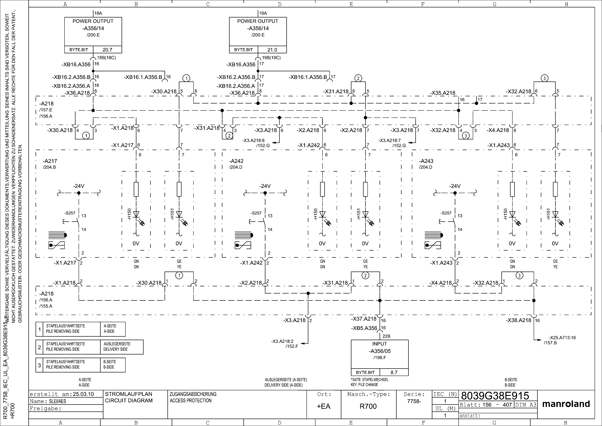

# +EA — Sheet 156 of 407 — ZUGANGSABSICHERUNG

**ACCESS PROTECTION**

> Part of the manroland **R700** printing press IEC/UL circuit diagrams.
> Drawing class: **Stromlaufplan / Circuit diagram** (DIN A3).
> Document `+EA` covers the **Printing unit** machine section.

## At a glance

| Field | Value |
|---|---|
| Document | `+EA`  (8039G38E915) |
| Sheet | **156** of 407 |
| Section (DE) | ZUGANGSABSICHERUNG |
| Section (EN) | ACCESS PROTECTION |
| Section type | CIRCUIT — Circuit diagram |
| Machine type | `R700` |
| Series | `7758` |
| Created | 25.03.10 |
| Replaces | — |
| Columns used | A, B, C, D, E, F, G, H |
| Path numbers | — |
| Labels on sheet | 210 |
| Cross-refs out | 14 |
| Cross-refs in | 68 |

**Previous:** [+EA sheet 155](SHEET_0155.md) · **Next:** [+EA sheet 157](SHEET_0157.md) · **Document TOC:** [_TOC.md](_TOC.md)  (+EA) · **Master TOC:** [all sheets](../_MASTER_TOC.md)

## Sheet image (300 DPI, exact vector render)



_Rendered directly from the PDF vector layer at 300 DPI (1-bit), no OCR and no resampling. Use it to confirm anything ambiguous in the text below._

## Cross-references on this sheet

Each entry is a wire leaving this sheet. The printed token is `/sheet.column`; the link resolves to that sheet inside the same document.

| Ref | Target sheet | Col | Path | Destination on target | Target section | From col |
|---|---|---|---|---|---|---|
| `/200.E` | [+EA sheet 200](SHEET_0200.md) | E | — | — | REFERENZMODUL | A |
| `/200.E` | [+EA sheet 200](SHEET_0200.md) | E | — | — | REFERENZMODUL | D |
| `/157.E` | [+EA sheet 157](SHEET_0157.md) | E | — | A218 | ZUGANGSABSICHERUNG | A |
| `/156.A` | [+EA sheet 156](SHEET_0156.md) | A | — | A218 | ZUGANGSABSICHERUNG | A |
| `/152.G` | [+EA sheet 152](SHEET_0152.md) | G | — | X3.A218:6 | ZUGANGSABSICHERUNG | D |
| `/152.G` | [+EA sheet 152](SHEET_0152.md) | G | — | X3.A218:7 | ZUGANGSABSICHERUNG | F |
| `/204.B` | [+EA sheet 204](SHEET_0204.md) | B | — | A217 | REFERENZMODUL | A |
| `/204.D` | [+EA sheet 204](SHEET_0204.md) | D | — | A242 | REFERENZMODUL | C |
| `/204.D` | [+EA sheet 204](SHEET_0204.md) | D | — | A243 | REFERENZMODUL | F |
| `/156.A` | [+EA sheet 156](SHEET_0156.md) | A | — | A218 | ZUGANGSABSICHERUNG | A |
| `/155.A` | [+EA sheet 155](SHEET_0155.md) | A | — | A218 | ZUGANGSABSICHERUNG | A |
| `/152.F` | [+EA sheet 152](SHEET_0152.md) | F | — | X3.A218:2 | ZUGANGSABSICHERUNG | D |
| `/157.B` | [+EA sheet 157](SHEET_0157.md) | B | — | — | ZUGANGSABSICHERUNG | H |
| `/198.F` | [+EA sheet 198](SHEET_0198.md) | F | — | — | REFERENZMODUL | E |

### Incoming references (sheets that point here)

Every other sheet that sends a wire to this one. `Back-ref` is the token printed on *that* sheet; `Path` is its line number.

| From sheet | Cols | Back-ref | Path | Refs | What continues there |
|---|---|---|---|---|---|
| [+EA#152](SHEET_0152.md) | F, G, H | `/152.F`, `/152.G`, `/152.H` | — | 3 | — |
| [+EA#155](SHEET_0155.md) | A | `/155.A` | — | 1 | — |
| [+EA#156](SHEET_0156.md) | A | `/156.A` | — | 2 | A218 |
| [+EA#157](SHEET_0157.md) | A, E | `/157.A`, `/157.E` | — | 2 | X25.A713:16 |
| [+EA#198](SHEET_0198.md) | F | `/198.F` | — | 1 | — |
| [+EA#200](SHEET_0200.md) | E | `/200.E` | — | 2 | — |
| [+EA#204](SHEET_0204.md) | B, D | `/204.B`, `/204.D` | — | 3 | — |
| [+EA#207](SHEET_0207.md) | C, D, E, F, H | `/207.C`, `/207.D`, `/207.E`, `/207.F`, `/207.H` | — | 12 | — |
| [+EA#223](SHEET_0223.md) | E | `/223.E` | — | 3 | — |
| [+EA#231](SHEET_0231.md) | H | `/231.H` | — | 3 | — |
| [+EA#236](SHEET_0236.md) | C | `/236.C` | — | 3 | — |
| [+EA#241](SHEET_0241.md) | H | `/241.H` | — | 1 | — |
| [+EA#261](SHEET_0261.md) | H | `/261.H` | — | 2 | — |
| [+EA#262](SHEET_0262.md) | B, C, E | `/262.B`, `/262.C`, `/262.E` | — | 6 | — |
| [+EA#275](SHEET_0275.md) | D, G | `/275.D`, `/275.G` | — | 12 | — |
| [+EA#276](SHEET_0276.md) | E | `/276.E` | — | 6 | — |
| [+EA#278](SHEET_0278.md) | C, H | `/278.C`, `/278.H` | — | 4 | — |
| [+EA#279](SHEET_0279.md) | E | `/279.E` | — | 1 | — |
| [+EA#280](SHEET_0280.md) | A | `/280.A` | — | 1 | — |


## Devices on this sheet

| Tag | Class | Class meaning (IEC) | Col | Sub | Terminal | Sign |
|---|---|---|---|---|---|---|
| `A218` | A | Baugruppe / assembly, module, PC board | A | — | — | — |
| `S257` | S | Schalter / switch | A | — | — | — |
| `A217` | A | Baugruppe / assembly, module, PC board | A | — | — | — |
| `S257` | S | Schalter / switch | D | — | — | — |
| `A242` | A | Baugruppe / assembly, module, PC board | C | — | — | — |
| `A356/05` | A | Baugruppe / assembly, module, PC board | E | 05 | — | — |
| `S257` | S | Schalter / switch | F | — | — | — |
| `A243` | A | Baugruppe / assembly, module, PC board | F | — | — | — |
| `A218` | A | Baugruppe / assembly, module, PC board | A | — | — | — |
| `A356/14` | A | Baugruppe / assembly, module, PC board | A | 14 | — | — |
| `A356/14` | A | Baugruppe / assembly, module, PC board | D | 14 | — | — |
| `X1.A218` | — | cross-device reference | A | — | — | — |
| `X1.A217` | — | cross-device reference | B | — | — | — |
| `X1.A217` | — | cross-device reference | A | — | — | — |
| `X30.A218` | — | cross-device reference | B | — | — | — |
| `X1.A242` | — | cross-device reference | D | — | — | — |
| `X1.A242` | — | cross-device reference | D | — | — | — |
| `X2.A218` | — | cross-device reference | D | — | — | — |
| `X31.A218` | — | cross-device reference | E | — | — | — |
| `X37.A218` | — | cross-device reference | E | — | — | — |
| `X3.A218` | — | cross-device reference | D | — | — | — |
| `8.7` | — | cross-device reference | F | — | — | — |
| `XB5.A356` | — | cross-device reference | E | — | — | — |
| `X1.A243` | — | cross-device reference | G | — | — | — |
| `X1.A243` | — | cross-device reference | F | — | — | — |
| `X4.A218` | — | cross-device reference | F | — | — | — |
| `X32.A218` | — | cross-device reference | G | — | — | — |
| `X38.A218` | — | cross-device reference | G | — | — | — |
| `X2.A218` | — | cross-device reference | D | — | — | — |
| `X2.A218` | — | cross-device reference | E | — | — | — |
| `X1.A218` | — | cross-device reference | B | — | — | — |
| `X30.A218` | — | cross-device reference | B | — | — | — |
| `X30.A218` | — | cross-device reference | A | — | — | — |
| `X4.A218` | — | cross-device reference | G | — | — | — |
| `X32.A218` | — | cross-device reference | G | — | — | — |
| `X32.A218` | — | cross-device reference | F | — | — | — |
| `X3.A218` | — | cross-device reference | F | — | — | — |
| `X3.A218` | — | cross-device reference | D | — | — | — |
| `X31.A218` | — | cross-device reference | C | — | — | — |
| `20.7` | — | cross-device reference | B | — | — | — |
| `XB16.A356` | — | cross-device reference | A | — | — | — |
| `X36.A218` | — | cross-device reference | A | — | — | — |
| `XB16.2.A356.B` | — | cross-device reference | A | — | — | — |
| `XB16.2.A356.A` | — | cross-device reference | A | — | — | — |
| `XB16.1.A356.B` | — | cross-device reference | B | — | — | — |
| `21.0` | — | cross-device reference | D | — | — | — |
| `XB16.A356` | — | cross-device reference | C | — | — | — |
| `X36.A218` | — | cross-device reference | C | — | — | — |
| `XB16.2.A356.B` | — | cross-device reference | C | — | — | — |
| `XB16.2.A356.A` | — | cross-device reference | C | — | — | — |
| `XB16.1.A356.B` | — | cross-device reference | D | — | — | — |
| `X31.A218` | — | cross-device reference | E | — | — | — |
| `X3.A218:6` | — | cross-device reference | D | — | 6 | — |
| `X3.A218:2` | — | cross-device reference | D | — | 2 | — |
| `X3.A218:7` | — | cross-device reference | F | — | 7 | — |
| `X25.A713:16` | — | cross-device reference | H | — | 16 | — |
| `X35.A218` | — | cross-device reference | F | — | — | — |

## Potentials / nets

| Potential | Count | Columns | Attached devices | Terminals |
|---|---|---|---|---|
| `0V` | 6 | B, C, E, G, H | — | — |
| `24V` | 3 | A, D, F | — | — |
| `H150` | 3 | B, E, G | — | — |
| `H151` | 3 | C, E, H | — | — |


A potential such as `L24+/4` or `M24+` is a named supply/return rail; every place it appears on this sheet is electrically common.

## Wire-end annotations (grouped as printed)

A wire that continues elsewhere is annotated with a small cluster: the destination description, the path/line number `#NN`, and the `/sheet.column` cross reference. Each row below is one such cluster exactly as it is grouped on the drawing.

| Col | Y | Path | Cross-ref | Text on the wire |
|---|---|---|---|---|
| A | 22.3 | — | — | `18A` |
| D | 22.3 | — | — | `19A` |
| A | 37.4 | — | — | `POWER OUTPUT` |
| D | 37.4 | — | — | `POWER OUTPUT` |
| A | 51.3 | — | — | `A356/14` |
| D | 51.3 | — | — | `A356/14` |
| A | 65.1 | — | `/200.E` | — |
| D | 65.1 | — | `/200.E` | — |
| A | 94.2 | — | — | `BYTE.BIT 20.7` |
| D | 94.2 | — | — | `BYTE.BIT 21.0` |
| B | 110.2 | — | — | `18B(18C)` |
| D | 110.2 | — | — | `19B(19C)` |
| A | 122.2 | — | — | `XB16.A356 16` |
| D | 122.2 | — | — | `XB16.A356 17` |
| A | 147.7 | — | — | `XB16.2.A356.B 16` |
| B | 147.7 | — | — | `XB16.1.A356.B 16` |
| C | 147.7 | — | — | `XB16.2.A356.B 17` |
| D | 147.7 | — | — | `XB16.1.A356.B 17` |
| E | 151.4 | — | — | `1 2 3` |
| A | 164.7 | — | — | `XB16.2.A356.A 16` |
| C | 164.7 | — | — | `XB16.2.A356.A 17` |
| A | 176.1 | — | — | `X36.A218 6` |
| D | 176.1 | — | — | `X30.A218 5 5` |
| D | 176.1 | — | — | `6 X31.A218 6` |
| D | 176.1 | — | — | `X36.A218 8` |
| H | 176.1 | — | — | `X32.A218 6 5` |
| F | 178.9 | — | — | `X35.A218` |
| G | 193.1 | — | — | `16` |
| G | 193.1 | — | — | `17` |
| A | 200.1 | — | `/157.E`, `/156.A` | `A218` |
| C | 248.3 | — | — | `X1.A218 6 X2.A218 6 X2.A218 7` |
| D | 248.3 | — | — | `X31.A218 4 3 X3.A218 6 X3.A218 7` |
| D | 252.6 | — | — | `X30.A218 4 3 X4.A218 6 7` |
| F | 252.6 | — | — | `X32.A218 4 3` |
| C | 254.0 | — | — | `7` |
| A | 264.8 | — | — | `1` |
| E | 265.3 | — | — | `2 3` |
| D | 273.8 | — | `/152.G` | `X3.A218:6` |
| F | 273.8 | — | `/152.G` | `X3.A218:7` |
| B | 282.4 | — | — | `X1.A217 6 7` |
| D | 282.4 | — | — | `X1.A242 6` |
| E | 282.4 | — | — | `7` |
| G | 282.4 | — | — | `X1.A243 6` |
| H | 282.4 | — | — | `7` |
| B | 302.2 | — | — | `6 7` |
| E | 302.2 | — | — | `6 7` |
| H | 302.2 | — | — | `6 7` |
| A | 313.5 | — | `/204.B` | `A217` |
| C | 313.5 | — | `/204.D` | `A242` |
| F | 313.5 | — | `/204.D` | `A243` |
| A | 363.1 | — | — | `24V` |
| D | 363.1 | — | — | `24V` |
| F | 363.1 | — | — | `24V` |
| C | 411.3 | — | — | `H151` |
| E | 411.3 | — | — | `H151` |
| H | 411.3 | — | — | `H151` |
| B | 412.0 | — | — | `H150` |
| E | 412.0 | — | — | `H150` |
| G | 412.0 | — | — | `H150` |
| A | 417.4 | — | — | `S257` |
| D | 417.4 | — | — | `S257` |
| F | 417.4 | — | — | `S257` |
| A | 422.7 | — | — | `13` |
| D | 422.7 | — | — | `13` |
| G | 422.7 | — | — | `13` |
| A | 449.6 | — | — | `14` |
| D | 449.6 | — | — | `14` |
| G | 449.6 | — | — | `14` |
| B | 476.5 | — | — | `0V` |
| C | 476.5 | — | — | `0V` |
| E | 476.5 | — | — | `0V` |
| E | 476.5 | — | — | `0V` |
| G | 476.5 | — | — | `0V` |
| H | 476.5 | — | — | `0V` |
| A | 496.4 | — | — | `2` |
| D | 496.4 | — | — | `2` |
| G | 496.4 | — | — | `2` |
| B | 513.6 | — | — | `GN GN` |
| D | 513.6 | — | — | `GE YE GN GN` |
| E | 513.6 | — | — | `GE YE` |
| H | 513.6 | — | — | `GN GN GE YE` |
| A | 514.8 | — | — | `X1.A217 2` |
| D | 514.8 | — | — | `X1.A242 2` |
| F | 514.8 | — | — | `X1.A243 2` |
| D | 541.2 | — | — | `1 2` |
| G | 541.7 | — | — | `3` |
| A | 551.7 | — | — | `X1.A218 2` |
| B | 551.7 | — | — | `X30.A218 1 2` |
| D | 551.7 | — | — | `X2.A218 2 X31.A218 1 2` |
| G | 551.7 | — | — | `X4.A218 2 X32.A218 1 2` |
| A | 575.7 | — | `/156.A`, `/155.A` | `A218` |
| E | 625.3 | — | — | `X37.A218 16` |
| D | 628.2 | — | — | `X3.A218 2` |
| G | 628.2 | — | — | `X38.A218 16` |
| A | 641.2 | — | — | `1 A SEITE A SIDE` |
| A | 641.2 | — | — | `PILE REMOVING SIDE STAPELAUSFAHRTSEITE` |
| E | 643.8 | — | — | `XB5.A356 16` |
| E | 660.8 | — | — | `22B` |
| H | 663.6 | — | — | `X25.A713:16` |
| D | 670.7 | — | `/152.F` | `X3.A218:2` |
| H | 673.5 | — | `/157.B` | — |
| E | 675.3 | — | — | `INPUT` |
| A | 676.7 | — | — | `2 PILE REMOVING SIDE STAPELAUSFAHRTSEITE` |
| B | 676.7 | — | — | `DELIVERY SIDE AUSLEGERSEITE` |
| E | 689.1 | — | — | `A356/05` |
| E | 702.9 | — | `/198.F` | — |
| A | 712.1 | — | — | `3 B SEITE B SIDE` |
| A | 712.1 | — | — | `PILE REMOVING SIDE STAPELAUSFAHRTSEITE` |
| E | 732.0 | — | — | `BYTE.BIT 8.7` |
| D | 747.5 | — | — | `A SEITE A SIDE DELIVERY SIDE (A SIDE) AUSLEGERSEITE (A SEITE) B SEITE B SIDE` |
| E | 747.7 | — | — | `KEY: PILE CHANGE TASTE: STAPELWECHSEL` |


## Reconstructed tables

This sheet carries tabular content (pin map / terminal assignment / index). The grid below was rebuilt from the drawing's own rule lines, so each row is exactly one physical row of the table.

### Table 1 — 14 data rows × 11 columns (at x=70.9, y=34.0)

|  |  | POWER | OUTPUT A356/14 /200.E |  |  |  |  |  |  |  |
|---|---|---|---|---|---|---|---|---|---|---|
|  | `BYTE.BIT` |  | `20.7` |  |  |  |  |  |  |  |
|  | `XB16.A356` |  | `18B(18C) 16` |  |  |  |  |  |  |  |
|  | `XB16.2.A356.B` |  | `16` |  |  |  | `XB16.1.A356.B 16` |  |  | `1` |
|  | `XB16.2.A356.A X36.A218` |  | `16 6` |  |  |  | `X30.A218` |  |  | `5 6` |
| `A218 /157.E` |  |  |  |  |  |  |  |  |  |  |
| `/156.A` |  |  |  |  |  |  |  |  |  |  |
| `X30.A218` | `4` | `1` | `3` | `X1.A218 X1.A217` |  |  | `6 6` |  |  | `X31.A218 7 7` |
| `A217 /204.B` | `24V` |  |  |  |  |  | `6` |  |  | `7` |
|  | `S257` | `13 14 2` |  | `H150` | `0V` |  | `H151` | `0V` |  |  |
|  | `X1.A217` | `2` |  |  |  | `GN GN` |  |  | `GE YE` |  |
| `X1.A218` |  | `2` |  |  |  |  | `1 X30.A218` |  | `1` | `2` |
| `A218 /156.A` |  |  |  |  |  |  |  |  |  |  |
| `/155.A 1 PILE REMOVING` | `STAPELAUSFAHRTSEITE SIDE` |  | `A SEITE A SIDE` |  |  |  |  |  |  |  |
| `2 PILE REMOVING 3 PILE REMOVING` | `STAPELAUSFAHRTSEITE SIDE STAPELAUSFAHRTSEITE SIDE` |  | `AUSLEGERSEITE DELIVERY B SEITE B SIDE` | `SIDE` |  |  |  |  |  |  |


### Table 2 — 12 data rows × 16 columns (at x=439.4, y=34.0)

|  | POWER | A356/14 /200.E | OUTPUT |  |  |  |  |  |  |  |  |  |  |  |  |
|---|---|---|---|---|---|---|---|---|---|---|---|---|---|---|---|
|  | `BYTE.BIT` |  | `21.0` |  |  |  |  |  |  |  |  |  |  |  |  |
|  | `XB16.A356` | `17` | `19B(19C)` |  |  |  |  |  |  |  |  |  |  |  |  |
|  | `XB16.2.A356.B` | `17` |  |  | `XB16.1.A356.B` |  |  |  | `17` | `2` |  |  |  |  |  |
|  | `XB16.2.A356.A X36.A218` | `17 8` |  |  |  |  |  |  | `X31.A218` | `6` |  |  | `5` |  |  |
| `4` | `3 2 X3.A218:6` | `/152.G` | `X3.A218` | `6` | `X2.A218` | `X1.A242` |  |  | `X2.A218 6 6` |  |  |  | `7 7` | `X3.A218:7 /152.G` | `X3.A218` |
|  | `A242 /204.D` | `24V` |  |  |  |  |  |  | `6` |  |  |  | `7` |  |  |
|  | `S257` |  | `13 14 2` |  |  | `H150` | `0V` |  |  | `H151` | `0V` |  |  |  |  |
|  | `X1.A242` |  | `2` |  |  |  |  | `GN GN` |  |  |  | `GE YE` |  |  |  |
|  | `X2.A218` |  | `2` |  |  |  |  |  | `X31.A218` | `1` |  | `2` |  | `2` |  |
|  |  |  |  |  | `X3.A218` | `2` |  |  |  |  | `X37.A218 XB5.A356` |  |  | `16 16 22B` |  |
|  |  |  |  | `X3.A218:2` | `/152.F` |  |  |  |  |  |  |  | `INPUT` | `A356/05 /198.F` |  |
|  |  |  |  |  |  |  |  |  |  |  | `BYTE.BIT` |  |  | `8.7` |  |


### Table 3 — 7 data rows × 10 columns (at x=822.0, y=34.0) — **3**

| X35.A218 |  | 16 17 |  |  | X32.A218 | 6 |  |  | 5 |
|---|---|---|---|---|---|---|---|---|---|
| `X32.A218 7` |  | `X4.A218 4 3 3 X1.A243` |  |  | `6 6` |  |  |  | `7 7` |
| `A243 /204.D 24V` |  |  |  |  | `6` |  |  |  | `7` |
| `S257` |  | `H150 13 14 2` | `0V` |  |  | `H151` | `0V` |  |  |
| `X1.A243` | `2` |  |  | `GN GN` |  |  |  | `GE YE` |  |
| `X4.A218` | `2` | `1 X32.A218` |  |  | `3` | `2` |  |  |  |
|  |  |  |  |  | `X38.A218` | `16` |  |  | `X25.A713:16` |
|  |  |  |  |  |  | `/157.B` |  |  |  |


## Notes and free text on this sheet

| Text | Col | Y (pt) |
|---|---|---|
| `22B` | E | 660.76 |
| `INPUT` | E | 675.28 |
| `BYTE.BIT` | E | 732.53 |
| `TASTE: STAPELWECHSEL` | E | 747.68 |
| `KEY: PILE CHANGE` | E | 757.67 |
| `18A` | A | 22.26 |
| `18B(18C)` | B | 110.16 |
| `POWER OUTPUT` | A | 37.41 |
| `BYTE.BIT` | A | 94.74 |
| `19A` | D | 22.26 |
| `19B(19C)` | D | 110.16 |
| `POWER OUTPUT` | D | 37.41 |
| `BYTE.BIT` | C | 94.74 |
| `GN` | B | 513.64 |
| `GN` | E | 513.64 |
| `GE` | C | 513.62 |
| `YE` | C | 524.24 |
| `GE` | E | 513.62 |
| `YE` | E | 524.24 |
| `STAPELAUSFAHRTSEITE` | A | 641.24 |
| `PILE REMOVING SIDE` | A | 651.87 |
| `A SEITE` | B | 641.22 |
| `A SIDE` | B | 651.86 |
| `B SEITE` | B | 712.06 |
| `B SIDE` | B | 722.7 |
| `AUSLEGERSEITE` | B | 676.68 |
| `DELIVERY SIDE` | B | 687.29 |
| `B SEITE` | G | 747.49 |
| `B SIDE` | G | 758.13 |
| `AUSLEGERSEITE (A SEITE)` | D | 747.54 |
| `DELIVERY SIDE (A SIDE)` | D | 758.17 |
| `A SEITE` | A | 747.52 |
| `A SIDE` | A | 758.16 |
| `GE` | H | 513.62 |
| `YE` | H | 524.24 |
| `GN` | G | 513.64 |

## Complete label inventory (exact text from the drawing)

Every text object inside the drawing area of this sheet, in DIN reading order (column A→H, then top→bottom). This is the authoritative list: if a string is not here it is not printed on this sheet.

| Col | Y | X | Dir | Type | Text |
|---|---|---|---|---|---|
| A | 22.3 | 186.2 | → | text | `18A` |
| A | 37.4 | 143.4 | → | text | `POWER OUTPUT` |
| A | 51.3 | 162.9 | → | device tag | `A356/14` |
| A | 65.1 | 171.8 | → | cross-reference | `/200.E` |
| A | 94.7 | 137.5 | → | text | `BYTE.BIT` |
| A | 122.2 | 186.2 | → | number | `16` |
| A | 122.9 | 121.9 | → | device ref | `XB16.A356` |
| A | 147.7 | 103.2 | → | device ref | `XB16.2.A356.B` |
| A | 147.7 | 186.2 | → | number | `16` |
| A | 164.7 | 186.2 | → | number | `16` |
| A | 165.4 | 102.3 | → | device ref | `XB16.2.A356.A` |
| A | 176.1 | 186.8 | → | number | `6` |
| A | 178.9 | 127.6 | → | device ref | `X36.A218` |
| A | 200.1 | 77.7 | → | device tag | `A218` |
| A | 213.2 | 78.0 | → | cross-reference | `/157.E` |
| A | 225.6 | 78.0 | → | cross-reference | `/156.A` |
| A | 252.6 | 93.5 | → | device ref | `X30.A218` |
| A | 254.0 | 151.4 | → | number | `4` |
| A | 254.0 | 186.8 | → | number | `3` |
| A | 264.8 | 168.3 | → | number | `1` |
| A | 313.5 | 84.8 | → | device tag | `A217` |
| A | 326.6 | 85.0 | → | cross-reference | `/204.B` |
| A | 363.1 | 144.6 | → | potential | `24V` |
| A | 417.4 | 127.3 | → | device tag | `S257` |
| A | 422.7 | 160.7 | → | number | `13` |
| A | 449.6 | 160.7 | → | number | `14` |
| A | 496.4 | 161.3 | → | number | `2` |
| A | 514.8 | 106.6 | → | device ref | `X1.A217` |
| A | 516.2 | 158.5 | → | number | `2` |
| A | 551.7 | 158.5 | → | number | `2` |
| A | 554.5 | 105.2 | → | device ref | `X1.A218` |
| A | 575.7 | 77.7 | → | device tag | `A218` |
| A | 588.8 | 78.0 | → | cross-reference | `/156.A` |
| A | 601.2 | 78.0 | → | cross-reference | `/155.A` |
| A | 641.2 | 91.8 | → | text | `STAPELAUSFAHRTSEITE` |
| A | 646.6 | 75.4 | → | number | `1` |
| A | 651.9 | 91.3 | → | text | `PILE REMOVING SIDE` |
| A | 676.7 | 91.8 | → | text | `STAPELAUSFAHRTSEITE` |
| A | 682.0 | 75.1 | → | number | `2` |
| A | 687.3 | 91.3 | → | text | `PILE REMOVING SIDE` |
| A | 712.1 | 91.8 | → | text | `STAPELAUSFAHRTSEITE` |
| A | 717.4 | 75.0 | → | number | `3` |
| A | 722.7 | 91.3 | → | text | `PILE REMOVING SIDE` |
| A | 747.5 | 155.9 | → | text | `A SEITE` |
| A | 758.2 | 155.9 | → | text | `A SIDE` |
| B | 94.2 | 203.1 | → | device ref | `20.7` |
| B | 110.2 | 191.9 | → | text | `18B(18C)` |
| B | 147.7 | 244.9 | → | device ref | `XB16.1.A356.B` |
| B | 147.7 | 328.0 | → | number | `16` |
| B | 176.1 | 299.1 | → | device ref | `X30.A218` |
| B | 248.3 | 220.0 | → | device ref | `X1.A218` |
| B | 254.0 | 271.8 | → | number | `6` |
| B | 282.4 | 220.0 | → | device ref | `X1.A217` |
| B | 282.4 | 271.8 | → | number | `6` |
| B | 302.2 | 274.7 | → | number | `6` |
| B | 412.0 | 251.9 | ↕ | potential | `H150` |
| B | 476.5 | 262.5 | → | potential | `0V` |
| B | 513.6 | 264.8 | → | text | `GN` |
| B | 524.3 | 264.8 | → | text | `GN` |
| B | 551.7 | 328.0 | → | number | `1` |
| B | 554.5 | 269.3 | → | device ref | `X30.A218` |
| B | 641.2 | 205.5 | → | text | `A SEITE` |
| B | 651.9 | 205.5 | → | text | `A SIDE` |
| B | 676.7 | 205.5 | → | text | `AUSLEGERSEITE` |
| B | 687.3 | 204.7 | → | text | `DELIVERY SIDE` |
| B | 712.1 | 204.7 | → | text | `B SEITE` |
| B | 722.7 | 204.7 | → | text | `B SIDE` |
| C | 94.7 | 463.5 | → | text | `BYTE.BIT` |
| C | 122.9 | 447.9 | → | device ref | `XB16.A356` |
| C | 147.7 | 429.2 | → | device ref | `XB16.2.A356.B` |
| C | 151.4 | 366.7 | → | number | `1` |
| C | 165.4 | 428.3 | → | device ref | `XB16.2.A356.A` |
| C | 176.1 | 356.9 | → | number | `5` |
| C | 176.1 | 385.2 | → | number | `6` |
| C | 178.9 | 453.5 | → | device ref | `X36.A218` |
| C | 248.3 | 384.1 | → | device ref | `X31.A218` |
| C | 254.0 | 356.9 | → | number | `7` |
| C | 254.0 | 441.9 | → | number | `4` |
| C | 254.0 | 463.2 | → | number | `3` |
| C | 265.3 | 451.5 | → | number | `2` |
| C | 282.4 | 356.9 | → | number | `7` |
| C | 302.2 | 359.7 | → | number | `7` |
| C | 313.5 | 453.3 | → | device tag | `A242` |
| C | 326.6 | 453.5 | → | cross-reference | `/204.D` |
| C | 411.3 | 336.9 | ↕ | potential | `H151` |
| C | 476.5 | 347.5 | → | potential | `0V` |
| C | 513.6 | 349.8 | → | text | `GE` |
| C | 524.2 | 350.3 | → | text | `YE` |
| C | 541.2 | 352.6 | → | number | `1` |
| C | 551.7 | 385.2 | → | number | `2` |
| D | 22.3 | 512.2 | → | text | `19A` |
| D | 37.4 | 469.4 | → | text | `POWER OUTPUT` |
| D | 51.3 | 488.8 | → | device tag | `A356/14` |
| D | 65.1 | 497.8 | → | cross-reference | `/200.E` |
| D | 94.2 | 529.1 | → | device ref | `21.0` |
| D | 110.2 | 517.9 | → | text | `19B(19C)` |
| D | 122.2 | 512.2 | → | number | `17` |
| D | 147.7 | 512.2 | → | number | `17` |
| D | 147.7 | 570.9 | → | device ref | `XB16.1.A356.B` |
| D | 164.7 | 512.2 | → | number | `17` |
| D | 176.1 | 512.8 | → | number | `8` |
| D | 252.6 | 503.4 | → | device ref | `X3.A218` |
| D | 252.6 | 587.1 | → | device ref | `X2.A218` |
| D | 254.0 | 555.3 | → | number | `6` |
| D | 273.8 | 479.3 | → | device ref | `X3.A218:6` |
| D | 282.4 | 588.5 | → | device ref | `X1.A242` |
| D | 283.7 | 507.1 | → | cross-reference | `/152.G` |
| D | 363.1 | 513.1 | → | potential | `24V` |
| D | 417.4 | 495.8 | → | device tag | `S257` |
| D | 422.7 | 529.2 | → | number | `13` |
| D | 449.6 | 529.2 | → | number | `14` |
| D | 496.4 | 529.8 | → | number | `2` |
| D | 514.8 | 475.1 | → | device ref | `X1.A242` |
| D | 516.2 | 527.0 | → | number | `2` |
| D | 551.7 | 527.0 | → | number | `2` |
| D | 554.5 | 473.7 | → | device ref | `X2.A218` |
| D | 628.2 | 560.1 | → | device ref | `X3.A218` |
| D | 629.6 | 612.0 | → | number | `2` |
| D | 670.7 | 536.3 | → | device ref | `X3.A218:2` |
| D | 680.6 | 564.9 | → | cross-reference | `/152.F` |
| D | 747.5 | 524.4 | → | text | `AUSLEGERSEITE (A SEITE)` |
| D | 758.2 | 523.6 | → | text | `DELIVERY SIDE (A SIDE)` |
| E | 147.7 | 654.0 | → | number | `17` |
| E | 151.9 | 706.7 | → | number | `2` |
| E | 176.1 | 639.2 | → | device ref | `X31.A218` |
| E | 176.1 | 697.0 | → | number | `6` |
| E | 176.1 | 725.4 | → | number | `5` |
| E | 252.6 | 672.1 | → | device ref | `X2.A218` |
| E | 254.0 | 640.3 | → | number | `6` |
| E | 254.0 | 725.4 | → | number | `7` |
| E | 282.4 | 640.3 | → | number | `6` |
| E | 282.4 | 725.4 | → | number | `7` |
| E | 302.2 | 643.2 | → | number | `6` |
| E | 302.2 | 728.2 | → | number | `7` |
| E | 411.3 | 705.5 | ↕ | potential | `H151` |
| E | 412.0 | 620.4 | ↕ | potential | `H150` |
| E | 476.5 | 631.0 | → | potential | `0V` |
| E | 476.5 | 716.0 | → | potential | `0V` |
| E | 513.6 | 633.3 | → | text | `GN` |
| E | 513.6 | 718.3 | → | text | `GE` |
| E | 524.2 | 718.8 | → | text | `YE` |
| E | 524.3 | 633.3 | → | text | `GN` |
| E | 541.7 | 720.8 | → | number | `2` |
| E | 551.7 | 696.5 | → | number | `1` |
| E | 551.7 | 753.7 | → | number | `2` |
| E | 554.5 | 637.8 | → | device ref | `X31.A218` |
| E | 625.3 | 694.5 | → | device ref | `X37.A218` |
| E | 629.6 | 753.2 | → | number | `16` |
| E | 643.8 | 694.8 | → | device ref | `XB5.A356` |
| E | 643.8 | 753.2 | → | number | `16` |
| E | 660.8 | 756.6 | → | text | `22B` |
| E | 675.3 | 736.3 | → | text | `INPUT` |
| E | 689.1 | 729.8 | → | device tag | `A356/05` |
| E | 702.9 | 738.9 | → | cross-reference | `/198.F` |
| E | 732.5 | 704.4 | → | text | `BYTE.BIT` |
| E | 747.7 | 694.2 | → | text | `TASTE: STAPELWECHSEL` |
| E | 757.7 | 693.9 | → | text | `KEY: PILE CHANGE` |
| F | 178.9 | 850.4 | → | device ref | `X35.A218` |
| F | 252.6 | 772.7 | → | device ref | `X3.A218` |
| F | 252.6 | 850.4 | → | device ref | `X32.A218` |
| F | 254.0 | 824.6 | → | number | `7` |
| F | 273.8 | 748.6 | → | device ref | `X3.A218:7` |
| F | 283.7 | 776.4 | → | cross-reference | `/152.G` |
| F | 313.5 | 828.9 | → | device tag | `A243` |
| F | 326.6 | 829.1 | → | cross-reference | `/204.D` |
| F | 363.1 | 888.7 | → | potential | `24V` |
| F | 417.4 | 871.4 | → | device tag | `S257` |
| F | 514.8 | 850.7 | → | device ref | `X1.A243` |
| F | 516.2 | 902.6 | → | number | `2` |
| F | 551.7 | 902.6 | → | number | `2` |
| F | 554.5 | 849.3 | → | device ref | `X4.A218` |
| F | 732.0 | 772.7 | → | device ref | `8.7` |
| G | 176.1 | 1000.6 | → | device ref | `X32.A218` |
| G | 193.1 | 909.1 | → | number | `16` |
| G | 193.1 | 944.5 | → | number | `17` |
| G | 252.6 | 962.6 | → | device ref | `X4.A218` |
| G | 254.0 | 909.6 | → | number | `4` |
| G | 254.0 | 938.0 | → | number | `3` |
| G | 254.0 | 1015.9 | → | number | `6` |
| G | 265.3 | 919.3 | → | number | `3` |
| G | 282.4 | 964.1 | → | device ref | `X1.A243` |
| G | 282.4 | 1015.9 | → | number | `6` |
| G | 302.2 | 1018.8 | → | number | `6` |
| G | 412.0 | 996.0 | ↕ | potential | `H150` |
| G | 422.7 | 904.8 | → | number | `13` |
| G | 449.6 | 904.8 | → | number | `14` |
| G | 476.5 | 1006.6 | → | potential | `0V` |
| G | 496.4 | 905.4 | → | number | `2` |
| G | 513.6 | 1008.9 | → | text | `GN` |
| G | 524.3 | 1008.9 | → | text | `GN` |
| G | 541.7 | 1025.6 | → | number | `3` |
| G | 551.7 | 994.1 | → | number | `1` |
| G | 554.5 | 935.4 | → | device ref | `X32.A218` |
| G | 628.2 | 1000.6 | → | device ref | `X38.A218` |
| G | 747.5 | 998.4 | → | text | `B SEITE` |
| G | 758.1 | 998.4 | → | text | `B SIDE` |
| H | 151.9 | 1075.2 | → | number | `3` |
| H | 176.1 | 1058.5 | → | number | `6` |
| H | 176.1 | 1101.0 | → | number | `5` |
| H | 254.0 | 1101.0 | → | number | `7` |
| H | 282.4 | 1101.0 | → | number | `7` |
| H | 302.2 | 1103.8 | → | number | `7` |
| H | 411.3 | 1081.0 | ↕ | potential | `H151` |
| H | 476.5 | 1091.6 | → | potential | `0V` |
| H | 513.6 | 1093.9 | → | text | `GE` |
| H | 524.2 | 1094.4 | → | text | `YE` |
| H | 551.7 | 1058.5 | → | number | `2` |
| H | 629.6 | 1057.9 | → | number | `16` |
| H | 663.6 | 1085.4 | → | device ref | `X25.A713:16` |
| H | 673.5 | 1075.7 | → | cross-reference | `/157.B` |

## Reading-order text block

The same content as a plain block, grouped by DIN column — convenient to paste or to match against a visual description.

```text
=== Column A ===
  22.3  186.2  text         18A
  37.4  143.4  text         POWER OUTPUT
  51.3  162.9  devtag       A356/14
  65.1  171.8  xref         /200.E
  94.7  137.5  text         BYTE.BIT
 122.2  186.2  numeric      16
 122.9  121.9  devref       XB16.A356
 147.7  103.2  devref       XB16.2.A356.B
 147.7  186.2  numeric      16
 164.7  186.2  numeric      16
 165.4  102.3  devref       XB16.2.A356.A
 176.1  186.8  numeric      6
 178.9  127.6  devref       X36.A218
 200.1   77.7  devtag       A218
 213.2   78.0  xref         /157.E
 225.6   78.0  xref         /156.A
 252.6   93.5  devref       X30.A218
 254.0  151.4  numeric      4
 254.0  186.8  numeric      3
 264.8  168.3  numeric      1
 313.5   84.8  devtag       A217
 326.6   85.0  xref         /204.B
 363.1  144.6  net          24V
 417.4  127.3  devtag       S257
 422.7  160.7  numeric      13
 449.6  160.7  numeric      14
 496.4  161.3  numeric      2
 514.8  106.6  devref       X1.A217
 516.2  158.5  numeric      2
 551.7  158.5  numeric      2
 554.5  105.2  devref       X1.A218
 575.7   77.7  devtag       A218
 588.8   78.0  xref         /156.A
 601.2   78.0  xref         /155.A
 641.2   91.8  text         STAPELAUSFAHRTSEITE
 646.6   75.4  numeric      1
 651.9   91.3  text         PILE REMOVING SIDE
 676.7   91.8  text         STAPELAUSFAHRTSEITE
 682.0   75.1  numeric      2
 687.3   91.3  text         PILE REMOVING SIDE
 712.1   91.8  text         STAPELAUSFAHRTSEITE
 717.4   75.0  numeric      3
 722.7   91.3  text         PILE REMOVING SIDE
 747.5  155.9  text         A SEITE
 758.2  155.9  text         A SIDE
=== Column B ===
  94.2  203.1  devref       20.7
 110.2  191.9  text         18B(18C)
 147.7  244.9  devref       XB16.1.A356.B
 147.7  328.0  numeric      16
 176.1  299.1  devref       X30.A218
 248.3  220.0  devref       X1.A218
 254.0  271.8  numeric      6
 282.4  220.0  devref       X1.A217
 282.4  271.8  numeric      6
 302.2  274.7  numeric      6
 412.0  251.9  net          H150
 476.5  262.5  net          0V
 513.6  264.8  text         GN
 524.3  264.8  text         GN
 551.7  328.0  numeric      1
 554.5  269.3  devref       X30.A218
 641.2  205.5  text         A SEITE
 651.9  205.5  text         A SIDE
 676.7  205.5  text         AUSLEGERSEITE
 687.3  204.7  text         DELIVERY SIDE
 712.1  204.7  text         B SEITE
 722.7  204.7  text         B SIDE
=== Column C ===
  94.7  463.5  text         BYTE.BIT
 122.9  447.9  devref       XB16.A356
 147.7  429.2  devref       XB16.2.A356.B
 151.4  366.7  numeric      1
 165.4  428.3  devref       XB16.2.A356.A
 176.1  356.9  numeric      5
 176.1  385.2  numeric      6
 178.9  453.5  devref       X36.A218
 248.3  384.1  devref       X31.A218
 254.0  356.9  numeric      7
 254.0  441.9  numeric      4
 254.0  463.2  numeric      3
 265.3  451.5  numeric      2
 282.4  356.9  numeric      7
 302.2  359.7  numeric      7
 313.5  453.3  devtag       A242
 326.6  453.5  xref         /204.D
 411.3  336.9  net          H151
 476.5  347.5  net          0V
 513.6  349.8  text         GE
 524.2  350.3  text         YE
 541.2  352.6  numeric      1
 551.7  385.2  numeric      2
=== Column D ===
  22.3  512.2  text         19A
  37.4  469.4  text         POWER OUTPUT
  51.3  488.8  devtag       A356/14
  65.1  497.8  xref         /200.E
  94.2  529.1  devref       21.0
 110.2  517.9  text         19B(19C)
 122.2  512.2  numeric      17
 147.7  512.2  numeric      17
 147.7  570.9  devref       XB16.1.A356.B
 164.7  512.2  numeric      17
 176.1  512.8  numeric      8
 252.6  503.4  devref       X3.A218
 252.6  587.1  devref       X2.A218
 254.0  555.3  numeric      6
 273.8  479.3  devref       X3.A218:6
 282.4  588.5  devref       X1.A242
 283.7  507.1  xref         /152.G
 363.1  513.1  net          24V
 417.4  495.8  devtag       S257
 422.7  529.2  numeric      13
 449.6  529.2  numeric      14
 496.4  529.8  numeric      2
 514.8  475.1  devref       X1.A242
 516.2  527.0  numeric      2
 551.7  527.0  numeric      2
 554.5  473.7  devref       X2.A218
 628.2  560.1  devref       X3.A218
 629.6  612.0  numeric      2
 670.7  536.3  devref       X3.A218:2
 680.6  564.9  xref         /152.F
 747.5  524.4  text         AUSLEGERSEITE (A SEITE)
 758.2  523.6  text         DELIVERY SIDE (A SIDE)
=== Column E ===
 147.7  654.0  numeric      17
 151.9  706.7  numeric      2
 176.1  639.2  devref       X31.A218
 176.1  697.0  numeric      6
 176.1  725.4  numeric      5
 252.6  672.1  devref       X2.A218
 254.0  640.3  numeric      6
 254.0  725.4  numeric      7
 282.4  640.3  numeric      6
 282.4  725.4  numeric      7
 302.2  643.2  numeric      6
 302.2  728.2  numeric      7
 411.3  705.5  net          H151
 412.0  620.4  net          H150
 476.5  631.0  net          0V
 476.5  716.0  net          0V
 513.6  633.3  text         GN
 513.6  718.3  text         GE
 524.2  718.8  text         YE
 524.3  633.3  text         GN
 541.7  720.8  numeric      2
 551.7  696.5  numeric      1
 551.7  753.7  numeric      2
 554.5  637.8  devref       X31.A218
 625.3  694.5  devref       X37.A218
 629.6  753.2  numeric      16
 643.8  694.8  devref       XB5.A356
 643.8  753.2  numeric      16
 660.8  756.6  text         22B
 675.3  736.3  text         INPUT
 689.1  729.8  devtag       A356/05
 702.9  738.9  xref         /198.F
 732.5  704.4  text         BYTE.BIT
 747.7  694.2  text         TASTE: STAPELWECHSEL
 757.7  693.9  text         KEY: PILE CHANGE
=== Column F ===
 178.9  850.4  devref       X35.A218
 252.6  772.7  devref       X3.A218
 252.6  850.4  devref       X32.A218
 254.0  824.6  numeric      7
 273.8  748.6  devref       X3.A218:7
 283.7  776.4  xref         /152.G
 313.5  828.9  devtag       A243
 326.6  829.1  xref         /204.D
 363.1  888.7  net          24V
 417.4  871.4  devtag       S257
 514.8  850.7  devref       X1.A243
 516.2  902.6  numeric      2
 551.7  902.6  numeric      2
 554.5  849.3  devref       X4.A218
 732.0  772.7  devref       8.7
=== Column G ===
 176.1 1000.6  devref       X32.A218
 193.1  909.1  numeric      16
 193.1  944.5  numeric      17
 252.6  962.6  devref       X4.A218
 254.0  909.6  numeric      4
 254.0  938.0  numeric      3
 254.0 1015.9  numeric      6
 265.3  919.3  numeric      3
 282.4  964.1  devref       X1.A243
 282.4 1015.9  numeric      6
 302.2 1018.8  numeric      6
 412.0  996.0  net          H150
 422.7  904.8  numeric      13
 449.6  904.8  numeric      14
 476.5 1006.6  net          0V
 496.4  905.4  numeric      2
 513.6 1008.9  text         GN
 524.3 1008.9  text         GN
 541.7 1025.6  numeric      3
 551.7  994.1  numeric      1
 554.5  935.4  devref       X32.A218
 628.2 1000.6  devref       X38.A218
 747.5  998.4  text         B SEITE
 758.1  998.4  text         B SIDE
=== Column H ===
 151.9 1075.2  numeric      3
 176.1 1058.5  numeric      6
 176.1 1101.0  numeric      5
 254.0 1101.0  numeric      7
 282.4 1101.0  numeric      7
 302.2 1103.8  numeric      7
 411.3 1081.0  net          H151
 476.5 1091.6  net          0V
 513.6 1093.9  text         GE
 524.2 1094.4  text         YE
 551.7 1058.5  numeric      2
 629.6 1057.9  numeric      16
 663.6 1085.4  devref       X25.A713:16
 673.5 1075.7  xref         /157.B
```

---
_Generated from the PDF vector text layer; no OCR. Source: `R700_7758_IEC_UL_EA_8039G38E915_p`, sheet 156._
