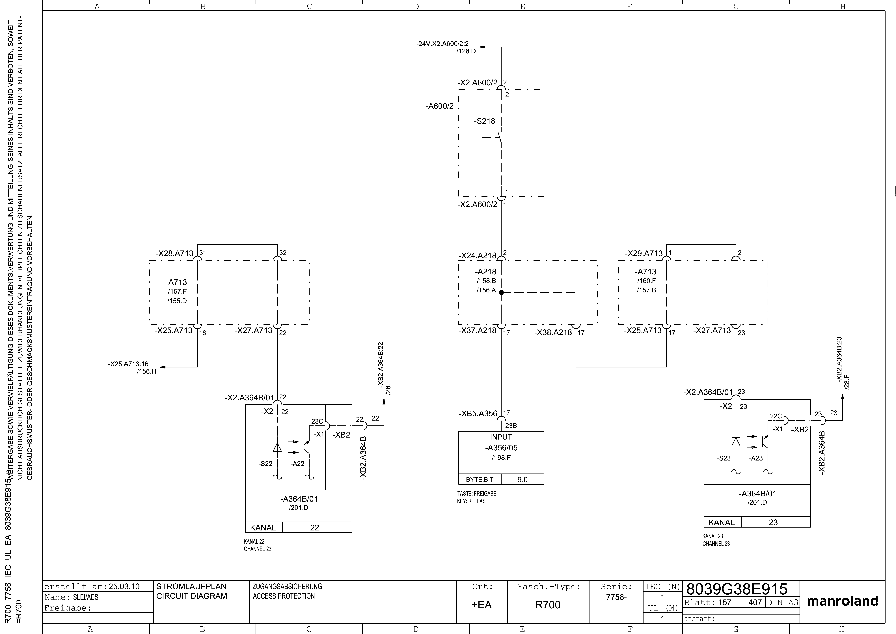

# +EA — Sheet 157 of 407 — ZUGANGSABSICHERUNG

**ACCESS PROTECTION**

> Part of the manroland **R700** printing press IEC/UL circuit diagrams.
> Drawing class: **Stromlaufplan / Circuit diagram** (DIN A3).
> Document `+EA` covers the **Printing unit** machine section.

## At a glance

| Field | Value |
|---|---|
| Document | `+EA`  (8039G38E915) |
| Sheet | **157** of 407 |
| Section (DE) | ZUGANGSABSICHERUNG |
| Section (EN) | ACCESS PROTECTION |
| Section type | CIRCUIT — Circuit diagram |
| Machine type | `R700` |
| Series | `7758` |
| Created | 25.03.10 |
| Replaces | — |
| Columns used | A, B, C, D, E, F, G, H |
| Path numbers | — |
| Labels on sheet | 91 |
| Cross-refs out | 13 |
| Cross-refs in | 31 |

**Previous:** [+EA sheet 156](SHEET_0156.md) · **Next:** [+EA sheet 158](SHEET_0158.md) · **Document TOC:** [_TOC.md](_TOC.md)  (+EA) · **Master TOC:** [all sheets](../_MASTER_TOC.md)

## Sheet image (300 DPI, exact vector render)



_Rendered directly from the PDF vector layer at 300 DPI (1-bit), no OCR and no resampling. Use it to confirm anything ambiguous in the text below._

## Cross-references on this sheet

Each entry is a wire leaving this sheet. The printed token is `/sheet.column`; the link resolves to that sheet inside the same document.

| Ref | Target sheet | Col | Path | Destination on target | Target section | From col |
|---|---|---|---|---|---|---|
| `/128.D` | [+EA sheet 128](SHEET_0128.md) | D | — | 24V.X2.A600\2:2 | ZUGANGSABSICHERUNG | D |
| `/158.B` | [+EA sheet 158](SHEET_0158.md) | B | — | — | ZUGANGSABSICHERUNG | E |
| `/156.A` | [+EA sheet 156](SHEET_0156.md) | A | — | — | ZUGANGSABSICHERUNG | E |
| `/160.F` | [+EA sheet 160](SHEET_0160.md) | F | — | — | ZUGANGSABSICHERUNG | F |
| `/157.B` | [+EA sheet 157](SHEET_0157.md) | B | — | — | ZUGANGSABSICHERUNG | F |
| `/157.F` | [+EA sheet 157](SHEET_0157.md) | F | — | — | ZUGANGSABSICHERUNG | B |
| `/155.D` | [+EA sheet 155](SHEET_0155.md) | D | — | — | ZUGANGSABSICHERUNG | B |
| `/28.F` | [+EA sheet 28](SHEET_0028.md) | F | — | XB2.A364B:23 | BUSVERBINDUNGEN: SICHERHEITSBUS | H |
| `/28.F` | [+EA sheet 28](SHEET_0028.md) | F | — | XB2.A364B:22 | BUSVERBINDUNGEN: SICHERHEITSBUS | D |
| `/156.H` | [+EA sheet 156](SHEET_0156.md) | H | — | X25.A713:16 | ZUGANGSABSICHERUNG | A |
| `/198.F` | [+EA sheet 198](SHEET_0198.md) | F | — | — | REFERENZMODUL | E |
| `/201.D` | [+EA sheet 201](SHEET_0201.md) | D | — | — | REFERENZMODUL | G |
| `/201.D` | [+EA sheet 201](SHEET_0201.md) | D | — | — | REFERENZMODUL | C |

### Incoming references (sheets that point here)

Every other sheet that sends a wire to this one. `Back-ref` is the token printed on *that* sheet; `Path` is its line number.

| From sheet | Cols | Back-ref | Path | Refs | What continues there |
|---|---|---|---|---|---|
| [+EA#28](SHEET_0028.md) | F | `/28.F` | — | 2 | — |
| [+EA#128](SHEET_0128.md) | D | `/128.D` | — | 1 | 24V.X2.A600\2:2 |
| [+EA#155](SHEET_0155.md) | D | `/155.D` | — | 1 | — |
| [+EA#156](SHEET_0156.md) | A, H | `/156.A`, `/156.H` | — | 2 | A218 |
| [+EA#157](SHEET_0157.md) | B, F | `/157.B`, `/157.F` | — | 2 | — |
| [+EA#158](SHEET_0158.md) | B | `/158.B` | — | 1 | — |
| [+EA#160](SHEET_0160.md) | F | `/160.F` | — | 1 | — |
| [+EA#198](SHEET_0198.md) | F | `/198.F` | — | 1 | — |
| [+EA#201](SHEET_0201.md) | D | `/201.D` | — | 2 | — |
| [+EA#227](SHEET_0227.md) | C, E | `/227.C`, `/227.E` | — | 4 | — |
| [+EA#230](SHEET_0230.md) | F | `/230.F` | — | 2 | — |
| [+EA#241](SHEET_0241.md) | H | `/241.H` | — | 1 | — |
| [+EA#265](SHEET_0265.md) | F | `/265.F` | — | 1 | — |
| [+EA#268](SHEET_0268.md) | G | `/268.G` | — | 2 | — |
| [+EA#272](SHEET_0272.md) | B | `/272.B` | — | 2 | — |
| [+EA#273](SHEET_0273.md) | G | `/273.G` | — | 2 | — |
| [+EA#275](SHEET_0275.md) | A | `/275.A` | — | 2 | — |
| [+EA#279](SHEET_0279.md) | E | `/279.E` | — | 1 | — |
| [+EA#280](SHEET_0280.md) | A | `/280.A` | — | 1 | — |


## Devices on this sheet

| Tag | Class | Class meaning (IEC) | Col | Sub | Terminal | Sign |
|---|---|---|---|---|---|---|
| `S218` | S | Schalter / switch | E | — | — | — |
| `A218` | A | Baugruppe / assembly, module, PC board | E | — | — | — |
| `A356/05` | A | Baugruppe / assembly, module, PC board | E | 05 | — | — |
| `A713` | A | Baugruppe / assembly, module, PC board | F | — | — | — |
| `S23` | S | Schalter / switch | G | — | — | — |
| `A23` | A | Baugruppe / assembly, module, PC board | G | — | — | — |
| `X1` | X | Klemme / terminal, plug connector | G | — | — | — |
| `X2` | X | Klemme / terminal, plug connector | G | — | — | — |
| `XB2` | XB |  | H | — | — | — |
| `S22` | S | Schalter / switch | C | — | — | — |
| `A22` | A | Baugruppe / assembly, module, PC board | C | — | — | — |
| `X1` | X | Klemme / terminal, plug connector | C | — | — | — |
| `X2` | X | Klemme / terminal, plug connector | C | — | — | — |
| `XB2` | XB |  | C | — | — | — |
| `A713` | A | Baugruppe / assembly, module, PC board | B | — | — | — |
| `A600/2` | A | Baugruppe / assembly, module, PC board | D | 2 | — | — |
| `X37.A218` | — | cross-device reference | E | — | — | — |
| `X24.A218` | — | cross-device reference | E | — | — | — |
| `X38.A218` | — | cross-device reference | E | — | — | — |
| `9.0` | — | cross-device reference | E | — | — | — |
| `XB5.A356` | — | cross-device reference | E | — | — | — |
| `X29.A713` | — | cross-device reference | F | — | — | — |
| `XB2.A364B` | — | cross-device reference | H | — | — | — |
| `X27.A713` | — | cross-device reference | G | — | — | — |
| `X25.A713` | — | cross-device reference | F | — | — | — |
| `XB2.A364B` | — | cross-device reference | D | — | — | — |
| `X27.A713` | — | cross-device reference | B | — | — | — |
| `X28.A713` | — | cross-device reference | B | — | — | — |
| `X25.A713` | — | cross-device reference | B | — | — | — |
| `XB2.A364B:22` | — | cross-device reference | D | — | 22 | — |
| `XB2.A364B:23` | — | cross-device reference | H | — | 23 | — |
| `X25.A713:16` | — | cross-device reference | A | — | 16 | — |

## Potentials / nets

| Potential | Count | Columns | Attached devices | Terminals |
|---|---|---|---|---|
| `24V` | 1 | D | `A600\2`, `X2` | `2` |


A potential such as `L24+/4` or `M24+` is a named supply/return rail; every place it appears on this sheet is electrically common.

## Wire-end annotations (grouped as printed)

A wire that continues elsewhere is annotated with a small cluster: the destination description, the path/line number `#NN`, and the `/sheet.column` cross reference. Each row below is one such cluster exactly as it is grouped on the drawing.

| Col | Y | Path | Cross-ref | Text on the wire |
|---|---|---|---|---|
| D | 54.1 | — | `/128.D` | `24V.X2.A600\2:2` |
| E | 105.2 | — | — | `X2.A600/2 2` |
| E | 122.2 | — | — | `2` |
| D | 136.4 | — | — | `A600/2` |
| E | 156.2 | — | — | `S218` |
| E | 251.2 | — | — | `1` |
| E | 266.8 | — | — | `X2.A600/2 1` |
| B | 332.0 | — | — | `X28.A713 31` |
| C | 332.0 | — | — | `32` |
| E | 332.0 | — | — | `X24.A218 2` |
| G | 332.0 | — | — | `X29.A713 1 2` |
| E | 356.1 | — | — | `A218` |
| F | 356.1 | — | — | `A713` |
| E | 369.1 | — | `/158.B`, `/156.A` | — |
| F | 369.1 | — | `/160.F`, `/157.B` | — |
| B | 370.2 | — | — | `A713` |
| B | 383.3 | — | `/157.F`, `/155.D` | — |
| B | 434.0 | — | — | `X25.A713 16` |
| C | 434.0 | — | — | `X27.A713 22` |
| E | 434.0 | — | — | `X37.A218 17` |
| G | 434.0 | — | — | `X25.A713 17 X27.A713 23` |
| E | 436.8 | — | — | `X38.A218 17` |
| H | 447.0 | — | `/28.F` | `XB2.A364B:23` |
| D | 454.1 | — | `/28.F` | `XB2.A364B:22` |
| A | 479.3 | — | `/156.H` | `X25.A713:16` |
| G | 516.2 | — | — | `X2.A364B/01 23` |
| B | 523.3 | — | — | `X2.A364B/01 22` |
| G | 534.7 | — | — | `X2` |
| G | 536.1 | — | — | `23 23` |
| C | 541.7 | — | — | `X2` |
| C | 543.2 | — | — | `22 22` |
| E | 544.6 | — | — | `XB5.A356 17` |
| H | 544.6 | — | — | `23` |
| G | 548.8 | — | — | `22C` |
| D | 551.7 | — | — | `22` |
| C | 555.9 | — | — | `23C` |
| E | 561.5 | — | — | `23B` |
| G | 565.8 | — | — | `X1` |
| H | 565.8 | — | — | `XB2` |
| H | 572.0 | — | — | `XB2.A364B` |
| C | 572.9 | — | — | `X1` |
| C | 572.9 | — | — | `XB2` |
| E | 576.1 | — | — | `INPUT` |
| D | 579.1 | — | — | `XB2.A364B` |
| E | 589.9 | — | — | `A356/05` |
| E | 603.7 | — | `/198.F` | — |
| G | 604.8 | — | — | `S23 A23` |
| C | 611.9 | — | — | `S22 A22` |
| E | 632.7 | — | — | `BYTE.BIT 9.0` |
| G | 650.9 | — | — | `A364B/01` |
| E | 652.7 | — | — | `KEY: RELEASE TASTE: FREIGABE` |
| C | 657.9 | — | — | `A364B/01` |
| G | 663.2 | — | `/201.D` | — |
| C | 670.3 | — | `/201.D` | — |
| G | 689.1 | — | — | `KANAL 23` |
| C | 696.2 | — | — | `KANAL 22` |
| G | 709.5 | — | — | `KANAL 23 CHANNEL 23` |
| C | 716.5 | — | — | `KANAL 22 CHANNEL 22` |


## Reconstructed tables

This sheet carries tabular content (pin map / terminal assignment / index). The grid below was rebuilt from the drawing's own rule lines, so each row is exactly one physical row of the table.

### Table 1 — 9 data rows × 10 columns (at x=262.2, y=119.1)

|  |  |  |  |  |  | A600/2 | S218 | 2 1 |  |
|---|---|---|---|---|---|---|---|---|---|
|  |  |  |  |  |  |  | `X2.A600/2` | `1` |  |
| `31` |  | `32` |  |  |  |  | `X24.A218 A218 /158.B /156.A` | `2` |  |
| `16` | `X27.A713` | `22` |  |  | `XB2.A364B:22` |  | `X37.A218` | `17` | `X38.A218` |
|  | `X2.A364B/01` | `22` |  |  |  | `/28.F` |  |  |  |
|  | `X2` | `22` | `23C` |  | `22 22` |  | `XB5.A356` | `17 23B` |  |
|  | `S22` | `A22` | `X1` | `XB2` | `XB2.A364B` |  | `INPUT` | `A356/05 /198.F` |  |
|  |  |  |  |  |  |  | `BYTE.BIT` | `9.0` |  |
|  |  | `A364B/01 /201.D` |  |  |  |  | `TASTE: FREIGABE KEY: RELEASE` |  |  |
|  | `KANAL` |  | `22` |  |  |  |  |  |  |


### Table 2 — 4 data rows × 6 columns (at x=885.8, y=324.6)

| 1 17 | X27.A713 | 2 23 |  |  | XB2.A364B:23 |
|---|---|---|---|---|---|
|  | `X2.A364B/01` | `23` |  |  |  |
|  | `X2 S23` | `23 A23` | `22C X1` | `XB2` | `23 23 XB2.A364B` |
|  |  | `A364B/01 /201.D` |  |  |  |
|  | `KANAL` |  | `23` |  |  |


## Notes and free text on this sheet

| Text | Col | Y (pt) |
|---|---|---|
| `X2.A600/2` | E | 266.77 |
| `23B` | E | 561.55 |
| `INPUT` | E | 576.07 |
| `BYTE.BIT` | E | 633.32 |
| `TASTE: FREIGABE` | E | 652.74 |
| `KEY: RELEASE` | E | 662.71 |
| `KANAL 23` | G | 709.45 |
| `CHANNEL 23` | G | 719.39 |
| `22C` | G | 548.83 |
| `KANAL` | G | 689.12 |
| `A364B/01` | G | 650.86 |
| `X2.A364B/01` | G | 516.21 |
| `KANAL 22` | B | 716.52 |
| `CHANNEL 22` | C | 726.47 |
| `23C` | C | 555.92 |
| `KANAL` | C | 696.2 |
| `A364B/01` | C | 657.94 |
| `X2.A364B/01` | B | 523.3 |

## Complete label inventory (exact text from the drawing)

Every text object inside the drawing area of this sheet, in DIN reading order (column A→H, then top→bottom). This is the authoritative list: if a string is not here it is not printed on this sheet.

| Col | Y | X | Dir | Type | Text |
|---|---|---|---|---|---|
| A | 479.3 | 143.7 | → | device ref | `X25.A713:16` |
| A | 489.3 | 182.0 | → | cross-reference | `/156.H` |
| B | 332.0 | 206.9 | → | device ref | `X28.A713` |
| B | 332.0 | 264.8 | → | number | `31` |
| B | 370.2 | 220.3 | → | device tag | `A713` |
| B | 383.3 | 223.4 | → | cross-reference | `/157.F` |
| B | 395.7 | 222.5 | → | cross-reference | `/155.D` |
| B | 434.0 | 205.5 | → | device ref | `X25.A713` |
| B | 434.0 | 311.8 | → | device ref | `X27.A713` |
| B | 438.3 | 264.2 | → | number | `16` |
| B | 523.3 | 298.8 | → | text | `X2.A364B/01` |
| B | 716.5 | 324.0 | → | text | `KANAL 22` |
| C | 332.0 | 371.1 | → | number | `32` |
| C | 438.3 | 371.1 | → | number | `22` |
| C | 523.3 | 371.1 | → | number | `22` |
| C | 541.7 | 347.0 | → | device tag | `X2` |
| C | 543.2 | 373.9 | → | number | `22` |
| C | 553.1 | 473.1 | → | number | `22` |
| C | 555.9 | 413.9 | → | text | `23C` |
| C | 572.9 | 417.5 | → | device tag | `X1` |
| C | 572.9 | 441.9 | → | device tag | `XB2` |
| C | 611.9 | 343.6 | → | device tag | `S22` |
| C | 611.9 | 386.1 | → | device tag | `A22` |
| C | 657.9 | 372.6 | → | text | `A364B/01` |
| C | 670.3 | 384.1 | → | cross-reference | `/201.D` |
| C | 696.2 | 332.2 | → | text | `KANAL` |
| C | 696.2 | 412.3 | → | number | `22` |
| C | 726.5 | 324.3 | → | text | `CHANNEL 22` |
| D | 54.1 | 553.3 | → | potential | `24V.X2.A600\2:2` |
| D | 64.1 | 606.6 | → | cross-reference | `/128.D` |
| D | 136.4 | 565.8 | → | device tag | `A600/2` |
| D | 454.1 | 502.0 | ↕ | device ref | `XB2.A364B:22` |
| D | 504.3 | 511.9 | ↕ | cross-reference | `/28.F` |
| D | 551.7 | 494.1 | → | number | `22` |
| D | 579.1 | 477.9 | ↕ | device ref | `XB2.A364B` |
| E | 105.2 | 608.0 | → | text | `X2.A600/2` |
| E | 105.2 | 668.7 | → | number | `2` |
| E | 122.2 | 671.5 | → | number | `2` |
| E | 156.2 | 629.9 | → | device tag | `S218` |
| E | 251.2 | 671.0 | → | number | `1` |
| E | 266.8 | 608.0 | → | text | `X2.A600/2` |
| E | 268.2 | 668.1 | → | number | `1` |
| E | 332.0 | 668.7 | → | number | `2` |
| E | 334.8 | 609.4 | → | device ref | `X24.A218` |
| E | 356.1 | 631.3 | → | device tag | `A218` |
| E | 369.1 | 633.8 | → | cross-reference | `/158.B` |
| E | 381.5 | 633.5 | → | cross-reference | `/156.A` |
| E | 434.0 | 609.4 | → | device ref | `X37.A218` |
| E | 436.8 | 710.1 | → | device ref | `X38.A218` |
| E | 438.3 | 668.1 | → | number | `17` |
| E | 544.6 | 609.7 | → | device ref | `XB5.A356` |
| E | 544.6 | 668.1 | → | number | `17` |
| E | 561.5 | 671.5 | → | text | `23B` |
| E | 576.1 | 651.3 | → | text | `INPUT` |
| E | 589.9 | 644.7 | → | device tag | `A356/05` |
| E | 603.7 | 653.8 | → | cross-reference | `/198.F` |
| E | 632.7 | 687.7 | → | device ref | `9.0` |
| E | 633.3 | 619.4 | → | text | `BYTE.BIT` |
| E | 652.7 | 607.7 | → | text | `TASTE: FREIGABE` |
| E | 662.7 | 607.5 | → | text | `KEY: RELEASE` |
| F | 332.0 | 830.6 | → | device ref | `X29.A713` |
| F | 332.0 | 887.8 | → | number | `1` |
| F | 356.1 | 843.9 | → | device tag | `A713` |
| F | 369.1 | 847.0 | → | cross-reference | `/160.F` |
| F | 381.5 | 846.4 | → | cross-reference | `/157.B` |
| F | 434.0 | 829.1 | → | device ref | `X25.A713` |
| F | 438.3 | 767.3 | → | number | `17` |
| F | 438.3 | 887.8 | → | number | `17` |
| G | 332.0 | 980.5 | → | number | `2` |
| G | 434.0 | 921.3 | → | device ref | `X27.A713` |
| G | 438.3 | 980.5 | → | number | `23` |
| G | 516.2 | 908.2 | → | text | `X2.A364B/01` |
| G | 516.2 | 980.5 | → | number | `23` |
| G | 534.7 | 956.4 | → | device tag | `X2` |
| G | 536.1 | 983.3 | → | number | `23` |
| G | 548.8 | 1023.3 | → | text | `22C` |
| G | 565.8 | 1027.0 | → | device tag | `X1` |
| G | 604.8 | 952.7 | → | device tag | `S23` |
| G | 604.8 | 995.2 | → | device tag | `A23` |
| G | 650.9 | 982.1 | → | text | `A364B/01` |
| G | 663.2 | 993.5 | → | cross-reference | `/201.D` |
| G | 689.1 | 941.7 | → | text | `KANAL` |
| G | 689.1 | 1021.7 | → | number | `23` |
| G | 709.4 | 933.4 | → | text | `KANAL 23` |
| G | 719.4 | 933.7 | → | text | `CHANNEL 23` |
| H | 447.0 | 1111.5 | ↕ | device ref | `XB2.A364B:23` |
| H | 497.2 | 1121.4 | ↕ | cross-reference | `/28.F` |
| H | 544.6 | 1103.2 | → | number | `23` |
| H | 546.0 | 1082.6 | → | number | `23` |
| H | 565.8 | 1051.4 | → | device tag | `XB2` |
| H | 572.0 | 1087.4 | ↕ | device ref | `XB2.A364B` |

## Reading-order text block

The same content as a plain block, grouped by DIN column — convenient to paste or to match against a visual description.

```text
=== Column A ===
 479.3  143.7  devref       X25.A713:16
 489.3  182.0  xref         /156.H
=== Column B ===
 332.0  206.9  devref       X28.A713
 332.0  264.8  numeric      31
 370.2  220.3  devtag       A713
 383.3  223.4  xref         /157.F
 395.7  222.5  xref         /155.D
 434.0  205.5  devref       X25.A713
 434.0  311.8  devref       X27.A713
 438.3  264.2  numeric      16
 523.3  298.8  text         X2.A364B/01
 716.5  324.0  text         KANAL 22
=== Column C ===
 332.0  371.1  numeric      32
 438.3  371.1  numeric      22
 523.3  371.1  numeric      22
 541.7  347.0  devtag       X2
 543.2  373.9  numeric      22
 553.1  473.1  numeric      22
 555.9  413.9  text         23C
 572.9  417.5  devtag       X1
 572.9  441.9  devtag       XB2
 611.9  343.6  devtag       S22
 611.9  386.1  devtag       A22
 657.9  372.6  text         A364B/01
 670.3  384.1  xref         /201.D
 696.2  332.2  text         KANAL
 696.2  412.3  numeric      22
 726.5  324.3  text         CHANNEL 22
=== Column D ===
  54.1  553.3  net          24V.X2.A600\2:2
  64.1  606.6  xref         /128.D
 136.4  565.8  devtag       A600/2
 454.1  502.0  devref       XB2.A364B:22
 504.3  511.9  xref         /28.F
 551.7  494.1  numeric      22
 579.1  477.9  devref       XB2.A364B
=== Column E ===
 105.2  608.0  text         X2.A600/2
 105.2  668.7  numeric      2
 122.2  671.5  numeric      2
 156.2  629.9  devtag       S218
 251.2  671.0  numeric      1
 266.8  608.0  text         X2.A600/2
 268.2  668.1  numeric      1
 332.0  668.7  numeric      2
 334.8  609.4  devref       X24.A218
 356.1  631.3  devtag       A218
 369.1  633.8  xref         /158.B
 381.5  633.5  xref         /156.A
 434.0  609.4  devref       X37.A218
 436.8  710.1  devref       X38.A218
 438.3  668.1  numeric      17
 544.6  609.7  devref       XB5.A356
 544.6  668.1  numeric      17
 561.5  671.5  text         23B
 576.1  651.3  text         INPUT
 589.9  644.7  devtag       A356/05
 603.7  653.8  xref         /198.F
 632.7  687.7  devref       9.0
 633.3  619.4  text         BYTE.BIT
 652.7  607.7  text         TASTE: FREIGABE
 662.7  607.5  text         KEY: RELEASE
=== Column F ===
 332.0  830.6  devref       X29.A713
 332.0  887.8  numeric      1
 356.1  843.9  devtag       A713
 369.1  847.0  xref         /160.F
 381.5  846.4  xref         /157.B
 434.0  829.1  devref       X25.A713
 438.3  767.3  numeric      17
 438.3  887.8  numeric      17
=== Column G ===
 332.0  980.5  numeric      2
 434.0  921.3  devref       X27.A713
 438.3  980.5  numeric      23
 516.2  908.2  text         X2.A364B/01
 516.2  980.5  numeric      23
 534.7  956.4  devtag       X2
 536.1  983.3  numeric      23
 548.8 1023.3  text         22C
 565.8 1027.0  devtag       X1
 604.8  952.7  devtag       S23
 604.8  995.2  devtag       A23
 650.9  982.1  text         A364B/01
 663.2  993.5  xref         /201.D
 689.1  941.7  text         KANAL
 689.1 1021.7  numeric      23
 709.4  933.4  text         KANAL 23
 719.4  933.7  text         CHANNEL 23
=== Column H ===
 447.0 1111.5  devref       XB2.A364B:23
 497.2 1121.4  xref         /28.F
 544.6 1103.2  numeric      23
 546.0 1082.6  numeric      23
 565.8 1051.4  devtag       XB2
 572.0 1087.4  devref       XB2.A364B
```

---
_Generated from the PDF vector text layer; no OCR. Source: `R700_7758_IEC_UL_EA_8039G38E915_p`, sheet 157._
