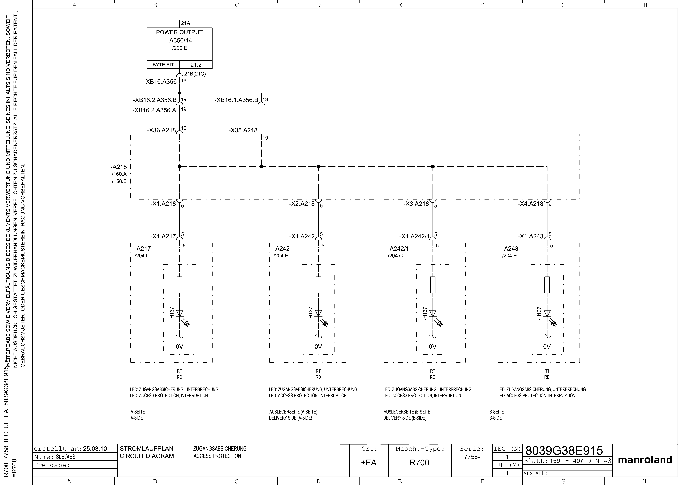

# +EA — Sheet 159 of 407 — ZUGANGSABSICHERUNG

**ACCESS PROTECTION**

> Part of the manroland **R700** printing press IEC/UL circuit diagrams.
> Drawing class: **Stromlaufplan / Circuit diagram** (DIN A3).
> Document `+EA` covers the **Printing unit** machine section.

## At a glance

| Field | Value |
|---|---|
| Document | `+EA`  (8039G38E915) |
| Sheet | **159** of 407 |
| Section (DE) | ZUGANGSABSICHERUNG |
| Section (EN) | ACCESS PROTECTION |
| Section type | CIRCUIT — Circuit diagram |
| Machine type | `R700` |
| Series | `7758` |
| Created | 25.03.10 |
| Replaces | — |
| Columns used | B, C, D, E, F, G |
| Path numbers | — |
| Labels on sheet | 82 |
| Cross-refs out | 7 |
| Cross-refs in | 21 |

**Previous:** [+EA sheet 158](SHEET_0158.md) · **Next:** [+EA sheet 160](SHEET_0160.md) · **Document TOC:** [_TOC.md](_TOC.md)  (+EA) · **Master TOC:** [all sheets](../_MASTER_TOC.md)

## Sheet image (300 DPI, exact vector render)



_Rendered directly from the PDF vector layer at 300 DPI (1-bit), no OCR and no resampling. Use it to confirm anything ambiguous in the text below._

## Cross-references on this sheet

Each entry is a wire leaving this sheet. The printed token is `/sheet.column`; the link resolves to that sheet inside the same document.

| Ref | Target sheet | Col | Path | Destination on target | Target section | From col |
|---|---|---|---|---|---|---|
| `/200.E` | [+EA sheet 200](SHEET_0200.md) | E | — | — | REFERENZMODUL | B |
| `/160.A` | [+EA sheet 160](SHEET_0160.md) | A | — | — | ZUGANGSABSICHERUNG | B |
| `/158.B` | [+EA sheet 158](SHEET_0158.md) | B | — | — | ZUGANGSABSICHERUNG | B |
| `/204.C` | [+EA sheet 204](SHEET_0204.md) | C | — | A217 | REFERENZMODUL | B |
| `/204.E` | [+EA sheet 204](SHEET_0204.md) | E | — | A242 | REFERENZMODUL | D |
| `/204.C` | [+EA sheet 204](SHEET_0204.md) | C | — | A242/1 | REFERENZMODUL | E |
| `/204.E` | [+EA sheet 204](SHEET_0204.md) | E | — | A243 | REFERENZMODUL | F |

### Incoming references (sheets that point here)

Every other sheet that sends a wire to this one. `Back-ref` is the token printed on *that* sheet; `Path` is its line number.

| From sheet | Cols | Back-ref | Path | Refs | What continues there |
|---|---|---|---|---|---|
| [+EA#158](SHEET_0158.md) | B | `/158.B` | — | 1 | — |
| [+EA#160](SHEET_0160.md) | A | `/160.A` | — | 1 | — |
| [+EA#200](SHEET_0200.md) | E | `/200.E` | — | 1 | — |
| [+EA#204](SHEET_0204.md) | C, E | `/204.C`, `/204.E` | — | 4 | — |
| [+EA#207](SHEET_0207.md) | C, E, F, G, H | `/207.C`, `/207.E`, `/207.F`, `/207.G`, `/207.H` | — | 5 | — |
| [+EA#223](SHEET_0223.md) | E | `/223.E` | — | 1 | — |
| [+EA#231](SHEET_0231.md) | H | `/231.H` | — | 1 | — |
| [+EA#236](SHEET_0236.md) | C | `/236.C` | — | 1 | — |
| [+EA#261](SHEET_0261.md) | H | `/261.H` | — | 1 | — |
| [+EA#262](SHEET_0262.md) | B, C, E | `/262.B`, `/262.C`, `/262.E` | — | 3 | — |
| [+EA#278](SHEET_0278.md) | C, H | `/278.C`, `/278.H` | — | 2 | — |


## Devices on this sheet

| Tag | Class | Class meaning (IEC) | Col | Sub | Terminal | Sign |
|---|---|---|---|---|---|---|
| `A218` | A | Baugruppe / assembly, module, PC board | B | — | — | — |
| `A217` | A | Baugruppe / assembly, module, PC board | B | — | — | — |
| `A242` | A | Baugruppe / assembly, module, PC board | D | — | — | — |
| `A242/1` | A | Baugruppe / assembly, module, PC board | E | 1 | — | — |
| `A243` | A | Baugruppe / assembly, module, PC board | F | — | — | — |
| `A356/14` | A | Baugruppe / assembly, module, PC board | B | 14 | — | — |
| `X36.A218` | — | cross-device reference | B | — | — | — |
| `X1.A218` | — | cross-device reference | B | — | — | — |
| `X2.A218` | — | cross-device reference | D | — | — | — |
| `X4.A218` | — | cross-device reference | G | — | — | — |
| `X3.A218` | — | cross-device reference | E | — | — | — |
| `X1.A217` | — | cross-device reference | B | — | — | — |
| `X1.A242` | — | cross-device reference | D | — | — | — |
| `X1.A243` | — | cross-device reference | G | — | — | — |
| `21.2` | — | cross-device reference | B | — | — | — |
| `XB16.A356` | — | cross-device reference | B | — | — | — |
| `XB16.2.A356.B` | — | cross-device reference | B | — | — | — |
| `XB16.1.A356.B` | — | cross-device reference | C | — | — | — |
| `XB16.2.A356.A` | — | cross-device reference | B | — | — | — |
| `X35.A218` | — | cross-device reference | C | — | — | — |

## Potentials / nets

| Potential | Count | Columns | Attached devices | Terminals |
|---|---|---|---|---|
| `0V` | 4 | B, D, E, G | — | — |
| `H137` | 4 | B, D, E, G | — | — |


A potential such as `L24+/4` or `M24+` is a named supply/return rail; every place it appears on this sheet is electrically common.

## Wire-end annotations (grouped as printed)

A wire that continues elsewhere is annotated with a small cluster: the destination description, the path/line number `#NN`, and the `/sheet.column` cross reference. Each row below is one such cluster exactly as it is grouped on the drawing.

| Col | Y | Path | Cross-ref | Text on the wire |
|---|---|---|---|---|
| B | 36.4 | — | — | `21A` |
| B | 51.6 | — | — | `POWER OUTPUT` |
| B | 65.5 | — | — | `A356/14` |
| B | 79.3 | — | `/200.E` | — |
| B | 108.3 | — | — | `BYTE.BIT 21.2` |
| B | 124.3 | — | — | `21B(21C)` |
| B | 136.4 | — | — | `XB16.A356 19` |
| C | 169.0 | — | — | `XB16.2.A356.B 19 XB16.1.A356.B 19` |
| B | 186.0 | — | — | `XB16.2.A356.A 19` |
| B | 218.6 | — | — | `X36.A218 12` |
| C | 221.4 | — | — | `X35.A218` |
| C | 235.6 | — | — | `19` |
| B | 285.2 | — | — | `A218` |
| B | 298.3 | — | `/160.A`, `/158.B` | — |
| D | 349.0 | — | — | `X1.A218 5 X2.A218 5 X3.A218 5 X4.A218 5` |
| B | 402.8 | — | — | `X1.A217 5` |
| D | 402.8 | — | — | `X1.A242 5` |
| E | 402.8 | — | — | `X1.A242/1 5` |
| G | 402.8 | — | — | `X1.A243 5` |
| B | 422.7 | — | — | `5` |
| D | 422.7 | — | — | `5` |
| E | 422.7 | — | — | `5` |
| G | 422.7 | — | — | `5` |
| B | 426.9 | — | `/204.C` | `A217` |
| D | 426.9 | — | `/204.E` | `A242` |
| E | 426.9 | — | `/204.C` | `A242/1` |
| F | 426.9 | — | `/204.E` | `A243` |
| B | 532.5 | — | — | `H137` |
| D | 532.5 | — | — | `H137` |
| E | 532.5 | — | — | `H137` |
| G | 532.5 | — | — | `H137` |
| B | 597.0 | — | — | `0V` |
| D | 597.0 | — | — | `0V` |
| E | 597.0 | — | — | `0V` |
| G | 597.0 | — | — | `0V` |
| B | 641.2 | — | — | `RD RT` |
| D | 641.2 | — | — | `RD RT` |
| E | 641.2 | — | — | `RD RT` |
| G | 641.2 | — | — | `RD RT` |
| B | 673.2 | — | — | `LED: ZUGANGSABSICHERUNG, UNTERBRECHUNG LED: ACCESS PROTECTION, INTERRUPTION` |
| D | 673.2 | — | — | `LED: ZUGANGSABSICHERUNG, UNTERBRECHUNG LED: ACCESS PROTECTION, INTERRUPTION` |
| E | 673.2 | — | — | `LED: ZUGANGSABSICHERUNG, UNTERBRECHUNG LED: ACCESS PROTECTION, INTERRUPTION` |
| G | 673.2 | — | — | `LED: ZUGANGSABSICHERUNG, UNTERBRECHUNG LED: ACCESS PROTECTION, INTERRUPTION` |
| B | 712.1 | — | — | `A SEITE A SIDE` |
| D | 712.1 | — | — | `DELIVERY SIDE (A SIDE) AUSLEGERSEITE (A SEITE)` |
| F | 712.1 | — | — | `DELIVERY SIDE (B SIDE) AUSLEGERSEITE (B SEITE) B SEITE B SIDE` |


## Reconstructed tables

This sheet carries tabular content (pin map / terminal assignment / index). The grid below was rebuilt from the drawing's own rule lines, so each row is exactly one physical row of the table.

### Table 1 — 5 data rows × 9 columns (at x=226.8, y=48.2)

|  | POWER |  | A356/14 /200.E | OUTPUT |  |  |  |  |
|---|---|---|---|---|---|---|---|---|
|  | `BYTE.BIT` |  |  | `21.2` |  |  |  |  |
|  | `XB16.A356` |  |  | `21B(21C) 19` |  |  |  |  |
|  | `XB16.2.A356.B XB16.2.A356.A X36.A218` |  |  | `19 19 12` | `XB16.1.A356.B X35.A218` | `19 19` |  |  |
|  | `X1.A218 X1.A217` |  |  | `5 5` |  |  | `X2.A218 X1.A242` |  |
| `A217 /204.C` | `H137` | `0V` |  | `5` |  |  | `A242 /204.E H137` | `0V` |


### Table 2 — 2 data rows × 1 columns (at x=557.0, y=48.2)

| C1 |
|---|
| `5 5` |
| `5` |


### Table 3 — 0 data rows × 2 columns (at x=666.1, y=48.2) — **X3.A218 X1.A242/1**

_none_


### Table 4 — 2 data rows × 1 columns (at x=755.4, y=48.2)

| C1 |
|---|
| `5 5` |
| `5` |


### Table 5 — 0 data rows × 2 columns (at x=864.6, y=48.2) — **X4.A218 X1.A243**

_none_


### Table 6 — 2 data rows × 1 columns (at x=953.9, y=48.2)

| C1 |
|---|
| `5 5` |
| `5` |


## Notes and free text on this sheet

| Text | Col | Y (pt) |
|---|---|---|
| `LED: ZUGANGSABSICHERUNG, UNTERBRECHUNG` | B | 673.16 |
| `LED: ACCESS PROTECTION, INTERRUPTION` | B | 683.78 |
| `LED: ZUGANGSABSICHERUNG, UNTERBRECHUNG` | D | 673.16 |
| `LED: ACCESS PROTECTION, INTERRUPTION` | D | 683.78 |
| `X1.A242/1` | E | 405.67 |
| `LED: ZUGANGSABSICHERUNG, UNTERBRECHUNG` | E | 673.16 |
| `LED: ACCESS PROTECTION, INTERRUPTION` | E | 683.78 |
| `LED: ZUGANGSABSICHERUNG, UNTERBRECHUNG` | G | 673.16 |
| `LED: ACCESS PROTECTION, INTERRUPTION` | G | 683.78 |
| `21A` | B | 36.43 |
| `21B(21C)` | B | 124.34 |
| `POWER OUTPUT` | B | 51.59 |
| `BYTE.BIT` | B | 108.91 |
| `RT` | B | 641.18 |
| `RD` | B | 651.85 |
| `RT` | D | 641.18 |
| `RD` | D | 651.85 |
| `RT` | E | 641.18 |
| `RD` | E | 651.85 |
| `RT` | G | 641.18 |
| `RD` | G | 651.85 |
| `A SEITE` | B | 712.08 |
| `A SIDE` | B | 722.73 |
| `AUSLEGERSEITE (A SEITE)` | D | 712.11 |
| `DELIVERY SIDE (A SIDE)` | D | 722.74 |
| `B SEITE` | F | 712.06 |
| `B SIDE` | F | 722.7 |
| `AUSLEGERSEITE (B SEITE)` | E | 712.11 |
| `DELIVERY SIDE (B SIDE)` | E | 722.74 |

## Complete label inventory (exact text from the drawing)

Every text object inside the drawing area of this sheet, in DIN reading order (column A→H, then top→bottom). This is the authoritative list: if a string is not here it is not printed on this sheet.

| Col | Y | X | Dir | Type | Text |
|---|---|---|---|---|---|
| B | 36.4 | 314.4 | → | text | `21A` |
| B | 51.6 | 271.0 | → | text | `POWER OUTPUT` |
| B | 65.5 | 290.4 | → | device tag | `A356/14` |
| B | 79.3 | 299.3 | → | cross-reference | `/200.E` |
| B | 108.3 | 330.7 | → | device ref | `21.2` |
| B | 108.9 | 265.0 | → | text | `BYTE.BIT` |
| B | 124.3 | 320.0 | → | text | `21B(21C)` |
| B | 136.4 | 313.8 | → | number | `19` |
| B | 137.1 | 249.4 | → | device ref | `XB16.A356` |
| B | 169.0 | 230.7 | → | device ref | `XB16.2.A356.B` |
| B | 169.0 | 313.8 | → | number | `19` |
| B | 186.0 | 313.8 | → | number | `19` |
| B | 186.7 | 229.9 | → | device ref | `XB16.2.A356.A` |
| B | 218.6 | 313.8 | → | number | `12` |
| B | 221.4 | 255.1 | → | device ref | `X36.A218` |
| B | 285.2 | 191.9 | → | device tag | `A218` |
| B | 298.3 | 194.2 | → | cross-reference | `/160.A` |
| B | 310.7 | 194.5 | → | cross-reference | `/158.B` |
| B | 349.0 | 261.1 | → | device ref | `X1.A218` |
| B | 353.2 | 314.4 | → | number | `5` |
| B | 402.8 | 314.4 | → | number | `5` |
| B | 405.7 | 261.1 | → | device ref | `X1.A217` |
| B | 422.7 | 317.2 | → | number | `5` |
| B | 426.9 | 233.6 | → | device tag | `A217` |
| B | 440.0 | 233.9 | → | cross-reference | `/204.C` |
| B | 532.5 | 294.4 | ↕ | potential | `H137` |
| B | 597.0 | 305.0 | → | potential | `0V` |
| B | 641.2 | 307.2 | → | text | `RT` |
| B | 651.8 | 306.9 | → | text | `RD` |
| B | 673.2 | 225.9 | → | text | `LED: ZUGANGSABSICHERUNG, UNTERBRECHUNG` |
| B | 683.8 | 225.9 | → | text | `LED: ACCESS PROTECTION, INTERRUPTION` |
| B | 712.1 | 226.8 | → | text | `A SEITE` |
| B | 722.7 | 226.8 | → | text | `A SIDE` |
| C | 169.0 | 372.5 | → | device ref | `XB16.1.A356.B` |
| C | 169.0 | 455.5 | → | number | `19` |
| C | 221.4 | 396.9 | → | device ref | `X35.A218` |
| C | 235.6 | 455.5 | → | number | `19` |
| D | 349.0 | 502.0 | → | device ref | `X2.A218` |
| D | 353.2 | 555.3 | → | number | `5` |
| D | 402.8 | 555.3 | → | number | `5` |
| D | 405.7 | 502.0 | → | device ref | `X1.A242` |
| D | 422.7 | 558.1 | → | number | `5` |
| D | 426.9 | 474.5 | → | device tag | `A242` |
| D | 440.0 | 474.8 | → | cross-reference | `/204.E` |
| D | 532.5 | 535.4 | ↕ | potential | `H137` |
| D | 597.0 | 546.0 | → | potential | `0V` |
| D | 641.2 | 548.2 | → | text | `RT` |
| D | 651.8 | 547.9 | → | text | `RD` |
| D | 673.2 | 466.9 | → | text | `LED: ZUGANGSABSICHERUNG, UNTERBRECHUNG` |
| D | 683.8 | 466.9 | → | text | `LED: ACCESS PROTECTION, INTERRUPTION` |
| D | 712.1 | 467.7 | → | text | `AUSLEGERSEITE (A SEITE)` |
| D | 722.7 | 466.9 | → | text | `DELIVERY SIDE (A SIDE)` |
| E | 349.0 | 700.4 | → | device ref | `X3.A218` |
| E | 353.2 | 753.7 | → | number | `5` |
| E | 402.8 | 753.7 | → | number | `5` |
| E | 405.7 | 693.1 | → | text | `X1.A242/1` |
| E | 422.7 | 756.6 | → | number | `5` |
| E | 426.9 | 672.9 | → | device tag | `A242/1` |
| E | 440.0 | 673.2 | → | cross-reference | `/204.C` |
| E | 532.5 | 733.8 | ↕ | potential | `H137` |
| E | 597.0 | 744.4 | → | potential | `0V` |
| E | 641.2 | 746.6 | → | text | `RT` |
| E | 651.8 | 746.3 | → | text | `RD` |
| E | 673.2 | 665.3 | → | text | `LED: ZUGANGSABSICHERUNG, UNTERBRECHUNG` |
| E | 683.8 | 665.3 | → | text | `LED: ACCESS PROTECTION, INTERRUPTION` |
| E | 712.1 | 666.1 | → | text | `AUSLEGERSEITE (B SEITE)` |
| E | 722.7 | 665.3 | → | text | `DELIVERY SIDE (B SIDE)` |
| F | 426.9 | 871.4 | → | device tag | `A243` |
| F | 440.0 | 871.7 | → | cross-reference | `/204.E` |
| F | 712.1 | 849.5 | → | text | `B SEITE` |
| F | 722.7 | 849.5 | → | text | `B SIDE` |
| G | 349.0 | 898.9 | → | device ref | `X4.A218` |
| G | 353.2 | 952.2 | → | number | `5` |
| G | 402.8 | 952.2 | → | number | `5` |
| G | 405.7 | 898.9 | → | device ref | `X1.A243` |
| G | 422.7 | 955.0 | → | number | `5` |
| G | 532.5 | 932.2 | ↕ | potential | `H137` |
| G | 597.0 | 942.8 | → | potential | `0V` |
| G | 641.2 | 945.0 | → | text | `RT` |
| G | 651.8 | 944.7 | → | text | `RD` |
| G | 673.2 | 863.7 | → | text | `LED: ZUGANGSABSICHERUNG, UNTERBRECHUNG` |
| G | 683.8 | 863.7 | → | text | `LED: ACCESS PROTECTION, INTERRUPTION` |

## Reading-order text block

The same content as a plain block, grouped by DIN column — convenient to paste or to match against a visual description.

```text
=== Column B ===
  36.4  314.4  text         21A
  51.6  271.0  text         POWER OUTPUT
  65.5  290.4  devtag       A356/14
  79.3  299.3  xref         /200.E
 108.3  330.7  devref       21.2
 108.9  265.0  text         BYTE.BIT
 124.3  320.0  text         21B(21C)
 136.4  313.8  numeric      19
 137.1  249.4  devref       XB16.A356
 169.0  230.7  devref       XB16.2.A356.B
 169.0  313.8  numeric      19
 186.0  313.8  numeric      19
 186.7  229.9  devref       XB16.2.A356.A
 218.6  313.8  numeric      12
 221.4  255.1  devref       X36.A218
 285.2  191.9  devtag       A218
 298.3  194.2  xref         /160.A
 310.7  194.5  xref         /158.B
 349.0  261.1  devref       X1.A218
 353.2  314.4  numeric      5
 402.8  314.4  numeric      5
 405.7  261.1  devref       X1.A217
 422.7  317.2  numeric      5
 426.9  233.6  devtag       A217
 440.0  233.9  xref         /204.C
 532.5  294.4  net          H137
 597.0  305.0  net          0V
 641.2  307.2  text         RT
 651.8  306.9  text         RD
 673.2  225.9  text         LED: ZUGANGSABSICHERUNG, UNTERBRECHUNG
 683.8  225.9  text         LED: ACCESS PROTECTION, INTERRUPTION
 712.1  226.8  text         A SEITE
 722.7  226.8  text         A SIDE
=== Column C ===
 169.0  372.5  devref       XB16.1.A356.B
 169.0  455.5  numeric      19
 221.4  396.9  devref       X35.A218
 235.6  455.5  numeric      19
=== Column D ===
 349.0  502.0  devref       X2.A218
 353.2  555.3  numeric      5
 402.8  555.3  numeric      5
 405.7  502.0  devref       X1.A242
 422.7  558.1  numeric      5
 426.9  474.5  devtag       A242
 440.0  474.8  xref         /204.E
 532.5  535.4  net          H137
 597.0  546.0  net          0V
 641.2  548.2  text         RT
 651.8  547.9  text         RD
 673.2  466.9  text         LED: ZUGANGSABSICHERUNG, UNTERBRECHUNG
 683.8  466.9  text         LED: ACCESS PROTECTION, INTERRUPTION
 712.1  467.7  text         AUSLEGERSEITE (A SEITE)
 722.7  466.9  text         DELIVERY SIDE (A SIDE)
=== Column E ===
 349.0  700.4  devref       X3.A218
 353.2  753.7  numeric      5
 402.8  753.7  numeric      5
 405.7  693.1  text         X1.A242/1
 422.7  756.6  numeric      5
 426.9  672.9  devtag       A242/1
 440.0  673.2  xref         /204.C
 532.5  733.8  net          H137
 597.0  744.4  net          0V
 641.2  746.6  text         RT
 651.8  746.3  text         RD
 673.2  665.3  text         LED: ZUGANGSABSICHERUNG, UNTERBRECHUNG
 683.8  665.3  text         LED: ACCESS PROTECTION, INTERRUPTION
 712.1  666.1  text         AUSLEGERSEITE (B SEITE)
 722.7  665.3  text         DELIVERY SIDE (B SIDE)
=== Column F ===
 426.9  871.4  devtag       A243
 440.0  871.7  xref         /204.E
 712.1  849.5  text         B SEITE
 722.7  849.5  text         B SIDE
=== Column G ===
 349.0  898.9  devref       X4.A218
 353.2  952.2  numeric      5
 402.8  952.2  numeric      5
 405.7  898.9  devref       X1.A243
 422.7  955.0  numeric      5
 532.5  932.2  net          H137
 597.0  942.8  net          0V
 641.2  945.0  text         RT
 651.8  944.7  text         RD
 673.2  863.7  text         LED: ZUGANGSABSICHERUNG, UNTERBRECHUNG
 683.8  863.7  text         LED: ACCESS PROTECTION, INTERRUPTION
```

---
_Generated from the PDF vector text layer; no OCR. Source: `R700_7758_IEC_UL_EA_8039G38E915_p`, sheet 159._
