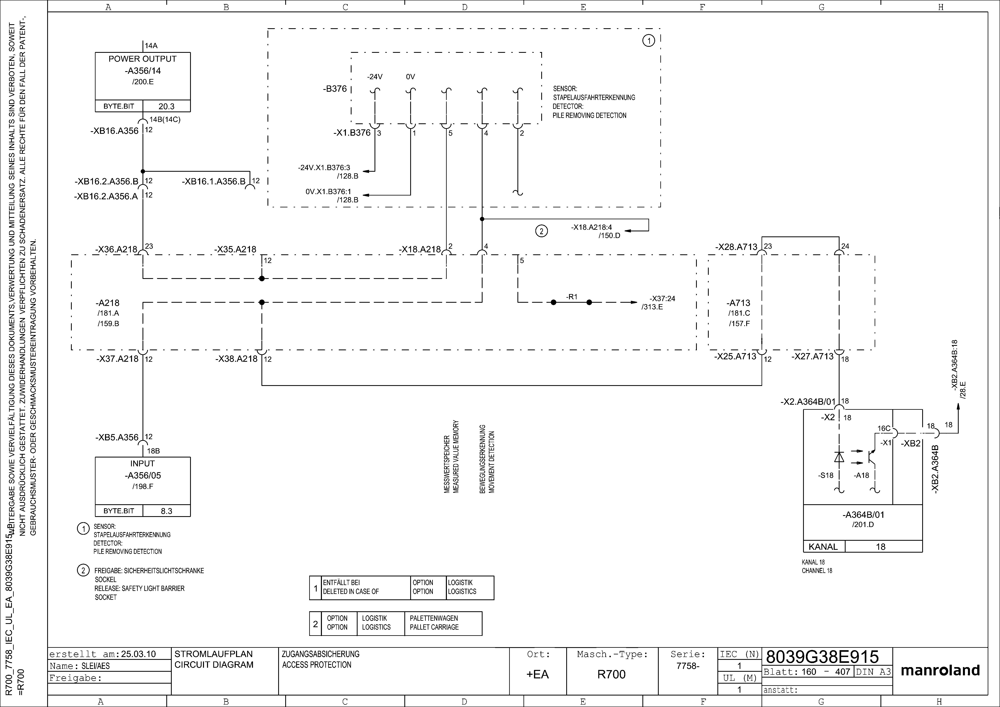

# +EA — Sheet 160 of 407 — ZUGANGSABSICHERUNG

**ACCESS PROTECTION**

> Part of the manroland **R700** printing press IEC/UL circuit diagrams.
> Drawing class: **Stromlaufplan / Circuit diagram** (DIN A3).
> Document `+EA` covers the **Printing unit** machine section.

## At a glance

| Field | Value |
|---|---|
| Document | `+EA`  (8039G38E915) |
| Sheet | **160** of 407 |
| Section (DE) | ZUGANGSABSICHERUNG |
| Section (EN) | ACCESS PROTECTION |
| Section type | CIRCUIT — Circuit diagram |
| Machine type | `R700` |
| Series | `7758` |
| Created | 25.03.10 |
| Replaces | — |
| Columns used | A, B, C, D, E, F, G, H |
| Path numbers | — |
| Labels on sheet | 120 |
| Cross-refs out | 12 |
| Cross-refs in | 35 |

**Previous:** [+EA sheet 159](SHEET_0159.md) · **Next:** [+EA sheet 161](SHEET_0161.md) · **Document TOC:** [_TOC.md](_TOC.md)  (+EA) · **Master TOC:** [all sheets](../_MASTER_TOC.md)

## Sheet image (300 DPI, exact vector render)



_Rendered directly from the PDF vector layer at 300 DPI (1-bit), no OCR and no resampling. Use it to confirm anything ambiguous in the text below._

## Cross-references on this sheet

Each entry is a wire leaving this sheet. The printed token is `/sheet.column`; the link resolves to that sheet inside the same document.

| Ref | Target sheet | Col | Path | Destination on target | Target section | From col |
|---|---|---|---|---|---|---|
| `/200.E` | [+EA sheet 200](SHEET_0200.md) | E | — | — | REFERENZMODUL | A |
| `/128.B` | [+EA sheet 128](SHEET_0128.md) | B | — | 24V.X1.B376:3 | ZUGANGSABSICHERUNG | C |
| `/128.B` | [+EA sheet 128](SHEET_0128.md) | B | — | 0V.X1.B376:1 | ZUGANGSABSICHERUNG | C |
| `/150.D` | [+EA sheet 150](SHEET_0150.md) | D | — | X18.A218:4 | ZUGANGSABSICHERUNG | E |
| `/313.E` | [+EA sheet 313](SHEET_0313.md) | E | — | — | OPTION: LOGISTIK, AUSLEGER | F |
| `/181.A` | [+EA sheet 181](SHEET_0181.md) | A | — | — | RESERVE | A |
| `/159.B` | [+EA sheet 159](SHEET_0159.md) | B | — | — | ZUGANGSABSICHERUNG | A |
| `/181.C` | [+EA sheet 181](SHEET_0181.md) | C | — | — | RESERVE | F |
| `/157.F` | [+EA sheet 157](SHEET_0157.md) | F | — | — | ZUGANGSABSICHERUNG | F |
| `/28.E` | [+EA sheet 28](SHEET_0028.md) | E | — | XB2.A364B:18 | BUSVERBINDUNGEN: SICHERHEITSBUS | H |
| `/198.F` | [+EA sheet 198](SHEET_0198.md) | F | — | — | REFERENZMODUL | A |
| `/201.D` | [+EA sheet 201](SHEET_0201.md) | D | — | — | REFERENZMODUL | G |

### Incoming references (sheets that point here)

Every other sheet that sends a wire to this one. `Back-ref` is the token printed on *that* sheet; `Path` is its line number.

| From sheet | Cols | Back-ref | Path | Refs | What continues there |
|---|---|---|---|---|---|
| [+EA#28](SHEET_0028.md) | E | `/28.E` | — | 1 | — |
| [+EA#128](SHEET_0128.md) | B | `/128.B` | — | 2 | 24V.X1.B376:3 |
| [+EA#150](SHEET_0150.md) | D | `/150.D` | — | 1 | — |
| [+EA#157](SHEET_0157.md) | F | `/157.F` | — | 1 | — |
| [+EA#159](SHEET_0159.md) | B | `/159.B` | — | 1 | — |
| [+EA#181](SHEET_0181.md) | A, C | `/181.A`, `/181.C` | — | 2 | — |
| [+EA#198](SHEET_0198.md) | F | `/198.F` | — | 1 | — |
| [+EA#200](SHEET_0200.md) | E | `/200.E` | — | 1 | — |
| [+EA#201](SHEET_0201.md) | D | `/201.D` | — | 1 | — |
| [+EA#217](SHEET_0217.md) | F | `/217.F` | — | 5 | — |
| [+EA#227](SHEET_0227.md) | C, E | `/227.C`, `/227.E` | — | 2 | — |
| [+EA#241](SHEET_0241.md) | H | `/241.H` | — | 1 | — |
| [+EA#261](SHEET_0261.md) | H | `/261.H` | — | 1 | — |
| [+EA#262](SHEET_0262.md) | B, C, E | `/262.B`, `/262.C`, `/262.E` | — | 3 | — |
| [+EA#263](SHEET_0263.md) | E | `/263.E` | — | 3 | — |
| [+EA#268](SHEET_0268.md) | G | `/268.G` | — | 1 | — |
| [+EA#272](SHEET_0272.md) | B | `/272.B` | — | 1 | — |
| [+EA#273](SHEET_0273.md) | F | `/273.F` | — | 2 | — |
| [+EA#278](SHEET_0278.md) | C, H | `/278.C`, `/278.H` | — | 2 | — |
| [+EA#279](SHEET_0279.md) | E | `/279.E` | — | 1 | — |
| [+EA#280](SHEET_0280.md) | A | `/280.A` | — | 1 | — |
| [+EA#313](SHEET_0313.md) | D | `/313.D` | — | 1 | X37:24 |


## Devices on this sheet

| Tag | Class | Class meaning (IEC) | Col | Sub | Terminal | Sign |
|---|---|---|---|---|---|---|
| `A218` | A | Baugruppe / assembly, module, PC board | A | — | — | — |
| `A356/14` | A | Baugruppe / assembly, module, PC board | A | 14 | — | — |
| `A356/05` | A | Baugruppe / assembly, module, PC board | A | 05 | — | — |
| `B376` | B | Umformer / transducer, sensor | C | — | — | — |
| `A713` | A | Baugruppe / assembly, module, PC board | F | — | — | — |
| `S18` | S | Schalter / switch | G | — | — | — |
| `A18` | A | Baugruppe / assembly, module, PC board | G | — | — | — |
| `X1` | X | Klemme / terminal, plug connector | H | — | — | — |
| `X2` | X | Klemme / terminal, plug connector | G | — | — | — |
| `XB2` | XB |  | H | — | — | — |
| `X37:24` | X | Klemme / terminal, plug connector | F | — | 24 | — |
| `R1` | R | Widerstand / resistor | E | — | — | — |
| `X36.A218` | — | cross-device reference | A | — | — | — |
| `X37.A218` | — | cross-device reference | A | — | — | — |
| `20.3` | — | cross-device reference | A | — | — | — |
| `XB16.A356` | — | cross-device reference | A | — | — | — |
| `8.3` | — | cross-device reference | A | — | — | — |
| `XB5.A356` | — | cross-device reference | A | — | — | — |
| `X38.A218` | — | cross-device reference | B | — | — | — |
| `XB16.2.A356.B` | — | cross-device reference | A | — | — | — |
| `XB16.2.A356.A` | — | cross-device reference | A | — | — | — |
| `XB16.1.A356.B` | — | cross-device reference | B | — | — | — |
| `X1.B376` | — | cross-device reference | C | — | — | — |
| `X18.A218` | — | cross-device reference | D | — | — | — |
| `X28.A713` | — | cross-device reference | F | — | — | — |
| `XB2.A364B` | — | cross-device reference | H | — | — | — |
| `X27.A713` | — | cross-device reference | G | — | — | — |
| `X25.A713` | — | cross-device reference | F | — | — | — |
| `XB2.A364B:18` | — | cross-device reference | H | — | 18 | — |
| `X18.A218:4` | — | cross-device reference | E | — | 4 | — |
| `X35.A218` | — | cross-device reference | B | — | — | — |

## Potentials / nets

| Potential | Count | Columns | Attached devices | Terminals |
|---|---|---|---|---|
| `0V` | 2 | C, D | `B376`, `X1` | `1` |
| `24V` | 2 | C | `B376`, `X1` | `3` |


A potential such as `L24+/4` or `M24+` is a named supply/return rail; every place it appears on this sheet is electrically common.

## Wire-end annotations (grouped as printed)

A wire that continues elsewhere is annotated with a small cluster: the destination description, the path/line number `#NN`, and the `/sheet.column` cross reference. Each row below is one such cluster exactly as it is grouped on the drawing.

| Col | Y | Path | Cross-ref | Text on the wire |
|---|---|---|---|---|
| F | 45.1 | — | — | `1` |
| A | 50.6 | — | — | `14A` |
| A | 65.8 | — | — | `POWER OUTPUT` |
| A | 79.7 | — | — | `A356/14` |
| C | 87.4 | — | — | `24V 0V` |
| A | 93.5 | — | `/200.E` | — |
| D | 100.9 | — | — | `B376 DETECTOR: PILE REMOVING DETECTION SENSOR: STAPELAUSFAHRTERKENNUNG` |
| A | 122.5 | — | — | `BYTE.BIT 20.3` |
| A | 138.5 | — | — | `14B(14C)` |
| A | 150.6 | — | — | `XB16.A356 12` |
| D | 153.4 | — | — | `X1.B376 3 1 4` |
| D | 154.8 | — | — | `5 2` |
| C | 195.9 | — | `/128.B` | `24V.X1.B376:3` |
| A | 211.5 | — | — | `XB16.2.A356.B 12` |
| B | 211.5 | — | — | `XB16.1.A356.B 12` |
| C | 224.2 | — | `/128.B` | `0V.X1.B376:1` |
| A | 228.5 | — | — | `XB16.2.A356.A 12` |
| E | 266.7 | — | `/150.D` | `X18.A218:4` |
| E | 272.4 | — | — | `2` |
| G | 289.4 | — | — | `X28.A713 23 24` |
| A | 289.5 | — | — | `X36.A218 23` |
| D | 289.5 | — | — | `X18.A218 2 4` |
| B | 292.3 | — | — | `X35.A218` |
| B | 306.5 | — | — | `12` |
| D | 306.5 | — | — | `5` |
| E | 349.7 | — | — | `R1` |
| F | 351.8 | — | — | `X37:24` |
| A | 356.1 | — | — | `A218` |
| F | 356.1 | — | — | `A713` |
| F | 361.7 | — | `/313.E` | — |
| A | 369.1 | — | `/181.A`, `/159.B` | — |
| F | 369.1 | — | `/181.C` | — |
| F | 381.5 | — | `/157.F` | — |
| H | 404.5 | — | `/28.E` | `XB2.A364B:18` |
| G | 419.8 | — | — | `X25.A713 12 X27.A713 18` |
| A | 422.7 | — | — | `X37.A218 12` |
| B | 422.7 | — | — | `X38.A218 12` |
| G | 473.7 | — | — | `X2.A364B/01 18` |
| G | 492.1 | — | — | `X2` |
| H | 493.6 | — | — | `18 18` |
| D | 500.0 | — | — | `MEASURED VALUE MEMORY` |
| H | 502.1 | — | — | `18` |
| D | 505.7 | — | — | `BEWEGUNGSERKENNUNG` |
| H | 506.3 | — | — | `16C` |
| D | 513.3 | — | — | `MOVEMENT DETECTION` |
| A | 516.2 | — | — | `XB5.A356 12` |
| D | 518.5 | — | — | `MESSWERTSPEICHER` |
| H | 523.3 | — | — | `X1` |
| H | 523.3 | — | — | `XB2` |
| H | 529.5 | — | — | `XB2.A364B` |
| A | 533.2 | — | — | `18B` |
| A | 547.7 | — | — | `INPUT` |
| A | 561.6 | — | — | `A356/05` |
| G | 562.3 | — | — | `S18 A18` |
| A | 575.4 | — | `/198.F` | — |
| A | 604.4 | — | — | `BYTE.BIT 8.3` |
| G | 608.3 | — | — | `A364B/01` |
| G | 620.7 | — | `/201.D` | — |
| A | 624.4 | — | — | `DETECTOR: PILE REMOVING DETECTION SENSOR: STAPELAUSFAHRTERKENNUNG` |
| A | 626.2 | — | — | `1` |
| G | 646.6 | — | — | `KANAL 18` |
| G | 666.9 | — | — | `KANAL 18 CHANNEL 18` |
| A | 676.4 | — | — | `2` |
| A | 676.7 | — | — | `FREIGABE: SICHERHEITSLICHTSCHRANKE` |
| A | 687.3 | — | — | `RELEASE: SAFETY LIGHT BARRIER SOCKEL` |
| C | 690.8 | — | — | `1 ENTFÄLLT BEI DELETED IN CASE OF` |
| D | 690.8 | — | — | `OPTION OPTION` |
| D | 690.8 | — | — | `LOGISTIK LOGISTICS` |
| A | 708.6 | — | — | `SOCKET` |
| C | 733.3 | — | — | `2 PALETTENWAGEN PALLET CARRIAGE` |
| C | 733.4 | — | — | `OPTION OPTION` |
| C | 733.4 | — | — | `LOGISTIK LOGISTICS` |


## Reconstructed tables

This sheet carries tabular content (pin map / terminal assignment / index). The grid below was rebuilt from the drawing's own rule lines, so each row is exactly one physical row of the table.

### Table 1 — 7 data rows × 3 columns (at x=113.4, y=62.4)

| POWER | OUTPUT A356/14 /200.E |  |
|---|---|---|
| `BYTE.BIT` | `20.3` |  |
| `XB16.A356` | `14B(14C) 12` |  |
| `XB16.2.A356.B XB16.2.A356.A X36.A218` | `12 12 23` | `XB16.1.A356.B 12 X35.A218` |
| `A218 /181.A /159.B X37.A218` | `12` | `X38.A218` |
| `XB5.A356` | `12 18B` |  |
| `INPUT` | `A356/05 /198.F` |  |
| `BYTE.BIT` | `8.3` |  |


### Table 2 — 4 data rows × 6 columns (at x=907.1, y=282.0)

| 23 12 | X27.A713 | 24 18 |  |  | XB2.A364B:18 |
|---|---|---|---|---|---|
|  | `X2.A364B/01` | `18` |  |  |  |
|  | `X2 S18` | `18 A18` | `16C X1` | `XB2` | `18 18 XB2.A364B` |
|  |  | `A364B/01 /201.D` |  |  |  |
|  | `KANAL` |  | `18` |  |  |


## Notes and free text on this sheet

| Text | Col | Y (pt) |
|---|---|---|
| `14A` | A | 50.6 |
| `14B(14C)` | A | 138.51 |
| `POWER OUTPUT` | A | 65.76 |
| `BYTE.BIT` | A | 123.08 |
| `18B` | A | 533.2 |
| `INPUT` | A | 547.72 |
| `SENSOR:` | A | 624.39 |
| `STAPELAUSFAHRTERKENNUNG` | A | 634.34 |
| `DETECTOR:` | A | 644.23 |
| `PILE REMOVING DETECTION` | A | 654.25 |
| `SENSOR:` | E | 102.64 |
| `STAPELAUSFAHRTERKENNUNG` | E | 113.31 |
| `DETECTOR:` | E | 123.92 |
| `PILE REMOVING DETECTION` | E | 134.57 |
| `KANAL 18` | G | 666.93 |
| `CHANNEL 18` | G | 676.87 |
| `16C` | H | 506.31 |
| `KANAL` | G | 646.6 |
| `A364B/01` | G | 608.34 |
| `X2.A364B/01` | G | 473.69 |
| `FREIGABE: SICHERHEITSLICHTSCHRANKE` | A | 676.69 |
| `SOCKEL` | A | 687.31 |
| `RELEASE: SAFETY LIGHT BARRIER` | A | 697.94 |
| `SOCKET` | A | 708.57 |
| `OPTION` | C | 733.35 |
| `LOGISTIK` | C | 733.35 |
| `LOGISTICS` | C | 743.98 |
| `PALETTENWAGEN` | D | 733.33 |
| `PALLET CARRIAGE` | D | 744 |
| `ENTFÄLLT BEI` | C | 690.83 |
| `DELETED IN CASE OF` | C | 701.48 |
| `OPTION` | D | 690.83 |
| `LOGISTIK` | D | 690.83 |
| `LOGISTICS` | D | 701.46 |
| `MESSWERTSPEICHER` | D | 518.46 |
| `MEASURED VALUE MEMORY` | D | 500.03 |
| `BEWEGUNGSERKENNUNG` | D | 505.7 |
| `MOVEMENT DETECTION` | D | 513.27 |

## Complete label inventory (exact text from the drawing)

Every text object inside the drawing area of this sheet, in DIN reading order (column A→H, then top→bottom). This is the authoritative list: if a string is not here it is not printed on this sheet.

| Col | Y | X | Dir | Type | Text |
|---|---|---|---|---|---|
| A | 50.6 | 172.1 | → | text | `14A` |
| A | 65.8 | 129.3 | → | text | `POWER OUTPUT` |
| A | 79.7 | 148.7 | → | device tag | `A356/14` |
| A | 93.5 | 157.6 | → | cross-reference | `/200.E` |
| A | 122.5 | 188.9 | → | device ref | `20.3` |
| A | 123.1 | 123.3 | → | text | `BYTE.BIT` |
| A | 138.5 | 177.7 | → | text | `14B(14C)` |
| A | 150.6 | 172.1 | → | number | `12` |
| A | 151.2 | 107.7 | → | device ref | `XB16.A356` |
| A | 211.5 | 89.0 | → | device ref | `XB16.2.A356.B` |
| A | 211.5 | 172.1 | → | number | `12` |
| A | 228.5 | 172.1 | → | number | `12` |
| A | 229.2 | 88.2 | → | device ref | `XB16.2.A356.A` |
| A | 289.5 | 172.6 | → | number | `23` |
| A | 292.3 | 113.4 | → | device ref | `X36.A218` |
| A | 356.1 | 114.0 | → | device tag | `A218` |
| A | 369.1 | 116.2 | → | cross-reference | `/181.A` |
| A | 381.5 | 116.5 | → | cross-reference | `/159.B` |
| A | 422.7 | 114.8 | → | device ref | `X37.A218` |
| A | 424.1 | 172.1 | → | number | `12` |
| A | 516.2 | 113.7 | → | device ref | `XB5.A356` |
| A | 516.2 | 172.1 | → | number | `12` |
| A | 533.2 | 174.9 | → | text | `18B` |
| A | 547.7 | 155.2 | → | text | `INPUT` |
| A | 561.6 | 148.7 | → | device tag | `A356/05` |
| A | 575.4 | 157.7 | → | cross-reference | `/198.F` |
| A | 604.4 | 191.6 | → | device ref | `8.3` |
| A | 605.0 | 123.3 | → | text | `BYTE.BIT` |
| A | 624.4 | 111.7 | → | text | `SENSOR:` |
| A | 626.2 | 97.5 | → | number | `1` |
| A | 634.3 | 111.7 | → | text | `STAPELAUSFAHRTERKENNUNG` |
| A | 644.2 | 111.4 | → | text | `DETECTOR:` |
| A | 654.2 | 111.4 | → | text | `PILE REMOVING DETECTION` |
| A | 676.4 | 97.2 | → | number | `2` |
| A | 676.7 | 112.5 | → | text | `FREIGABE: SICHERHEITSLICHTSCHRANKE` |
| A | 687.3 | 113.1 | → | text | `SOCKEL` |
| A | 697.9 | 112.5 | → | text | `RELEASE: SAFETY LIGHT BARRIER` |
| A | 708.6 | 113.1 | → | text | `SOCKET` |
| B | 211.5 | 216.6 | → | device ref | `XB16.1.A356.B` |
| B | 211.5 | 299.6 | → | number | `12` |
| B | 292.3 | 255.1 | → | device ref | `X35.A218` |
| B | 306.5 | 313.8 | → | number | `12` |
| B | 422.7 | 256.5 | → | device ref | `X38.A218` |
| B | 424.1 | 313.8 | → | number | `12` |
| C | 87.5 | 437.1 | → | potential | `24V` |
| C | 100.9 | 384.7 | → | device tag | `B376` |
| C | 153.4 | 397.1 | → | device ref | `X1.B376` |
| C | 154.8 | 449.0 | → | number | `3` |
| C | 195.9 | 354.9 | → | potential | `24V.X1.B376:3` |
| C | 205.8 | 401.4 | → | cross-reference | `/128.B` |
| C | 224.2 | 364.0 | → | potential | `0V.X1.B376:1` |
| C | 234.1 | 401.4 | → | cross-reference | `/128.B` |
| C | 690.8 | 384.7 | → | text | `ENTFÄLLT BEI` |
| C | 696.2 | 373.0 | → | number | `1` |
| C | 701.5 | 384.7 | → | text | `DELETED IN CASE OF` |
| C | 733.4 | 389.5 | → | text | `OPTION` |
| C | 733.4 | 431.4 | → | text | `LOGISTIK` |
| C | 738.7 | 372.8 | → | number | `2` |
| C | 744.0 | 389.5 | → | text | `OPTION` |
| C | 744.0 | 431.4 | → | text | `LOGISTICS` |
| D | 87.4 | 483.4 | → | potential | `0V` |
| D | 154.8 | 491.0 | → | number | `1` |
| D | 154.8 | 534.0 | → | number | `5` |
| D | 154.8 | 576.6 | → | number | `4` |
| D | 154.8 | 619.1 | → | number | `2` |
| D | 289.5 | 534.0 | → | number | `2` |
| D | 289.5 | 576.6 | → | number | `4` |
| D | 292.3 | 474.8 | → | device ref | `X18.A218` |
| D | 306.5 | 619.1 | → | number | `5` |
| D | 500.0 | 539.9 | ↕ | text | `MEASURED VALUE MEMORY` |
| D | 505.7 | 571.8 | ↕ | text | `BEWEGUNGSERKENNUNG` |
| D | 513.3 | 582.4 | ↕ | text | `MOVEMENT DETECTION` |
| D | 518.5 | 529.3 | ↕ | text | `MESSWERTSPEICHER` |
| D | 690.8 | 491.5 | → | text | `OPTION` |
| D | 690.8 | 533.5 | → | text | `LOGISTIK` |
| D | 701.5 | 491.5 | → | text | `OPTION` |
| D | 701.5 | 533.5 | → | text | `LOGISTICS` |
| D | 733.3 | 488.1 | → | text | `PALETTENWAGEN` |
| D | 744.0 | 488.1 | → | text | `PALLET CARRIAGE` |
| E | 102.6 | 658.8 | → | text | `SENSOR:` |
| E | 113.3 | 658.8 | → | text | `STAPELAUSFAHRTERKENNUNG` |
| E | 123.9 | 658.2 | → | text | `DETECTOR:` |
| E | 134.6 | 658.2 | → | text | `PILE REMOVING DETECTION` |
| E | 266.7 | 680.0 | → | device ref | `X18.A218:4` |
| E | 272.4 | 642.9 | → | number | `2` |
| E | 276.7 | 712.9 | → | cross-reference | `/150.D` |
| E | 349.7 | 674.1 | → | device tag | `R1` |
| F | 45.1 | 770.7 | → | number | `1` |
| F | 289.4 | 851.8 | → | device ref | `X28.A713` |
| F | 351.8 | 773.6 | → | device tag | `X37:24` |
| F | 356.1 | 865.1 | → | device tag | `A713` |
| F | 361.7 | 763.9 | → | cross-reference | `/313.E` |
| F | 369.1 | 867.4 | → | cross-reference | `/181.C` |
| F | 381.5 | 868.3 | → | cross-reference | `/157.F` |
| F | 419.8 | 850.4 | → | device ref | `X25.A713` |
| G | 289.5 | 909.6 | → | number | `23` |
| G | 289.5 | 1001.8 | → | number | `24` |
| G | 419.8 | 942.5 | → | device ref | `X27.A713` |
| G | 424.1 | 909.1 | → | number | `12` |
| G | 424.1 | 1001.2 | → | number | `18` |
| G | 473.7 | 929.5 | → | text | `X2.A364B/01` |
| G | 473.7 | 1001.2 | → | number | `18` |
| G | 492.1 | 977.7 | → | device tag | `X2` |
| G | 493.6 | 1004.0 | → | number | `18` |
| G | 562.3 | 974.0 | → | device tag | `S18` |
| G | 562.3 | 1016.5 | → | device tag | `A18` |
| G | 608.3 | 1003.3 | → | text | `A364B/01` |
| G | 620.7 | 1014.8 | → | cross-reference | `/201.D` |
| G | 646.6 | 962.9 | → | text | `KANAL` |
| G | 646.6 | 1042.6 | → | number | `18` |
| G | 666.9 | 954.7 | → | text | `KANAL 18` |
| G | 676.9 | 955.0 | → | text | `CHANNEL 18` |
| H | 404.5 | 1132.7 | ↕ | device ref | `XB2.A364B:18` |
| H | 454.1 | 1142.6 | ↕ | cross-reference | `/28.E` |
| H | 502.1 | 1124.5 | → | number | `18` |
| H | 503.5 | 1103.2 | → | number | `18` |
| H | 506.3 | 1044.6 | → | text | `16C` |
| H | 523.3 | 1048.3 | → | device tag | `X1` |
| H | 523.3 | 1072.6 | → | device tag | `XB2` |
| H | 529.5 | 1108.7 | ↕ | device ref | `XB2.A364B` |

## Reading-order text block

The same content as a plain block, grouped by DIN column — convenient to paste or to match against a visual description.

```text
=== Column A ===
  50.6  172.1  text         14A
  65.8  129.3  text         POWER OUTPUT
  79.7  148.7  devtag       A356/14
  93.5  157.6  xref         /200.E
 122.5  188.9  devref       20.3
 123.1  123.3  text         BYTE.BIT
 138.5  177.7  text         14B(14C)
 150.6  172.1  numeric      12
 151.2  107.7  devref       XB16.A356
 211.5   89.0  devref       XB16.2.A356.B
 211.5  172.1  numeric      12
 228.5  172.1  numeric      12
 229.2   88.2  devref       XB16.2.A356.A
 289.5  172.6  numeric      23
 292.3  113.4  devref       X36.A218
 356.1  114.0  devtag       A218
 369.1  116.2  xref         /181.A
 381.5  116.5  xref         /159.B
 422.7  114.8  devref       X37.A218
 424.1  172.1  numeric      12
 516.2  113.7  devref       XB5.A356
 516.2  172.1  numeric      12
 533.2  174.9  text         18B
 547.7  155.2  text         INPUT
 561.6  148.7  devtag       A356/05
 575.4  157.7  xref         /198.F
 604.4  191.6  devref       8.3
 605.0  123.3  text         BYTE.BIT
 624.4  111.7  text         SENSOR:
 626.2   97.5  numeric      1
 634.3  111.7  text         STAPELAUSFAHRTERKENNUNG
 644.2  111.4  text         DETECTOR:
 654.2  111.4  text         PILE REMOVING DETECTION
 676.4   97.2  numeric      2
 676.7  112.5  text         FREIGABE: SICHERHEITSLICHTSCHRANKE
 687.3  113.1  text         SOCKEL
 697.9  112.5  text         RELEASE: SAFETY LIGHT BARRIER
 708.6  113.1  text         SOCKET
=== Column B ===
 211.5  216.6  devref       XB16.1.A356.B
 211.5  299.6  numeric      12
 292.3  255.1  devref       X35.A218
 306.5  313.8  numeric      12
 422.7  256.5  devref       X38.A218
 424.1  313.8  numeric      12
=== Column C ===
  87.5  437.1  net          24V
 100.9  384.7  devtag       B376
 153.4  397.1  devref       X1.B376
 154.8  449.0  numeric      3
 195.9  354.9  net          24V.X1.B376:3
 205.8  401.4  xref         /128.B
 224.2  364.0  net          0V.X1.B376:1
 234.1  401.4  xref         /128.B
 690.8  384.7  text         ENTFÄLLT BEI
 696.2  373.0  numeric      1
 701.5  384.7  text         DELETED IN CASE OF
 733.4  389.5  text         OPTION
 733.4  431.4  text         LOGISTIK
 738.7  372.8  numeric      2
 744.0  389.5  text         OPTION
 744.0  431.4  text         LOGISTICS
=== Column D ===
  87.4  483.4  net          0V
 154.8  491.0  numeric      1
 154.8  534.0  numeric      5
 154.8  576.6  numeric      4
 154.8  619.1  numeric      2
 289.5  534.0  numeric      2
 289.5  576.6  numeric      4
 292.3  474.8  devref       X18.A218
 306.5  619.1  numeric      5
 500.0  539.9  text         MEASURED VALUE MEMORY
 505.7  571.8  text         BEWEGUNGSERKENNUNG
 513.3  582.4  text         MOVEMENT DETECTION
 518.5  529.3  text         MESSWERTSPEICHER
 690.8  491.5  text         OPTION
 690.8  533.5  text         LOGISTIK
 701.5  491.5  text         OPTION
 701.5  533.5  text         LOGISTICS
 733.3  488.1  text         PALETTENWAGEN
 744.0  488.1  text         PALLET CARRIAGE
=== Column E ===
 102.6  658.8  text         SENSOR:
 113.3  658.8  text         STAPELAUSFAHRTERKENNUNG
 123.9  658.2  text         DETECTOR:
 134.6  658.2  text         PILE REMOVING DETECTION
 266.7  680.0  devref       X18.A218:4
 272.4  642.9  numeric      2
 276.7  712.9  xref         /150.D
 349.7  674.1  devtag       R1
=== Column F ===
  45.1  770.7  numeric      1
 289.4  851.8  devref       X28.A713
 351.8  773.6  devtag       X37:24
 356.1  865.1  devtag       A713
 361.7  763.9  xref         /313.E
 369.1  867.4  xref         /181.C
 381.5  868.3  xref         /157.F
 419.8  850.4  devref       X25.A713
=== Column G ===
 289.5  909.6  numeric      23
 289.5 1001.8  numeric      24
 419.8  942.5  devref       X27.A713
 424.1  909.1  numeric      12
 424.1 1001.2  numeric      18
 473.7  929.5  text         X2.A364B/01
 473.7 1001.2  numeric      18
 492.1  977.7  devtag       X2
 493.6 1004.0  numeric      18
 562.3  974.0  devtag       S18
 562.3 1016.5  devtag       A18
 608.3 1003.3  text         A364B/01
 620.7 1014.8  xref         /201.D
 646.6  962.9  text         KANAL
 646.6 1042.6  numeric      18
 666.9  954.7  text         KANAL 18
 676.9  955.0  text         CHANNEL 18
=== Column H ===
 404.5 1132.7  devref       XB2.A364B:18
 454.1 1142.6  xref         /28.E
 502.1 1124.5  numeric      18
 503.5 1103.2  numeric      18
 506.3 1044.6  text         16C
 523.3 1048.3  devtag       X1
 523.3 1072.6  devtag       XB2
 529.5 1108.7  devref       XB2.A364B
```

---
_Generated from the PDF vector text layer; no OCR. Source: `R700_7758_IEC_UL_EA_8039G38E915_p`, sheet 160._
