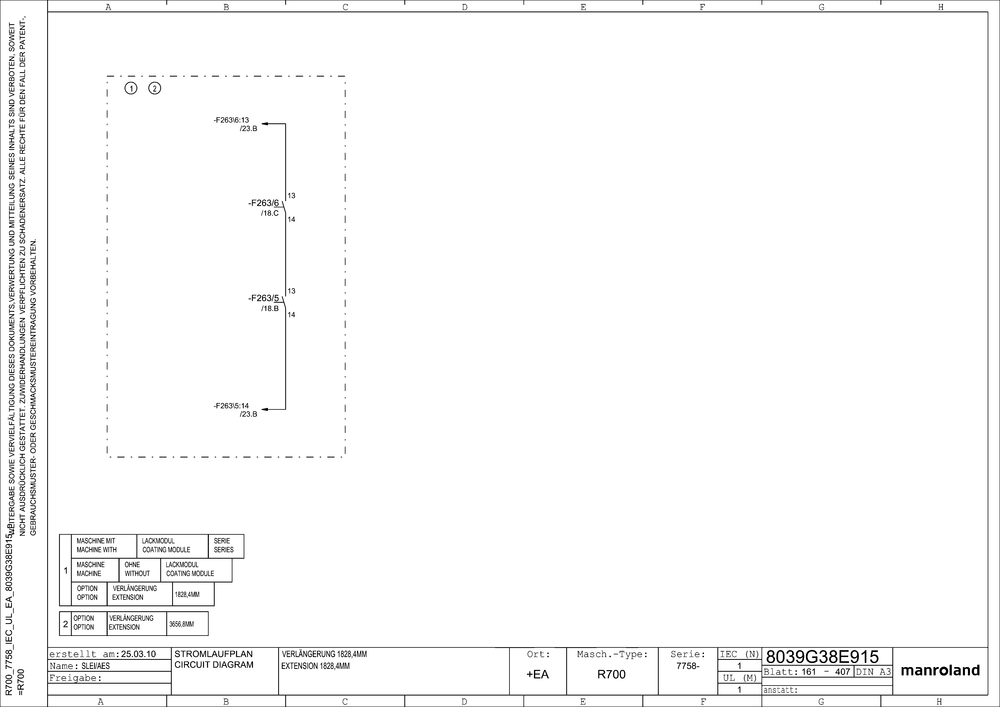

# +EA — Sheet 161 of 407 — VERLÄNGERUNG 1828,4MM

**EXTENSION 1828,4MM**

> Part of the manroland **R700** printing press IEC/UL circuit diagrams.
> Drawing class: **Stromlaufplan / Circuit diagram** (DIN A3).
> Document `+EA` covers the **Printing unit** machine section.

## At a glance

| Field | Value |
|---|---|
| Document | `+EA`  (8039G38E915) |
| Sheet | **161** of 407 |
| Section (DE) | VERLÄNGERUNG 1828,4MM |
| Section (EN) | EXTENSION 1828,4MM |
| Section type | CIRCUIT — Circuit diagram |
| Machine type | `R700` |
| Series | `7758` |
| Created | 25.03.10 |
| Replaces | — |
| Columns used | A, B, C |
| Path numbers | — |
| Labels on sheet | 38 |
| Cross-refs out | 4 |
| Cross-refs in | 4 |

**Previous:** [+EA sheet 160](SHEET_0160.md) · **Next:** [+EA sheet 162](SHEET_0162.md) · **Document TOC:** [_TOC.md](_TOC.md)  (+EA) · **Master TOC:** [all sheets](../_MASTER_TOC.md)

## Sheet image (300 DPI, exact vector render)



_Rendered directly from the PDF vector layer at 300 DPI (1-bit), no OCR and no resampling. Use it to confirm anything ambiguous in the text below._

## Cross-references on this sheet

Each entry is a wire leaving this sheet. The printed token is `/sheet.column`; the link resolves to that sheet inside the same document.

| Ref | Target sheet | Col | Path | Destination on target | Target section | From col |
|---|---|---|---|---|---|---|
| `/23.B` | [+EA sheet 23](SHEET_0023.md) | B | — | F263\6:13 | SPANNUNGSVERSORGUNG: 400V, 24V | B |
| `/18.C` | [+EA sheet 18](SHEET_0018.md) | C | — | — | SPANNUNGSVERSORGUNG: 400V, 24V | B |
| `/18.B` | [+EA sheet 18](SHEET_0018.md) | B | — | — | SPANNUNGSVERSORGUNG: 400V, 24V | B |
| `/23.B` | [+EA sheet 23](SHEET_0023.md) | B | — | F263\5:14 | SPANNUNGSVERSORGUNG: 400V, 24V | B |

### Incoming references (sheets that point here)

Every other sheet that sends a wire to this one. `Back-ref` is the token printed on *that* sheet; `Path` is its line number.

| From sheet | Cols | Back-ref | Path | Refs | What continues there |
|---|---|---|---|---|---|
| [+EA#18](SHEET_0018.md) | B, C | `/18.B`, `/18.C` | — | 2 | — |
| [+EA#23](SHEET_0023.md) | B | `/23.B` | — | 2 | — |


## Devices on this sheet

| Tag | Class | Class meaning (IEC) | Col | Sub | Terminal | Sign |
|---|---|---|---|---|---|---|
| `F263/6` | F | Schutz / protection device (fuse, circuit breaker) | B | 6 | — | — |
| `F263/5` | F | Schutz / protection device (fuse, circuit breaker) | B | 5 | — | — |

## Potentials / nets

_No named potentials on this sheet._

## Wire-end annotations (grouped as printed)

A wire that continues elsewhere is annotated with a small cluster: the destination description, the path/line number `#NN`, and the `/sheet.column` cross reference. Each row below is one such cluster exactly as it is grouped on the drawing.

| Col | Y | Path | Cross-ref | Text on the wire |
|---|---|---|---|---|
| A | 101.8 | — | — | `1 2` |
| B | 139.2 | — | `/23.B` | `F263\6:13` |
| C | 229.2 | — | — | `13` |
| B | 237.0 | — | — | `F263/6` |
| B | 250.1 | — | `/18.C` | — |
| C | 257.6 | — | — | `14` |
| C | 342.6 | — | — | `13` |
| B | 350.4 | — | — | `F263/5` |
| B | 363.4 | — | `/18.B` | — |
| C | 370.9 | — | — | `14` |
| B | 479.4 | — | `/23.B` | `F263\5:14` |
| B | 641.2 | — | — | `SERIE SERIES` |
| A | 641.3 | — | — | `MASCHINE MIT MACHINE WITH` |
| A | 641.3 | — | — | `LACKMODUL` |
| A | 651.9 | — | — | `COATING MODULE` |
| A | 669.6 | — | — | `MASCHINE MACHINE` |
| A | 669.6 | — | — | `OHNE WITHOUT` |
| B | 669.6 | — | — | `LACKMODUL` |
| A | 674.9 | — | — | `1 COATING MODULE` |
| A | 697.9 | — | — | `OPTION OPTION` |
| A | 698.0 | — | — | `EXTENSION VERLÄNGERUNG` |
| B | 705.1 | — | — | `1828,4MM` |
| A | 733.4 | — | — | `2 OPTION OPTION` |
| A | 733.4 | — | — | `EXTENSION VERLÄNGERUNG 3656,8MM` |


## Reconstructed tables

This sheet carries tabular content (pin map / terminal assignment / index). The grid below was rebuilt from the drawing's own rule lines, so each row is exactly one physical row of the table.

### Table 1 — 5 data rows × 8 columns (at x=204.1, y=0.0) — **F263\6:13 /23.B F263/6 /18.C F263/5 /18.B F263\5:14 /23.B SERIE SERIES MODULE LACKMODUL COATING MODULE 1828,4MM 3656,8MM 13 14 13 14**

| STROMLAUFPLAN |  | VERLÄNGERUNG 1828,4MM | Ort: | Masch. Type: | Serie: | IEC (N) | 8039G38E915 |
|---|---|---|---|---|---|---|---|
| `CIRCUIT DIAGRAM` |  |  |  |  |  |  |  |
|  |  | `EXTENSION 1828,4MM` |  |  | `7758` | `1` |  |
|  |  |  | `+EA` | `R700` |  |  | `Blatt: DIN A3 161 407` |
|  |  |  |  |  |  | `UL (M)` |  |
|  |  |  |  |  |  | `1` | `anstatt:` |


## Notes and free text on this sheet

| Text | Col | Y (pt) |
|---|---|---|
| `F263\6:13` | B | 139.2 |
| `F263\5:14` | B | 479.35 |
| `MASCHINE MIT` | A | 641.26 |
| `MACHINE WITH` | A | 651.85 |
| `MASCHINE` | A | 669.6 |
| `MACHINE` | A | 680.24 |
| `OPTION` | A | 697.92 |
| `VERLÄNGERUNG` | A | 697.97 |
| `EXTENSION` | A | 708.54 |
| `OHNE` | A | 669.6 |
| `WITHOUT` | A | 680.2 |
| `LACKMODUL` | A | 641.27 |
| `COATING MODULE` | A | 651.91 |
| `SERIE` | B | 641.2 |
| `SERIES` | B | 651.84 |
| `LACKMODUL` | B | 669.62 |
| `COATING MODULE` | B | 680.25 |
| `1828,4MM` | B | 705.06 |
| `3656,8MM` | B | 740.51 |

## Complete label inventory (exact text from the drawing)

Every text object inside the drawing area of this sheet, in DIN reading order (column A→H, then top→bottom). This is the authoritative list: if a string is not here it is not printed on this sheet.

| Col | Y | X | Dir | Type | Text |
|---|---|---|---|---|---|
| A | 101.8 | 154.1 | → | number | `1` |
| A | 102.3 | 182.3 | → | number | `2` |
| A | 641.3 | 91.6 | → | text | `MASCHINE MIT` |
| A | 641.3 | 169.2 | → | text | `LACKMODUL` |
| A | 651.9 | 91.6 | → | text | `MACHINE WITH` |
| A | 651.9 | 169.8 | → | text | `COATING MODULE` |
| A | 669.6 | 91.6 | → | text | `MASCHINE` |
| A | 669.6 | 148.5 | → | text | `OHNE` |
| A | 674.9 | 75.4 | → | number | `1` |
| A | 680.2 | 91.6 | → | text | `MACHINE` |
| A | 680.2 | 148.8 | → | text | `WITHOUT` |
| A | 697.9 | 91.8 | → | text | `OPTION` |
| A | 698.0 | 134.6 | → | text | `VERLÄNGERUNG` |
| A | 708.5 | 133.8 | → | text | `EXTENSION` |
| A | 708.6 | 91.8 | → | text | `OPTION` |
| A | 733.4 | 87.6 | → | text | `OPTION` |
| A | 733.4 | 130.4 | → | text | `VERLÄNGERUNG` |
| A | 738.7 | 75.1 | → | number | `2` |
| A | 744.0 | 87.6 | → | text | `OPTION` |
| A | 744.0 | 129.5 | → | text | `EXTENSION` |
| B | 139.2 | 254.3 | → | text | `F263\6:13` |
| B | 149.1 | 285.7 | → | cross-reference | `/23.B` |
| B | 237.0 | 295.7 | → | device tag | `F263/6` |
| B | 250.1 | 311.0 | → | cross-reference | `/18.C` |
| B | 350.4 | 295.7 | → | device tag | `F263/5` |
| B | 363.4 | 311.2 | → | cross-reference | `/18.B` |
| B | 479.4 | 254.3 | → | text | `F263\5:14` |
| B | 489.2 | 285.7 | → | cross-reference | `/23.B` |
| B | 641.2 | 254.8 | → | text | `SERIE` |
| B | 651.8 | 254.8 | → | text | `SERIES` |
| B | 669.6 | 197.6 | → | text | `LACKMODUL` |
| B | 680.3 | 198.1 | → | text | `COATING MODULE` |
| B | 705.1 | 208.2 | → | text | `1828,4MM` |
| B | 740.5 | 201.7 | → | text | `3656,8MM` |
| C | 229.2 | 342.1 | → | number | `13` |
| C | 257.6 | 342.1 | → | number | `14` |
| C | 342.6 | 342.1 | → | number | `13` |
| C | 371.0 | 342.1 | → | number | `14` |

## Reading-order text block

The same content as a plain block, grouped by DIN column — convenient to paste or to match against a visual description.

```text
=== Column A ===
 101.8  154.1  numeric      1
 102.3  182.3  numeric      2
 641.3   91.6  text         MASCHINE MIT
 641.3  169.2  text         LACKMODUL
 651.9   91.6  text         MACHINE WITH
 651.9  169.8  text         COATING MODULE
 669.6   91.6  text         MASCHINE
 669.6  148.5  text         OHNE
 674.9   75.4  numeric      1
 680.2   91.6  text         MACHINE
 680.2  148.8  text         WITHOUT
 697.9   91.8  text         OPTION
 698.0  134.6  text         VERLÄNGERUNG
 708.5  133.8  text         EXTENSION
 708.6   91.8  text         OPTION
 733.4   87.6  text         OPTION
 733.4  130.4  text         VERLÄNGERUNG
 738.7   75.1  numeric      2
 744.0   87.6  text         OPTION
 744.0  129.5  text         EXTENSION
=== Column B ===
 139.2  254.3  text         F263\6:13
 149.1  285.7  xref         /23.B
 237.0  295.7  devtag       F263/6
 250.1  311.0  xref         /18.C
 350.4  295.7  devtag       F263/5
 363.4  311.2  xref         /18.B
 479.4  254.3  text         F263\5:14
 489.2  285.7  xref         /23.B
 641.2  254.8  text         SERIE
 651.8  254.8  text         SERIES
 669.6  197.6  text         LACKMODUL
 680.3  198.1  text         COATING MODULE
 705.1  208.2  text         1828,4MM
 740.5  201.7  text         3656,8MM
=== Column C ===
 229.2  342.1  numeric      13
 257.6  342.1  numeric      14
 342.6  342.1  numeric      13
 371.0  342.1  numeric      14
```

---
_Generated from the PDF vector text layer; no OCR. Source: `R700_7758_IEC_UL_EA_8039G38E915_p`, sheet 161._
