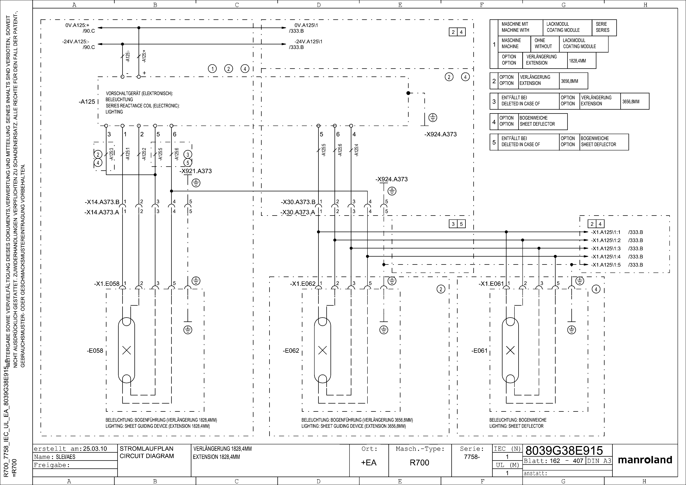

# +EA — Sheet 162 of 407 — VERLÄNGERUNG 1828,4MM

**EXTENSION 1828,4MM**

> Part of the manroland **R700** printing press IEC/UL circuit diagrams.
> Drawing class: **Stromlaufplan / Circuit diagram** (DIN A3).
> Document `+EA` covers the **Printing unit** machine section.

## At a glance

| Field | Value |
|---|---|
| Document | `+EA`  (8039G38E915) |
| Sheet | **162** of 407 |
| Section (DE) | VERLÄNGERUNG 1828,4MM |
| Section (EN) | EXTENSION 1828,4MM |
| Section type | CIRCUIT — Circuit diagram |
| Machine type | `R700` |
| Series | `7758` |
| Created | 25.03.10 |
| Replaces | — |
| Columns used | A, B, C, D, E, F, G, H |
| Path numbers | — |
| Labels on sheet | 154 |
| Cross-refs out | 9 |
| Cross-refs in | 44 |

**Previous:** [+EA sheet 161](SHEET_0161.md) · **Next:** [+EA sheet 163](SHEET_0163.md) · **Document TOC:** [_TOC.md](_TOC.md)  (+EA) · **Master TOC:** [all sheets](../_MASTER_TOC.md)

## Sheet image (300 DPI, exact vector render)



_Rendered directly from the PDF vector layer at 300 DPI (1-bit), no OCR and no resampling. Use it to confirm anything ambiguous in the text below._

## Cross-references on this sheet

Each entry is a wire leaving this sheet. The printed token is `/sheet.column`; the link resolves to that sheet inside the same document.

| Ref | Target sheet | Col | Path | Destination on target | Target section | From col |
|---|---|---|---|---|---|---|
| `/333.B` | [+EA sheet 333](SHEET_0333.md) | B | — | 0V.A125:+ | OPTION: BOGENWEICHE | B |
| `/90.C` | [+EA sheet 90](SHEET_0090.md) | C | — | 0V.A125:+ | BELEUCHTUNG | B |
| `/90.C` | [+EA sheet 90](SHEET_0090.md) | C | — | 24V.A125: | BELEUCHTUNG | A |
| `/333.B` | [+EA sheet 333](SHEET_0333.md) | B | — | — | OPTION: BOGENWEICHE | D |
| `/333.B` | [+EA sheet 333](SHEET_0333.md) | B | — | X1.A125\1:1 | OPTION: BOGENWEICHE | H |
| `/333.B` | [+EA sheet 333](SHEET_0333.md) | B | — | X1.A125\1:2 | OPTION: BOGENWEICHE | H |
| `/333.B` | [+EA sheet 333](SHEET_0333.md) | B | — | X1.A125\1:3 | OPTION: BOGENWEICHE | H |
| `/333.B` | [+EA sheet 333](SHEET_0333.md) | B | — | X1.A125\1:4 | OPTION: BOGENWEICHE | H |
| `/333.B` | [+EA sheet 333](SHEET_0333.md) | B | — | X1.A125\1:5 | OPTION: BOGENWEICHE | H |

### Incoming references (sheets that point here)

Every other sheet that sends a wire to this one. `Back-ref` is the token printed on *that* sheet; `Path` is its line number.

| From sheet | Cols | Back-ref | Path | Refs | What continues there |
|---|---|---|---|---|---|
| [+EA#90](SHEET_0090.md) | C | `/90.C` | — | 2 | — |
| [+EA#218](SHEET_0218.md) | C, E | `/218.C`, `/218.E` | — | 15 | — |
| [+EA#259](SHEET_0259.md) | H | `/259.H` | — | 10 | — |
| [+EA#275](SHEET_0275.md) | F | `/275.F` | — | 10 | — |
| [+EA#333](SHEET_0333.md) | A | `/333.A` | — | 7 | 0V.A125\1; 24V.A125\1; X1.A125\1:1; X1.A125\1:2; X1.A125\1:3; X1.A125\1:4; X1.A125\1:5 |


## Devices on this sheet

| Tag | Class | Class meaning (IEC) | Col | Sub | Terminal | Sign |
|---|---|---|---|---|---|---|
| `A125` | A | Baugruppe / assembly, module, PC board | A | — | — | — |
| `E058` | E | Sonstiges / miscellaneous, lamp | A | — | — | — |
| `E062` | E | Sonstiges / miscellaneous, lamp | D | — | — | — |
| `E061` | E | Sonstiges / miscellaneous, lamp | F | — | — | — |
| `A125:2` | A | Baugruppe / assembly, module, PC board | B | — | 2 | — |
| `A125:5` | A | Baugruppe / assembly, module, PC board | B | — | 5 | — |
| `A125:6` | A | Baugruppe / assembly, module, PC board | B | — | 6 | — |
| `A125:1` | A | Baugruppe / assembly, module, PC board | B | — | 1 | — |
| `A125:3` | A | Baugruppe / assembly, module, PC board | A | — | 3 | — |
| `A125:4` | A | Baugruppe / assembly, module, PC board | D | — | 4 | — |
| `A125:6` | A | Baugruppe / assembly, module, PC board | D | — | 6 | — |
| `A125:5` | A | Baugruppe / assembly, module, PC board | D | — | 5 | — |
| `X1.E058` | — | cross-device reference | A | — | — | — |
| `X1.E062` | — | cross-device reference | D | — | — | — |
| `X1.E061` | — | cross-device reference | F | — | — | — |
| `X14.A373.B` | — | cross-device reference | A | — | — | — |
| `X14.A373.A` | — | cross-device reference | A | — | — | — |
| `X30.A373.B` | — | cross-device reference | D | — | — | — |
| `X30.A373.A` | — | cross-device reference | D | — | — | — |
| `X1.A125\1:5` | — | cross-device reference | H | — | 5 | — |
| `X1.A125\1:4` | — | cross-device reference | H | — | 4 | — |
| `X1.A125\1:2` | — | cross-device reference | H | — | 2 | — |
| `X1.A125\1:1` | — | cross-device reference | H | — | 1 | — |
| `X1.A125\1:3` | — | cross-device reference | H | — | 3 | — |
| `X924.A373` | — | cross-device reference | E | — | — | — |
| `X921.A373` | — | cross-device reference | B | — | — | — |
| `X924.A373` | — | cross-device reference | E | — | — | — |

## Potentials / nets

| Potential | Count | Columns | Attached devices | Terminals |
|---|---|---|---|---|
| `0V` | 2 | A, D | `A125`, `A125\1` | — |
| `24V` | 2 | A, D | `A125`, `A125\1` | — |


A potential such as `L24+/4` or `M24+` is a named supply/return rail; every place it appears on this sheet is electrically common.

## Wire-end annotations (grouped as printed)

A wire that continues elsewhere is annotated with a small cluster: the destination description, the path/line number `#NN`, and the `/sheet.column` cross reference. Each row below is one such cluster exactly as it is grouped on the drawing.

| Col | Y | Path | Cross-ref | Text on the wire |
|---|---|---|---|---|
| G | 38.8 | — | — | `SERIE SERIES` |
| F | 38.9 | — | — | `MASCHINE MIT MACHINE WITH` |
| G | 38.9 | — | — | `LACKMODUL` |
| B | 40.0 | — | `/333.B`, `/90.C` | `0V.A125:+` |
| D | 40.0 | — | — | `0V.A125\1` |
| G | 49.5 | — | — | `COATING MODULE` |
| F | 52.1 | — | — | `2 4` |
| F | 67.2 | — | — | `MASCHINE MACHINE` |
| G | 67.2 | — | — | `OHNE WITHOUT` |
| G | 67.3 | — | — | `LACKMODUL` |
| A | 68.3 | — | `/90.C` | `24V.A125:` |
| D | 68.3 | — | — | `24V.A125\1` |
| G | 72.5 | — | — | `1 COATING MODULE` |
| D | 78.2 | — | `/333.B` | — |
| B | 86.6 | — | — | `A125:+` |
| B | 87.5 | — | — | `A125:` |
| F | 95.6 | — | — | `OPTION OPTION` |
| G | 95.6 | — | — | `EXTENSION VERLÄNGERUNG` |
| G | 102.7 | — | — | `1828,4MM` |
| C | 116.0 | — | — | `1 2 4` |
| B | 122.2 | — | — | `+` |
| F | 130.7 | — | — | `2 4` |
| F | 131.0 | — | — | `2 OPTION OPTION` |
| G | 131.0 | — | — | `EXTENSION VERLÄNGERUNG 3656,8MM` |
| B | 159.4 | — | — | `BELEUCHTUNG VORSCHALTGERÄT (ELEKTRONISCH):` |
| F | 166.4 | — | — | `3 ENTFÄLLT BEI DELETED IN CASE OF` |
| G | 166.4 | — | — | `OPTION OPTION` |
| H | 166.5 | — | — | `EXTENSION VERLÄNGERUNG 3656,8MM` |
| A | 171.8 | — | — | `A125` |
| B | 180.6 | — | — | `LIGHTING SERIES REACTANCE COIL (ELECTRONIC):` |
| G | 201.8 | — | — | `BOGENWEICHE` |
| F | 201.9 | — | — | `4 OPTION OPTION` |
| G | 212.5 | — | — | `SHEET DEFLECTOR` |
| C | 228.5 | — | — | `3 5 6 4` |
| B | 228.5 | — | — | `1 2 5 6` |
| E | 228.5 | — | — | `X924.A373` |
| G | 237.3 | — | — | `5 OPTION OPTION` |
| G | 237.3 | — | — | `ENTFÄLLT BEI DELETED IN CASE OF SHEET DEFLECTOR` |
| G | 237.3 | — | — | `BOGENWEICHE` |
| D | 249.8 | — | — | `A125:5` |
| D | 249.8 | — | — | `A125:6` |
| D | 249.8 | — | — | `A125:4` |
| B | 256.0 | — | — | `A125:1` |
| B | 256.7 | — | — | `A125:2` |
| A | 256.9 | — | — | `A125:3` |
| B | 256.9 | — | — | `A125:5` |
| B | 256.9 | — | — | `A125:6` |
| B | 265.3 | — | — | `2 3` |
| B | 279.5 | — | — | `4 5` |
| B | 292.3 | — | — | `X921.A373` |
| E | 306.4 | — | — | `X924.A373` |
| B | 346.1 | — | — | `X14.A373.B 1 2 3 4 5` |
| D | 346.1 | — | — | `X30.A373.B 1 2 3 4 5` |
| B | 363.2 | — | — | `X14.A373.A 1 2 3 4 5` |
| D | 363.2 | — | — | `X30.A373.A 1 2 3 4 5` |
| G | 385.1 | — | — | `3 5 2 4` |
| H | 399.2 | — | `/333.B` | `X1.A125\1:1` |
| H | 413.4 | — | `/333.B` | `X1.A125\1:2` |
| H | 427.6 | — | `/333.B` | `X1.A125\1:3` |
| H | 441.8 | — | `/333.B` | `X1.A125\1:4` |
| H | 455.9 | — | `/333.B` | `X1.A125\1:5` |
| B | 487.9 | — | — | `X1.E058 1 2 3 5` |
| D | 487.9 | — | — | `X1.E062 1 2 3 5` |
| F | 487.9 | — | — | `X1.E061 1 2 3 5` |
| F | 499.2 | — | — | `2 4` |
| A | 604.1 | — | — | `E058` |
| D | 604.1 | — | — | `E062` |
| F | 604.1 | — | — | `E061` |
| B | 726.3 | — | — | `BELEUCHTUNG: BOGENFÜHRUNG (VERLÄNGERUNG 1828,4MM) LIGHTING: SHEET GUIDING DEVICE (EXTENSION 1828,4MM)` |
| D | 726.3 | — | — | `BELEUCHTUNG: BOGENFÜHRUNG (VERLÄNGERUNG 3656,8MM) LIGHTING: SHEET GUIDING DEVICE (EXTENSION 3656,8MM)` |
| F | 726.3 | — | — | `BELEUCHTUNG: BOGENWEICHE LIGHTING: SHEET DEFLECTOR` |


## Reconstructed tables

This sheet carries tabular content (pin map / terminal assignment / index). The grid below was rebuilt from the drawing's own rule lines, so each row is exactly one physical row of the table.

### Table 1 — 1 data rows × 3 columns (at x=184.3, y=48.2)

| SERIES LIGHTING 3 A125:3 | BELEUCHTUNG | A125: VORSCHALTGERÄT REACTANCE 1 A125:1 |
|---|---|---|
| `X1.E058` |  | `1 1 1` |


### Table 2 — 1 data rows × 3 columns (at x=240.9, y=48.2)

| A125:+ + COIL 2 A125:2 | (ELEKTRONISCH): (ELECTRONIC): 5 A125:5 | 6 A125:6 3 5 |
|---|---|---|
| `2 2 2` | `3 3 3` | `4 4 5` |


### Table 3 — 3 data rows × 1 columns (at x=552.8, y=119.1)

| C1 |
|---|
| `5 A125:5` |
| `1 1` |
| `1` |


### Table 4 — 2 data rows × 4 columns (at x=581.1, y=119.1)

| 6 A125:6 | 4 A125:4 |  | X924.A373 |
|---|---|---|---|
| `2 2` | `3 3` | `4 4` | `5 5` |
| `2` | `3` | `5` |  |


### Table 5 — 2 data rows × 2 columns (at x=737.0, y=119.1)

| 2 4 X924.A373 | 2 3 4 5 |
|---|---|
| `3 5` |  |
| `2` | `X1.E061 E061` |


### Table 6 — 1 data rows × 5 columns (at x=878.7, y=119.1)

| OPTION OPTION ENTFÄLLT DELETED OPTION OPTION ENTFÄLLT DELETED | IN IN | VERLÄNGERUNG EXTENSION BEI CASE OF BOGENWEICHE SHEET BEI CASE OF | DEFLECTOR | 3656,8MM OPTION OPTION OPTION OPTION |
|---|---|---|---|---|
| `1` |  | `2` | `3` | `5` |


## Notes and free text on this sheet

| Text | Col | Y (pt) |
|---|---|---|
| `VORSCHALTGERÄT (ELEKTRONISCH):` | B | 159.38 |
| `BELEUCHTUNG` | B | 170 |
| `SERIES REACTANCE COIL (ELECTRONIC):` | B | 180.64 |
| `LIGHTING` | A | 191.25 |
| `BELEUCHTUNG: BOGENFÜHRUNG (VERLÄNGERUNG 1828,4MM)` | B | 726.32 |
| `LIGHTING: SHEET GUIDING DEVICE (EXTENSION 1828,4MM)` | B | 736.94 |
| `BELEUCHTUNG: BOGENFÜHRUNG (VERLÄNGERUNG 3656,8MM)` | D | 726.32 |
| `LIGHTING: SHEET GUIDING DEVICE (EXTENSION 3656,8MM)` | D | 736.94 |
| `BELEUCHTUNG: BOGENWEICHE` | F | 726.28 |
| `LIGHTING: SHEET DEFLECTOR` | F | 736.93 |
| `A125:+` | B | 86.56 |
| `A125:` | B | 87.55 |
| `MASCHINE MIT` | F | 38.9 |
| `MACHINE WITH` | F | 49.49 |
| `MASCHINE` | F | 67.24 |
| `MACHINE` | F | 77.87 |
| `OPTION` | F | 95.56 |
| `VERLÄNGERUNG` | G | 95.6 |
| `EXTENSION` | G | 106.18 |
| `OHNE` | G | 67.23 |
| `WITHOUT` | G | 77.83 |
| `LACKMODUL` | G | 38.91 |
| `COATING MODULE` | G | 49.54 |
| `SERIE` | G | 38.84 |
| `SERIES` | G | 49.48 |
| `1828,4MM` | G | 102.7 |
| `3656,8MM` | G | 138.14 |
| `ENTFÄLLT BEI` | F | 166.42 |
| `DELETED IN CASE OF` | F | 177.07 |
| `OPTION` | G | 166.42 |
| `3656,8MM` | H | 173.58 |
| `BOGENWEICHE` | G | 201.84 |
| `SHEET DEFLECTOR` | G | 212.52 |

## Complete label inventory (exact text from the drawing)

Every text object inside the drawing area of this sheet, in DIN reading order (column A→H, then top→bottom). This is the authoritative list: if a string is not here it is not printed on this sheet.

| Col | Y | X | Dir | Type | Text |
|---|---|---|---|---|---|
| A | 40.0 | 113.7 | → | potential | `0V.A125:+` |
| A | 49.9 | 143.7 | → | cross-reference | `/90.C` |
| A | 68.3 | 108.0 | → | potential | `24V.A125:` |
| A | 78.2 | 143.7 | → | cross-reference | `/90.C` |
| A | 171.8 | 136.6 | → | device tag | `A125` |
| A | 191.2 | 183.4 | → | text | `LIGHTING` |
| A | 228.5 | 186.5 | → | number | `3` |
| A | 256.9 | 190.6 | ↕ | device tag | `A125:3` |
| A | 265.3 | 168.1 | → | number | `2` |
| A | 279.5 | 168.1 | → | number | `4` |
| A | 346.1 | 147.4 | → | device ref | `X14.A373.B` |
| A | 363.9 | 146.6 | → | device ref | `X14.A373.A` |
| A | 487.9 | 163.3 | → | device ref | `X1.E058` |
| A | 604.1 | 150.8 | → | device tag | `E058` |
| B | 86.6 | 247.2 | ↕ | text | `A125:+` |
| B | 87.6 | 218.9 | ↕ | text | `A125:` |
| B | 122.2 | 247.5 | → | number | `+` |
| B | 159.4 | 184.3 | → | text | `VORSCHALTGERÄT (ELEKTRONISCH):` |
| B | 170.0 | 183.4 | → | text | `BELEUCHTUNG` |
| B | 180.6 | 184.0 | → | text | `SERIES REACTANCE COIL (ELECTRONIC):` |
| B | 228.5 | 214.3 | → | number | `1` |
| B | 228.5 | 243.5 | → | number | `2` |
| B | 228.5 | 271.6 | → | number | `5` |
| B | 228.5 | 300.2 | → | number | `6` |
| B | 256.0 | 218.8 | ↕ | device tag | `A125:1` |
| B | 256.7 | 247.2 | ↕ | device tag | `A125:2` |
| B | 256.9 | 275.6 | ↕ | device tag | `A125:5` |
| B | 256.9 | 303.9 | ↕ | device tag | `A125:6` |
| B | 265.3 | 324.0 | → | number | `3` |
| B | 279.5 | 324.0 | → | number | `5` |
| B | 292.3 | 311.5 | → | device ref | `X921.A373` |
| B | 346.2 | 214.6 | → | number | `1` |
| B | 346.2 | 243.5 | → | number | `2` |
| B | 346.2 | 271.8 | → | number | `3` |
| B | 346.2 | 300.2 | → | number | `4` |
| B | 346.2 | 328.5 | → | number | `5` |
| B | 363.2 | 214.6 | → | number | `1` |
| B | 363.2 | 243.5 | → | number | `2` |
| B | 363.2 | 271.8 | → | number | `3` |
| B | 363.2 | 300.2 | → | number | `4` |
| B | 363.2 | 328.5 | → | number | `5` |
| B | 487.9 | 214.6 | → | number | `1` |
| B | 487.9 | 243.5 | → | number | `2` |
| B | 487.9 | 271.8 | → | number | `3` |
| B | 487.9 | 300.2 | → | number | `5` |
| B | 726.3 | 183.4 | → | text | `BELEUCHTUNG: BOGENFÜHRUNG (VERLÄNGERUNG 1828,4MM)` |
| B | 736.9 | 183.4 | → | text | `LIGHTING: SHEET GUIDING DEVICE (EXTENSION 1828,4MM)` |
| C | 116.0 | 366.7 | → | number | `1` |
| C | 116.5 | 394.9 | → | number | `2` |
| C | 116.5 | 423.2 | → | number | `4` |
| D | 40.0 | 511.4 | → | potential | `0V.A125\1` |
| D | 49.9 | 501.7 | → | cross-reference | `/333.B` |
| D | 68.3 | 511.4 | → | potential | `24V.A125\1` |
| D | 78.2 | 501.7 | → | cross-reference | `/333.B` |
| D | 228.5 | 555.0 | → | number | `5` |
| D | 228.5 | 583.7 | → | number | `6` |
| D | 228.5 | 612.0 | → | number | `4` |
| D | 249.8 | 559.1 | ↕ | device tag | `A125:5` |
| D | 249.8 | 587.4 | ↕ | device tag | `A125:6` |
| D | 249.8 | 615.8 | ↕ | device tag | `A125:4` |
| D | 346.1 | 487.6 | → | device ref | `X30.A373.B` |
| D | 346.2 | 554.7 | → | number | `1` |
| D | 346.2 | 583.7 | → | number | `2` |
| D | 346.2 | 612.0 | → | number | `3` |
| D | 363.2 | 554.7 | → | number | `1` |
| D | 363.2 | 583.7 | → | number | `2` |
| D | 363.2 | 612.0 | → | number | `3` |
| D | 363.9 | 486.7 | → | device ref | `X30.A373.A` |
| D | 487.9 | 503.4 | → | device ref | `X1.E062` |
| D | 487.9 | 554.7 | → | number | `1` |
| D | 487.9 | 583.7 | → | number | `2` |
| D | 487.9 | 612.0 | → | number | `3` |
| D | 604.1 | 491.0 | → | device tag | `E062` |
| D | 726.3 | 523.6 | → | text | `BELEUCHTUNG: BOGENFÜHRUNG (VERLÄNGERUNG 3656,8MM)` |
| D | 736.9 | 523.6 | → | text | `LIGHTING: SHEET GUIDING DEVICE (EXTENSION 3656,8MM)` |
| E | 228.5 | 736.7 | → | device ref | `X924.A373` |
| E | 306.4 | 651.7 | → | device ref | `X924.A373` |
| E | 346.2 | 640.3 | → | number | `4` |
| E | 346.2 | 668.7 | → | number | `5` |
| E | 363.2 | 640.3 | → | number | `4` |
| E | 363.2 | 668.7 | → | number | `5` |
| E | 487.9 | 640.3 | → | number | `5` |
| F | 38.9 | 871.1 | → | text | `MASCHINE MIT` |
| F | 49.5 | 871.1 | → | text | `MACHINE WITH` |
| F | 52.1 | 784.3 | → | number | `2` |
| F | 52.1 | 798.4 | → | number | `4` |
| F | 67.2 | 871.1 | → | text | `MASCHINE` |
| F | 72.6 | 854.9 | → | number | `1` |
| F | 77.9 | 871.1 | → | text | `MACHINE` |
| F | 95.6 | 871.4 | → | text | `OPTION` |
| F | 106.2 | 871.4 | → | text | `OPTION` |
| F | 130.7 | 777.5 | → | number | `2` |
| F | 130.7 | 805.9 | → | number | `4` |
| F | 131.0 | 867.1 | → | text | `OPTION` |
| F | 136.3 | 854.6 | → | number | `2` |
| F | 141.6 | 867.1 | → | text | `OPTION` |
| F | 166.4 | 870.8 | → | text | `ENTFÄLLT BEI` |
| F | 171.8 | 854.5 | → | number | `3` |
| F | 177.1 | 870.8 | → | text | `DELETED IN CASE OF` |
| F | 201.9 | 867.1 | → | text | `OPTION` |
| F | 207.2 | 854.6 | → | number | `4` |
| F | 212.5 | 867.1 | → | text | `OPTION` |
| F | 237.3 | 870.8 | → | text | `ENTFÄLLT BEI` |
| F | 242.6 | 854.5 | → | number | `5` |
| F | 247.9 | 870.8 | → | text | `DELETED IN CASE OF` |
| F | 385.1 | 784.2 | → | number | `3` |
| F | 385.1 | 798.4 | → | number | `5` |
| F | 487.9 | 830.8 | → | device ref | `X1.E061` |
| F | 487.9 | 880.7 | → | number | `1` |
| F | 499.2 | 763.4 | → | number | `2` |
| F | 604.1 | 818.4 | → | device tag | `E061` |
| F | 726.3 | 849.5 | → | text | `BELEUCHTUNG: BOGENWEICHE` |
| F | 736.9 | 849.5 | → | text | `LIGHTING: SHEET DEFLECTOR` |
| G | 38.8 | 1034.4 | → | text | `SERIE` |
| G | 38.9 | 948.8 | → | text | `LACKMODUL` |
| G | 49.5 | 949.3 | → | text | `COATING MODULE` |
| G | 49.5 | 1034.4 | → | text | `SERIES` |
| G | 67.2 | 928.1 | → | text | `OHNE` |
| G | 67.3 | 977.1 | → | text | `LACKMODUL` |
| G | 77.8 | 928.3 | → | text | `WITHOUT` |
| G | 77.9 | 977.7 | → | text | `COATING MODULE` |
| G | 95.6 | 914.2 | → | text | `VERLÄNGERUNG` |
| G | 102.7 | 987.7 | → | text | `1828,4MM` |
| G | 106.2 | 913.3 | → | text | `EXTENSION` |
| G | 131.0 | 902.8 | → | text | `VERLÄNGERUNG` |
| G | 138.1 | 974.1 | → | text | `3656,8MM` |
| G | 141.6 | 902.0 | → | text | `EXTENSION` |
| G | 166.4 | 973.4 | → | text | `OPTION` |
| G | 166.5 | 1009.1 | → | text | `VERLÄNGERUNG` |
| G | 177.0 | 1008.3 | → | text | `EXTENSION` |
| G | 177.1 | 973.4 | → | text | `OPTION` |
| G | 201.8 | 902.0 | → | text | `BOGENWEICHE` |
| G | 212.5 | 902.6 | → | text | `SHEET DEFLECTOR` |
| G | 237.3 | 973.4 | → | text | `OPTION` |
| G | 237.3 | 1008.3 | → | text | `BOGENWEICHE` |
| G | 247.9 | 973.4 | → | text | `OPTION` |
| G | 248.0 | 1008.9 | → | text | `SHEET DEFLECTOR` |
| G | 385.1 | 1025.3 | → | number | `2` |
| G | 385.1 | 1039.3 | → | number | `4` |
| G | 487.9 | 909.6 | → | number | `2` |
| G | 487.9 | 938.0 | → | number | `3` |
| G | 487.9 | 966.3 | → | number | `5` |
| G | 499.2 | 1032.7 | → | number | `4` |
| H | 173.6 | 1080.4 | → | text | `3656,8MM` |
| H | 399.2 | 1090.6 | → | cross-reference | `/333.B` |
| H | 399.3 | 1025.9 | → | device ref | `X1.A125\1:1` |
| H | 413.4 | 1025.9 | → | device ref | `X1.A125\1:2` |
| H | 413.4 | 1090.6 | → | cross-reference | `/333.B` |
| H | 427.6 | 1025.9 | → | device ref | `X1.A125\1:3` |
| H | 427.6 | 1090.6 | → | cross-reference | `/333.B` |
| H | 441.8 | 1025.9 | → | device ref | `X1.A125\1:4` |
| H | 441.8 | 1090.6 | → | cross-reference | `/333.B` |
| H | 455.9 | 1025.9 | → | device ref | `X1.A125\1:5` |
| H | 455.9 | 1090.6 | → | cross-reference | `/333.B` |

## Reading-order text block

The same content as a plain block, grouped by DIN column — convenient to paste or to match against a visual description.

```text
=== Column A ===
  40.0  113.7  net          0V.A125:+
  49.9  143.7  xref         /90.C
  68.3  108.0  net          24V.A125:
  78.2  143.7  xref         /90.C
 171.8  136.6  devtag       A125
 191.2  183.4  text         LIGHTING
 228.5  186.5  numeric      3
 256.9  190.6  devtag       A125:3
 265.3  168.1  numeric      2
 279.5  168.1  numeric      4
 346.1  147.4  devref       X14.A373.B
 363.9  146.6  devref       X14.A373.A
 487.9  163.3  devref       X1.E058
 604.1  150.8  devtag       E058
=== Column B ===
  86.6  247.2  text         A125:+
  87.6  218.9  text         A125:
 122.2  247.5  numeric      +
 159.4  184.3  text         VORSCHALTGERÄT (ELEKTRONISCH):
 170.0  183.4  text         BELEUCHTUNG
 180.6  184.0  text         SERIES REACTANCE COIL (ELECTRONIC):
 228.5  214.3  numeric      1
 228.5  243.5  numeric      2
 228.5  271.6  numeric      5
 228.5  300.2  numeric      6
 256.0  218.8  devtag       A125:1
 256.7  247.2  devtag       A125:2
 256.9  275.6  devtag       A125:5
 256.9  303.9  devtag       A125:6
 265.3  324.0  numeric      3
 279.5  324.0  numeric      5
 292.3  311.5  devref       X921.A373
 346.2  214.6  numeric      1
 346.2  243.5  numeric      2
 346.2  271.8  numeric      3
 346.2  300.2  numeric      4
 346.2  328.5  numeric      5
 363.2  214.6  numeric      1
 363.2  243.5  numeric      2
 363.2  271.8  numeric      3
 363.2  300.2  numeric      4
 363.2  328.5  numeric      5
 487.9  214.6  numeric      1
 487.9  243.5  numeric      2
 487.9  271.8  numeric      3
 487.9  300.2  numeric      5
 726.3  183.4  text         BELEUCHTUNG: BOGENFÜHRUNG (VERLÄNGERUNG 1828,4MM)
 736.9  183.4  text         LIGHTING: SHEET GUIDING DEVICE (EXTENSION 1828,4MM)
=== Column C ===
 116.0  366.7  numeric      1
 116.5  394.9  numeric      2
 116.5  423.2  numeric      4
=== Column D ===
  40.0  511.4  net          0V.A125\1
  49.9  501.7  xref         /333.B
  68.3  511.4  net          24V.A125\1
  78.2  501.7  xref         /333.B
 228.5  555.0  numeric      5
 228.5  583.7  numeric      6
 228.5  612.0  numeric      4
 249.8  559.1  devtag       A125:5
 249.8  587.4  devtag       A125:6
 249.8  615.8  devtag       A125:4
 346.1  487.6  devref       X30.A373.B
 346.2  554.7  numeric      1
 346.2  583.7  numeric      2
 346.2  612.0  numeric      3
 363.2  554.7  numeric      1
 363.2  583.7  numeric      2
 363.2  612.0  numeric      3
 363.9  486.7  devref       X30.A373.A
 487.9  503.4  devref       X1.E062
 487.9  554.7  numeric      1
 487.9  583.7  numeric      2
 487.9  612.0  numeric      3
 604.1  491.0  devtag       E062
 726.3  523.6  text         BELEUCHTUNG: BOGENFÜHRUNG (VERLÄNGERUNG 3656,8MM)
 736.9  523.6  text         LIGHTING: SHEET GUIDING DEVICE (EXTENSION 3656,8MM)
=== Column E ===
 228.5  736.7  devref       X924.A373
 306.4  651.7  devref       X924.A373
 346.2  640.3  numeric      4
 346.2  668.7  numeric      5
 363.2  640.3  numeric      4
 363.2  668.7  numeric      5
 487.9  640.3  numeric      5
=== Column F ===
  38.9  871.1  text         MASCHINE MIT
  49.5  871.1  text         MACHINE WITH
  52.1  784.3  numeric      2
  52.1  798.4  numeric      4
  67.2  871.1  text         MASCHINE
  72.6  854.9  numeric      1
  77.9  871.1  text         MACHINE
  95.6  871.4  text         OPTION
 106.2  871.4  text         OPTION
 130.7  777.5  numeric      2
 130.7  805.9  numeric      4
 131.0  867.1  text         OPTION
 136.3  854.6  numeric      2
 141.6  867.1  text         OPTION
 166.4  870.8  text         ENTFÄLLT BEI
 171.8  854.5  numeric      3
 177.1  870.8  text         DELETED IN CASE OF
 201.9  867.1  text         OPTION
 207.2  854.6  numeric      4
 212.5  867.1  text         OPTION
 237.3  870.8  text         ENTFÄLLT BEI
 242.6  854.5  numeric      5
 247.9  870.8  text         DELETED IN CASE OF
 385.1  784.2  numeric      3
 385.1  798.4  numeric      5
 487.9  830.8  devref       X1.E061
 487.9  880.7  numeric      1
 499.2  763.4  numeric      2
 604.1  818.4  devtag       E061
 726.3  849.5  text         BELEUCHTUNG: BOGENWEICHE
 736.9  849.5  text         LIGHTING: SHEET DEFLECTOR
=== Column G ===
  38.8 1034.4  text         SERIE
  38.9  948.8  text         LACKMODUL
  49.5  949.3  text         COATING MODULE
  49.5 1034.4  text         SERIES
  67.2  928.1  text         OHNE
  67.3  977.1  text         LACKMODUL
  77.8  928.3  text         WITHOUT
  77.9  977.7  text         COATING MODULE
  95.6  914.2  text         VERLÄNGERUNG
 102.7  987.7  text         1828,4MM
 106.2  913.3  text         EXTENSION
 131.0  902.8  text         VERLÄNGERUNG
 138.1  974.1  text         3656,8MM
 141.6  902.0  text         EXTENSION
 166.4  973.4  text         OPTION
 166.5 1009.1  text         VERLÄNGERUNG
 177.0 1008.3  text         EXTENSION
 177.1  973.4  text         OPTION
 201.8  902.0  text         BOGENWEICHE
 212.5  902.6  text         SHEET DEFLECTOR
 237.3  973.4  text         OPTION
 237.3 1008.3  text         BOGENWEICHE
 247.9  973.4  text         OPTION
 248.0 1008.9  text         SHEET DEFLECTOR
 385.1 1025.3  numeric      2
 385.1 1039.3  numeric      4
 487.9  909.6  numeric      2
 487.9  938.0  numeric      3
 487.9  966.3  numeric      5
 499.2 1032.7  numeric      4
=== Column H ===
 173.6 1080.4  text         3656,8MM
 399.2 1090.6  xref         /333.B
 399.3 1025.9  devref       X1.A125\1:1
 413.4 1025.9  devref       X1.A125\1:2
 413.4 1090.6  xref         /333.B
 427.6 1025.9  devref       X1.A125\1:3
 427.6 1090.6  xref         /333.B
 441.8 1025.9  devref       X1.A125\1:4
 441.8 1090.6  xref         /333.B
 455.9 1025.9  devref       X1.A125\1:5
 455.9 1090.6  xref         /333.B
```

---
_Generated from the PDF vector text layer; no OCR. Source: `R700_7758_IEC_UL_EA_8039G38E915_p`, sheet 162._
