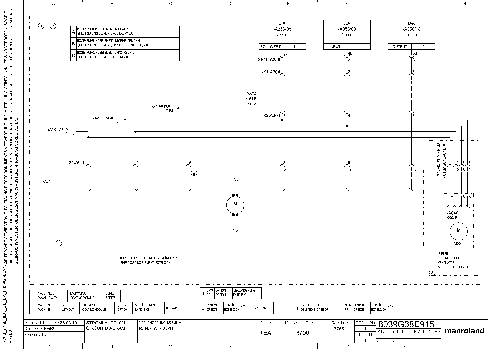

# +EA — Sheet 163 of 407 — VERLÄNGERUNG 1828,4MM

**EXTENSION 1828,4MM**

> Part of the manroland **R700** printing press IEC/UL circuit diagrams.
> Drawing class: **Stromlaufplan / Circuit diagram** (DIN A3).
> Document `+EA` covers the **Printing unit** machine section.

## At a glance

| Field | Value |
|---|---|
| Document | `+EA`  (8039G38E915) |
| Sheet | **163** of 407 |
| Section (DE) | VERLÄNGERUNG 1828,4MM |
| Section (EN) | EXTENSION 1828,4MM |
| Section type | CIRCUIT — Circuit diagram |
| Machine type | `R700` |
| Series | `7758` |
| Created | 25.03.10 |
| Replaces | — |
| Columns used | A, B, C, D, E, F, G, H |
| Path numbers | — |
| Labels on sheet | 127 |
| Cross-refs out | 9 |
| Cross-refs in | 32 |

**Previous:** [+EA sheet 162](SHEET_0162.md) · **Next:** [+EA sheet 164](SHEET_0164.md) · **Document TOC:** [_TOC.md](_TOC.md)  (+EA) · **Master TOC:** [all sheets](../_MASTER_TOC.md)

## Sheet image (300 DPI, exact vector render)



_Rendered directly from the PDF vector layer at 300 DPI (1-bit), no OCR and no resampling. Use it to confirm anything ambiguous in the text below._

## Cross-references on this sheet

Each entry is a wire leaving this sheet. The printed token is `/sheet.column`; the link resolves to that sheet inside the same document.

| Ref | Target sheet | Col | Path | Destination on target | Target section | From col |
|---|---|---|---|---|---|---|
| `/199.B` | [+EA sheet 199](SHEET_0199.md) | B | — | — | REFERENZMODUL | E |
| `/199.B` | [+EA sheet 199](SHEET_0199.md) | B | — | — | REFERENZMODUL | F |
| `/199.B` | [+EA sheet 199](SHEET_0199.md) | B | — | — | REFERENZMODUL | G |
| `/164.E` | [+EA sheet 164](SHEET_0164.md) | E | — | — | VERLÄNGERUNG 1828,4MM | D |
| `/91.A` | [+EA sheet 91](SHEET_0091.md) | A | — | — | BLASROHRE (BLASRAHMEN) | D |
| `/18.F` | [+EA sheet 18](SHEET_0018.md) | F | — | X1.A640:6 | SPANNUNGSVERSORGUNG: 400V, 24V | C |
| `/18.D` | [+EA sheet 18](SHEET_0018.md) | D | — | 24V.X1.A640:2 | SPANNUNGSVERSORGUNG: 400V, 24V | B |
| `/18.D` | [+EA sheet 18](SHEET_0018.md) | D | — | 0V.X1.A640:1 | SPANNUNGSVERSORGUNG: 400V, 24V | A |
| `/203.F` | [+EA sheet 203](SHEET_0203.md) | F | — | A640 | REFERENZMODUL | H |

### Incoming references (sheets that point here)

Every other sheet that sends a wire to this one. `Back-ref` is the token printed on *that* sheet; `Path` is its line number.

| From sheet | Cols | Back-ref | Path | Refs | What continues there |
|---|---|---|---|---|---|
| [+EA#18](SHEET_0018.md) | D, E | `/18.D`, `/18.E` | — | 3 | 0V.X1.A640:1 |
| [+EA#91](SHEET_0091.md) | A | `/91.A` | — | 1 | — |
| [+EA#164](SHEET_0164.md) | D | `/164.D` | — | 1 | — |
| [+EA#199](SHEET_0199.md) | B | `/199.B` | — | 3 | — |
| [+EA#203](SHEET_0203.md) | F | `/203.F` | — | 1 | — |
| [+EA#208](SHEET_0208.md) | C | `/208.C` | — | 3 | — |
| [+EA#213](SHEET_0213.md) | F | `/213.F` | — | 6 | — |
| [+EA#219](SHEET_0219.md) | F | `/219.F` | — | 8 | — |
| [+EA#224](SHEET_0224.md) | B | `/224.B` | — | 3 | — |
| [+EA#254](SHEET_0254.md) | E | `/254.E` | — | 3 | — |


## Devices on this sheet

| Tag | Class | Class meaning (IEC) | Col | Sub | Terminal | Sign |
|---|---|---|---|---|---|---|
| `A356/08` | A | Baugruppe / assembly, module, PC board | E | 08 | — | — |
| `A356/08` | A | Baugruppe / assembly, module, PC board | G | 08 | — | — |
| `A356/08` | A | Baugruppe / assembly, module, PC board | F | 08 | — | — |
| `A304` | A | Baugruppe / assembly, module, PC board | D | — | — | — |
| `A640` | A | Baugruppe / assembly, module, PC board | H | — | — | — |
| `A640` | A | Baugruppe / assembly, module, PC board | A | — | — | — |
| `X1.A640` | — | cross-device reference | A | — | — | — |
| `XB10.A356` | — | cross-device reference | E | — | — | — |
| `X1.A304` | — | cross-device reference | E | — | — | — |
| `X2.A304` | — | cross-device reference | E | — | — | — |
| `X1.M501.A640.B` | — | cross-device reference | H | — | — | — |
| `X1.M501.A640.A` | — | cross-device reference | H | — | — | — |
| `X1.A640:6` | — | cross-device reference | C | — | 6 | — |

## Potentials / nets

| Potential | Count | Columns | Attached devices | Terminals |
|---|---|---|---|---|
| `0V` | 1 | A | `A640`, `X1` | `1` |
| `24V` | 1 | B | `A640`, `X1` | `2` |
| `M501` | 1 | H | — | — |


A potential such as `L24+/4` or `M24+` is a named supply/return rail; every place it appears on this sheet is electrically common.

## Wire-end annotations (grouped as printed)

A wire that continues elsewhere is annotated with a small cluster: the destination description, the path/line number `#NN`, and the `/sheet.column` cross reference. Each row below is one such cluster exactly as it is grouped on the drawing.

| Col | Y | Path | Cross-ref | Text on the wire |
|---|---|---|---|---|
| E | 51.6 | — | — | `D/A` |
| F | 51.6 | — | — | `D/A` |
| G | 51.6 | — | — | `D/A` |
| A | 59.3 | — | — | `1` |
| A | 59.8 | — | — | `2` |
| E | 65.5 | — | — | `A356/08` |
| F | 65.5 | — | — | `A356/08` |
| G | 65.5 | — | — | `A356/08` |
| B | 67.2 | — | — | `BOGENFÜHRUNGSELEMENT, SOLLWERT` |
| B | 72.6 | — | — | `A SHEET GUIDING ELEMENT, NOMINAL VALUE` |
| E | 80.3 | — | `/199.B` | — |
| F | 80.3 | — | `/199.B` | — |
| G | 80.3 | — | `/199.B` | — |
| B | 95.6 | — | — | `BOGENFÜHRUNGSELEMENT, STÖRMELDESIGNAL` |
| B | 100.9 | — | — | `B SHEET GUIDING ELEMENT, TROUBLE MESSAGE SIGNAL` |
| E | 108.7 | — | — | `SOLLWERT 1` |
| F | 108.7 | — | — | `INPUT 1` |
| G | 108.7 | — | — | `OUTPUT 1` |
| B | 123.9 | — | — | `BOGENFÜHRUNGSELEMENT LINKS / RECHTS` |
| E | 125.0 | — | — | `3B` |
| F | 125.0 | — | — | `4B` |
| G | 125.0 | — | — | `5B` |
| B | 129.3 | — | — | `C SHEET GUIDING ELEMENT LEFT / RIGHT` |
| E | 139.2 | — | — | `XB10.A356 1` |
| F | 140.6 | — | — | `2` |
| G | 140.6 | — | — | `3` |
| E | 169.0 | — | — | `X1.A304 1` |
| G | 169.0 | — | — | `2 3` |
| D | 221.4 | — | — | `A304` |
| D | 234.5 | — | `/164.E` | — |
| D | 246.9 | — | `/91.A` | — |
| C | 252.6 | — | `/18.F` | `X1.A640:6` |
| E | 273.9 | — | — | `X2.A304 3` |
| F | 275.3 | — | — | `4` |
| G | 275.3 | — | — | `5` |
| B | 280.9 | — | `/18.D` | `24V.X1.A640:2` |
| A | 309.2 | — | `/18.D` | `0V.X1.A640:1` |
| H | 345.3 | — | — | `X1.M501.A640.B` |
| H | 346.1 | — | — | `X1.M501.A640.A` |
| B | 387.2 | — | — | `X1.A640 1 2 6` |
| E | 388.7 | — | — | `3` |
| F | 388.7 | — | — | `5` |
| G | 388.7 | — | — | `4` |
| H | 388.7 | — | — | `1` |
| H | 388.7 | — | — | `2 5 3` |
| H | 405.7 | — | — | `1` |
| H | 405.7 | — | — | `2 5 3` |
| F | 406.3 | — | — | `A B C` |
| A | 435.2 | — | — | `A640` |
| H | 470.8 | — | — | `+ B A` |
| D | 486.2 | — | — | `M` |
| H | 509.1 | — | `/203.F` | `A640` |
| H | 550.2 | — | — | `M` |
| H | 583.6 | — | — | `M501` |
| A | 584.2 | — | — | `4` |
| H | 609.3 | — | — | `LÜFTER: BOGENFÜHRUNG` |
| C | 620.0 | — | — | `BOGENFÜHRUNGSELEMENT: VERLÄNGERUNG` |
| C | 630.6 | — | — | `SHEET GUIDING ELEMENT: EXTENSION` |
| H | 630.6 | — | — | `SHEET GUIDING DEVICE VENTILATOR:` |
| G | 655.1 | — | — | `3` |
| D | 697.8 | — | — | `3 PP S+W OPTION OPTION` |
| D | 698.0 | — | — | `EXTENSION VERLÄNGERUNG` |
| A | 705.0 | — | — | `MASCHINE MIT MACHINE WITH` |
| A | 705.0 | — | — | `LACKMODUL` |
| B | 705.0 | — | — | `SERIE SERIES` |
| A | 715.7 | — | — | `COATING MODULE` |
| A | 724.5 | — | — | `1` |
| F | 733.2 | — | — | `PP S+W` |
| A | 733.4 | — | — | `MASCHINE MACHINE` |
| A | 733.4 | — | — | `OHNE WITHOUT` |
| B | 733.4 | — | — | `LACKMODUL` |
| B | 733.4 | — | — | `OPTION OPTION` |
| C | 733.4 | — | — | `EXTENSION VERLÄNGERUNG` |
| C | 733.4 | — | — | `1828,4MM 2 OPTION OPTION` |
| D | 733.4 | — | — | `EXTENSION VERLÄNGERUNG 3656,8MM` |
| F | 733.4 | — | — | `4 ENTFÄLLT BEI DELETED IN CASE OF EXTENSION VERLÄNGERUNG` |
| F | 733.4 | — | — | `OPTION OPTION` |
| B | 744.0 | — | — | `COATING MODULE` |


## Reconstructed tables

This sheet carries tabular content (pin map / terminal assignment / index). The grid below was rebuilt from the drawing's own rule lines, so each row is exactly one physical row of the table.

### Table 1 — 3 data rows × 2 columns (at x=623.6, y=48.2)

| D/A | A356/08 /199.B |
|---|---|
| `SOLLWERT` | `1` |
| `XB10.A356 X1.A304 X2.A304` | `3B 1 1 3` |
|  | `3 A` |


### Table 2 — 3 data rows × 2 columns (at x=779.5, y=48.2)

| D/A | A356/08 /199.B |
|---|---|
| `INPUT` | `1` |
|  | `4B 2 2 4` |
|  | `5 B` |


### Table 3 — 4 data rows × 8 columns (at x=935.4, y=48.2)

| D/A | A356/08 /199.B |  |  |  |  |  |  |
|---|---|---|---|---|---|---|---|
| `OUTPUT` | `1` |  |  |  |  |  |  |
|  | `5B 3 3 5` |  |  |  |  |  |  |
|  | `4 C` | `X1.M501.A640.B` | `X1.M501.A640.A` | `1 1` | `2 2` | `5 5` | `3 3` |
|  |  |  |  | `+ A640 /203.F` | `M M501` | `B` | `A` |


## Notes and free text on this sheet

| Text | Col | Y (pt) |
|---|---|---|
| `M` | D | 486.22 |
| `3B` | E | 124.99 |
| `D/A` | E | 51.61 |
| `SOLLWERT` | E | 108.65 |
| `5B` | G | 124.99 |
| `D/A` | G | 51.61 |
| `OUTPUT` | G | 108.71 |
| `4B` | F | 124.99 |
| `D/A` | F | 51.61 |
| `INPUT` | F | 108.7 |
| `M` | H | 550.25 |
| `LÜFTER:` | H | 609.33 |
| `BOGENFÜHRUNG` | H | 620.01 |
| `VENTILATOR:` | H | 630.62 |
| `SHEET GUIDING DEVICE` | H | 641.26 |
| `B` | H | 470.78 |
| `A` | H | 470.78 |
| `MASCHINE MIT` | A | 705.04 |
| `MACHINE WITH` | A | 715.63 |
| `MASCHINE` | A | 733.38 |
| `MACHINE` | A | 744.02 |
| `OHNE` | A | 733.37 |
| `WITHOUT` | A | 743.97 |
| `LACKMODUL` | A | 705.05 |
| `COATING MODULE` | A | 715.69 |
| `SERIE` | B | 704.98 |
| `SERIES` | B | 715.62 |
| `LACKMODUL` | B | 733.4 |
| `COATING MODULE` | B | 744.03 |
| `OPTION` | B | 733.35 |
| `VERLÄNGERUNG` | C | 733.4 |
| `EXTENSION` | C | 743.98 |
| `1828,4MM` | C | 740.49 |
| `OPTION` | D | 733.35 |
| `VERLÄNGERUNG` | D | 733.4 |
| `EXTENSION` | D | 743.98 |
| `3656,8MM` | E | 740.51 |
| `A` | E | 406.29 |
| `B` | F | 406.29 |
| `C` | G | 406.4 |
| `BOGENFÜHRUNGSELEMENT: VERLÄNGERUNG` | C | 620.01 |
| `SHEET GUIDING ELEMENT: EXTENSION` | C | 630.63 |
| `S+W` | D | 697.81 |
| `PP` | D | 708.44 |
| `S+W` | F | 733.24 |
| `PP` | F | 743.87 |
| `OPTION` | F | 733.35 |
| `VERLÄNGERUNG` | G | 733.4 |
| `EXTENSION` | G | 743.98 |
| `ENTFÄLLT BEI` | E | 733.35 |
| `DELETED IN CASE OF` | E | 744 |
| `BOGENFÜHRUNGSELEMENT, SOLLWERT` | B | 67.24 |
| `SHEET GUIDING ELEMENT, NOMINAL VALUE` | B | 77.88 |
| `A` | A | 72.59 |
| `BOGENFÜHRUNGSELEMENT, STÖRMELDESIGNAL` | B | 95.6 |
| `SHEET GUIDING ELEMENT, TROUBLE MESSAGE SIGNAL` | B | 106.22 |
| `B` | A | 100.93 |
| `BOGENFÜHRUNGSELEMENT LINKS / RECHTS` | B | 123.94 |
| `SHEET GUIDING ELEMENT LEFT / RIGHT` | B | 134.57 |
| `C` | A | 129.29 |

## Complete label inventory (exact text from the drawing)

Every text object inside the drawing area of this sheet, in DIN reading order (column A→H, then top→bottom). This is the authoritative list: if a string is not here it is not printed on this sheet.

| Col | Y | X | Dir | Type | Text |
|---|---|---|---|---|---|
| A | 59.3 | 97.5 | → | number | `1` |
| A | 59.8 | 125.6 | → | number | `2` |
| A | 72.6 | 173.6 | → | text | `A` |
| A | 100.9 | 173.5 | → | text | `B` |
| A | 129.3 | 173.3 | → | text | `C` |
| A | 309.2 | 115.9 | → | potential | `0V.X1.A640:1` |
| A | 319.2 | 157.9 | → | cross-reference | `/18.D` |
| A | 387.2 | 161.9 | → | device ref | `X1.A640` |
| A | 435.3 | 100.7 | → | device tag | `A640` |
| A | 584.2 | 139.7 | → | number | `4` |
| A | 705.0 | 91.6 | → | text | `MASCHINE MIT` |
| A | 705.1 | 169.2 | → | text | `LACKMODUL` |
| A | 715.6 | 91.6 | → | text | `MACHINE WITH` |
| A | 715.7 | 169.8 | → | text | `COATING MODULE` |
| A | 724.5 | 75.4 | → | number | `1` |
| A | 733.4 | 91.6 | → | text | `MASCHINE` |
| A | 733.4 | 148.5 | → | text | `OHNE` |
| A | 744.0 | 91.6 | → | text | `MACHINE` |
| A | 744.0 | 148.8 | → | text | `WITHOUT` |
| B | 67.2 | 186.2 | → | text | `BOGENFÜHRUNGSELEMENT, SOLLWERT` |
| B | 77.9 | 186.8 | → | text | `SHEET GUIDING ELEMENT, NOMINAL VALUE` |
| B | 95.6 | 186.2 | → | text | `BOGENFÜHRUNGSELEMENT, STÖRMELDESIGNAL` |
| B | 106.2 | 186.8 | → | text | `SHEET GUIDING ELEMENT, TROUBLE MESSAGE SIGNAL` |
| B | 123.9 | 186.2 | → | text | `BOGENFÜHRUNGSELEMENT LINKS / RECHTS` |
| B | 134.6 | 186.8 | → | text | `SHEET GUIDING ELEMENT LEFT / RIGHT` |
| B | 280.9 | 220.5 | → | potential | `24V.X1.A640:2` |
| B | 290.8 | 271.3 | → | cross-reference | `/18.D` |
| B | 388.7 | 214.6 | → | number | `1` |
| B | 388.7 | 328.5 | → | number | `2` |
| B | 705.0 | 254.8 | → | text | `SERIE` |
| B | 715.6 | 254.8 | → | text | `SERIES` |
| B | 733.4 | 197.6 | → | text | `LACKMODUL` |
| B | 733.4 | 283.2 | → | text | `OPTION` |
| B | 744.0 | 198.1 | → | text | `COATING MODULE` |
| B | 744.0 | 283.2 | → | text | `OPTION` |
| C | 252.6 | 366.0 | → | device ref | `X1.A640:6` |
| C | 262.5 | 399.7 | → | cross-reference | `/18.F` |
| C | 388.7 | 456.1 | → | number | `6` |
| C | 620.0 | 289.7 | → | text | `BOGENFÜHRUNGSELEMENT: VERLÄNGERUNG` |
| C | 630.6 | 290.3 | → | text | `SHEET GUIDING ELEMENT: EXTENSION` |
| C | 733.4 | 326.0 | → | text | `VERLÄNGERUNG` |
| C | 740.5 | 399.5 | → | text | `1828,4MM` |
| C | 744.0 | 325.1 | → | text | `EXTENSION` |
| D | 221.4 | 590.2 | → | device tag | `A304` |
| D | 234.5 | 593.0 | → | cross-reference | `/164.E` |
| D | 246.9 | 597.3 | → | cross-reference | `/91.A` |
| D | 486.2 | 562.3 | → | text | `M` |
| D | 697.8 | 498.6 | → | text | `S+W` |
| D | 697.9 | 519.9 | → | text | `OPTION` |
| D | 698.0 | 562.7 | → | text | `VERLÄNGERUNG` |
| D | 703.3 | 486.0 | → | number | `3` |
| D | 708.4 | 498.0 | → | text | `PP` |
| D | 708.5 | 561.8 | → | text | `EXTENSION` |
| D | 708.6 | 519.9 | → | text | `OPTION` |
| D | 733.4 | 498.6 | → | text | `OPTION` |
| D | 733.4 | 541.4 | → | text | `VERLÄNGERUNG` |
| D | 738.7 | 486.1 | → | number | `2` |
| D | 744.0 | 498.6 | → | text | `OPTION` |
| D | 744.0 | 540.6 | → | text | `EXTENSION` |
| E | 51.6 | 671.5 | → | text | `D/A` |
| E | 65.5 | 658.9 | → | device tag | `A356/08` |
| E | 80.3 | 667.7 | → | cross-reference | `/199.B` |
| E | 108.7 | 627.4 | → | text | `SOLLWERT` |
| E | 108.7 | 706.7 | → | number | `1` |
| E | 125.0 | 682.9 | → | text | `3B` |
| E | 139.2 | 618.0 | → | device ref | `XB10.A356` |
| E | 140.6 | 682.3 | → | number | `1` |
| E | 169.0 | 631.0 | → | device ref | `X1.A304` |
| E | 169.0 | 682.3 | → | number | `1` |
| E | 273.9 | 631.0 | → | device ref | `X2.A304` |
| E | 275.3 | 682.9 | → | number | `3` |
| E | 388.7 | 682.9 | → | number | `3` |
| E | 406.3 | 684.4 | → | text | `A` |
| E | 733.3 | 724.8 | → | text | `ENTFÄLLT BEI` |
| E | 738.7 | 712.9 | → | number | `4` |
| E | 740.5 | 612.7 | → | text | `3656,8MM` |
| E | 744.0 | 724.8 | → | text | `DELETED IN CASE OF` |
| F | 51.6 | 827.4 | → | text | `D/A` |
| F | 65.5 | 814.8 | → | device tag | `A356/08` |
| F | 80.3 | 823.6 | → | cross-reference | `/199.B` |
| F | 108.7 | 794.4 | → | text | `INPUT` |
| F | 108.7 | 862.6 | → | number | `1` |
| F | 125.0 | 838.8 | → | text | `4B` |
| F | 140.6 | 838.8 | → | number | `2` |
| F | 169.0 | 838.8 | → | number | `2` |
| F | 275.3 | 838.8 | → | number | `4` |
| F | 388.7 | 838.8 | → | number | `5` |
| F | 406.3 | 840.0 | → | text | `B` |
| F | 733.2 | 831.7 | → | text | `S+W` |
| F | 733.4 | 852.9 | → | text | `OPTION` |
| F | 743.9 | 831.1 | → | text | `PP` |
| F | 744.0 | 852.9 | → | text | `OPTION` |
| G | 51.6 | 983.3 | → | text | `D/A` |
| G | 65.5 | 970.7 | → | device tag | `A356/08` |
| G | 80.3 | 979.5 | → | cross-reference | `/199.B` |
| G | 108.7 | 945.8 | → | text | `OUTPUT` |
| G | 108.7 | 1018.5 | → | number | `1` |
| G | 125.0 | 994.7 | → | text | `5B` |
| G | 140.6 | 994.7 | → | number | `3` |
| G | 169.0 | 994.7 | → | number | `3` |
| G | 275.3 | 994.7 | → | number | `5` |
| G | 388.7 | 994.7 | → | number | `4` |
| G | 406.4 | 996.1 | → | text | `C` |
| G | 655.1 | 1039.7 | → | number | `3` |
| G | 733.4 | 895.7 | → | text | `VERLÄNGERUNG` |
| G | 744.0 | 894.9 | → | text | `EXTENSION` |
| H | 345.3 | 1052.0 | ↕ | device ref | `X1.M501.A640.B` |
| H | 346.1 | 1066.1 | ↕ | device ref | `X1.M501.A640.A` |
| H | 388.7 | 1086.2 | → | number | `1` |
| H | 388.7 | 1101.0 | → | number | `2` |
| H | 388.7 | 1115.1 | → | number | `5` |
| H | 388.7 | 1129.3 | → | number | `3` |
| H | 405.7 | 1086.2 | → | number | `1` |
| H | 405.7 | 1101.0 | → | number | `2` |
| H | 405.7 | 1115.1 | → | number | `5` |
| H | 405.7 | 1129.3 | → | number | `3` |
| H | 470.8 | 1086.8 | → | number | `+` |
| H | 470.8 | 1114.6 | → | text | `B` |
| H | 470.8 | 1129.6 | → | text | `A` |
| H | 509.1 | 1076.9 | → | device tag | `A640` |
| H | 521.5 | 1077.2 | → | cross-reference | `/203.F` |
| H | 550.3 | 1101.1 | → | text | `M` |
| H | 583.6 | 1091.1 | → | potential | `M501` |
| H | 609.3 | 1055.1 | → | text | `LÜFTER:` |
| H | 620.0 | 1055.1 | → | text | `BOGENFÜHRUNG` |
| H | 630.6 | 1055.9 | → | text | `VENTILATOR:` |
| H | 641.3 | 1055.6 | → | text | `SHEET GUIDING DEVICE` |

## Reading-order text block

The same content as a plain block, grouped by DIN column — convenient to paste or to match against a visual description.

```text
=== Column A ===
  59.3   97.5  numeric      1
  59.8  125.6  numeric      2
  72.6  173.6  text         A
 100.9  173.5  text         B
 129.3  173.3  text         C
 309.2  115.9  net          0V.X1.A640:1
 319.2  157.9  xref         /18.D
 387.2  161.9  devref       X1.A640
 435.3  100.7  devtag       A640
 584.2  139.7  numeric      4
 705.0   91.6  text         MASCHINE MIT
 705.1  169.2  text         LACKMODUL
 715.6   91.6  text         MACHINE WITH
 715.7  169.8  text         COATING MODULE
 724.5   75.4  numeric      1
 733.4   91.6  text         MASCHINE
 733.4  148.5  text         OHNE
 744.0   91.6  text         MACHINE
 744.0  148.8  text         WITHOUT
=== Column B ===
  67.2  186.2  text         BOGENFÜHRUNGSELEMENT, SOLLWERT
  77.9  186.8  text         SHEET GUIDING ELEMENT, NOMINAL VALUE
  95.6  186.2  text         BOGENFÜHRUNGSELEMENT, STÖRMELDESIGNAL
 106.2  186.8  text         SHEET GUIDING ELEMENT, TROUBLE MESSAGE SIGNAL
 123.9  186.2  text         BOGENFÜHRUNGSELEMENT LINKS / RECHTS
 134.6  186.8  text         SHEET GUIDING ELEMENT LEFT / RIGHT
 280.9  220.5  net          24V.X1.A640:2
 290.8  271.3  xref         /18.D
 388.7  214.6  numeric      1
 388.7  328.5  numeric      2
 705.0  254.8  text         SERIE
 715.6  254.8  text         SERIES
 733.4  197.6  text         LACKMODUL
 733.4  283.2  text         OPTION
 744.0  198.1  text         COATING MODULE
 744.0  283.2  text         OPTION
=== Column C ===
 252.6  366.0  devref       X1.A640:6
 262.5  399.7  xref         /18.F
 388.7  456.1  numeric      6
 620.0  289.7  text         BOGENFÜHRUNGSELEMENT: VERLÄNGERUNG
 630.6  290.3  text         SHEET GUIDING ELEMENT: EXTENSION
 733.4  326.0  text         VERLÄNGERUNG
 740.5  399.5  text         1828,4MM
 744.0  325.1  text         EXTENSION
=== Column D ===
 221.4  590.2  devtag       A304
 234.5  593.0  xref         /164.E
 246.9  597.3  xref         /91.A
 486.2  562.3  text         M
 697.8  498.6  text         S+W
 697.9  519.9  text         OPTION
 698.0  562.7  text         VERLÄNGERUNG
 703.3  486.0  numeric      3
 708.4  498.0  text         PP
 708.5  561.8  text         EXTENSION
 708.6  519.9  text         OPTION
 733.4  498.6  text         OPTION
 733.4  541.4  text         VERLÄNGERUNG
 738.7  486.1  numeric      2
 744.0  498.6  text         OPTION
 744.0  540.6  text         EXTENSION
=== Column E ===
  51.6  671.5  text         D/A
  65.5  658.9  devtag       A356/08
  80.3  667.7  xref         /199.B
 108.7  627.4  text         SOLLWERT
 108.7  706.7  numeric      1
 125.0  682.9  text         3B
 139.2  618.0  devref       XB10.A356
 140.6  682.3  numeric      1
 169.0  631.0  devref       X1.A304
 169.0  682.3  numeric      1
 273.9  631.0  devref       X2.A304
 275.3  682.9  numeric      3
 388.7  682.9  numeric      3
 406.3  684.4  text         A
 733.3  724.8  text         ENTFÄLLT BEI
 738.7  712.9  numeric      4
 740.5  612.7  text         3656,8MM
 744.0  724.8  text         DELETED IN CASE OF
=== Column F ===
  51.6  827.4  text         D/A
  65.5  814.8  devtag       A356/08
  80.3  823.6  xref         /199.B
 108.7  794.4  text         INPUT
 108.7  862.6  numeric      1
 125.0  838.8  text         4B
 140.6  838.8  numeric      2
 169.0  838.8  numeric      2
 275.3  838.8  numeric      4
 388.7  838.8  numeric      5
 406.3  840.0  text         B
 733.2  831.7  text         S+W
 733.4  852.9  text         OPTION
 743.9  831.1  text         PP
 744.0  852.9  text         OPTION
=== Column G ===
  51.6  983.3  text         D/A
  65.5  970.7  devtag       A356/08
  80.3  979.5  xref         /199.B
 108.7  945.8  text         OUTPUT
 108.7 1018.5  numeric      1
 125.0  994.7  text         5B
 140.6  994.7  numeric      3
 169.0  994.7  numeric      3
 275.3  994.7  numeric      5
 388.7  994.7  numeric      4
 406.4  996.1  text         C
 655.1 1039.7  numeric      3
 733.4  895.7  text         VERLÄNGERUNG
 744.0  894.9  text         EXTENSION
=== Column H ===
 345.3 1052.0  devref       X1.M501.A640.B
 346.1 1066.1  devref       X1.M501.A640.A
 388.7 1086.2  numeric      1
 388.7 1101.0  numeric      2
 388.7 1115.1  numeric      5
 388.7 1129.3  numeric      3
 405.7 1086.2  numeric      1
 405.7 1101.0  numeric      2
 405.7 1115.1  numeric      5
 405.7 1129.3  numeric      3
 470.8 1086.8  numeric      +
 470.8 1114.6  text         B
 470.8 1129.6  text         A
 509.1 1076.9  devtag       A640
 521.5 1077.2  xref         /203.F
 550.3 1101.1  text         M
 583.6 1091.1  net          M501
 609.3 1055.1  text         LÜFTER:
 620.0 1055.1  text         BOGENFÜHRUNG
 630.6 1055.9  text         VENTILATOR:
 641.3 1055.6  text         SHEET GUIDING DEVICE
```

---
_Generated from the PDF vector text layer; no OCR. Source: `R700_7758_IEC_UL_EA_8039G38E915_p`, sheet 163._
