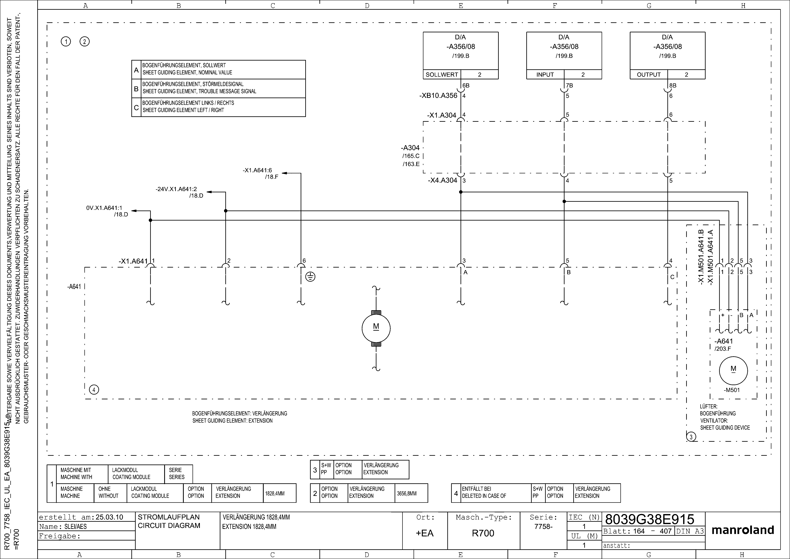

# +EA — Sheet 164 of 407 — VERLÄNGERUNG 1828,4MM

**EXTENSION 1828,4MM**

> Part of the manroland **R700** printing press IEC/UL circuit diagrams.
> Drawing class: **Stromlaufplan / Circuit diagram** (DIN A3).
> Document `+EA` covers the **Printing unit** machine section.

## At a glance

| Field | Value |
|---|---|
| Document | `+EA`  (8039G38E915) |
| Sheet | **164** of 407 |
| Section (DE) | VERLÄNGERUNG 1828,4MM |
| Section (EN) | EXTENSION 1828,4MM |
| Section type | CIRCUIT — Circuit diagram |
| Machine type | `R700` |
| Series | `7758` |
| Created | 25.03.10 |
| Replaces | — |
| Columns used | A, B, C, D, E, F, G, H |
| Path numbers | — |
| Labels on sheet | 127 |
| Cross-refs out | 9 |
| Cross-refs in | 32 |

**Previous:** [+EA sheet 163](SHEET_0163.md) · **Next:** [+EA sheet 165](SHEET_0165.md) · **Document TOC:** [_TOC.md](_TOC.md)  (+EA) · **Master TOC:** [all sheets](../_MASTER_TOC.md)

## Sheet image (300 DPI, exact vector render)



_Rendered directly from the PDF vector layer at 300 DPI (1-bit), no OCR and no resampling. Use it to confirm anything ambiguous in the text below._

## Cross-references on this sheet

Each entry is a wire leaving this sheet. The printed token is `/sheet.column`; the link resolves to that sheet inside the same document.

| Ref | Target sheet | Col | Path | Destination on target | Target section | From col |
|---|---|---|---|---|---|---|
| `/199.B` | [+EA sheet 199](SHEET_0199.md) | B | — | — | REFERENZMODUL | E |
| `/199.B` | [+EA sheet 199](SHEET_0199.md) | B | — | — | REFERENZMODUL | F |
| `/199.B` | [+EA sheet 199](SHEET_0199.md) | B | — | — | REFERENZMODUL | G |
| `/165.C` | [+EA sheet 165](SHEET_0165.md) | C | — | — | VERLÄNGERUNG 1828,4MM | D |
| `/163.E` | [+EA sheet 163](SHEET_0163.md) | E | — | — | VERLÄNGERUNG 1828,4MM | D |
| `/18.F` | [+EA sheet 18](SHEET_0018.md) | F | — | X1.A641:6 X4.A304 3 4 5 | SPANNUNGSVERSORGUNG: 400V, 24V | E |
| `/18.D` | [+EA sheet 18](SHEET_0018.md) | D | — | 24V.X1.A641:2 | SPANNUNGSVERSORGUNG: 400V, 24V | B |
| `/18.D` | [+EA sheet 18](SHEET_0018.md) | D | — | 0V.X1.A641:1 | SPANNUNGSVERSORGUNG: 400V, 24V | A |
| `/203.F` | [+EA sheet 203](SHEET_0203.md) | F | — | A641 | REFERENZMODUL | H |

### Incoming references (sheets that point here)

Every other sheet that sends a wire to this one. `Back-ref` is the token printed on *that* sheet; `Path` is its line number.

| From sheet | Cols | Back-ref | Path | Refs | What continues there |
|---|---|---|---|---|---|
| [+EA#18](SHEET_0018.md) | D, F | `/18.D`, `/18.F` | — | 3 | 0V.X1.A641:1 |
| [+EA#163](SHEET_0163.md) | D | `/163.D` | — | 1 | — |
| [+EA#165](SHEET_0165.md) | C | `/165.C` | — | 1 | — |
| [+EA#199](SHEET_0199.md) | B | `/199.B` | — | 3 | — |
| [+EA#203](SHEET_0203.md) | F | `/203.F` | — | 1 | — |
| [+EA#208](SHEET_0208.md) | C | `/208.C` | — | 3 | — |
| [+EA#213](SHEET_0213.md) | F | `/213.F` | — | 6 | — |
| [+EA#219](SHEET_0219.md) | G | `/219.G` | — | 8 | — |
| [+EA#236](SHEET_0236.md) | E | `/236.E` | — | 3 | — |
| [+EA#254](SHEET_0254.md) | E | `/254.E` | — | 3 | — |


## Devices on this sheet

| Tag | Class | Class meaning (IEC) | Col | Sub | Terminal | Sign |
|---|---|---|---|---|---|---|
| `A356/08` | A | Baugruppe / assembly, module, PC board | E | 08 | — | — |
| `A356/08` | A | Baugruppe / assembly, module, PC board | G | 08 | — | — |
| `A356/08` | A | Baugruppe / assembly, module, PC board | F | 08 | — | — |
| `A641` | A | Baugruppe / assembly, module, PC board | H | — | — | — |
| `A304` | A | Baugruppe / assembly, module, PC board | D | — | — | — |
| `A641` | A | Baugruppe / assembly, module, PC board | A | — | — | — |
| `X1.A641` | — | cross-device reference | B | — | — | — |
| `XB10.A356` | — | cross-device reference | E | — | — | — |
| `X1.M501.A641.B` | — | cross-device reference | H | — | — | — |
| `X1.M501.A641.A` | — | cross-device reference | H | — | — | — |
| `X1.A304` | — | cross-device reference | E | — | — | — |
| `X4.A304` | — | cross-device reference | E | — | — | — |
| `X1.A641:6` | — | cross-device reference | C | — | 6 | — |

## Potentials / nets

| Potential | Count | Columns | Attached devices | Terminals |
|---|---|---|---|---|
| `0V` | 1 | A | `A641`, `X1` | `1` |
| `24V` | 1 | B | `A641`, `X1` | `2` |
| `M501` | 1 | H | — | — |


A potential such as `L24+/4` or `M24+` is a named supply/return rail; every place it appears on this sheet is electrically common.

## Wire-end annotations (grouped as printed)

A wire that continues elsewhere is annotated with a small cluster: the destination description, the path/line number `#NN`, and the `/sheet.column` cross reference. Each row below is one such cluster exactly as it is grouped on the drawing.

| Col | Y | Path | Cross-ref | Text on the wire |
|---|---|---|---|---|
| E | 51.6 | — | — | `D/A` |
| F | 51.6 | — | — | `D/A` |
| G | 51.6 | — | — | `D/A` |
| A | 59.3 | — | — | `1 2` |
| E | 65.5 | — | — | `A356/08` |
| F | 65.5 | — | — | `A356/08` |
| G | 65.5 | — | — | `A356/08` |
| E | 80.3 | — | `/199.B` | — |
| F | 80.3 | — | `/199.B` | — |
| G | 80.3 | — | `/199.B` | — |
| B | 95.6 | — | — | `BOGENFÜHRUNGSELEMENT, SOLLWERT` |
| B | 100.9 | — | — | `A SHEET GUIDING ELEMENT, NOMINAL VALUE` |
| E | 108.7 | — | — | `SOLLWERT 2` |
| F | 108.7 | — | — | `INPUT 2` |
| G | 108.7 | — | — | `OUTPUT 2` |
| B | 124.0 | — | — | `BOGENFÜHRUNGSELEMENT, STÖRMELDESIGNAL` |
| E | 125.0 | — | — | `6B` |
| F | 125.0 | — | — | `7B` |
| G | 125.0 | — | — | `8B` |
| B | 129.3 | — | — | `B SHEET GUIDING ELEMENT, TROUBLE MESSAGE SIGNAL` |
| E | 139.2 | — | — | `XB10.A356 4` |
| F | 140.6 | — | — | `5` |
| G | 140.6 | — | — | `6` |
| B | 152.3 | — | — | `BOGENFÜHRUNGSELEMENT LINKS / RECHTS` |
| B | 157.6 | — | — | `C SHEET GUIDING ELEMENT LEFT / RIGHT` |
| E | 169.0 | — | — | `X1.A304 4` |
| G | 169.0 | — | — | `5 6` |
| D | 217.9 | — | — | `A304` |
| D | 231.0 | — | `/165.C` | — |
| D | 243.3 | — | `/163.E` | — |
| E | 252.6 | — | `/18.F` | `X1.A641:6 X4.A304 3 4 5` |
| B | 280.9 | — | `/18.D` | `24V.X1.A641:2` |
| A | 309.2 | — | `/18.D` | `0V.X1.A641:1` |
| H | 345.3 | — | — | `X1.M501.A641.B` |
| H | 346.1 | — | — | `X1.M501.A641.A` |
| B | 388.7 | — | — | `X1.A641 1 2 6` |
| E | 388.7 | — | — | `3` |
| F | 388.7 | — | — | `5` |
| G | 388.7 | — | — | `4` |
| H | 388.7 | — | — | `1` |
| H | 388.7 | — | — | `2 5 3` |
| H | 405.7 | — | — | `1` |
| H | 405.7 | — | — | `2 5 3` |
| F | 406.3 | — | — | `A B` |
| G | 413.5 | — | — | `C` |
| A | 428.1 | — | — | `A641` |
| H | 470.8 | — | — | `+ B A` |
| D | 486.2 | — | — | `M` |
| H | 509.1 | — | `/203.F` | `A641` |
| H | 550.2 | — | — | `M` |
| H | 583.6 | — | — | `M501` |
| A | 584.2 | — | — | `4` |
| H | 609.3 | — | — | `LÜFTER: BOGENFÜHRUNG` |
| C | 620.0 | — | — | `BOGENFÜHRUNGSELEMENT: VERLÄNGERUNG` |
| C | 630.6 | — | — | `SHEET GUIDING ELEMENT: EXTENSION` |
| H | 630.6 | — | — | `SHEET GUIDING DEVICE VENTILATOR:` |
| G | 655.1 | — | — | `3` |
| D | 697.8 | — | — | `3 PP S+W OPTION OPTION` |
| D | 698.0 | — | — | `EXTENSION VERLÄNGERUNG` |
| A | 705.0 | — | — | `MASCHINE MIT MACHINE WITH` |
| A | 705.0 | — | — | `LACKMODUL` |
| B | 705.0 | — | — | `SERIE SERIES` |
| A | 715.7 | — | — | `COATING MODULE` |
| A | 724.5 | — | — | `1` |
| F | 733.2 | — | — | `PP S+W` |
| A | 733.4 | — | — | `MASCHINE MACHINE` |
| A | 733.4 | — | — | `OHNE WITHOUT` |
| B | 733.4 | — | — | `LACKMODUL` |
| B | 733.4 | — | — | `OPTION OPTION` |
| C | 733.4 | — | — | `EXTENSION VERLÄNGERUNG` |
| C | 733.4 | — | — | `1828,4MM 2 OPTION OPTION` |
| D | 733.4 | — | — | `EXTENSION VERLÄNGERUNG 3656,8MM` |
| F | 733.4 | — | — | `4 ENTFÄLLT BEI DELETED IN CASE OF EXTENSION VERLÄNGERUNG` |
| F | 733.4 | — | — | `OPTION OPTION` |
| B | 744.0 | — | — | `COATING MODULE` |


## Reconstructed tables

This sheet carries tabular content (pin map / terminal assignment / index). The grid below was rebuilt from the drawing's own rule lines, so each row is exactly one physical row of the table.

### Table 1 — 3 data rows × 2 columns (at x=637.8, y=48.2)

| D/A | A356/08 /199.B |
|---|---|
| `SOLLWERT` | `2` |
| `XB10.A356 X1.A304 X4.A304` | `6B 4 4 3` |
|  | `3 A` |


### Table 2 — 3 data rows × 2 columns (at x=793.7, y=48.2)

| D/A | A356/08 /199.B |
|---|---|
| `INPUT` | `2` |
|  | `7B 5 5 4` |
|  | `5 B` |


### Table 3 — 3 data rows × 2 columns (at x=949.6, y=48.2)

| D/A | A356/08 /199.B |
|---|---|
| `OUTPUT` | `2` |
|  | `8B 6 6 5` |
|  | `X1.M501.A641.B 4 C` |


### Table 4 — 1 data rows × 5 columns (at x=1070.1, y=48.2)

| X1.M501.A641.A | 1 1 | 2 2 | 5 5 | 3 3 |
|---|---|---|---|---|
|  | `+ A641 /203.F` | `M M501` | `B` | `A` |


## Notes and free text on this sheet

| Text | Col | Y (pt) |
|---|---|---|
| `M` | D | 486.22 |
| `6B` | E | 124.99 |
| `D/A` | E | 51.61 |
| `SOLLWERT` | E | 108.65 |
| `8B` | G | 124.99 |
| `D/A` | G | 51.61 |
| `OUTPUT` | G | 108.71 |
| `7B` | F | 124.99 |
| `D/A` | F | 51.61 |
| `INPUT` | F | 108.7 |
| `M` | H | 550.25 |
| `LÜFTER:` | H | 609.33 |
| `BOGENFÜHRUNG` | H | 620.01 |
| `VENTILATOR:` | H | 630.62 |
| `SHEET GUIDING DEVICE` | H | 641.26 |
| `B` | H | 470.78 |
| `A` | H | 470.78 |
| `MASCHINE MIT` | A | 705.04 |
| `MACHINE WITH` | A | 715.63 |
| `MASCHINE` | A | 733.38 |
| `MACHINE` | A | 744.02 |
| `OHNE` | A | 733.37 |
| `WITHOUT` | A | 743.97 |
| `LACKMODUL` | A | 705.05 |
| `COATING MODULE` | A | 715.69 |
| `SERIE` | B | 704.98 |
| `SERIES` | B | 715.62 |
| `LACKMODUL` | B | 733.4 |
| `COATING MODULE` | B | 744.03 |
| `OPTION` | B | 733.35 |
| `VERLÄNGERUNG` | C | 733.4 |
| `EXTENSION` | C | 743.98 |
| `1828,4MM` | C | 740.49 |
| `OPTION` | D | 733.35 |
| `VERLÄNGERUNG` | D | 733.4 |
| `EXTENSION` | D | 743.98 |
| `3656,8MM` | D | 740.51 |
| `BOGENFÜHRUNGSELEMENT: VERLÄNGERUNG` | C | 620.01 |
| `SHEET GUIDING ELEMENT: EXTENSION` | C | 630.63 |
| `S+W` | D | 697.81 |
| `PP` | D | 708.44 |
| `S+W` | F | 733.24 |
| `PP` | F | 743.87 |
| `OPTION` | F | 733.35 |
| `VERLÄNGERUNG` | F | 733.4 |
| `EXTENSION` | F | 743.98 |
| `ENTFÄLLT BEI` | E | 733.35 |
| `DELETED IN CASE OF` | E | 744 |
| `A` | E | 406.29 |
| `B` | F | 406.29 |
| `C` | G | 413.49 |
| `BOGENFÜHRUNGSELEMENT, SOLLWERT` | B | 95.59 |
| `SHEET GUIDING ELEMENT, NOMINAL VALUE` | B | 106.23 |
| `A` | B | 100.93 |
| `BOGENFÜHRUNGSELEMENT, STÖRMELDESIGNAL` | B | 123.95 |
| `SHEET GUIDING ELEMENT, TROUBLE MESSAGE SIGNAL` | B | 134.57 |
| `B` | B | 129.28 |
| `BOGENFÜHRUNGSELEMENT LINKS / RECHTS` | B | 152.29 |
| `SHEET GUIDING ELEMENT LEFT / RIGHT` | B | 162.92 |
| `C` | B | 157.63 |

## Complete label inventory (exact text from the drawing)

Every text object inside the drawing area of this sheet, in DIN reading order (column A→H, then top→bottom). This is the authoritative list: if a string is not here it is not printed on this sheet.

| Col | Y | X | Dir | Type | Text |
|---|---|---|---|---|---|
| A | 59.3 | 97.5 | → | number | `1` |
| A | 59.8 | 125.6 | → | number | `2` |
| A | 309.2 | 130.1 | → | potential | `0V.X1.A641:1` |
| A | 319.2 | 172.1 | → | cross-reference | `/18.D` |
| A | 428.1 | 101.7 | → | device tag | `A641` |
| A | 584.2 | 139.7 | → | number | `4` |
| A | 705.0 | 91.6 | → | text | `MASCHINE MIT` |
| A | 705.1 | 169.2 | → | text | `LACKMODUL` |
| A | 715.6 | 91.6 | → | text | `MACHINE WITH` |
| A | 715.7 | 169.8 | → | text | `COATING MODULE` |
| A | 724.5 | 75.4 | → | number | `1` |
| A | 733.4 | 91.6 | → | text | `MASCHINE` |
| A | 733.4 | 148.5 | → | text | `OHNE` |
| A | 744.0 | 91.6 | → | text | `MACHINE` |
| A | 744.0 | 148.8 | → | text | `WITHOUT` |
| B | 95.6 | 214.6 | → | text | `BOGENFÜHRUNGSELEMENT, SOLLWERT` |
| B | 100.9 | 202.0 | → | text | `A` |
| B | 106.2 | 215.1 | → | text | `SHEET GUIDING ELEMENT, NOMINAL VALUE` |
| B | 123.9 | 214.6 | → | text | `BOGENFÜHRUNGSELEMENT, STÖRMELDESIGNAL` |
| B | 129.3 | 201.8 | → | text | `B` |
| B | 134.6 | 215.1 | → | text | `SHEET GUIDING ELEMENT, TROUBLE MESSAGE SIGNAL` |
| B | 152.3 | 214.6 | → | text | `BOGENFÜHRUNGSELEMENT LINKS / RECHTS` |
| B | 157.6 | 201.7 | → | text | `C` |
| B | 162.9 | 215.1 | → | text | `SHEET GUIDING ELEMENT LEFT / RIGHT` |
| B | 280.9 | 234.7 | → | potential | `24V.X1.A641:2` |
| B | 290.8 | 285.4 | → | cross-reference | `/18.D` |
| B | 388.7 | 178.9 | → | device ref | `X1.A641` |
| B | 388.7 | 228.8 | → | number | `1` |
| B | 705.0 | 254.8 | → | text | `SERIE` |
| B | 715.6 | 254.8 | → | text | `SERIES` |
| B | 733.4 | 197.6 | → | text | `LACKMODUL` |
| B | 733.4 | 283.2 | → | text | `OPTION` |
| B | 744.0 | 198.1 | → | text | `COATING MODULE` |
| B | 744.0 | 283.2 | → | text | `OPTION` |
| C | 252.6 | 366.0 | → | device ref | `X1.A641:6` |
| C | 262.5 | 399.7 | → | cross-reference | `/18.F` |
| C | 388.7 | 342.7 | → | number | `2` |
| C | 388.7 | 456.1 | → | number | `6` |
| C | 620.0 | 289.7 | → | text | `BOGENFÜHRUNGSELEMENT: VERLÄNGERUNG` |
| C | 630.6 | 290.3 | → | text | `SHEET GUIDING ELEMENT: EXTENSION` |
| C | 703.3 | 471.8 | → | number | `3` |
| C | 733.4 | 326.0 | → | text | `VERLÄNGERUNG` |
| C | 738.7 | 472.0 | → | number | `2` |
| C | 740.5 | 399.5 | → | text | `1828,4MM` |
| C | 744.0 | 325.1 | → | text | `EXTENSION` |
| D | 217.9 | 604.3 | → | device tag | `A304` |
| D | 231.0 | 606.6 | → | cross-reference | `/165.C` |
| D | 243.3 | 607.2 | → | cross-reference | `/163.E` |
| D | 486.2 | 562.3 | → | text | `M` |
| D | 697.8 | 484.4 | → | text | `S+W` |
| D | 697.9 | 505.7 | → | text | `OPTION` |
| D | 698.0 | 548.5 | → | text | `VERLÄNGERUNG` |
| D | 708.4 | 483.9 | → | text | `PP` |
| D | 708.5 | 547.7 | → | text | `EXTENSION` |
| D | 708.6 | 505.7 | → | text | `OPTION` |
| D | 733.4 | 484.4 | → | text | `OPTION` |
| D | 733.4 | 527.2 | → | text | `VERLÄNGERUNG` |
| D | 740.5 | 598.5 | → | text | `3656,8MM` |
| D | 744.0 | 484.4 | → | text | `OPTION` |
| D | 744.0 | 526.4 | → | text | `EXTENSION` |
| E | 51.6 | 685.7 | → | text | `D/A` |
| E | 65.5 | 673.1 | → | device tag | `A356/08` |
| E | 80.3 | 681.9 | → | cross-reference | `/199.B` |
| E | 108.7 | 641.6 | → | text | `SOLLWERT` |
| E | 108.7 | 720.6 | → | number | `2` |
| E | 125.0 | 697.0 | → | text | `6B` |
| E | 139.2 | 632.1 | → | device ref | `XB10.A356` |
| E | 140.6 | 697.0 | → | number | `4` |
| E | 169.0 | 643.7 | → | device ref | `X1.A304` |
| E | 169.0 | 697.0 | → | number | `4` |
| E | 266.8 | 645.2 | → | device ref | `X4.A304` |
| E | 268.2 | 697.0 | → | number | `3` |
| E | 388.7 | 697.0 | → | number | `3` |
| E | 406.3 | 698.6 | → | text | `A` |
| E | 733.3 | 696.5 | → | text | `ENTFÄLLT BEI` |
| E | 738.7 | 684.6 | → | number | `4` |
| E | 744.0 | 696.5 | → | text | `DELETED IN CASE OF` |
| F | 51.6 | 841.6 | → | text | `D/A` |
| F | 65.5 | 829.0 | → | device tag | `A356/08` |
| F | 80.3 | 837.8 | → | cross-reference | `/199.B` |
| F | 108.7 | 808.6 | → | text | `INPUT` |
| F | 108.7 | 876.5 | → | number | `2` |
| F | 125.0 | 852.9 | → | text | `7B` |
| F | 140.6 | 852.9 | → | number | `5` |
| F | 169.0 | 852.9 | → | number | `5` |
| F | 268.2 | 852.9 | → | number | `4` |
| F | 388.7 | 852.9 | → | number | `5` |
| F | 406.3 | 854.2 | → | text | `B` |
| F | 733.2 | 803.3 | → | text | `S+W` |
| F | 733.4 | 824.6 | → | text | `OPTION` |
| F | 733.4 | 867.4 | → | text | `VERLÄNGERUNG` |
| F | 743.9 | 802.8 | → | text | `PP` |
| F | 744.0 | 824.6 | → | text | `OPTION` |
| F | 744.0 | 866.6 | → | text | `EXTENSION` |
| G | 51.6 | 997.5 | → | text | `D/A` |
| G | 65.5 | 984.9 | → | device tag | `A356/08` |
| G | 80.3 | 993.7 | → | cross-reference | `/199.B` |
| G | 108.7 | 960.0 | → | text | `OUTPUT` |
| G | 108.7 | 1032.4 | → | number | `2` |
| G | 125.0 | 1008.9 | → | text | `8B` |
| G | 140.6 | 1008.9 | → | number | `6` |
| G | 169.0 | 1008.9 | → | number | `6` |
| G | 268.2 | 1008.9 | → | number | `5` |
| G | 388.7 | 1008.9 | → | number | `4` |
| G | 413.5 | 1010.3 | → | text | `C` |
| G | 655.1 | 1039.7 | → | number | `3` |
| H | 345.3 | 1052.0 | ↕ | device ref | `X1.M501.A641.B` |
| H | 346.1 | 1066.1 | ↕ | device ref | `X1.M501.A641.A` |
| H | 388.7 | 1086.2 | → | number | `1` |
| H | 388.7 | 1101.0 | → | number | `2` |
| H | 388.7 | 1115.1 | → | number | `5` |
| H | 388.7 | 1129.3 | → | number | `3` |
| H | 405.7 | 1086.2 | → | number | `1` |
| H | 405.7 | 1101.0 | → | number | `2` |
| H | 405.7 | 1115.1 | → | number | `5` |
| H | 405.7 | 1129.3 | → | number | `3` |
| H | 470.8 | 1086.8 | → | number | `+` |
| H | 470.8 | 1114.6 | → | text | `B` |
| H | 470.8 | 1129.6 | → | text | `A` |
| H | 509.1 | 1076.9 | → | device tag | `A641` |
| H | 521.5 | 1077.2 | → | cross-reference | `/203.F` |
| H | 550.3 | 1101.1 | → | text | `M` |
| H | 583.6 | 1091.1 | → | potential | `M501` |
| H | 609.3 | 1055.1 | → | text | `LÜFTER:` |
| H | 620.0 | 1055.1 | → | text | `BOGENFÜHRUNG` |
| H | 630.6 | 1055.9 | → | text | `VENTILATOR:` |
| H | 641.3 | 1055.6 | → | text | `SHEET GUIDING DEVICE` |

## Reading-order text block

The same content as a plain block, grouped by DIN column — convenient to paste or to match against a visual description.

```text
=== Column A ===
  59.3   97.5  numeric      1
  59.8  125.6  numeric      2
 309.2  130.1  net          0V.X1.A641:1
 319.2  172.1  xref         /18.D
 428.1  101.7  devtag       A641
 584.2  139.7  numeric      4
 705.0   91.6  text         MASCHINE MIT
 705.1  169.2  text         LACKMODUL
 715.6   91.6  text         MACHINE WITH
 715.7  169.8  text         COATING MODULE
 724.5   75.4  numeric      1
 733.4   91.6  text         MASCHINE
 733.4  148.5  text         OHNE
 744.0   91.6  text         MACHINE
 744.0  148.8  text         WITHOUT
=== Column B ===
  95.6  214.6  text         BOGENFÜHRUNGSELEMENT, SOLLWERT
 100.9  202.0  text         A
 106.2  215.1  text         SHEET GUIDING ELEMENT, NOMINAL VALUE
 123.9  214.6  text         BOGENFÜHRUNGSELEMENT, STÖRMELDESIGNAL
 129.3  201.8  text         B
 134.6  215.1  text         SHEET GUIDING ELEMENT, TROUBLE MESSAGE SIGNAL
 152.3  214.6  text         BOGENFÜHRUNGSELEMENT LINKS / RECHTS
 157.6  201.7  text         C
 162.9  215.1  text         SHEET GUIDING ELEMENT LEFT / RIGHT
 280.9  234.7  net          24V.X1.A641:2
 290.8  285.4  xref         /18.D
 388.7  178.9  devref       X1.A641
 388.7  228.8  numeric      1
 705.0  254.8  text         SERIE
 715.6  254.8  text         SERIES
 733.4  197.6  text         LACKMODUL
 733.4  283.2  text         OPTION
 744.0  198.1  text         COATING MODULE
 744.0  283.2  text         OPTION
=== Column C ===
 252.6  366.0  devref       X1.A641:6
 262.5  399.7  xref         /18.F
 388.7  342.7  numeric      2
 388.7  456.1  numeric      6
 620.0  289.7  text         BOGENFÜHRUNGSELEMENT: VERLÄNGERUNG
 630.6  290.3  text         SHEET GUIDING ELEMENT: EXTENSION
 703.3  471.8  numeric      3
 733.4  326.0  text         VERLÄNGERUNG
 738.7  472.0  numeric      2
 740.5  399.5  text         1828,4MM
 744.0  325.1  text         EXTENSION
=== Column D ===
 217.9  604.3  devtag       A304
 231.0  606.6  xref         /165.C
 243.3  607.2  xref         /163.E
 486.2  562.3  text         M
 697.8  484.4  text         S+W
 697.9  505.7  text         OPTION
 698.0  548.5  text         VERLÄNGERUNG
 708.4  483.9  text         PP
 708.5  547.7  text         EXTENSION
 708.6  505.7  text         OPTION
 733.4  484.4  text         OPTION
 733.4  527.2  text         VERLÄNGERUNG
 740.5  598.5  text         3656,8MM
 744.0  484.4  text         OPTION
 744.0  526.4  text         EXTENSION
=== Column E ===
  51.6  685.7  text         D/A
  65.5  673.1  devtag       A356/08
  80.3  681.9  xref         /199.B
 108.7  641.6  text         SOLLWERT
 108.7  720.6  numeric      2
 125.0  697.0  text         6B
 139.2  632.1  devref       XB10.A356
 140.6  697.0  numeric      4
 169.0  643.7  devref       X1.A304
 169.0  697.0  numeric      4
 266.8  645.2  devref       X4.A304
 268.2  697.0  numeric      3
 388.7  697.0  numeric      3
 406.3  698.6  text         A
 733.3  696.5  text         ENTFÄLLT BEI
 738.7  684.6  numeric      4
 744.0  696.5  text         DELETED IN CASE OF
=== Column F ===
  51.6  841.6  text         D/A
  65.5  829.0  devtag       A356/08
  80.3  837.8  xref         /199.B
 108.7  808.6  text         INPUT
 108.7  876.5  numeric      2
 125.0  852.9  text         7B
 140.6  852.9  numeric      5
 169.0  852.9  numeric      5
 268.2  852.9  numeric      4
 388.7  852.9  numeric      5
 406.3  854.2  text         B
 733.2  803.3  text         S+W
 733.4  824.6  text         OPTION
 733.4  867.4  text         VERLÄNGERUNG
 743.9  802.8  text         PP
 744.0  824.6  text         OPTION
 744.0  866.6  text         EXTENSION
=== Column G ===
  51.6  997.5  text         D/A
  65.5  984.9  devtag       A356/08
  80.3  993.7  xref         /199.B
 108.7  960.0  text         OUTPUT
 108.7 1032.4  numeric      2
 125.0 1008.9  text         8B
 140.6 1008.9  numeric      6
 169.0 1008.9  numeric      6
 268.2 1008.9  numeric      5
 388.7 1008.9  numeric      4
 413.5 1010.3  text         C
 655.1 1039.7  numeric      3
=== Column H ===
 345.3 1052.0  devref       X1.M501.A641.B
 346.1 1066.1  devref       X1.M501.A641.A
 388.7 1086.2  numeric      1
 388.7 1101.0  numeric      2
 388.7 1115.1  numeric      5
 388.7 1129.3  numeric      3
 405.7 1086.2  numeric      1
 405.7 1101.0  numeric      2
 405.7 1115.1  numeric      5
 405.7 1129.3  numeric      3
 470.8 1086.8  numeric      +
 470.8 1114.6  text         B
 470.8 1129.6  text         A
 509.1 1076.9  devtag       A641
 521.5 1077.2  xref         /203.F
 550.3 1101.1  text         M
 583.6 1091.1  net          M501
 609.3 1055.1  text         LÜFTER:
 620.0 1055.1  text         BOGENFÜHRUNG
 630.6 1055.9  text         VENTILATOR:
 641.3 1055.6  text         SHEET GUIDING DEVICE
```

---
_Generated from the PDF vector text layer; no OCR. Source: `R700_7758_IEC_UL_EA_8039G38E915_p`, sheet 164._
