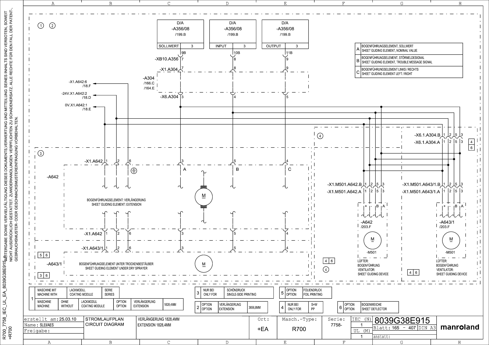

# +EA — Sheet 165 of 407 — VERLÄNGERUNG 1828,4MM

**EXTENSION 1828,4MM**

> Part of the manroland **R700** printing press IEC/UL circuit diagrams.
> Drawing class: **Stromlaufplan / Circuit diagram** (DIN A3).
> Document `+EA` covers the **Printing unit** machine section.

## At a glance

| Field | Value |
|---|---|
| Document | `+EA`  (8039G38E915) |
| Sheet | **165** of 407 |
| Section (DE) | VERLÄNGERUNG 1828,4MM |
| Section (EN) | EXTENSION 1828,4MM |
| Section type | CIRCUIT — Circuit diagram |
| Machine type | `R700` |
| Series | `7758` |
| Created | 25.03.10 |
| Replaces | — |
| Columns used | A, B, C, D, E, F, G, H |
| Path numbers | — |
| Labels on sheet | 191 |
| Cross-refs out | 10 |
| Cross-refs in | 55 |

**Previous:** [+EA sheet 164](SHEET_0164.md) · **Next:** [+EA sheet 166](SHEET_0166.md) · **Document TOC:** [_TOC.md](_TOC.md)  (+EA) · **Master TOC:** [all sheets](../_MASTER_TOC.md)

## Sheet image (300 DPI, exact vector render)



_Rendered directly from the PDF vector layer at 300 DPI (1-bit), no OCR and no resampling. Use it to confirm anything ambiguous in the text below._

## Cross-references on this sheet

Each entry is a wire leaving this sheet. The printed token is `/sheet.column`; the link resolves to that sheet inside the same document.

| Ref | Target sheet | Col | Path | Destination on target | Target section | From col |
|---|---|---|---|---|---|---|
| `/199.B` | [+EA sheet 199](SHEET_0199.md) | B | — | — | REFERENZMODUL | C |
| `/199.B` | [+EA sheet 199](SHEET_0199.md) | B | — | — | REFERENZMODUL | D |
| `/199.B` | [+EA sheet 199](SHEET_0199.md) | B | — | — | REFERENZMODUL | E |
| `/18.F` | [+EA sheet 18](SHEET_0018.md) | F | — | X1.A642:6 | SPANNUNGSVERSORGUNG: 400V, 24V | A |
| `/166.C` | [+EA sheet 166](SHEET_0166.md) | C | — | — | VERLÄNGERUNG 1828,4MM | C |
| `/164.E` | [+EA sheet 164](SHEET_0164.md) | E | — | — | VERLÄNGERUNG 1828,4MM | C |
| `/18.D` | [+EA sheet 18](SHEET_0018.md) | D | — | 24V.X1.A642:2 | SPANNUNGSVERSORGUNG: 400V, 24V | A |
| `/18.E` | [+EA sheet 18](SHEET_0018.md) | E | — | 0V.X1.A642:1 | SPANNUNGSVERSORGUNG: 400V, 24V | A |
| `/203.F` | [+EA sheet 203](SHEET_0203.md) | F | — | A642 | REFERENZMODUL | F |
| `/203.F` | [+EA sheet 203](SHEET_0203.md) | F | — | A643/1 | REFERENZMODUL | H |

### Incoming references (sheets that point here)

Every other sheet that sends a wire to this one. `Back-ref` is the token printed on *that* sheet; `Path` is its line number.

| From sheet | Cols | Back-ref | Path | Refs | What continues there |
|---|---|---|---|---|---|
| [+EA#18](SHEET_0018.md) | D, E, F | `/18.D`, `/18.E`, `/18.F` | — | 3 | 0V.X1.A642:1; X1.A642:6 |
| [+EA#164](SHEET_0164.md) | D | `/164.D` | — | 1 | — |
| [+EA#166](SHEET_0166.md) | C | `/166.C` | — | 1 | — |
| [+EA#199](SHEET_0199.md) | B | `/199.B` | — | 3 | — |
| [+EA#203](SHEET_0203.md) | F | `/203.F` | — | 2 | — |
| [+EA#208](SHEET_0208.md) | C | `/208.C` | — | 3 | — |
| [+EA#213](SHEET_0213.md) | G, H | `/213.G`, `/213.H` | — | 12 | — |
| [+EA#219](SHEET_0219.md) | H | `/219.H` | — | 8 | — |
| [+EA#220](SHEET_0220.md) | B | `/220.B` | — | 8 | — |
| [+EA#244](SHEET_0244.md) | C, E | `/244.C`, `/244.E` | — | 11 | — |
| [+EA#254](SHEET_0254.md) | E | `/254.E` | — | 3 | — |


## Devices on this sheet

| Tag | Class | Class meaning (IEC) | Col | Sub | Terminal | Sign |
|---|---|---|---|---|---|---|
| `A356/08` | A | Baugruppe / assembly, module, PC board | C | 08 | — | — |
| `A356/08` | A | Baugruppe / assembly, module, PC board | D | 08 | — | — |
| `A356/08` | A | Baugruppe / assembly, module, PC board | E | 08 | — | — |
| `A304` | A | Baugruppe / assembly, module, PC board | C | — | — | — |
| `A642` | A | Baugruppe / assembly, module, PC board | F | — | — | — |
| `A643/1` | A | Baugruppe / assembly, module, PC board | H | 1 | — | — |
| `A642` | A | Baugruppe / assembly, module, PC board | A | — | — | — |
| `A643/1` | A | Baugruppe / assembly, module, PC board | A | 1 | — | — |
| `XB10.A356` | — | cross-device reference | C | — | — | — |
| `X1.A642` | — | cross-device reference | B | — | — | — |
| `X1.A304` | — | cross-device reference | C | — | — | — |
| `X6.A304` | — | cross-device reference | C | — | — | — |
| `X1.M501.A642.B` | — | cross-device reference | F | — | — | — |
| `X1.M501.A642.A` | — | cross-device reference | F | — | — | — |
| `X6.1.A304.B` | — | cross-device reference | G | — | — | — |
| `X6.1.A304.A` | — | cross-device reference | G | — | — | — |
| `X1.A642:6` | — | cross-device reference | A | — | 6 | — |
| `X1.A642` | — | cross-device reference | B | — | — | — |

## Potentials / nets

| Potential | Count | Columns | Attached devices | Terminals |
|---|---|---|---|---|
| `0V` | 1 | A | `A642`, `X1` | `1` |
| `24V` | 1 | A | `A642`, `X1` | `2` |
| `M501` | 2 | F, H | — | — |


A potential such as `L24+/4` or `M24+` is a named supply/return rail; every place it appears on this sheet is electrically common.

## Wire-end annotations (grouped as printed)

A wire that continues elsewhere is annotated with a small cluster: the destination description, the path/line number `#NN`, and the `/sheet.column` cross reference. Each row below is one such cluster exactly as it is grouped on the drawing.

| Col | Y | Path | Cross-ref | Text on the wire |
|---|---|---|---|---|
| C | 51.6 | — | — | `D/A` |
| D | 51.6 | — | — | `D/A` |
| E | 51.6 | — | — | `D/A` |
| A | 59.3 | — | — | `1 2` |
| C | 65.5 | — | — | `A356/08` |
| D | 65.5 | — | — | `A356/08` |
| E | 65.5 | — | — | `A356/08` |
| C | 80.3 | — | `/199.B` | — |
| D | 80.3 | — | `/199.B` | — |
| E | 80.3 | — | `/199.B` | — |
| C | 108.7 | — | — | `SOLLWERT 3` |
| D | 108.7 | — | — | `INPUT 3` |
| E | 108.7 | — | — | `OUTPUT 3` |
| G | 109.8 | — | — | `BOGENFÜHRUNGSELEMENT, SOLLWERT` |
| G | 115.1 | — | — | `A SHEET GUIDING ELEMENT, NOMINAL VALUE` |
| C | 125.0 | — | — | `9B` |
| D | 125.0 | — | — | `10B` |
| E | 125.0 | — | — | `11B` |
| G | 138.1 | — | — | `BOGENFÜHRUNGSELEMENT, STÖRMELDESIGNAL` |
| C | 139.2 | — | — | `XB10.A356 7` |
| D | 140.6 | — | — | `8` |
| E | 140.6 | — | — | `9` |
| G | 143.4 | — | — | `B SHEET GUIDING ELEMENT, TROUBLE MESSAGE SIGNAL` |
| C | 161.9 | — | — | `X1.A304 7` |
| E | 161.9 | — | — | `8 9` |
| G | 166.5 | — | — | `BOGENFÜHRUNGSELEMENT LINKS / RECHTS` |
| G | 171.8 | — | — | `C SHEET GUIDING ELEMENT LEFT / RIGHT` |
| C | 186.0 | — | — | `A304` |
| A | 195.9 | — | `/18.F` | `X1.A642:6` |
| C | 199.1 | — | `/166.C` | — |
| C | 211.4 | — | `/164.E` | — |
| A | 224.2 | — | `/18.D` | `24V.X1.A642:2` |
| D | 231.3 | — | — | `X6.A304 3 4 5` |
| A | 252.6 | — | `/18.E` | `0V.X1.A642:1` |
| G | 324.9 | — | — | `X6.1.A304.B 1` |
| H | 324.9 | — | — | `2` |
| H | 324.9 | — | — | `5` |
| H | 324.9 | — | — | `3` |
| F | 329.1 | — | — | `4` |
| G | 341.9 | — | — | `X6.1.A304.A 1` |
| H | 341.9 | — | — | `2` |
| H | 341.9 | — | — | `5` |
| H | 341.9 | — | — | `3` |
| H | 342.6 | — | — | `4` |
| H | 356.8 | — | — | `6` |
| A | 371.6 | — | — | `3` |
| B | 388.7 | — | — | `X1.A642 1` |
| B | 388.7 | — | — | `2` |
| B | 388.7 | — | — | `6` |
| C | 388.7 | — | — | `3` |
| D | 388.7 | — | — | `5` |
| E | 388.7 | — | — | `4` |
| D | 408.5 | — | — | `A B C` |
| A | 426.9 | — | — | `A642` |
| F | 445.4 | — | — | `X1.M501.A642.B 1` |
| F | 445.4 | — | — | `2` |
| G | 445.4 | — | — | `5` |
| G | 445.4 | — | — | `3` |
| G | 445.4 | — | — | `X1.M501.A643/1.B 1` |
| H | 445.4 | — | — | `2` |
| H | 445.4 | — | — | `5` |
| H | 445.4 | — | — | `3` |
| F | 462.4 | — | — | `X1.M501.A642.A 1` |
| F | 462.4 | — | — | `2` |
| G | 462.4 | — | — | `5` |
| G | 462.4 | — | — | `3` |
| G | 462.4 | — | — | `X1.M501.A643/1.A 1` |
| H | 462.4 | — | — | `2` |
| H | 462.4 | — | — | `5` |
| H | 462.4 | — | — | `3` |
| D | 472.1 | — | — | `M` |
| B | 485.4 | — | — | `BOGENFÜHRUNGSELEMENT: VERLÄNGERUNG` |
| B | 496.0 | — | — | `SHEET GUIDING ELEMENT: EXTENSION` |
| G | 499.1 | — | — | `+ B A` |
| H | 499.1 | — | — | `+ B A` |
| F | 537.5 | — | `/203.F` | `A642` |
| H | 537.5 | — | `/203.F` | `A643/1` |
| B | 565.8 | — | — | `X1.A642` |
| B | 565.8 | — | — | `1` |
| B | 565.8 | — | — | `2` |
| B | 565.8 | — | — | `6` |
| C | 565.8 | — | — | `3` |
| D | 565.8 | — | — | `5` |
| E | 565.8 | — | — | `4` |
| F | 578.6 | — | — | `M` |
| H | 578.6 | — | — | `M` |
| B | 601.3 | — | — | `X1.A643/1 1` |
| B | 601.3 | — | — | `2` |
| B | 601.3 | — | — | `6` |
| C | 601.3 | — | — | `3` |
| D | 601.3 | — | — | `5` |
| E | 601.3 | — | — | `4` |
| F | 611.9 | — | — | `M501` |
| H | 611.9 | — | — | `M501` |
| A | 619.0 | — | — | `5 6` |
| F | 633.2 | — | — | `4 6` |
| F | 634.1 | — | — | `LÜFTER: BOGENFÜHRUNG` |
| H | 634.1 | — | — | `LÜFTER: BOGENFÜHRUNG` |
| A | 639.5 | — | — | `A643/1` |
| D | 639.8 | — | — | `M` |
| B | 641.3 | — | — | `BOGENFÜHRUNGSELEMENT UNTER TROCKENBESTÄUBER` |
| B | 651.9 | — | — | `SHEET GUIDING ELEMENT UNDER DRY SPRAYER` |
| F | 655.1 | — | — | `4` |
| G | 655.4 | — | — | `SHEET GUIDING DEVICE VENTILATOR:` |
| H | 655.4 | — | — | `SHEET GUIDING DEVICE VENTILATOR:` |
| G | 661.5 | — | — | `4 6` |
| A | 668.6 | — | — | `3 6` |
| A | 705.0 | — | — | `MASCHINE MIT MACHINE WITH` |
| A | 705.0 | — | — | `LACKMODUL` |
| B | 705.0 | — | — | `SERIE SERIES` |
| D | 705.0 | — | — | `NUR BEI` |
| E | 705.0 | — | — | `5 FOLIENDRUCK FOIL PRINTING` |
| E | 705.0 | — | — | `OPTION OPTION` |
| D | 705.1 | — | — | `3 SCHÖNDRUCK SINGLE SIDE PRINTING` |
| A | 715.7 | — | — | `COATING MODULE` |
| D | 715.7 | — | — | `ONLY FOR` |
| A | 724.5 | — | — | `1` |
| A | 733.4 | — | — | `MASCHINE MACHINE` |
| A | 733.4 | — | — | `OHNE WITHOUT` |
| B | 733.4 | — | — | `LACKMODUL` |
| B | 733.4 | — | — | `OPTION OPTION` |
| C | 733.4 | — | — | `EXTENSION VERLÄNGERUNG` |
| F | 740.3 | — | — | `4 PP S+W 6 OPTION OPTION` |
| C | 740.4 | — | — | `1828,4MM 2 OPTION OPTION` |
| E | 740.4 | — | — | `NUR BEI` |
| F | 740.4 | — | — | `BOGENWEICHE` |
| D | 740.5 | — | — | `EXTENSION VERLÄNGERUNG 3656,8MM` |
| B | 744.0 | — | — | `COATING MODULE` |
| E | 751.1 | — | — | `ONLY FOR` |
| G | 751.1 | — | — | `SHEET DEFLECTOR` |


## Reconstructed tables

This sheet carries tabular content (pin map / terminal assignment / index). The grid below was rebuilt from the drawing's own rule lines, so each row is exactly one physical row of the table.

### Table 1 — 4 data rows × 3 columns (at x=311.8, y=48.2)

|  | D/A | A356/08 /199.B |
|---|---|---|
|  | `SOLLWERT` | `3` |
| `A304 /166.C` | `XB10.A356 X1.A304` | `9B 7 7` |
| `/164.E` |  |  |
|  | `X6.A304` | `3` |


### Table 2 — 3 data rows × 2 columns (at x=510.2, y=48.2)

| D/A | A356/08 /199.B |
|---|---|
| `INPUT` | `3` |
|  | `10B 8 8` |
|  | `4` |


### Table 3 — 3 data rows × 2 columns (at x=637.8, y=48.2)

| D/A | A356/08 /199.B |
|---|---|
| `OUTPUT` | `3` |
|  | `11B 9 9` |
|  | `5` |


### Table 4 — 1 data rows × 4 columns (at x=885.8, y=260.8)

| 1 1 | 2 2 | 5 5 | 3 3 |
|---|---|---|---|
| `+ A642 /203.F` | `M M501` | `B` | `A` |


### Table 5 — 2 data rows × 1 columns (at x=978.0, y=260.8)

| C1 |
|---|
| `X6.1.A304.B X6.1.A304.A` |
| `X1.M501.A643/1.B X1.M501.A643/1.A` |


### Table 6 — 2 data rows × 4 columns (at x=1077.2, y=260.8)

| 1 1 | 2 2 | 5 5 | 3 3 |
|---|---|---|---|
| `1 1` | `2 2` | `5 5` | `3 3` |
| `+ A643/1 /203.F` | `M M501` | `B` | `A` |


## Notes and free text on this sheet

| Text | Col | Y (pt) |
|---|---|---|
| `9B` | C | 124.99 |
| `D/A` | C | 51.61 |
| `SOLLWERT` | C | 108.65 |
| `10B` | D | 125.01 |
| `D/A` | D | 51.61 |
| `INPUT` | D | 108.7 |
| `11B` | E | 125.01 |
| `D/A` | E | 51.61 |
| `OUTPUT` | E | 108.71 |
| `X1.A643/1` | B | 601.26 |
| `M` | D | 472.05 |
| `M` | F | 578.6 |
| `LÜFTER:` | F | 634.13 |
| `BOGENFÜHRUNG` | F | 644.82 |
| `VENTILATOR:` | F | 655.42 |
| `SHEET GUIDING DEVICE` | G | 666.06 |
| `B` | G | 499.12 |
| `A` | G | 499.12 |
| `M` | H | 578.6 |
| `LÜFTER:` | H | 634.13 |
| `BOGENFÜHRUNG` | H | 644.82 |
| `VENTILATOR:` | H | 655.42 |
| `SHEET GUIDING DEVICE` | H | 666.06 |
| `B` | H | 499.12 |
| `A` | H | 499.12 |
| `X1.M501.A643/1.B` | G | 445.36 |
| `X1.M501.A643/1.A` | G | 463.07 |
| `MASCHINE MIT` | A | 705.04 |
| `MACHINE WITH` | A | 715.63 |
| `MASCHINE` | A | 733.38 |
| `MACHINE` | A | 744.02 |
| `LACKMODUL` | A | 705.05 |
| `COATING MODULE` | A | 715.69 |
| `SERIE` | B | 704.98 |
| `SERIES` | B | 715.62 |
| `OHNE` | A | 733.37 |
| `WITHOUT` | A | 743.97 |
| `LACKMODUL` | B | 733.4 |
| `COATING MODULE` | B | 744.03 |
| `OPTION` | B | 733.35 |
| `VERLÄNGERUNG` | C | 733.4 |
| `EXTENSION` | C | 743.98 |
| `1828,4MM` | C | 740.49 |
| `OPTION` | D | 740.44 |
| `VERLÄNGERUNG` | D | 740.49 |
| `EXTENSION` | D | 751.06 |
| `3656,8MM` | D | 747.59 |
| `NUR BEI` | D | 704.99 |
| `ONLY FOR` | D | 715.68 |
| `SCHÖNDRUCK` | D | 705.07 |
| `SINGLE SIDE PRINTING` | D | 715.67 |
| `BOGENFÜHRUNGSELEMENT: VERLÄNGERUNG` | B | 485.37 |
| `SHEET GUIDING ELEMENT: EXTENSION` | B | 495.98 |
| `BOGENFÜHRUNGSELEMENT UNTER TROCKENBESTÄUBER` | B | 641.27 |
| `SHEET GUIDING ELEMENT UNDER DRY SPRAYER` | B | 651.9 |
| `OPTION` | E | 705.01 |
| `FOLIENDRUCK` | E | 705.05 |
| `FOIL PRINTING` | E | 715.65 |
| `NUR BEI` | E | 740.42 |
| `ONLY FOR` | E | 751.11 |
| `S+W` | E | 740.33 |
| `PP` | E | 750.96 |
| `OPTION` | F | 740.44 |
| `BOGENWEICHE` | F | 740.42 |
| `SHEET DEFLECTOR` | G | 751.11 |
| `BOGENFÜHRUNGSELEMENT, SOLLWERT` | G | 109.76 |
| `SHEET GUIDING ELEMENT, NOMINAL VALUE` | G | 120.4 |
| `A` | F | 115.1 |
| `BOGENFÜHRUNGSELEMENT, STÖRMELDESIGNAL` | G | 138.12 |
| `SHEET GUIDING ELEMENT, TROUBLE MESSAGE SIGNAL` | G | 148.74 |
| `B` | F | 143.45 |
| `BOGENFÜHRUNGSELEMENT LINKS / RECHTS` | G | 166.46 |
| `SHEET GUIDING ELEMENT LEFT / RIGHT` | G | 177.09 |
| `C` | F | 171.81 |
| `A` | C | 408.49 |
| `B` | D | 408.49 |
| `C` | E | 408.5 |

## Complete label inventory (exact text from the drawing)

Every text object inside the drawing area of this sheet, in DIN reading order (column A→H, then top→bottom). This is the authoritative list: if a string is not here it is not printed on this sheet.

| Col | Y | X | Dir | Type | Text |
|---|---|---|---|---|---|
| A | 59.3 | 97.5 | → | number | `1` |
| A | 59.8 | 125.6 | → | number | `2` |
| A | 195.9 | 167.5 | → | device ref | `X1.A642:6` |
| A | 224.2 | 149.7 | → | potential | `24V.X1.A642:2` |
| A | 252.5 | 158.5 | → | potential | `0V.X1.A642:1` |
| A | 371.6 | 97.2 | → | number | `3` |
| A | 426.9 | 114.0 | → | device tag | `A642` |
| A | 619.0 | 96.8 | → | number | `5` |
| A | 619.0 | 111.0 | → | number | `6` |
| A | 639.5 | 113.7 | → | device tag | `A643/1` |
| A | 668.6 | 96.8 | → | number | `3` |
| A | 668.6 | 111.0 | → | number | `6` |
| A | 705.0 | 91.6 | → | text | `MASCHINE MIT` |
| A | 705.1 | 169.2 | → | text | `LACKMODUL` |
| A | 715.6 | 91.6 | → | text | `MACHINE WITH` |
| A | 715.7 | 169.8 | → | text | `COATING MODULE` |
| A | 724.5 | 75.4 | → | number | `1` |
| A | 733.4 | 91.6 | → | text | `MASCHINE` |
| A | 733.4 | 148.5 | → | text | `OHNE` |
| A | 744.0 | 91.6 | → | text | `MACHINE` |
| A | 744.0 | 148.8 | → | text | `WITHOUT` |
| B | 205.8 | 201.3 | → | cross-reference | `/18.F` |
| B | 234.1 | 200.4 | → | cross-reference | `/18.D` |
| B | 262.5 | 201.0 | → | cross-reference | `/18.E` |
| B | 388.7 | 205.8 | → | device ref | `X1.A642` |
| B | 388.7 | 257.1 | → | number | `1` |
| B | 388.7 | 286.0 | → | number | `2` |
| B | 388.7 | 314.4 | → | number | `6` |
| B | 485.4 | 211.8 | → | text | `BOGENFÜHRUNGSELEMENT: VERLÄNGERUNG` |
| B | 496.0 | 223.4 | → | text | `SHEET GUIDING ELEMENT: EXTENSION` |
| B | 565.8 | 204.4 | → | device ref | `X1.A642` |
| B | 565.8 | 257.1 | → | number | `1` |
| B | 565.8 | 286.0 | → | number | `2` |
| B | 565.8 | 314.4 | → | number | `6` |
| B | 601.3 | 198.4 | → | text | `X1.A643/1` |
| B | 601.3 | 257.1 | → | number | `1` |
| B | 601.3 | 286.0 | → | number | `2` |
| B | 601.3 | 314.4 | → | number | `6` |
| B | 641.3 | 192.9 | → | text | `BOGENFÜHRUNGSELEMENT UNTER TROCKENBESTÄUBER` |
| B | 651.9 | 207.9 | → | text | `SHEET GUIDING ELEMENT UNDER DRY SPRAYER` |
| B | 705.0 | 254.8 | → | text | `SERIE` |
| B | 715.6 | 254.8 | → | text | `SERIES` |
| B | 733.4 | 197.6 | → | text | `LACKMODUL` |
| B | 733.4 | 283.2 | → | text | `OPTION` |
| B | 744.0 | 198.1 | → | text | `COATING MODULE` |
| B | 744.0 | 283.2 | → | text | `OPTION` |
| C | 51.6 | 430.6 | → | text | `D/A` |
| C | 65.5 | 418.0 | → | device tag | `A356/08` |
| C | 80.3 | 426.8 | → | cross-reference | `/199.B` |
| C | 108.7 | 386.5 | → | text | `SOLLWERT` |
| C | 108.7 | 465.3 | → | number | `3` |
| C | 125.0 | 441.9 | → | text | `9B` |
| C | 139.2 | 377.0 | → | device ref | `XB10.A356` |
| C | 140.6 | 441.9 | → | number | `7` |
| C | 161.9 | 441.9 | → | number | `7` |
| C | 164.7 | 388.6 | → | device ref | `X1.A304` |
| C | 186.0 | 347.8 | → | device tag | `A304` |
| C | 199.1 | 350.1 | → | cross-reference | `/166.C` |
| C | 211.4 | 350.6 | → | cross-reference | `/164.E` |
| C | 231.3 | 390.0 | → | device ref | `X6.A304` |
| C | 232.8 | 441.9 | → | number | `3` |
| C | 388.7 | 441.9 | → | number | `3` |
| C | 408.5 | 446.2 | → | text | `A` |
| C | 565.8 | 441.9 | → | number | `3` |
| C | 601.3 | 441.9 | → | number | `3` |
| C | 710.3 | 478.9 | → | number | `3` |
| C | 733.4 | 326.0 | → | text | `VERLÄNGERUNG` |
| C | 740.5 | 399.5 | → | text | `1828,4MM` |
| C | 744.0 | 325.1 | → | text | `EXTENSION` |
| C | 745.8 | 479.1 | → | number | `2` |
| D | 51.6 | 558.1 | → | text | `D/A` |
| D | 65.5 | 545.5 | → | device tag | `A356/08` |
| D | 80.3 | 554.3 | → | cross-reference | `/199.B` |
| D | 108.7 | 525.1 | → | text | `INPUT` |
| D | 108.7 | 592.9 | → | number | `3` |
| D | 125.0 | 568.9 | → | text | `10B` |
| D | 140.6 | 569.5 | → | number | `8` |
| D | 161.9 | 569.5 | → | number | `8` |
| D | 232.8 | 569.5 | → | number | `4` |
| D | 388.7 | 569.5 | → | number | `5` |
| D | 408.5 | 574.6 | → | text | `B` |
| D | 472.1 | 491.4 | → | text | `M` |
| D | 565.8 | 569.5 | → | number | `5` |
| D | 601.3 | 569.5 | → | number | `5` |
| D | 639.8 | 492.0 | → | text | `M` |
| D | 705.0 | 495.2 | → | text | `NUR BEI` |
| D | 705.1 | 552.5 | → | text | `SCHÖNDRUCK` |
| D | 715.7 | 495.8 | → | text | `ONLY FOR` |
| D | 715.7 | 552.5 | → | text | `SINGLE SIDE PRINTING` |
| D | 740.4 | 491.5 | → | text | `OPTION` |
| D | 740.5 | 534.3 | → | text | `VERLÄNGERUNG` |
| D | 747.6 | 605.6 | → | text | `3656,8MM` |
| D | 751.1 | 491.5 | → | text | `OPTION` |
| D | 751.1 | 533.5 | → | text | `EXTENSION` |
| E | 51.6 | 685.7 | → | text | `D/A` |
| E | 65.5 | 673.1 | → | device tag | `A356/08` |
| E | 80.3 | 681.9 | → | cross-reference | `/199.B` |
| E | 108.7 | 648.1 | → | text | `OUTPUT` |
| E | 108.7 | 720.4 | → | number | `3` |
| E | 125.0 | 696.5 | → | text | `11B` |
| E | 140.6 | 697.0 | → | number | `9` |
| E | 161.9 | 697.0 | → | number | `9` |
| E | 232.8 | 697.0 | → | number | `5` |
| E | 388.7 | 697.0 | → | number | `4` |
| E | 408.5 | 701.6 | → | text | `C` |
| E | 565.8 | 697.0 | → | number | `4` |
| E | 601.3 | 697.0 | → | number | `4` |
| E | 705.0 | 697.0 | → | text | `OPTION` |
| E | 705.0 | 739.0 | → | text | `FOLIENDRUCK` |
| E | 710.3 | 684.4 | → | number | `5` |
| E | 715.6 | 697.0 | → | text | `OPTION` |
| E | 715.7 | 739.0 | → | text | `FOIL PRINTING` |
| E | 740.3 | 758.0 | → | text | `S+W` |
| E | 740.4 | 700.7 | → | text | `NUR BEI` |
| E | 745.8 | 684.6 | → | number | `4` |
| E | 751.0 | 757.4 | → | text | `PP` |
| E | 751.1 | 701.3 | → | text | `ONLY FOR` |
| F | 115.1 | 868.1 | → | text | `A` |
| F | 143.5 | 868.0 | → | text | `B` |
| F | 171.8 | 867.8 | → | text | `C` |
| F | 329.1 | 777.5 | → | number | `4` |
| F | 445.4 | 797.1 | → | device ref | `X1.M501.A642.B` |
| F | 445.4 | 887.8 | → | number | `1` |
| F | 445.4 | 902.6 | → | number | `2` |
| F | 462.4 | 887.8 | → | number | `1` |
| F | 462.4 | 902.6 | → | number | `2` |
| F | 463.1 | 796.3 | → | device ref | `X1.M501.A642.A` |
| F | 499.2 | 888.4 | → | number | `+` |
| F | 537.5 | 878.5 | → | device tag | `A642` |
| F | 549.8 | 878.7 | → | cross-reference | `/203.F` |
| F | 578.6 | 902.7 | → | text | `M` |
| F | 611.9 | 892.6 | → | potential | `M501` |
| F | 633.2 | 791.3 | → | number | `4` |
| F | 633.2 | 805.5 | → | number | `6` |
| F | 634.1 | 870.8 | → | text | `LÜFTER:` |
| F | 644.8 | 870.8 | → | text | `BOGENFÜHRUNG` |
| F | 655.1 | 791.7 | → | number | `4` |
| F | 655.4 | 871.7 | → | text | `VENTILATOR:` |
| F | 740.4 | 838.8 | → | text | `OPTION` |
| F | 740.4 | 880.7 | → | text | `BOGENWEICHE` |
| F | 745.8 | 826.3 | → | number | `6` |
| F | 751.1 | 838.8 | → | text | `OPTION` |
| G | 109.8 | 880.7 | → | text | `BOGENFÜHRUNGSELEMENT, SOLLWERT` |
| G | 120.4 | 881.3 | → | text | `SHEET GUIDING ELEMENT, NOMINAL VALUE` |
| G | 138.1 | 880.7 | → | text | `BOGENFÜHRUNGSELEMENT, STÖRMELDESIGNAL` |
| G | 148.7 | 881.3 | → | text | `SHEET GUIDING ELEMENT, TROUBLE MESSAGE SIGNAL` |
| G | 166.5 | 880.7 | → | text | `BOGENFÜHRUNGSELEMENT LINKS / RECHTS` |
| G | 177.1 | 881.3 | → | text | `SHEET GUIDING ELEMENT LEFT / RIGHT` |
| G | 324.9 | 1009.1 | → | device ref | `X6.1.A304.B` |
| G | 342.6 | 1008.3 | → | device ref | `X6.1.A304.A` |
| G | 445.4 | 916.7 | → | number | `5` |
| G | 445.4 | 930.9 | → | number | `3` |
| G | 445.4 | 979.7 | → | text | `X1.M501.A643/1.B` |
| G | 462.4 | 916.7 | → | number | `5` |
| G | 462.4 | 930.9 | → | number | `3` |
| G | 463.1 | 978.8 | → | text | `X1.M501.A643/1.A` |
| G | 499.1 | 916.2 | → | text | `B` |
| G | 499.1 | 931.2 | → | text | `A` |
| G | 661.5 | 996.8 | → | number | `4` |
| G | 661.5 | 1011.0 | → | number | `6` |
| G | 666.1 | 871.4 | → | text | `SHEET GUIDING DEVICE` |
| G | 751.1 | 881.3 | → | text | `SHEET DEFLECTOR` |
| H | 324.9 | 1079.1 | → | number | `1` |
| H | 324.9 | 1093.9 | → | number | `2` |
| H | 324.9 | 1108.1 | → | number | `5` |
| H | 324.9 | 1122.2 | → | number | `3` |
| H | 341.9 | 1079.1 | → | number | `1` |
| H | 341.9 | 1093.9 | → | number | `2` |
| H | 341.9 | 1108.1 | → | number | `5` |
| H | 341.9 | 1122.2 | → | number | `3` |
| H | 342.6 | 1145.6 | → | number | `4` |
| H | 356.8 | 1145.6 | → | number | `6` |
| H | 445.4 | 1079.1 | → | number | `1` |
| H | 445.4 | 1093.9 | → | number | `2` |
| H | 445.4 | 1108.1 | → | number | `5` |
| H | 445.4 | 1122.2 | → | number | `3` |
| H | 462.4 | 1079.1 | → | number | `1` |
| H | 462.4 | 1093.9 | → | number | `2` |
| H | 462.4 | 1108.1 | → | number | `5` |
| H | 462.4 | 1122.2 | → | number | `3` |
| H | 499.1 | 1107.5 | → | text | `B` |
| H | 499.1 | 1122.5 | → | text | `A` |
| H | 499.2 | 1079.7 | → | number | `+` |
| H | 537.5 | 1069.8 | → | device tag | `A643/1` |
| H | 549.8 | 1070.1 | → | cross-reference | `/203.F` |
| H | 578.6 | 1094.0 | → | text | `M` |
| H | 611.9 | 1084.0 | → | potential | `M501` |
| H | 634.1 | 1062.1 | → | text | `LÜFTER:` |
| H | 644.8 | 1062.1 | → | text | `BOGENFÜHRUNG` |
| H | 655.4 | 1063.0 | → | text | `VENTILATOR:` |
| H | 666.1 | 1062.7 | → | text | `SHEET GUIDING DEVICE` |

## Reading-order text block

The same content as a plain block, grouped by DIN column — convenient to paste or to match against a visual description.

```text
=== Column A ===
  59.3   97.5  numeric      1
  59.8  125.6  numeric      2
 195.9  167.5  devref       X1.A642:6
 224.2  149.7  net          24V.X1.A642:2
 252.5  158.5  net          0V.X1.A642:1
 371.6   97.2  numeric      3
 426.9  114.0  devtag       A642
 619.0   96.8  numeric      5
 619.0  111.0  numeric      6
 639.5  113.7  devtag       A643/1
 668.6   96.8  numeric      3
 668.6  111.0  numeric      6
 705.0   91.6  text         MASCHINE MIT
 705.1  169.2  text         LACKMODUL
 715.6   91.6  text         MACHINE WITH
 715.7  169.8  text         COATING MODULE
 724.5   75.4  numeric      1
 733.4   91.6  text         MASCHINE
 733.4  148.5  text         OHNE
 744.0   91.6  text         MACHINE
 744.0  148.8  text         WITHOUT
=== Column B ===
 205.8  201.3  xref         /18.F
 234.1  200.4  xref         /18.D
 262.5  201.0  xref         /18.E
 388.7  205.8  devref       X1.A642
 388.7  257.1  numeric      1
 388.7  286.0  numeric      2
 388.7  314.4  numeric      6
 485.4  211.8  text         BOGENFÜHRUNGSELEMENT: VERLÄNGERUNG
 496.0  223.4  text         SHEET GUIDING ELEMENT: EXTENSION
 565.8  204.4  devref       X1.A642
 565.8  257.1  numeric      1
 565.8  286.0  numeric      2
 565.8  314.4  numeric      6
 601.3  198.4  text         X1.A643/1
 601.3  257.1  numeric      1
 601.3  286.0  numeric      2
 601.3  314.4  numeric      6
 641.3  192.9  text         BOGENFÜHRUNGSELEMENT UNTER TROCKENBESTÄUBER
 651.9  207.9  text         SHEET GUIDING ELEMENT UNDER DRY SPRAYER
 705.0  254.8  text         SERIE
 715.6  254.8  text         SERIES
 733.4  197.6  text         LACKMODUL
 733.4  283.2  text         OPTION
 744.0  198.1  text         COATING MODULE
 744.0  283.2  text         OPTION
=== Column C ===
  51.6  430.6  text         D/A
  65.5  418.0  devtag       A356/08
  80.3  426.8  xref         /199.B
 108.7  386.5  text         SOLLWERT
 108.7  465.3  numeric      3
 125.0  441.9  text         9B
 139.2  377.0  devref       XB10.A356
 140.6  441.9  numeric      7
 161.9  441.9  numeric      7
 164.7  388.6  devref       X1.A304
 186.0  347.8  devtag       A304
 199.1  350.1  xref         /166.C
 211.4  350.6  xref         /164.E
 231.3  390.0  devref       X6.A304
 232.8  441.9  numeric      3
 388.7  441.9  numeric      3
 408.5  446.2  text         A
 565.8  441.9  numeric      3
 601.3  441.9  numeric      3
 710.3  478.9  numeric      3
 733.4  326.0  text         VERLÄNGERUNG
 740.5  399.5  text         1828,4MM
 744.0  325.1  text         EXTENSION
 745.8  479.1  numeric      2
=== Column D ===
  51.6  558.1  text         D/A
  65.5  545.5  devtag       A356/08
  80.3  554.3  xref         /199.B
 108.7  525.1  text         INPUT
 108.7  592.9  numeric      3
 125.0  568.9  text         10B
 140.6  569.5  numeric      8
 161.9  569.5  numeric      8
 232.8  569.5  numeric      4
 388.7  569.5  numeric      5
 408.5  574.6  text         B
 472.1  491.4  text         M
 565.8  569.5  numeric      5
 601.3  569.5  numeric      5
 639.8  492.0  text         M
 705.0  495.2  text         NUR BEI
 705.1  552.5  text         SCHÖNDRUCK
 715.7  495.8  text         ONLY FOR
 715.7  552.5  text         SINGLE SIDE PRINTING
 740.4  491.5  text         OPTION
 740.5  534.3  text         VERLÄNGERUNG
 747.6  605.6  text         3656,8MM
 751.1  491.5  text         OPTION
 751.1  533.5  text         EXTENSION
=== Column E ===
  51.6  685.7  text         D/A
  65.5  673.1  devtag       A356/08
  80.3  681.9  xref         /199.B
 108.7  648.1  text         OUTPUT
 108.7  720.4  numeric      3
 125.0  696.5  text         11B
 140.6  697.0  numeric      9
 161.9  697.0  numeric      9
 232.8  697.0  numeric      5
 388.7  697.0  numeric      4
 408.5  701.6  text         C
 565.8  697.0  numeric      4
 601.3  697.0  numeric      4
 705.0  697.0  text         OPTION
 705.0  739.0  text         FOLIENDRUCK
 710.3  684.4  numeric      5
 715.6  697.0  text         OPTION
 715.7  739.0  text         FOIL PRINTING
 740.3  758.0  text         S+W
 740.4  700.7  text         NUR BEI
 745.8  684.6  numeric      4
 751.0  757.4  text         PP
 751.1  701.3  text         ONLY FOR
=== Column F ===
 115.1  868.1  text         A
 143.5  868.0  text         B
 171.8  867.8  text         C
 329.1  777.5  numeric      4
 445.4  797.1  devref       X1.M501.A642.B
 445.4  887.8  numeric      1
 445.4  902.6  numeric      2
 462.4  887.8  numeric      1
 462.4  902.6  numeric      2
 463.1  796.3  devref       X1.M501.A642.A
 499.2  888.4  numeric      +
 537.5  878.5  devtag       A642
 549.8  878.7  xref         /203.F
 578.6  902.7  text         M
 611.9  892.6  net          M501
 633.2  791.3  numeric      4
 633.2  805.5  numeric      6
 634.1  870.8  text         LÜFTER:
 644.8  870.8  text         BOGENFÜHRUNG
 655.1  791.7  numeric      4
 655.4  871.7  text         VENTILATOR:
 740.4  838.8  text         OPTION
 740.4  880.7  text         BOGENWEICHE
 745.8  826.3  numeric      6
 751.1  838.8  text         OPTION
=== Column G ===
 109.8  880.7  text         BOGENFÜHRUNGSELEMENT, SOLLWERT
 120.4  881.3  text         SHEET GUIDING ELEMENT, NOMINAL VALUE
 138.1  880.7  text         BOGENFÜHRUNGSELEMENT, STÖRMELDESIGNAL
 148.7  881.3  text         SHEET GUIDING ELEMENT, TROUBLE MESSAGE SIGNAL
 166.5  880.7  text         BOGENFÜHRUNGSELEMENT LINKS / RECHTS
 177.1  881.3  text         SHEET GUIDING ELEMENT LEFT / RIGHT
 324.9 1009.1  devref       X6.1.A304.B
 342.6 1008.3  devref       X6.1.A304.A
 445.4  916.7  numeric      5
 445.4  930.9  numeric      3
 445.4  979.7  text         X1.M501.A643/1.B
 462.4  916.7  numeric      5
 462.4  930.9  numeric      3
 463.1  978.8  text         X1.M501.A643/1.A
 499.1  916.2  text         B
 499.1  931.2  text         A
 661.5  996.8  numeric      4
 661.5 1011.0  numeric      6
 666.1  871.4  text         SHEET GUIDING DEVICE
 751.1  881.3  text         SHEET DEFLECTOR
=== Column H ===
 324.9 1079.1  numeric      1
 324.9 1093.9  numeric      2
 324.9 1108.1  numeric      5
 324.9 1122.2  numeric      3
 341.9 1079.1  numeric      1
 341.9 1093.9  numeric      2
 341.9 1108.1  numeric      5
 341.9 1122.2  numeric      3
 342.6 1145.6  numeric      4
 356.8 1145.6  numeric      6
 445.4 1079.1  numeric      1
 445.4 1093.9  numeric      2
 445.4 1108.1  numeric      5
 445.4 1122.2  numeric      3
 462.4 1079.1  numeric      1
 462.4 1093.9  numeric      2
 462.4 1108.1  numeric      5
 462.4 1122.2  numeric      3
 499.1 1107.5  text         B
 499.1 1122.5  text         A
 499.2 1079.7  numeric      +
 537.5 1069.8  devtag       A643/1
 549.8 1070.1  xref         /203.F
 578.6 1094.0  text         M
 611.9 1084.0  net          M501
 634.1 1062.1  text         LÜFTER:
 644.8 1062.1  text         BOGENFÜHRUNG
 655.4 1063.0  text         VENTILATOR:
 666.1 1062.7  text         SHEET GUIDING DEVICE
```

---
_Generated from the PDF vector text layer; no OCR. Source: `R700_7758_IEC_UL_EA_8039G38E915_p`, sheet 165._
