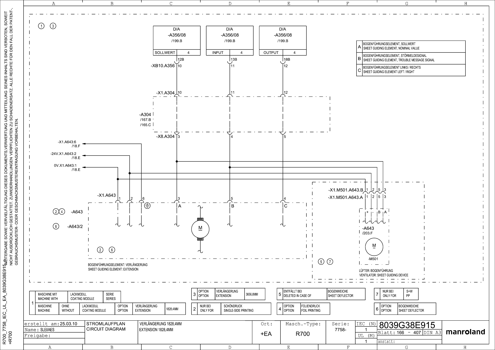

# +EA — Sheet 166 of 407 — VERLÄNGERUNG 1828,4MM

**EXTENSION 1828,4MM**

> Part of the manroland **R700** printing press IEC/UL circuit diagrams.
> Drawing class: **Stromlaufplan / Circuit diagram** (DIN A3).
> Document `+EA` covers the **Printing unit** machine section.

## At a glance

| Field | Value |
|---|---|
| Document | `+EA`  (8039G38E915) |
| Sheet | **166** of 407 |
| Section (DE) | VERLÄNGERUNG 1828,4MM |
| Section (EN) | EXTENSION 1828,4MM |
| Section type | CIRCUIT — Circuit diagram |
| Machine type | `R700` |
| Series | `7758` |
| Created | 25.03.10 |
| Replaces | — |
| Columns used | A, B, C, D, E, F, G |
| Path numbers | — |
| Labels on sheet | 140 |
| Cross-refs out | 9 |
| Cross-refs in | 32 |

**Previous:** [+EA sheet 165](SHEET_0165.md) · **Next:** [+EA sheet 167](SHEET_0167.md) · **Document TOC:** [_TOC.md](_TOC.md)  (+EA) · **Master TOC:** [all sheets](../_MASTER_TOC.md)

## Sheet image (300 DPI, exact vector render)



_Rendered directly from the PDF vector layer at 300 DPI (1-bit), no OCR and no resampling. Use it to confirm anything ambiguous in the text below._

## Cross-references on this sheet

Each entry is a wire leaving this sheet. The printed token is `/sheet.column`; the link resolves to that sheet inside the same document.

| Ref | Target sheet | Col | Path | Destination on target | Target section | From col |
|---|---|---|---|---|---|---|
| `/199.B` | [+EA sheet 199](SHEET_0199.md) | B | — | — | REFERENZMODUL | C |
| `/199.B` | [+EA sheet 199](SHEET_0199.md) | B | — | — | REFERENZMODUL | D |
| `/199.B` | [+EA sheet 199](SHEET_0199.md) | B | — | — | REFERENZMODUL | E |
| `/167.B` | [+EA sheet 167](SHEET_0167.md) | B | — | — | BOGENFÜHRUNGSELEMENT (BLASROHRE) | C |
| `/165.C` | [+EA sheet 165](SHEET_0165.md) | C | — | — | VERLÄNGERUNG 1828,4MM | C |
| `/18.F` | [+EA sheet 18](SHEET_0018.md) | F | — | X1.A643:6 | SPANNUNGSVERSORGUNG: 400V, 24V | A |
| `/18.E` | [+EA sheet 18](SHEET_0018.md) | E | — | 24V.X1.A643:2 | SPANNUNGSVERSORGUNG: 400V, 24V | A |
| `/18.E` | [+EA sheet 18](SHEET_0018.md) | E | — | 0V.X1.A643:1 | SPANNUNGSVERSORGUNG: 400V, 24V | A |
| `/203.F` | [+EA sheet 203](SHEET_0203.md) | F | — | A643 | REFERENZMODUL | F |

### Incoming references (sheets that point here)

Every other sheet that sends a wire to this one. `Back-ref` is the token printed on *that* sheet; `Path` is its line number.

| From sheet | Cols | Back-ref | Path | Refs | What continues there |
|---|---|---|---|---|---|
| [+EA#18](SHEET_0018.md) | E, F | `/18.E`, `/18.F` | — | 3 | 0V.X1.A643:1; X1.A643:6 |
| [+EA#165](SHEET_0165.md) | C | `/165.C` | — | 1 | — |
| [+EA#167](SHEET_0167.md) | B | `/167.B` | — | 1 | — |
| [+EA#199](SHEET_0199.md) | B | `/199.B` | — | 3 | — |
| [+EA#203](SHEET_0203.md) | F | `/203.F` | — | 1 | — |
| [+EA#208](SHEET_0208.md) | C | `/208.C` | — | 3 | — |
| [+EA#213](SHEET_0213.md) | G | `/213.G` | — | 6 | — |
| [+EA#220](SHEET_0220.md) | A | `/220.A` | — | 8 | — |
| [+EA#249](SHEET_0249.md) | B | `/249.B` | — | 3 | — |
| [+EA#254](SHEET_0254.md) | E | `/254.E` | — | 3 | — |


## Devices on this sheet

| Tag | Class | Class meaning (IEC) | Col | Sub | Terminal | Sign |
|---|---|---|---|---|---|---|
| `A304` | A | Baugruppe / assembly, module, PC board | C | — | — | — |
| `A356/08` | A | Baugruppe / assembly, module, PC board | C | 08 | — | — |
| `A356/08` | A | Baugruppe / assembly, module, PC board | D | 08 | — | — |
| `A356/08` | A | Baugruppe / assembly, module, PC board | E | 08 | — | — |
| `A643` | A | Baugruppe / assembly, module, PC board | F | — | — | — |
| `A643/2` | A | Baugruppe / assembly, module, PC board | A | 2 | — | — |
| `A643` | A | Baugruppe / assembly, module, PC board | A | — | — | — |
| `X1.A643` | — | cross-device reference | B | — | — | — |
| `X1.A304` | — | cross-device reference | C | — | — | — |
| `X8.A304` | — | cross-device reference | C | — | — | — |
| `XB10.A356` | — | cross-device reference | C | — | — | — |
| `X1.M501.A643.B` | — | cross-device reference | F | — | — | — |
| `X1.M501.A643.A` | — | cross-device reference | F | — | — | — |
| `X1.A643:6` | — | cross-device reference | A | — | 6 | — |

## Potentials / nets

| Potential | Count | Columns | Attached devices | Terminals |
|---|---|---|---|---|
| `0V` | 1 | A | `A643`, `X1` | `1` |
| `24V` | 1 | A | `A643`, `X1` | `2` |
| `M501` | 1 | F | — | — |


A potential such as `L24+/4` or `M24+` is a named supply/return rail; every place it appears on this sheet is electrically common.

## Wire-end annotations (grouped as printed)

A wire that continues elsewhere is annotated with a small cluster: the destination description, the path/line number `#NN`, and the `/sheet.column` cross reference. Each row below is one such cluster exactly as it is grouped on the drawing.

| Col | Y | Path | Cross-ref | Text on the wire |
|---|---|---|---|---|
| A | 59.3 | — | — | `1` |
| A | 59.8 | — | — | `3` |
| C | 65.8 | — | — | `D/A` |
| D | 65.8 | — | — | `D/A` |
| E | 65.8 | — | — | `D/A` |
| C | 79.7 | — | — | `A356/08` |
| D | 79.7 | — | — | `A356/08` |
| E | 79.7 | — | — | `A356/08` |
| C | 94.5 | — | `/199.B` | — |
| D | 94.5 | — | `/199.B` | — |
| E | 94.5 | — | `/199.B` | — |
| G | 102.7 | — | — | `BOGENFÜHRUNGSELEMENT, SOLLWERT` |
| G | 108.0 | — | — | `A SHEET GUIDING ELEMENT, NOMINAL VALUE` |
| C | 122.8 | — | — | `SOLLWERT 4` |
| D | 122.9 | — | — | `INPUT 4` |
| E | 122.9 | — | — | `OUTPUT 4` |
| G | 131.0 | — | — | `BOGENFÜHRUNGSELEMENT, STÖRMELDESIGNAL` |
| G | 136.4 | — | — | `B SHEET GUIDING ELEMENT, TROUBLE MESSAGE SIGNAL` |
| C | 139.2 | — | — | `12B` |
| D | 139.2 | — | — | `13B` |
| E | 139.2 | — | — | `18B` |
| C | 153.4 | — | — | `XB10.A356 10` |
| D | 154.8 | — | — | `11` |
| E | 154.8 | — | — | `12` |
| G | 159.4 | — | — | `BOGENFÜHRUNGSELEMENT LINKS / RECHTS` |
| G | 164.7 | — | — | `C SHEET GUIDING ELEMENT LEFT / RIGHT` |
| C | 218.6 | — | — | `X1.A304 10` |
| D | 218.6 | — | — | `11` |
| E | 218.6 | — | — | `12` |
| C | 271.0 | — | — | `A304` |
| C | 284.1 | — | `/167.B`, `/165.C` | — |
| C | 323.5 | — | — | `X8.A304 3` |
| D | 324.9 | — | — | `4` |
| E | 324.9 | — | — | `5` |
| A | 337.6 | — | `/18.F` | `X1.A643:6` |
| A | 365.9 | — | `/18.E` | `24V.X1.A643:2` |
| A | 394.3 | — | `/18.E` | `0V.X1.A643:1` |
| F | 452.4 | — | — | `X1.M501.A643.B 1` |
| F | 452.4 | — | — | `2` |
| G | 452.4 | — | — | `5` |
| G | 452.4 | — | — | `3` |
| C | 465.2 | — | — | `X1.A643 1 2 6 3 5 4` |
| F | 469.5 | — | — | `X1.M501.A643.A 1` |
| F | 469.5 | — | — | `2` |
| G | 469.5 | — | — | `5` |
| G | 469.5 | — | — | `3` |
| D | 490.7 | — | — | `A B C` |
| A | 504.9 | — | — | `A643` |
| F | 506.2 | — | — | `+ B A` |
| A | 506.3 | — | — | `2 4` |
| A | 540.3 | — | — | `6 A643/2` |
| C | 542.9 | — | — | `M` |
| F | 544.5 | — | `/203.F` | `A643` |
| F | 585.7 | — | — | `M` |
| B | 598.4 | — | — | `2 6` |
| F | 619.0 | — | — | `M501` |
| F | 626.8 | — | — | `5` |
| F | 626.8 | — | — | `7` |
| B | 634.2 | — | — | `BOGENFÜHRUNGSELEMENT: VERLÄNGERUNG` |
| B | 644.8 | — | — | `SHEET GUIDING ELEMENT: EXTENSION` |
| F | 648.4 | — | — | `LÜFTER: BOGENFÜHRUNG` |
| G | 659.0 | — | — | `VENTILATOR: SHEET GUIDING DEVICE` |
| G | 697.8 | — | — | `7 PP S+W` |
| D | 697.9 | — | — | `3 OPTION OPTION` |
| E | 697.9 | — | — | `5 ENTFÄLLT BEI DELETED IN CASE OF` |
| F | 697.9 | — | — | `BOGENWEICHE` |
| G | 697.9 | — | — | `NUR BEI` |
| D | 698.0 | — | — | `EXTENSION VERLÄNGERUNG 3656,8MM` |
| A | 705.0 | — | — | `MASCHINE MIT MACHINE WITH` |
| A | 705.0 | — | — | `LACKMODUL` |
| B | 705.0 | — | — | `SERIE SERIES` |
| F | 708.6 | — | — | `SHEET DEFLECTOR` |
| G | 708.6 | — | — | `ONLY FOR` |
| A | 715.7 | — | — | `COATING MODULE` |
| A | 724.5 | — | — | `1` |
| D | 733.3 | — | — | `NUR BEI` |
| G | 733.3 | — | — | `BOGENWEICHE` |
| A | 733.4 | — | — | `MASCHINE MACHINE` |
| A | 733.4 | — | — | `OHNE WITHOUT` |
| B | 733.4 | — | — | `LACKMODUL` |
| B | 733.4 | — | — | `OPTION OPTION` |
| C | 733.4 | — | — | `EXTENSION VERLÄNGERUNG` |
| D | 733.4 | — | — | `2 SCHÖNDRUCK SINGLE SIDE PRINTING` |
| E | 733.4 | — | — | `4 OPTION OPTION` |
| E | 733.4 | — | — | `FOLIENDRUCK FOIL PRINTING` |
| G | 733.4 | — | — | `6 OPTION OPTION` |
| C | 740.5 | — | — | `1828,4MM` |
| B | 744.0 | — | — | `COATING MODULE` |
| D | 744.0 | — | — | `ONLY FOR` |
| G | 744.0 | — | — | `SHEET DEFLECTOR` |


## Reconstructed tables

This sheet carries tabular content (pin map / terminal assignment / index). The grid below was rebuilt from the drawing's own rule lines, so each row is exactly one physical row of the table.

### Table 1 — 2 data rows × 3 columns (at x=340.2, y=62.4)

|  | D/A | A356/08 /199.B |
|---|---|---|
|  | `SOLLWERT` | `4` |
| `A304 /167.B /165.C` | `XB10.A356 X1.A304 X8.A304` | `12B 10 10 3` |


### Table 2 — 2 data rows × 2 columns (at x=496.1, y=62.4)

| D/A | A356/08 /199.B |
|---|---|
| `INPUT` | `4` |
|  | `13B 11 11 4` |


### Table 3 — 2 data rows × 2 columns (at x=623.6, y=62.4)

| D/A | A356/08 /199.B |
|---|---|
| `OUTPUT` | `4` |
|  | `18B 12 12 5` |


### Table 4 — 1 data rows × 4 columns (at x=878.7, y=388.3)

| 1 1 | 2 2 | 5 5 | 3 3 |
|---|---|---|---|
| `+ A643 /203.F` | `M M501` | `B` | `A` |


## Notes and free text on this sheet

| Text | Col | Y (pt) |
|---|---|---|
| `12B` | C | 139.18 |
| `D/A` | C | 65.78 |
| `SOLLWERT` | C | 122.83 |
| `13B` | D | 139.18 |
| `D/A` | D | 65.78 |
| `INPUT` | D | 122.88 |
| `18B` | E | 139.18 |
| `D/A` | E | 65.78 |
| `OUTPUT` | E | 122.89 |
| `M` | C | 542.92 |
| `M` | F | 585.69 |
| `LÜFTER: BOGENFÜHRUNG` | F | 648.35 |
| `VENTILATOR: SHEET GUIDING DEVICE` | G | 658.97 |
| `B` | G | 506.21 |
| `A` | G | 506.21 |
| `MASCHINE MIT` | A | 705.04 |
| `MACHINE WITH` | A | 715.63 |
| `MASCHINE` | A | 733.38 |
| `MACHINE` | A | 744.02 |
| `LACKMODUL` | A | 705.05 |
| `COATING MODULE` | A | 715.69 |
| `SERIE` | B | 704.98 |
| `SERIES` | B | 715.62 |
| `OHNE` | A | 733.37 |
| `WITHOUT` | A | 743.97 |
| `LACKMODUL` | B | 733.4 |
| `COATING MODULE` | B | 744.03 |
| `OPTION` | B | 733.35 |
| `VERLÄNGERUNG` | C | 733.4 |
| `EXTENSION` | C | 743.98 |
| `1828,4MM` | C | 740.49 |
| `A` | C | 490.7 |
| `B` | D | 490.7 |
| `C` | E | 490.7 |
| `BOGENFÜHRUNGSELEMENT: VERLÄNGERUNG` | B | 634.18 |
| `SHEET GUIDING ELEMENT: EXTENSION` | B | 644.8 |
| `BOGENFÜHRUNGSELEMENT, SOLLWERT` | G | 102.67 |
| `SHEET GUIDING ELEMENT, NOMINAL VALUE` | G | 113.31 |
| `A` | F | 108.02 |
| `BOGENFÜHRUNGSELEMENT, STÖRMELDESIGNAL` | G | 131.04 |
| `SHEET GUIDING ELEMENT, TROUBLE MESSAGE SIGNAL` | G | 141.66 |
| `B` | F | 136.36 |
| `BOGENFÜHRUNGSELEMENT LINKS / RECHTS` | G | 159.37 |
| `SHEET GUIDING ELEMENT LEFT / RIGHT` | G | 170 |
| `C` | F | 164.72 |
| `NUR BEI` | D | 733.33 |
| `ONLY FOR` | D | 744.02 |
| `SCHÖNDRUCK` | D | 733.42 |
| `SINGLE SIDE PRINTING` | D | 744.01 |
| `OPTION` | D | 697.92 |
| `VERLÄNGERUNG` | D | 697.97 |
| `EXTENSION` | D | 708.54 |
| `3656,8MM` | D | 705.07 |
| `OPTION` | E | 733.35 |
| `FOLIENDRUCK` | E | 733.4 |
| `FOIL PRINTING` | E | 744 |
| `ENTFÄLLT BEI` | E | 697.91 |
| `DELETED IN CASE OF` | E | 708.57 |
| `BOGENWEICHE` | F | 697.9 |
| `SHEET DEFLECTOR` | F | 708.59 |
| `NUR BEI` | G | 697.9 |
| `ONLY FOR` | G | 708.59 |
| `S+W` | G | 697.81 |
| `PP` | G | 708.44 |
| `OPTION` | G | 733.35 |
| `BOGENWEICHE` | G | 733.33 |
| `SHEET DEFLECTOR` | G | 744.02 |

## Complete label inventory (exact text from the drawing)

Every text object inside the drawing area of this sheet, in DIN reading order (column A→H, then top→bottom). This is the authoritative list: if a string is not here it is not printed on this sheet.

| Col | Y | X | Dir | Type | Text |
|---|---|---|---|---|---|
| A | 59.3 | 97.5 | → | number | `1` |
| A | 59.8 | 125.6 | → | number | `3` |
| A | 337.6 | 139.2 | → | device ref | `X1.A643:6` |
| A | 347.5 | 172.9 | → | cross-reference | `/18.F` |
| A | 365.9 | 121.3 | → | potential | `24V.X1.A643:2` |
| A | 375.8 | 172.6 | → | cross-reference | `/18.E` |
| A | 394.3 | 130.1 | → | potential | `0V.X1.A643:1` |
| A | 404.2 | 172.6 | → | cross-reference | `/18.E` |
| A | 504.9 | 170.6 | → | device tag | `A643` |
| A | 506.3 | 132.7 | → | number | `2` |
| A | 506.3 | 146.8 | → | number | `4` |
| A | 540.3 | 161.9 | → | device tag | `A643/2` |
| A | 541.7 | 132.7 | → | number | `6` |
| A | 705.0 | 91.6 | → | text | `MASCHINE MIT` |
| A | 705.1 | 169.2 | → | text | `LACKMODUL` |
| A | 715.6 | 91.6 | → | text | `MACHINE WITH` |
| A | 715.7 | 169.8 | → | text | `COATING MODULE` |
| A | 724.5 | 75.4 | → | number | `1` |
| A | 733.4 | 91.6 | → | text | `MASCHINE` |
| A | 733.4 | 148.5 | → | text | `OHNE` |
| A | 744.0 | 91.6 | → | text | `MACHINE` |
| A | 744.0 | 148.8 | → | text | `WITHOUT` |
| B | 465.2 | 234.1 | → | device ref | `X1.A643` |
| B | 473.7 | 285.4 | → | number | `1` |
| B | 473.7 | 314.4 | → | number | `2` |
| B | 598.4 | 239.0 | → | number | `2` |
| B | 598.4 | 267.3 | → | number | `6` |
| B | 634.2 | 211.7 | → | text | `BOGENFÜHRUNGSELEMENT: VERLÄNGERUNG` |
| B | 644.8 | 212.3 | → | text | `SHEET GUIDING ELEMENT: EXTENSION` |
| B | 705.0 | 254.8 | → | text | `SERIE` |
| B | 715.6 | 254.8 | → | text | `SERIES` |
| B | 733.4 | 197.6 | → | text | `LACKMODUL` |
| B | 733.4 | 283.2 | → | text | `OPTION` |
| B | 744.0 | 198.1 | → | text | `COATING MODULE` |
| B | 744.0 | 283.2 | → | text | `OPTION` |
| C | 65.8 | 416.4 | → | text | `D/A` |
| C | 79.7 | 403.8 | → | device tag | `A356/08` |
| C | 94.5 | 412.6 | → | cross-reference | `/199.B` |
| C | 122.8 | 372.3 | → | text | `SOLLWERT` |
| C | 122.9 | 451.1 | → | number | `4` |
| C | 139.2 | 427.2 | → | text | `12B` |
| C | 153.4 | 362.8 | → | device ref | `XB10.A356` |
| C | 154.8 | 427.2 | → | number | `10` |
| C | 218.6 | 375.9 | → | device ref | `X1.A304` |
| C | 218.6 | 427.2 | → | number | `10` |
| C | 271.0 | 335.1 | → | device tag | `A304` |
| C | 284.1 | 337.6 | → | cross-reference | `/167.B` |
| C | 296.5 | 337.3 | → | cross-reference | `/165.C` |
| C | 323.5 | 375.9 | → | device ref | `X8.A304` |
| C | 324.9 | 427.7 | → | number | `3` |
| C | 473.7 | 342.7 | → | number | `6` |
| C | 473.7 | 427.7 | → | number | `3` |
| C | 490.7 | 428.7 | → | text | `A` |
| C | 542.9 | 477.2 | → | text | `M` |
| C | 703.3 | 464.7 | → | number | `3` |
| C | 733.4 | 326.0 | → | text | `VERLÄNGERUNG` |
| C | 738.7 | 464.9 | → | number | `2` |
| C | 740.5 | 399.5 | → | text | `1828,4MM` |
| C | 744.0 | 325.1 | → | text | `EXTENSION` |
| D | 65.8 | 544.0 | → | text | `D/A` |
| D | 79.7 | 531.4 | → | device tag | `A356/08` |
| D | 94.5 | 540.1 | → | cross-reference | `/199.B` |
| D | 122.9 | 510.9 | → | text | `INPUT` |
| D | 122.9 | 578.7 | → | number | `4` |
| D | 139.2 | 554.7 | → | text | `13B` |
| D | 154.8 | 554.7 | → | number | `11` |
| D | 218.6 | 554.7 | → | number | `11` |
| D | 324.9 | 555.3 | → | number | `4` |
| D | 473.7 | 555.3 | → | number | `5` |
| D | 490.7 | 556.2 | → | text | `B` |
| D | 697.9 | 477.4 | → | text | `OPTION` |
| D | 698.0 | 520.2 | → | text | `VERLÄNGERUNG` |
| D | 705.1 | 591.4 | → | text | `3656,8MM` |
| D | 708.5 | 519.3 | → | text | `EXTENSION` |
| D | 708.6 | 477.4 | → | text | `OPTION` |
| D | 733.3 | 481.0 | → | text | `NUR BEI` |
| D | 733.4 | 538.3 | → | text | `SCHÖNDRUCK` |
| D | 744.0 | 481.6 | → | text | `ONLY FOR` |
| D | 744.0 | 538.3 | → | text | `SINGLE SIDE PRINTING` |
| E | 65.8 | 671.5 | → | text | `D/A` |
| E | 79.7 | 658.9 | → | device tag | `A356/08` |
| E | 94.5 | 667.7 | → | cross-reference | `/199.B` |
| E | 122.9 | 634.0 | → | text | `OUTPUT` |
| E | 122.9 | 706.3 | → | number | `4` |
| E | 139.2 | 682.3 | → | text | `18B` |
| E | 154.8 | 682.3 | → | number | `12` |
| E | 218.6 | 682.3 | → | number | `12` |
| E | 324.9 | 682.9 | → | number | `5` |
| E | 473.7 | 682.9 | → | number | `4` |
| E | 490.7 | 683.6 | → | text | `C` |
| E | 697.9 | 682.3 | → | text | `ENTFÄLLT BEI` |
| E | 703.3 | 670.3 | → | number | `5` |
| E | 708.6 | 682.3 | → | text | `DELETED IN CASE OF` |
| E | 733.4 | 682.9 | → | text | `OPTION` |
| E | 733.4 | 724.8 | → | text | `FOLIENDRUCK` |
| E | 738.7 | 670.4 | → | number | `4` |
| E | 744.0 | 682.9 | → | text | `OPTION` |
| E | 744.0 | 724.8 | → | text | `FOIL PRINTING` |
| F | 108.0 | 861.0 | → | text | `A` |
| F | 136.4 | 860.9 | → | text | `B` |
| F | 164.7 | 860.7 | → | text | `C` |
| F | 452.4 | 790.0 | → | device ref | `X1.M501.A643.B` |
| F | 452.5 | 880.7 | → | number | `1` |
| F | 452.5 | 895.5 | → | number | `2` |
| F | 469.5 | 880.7 | → | number | `1` |
| F | 469.5 | 895.5 | → | number | `2` |
| F | 470.2 | 789.2 | → | device ref | `X1.M501.A643.A` |
| F | 506.3 | 881.3 | → | number | `+` |
| F | 544.6 | 871.4 | → | device tag | `A643` |
| F | 556.9 | 871.7 | → | cross-reference | `/203.F` |
| F | 585.7 | 895.6 | → | text | `M` |
| F | 619.0 | 885.5 | → | potential | `M501` |
| F | 626.7 | 770.4 | → | number | `5` |
| F | 626.7 | 791.7 | → | number | `7` |
| F | 648.4 | 863.7 | → | text | `LÜFTER: BOGENFÜHRUNG` |
| F | 697.9 | 788.6 | → | text | `BOGENWEICHE` |
| F | 708.6 | 789.2 | → | text | `SHEET DEFLECTOR` |
| G | 102.7 | 873.6 | → | text | `BOGENFÜHRUNGSELEMENT, SOLLWERT` |
| G | 113.3 | 874.2 | → | text | `SHEET GUIDING ELEMENT, NOMINAL VALUE` |
| G | 131.0 | 873.6 | → | text | `BOGENFÜHRUNGSELEMENT, STÖRMELDESIGNAL` |
| G | 141.7 | 874.2 | → | text | `SHEET GUIDING ELEMENT, TROUBLE MESSAGE SIGNAL` |
| G | 159.4 | 873.6 | → | text | `BOGENFÜHRUNGSELEMENT LINKS / RECHTS` |
| G | 170.0 | 874.2 | → | text | `SHEET GUIDING ELEMENT LEFT / RIGHT` |
| G | 452.5 | 909.6 | → | number | `5` |
| G | 452.5 | 923.8 | → | number | `3` |
| G | 469.5 | 909.6 | → | number | `5` |
| G | 469.5 | 923.8 | → | number | `3` |
| G | 506.2 | 909.1 | → | text | `B` |
| G | 506.2 | 924.1 | → | text | `A` |
| G | 659.0 | 864.6 | → | text | `VENTILATOR: SHEET GUIDING DEVICE` |
| G | 697.8 | 977.7 | → | text | `S+W` |
| G | 697.9 | 920.4 | → | text | `NUR BEI` |
| G | 703.3 | 904.3 | → | number | `7` |
| G | 708.4 | 977.1 | → | text | `PP` |
| G | 708.6 | 921.0 | → | text | `ONLY FOR` |
| G | 733.3 | 958.7 | → | text | `BOGENWEICHE` |
| G | 733.4 | 916.7 | → | text | `OPTION` |
| G | 738.7 | 904.3 | → | number | `6` |
| G | 744.0 | 916.7 | → | text | `OPTION` |
| G | 744.0 | 959.2 | → | text | `SHEET DEFLECTOR` |

## Reading-order text block

The same content as a plain block, grouped by DIN column — convenient to paste or to match against a visual description.

```text
=== Column A ===
  59.3   97.5  numeric      1
  59.8  125.6  numeric      3
 337.6  139.2  devref       X1.A643:6
 347.5  172.9  xref         /18.F
 365.9  121.3  net          24V.X1.A643:2
 375.8  172.6  xref         /18.E
 394.3  130.1  net          0V.X1.A643:1
 404.2  172.6  xref         /18.E
 504.9  170.6  devtag       A643
 506.3  132.7  numeric      2
 506.3  146.8  numeric      4
 540.3  161.9  devtag       A643/2
 541.7  132.7  numeric      6
 705.0   91.6  text         MASCHINE MIT
 705.1  169.2  text         LACKMODUL
 715.6   91.6  text         MACHINE WITH
 715.7  169.8  text         COATING MODULE
 724.5   75.4  numeric      1
 733.4   91.6  text         MASCHINE
 733.4  148.5  text         OHNE
 744.0   91.6  text         MACHINE
 744.0  148.8  text         WITHOUT
=== Column B ===
 465.2  234.1  devref       X1.A643
 473.7  285.4  numeric      1
 473.7  314.4  numeric      2
 598.4  239.0  numeric      2
 598.4  267.3  numeric      6
 634.2  211.7  text         BOGENFÜHRUNGSELEMENT: VERLÄNGERUNG
 644.8  212.3  text         SHEET GUIDING ELEMENT: EXTENSION
 705.0  254.8  text         SERIE
 715.6  254.8  text         SERIES
 733.4  197.6  text         LACKMODUL
 733.4  283.2  text         OPTION
 744.0  198.1  text         COATING MODULE
 744.0  283.2  text         OPTION
=== Column C ===
  65.8  416.4  text         D/A
  79.7  403.8  devtag       A356/08
  94.5  412.6  xref         /199.B
 122.8  372.3  text         SOLLWERT
 122.9  451.1  numeric      4
 139.2  427.2  text         12B
 153.4  362.8  devref       XB10.A356
 154.8  427.2  numeric      10
 218.6  375.9  devref       X1.A304
 218.6  427.2  numeric      10
 271.0  335.1  devtag       A304
 284.1  337.6  xref         /167.B
 296.5  337.3  xref         /165.C
 323.5  375.9  devref       X8.A304
 324.9  427.7  numeric      3
 473.7  342.7  numeric      6
 473.7  427.7  numeric      3
 490.7  428.7  text         A
 542.9  477.2  text         M
 703.3  464.7  numeric      3
 733.4  326.0  text         VERLÄNGERUNG
 738.7  464.9  numeric      2
 740.5  399.5  text         1828,4MM
 744.0  325.1  text         EXTENSION
=== Column D ===
  65.8  544.0  text         D/A
  79.7  531.4  devtag       A356/08
  94.5  540.1  xref         /199.B
 122.9  510.9  text         INPUT
 122.9  578.7  numeric      4
 139.2  554.7  text         13B
 154.8  554.7  numeric      11
 218.6  554.7  numeric      11
 324.9  555.3  numeric      4
 473.7  555.3  numeric      5
 490.7  556.2  text         B
 697.9  477.4  text         OPTION
 698.0  520.2  text         VERLÄNGERUNG
 705.1  591.4  text         3656,8MM
 708.5  519.3  text         EXTENSION
 708.6  477.4  text         OPTION
 733.3  481.0  text         NUR BEI
 733.4  538.3  text         SCHÖNDRUCK
 744.0  481.6  text         ONLY FOR
 744.0  538.3  text         SINGLE SIDE PRINTING
=== Column E ===
  65.8  671.5  text         D/A
  79.7  658.9  devtag       A356/08
  94.5  667.7  xref         /199.B
 122.9  634.0  text         OUTPUT
 122.9  706.3  numeric      4
 139.2  682.3  text         18B
 154.8  682.3  numeric      12
 218.6  682.3  numeric      12
 324.9  682.9  numeric      5
 473.7  682.9  numeric      4
 490.7  683.6  text         C
 697.9  682.3  text         ENTFÄLLT BEI
 703.3  670.3  numeric      5
 708.6  682.3  text         DELETED IN CASE OF
 733.4  682.9  text         OPTION
 733.4  724.8  text         FOLIENDRUCK
 738.7  670.4  numeric      4
 744.0  682.9  text         OPTION
 744.0  724.8  text         FOIL PRINTING
=== Column F ===
 108.0  861.0  text         A
 136.4  860.9  text         B
 164.7  860.7  text         C
 452.4  790.0  devref       X1.M501.A643.B
 452.5  880.7  numeric      1
 452.5  895.5  numeric      2
 469.5  880.7  numeric      1
 469.5  895.5  numeric      2
 470.2  789.2  devref       X1.M501.A643.A
 506.3  881.3  numeric      +
 544.6  871.4  devtag       A643
 556.9  871.7  xref         /203.F
 585.7  895.6  text         M
 619.0  885.5  net          M501
 626.7  770.4  numeric      5
 626.7  791.7  numeric      7
 648.4  863.7  text         LÜFTER: BOGENFÜHRUNG
 697.9  788.6  text         BOGENWEICHE
 708.6  789.2  text         SHEET DEFLECTOR
=== Column G ===
 102.7  873.6  text         BOGENFÜHRUNGSELEMENT, SOLLWERT
 113.3  874.2  text         SHEET GUIDING ELEMENT, NOMINAL VALUE
 131.0  873.6  text         BOGENFÜHRUNGSELEMENT, STÖRMELDESIGNAL
 141.7  874.2  text         SHEET GUIDING ELEMENT, TROUBLE MESSAGE SIGNAL
 159.4  873.6  text         BOGENFÜHRUNGSELEMENT LINKS / RECHTS
 170.0  874.2  text         SHEET GUIDING ELEMENT LEFT / RIGHT
 452.5  909.6  numeric      5
 452.5  923.8  numeric      3
 469.5  909.6  numeric      5
 469.5  923.8  numeric      3
 506.2  909.1  text         B
 506.2  924.1  text         A
 659.0  864.6  text         VENTILATOR: SHEET GUIDING DEVICE
 697.8  977.7  text         S+W
 697.9  920.4  text         NUR BEI
 703.3  904.3  numeric      7
 708.4  977.1  text         PP
 708.6  921.0  text         ONLY FOR
 733.3  958.7  text         BOGENWEICHE
 733.4  916.7  text         OPTION
 738.7  904.3  numeric      6
 744.0  916.7  text         OPTION
 744.0  959.2  text         SHEET DEFLECTOR
```

---
_Generated from the PDF vector text layer; no OCR. Source: `R700_7758_IEC_UL_EA_8039G38E915_p`, sheet 166._
