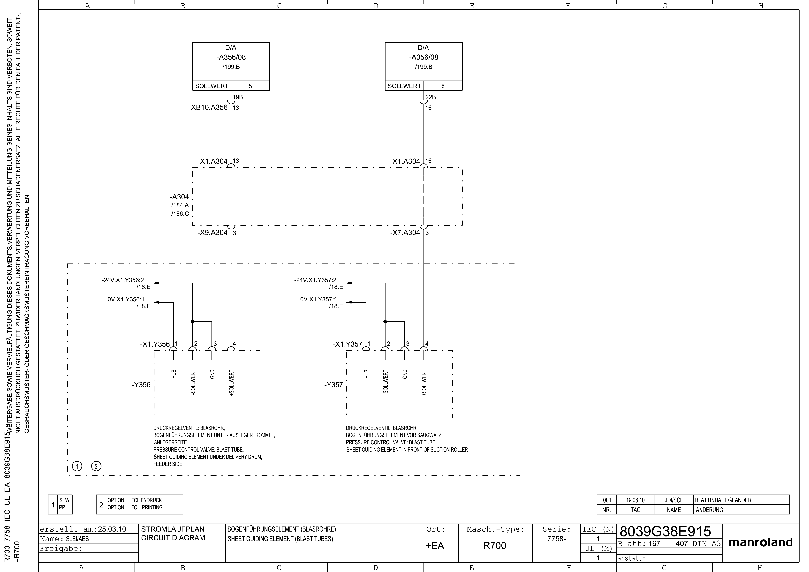

# +EA — Sheet 167 of 407 — BOGENFÜHRUNGSELEMENT (BLASROHRE)

**SHEET GUIDING ELEMENT (BLAST TUBES)**

> Part of the manroland **R700** printing press IEC/UL circuit diagrams.
> Drawing class: **Stromlaufplan / Circuit diagram** (DIN A3).
> Document `+EA` covers the **Printing unit** machine section.

## At a glance

| Field | Value |
|---|---|
| Document | `+EA`  (8039G38E915) |
| Sheet | **167** of 407 |
| Section (DE) | BOGENFÜHRUNGSELEMENT (BLASROHRE) |
| Section (EN) | SHEET GUIDING ELEMENT (BLAST TUBES) |
| Section type | CIRCUIT — Circuit diagram |
| Machine type | `R700` |
| Series | `7758` |
| Created | 25.03.10 |
| Replaces | — |
| Columns used | A, B, C, D, E, F, G, H |
| Path numbers | — |
| Labels on sheet | 82 |
| Cross-refs out | 8 |
| Cross-refs in | 22 |

**Previous:** [+EA sheet 166](SHEET_0166.md) · **Next:** [+EA sheet 168](SHEET_0168.md) · **Document TOC:** [_TOC.md](_TOC.md)  (+EA) · **Master TOC:** [all sheets](../_MASTER_TOC.md)

## Sheet image (300 DPI, exact vector render)



_Rendered directly from the PDF vector layer at 300 DPI (1-bit), no OCR and no resampling. Use it to confirm anything ambiguous in the text below._

## Cross-references on this sheet

Each entry is a wire leaving this sheet. The printed token is `/sheet.column`; the link resolves to that sheet inside the same document.

| Ref | Target sheet | Col | Path | Destination on target | Target section | From col |
|---|---|---|---|---|---|---|
| `/199.B` | [+EA sheet 199](SHEET_0199.md) | B | — | — | REFERENZMODUL | B |
| `/199.B` | [+EA sheet 199](SHEET_0199.md) | B | — | — | REFERENZMODUL | E |
| `/184.A` | [+EA sheet 184](SHEET_0184.md) | A | — | — | RESERVE | B |
| `/166.C` | [+EA sheet 166](SHEET_0166.md) | C | — | — | VERLÄNGERUNG 1828,4MM | B |
| `/18.E` | [+EA sheet 18](SHEET_0018.md) | E | — | 24V.X1.Y356:2 24V.X1.Y357:2 | SPANNUNGSVERSORGUNG: 400V, 24V | B |
| `/18.E` | [+EA sheet 18](SHEET_0018.md) | E | — | 24V.X1.Y356:2 24V.X1.Y357:2 | SPANNUNGSVERSORGUNG: 400V, 24V | B |
| `/18.E` | [+EA sheet 18](SHEET_0018.md) | E | — | 0V.X1.Y356:1 0V.X1.Y357:1 | SPANNUNGSVERSORGUNG: 400V, 24V | B |
| `/18.E` | [+EA sheet 18](SHEET_0018.md) | E | — | 0V.X1.Y356:1 0V.X1.Y357:1 | SPANNUNGSVERSORGUNG: 400V, 24V | B |

### Incoming references (sheets that point here)

Every other sheet that sends a wire to this one. `Back-ref` is the token printed on *that* sheet; `Path` is its line number.

| From sheet | Cols | Back-ref | Path | Refs | What continues there |
|---|---|---|---|---|---|
| [+EA#18](SHEET_0018.md) | E | `/18.E` | — | 4 | 0V.X1.A643:1; 0V.X1.Y356:1; 0V.X1.Y357:1 |
| [+EA#166](SHEET_0166.md) | C | `/166.C` | — | 1 | — |
| [+EA#184](SHEET_0184.md) | A | `/184.A` | — | 1 | — |
| [+EA#199](SHEET_0199.md) | B | `/199.B` | — | 2 | — |
| [+EA#208](SHEET_0208.md) | C | `/208.C` | — | 2 | — |
| [+EA#222](SHEET_0222.md) | H | `/222.H` | — | 8 | — |
| [+EA#246](SHEET_0246.md) | E | `/246.E` | — | 1 | — |
| [+EA#251](SHEET_0251.md) | F | `/251.F` | — | 1 | — |
| [+EA#254](SHEET_0254.md) | E | `/254.E` | — | 2 | — |


## Devices on this sheet

| Tag | Class | Class meaning (IEC) | Col | Sub | Terminal | Sign |
|---|---|---|---|---|---|---|
| `A356/08` | A | Baugruppe / assembly, module, PC board | B | 08 | — | — |
| `Y356` | Y | Magnetventil / solenoid valve, actuator | B | — | — | — |
| `A304` | A | Baugruppe / assembly, module, PC board | B | — | — | — |
| `A356/08` | A | Baugruppe / assembly, module, PC board | E | 08 | — | — |
| `Y357` | Y | Magnetventil / solenoid valve, actuator | D | — | — | — |
| `XB10.A356` | — | cross-device reference | B | — | — | — |
| `X1.Y356` | — | cross-device reference | B | — | — | — |
| `X1.A304` | — | cross-device reference | B | — | — | — |
| `X9.A304` | — | cross-device reference | B | — | — | — |
| `X1.A304` | — | cross-device reference | D | — | — | — |
| `X7.A304` | — | cross-device reference | D | — | — | — |
| `X1.Y357` | — | cross-device reference | D | — | — | — |
| `NR.` | — | cross-device reference | F | — | — | — |
| `19.08.10` | — | cross-device reference | G | — | — | — |

## Potentials / nets

| Potential | Count | Columns | Attached devices | Terminals |
|---|---|---|---|---|
| `0V` | 2 | A, C | `X1`, `Y356`, `Y357` | `1` |
| `24V` | 2 | A, C | `X1`, `Y356`, `Y357` | `2` |


A potential such as `L24+/4` or `M24+` is a named supply/return rail; every place it appears on this sheet is electrically common.

## Wire-end annotations (grouped as printed)

A wire that continues elsewhere is annotated with a small cluster: the destination description, the path/line number `#NN`, and the `/sheet.column` cross reference. Each row below is one such cluster exactly as it is grouped on the drawing.

| Col | Y | Path | Cross-ref | Text on the wire |
|---|---|---|---|---|
| B | 65.8 | — | — | `D/A` |
| D | 65.8 | — | — | `D/A` |
| B | 79.7 | — | — | `A356/08` |
| E | 79.7 | — | — | `A356/08` |
| B | 94.5 | — | `/199.B` | — |
| E | 94.5 | — | `/199.B` | — |
| B | 122.8 | — | — | `SOLLWERT 5` |
| D | 122.8 | — | — | `SOLLWERT 6` |
| C | 139.2 | — | — | `19B` |
| E | 139.2 | — | — | `22B` |
| B | 153.4 | — | — | `XB10.A356 13` |
| E | 154.8 | — | — | `16` |
| B | 232.8 | — | — | `X1.A304 13` |
| D | 232.8 | — | — | `X1.A304 16` |
| B | 285.2 | — | — | `A304` |
| B | 298.3 | — | `/184.A`, `/166.C` | — |
| B | 337.6 | — | — | `X9.A304 3` |
| D | 337.6 | — | — | `X7.A304 3` |
| B | 408.5 | — | `/18.E`, `/18.E` | `24V.X1.Y356:2 24V.X1.Y357:2` |
| B | 436.8 | — | `/18.E`, `/18.E` | `0V.X1.Y356:1 0V.X1.Y357:1` |
| B | 502.1 | — | — | `X1.Y356 1 2 3 4` |
| D | 502.1 | — | — | `X1.Y357 1 2 3 4` |
| B | 544.0 | — | — | `+UB` |
| B | 544.0 | — | — | `SOLLWERT` |
| B | 544.0 | — | — | `GND` |
| C | 544.0 | — | — | `+SOLLWERT` |
| D | 544.0 | — | — | `+UB` |
| D | 544.0 | — | — | `SOLLWERT` |
| D | 544.0 | — | — | `GND` |
| E | 544.0 | — | — | `+SOLLWERT` |
| B | 561.6 | — | — | `Y356` |
| D | 561.6 | — | — | `Y357` |
| B | 627.1 | — | — | `DRUCKREGELVENTIL: BLASROHR, BOGENFÜHRUNGSELEMENT UNTER AUSLEGERTROMMEL,` |
| D | 627.1 | — | — | `DRUCKREGELVENTIL: BLASROHR, BOGENFÜHRUNGSELEMENT VOR SAUGWALZE PRESSURE CONTROL VALVE: BLAST TUBE,` |
| B | 648.3 | — | — | `PRESSURE CONTROL VALVE: BLAST TUBE, ANLEGERSEITE` |
| D | 659.0 | — | — | `SHEET GUIDING ELEMENT IN FRONT OF SUCTION ROLLER` |
| B | 669.6 | — | — | `FEEDER SIDE SHEET GUIDING ELEMENT UNDER DELIVERY DRUM,` |
| A | 682.9 | — | — | `1 2` |
| G | 733.0 | — | — | `001 19.08.10 JDI/SCH BLATTINHALT GEÄNDERT` |
| A | 733.2 | — | — | `1 PP S+W OPTION OPTION` |
| A | 733.4 | — | — | `2 FOLIENDRUCK FOIL PRINTING` |
| G | 747.1 | — | — | `NR. TAG NAME ÄNDERUNG` |


## Reconstructed tables

This sheet carries tabular content (pin map / terminal assignment / index). The grid below was rebuilt from the drawing's own rule lines, so each row is exactly one physical row of the table.

### Table 1 — 2 data rows × 4 columns (at x=255.1, y=62.4)

|  |  | D/A | A356/08 /199.B |
|---|---|---|---|
|  |  | `SOLLWERT` | `5` |
| `A304 /184.A /166.C` | `XB10.A356` | `X1.A304 X9.A304` | `19B 13 13 3` |


### Table 2 — 2 data rows × 3 columns (at x=566.9, y=62.4)

|  | D/A | A356/08 /199.B |
|---|---|---|
| `SOLLWERT` |  | `6` |
|  | `X1.A304 X7.A304` | `22B 16 16 3` |


## Notes and free text on this sheet

| Text | Col | Y (pt) |
|---|---|---|
| `19B` | C | 139.18 |
| `D/A` | B | 65.78 |
| `SOLLWERT` | B | 122.83 |
| `DRUCKREGELVENTIL: BLASROHR,` | B | 627.08 |
| `BOGENFÜHRUNGSELEMENT UNTER AUSLEGERTROMMEL,` | B | 637.73 |
| `ANLEGERSEITE` | B | 648.34 |
| `PRESSURE CONTROL VALVE: BLAST TUBE,` | B | 658.97 |
| `SHEET GUIDING ELEMENT UNDER DELIVERY DRUM,` | B | 669.62 |
| `FEEDER SIDE` | B | 680.21 |
| `22B` | E | 139.18 |
| `D/A` | D | 65.78 |
| `SOLLWERT` | D | 122.83 |
| `DRUCKREGELVENTIL: BLASROHR,` | D | 627.08 |
| `BOGENFÜHRUNGSELEMENT VOR SAUGWALZE` | D | 637.71 |
| `PRESSURE CONTROL VALVE: BLAST TUBE,` | D | 648.34 |
| `SHEET GUIDING ELEMENT IN FRONT OF SUCTION ROLLER` | D | 658.99 |
| `TAG` | G | 747.27 |
| `NAME` | G | 747.25 |
| `ÄNDERUNG` | G | 747.31 |
| `JDI/SCH` | G | 733.1 |
| `BLATTINHALT GEÄNDERT` | H | 733.14 |
| `S+W` | A | 733.24 |
| `PP` | A | 743.87 |
| `OPTION` | A | 733.35 |
| `FOLIENDRUCK` | B | 733.4 |
| `FOIL PRINTING` | B | 744 |
| `+UB` | B | 543.97 |
| `GND` | B | 543.97 |
| `+SOLLWERT` | C | 543.97 |
| `+UB` | D | 543.97 |
| `GND` | D | 543.97 |
| `+SOLLWERT` | E | 543.97 |

## Complete label inventory (exact text from the drawing)

Every text object inside the drawing area of this sheet, in DIN reading order (column A→H, then top→bottom). This is the authoritative list: if a string is not here it is not printed on this sheet.

| Col | Y | X | Dir | Type | Text |
|---|---|---|---|---|---|
| A | 408.5 | 149.7 | → | potential | `24V.X1.Y356:2` |
| A | 436.8 | 158.5 | → | potential | `0V.X1.Y356:1` |
| A | 682.9 | 111.6 | → | number | `1` |
| A | 683.4 | 139.7 | → | number | `2` |
| A | 733.2 | 87.6 | → | text | `S+W` |
| A | 733.4 | 158.5 | → | text | `OPTION` |
| A | 738.7 | 75.4 | → | number | `1` |
| A | 738.7 | 146.0 | → | number | `2` |
| A | 743.9 | 87.0 | → | text | `PP` |
| A | 744.0 | 158.5 | → | text | `OPTION` |
| B | 65.8 | 331.4 | → | text | `D/A` |
| B | 79.7 | 318.8 | → | device tag | `A356/08` |
| B | 94.5 | 327.5 | → | cross-reference | `/199.B` |
| B | 122.8 | 287.3 | → | text | `SOLLWERT` |
| B | 153.4 | 277.8 | → | device ref | `XB10.A356` |
| B | 232.8 | 290.8 | → | device ref | `X1.A304` |
| B | 285.2 | 250.0 | → | device tag | `A304` |
| B | 298.3 | 252.3 | → | cross-reference | `/184.A` |
| B | 310.7 | 252.3 | → | cross-reference | `/166.C` |
| B | 337.6 | 290.8 | → | device ref | `X9.A304` |
| B | 418.4 | 201.0 | → | cross-reference | `/18.E` |
| B | 446.7 | 201.0 | → | cross-reference | `/18.E` |
| B | 502.1 | 206.4 | → | device ref | `X1.Y356` |
| B | 502.1 | 257.1 | → | number | `1` |
| B | 502.1 | 286.0 | → | number | `2` |
| B | 502.1 | 314.4 | → | number | `3` |
| B | 544.0 | 252.9 | ↕ | text | `+UB` |
| B | 544.0 | 281.2 | ↕ | text | `SOLLWERT` |
| B | 544.0 | 309.6 | ↕ | text | `GND` |
| B | 561.6 | 193.9 | → | device tag | `Y356` |
| B | 627.1 | 225.9 | → | text | `DRUCKREGELVENTIL: BLASROHR,` |
| B | 637.7 | 225.9 | → | text | `BOGENFÜHRUNGSELEMENT UNTER AUSLEGERTROMMEL,` |
| B | 648.3 | 226.8 | → | text | `ANLEGERSEITE` |
| B | 659.0 | 225.9 | → | text | `PRESSURE CONTROL VALVE: BLAST TUBE,` |
| B | 669.6 | 226.5 | → | text | `SHEET GUIDING ELEMENT UNDER DELIVERY DRUM,` |
| B | 680.2 | 225.9 | → | text | `FEEDER SIDE` |
| B | 733.4 | 193.3 | → | text | `FOLIENDRUCK` |
| B | 744.0 | 193.3 | → | text | `FOIL PRINTING` |
| C | 122.9 | 366.1 | → | number | `5` |
| C | 139.2 | 342.1 | → | text | `19B` |
| C | 154.8 | 342.1 | → | number | `13` |
| C | 232.8 | 342.1 | → | number | `13` |
| C | 339.1 | 342.7 | → | number | `3` |
| C | 408.5 | 433.1 | → | potential | `24V.X1.Y357:2` |
| C | 436.8 | 441.9 | → | potential | `0V.X1.Y357:1` |
| C | 502.1 | 342.7 | → | number | `4` |
| C | 544.0 | 337.9 | ↕ | text | `+SOLLWERT` |
| D | 65.8 | 614.8 | → | text | `D/A` |
| D | 122.8 | 570.8 | → | text | `SOLLWERT` |
| D | 232.8 | 574.3 | → | device ref | `X1.A304` |
| D | 337.6 | 574.3 | → | device ref | `X7.A304` |
| D | 418.4 | 484.4 | → | cross-reference | `/18.E` |
| D | 446.7 | 484.4 | → | cross-reference | `/18.E` |
| D | 502.1 | 489.8 | → | device ref | `X1.Y357` |
| D | 502.1 | 540.6 | → | number | `1` |
| D | 502.1 | 569.5 | → | number | `2` |
| D | 502.1 | 597.8 | → | number | `3` |
| D | 544.0 | 536.4 | ↕ | text | `+UB` |
| D | 544.0 | 564.7 | ↕ | text | `SOLLWERT` |
| D | 544.0 | 593.1 | ↕ | text | `GND` |
| D | 561.6 | 477.4 | → | device tag | `Y357` |
| D | 627.1 | 509.4 | → | text | `DRUCKREGELVENTIL: BLASROHR,` |
| D | 637.7 | 509.4 | → | text | `BOGENFÜHRUNGSELEMENT VOR SAUGWALZE` |
| D | 648.3 | 509.4 | → | text | `PRESSURE CONTROL VALVE: BLAST TUBE,` |
| D | 659.0 | 510.0 | → | text | `SHEET GUIDING ELEMENT IN FRONT OF SUCTION ROLLER` |
| E | 79.7 | 602.2 | → | device tag | `A356/08` |
| E | 94.5 | 611.0 | → | cross-reference | `/199.B` |
| E | 122.9 | 649.6 | → | number | `6` |
| E | 139.2 | 626.2 | → | text | `22B` |
| E | 154.8 | 625.6 | → | number | `16` |
| E | 232.8 | 625.6 | → | number | `16` |
| E | 339.1 | 626.2 | → | number | `3` |
| E | 502.1 | 626.2 | → | number | `4` |
| E | 544.0 | 621.4 | ↕ | text | `+SOLLWERT` |
| F | 733.0 | 887.7 | → | number | `001` |
| F | 747.1 | 886.7 | → | device ref | `NR.` |
| G | 733.1 | 921.5 | → | device ref | `19.08.10` |
| G | 733.1 | 978.7 | → | text | `JDI/SCH` |
| G | 747.3 | 928.3 | → | text | `TAG` |
| G | 747.3 | 981.7 | → | text | `NAME` |
| G | 747.3 | 1024.3 | → | text | `ÄNDERUNG` |
| H | 733.1 | 1023.2 | → | text | `BLATTINHALT GEÄNDERT` |

## Reading-order text block

The same content as a plain block, grouped by DIN column — convenient to paste or to match against a visual description.

```text
=== Column A ===
 408.5  149.7  net          24V.X1.Y356:2
 436.8  158.5  net          0V.X1.Y356:1
 682.9  111.6  numeric      1
 683.4  139.7  numeric      2
 733.2   87.6  text         S+W
 733.4  158.5  text         OPTION
 738.7   75.4  numeric      1
 738.7  146.0  numeric      2
 743.9   87.0  text         PP
 744.0  158.5  text         OPTION
=== Column B ===
  65.8  331.4  text         D/A
  79.7  318.8  devtag       A356/08
  94.5  327.5  xref         /199.B
 122.8  287.3  text         SOLLWERT
 153.4  277.8  devref       XB10.A356
 232.8  290.8  devref       X1.A304
 285.2  250.0  devtag       A304
 298.3  252.3  xref         /184.A
 310.7  252.3  xref         /166.C
 337.6  290.8  devref       X9.A304
 418.4  201.0  xref         /18.E
 446.7  201.0  xref         /18.E
 502.1  206.4  devref       X1.Y356
 502.1  257.1  numeric      1
 502.1  286.0  numeric      2
 502.1  314.4  numeric      3
 544.0  252.9  text         +UB
 544.0  281.2  text         SOLLWERT
 544.0  309.6  text         GND
 561.6  193.9  devtag       Y356
 627.1  225.9  text         DRUCKREGELVENTIL: BLASROHR,
 637.7  225.9  text         BOGENFÜHRUNGSELEMENT UNTER AUSLEGERTROMMEL,
 648.3  226.8  text         ANLEGERSEITE
 659.0  225.9  text         PRESSURE CONTROL VALVE: BLAST TUBE,
 669.6  226.5  text         SHEET GUIDING ELEMENT UNDER DELIVERY DRUM,
 680.2  225.9  text         FEEDER SIDE
 733.4  193.3  text         FOLIENDRUCK
 744.0  193.3  text         FOIL PRINTING
=== Column C ===
 122.9  366.1  numeric      5
 139.2  342.1  text         19B
 154.8  342.1  numeric      13
 232.8  342.1  numeric      13
 339.1  342.7  numeric      3
 408.5  433.1  net          24V.X1.Y357:2
 436.8  441.9  net          0V.X1.Y357:1
 502.1  342.7  numeric      4
 544.0  337.9  text         +SOLLWERT
=== Column D ===
  65.8  614.8  text         D/A
 122.8  570.8  text         SOLLWERT
 232.8  574.3  devref       X1.A304
 337.6  574.3  devref       X7.A304
 418.4  484.4  xref         /18.E
 446.7  484.4  xref         /18.E
 502.1  489.8  devref       X1.Y357
 502.1  540.6  numeric      1
 502.1  569.5  numeric      2
 502.1  597.8  numeric      3
 544.0  536.4  text         +UB
 544.0  564.7  text         SOLLWERT
 544.0  593.1  text         GND
 561.6  477.4  devtag       Y357
 627.1  509.4  text         DRUCKREGELVENTIL: BLASROHR,
 637.7  509.4  text         BOGENFÜHRUNGSELEMENT VOR SAUGWALZE
 648.3  509.4  text         PRESSURE CONTROL VALVE: BLAST TUBE,
 659.0  510.0  text         SHEET GUIDING ELEMENT IN FRONT OF SUCTION ROLLER
=== Column E ===
  79.7  602.2  devtag       A356/08
  94.5  611.0  xref         /199.B
 122.9  649.6  numeric      6
 139.2  626.2  text         22B
 154.8  625.6  numeric      16
 232.8  625.6  numeric      16
 339.1  626.2  numeric      3
 502.1  626.2  numeric      4
 544.0  621.4  text         +SOLLWERT
=== Column F ===
 733.0  887.7  numeric      001
 747.1  886.7  devref       NR.
=== Column G ===
 733.1  921.5  devref       19.08.10
 733.1  978.7  text         JDI/SCH
 747.3  928.3  text         TAG
 747.3  981.7  text         NAME
 747.3 1024.3  text         ÄNDERUNG
=== Column H ===
 733.1 1023.2  text         BLATTINHALT GEÄNDERT
```

---
_Generated from the PDF vector text layer; no OCR. Source: `R700_7758_IEC_UL_EA_8039G38E915_p`, sheet 167._
