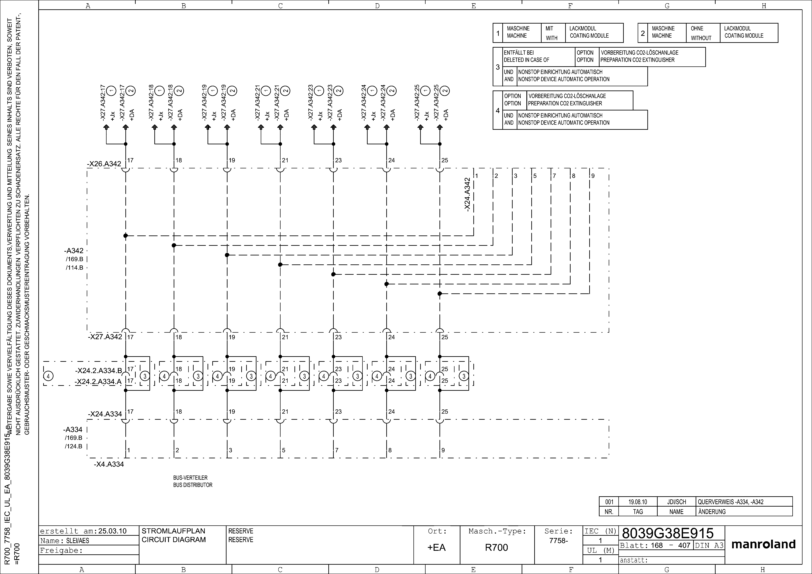

# +EA — Sheet 168 of 407 — RESERVE

**RESERVE**

> Part of the manroland **R700** printing press IEC/UL circuit diagrams.
> Drawing class: **Stromlaufplan / Circuit diagram** (DIN A3).
> Document `+EA` covers the **Printing unit** machine section.

## At a glance

| Field | Value |
|---|---|
| Document | `+EA`  (8039G38E915) |
| Sheet | **168** of 407 |
| Section (DE) | RESERVE |
| Section (EN) | RESERVE |
| Section type | CIRCUIT — Circuit diagram |
| Machine type | `R700` |
| Series | `7758` |
| Created | 25.03.10 |
| Replaces | — |
| Columns used | A, B, C, D, E, F, G, H |
| Path numbers | — |
| Labels on sheet | 162 |
| Cross-refs out | 4 |
| Cross-refs in | 53 |

**Previous:** [+EA sheet 167](SHEET_0167.md) · **Next:** [+EA sheet 169](SHEET_0169.md) · **Document TOC:** [_TOC.md](_TOC.md)  (+EA) · **Master TOC:** [all sheets](../_MASTER_TOC.md)

## Sheet image (300 DPI, exact vector render)



_Rendered directly from the PDF vector layer at 300 DPI (1-bit), no OCR and no resampling. Use it to confirm anything ambiguous in the text below._

## Cross-references on this sheet

Each entry is a wire leaving this sheet. The printed token is `/sheet.column`; the link resolves to that sheet inside the same document.

| Ref | Target sheet | Col | Path | Destination on target | Target section | From col |
|---|---|---|---|---|---|---|
| `/169.B` | [+EA sheet 169](SHEET_0169.md) | B | — | — | RESERVE | A |
| `/114.B` | [+EA sheet 114](SHEET_0114.md) | B | — | — | FEHLBOGENKONTROLLE | A |
| `/169.B` | [+EA sheet 169](SHEET_0169.md) | B | — | — | RESERVE | A |
| `/124.B` | [+EA sheet 124](SHEET_0124.md) | B | — | — | TROCKENBESTÄUBER | A |

### Incoming references (sheets that point here)

Every other sheet that sends a wire to this one. `Back-ref` is the token printed on *that* sheet; `Path` is its line number.

| From sheet | Cols | Back-ref | Path | Refs | What continues there |
|---|---|---|---|---|---|
| [+EA#114](SHEET_0114.md) | B | `/114.B` | — | 1 | — |
| [+EA#124](SHEET_0124.md) | B | `/124.B` | — | 1 | — |
| [+EA#169](SHEET_0169.md) | B | `/169.B` | — | 2 | — |
| [+EA#236](SHEET_0236.md) | F | `/236.F` | — | 7 | — |
| [+EA#265](SHEET_0265.md) | F | `/265.F` | — | 7 | — |
| [+EA#266](SHEET_0266.md) | A, B, D | `/266.A`, `/266.B`, `/266.D` | — | 21 | — |
| [+EA#269](SHEET_0269.md) | C | `/269.C` | — | 7 | — |
| [+EA#270](SHEET_0270.md) | G | `/270.G` | — | 7 | — |


## Devices on this sheet

| Tag | Class | Class meaning (IEC) | Col | Sub | Terminal | Sign |
|---|---|---|---|---|---|---|
| `A334` | A | Baugruppe / assembly, module, PC board | A | — | — | — |
| `A342` | A | Baugruppe / assembly, module, PC board | A | — | — | — |
| `X24.A334` | — | cross-device reference | A | — | — | — |
| `X24.2.A334.B` | — | cross-device reference | A | — | — | — |
| `X24.2.A334.A` | — | cross-device reference | A | — | — | — |
| `X26.A342` | — | cross-device reference | A | — | — | — |
| `X27.A342:17` | — | cross-device reference | A | — | 17 | — |
| `X27.A342:17` | — | cross-device reference | A | — | 17 | — |
| `X27.A342:21` | — | cross-device reference | C | — | 21 | — |
| `X27.A342:21` | — | cross-device reference | C | — | 21 | — |
| `X27.A342:18` | — | cross-device reference | B | — | 18 | — |
| `X27.A342:18` | — | cross-device reference | B | — | 18 | — |
| `X27.A342` | — | cross-device reference | A | — | — | — |
| `X27.A342:19` | — | cross-device reference | B | — | 19 | — |
| `X27.A342:19` | — | cross-device reference | B | — | 19 | — |
| `X27.A342:23` | — | cross-device reference | C | — | 23 | — |
| `X27.A342:23` | — | cross-device reference | D | — | 23 | — |
| `X27.A342:24` | — | cross-device reference | D | — | 24 | — |
| `X27.A342:24` | — | cross-device reference | D | — | 24 | — |
| `X27.A342:25` | — | cross-device reference | E | — | 25 | — |
| `X27.A342:25` | — | cross-device reference | D | — | 25 | — |
| `NR.` | — | cross-device reference | F | — | — | — |
| `19.08.10` | — | cross-device reference | G | — | — | — |
| `X4.A334` | — | cross-device reference | A | — | — | — |
| `X24.A342` | — | cross-device reference | E | — | — | — |

## Potentials / nets

_No named potentials on this sheet._

## Wire-end annotations (grouped as printed)

A wire that continues elsewhere is annotated with a small cluster: the destination description, the path/line number `#NN`, and the `/sheet.column` cross reference. Each row below is one such cluster exactly as it is grouped on the drawing.

| Col | Y | Path | Cross-ref | Text on the wire |
|---|---|---|---|---|
| F | 38.9 | — | — | `1 MASCHINE MACHINE MIT` |
| F | 38.9 | — | — | `LACKMODUL` |
| G | 38.9 | — | — | `2 MASCHINE MACHINE COATING MODULE` |
| G | 38.9 | — | — | `OHNE` |
| H | 38.9 | — | — | `LACKMODUL` |
| F | 49.5 | — | — | `COATING MODULE` |
| F | 52.9 | — | — | `WITH` |
| G | 53.0 | — | — | `WITHOUT` |
| F | 74.3 | — | — | `ENTFÄLLT BEI DELETED IN CASE OF` |
| F | 74.3 | — | — | `OPTION OPTION` |
| G | 74.3 | — | — | `PREPARATION CO2 EXTINGUISHER VORBEREITUNG CO2 LÖSCHANLAGE` |
| E | 93.8 | — | — | `3` |
| E | 102.7 | — | — | `UND` |
| F | 102.7 | — | — | `NONSTOP EINRICHTUNG AUTOMATISCH NONSTOP DEVICE AUTOMATIC OPERATION` |
| E | 113.3 | — | — | `AND` |
| A | 123.9 | — | — | `X27.A342:17` |
| A | 123.9 | — | — | `X27.A342:17` |
| B | 123.9 | — | — | `X27.A342:18` |
| B | 123.9 | — | — | `X27.A342:18` |
| B | 123.9 | — | — | `X27.A342:19` |
| B | 123.9 | — | — | `X27.A342:19` |
| C | 123.9 | — | — | `X27.A342:21` |
| C | 123.9 | — | — | `X27.A342:21` |
| C | 123.9 | — | — | `X27.A342:23` |
| D | 123.9 | — | — | `X27.A342:23` |
| D | 123.9 | — | — | `X27.A342:24` |
| D | 123.9 | — | — | `X27.A342:24` |
| D | 123.9 | — | — | `X27.A342:25` |
| E | 123.9 | — | — | `X27.A342:25` |
| A | 131.1 | — | — | `1` |
| B | 131.1 | — | — | `1` |
| B | 131.1 | — | — | `1` |
| C | 131.1 | — | — | `1` |
| C | 131.1 | — | — | `1` |
| D | 131.1 | — | — | `1` |
| E | 131.1 | — | — | `1` |
| A | 131.2 | — | — | `2` |
| B | 131.2 | — | — | `2` |
| C | 131.2 | — | — | `2` |
| C | 131.2 | — | — | `2` |
| D | 131.2 | — | — | `2` |
| D | 131.2 | — | — | `2` |
| E | 131.2 | — | — | `2` |
| E | 138.1 | — | — | `OPTION OPTION` |
| F | 138.1 | — | — | `PREPARATION CO2 EXTINGUISHER VORBEREITUNG CO2 LÖSCHANLAGE` |
| E | 157.6 | — | — | `4` |
| A | 160.2 | — | — | `+DA` |
| B | 160.2 | — | — | `+DA` |
| C | 160.2 | — | — | `+DA` |
| C | 160.2 | — | — | `+DA` |
| D | 160.2 | — | — | `+DA` |
| D | 160.2 | — | — | `+DA` |
| E | 160.2 | — | — | `+DA` |
| A | 163.8 | — | — | `+Jx` |
| B | 163.8 | — | — | `+Jx` |
| B | 163.8 | — | — | `+Jx` |
| C | 163.8 | — | — | `+Jx` |
| C | 163.8 | — | — | `+Jx` |
| D | 163.8 | — | — | `+Jx` |
| E | 163.8 | — | — | `+Jx` |
| E | 166.4 | — | — | `UND` |
| F | 166.5 | — | — | `NONSTOP EINRICHTUNG AUTOMATISCH NONSTOP DEVICE AUTOMATIC OPERATION` |
| E | 177.1 | — | — | `AND` |
| B | 231.3 | — | — | `X26.A342 17 18 21` |
| B | 231.3 | — | — | `19` |
| D | 231.3 | — | — | `23` |
| D | 231.3 | — | — | `24` |
| E | 231.3 | — | — | `25` |
| F | 254.0 | — | — | `1 2 3 5 7 8 9` |
| E | 260.2 | — | — | `X24.A342` |
| A | 363.1 | — | — | `A342` |
| A | 376.2 | — | `/169.B`, `/114.B` | — |
| B | 489.3 | — | — | `X27.A342 17 18 21` |
| B | 490.7 | — | — | `19` |
| D | 490.7 | — | — | `23` |
| D | 490.7 | — | — | `24` |
| E | 490.7 | — | — | `25` |
| A | 537.5 | — | — | `X24.2.A334.B 17` |
| B | 537.5 | — | — | `18` |
| B | 537.5 | — | — | `19` |
| C | 537.5 | — | — | `21` |
| D | 537.5 | — | — | `23` |
| D | 537.5 | — | — | `24` |
| E | 537.5 | — | — | `25` |
| B | 548.8 | — | — | `4 4 3 4 3` |
| B | 548.8 | — | — | `3` |
| C | 548.8 | — | — | `4 3` |
| D | 548.8 | — | — | `4 3` |
| D | 548.8 | — | — | `4 3` |
| E | 548.8 | — | — | `4` |
| E | 548.8 | — | — | `3` |
| A | 554.5 | — | — | `X24.2.A334.A 17` |
| B | 554.5 | — | — | `18` |
| B | 554.5 | — | — | `19` |
| C | 554.5 | — | — | `21` |
| D | 554.5 | — | — | `23` |
| D | 554.5 | — | — | `24` |
| E | 554.5 | — | — | `25` |
| A | 599.9 | — | — | `X24.A334 17` |
| B | 599.9 | — | — | `18` |
| B | 599.9 | — | — | `19` |
| C | 599.9 | — | — | `21` |
| D | 599.9 | — | — | `23` |
| D | 599.9 | — | — | `24` |
| E | 599.9 | — | — | `25` |
| A | 625.3 | — | — | `A334` |
| A | 638.4 | — | `/169.B`, `/124.B` | — |
| A | 656.5 | — | — | `1` |
| B | 656.5 | — | — | `2` |
| B | 656.5 | — | — | `3` |
| C | 656.5 | — | — | `5` |
| D | 656.5 | — | — | `7` |
| D | 656.5 | — | — | `8` |
| E | 656.5 | — | — | `9` |
| A | 676.4 | — | — | `X4.A334` |
| B | 697.9 | — | — | `BUS VERTEILER BUS DISTRIBUTOR` |
| G | 733.0 | — | — | `001 19.08.10 JDI/SCH QUERVERWEIS A334, A342` |
| G | 747.1 | — | — | `NR. TAG NAME ÄNDERUNG` |


## Reconstructed tables

This sheet carries tabular content (pin map / terminal assignment / index). The grid below was rebuilt from the drawing's own rule lines, so each row is exactly one physical row of the table.

### Table 1 — 1 data rows × 13 columns (at x=184.3, y=345.8)

| 17 |  | 18 |  | 19 |  | 21 |  | 23 |  | 24 |  | 25 |
|---|---|---|---|---|---|---|---|---|---|---|---|---|
| `17 3 17` | `4` | `18 3 18` | `4` | `19 3 19` | `4` | `21 3 21` | `4` | `23 3 23` | `4` | `24 3 24` | `4` | `25 3 25` |


## Notes and free text on this sheet

| Text | Col | Y (pt) |
|---|---|---|
| `BUS VERTEILER` | B | 697.94 |
| `BUS DISTRIBUTOR` | B | 708.57 |
| `+Jx` | A | 163.84 |
| `+DA` | A | 160.16 |
| `+Jx` | C | 163.84 |
| `+DA` | C | 160.16 |
| `+Jx` | B | 163.84 |
| `+DA` | B | 160.16 |
| `+DA` | D | 160.16 |
| `+Jx` | D | 163.84 |
| `+DA` | E | 160.16 |
| `+Jx` | E | 163.84 |
| `TAG` | G | 747.27 |
| `NAME` | G | 747.25 |
| `ÄNDERUNG` | G | 747.31 |
| `JDI/SCH` | G | 733.1 |
| `QUERVERWEIS A334, A342` | H | 733.12 |
| `MASCHINE` | E | 38.89 |
| `MACHINE` | E | 49.53 |
| `MIT` | F | 38.86 |
| `WITH` | F | 52.94 |
| `LACKMODUL` | F | 38.91 |
| `COATING MODULE` | F | 49.54 |
| `OHNE` | G | 38.89 |
| `WITHOUT` | G | 53.03 |
| `LACKMODUL` | H | 38.91 |
| `COATING MODULE` | H | 49.54 |
| `MASCHINE` | G | 38.89 |
| `MACHINE` | G | 49.53 |
| `ENTFÄLLT BEI` | E | 74.29 |
| `DELETED IN CASE OF` | F | 84.94 |
| `OPTION` | F | 74.3 |
| `VORBEREITUNG CO2 LÖSCHANLAGE` | G | 74.34 |
| `PREPARATION CO2 EXTINGUISHER` | G | 84.96 |
| `UND` | E | 102.67 |
| `AND` | E | 113.32 |
| `NONSTOP EINRICHTUNG AUTOMATISCH` | F | 102.68 |
| `NONSTOP DEVICE AUTOMATIC OPERATION` | F | 113.3 |
| `OPTION` | E | 138.08 |
| `VORBEREITUNG CO2 LÖSCHANLAGE` | F | 138.12 |
| `PREPARATION CO2 EXTINGUISHER` | F | 148.74 |

## Complete label inventory (exact text from the drawing)

Every text object inside the drawing area of this sheet, in DIN reading order (column A→H, then top→bottom). This is the authoritative list: if a string is not here it is not printed on this sheet.

| Col | Y | X | Dir | Type | Text |
|---|---|---|---|---|---|
| A | 123.9 | 147.0 | ↕ | device ref | `X27.A342:17` |
| A | 123.9 | 175.3 | ↕ | device ref | `X27.A342:17` |
| A | 131.1 | 160.8 | ↕ | number | `1` |
| A | 131.2 | 188.8 | ↕ | number | `2` |
| A | 160.2 | 189.5 | ↕ | text | `+DA` |
| A | 163.8 | 161.2 | ↕ | text | `+Jx` |
| A | 231.3 | 186.2 | → | number | `17` |
| A | 235.6 | 127.6 | → | device ref | `X26.A342` |
| A | 363.1 | 94.1 | → | device tag | `A342` |
| A | 376.2 | 96.7 | → | cross-reference | `/169.B` |
| A | 388.6 | 96.7 | → | cross-reference | `/114.B` |
| A | 489.3 | 129.0 | → | device ref | `X27.A342` |
| A | 490.7 | 186.2 | → | number | `17` |
| A | 537.5 | 186.2 | → | number | `17` |
| A | 538.9 | 110.3 | → | device ref | `X24.2.A334.B` |
| A | 548.8 | 68.9 | → | number | `4` |
| A | 554.5 | 186.2 | → | number | `17` |
| A | 555.2 | 109.4 | → | device ref | `X24.2.A334.A` |
| A | 599.9 | 186.2 | → | number | `17` |
| A | 602.7 | 129.0 | → | device ref | `X24.A334` |
| A | 625.3 | 92.7 | → | device tag | `A334` |
| A | 638.4 | 95.2 | → | cross-reference | `/169.B` |
| A | 650.8 | 95.2 | → | cross-reference | `/124.B` |
| A | 656.5 | 186.2 | → | number | `1` |
| A | 676.4 | 137.8 | → | device ref | `X4.A334` |
| B | 123.9 | 217.8 | ↕ | device ref | `X27.A342:18` |
| B | 123.9 | 246.2 | ↕ | device ref | `X27.A342:18` |
| B | 123.9 | 295.8 | ↕ | device ref | `X27.A342:19` |
| B | 123.9 | 324.1 | ↕ | device ref | `X27.A342:19` |
| B | 131.1 | 231.6 | ↕ | number | `1` |
| B | 131.1 | 309.6 | ↕ | number | `1` |
| B | 131.2 | 259.7 | ↕ | number | `2` |
| B | 160.2 | 260.4 | ↕ | text | `+DA` |
| B | 163.8 | 232.1 | ↕ | text | `+Jx` |
| B | 163.8 | 310.0 | ↕ | text | `+Jx` |
| B | 231.3 | 257.1 | → | number | `18` |
| B | 231.3 | 335.1 | → | number | `19` |
| B | 490.7 | 257.1 | → | number | `18` |
| B | 490.7 | 335.1 | → | number | `19` |
| B | 537.5 | 257.1 | → | number | `18` |
| B | 537.5 | 335.1 | → | number | `19` |
| B | 548.8 | 210.6 | → | number | `3` |
| B | 548.8 | 239.0 | → | number | `4` |
| B | 548.8 | 288.6 | → | number | `3` |
| B | 548.8 | 316.9 | → | number | `4` |
| B | 554.5 | 257.1 | → | number | `18` |
| B | 554.5 | 335.1 | → | number | `19` |
| B | 599.9 | 257.1 | → | number | `18` |
| B | 599.9 | 335.1 | → | number | `19` |
| B | 656.5 | 257.7 | → | number | `2` |
| B | 656.5 | 335.6 | → | number | `3` |
| B | 697.9 | 254.3 | → | text | `BUS VERTEILER` |
| B | 708.6 | 254.3 | → | text | `BUS DISTRIBUTOR` |
| C | 123.9 | 373.8 | ↕ | device ref | `X27.A342:21` |
| C | 123.9 | 402.1 | ↕ | device ref | `X27.A342:21` |
| C | 123.9 | 451.7 | ↕ | device ref | `X27.A342:23` |
| C | 131.1 | 387.5 | ↕ | number | `1` |
| C | 131.1 | 465.5 | ↕ | number | `1` |
| C | 131.2 | 337.6 | ↕ | number | `2` |
| C | 131.2 | 415.6 | ↕ | number | `2` |
| C | 160.2 | 338.3 | ↕ | text | `+DA` |
| C | 160.2 | 416.3 | ↕ | text | `+DA` |
| C | 163.8 | 388.0 | ↕ | text | `+Jx` |
| C | 163.8 | 465.9 | ↕ | text | `+Jx` |
| C | 231.3 | 413.6 | → | number | `21` |
| C | 490.7 | 413.6 | → | number | `21` |
| C | 537.5 | 413.6 | → | number | `21` |
| C | 548.8 | 366.5 | → | number | `3` |
| C | 548.8 | 394.9 | → | number | `4` |
| C | 548.8 | 444.5 | → | number | `3` |
| C | 548.8 | 472.8 | → | number | `4` |
| C | 554.5 | 413.6 | → | number | `21` |
| C | 599.9 | 413.6 | → | number | `21` |
| C | 656.5 | 413.6 | → | number | `5` |
| D | 123.9 | 480.1 | ↕ | device ref | `X27.A342:23` |
| D | 123.9 | 529.7 | ↕ | device ref | `X27.A342:24` |
| D | 123.9 | 558.0 | ↕ | device ref | `X27.A342:24` |
| D | 123.9 | 607.6 | ↕ | device ref | `X27.A342:25` |
| D | 131.1 | 543.4 | ↕ | number | `1` |
| D | 131.2 | 493.5 | ↕ | number | `2` |
| D | 131.2 | 571.5 | ↕ | number | `2` |
| D | 160.2 | 494.2 | ↕ | text | `+DA` |
| D | 160.2 | 572.2 | ↕ | text | `+DA` |
| D | 163.8 | 543.9 | ↕ | text | `+Jx` |
| D | 231.3 | 491.5 | → | number | `23` |
| D | 231.3 | 569.5 | → | number | `24` |
| D | 490.7 | 491.5 | → | number | `23` |
| D | 490.7 | 569.5 | → | number | `24` |
| D | 537.5 | 491.5 | → | number | `23` |
| D | 537.5 | 569.5 | → | number | `24` |
| D | 548.8 | 522.4 | → | number | `3` |
| D | 548.8 | 550.8 | → | number | `4` |
| D | 548.8 | 600.4 | → | number | `3` |
| D | 554.5 | 491.5 | → | number | `23` |
| D | 554.5 | 569.5 | → | number | `24` |
| D | 599.9 | 491.5 | → | number | `23` |
| D | 599.9 | 569.5 | → | number | `24` |
| D | 656.5 | 491.5 | → | number | `7` |
| D | 656.5 | 569.5 | → | number | `8` |
| E | 38.9 | 743.5 | → | text | `MASCHINE` |
| E | 44.2 | 727.4 | → | number | `1` |
| E | 49.5 | 743.5 | → | text | `MACHINE` |
| E | 74.3 | 739.0 | → | text | `ENTFÄLLT BEI` |
| E | 93.8 | 726.9 | → | number | `3` |
| E | 102.7 | 739.0 | → | text | `UND` |
| E | 113.3 | 739.8 | → | text | `AND` |
| E | 123.9 | 636.0 | ↕ | device ref | `X27.A342:25` |
| E | 131.1 | 621.4 | ↕ | number | `1` |
| E | 131.2 | 649.4 | ↕ | number | `2` |
| E | 138.1 | 739.6 | → | text | `OPTION` |
| E | 148.7 | 739.6 | → | text | `OPTION` |
| E | 157.6 | 727.1 | → | number | `4` |
| E | 160.2 | 650.1 | ↕ | text | `+DA` |
| E | 163.8 | 621.9 | ↕ | text | `+Jx` |
| E | 166.4 | 739.0 | → | text | `UND` |
| E | 177.1 | 739.8 | → | text | `AND` |
| E | 231.3 | 647.4 | → | number | `25` |
| E | 254.0 | 696.5 | → | number | `1` |
| E | 254.0 | 725.4 | → | number | `2` |
| E | 254.0 | 753.7 | → | number | `3` |
| E | 260.2 | 680.6 | ↕ | device ref | `X24.A342` |
| E | 490.7 | 647.4 | → | number | `25` |
| E | 537.5 | 647.4 | → | number | `25` |
| E | 548.8 | 628.7 | → | number | `4` |
| E | 548.8 | 678.3 | → | number | `3` |
| E | 554.5 | 647.4 | → | number | `25` |
| E | 599.9 | 647.4 | → | number | `25` |
| E | 656.5 | 647.4 | → | number | `9` |
| F | 38.9 | 800.2 | → | text | `MIT` |
| F | 38.9 | 835.4 | → | text | `LACKMODUL` |
| F | 49.5 | 835.9 | → | text | `COATING MODULE` |
| F | 52.9 | 800.8 | → | text | `WITH` |
| F | 74.3 | 845.9 | → | text | `OPTION` |
| F | 84.9 | 739.0 | → | text | `DELETED IN CASE OF` |
| F | 84.9 | 845.9 | → | text | `OPTION` |
| F | 102.7 | 760.3 | → | text | `NONSTOP EINRICHTUNG AUTOMATISCH` |
| F | 113.3 | 760.3 | → | text | `NONSTOP DEVICE AUTOMATIC OPERATION` |
| F | 138.1 | 775.3 | → | text | `VORBEREITUNG CO2 LÖSCHANLAGE` |
| F | 148.7 | 774.4 | → | text | `PREPARATION CO2 EXTINGUISHER` |
| F | 166.5 | 760.3 | → | text | `NONSTOP EINRICHTUNG AUTOMATISCH` |
| F | 177.1 | 760.3 | → | text | `NONSTOP DEVICE AUTOMATIC OPERATION` |
| F | 254.0 | 782.1 | → | number | `5` |
| F | 254.0 | 810.4 | → | number | `7` |
| F | 254.0 | 838.8 | → | number | `8` |
| F | 254.0 | 867.1 | → | number | `9` |
| F | 733.0 | 887.7 | → | number | `001` |
| F | 747.1 | 886.7 | → | device ref | `NR.` |
| G | 38.9 | 956.1 | → | text | `MASCHINE` |
| G | 38.9 | 1013.1 | → | text | `OHNE` |
| G | 44.2 | 939.7 | → | number | `2` |
| G | 49.5 | 956.1 | → | text | `MACHINE` |
| G | 53.0 | 1013.4 | → | text | `WITHOUT` |
| G | 74.3 | 881.6 | → | text | `VORBEREITUNG CO2 LÖSCHANLAGE` |
| G | 85.0 | 880.7 | → | text | `PREPARATION CO2 EXTINGUISHER` |
| G | 733.1 | 921.5 | → | device ref | `19.08.10` |
| G | 733.1 | 978.7 | → | text | `JDI/SCH` |
| G | 747.3 | 928.3 | → | text | `TAG` |
| G | 747.3 | 981.7 | → | text | `NAME` |
| G | 747.3 | 1024.3 | → | text | `ÄNDERUNG` |
| H | 38.9 | 1062.1 | → | text | `LACKMODUL` |
| H | 49.5 | 1062.7 | → | text | `COATING MODULE` |
| H | 733.1 | 1023.4 | → | text | `QUERVERWEIS A334, A342` |

## Reading-order text block

The same content as a plain block, grouped by DIN column — convenient to paste or to match against a visual description.

```text
=== Column A ===
 123.9  147.0  devref       X27.A342:17
 123.9  175.3  devref       X27.A342:17
 131.1  160.8  numeric      1
 131.2  188.8  numeric      2
 160.2  189.5  text         +DA
 163.8  161.2  text         +Jx
 231.3  186.2  numeric      17
 235.6  127.6  devref       X26.A342
 363.1   94.1  devtag       A342
 376.2   96.7  xref         /169.B
 388.6   96.7  xref         /114.B
 489.3  129.0  devref       X27.A342
 490.7  186.2  numeric      17
 537.5  186.2  numeric      17
 538.9  110.3  devref       X24.2.A334.B
 548.8   68.9  numeric      4
 554.5  186.2  numeric      17
 555.2  109.4  devref       X24.2.A334.A
 599.9  186.2  numeric      17
 602.7  129.0  devref       X24.A334
 625.3   92.7  devtag       A334
 638.4   95.2  xref         /169.B
 650.8   95.2  xref         /124.B
 656.5  186.2  numeric      1
 676.4  137.8  devref       X4.A334
=== Column B ===
 123.9  217.8  devref       X27.A342:18
 123.9  246.2  devref       X27.A342:18
 123.9  295.8  devref       X27.A342:19
 123.9  324.1  devref       X27.A342:19
 131.1  231.6  numeric      1
 131.1  309.6  numeric      1
 131.2  259.7  numeric      2
 160.2  260.4  text         +DA
 163.8  232.1  text         +Jx
 163.8  310.0  text         +Jx
 231.3  257.1  numeric      18
 231.3  335.1  numeric      19
 490.7  257.1  numeric      18
 490.7  335.1  numeric      19
 537.5  257.1  numeric      18
 537.5  335.1  numeric      19
 548.8  210.6  numeric      3
 548.8  239.0  numeric      4
 548.8  288.6  numeric      3
 548.8  316.9  numeric      4
 554.5  257.1  numeric      18
 554.5  335.1  numeric      19
 599.9  257.1  numeric      18
 599.9  335.1  numeric      19
 656.5  257.7  numeric      2
 656.5  335.6  numeric      3
 697.9  254.3  text         BUS VERTEILER
 708.6  254.3  text         BUS DISTRIBUTOR
=== Column C ===
 123.9  373.8  devref       X27.A342:21
 123.9  402.1  devref       X27.A342:21
 123.9  451.7  devref       X27.A342:23
 131.1  387.5  numeric      1
 131.1  465.5  numeric      1
 131.2  337.6  numeric      2
 131.2  415.6  numeric      2
 160.2  338.3  text         +DA
 160.2  416.3  text         +DA
 163.8  388.0  text         +Jx
 163.8  465.9  text         +Jx
 231.3  413.6  numeric      21
 490.7  413.6  numeric      21
 537.5  413.6  numeric      21
 548.8  366.5  numeric      3
 548.8  394.9  numeric      4
 548.8  444.5  numeric      3
 548.8  472.8  numeric      4
 554.5  413.6  numeric      21
 599.9  413.6  numeric      21
 656.5  413.6  numeric      5
=== Column D ===
 123.9  480.1  devref       X27.A342:23
 123.9  529.7  devref       X27.A342:24
 123.9  558.0  devref       X27.A342:24
 123.9  607.6  devref       X27.A342:25
 131.1  543.4  numeric      1
 131.2  493.5  numeric      2
 131.2  571.5  numeric      2
 160.2  494.2  text         +DA
 160.2  572.2  text         +DA
 163.8  543.9  text         +Jx
 231.3  491.5  numeric      23
 231.3  569.5  numeric      24
 490.7  491.5  numeric      23
 490.7  569.5  numeric      24
 537.5  491.5  numeric      23
 537.5  569.5  numeric      24
 548.8  522.4  numeric      3
 548.8  550.8  numeric      4
 548.8  600.4  numeric      3
 554.5  491.5  numeric      23
 554.5  569.5  numeric      24
 599.9  491.5  numeric      23
 599.9  569.5  numeric      24
 656.5  491.5  numeric      7
 656.5  569.5  numeric      8
=== Column E ===
  38.9  743.5  text         MASCHINE
  44.2  727.4  numeric      1
  49.5  743.5  text         MACHINE
  74.3  739.0  text         ENTFÄLLT BEI
  93.8  726.9  numeric      3
 102.7  739.0  text         UND
 113.3  739.8  text         AND
 123.9  636.0  devref       X27.A342:25
 131.1  621.4  numeric      1
 131.2  649.4  numeric      2
 138.1  739.6  text         OPTION
 148.7  739.6  text         OPTION
 157.6  727.1  numeric      4
 160.2  650.1  text         +DA
 163.8  621.9  text         +Jx
 166.4  739.0  text         UND
 177.1  739.8  text         AND
 231.3  647.4  numeric      25
 254.0  696.5  numeric      1
 254.0  725.4  numeric      2
 254.0  753.7  numeric      3
 260.2  680.6  devref       X24.A342
 490.7  647.4  numeric      25
 537.5  647.4  numeric      25
 548.8  628.7  numeric      4
 548.8  678.3  numeric      3
 554.5  647.4  numeric      25
 599.9  647.4  numeric      25
 656.5  647.4  numeric      9
=== Column F ===
  38.9  800.2  text         MIT
  38.9  835.4  text         LACKMODUL
  49.5  835.9  text         COATING MODULE
  52.9  800.8  text         WITH
  74.3  845.9  text         OPTION
  84.9  739.0  text         DELETED IN CASE OF
  84.9  845.9  text         OPTION
 102.7  760.3  text         NONSTOP EINRICHTUNG AUTOMATISCH
 113.3  760.3  text         NONSTOP DEVICE AUTOMATIC OPERATION
 138.1  775.3  text         VORBEREITUNG CO2 LÖSCHANLAGE
 148.7  774.4  text         PREPARATION CO2 EXTINGUISHER
 166.5  760.3  text         NONSTOP EINRICHTUNG AUTOMATISCH
 177.1  760.3  text         NONSTOP DEVICE AUTOMATIC OPERATION
 254.0  782.1  numeric      5
 254.0  810.4  numeric      7
 254.0  838.8  numeric      8
 254.0  867.1  numeric      9
 733.0  887.7  numeric      001
 747.1  886.7  devref       NR.
=== Column G ===
  38.9  956.1  text         MASCHINE
  38.9 1013.1  text         OHNE
  44.2  939.7  numeric      2
  49.5  956.1  text         MACHINE
  53.0 1013.4  text         WITHOUT
  74.3  881.6  text         VORBEREITUNG CO2 LÖSCHANLAGE
  85.0  880.7  text         PREPARATION CO2 EXTINGUISHER
 733.1  921.5  devref       19.08.10
 733.1  978.7  text         JDI/SCH
 747.3  928.3  text         TAG
 747.3  981.7  text         NAME
 747.3 1024.3  text         ÄNDERUNG
=== Column H ===
  38.9 1062.1  text         LACKMODUL
  49.5 1062.7  text         COATING MODULE
 733.1 1023.4  text         QUERVERWEIS A334, A342
```

---
_Generated from the PDF vector text layer; no OCR. Source: `R700_7758_IEC_UL_EA_8039G38E915_p`, sheet 168._
