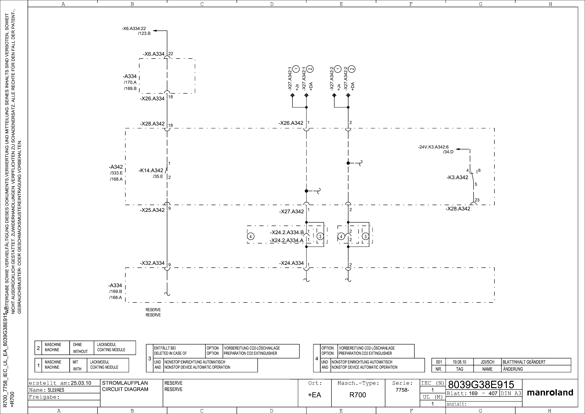

# +EA — Sheet 169 of 407 — RESERVE

**RESERVE**

> Part of the manroland **R700** printing press IEC/UL circuit diagrams.
> Drawing class: **Stromlaufplan / Circuit diagram** (DIN A3).
> Document `+EA` covers the **Printing unit** machine section.

## At a glance

| Field | Value |
|---|---|
| Document | `+EA`  (8039G38E915) |
| Sheet | **169** of 407 |
| Section (DE) | RESERVE |
| Section (EN) | RESERVE |
| Section type | CIRCUIT — Circuit diagram |
| Machine type | `R700` |
| Series | `7758` |
| Created | 25.03.10 |
| Replaces | — |
| Columns used | A, B, C, D, E, F, G, H |
| Path numbers | — |
| Labels on sheet | 108 |
| Cross-refs out | 9 |
| Cross-refs in | 25 |

**Previous:** [+EA sheet 168](SHEET_0168.md) · **Next:** [+EA sheet 170](SHEET_0170.md) · **Document TOC:** [_TOC.md](_TOC.md)  (+EA) · **Master TOC:** [all sheets](../_MASTER_TOC.md)

## Sheet image (300 DPI, exact vector render)



_Rendered directly from the PDF vector layer at 300 DPI (1-bit), no OCR and no resampling. Use it to confirm anything ambiguous in the text below._

## Cross-references on this sheet

Each entry is a wire leaving this sheet. The printed token is `/sheet.column`; the link resolves to that sheet inside the same document.

| Ref | Target sheet | Col | Path | Destination on target | Target section | From col |
|---|---|---|---|---|---|---|
| `/123.B` | [+EA sheet 123](SHEET_0123.md) | B | — | X6.A334:22 | TROCKENBESTÄUBER | B |
| `/170.A` | [+EA sheet 170](SHEET_0170.md) | A | — | — | RESERVE | B |
| `/169.B` | [+EA sheet 169](SHEET_0169.md) | B | — | — | RESERVE | B |
| `/34.D` | [+EA sheet 34](SHEET_0034.md) | D | — | 24V.K3.A342:6 | BUSVERBINDUNGEN: NOT AUS | F |
| `/333.E` | [+EA sheet 333](SHEET_0333.md) | E | — | — | OPTION: BOGENWEICHE | B |
| `/168.A` | [+EA sheet 168](SHEET_0168.md) | A | — | — | RESERVE | B |
| `/35.E` | [+EA sheet 35](SHEET_0035.md) | E | — | — | BUSVERBINDUNGEN: NOT AUS | B |
| `/169.B` | [+EA sheet 169](SHEET_0169.md) | B | — | — | RESERVE | B |
| `/168.A` | [+EA sheet 168](SHEET_0168.md) | A | — | — | RESERVE | B |

### Incoming references (sheets that point here)

Every other sheet that sends a wire to this one. `Back-ref` is the token printed on *that* sheet; `Path` is its line number.

| From sheet | Cols | Back-ref | Path | Refs | What continues there |
|---|---|---|---|---|---|
| [+EA#34](SHEET_0034.md) | D | `/34.D` | — | 1 | — |
| [+EA#35](SHEET_0035.md) | E | `/35.E` | — | 1 | — |
| [+EA#123](SHEET_0123.md) | B | `/123.B` | — | 1 | — |
| [+EA#168](SHEET_0168.md) | A | `/168.A` | — | 2 | — |
| [+EA#169](SHEET_0169.md) | B | `/169.B` | — | 2 | — |
| [+EA#170](SHEET_0170.md) | A | `/170.A` | — | 1 | — |
| [+EA#244](SHEET_0244.md) | F | `/244.F` | — | 1 | — |
| [+EA#265](SHEET_0265.md) | F | `/265.F` | — | 2 | — |
| [+EA#266](SHEET_0266.md) | B, D | `/266.B`, `/266.D` | — | 4 | — |
| [+EA#267](SHEET_0267.md) | F | `/267.F` | — | 1 | — |
| [+EA#269](SHEET_0269.md) | B, C | `/269.B`, `/269.C` | — | 3 | — |
| [+EA#270](SHEET_0270.md) | G | `/270.G` | — | 2 | — |
| [+EA#272](SHEET_0272.md) | E | `/272.E` | — | 2 | — |
| [+EA#276](SHEET_0276.md) | F | `/276.F` | — | 1 | — |
| [+EA#333](SHEET_0333.md) | D | `/333.D` | — | 1 | — |


## Devices on this sheet

| Tag | Class | Class meaning (IEC) | Col | Sub | Terminal | Sign |
|---|---|---|---|---|---|---|
| `A334` | A | Baugruppe / assembly, module, PC board | B | — | — | — |
| `A342` | A | Baugruppe / assembly, module, PC board | B | — | — | — |
| `A334` | A | Baugruppe / assembly, module, PC board | B | — | — | — |
| `X27.A342:2` | — | cross-device reference | E | — | 2 | — |
| `X27.A342:2` | — | cross-device reference | E | — | 2 | — |
| `K3.A342` | — | cross-device reference | G | — | — | — |
| `X26.A342` | — | cross-device reference | D | — | — | — |
| `X27.A342` | — | cross-device reference | D | — | — | — |
| `X27.A342:1` | — | cross-device reference | D | — | 1 | — |
| `X27.A342:1` | — | cross-device reference | D | — | 1 | — |
| `X24.2.A334.B` | — | cross-device reference | D | — | — | — |
| `X24.2.A334.A` | — | cross-device reference | D | — | — | — |
| `X24.A334` | — | cross-device reference | D | — | — | — |
| `X32.A334` | — | cross-device reference | B | — | — | — |
| `X26.A334` | — | cross-device reference | B | — | — | — |
| `X28.A342` | — | cross-device reference | B | — | — | — |
| `X6.A334` | — | cross-device reference | B | — | — | — |
| `X25.A342` | — | cross-device reference | B | — | — | — |
| `K14.A342` | — | cross-device reference | B | — | — | — |
| `NR.` | — | cross-device reference | F | — | — | — |
| `19.08.10` | — | cross-device reference | G | — | — | — |
| `X6.A334:22` | — | cross-device reference | B | — | 22 | — |
| `X28.A342` | — | cross-device reference | G | — | — | — |

## Potentials / nets

| Potential | Count | Columns | Attached devices | Terminals |
|---|---|---|---|---|
| `24V` | 1 | F | `A342`, `K3` | `6` |


A potential such as `L24+/4` or `M24+` is a named supply/return rail; every place it appears on this sheet is electrically common.

## Wire-end annotations (grouped as printed)

A wire that continues elsewhere is annotated with a small cluster: the destination description, the path/line number `#NN`, and the `/sheet.column` cross reference. Each row below is one such cluster exactly as it is grouped on the drawing.

| Col | Y | Path | Cross-ref | Text on the wire |
|---|---|---|---|---|
| B | 54.1 | — | `/123.B` | `X6.A334:22` |
| B | 105.2 | — | — | `X6.A334 22` |
| D | 135.8 | — | — | `X27.A342:1` |
| D | 135.8 | — | — | `X27.A342:1` |
| E | 135.8 | — | — | `X27.A342:2` |
| E | 135.8 | — | — | `X27.A342:2` |
| D | 138.2 | — | — | `1` |
| E | 138.2 | — | — | `1` |
| E | 138.3 | — | — | `2` |
| E | 138.3 | — | — | `2` |
| B | 150.5 | — | — | `A334` |
| B | 163.6 | — | `/170.A`, `/169.B` | — |
| E | 167.2 | — | — | `+DA` |
| E | 167.2 | — | — | `+DA` |
| D | 170.9 | — | — | `+Jx` |
| E | 170.9 | — | — | `+Jx` |
| B | 193.1 | — | — | `X26.A334 18` |
| D | 245.5 | — | — | `X26.A342 1` |
| E | 245.5 | — | — | `2` |
| B | 246.9 | — | — | `X28.A342 18` |
| F | 295.1 | — | `/34.D` | `24V.K3.A342:6` |
| B | 328.4 | — | — | `K14.A342 1` |
| B | 334.8 | — | — | `A342` |
| G | 342.6 | — | — | `K3.A342 6` |
| G | 342.6 | — | — | `4` |
| B | 347.9 | — | `/333.E`, `/168.A` | — |
| B | 354.9 | — | `/35.E` | — |
| C | 356.8 | — | — | `2` |
| G | 370.9 | — | — | `5` |
| G | 402.8 | — | — | `23` |
| G | 419.8 | — | — | `X28.A342` |
| B | 419.9 | — | — | `X25.A342 9` |
| D | 422.7 | — | — | `X27.A342 1` |
| E | 422.7 | — | — | `2` |
| D | 466.6 | — | — | `X24.2.A334.B 1` |
| E | 466.6 | — | — | `2` |
| E | 477.9 | — | — | `4 3 4 3` |
| D | 483.6 | — | — | `X24.2.A334.A 1` |
| E | 483.6 | — | — | `2` |
| B | 530.4 | — | — | `X32.A334 9` |
| E | 530.4 | — | — | `X24.A334 1 2` |
| B | 575.7 | — | — | `A334` |
| B | 588.8 | — | `/169.B`, `/168.A` | — |
| B | 627.0 | — | — | `RESERVE RESERVE` |
| A | 697.9 | — | — | `2 MASCHINE MACHINE OHNE` |
| B | 698.0 | — | — | `LACKMODUL` |
| C | 705.0 | — | — | `ENTFÄLLT BEI DELETED IN CASE OF` |
| C | 705.0 | — | — | `OPTION OPTION` |
| D | 705.0 | — | — | `PREPARATION CO2 EXTINGUISHER VORBEREITUNG CO2 LÖSCHANLAGE` |
| E | 705.0 | — | — | `OPTION OPTION` |
| E | 705.0 | — | — | `PREPARATION CO2 EXTINGUISHER VORBEREITUNG CO2 LÖSCHANLAGE` |
| B | 708.6 | — | — | `COATING MODULE` |
| A | 712.1 | — | — | `WITHOUT` |
| D | 724.5 | — | — | `3 UND` |
| E | 724.5 | — | — | `4` |
| G | 733.0 | — | — | `001 19.08.10 JDI/SCH BLATTINHALT GEÄNDERT` |
| A | 733.4 | — | — | `1 MASCHINE MACHINE MIT` |
| B | 733.4 | — | — | `LACKMODUL` |
| B | 733.4 | — | — | `UND` |
| C | 733.4 | — | — | `NONSTOP EINRICHTUNG AUTOMATISCH NONSTOP DEVICE AUTOMATIC OPERATION` |
| E | 733.4 | — | — | `NONSTOP EINRICHTUNG AUTOMATISCH NONSTOP DEVICE AUTOMATIC OPERATION` |
| B | 744.0 | — | — | `COATING MODULE` |
| B | 744.0 | — | — | `AND` |
| E | 744.0 | — | — | `AND` |
| G | 747.1 | — | — | `NR. TAG NAME ÄNDERUNG` |
| A | 747.4 | — | — | `WITH` |


## Reconstructed tables

This sheet carries tabular content (pin map / terminal assignment / index). The grid below was rebuilt from the drawing's own rule lines, so each row is exactly one physical row of the table.

### Table 1 — 6 data rows × 14 columns (at x=204.1, y=0.0) — **X6.A334:22 /123.B X6.A334 A334 /170.A /169.B X26.A334 X28.A342 A342 K14.A342 /333.E /35.E /168.A X25.A342 22 X27.A342:1 1 +Jx 18 X26.A342 18 1 2 9 X27.A342 X27.A342:1 2 +DA 1 1 X27.A342:2 X27.A342:2 1 +Jx 2 +DA 2 2 24V.K3.A342:6 /34.D 4 K3.A342 X28.A342 6 5 23 X24.2.A334.B 4 X24.2.A334.A 1 3 1 4 2 3 2**

| X32.A334 A334 /169.B /168.A RESERVE RESERVE LACKMODUL ENTFÄLLT COATING MODULE DELETED 3 UND AND MODULE |  | X24.A334 9 BEI OPTION VORBEREITUNG CO2 LÖSCHANLAGE OPTION IN CASE OF PREPARATION CO2 EXTINGUISHER NONSTOP EINRICHTUNG AUTOMATISCH NONSTOP DEVICE AUTOMATIC OPERATION |  | 1 4 | OPTION OPTION UND AND | NONSTOP NONSTOP | 2 VORBEREITUNG PREPARATION CO2 EINRICHTUNG DEVICE | CO2 LÖSCHANLAGE EXTINGUISHER AUTOMATISCH AUTOMATIC | OPERATION | 001 NR. | 19.08.10 TAG |  | JDI/SCH BLATTINHALT NAME ÄNDERUNG |
|---|---|---|---|---|---|---|---|---|---|---|---|---|---|
| `STROMLAUFPLAN` |  | `RESERVE` |  | `Ort:` |  |  | `Masch. Type:` |  | `Serie:` | `IEC (N)` |  |  | `8039G38E915` |
| `CIRCUIT DIAGRAM` |  |  |  |  |  |  |  |  |  |  |  |  |  |
|  |  | `RESERVE` |  |  |  |  |  |  | `7758` | `1` |  |  |  |
|  |  |  |  | `+EA` |  |  | `R700` |  |  |  | `Blatt:` | `169` | `DIN A3 407` |
|  |  |  |  |  |  |  |  |  |  | `UL (M)` |  |  |  |
|  |  |  |  |  |  |  |  |  |  | `1` | `anstatt:` |  |  |


## Notes and free text on this sheet

| Text | Col | Y (pt) |
|---|---|---|
| `+Jx` | E | 170.93 |
| `+DA` | E | 167.25 |
| `+Jx` | D | 170.93 |
| `TAG` | G | 747.27 |
| `NAME` | G | 747.25 |
| `ÄNDERUNG` | G | 747.31 |
| `JDI/SCH` | G | 733.1 |
| `BLATTINHALT GEÄNDERT` | H | 733.14 |
| `MASCHINE` | A | 733.38 |
| `MACHINE` | A | 744.02 |
| `MIT` | A | 733.35 |
| `WITH` | A | 747.43 |
| `LACKMODUL` | B | 733.4 |
| `COATING MODULE` | B | 744.03 |
| `OHNE` | A | 697.94 |
| `WITHOUT` | A | 712.08 |
| `RESERVE` | B | 627.04 |
| `ENTFÄLLT BEI` | B | 705 |
| `DELETED IN CASE OF` | C | 715.65 |
| `OPTION` | C | 705.01 |
| `VORBEREITUNG CO2 LÖSCHANLAGE` | D | 705.05 |
| `PREPARATION CO2 EXTINGUISHER` | D | 715.67 |
| `UND` | B | 733.38 |
| `AND` | B | 744.03 |
| `NONSTOP EINRICHTUNG AUTOMATISCH` | C | 733.39 |
| `NONSTOP DEVICE AUTOMATIC OPERATION` | C | 744.01 |
| `UND` | E | 733.38 |
| `AND` | E | 744.03 |
| `NONSTOP EINRICHTUNG AUTOMATISCH` | E | 733.39 |
| `NONSTOP DEVICE AUTOMATIC OPERATION` | E | 744.01 |
| `OPTION` | E | 705.01 |
| `VORBEREITUNG CO2 LÖSCHANLAGE` | E | 705.05 |
| `PREPARATION CO2 EXTINGUISHER` | E | 715.67 |

## Complete label inventory (exact text from the drawing)

Every text object inside the drawing area of this sheet, in DIN reading order (column A→H, then top→bottom). This is the authoritative list: if a string is not here it is not printed on this sheet.

| Col | Y | X | Dir | Type | Text |
|---|---|---|---|---|---|
| A | 697.9 | 91.6 | → | text | `MASCHINE` |
| A | 697.9 | 148.5 | → | text | `OHNE` |
| A | 703.3 | 75.1 | → | number | `2` |
| A | 708.6 | 91.6 | → | text | `MACHINE` |
| A | 712.1 | 148.8 | → | text | `WITHOUT` |
| A | 733.4 | 91.6 | → | text | `MASCHINE` |
| A | 733.4 | 148.3 | → | text | `MIT` |
| A | 738.7 | 75.4 | → | number | `1` |
| A | 744.0 | 91.6 | → | text | `MACHINE` |
| A | 747.4 | 148.8 | → | text | `WITH` |
| B | 54.1 | 248.0 | → | device ref | `X6.A334:22` |
| B | 64.0 | 280.9 | → | cross-reference | `/123.B` |
| B | 105.2 | 290.8 | → | device ref | `X6.A334` |
| B | 150.5 | 250.0 | → | device tag | `A334` |
| B | 163.6 | 252.3 | → | cross-reference | `/170.A` |
| B | 176.0 | 252.6 | → | cross-reference | `/169.B` |
| B | 195.9 | 284.9 | → | device ref | `X26.A334` |
| B | 246.9 | 284.9 | → | device ref | `X28.A342` |
| B | 334.8 | 221.7 | → | device tag | `A342` |
| B | 341.9 | 282.0 | → | device ref | `K14.A342` |
| B | 347.9 | 224.5 | → | cross-reference | `/333.E` |
| B | 354.9 | 311.5 | → | cross-reference | `/35.E` |
| B | 360.3 | 223.9 | → | cross-reference | `/168.A` |
| B | 422.7 | 284.9 | → | device ref | `X25.A342` |
| B | 530.4 | 284.9 | → | device ref | `X32.A334` |
| B | 575.7 | 220.3 | → | device tag | `A334` |
| B | 588.8 | 222.8 | → | cross-reference | `/169.B` |
| B | 601.2 | 222.5 | → | cross-reference | `/168.A` |
| B | 627.0 | 296.8 | → | text | `RESERVE` |
| B | 637.7 | 296.8 | → | text | `RESERVE` |
| B | 698.0 | 197.6 | → | text | `LACKMODUL` |
| B | 705.0 | 313.8 | → | text | `ENTFÄLLT BEI` |
| B | 708.6 | 198.1 | → | text | `COATING MODULE` |
| B | 724.5 | 301.7 | → | number | `3` |
| B | 733.4 | 183.4 | → | text | `LACKMODUL` |
| B | 733.4 | 313.8 | → | text | `UND` |
| B | 744.0 | 184.0 | → | text | `COATING MODULE` |
| B | 744.0 | 314.6 | → | text | `AND` |
| C | 105.2 | 342.7 | → | number | `22` |
| C | 193.1 | 342.1 | → | number | `18` |
| C | 251.2 | 342.1 | → | number | `18` |
| C | 328.4 | 342.1 | → | number | `1` |
| C | 356.8 | 342.7 | → | number | `2` |
| C | 419.9 | 342.7 | → | number | `9` |
| C | 534.7 | 342.7 | → | number | `9` |
| C | 705.0 | 420.7 | → | text | `OPTION` |
| C | 715.6 | 420.7 | → | text | `OPTION` |
| C | 715.7 | 313.8 | → | text | `DELETED IN CASE OF` |
| C | 733.4 | 335.1 | → | text | `NONSTOP EINRICHTUNG AUTOMATISCH` |
| C | 744.0 | 335.1 | → | text | `NONSTOP DEVICE AUTOMATIC OPERATION` |
| D | 135.8 | 586.3 | ↕ | device ref | `X27.A342:1` |
| D | 135.8 | 614.7 | ↕ | device ref | `X27.A342:1` |
| D | 138.2 | 600.1 | ↕ | number | `1` |
| D | 170.9 | 600.6 | ↕ | text | `+Jx` |
| D | 245.5 | 566.9 | → | device ref | `X26.A342` |
| D | 425.5 | 568.3 | → | device ref | `X27.A342` |
| D | 468.0 | 549.6 | → | device ref | `X24.2.A334.B` |
| D | 477.9 | 508.2 | → | number | `4` |
| D | 484.3 | 548.8 | → | device ref | `X24.2.A334.A` |
| D | 530.4 | 568.3 | → | device ref | `X24.A334` |
| D | 705.1 | 456.4 | → | text | `VORBEREITUNG CO2 LÖSCHANLAGE` |
| D | 715.7 | 455.5 | → | text | `PREPARATION CO2 EXTINGUISHER` |
| E | 135.8 | 671.4 | ↕ | device ref | `X27.A342:2` |
| E | 135.8 | 699.7 | ↕ | device ref | `X27.A342:2` |
| E | 138.2 | 685.2 | ↕ | number | `1` |
| E | 138.3 | 628.2 | ↕ | number | `2` |
| E | 138.3 | 713.2 | ↕ | number | `2` |
| E | 167.2 | 628.9 | ↕ | text | `+DA` |
| E | 167.2 | 713.9 | ↕ | text | `+DA` |
| E | 170.9 | 685.6 | ↕ | text | `+Jx` |
| E | 245.5 | 625.6 | → | number | `1` |
| E | 245.5 | 711.2 | → | number | `2` |
| E | 422.7 | 625.6 | → | number | `1` |
| E | 422.7 | 711.2 | → | number | `2` |
| E | 466.6 | 625.6 | → | number | `1` |
| E | 466.6 | 711.2 | → | number | `2` |
| E | 477.9 | 650.0 | → | number | `3` |
| E | 477.9 | 692.5 | → | number | `4` |
| E | 477.9 | 742.1 | → | number | `3` |
| E | 483.6 | 625.6 | → | number | `1` |
| E | 483.6 | 711.2 | → | number | `2` |
| E | 534.7 | 625.6 | → | number | `1` |
| E | 534.7 | 711.2 | → | number | `2` |
| E | 705.0 | 654.5 | → | text | `OPTION` |
| E | 705.1 | 690.2 | → | text | `VORBEREITUNG CO2 LÖSCHANLAGE` |
| E | 715.6 | 654.5 | → | text | `OPTION` |
| E | 715.7 | 689.4 | → | text | `PREPARATION CO2 EXTINGUISHER` |
| E | 724.5 | 642.0 | → | number | `4` |
| E | 733.4 | 654.0 | → | text | `UND` |
| E | 733.4 | 675.2 | → | text | `NONSTOP EINRICHTUNG AUTOMATISCH` |
| E | 744.0 | 654.8 | → | text | `AND` |
| E | 744.0 | 675.2 | → | text | `NONSTOP DEVICE AUTOMATIC OPERATION` |
| F | 295.1 | 851.0 | → | potential | `24V.K3.A342:6` |
| F | 733.0 | 887.7 | → | number | `001` |
| F | 747.1 | 886.7 | → | device ref | `NR.` |
| G | 305.0 | 902.0 | → | cross-reference | `/34.D` |
| G | 342.6 | 949.3 | → | number | `4` |
| G | 342.6 | 973.4 | → | number | `6` |
| G | 356.1 | 908.8 | → | device ref | `K3.A342` |
| G | 371.0 | 966.3 | → | number | `5` |
| G | 402.8 | 966.3 | → | number | `23` |
| G | 419.8 | 907.1 | → | device ref | `X28.A342` |
| G | 733.1 | 921.5 | → | device ref | `19.08.10` |
| G | 733.1 | 978.7 | → | text | `JDI/SCH` |
| G | 747.3 | 928.3 | → | text | `TAG` |
| G | 747.3 | 981.7 | → | text | `NAME` |
| G | 747.3 | 1024.3 | → | text | `ÄNDERUNG` |
| H | 733.1 | 1023.2 | → | text | `BLATTINHALT GEÄNDERT` |

## Reading-order text block

The same content as a plain block, grouped by DIN column — convenient to paste or to match against a visual description.

```text
=== Column A ===
 697.9   91.6  text         MASCHINE
 697.9  148.5  text         OHNE
 703.3   75.1  numeric      2
 708.6   91.6  text         MACHINE
 712.1  148.8  text         WITHOUT
 733.4   91.6  text         MASCHINE
 733.4  148.3  text         MIT
 738.7   75.4  numeric      1
 744.0   91.6  text         MACHINE
 747.4  148.8  text         WITH
=== Column B ===
  54.1  248.0  devref       X6.A334:22
  64.0  280.9  xref         /123.B
 105.2  290.8  devref       X6.A334
 150.5  250.0  devtag       A334
 163.6  252.3  xref         /170.A
 176.0  252.6  xref         /169.B
 195.9  284.9  devref       X26.A334
 246.9  284.9  devref       X28.A342
 334.8  221.7  devtag       A342
 341.9  282.0  devref       K14.A342
 347.9  224.5  xref         /333.E
 354.9  311.5  xref         /35.E
 360.3  223.9  xref         /168.A
 422.7  284.9  devref       X25.A342
 530.4  284.9  devref       X32.A334
 575.7  220.3  devtag       A334
 588.8  222.8  xref         /169.B
 601.2  222.5  xref         /168.A
 627.0  296.8  text         RESERVE
 637.7  296.8  text         RESERVE
 698.0  197.6  text         LACKMODUL
 705.0  313.8  text         ENTFÄLLT BEI
 708.6  198.1  text         COATING MODULE
 724.5  301.7  numeric      3
 733.4  183.4  text         LACKMODUL
 733.4  313.8  text         UND
 744.0  184.0  text         COATING MODULE
 744.0  314.6  text         AND
=== Column C ===
 105.2  342.7  numeric      22
 193.1  342.1  numeric      18
 251.2  342.1  numeric      18
 328.4  342.1  numeric      1
 356.8  342.7  numeric      2
 419.9  342.7  numeric      9
 534.7  342.7  numeric      9
 705.0  420.7  text         OPTION
 715.6  420.7  text         OPTION
 715.7  313.8  text         DELETED IN CASE OF
 733.4  335.1  text         NONSTOP EINRICHTUNG AUTOMATISCH
 744.0  335.1  text         NONSTOP DEVICE AUTOMATIC OPERATION
=== Column D ===
 135.8  586.3  devref       X27.A342:1
 135.8  614.7  devref       X27.A342:1
 138.2  600.1  numeric      1
 170.9  600.6  text         +Jx
 245.5  566.9  devref       X26.A342
 425.5  568.3  devref       X27.A342
 468.0  549.6  devref       X24.2.A334.B
 477.9  508.2  numeric      4
 484.3  548.8  devref       X24.2.A334.A
 530.4  568.3  devref       X24.A334
 705.1  456.4  text         VORBEREITUNG CO2 LÖSCHANLAGE
 715.7  455.5  text         PREPARATION CO2 EXTINGUISHER
=== Column E ===
 135.8  671.4  devref       X27.A342:2
 135.8  699.7  devref       X27.A342:2
 138.2  685.2  numeric      1
 138.3  628.2  numeric      2
 138.3  713.2  numeric      2
 167.2  628.9  text         +DA
 167.2  713.9  text         +DA
 170.9  685.6  text         +Jx
 245.5  625.6  numeric      1
 245.5  711.2  numeric      2
 422.7  625.6  numeric      1
 422.7  711.2  numeric      2
 466.6  625.6  numeric      1
 466.6  711.2  numeric      2
 477.9  650.0  numeric      3
 477.9  692.5  numeric      4
 477.9  742.1  numeric      3
 483.6  625.6  numeric      1
 483.6  711.2  numeric      2
 534.7  625.6  numeric      1
 534.7  711.2  numeric      2
 705.0  654.5  text         OPTION
 705.1  690.2  text         VORBEREITUNG CO2 LÖSCHANLAGE
 715.6  654.5  text         OPTION
 715.7  689.4  text         PREPARATION CO2 EXTINGUISHER
 724.5  642.0  numeric      4
 733.4  654.0  text         UND
 733.4  675.2  text         NONSTOP EINRICHTUNG AUTOMATISCH
 744.0  654.8  text         AND
 744.0  675.2  text         NONSTOP DEVICE AUTOMATIC OPERATION
=== Column F ===
 295.1  851.0  net          24V.K3.A342:6
 733.0  887.7  numeric      001
 747.1  886.7  devref       NR.
=== Column G ===
 305.0  902.0  xref         /34.D
 342.6  949.3  numeric      4
 342.6  973.4  numeric      6
 356.1  908.8  devref       K3.A342
 371.0  966.3  numeric      5
 402.8  966.3  numeric      23
 419.8  907.1  devref       X28.A342
 733.1  921.5  devref       19.08.10
 733.1  978.7  text         JDI/SCH
 747.3  928.3  text         TAG
 747.3  981.7  text         NAME
 747.3 1024.3  text         ÄNDERUNG
=== Column H ===
 733.1 1023.2  text         BLATTINHALT GEÄNDERT
```

---
_Generated from the PDF vector text layer; no OCR. Source: `R700_7758_IEC_UL_EA_8039G38E915_p`, sheet 169._
