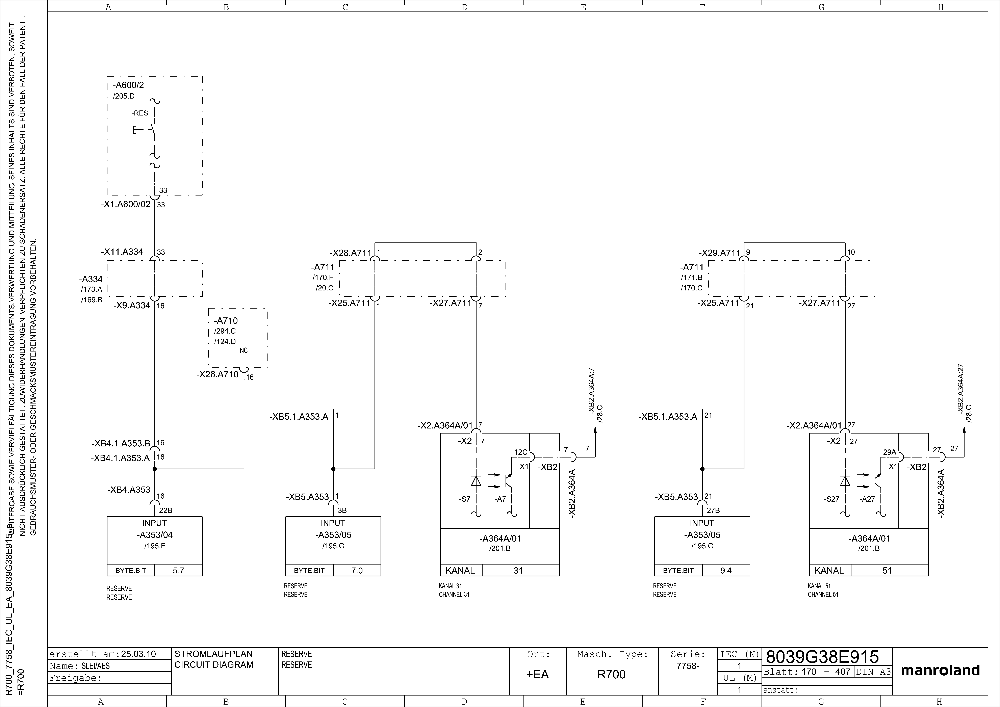

# +EA — Sheet 170 of 407 — RESERVE

**RESERVE**

> Part of the manroland **R700** printing press IEC/UL circuit diagrams.
> Drawing class: **Stromlaufplan / Circuit diagram** (DIN A3).
> Document `+EA` covers the **Printing unit** machine section.

## At a glance

| Field | Value |
|---|---|
| Document | `+EA`  (8039G38E915) |
| Sheet | **170** of 407 |
| Section (DE) | RESERVE |
| Section (EN) | RESERVE |
| Section type | CIRCUIT — Circuit diagram |
| Machine type | `R700` |
| Series | `7758` |
| Created | 25.03.10 |
| Replaces | — |
| Columns used | A, B, C, D, E, F, G, H |
| Path numbers | — |
| Labels on sheet | 117 |
| Cross-refs out | 16 |
| Cross-refs in | 39 |

**Previous:** [+EA sheet 169](SHEET_0169.md) · **Next:** [+EA sheet 171](SHEET_0171.md) · **Document TOC:** [_TOC.md](_TOC.md)  (+EA) · **Master TOC:** [all sheets](../_MASTER_TOC.md)

## Sheet image (300 DPI, exact vector render)



_Rendered directly from the PDF vector layer at 300 DPI (1-bit), no OCR and no resampling. Use it to confirm anything ambiguous in the text below._

## Cross-references on this sheet

Each entry is a wire leaving this sheet. The printed token is `/sheet.column`; the link resolves to that sheet inside the same document.

| Ref | Target sheet | Col | Path | Destination on target | Target section | From col |
|---|---|---|---|---|---|---|
| `/205.D` | [+EA sheet 205](SHEET_0205.md) | D | — | A600/2 | REFERENZMODUL | A |
| `/171.B` | [+EA sheet 171](SHEET_0171.md) | B | — | — | RESERVE | F |
| `/170.C` | [+EA sheet 170](SHEET_0170.md) | C | — | — | RESERVE | F |
| `/170.F` | [+EA sheet 170](SHEET_0170.md) | F | — | — | RESERVE | C |
| `/20.C` | [+EA sheet 20](SHEET_0020.md) | C | — | — | SPANNUNGSVERSORGUNG: 400V, 24V | C |
| `/173.A` | [+EA sheet 173](SHEET_0173.md) | A | — | — | RESERVE | A |
| `/169.B` | [+EA sheet 169](SHEET_0169.md) | B | — | — | RESERVE | A |
| `/294.C` | [+EA sheet 294](SHEET_0294.md) | C | — | A710 | OPTION: ZWISCHENSTAPEL / | B |
| `/124.D` | [+EA sheet 124](SHEET_0124.md) | D | — | A710 | TROCKENBESTÄUBER | B |
| `/28.G` | [+EA sheet 28](SHEET_0028.md) | G | — | XB2.A364A:27 | BUSVERBINDUNGEN: SICHERHEITSBUS | H |
| `/28.C` | [+EA sheet 28](SHEET_0028.md) | C | — | XB2.A364A:7 | BUSVERBINDUNGEN: SICHERHEITSBUS | E |
| `/195.F` | [+EA sheet 195](SHEET_0195.md) | F | — | — | REFERENZMODUL | A |
| `/195.G` | [+EA sheet 195](SHEET_0195.md) | G | — | — | REFERENZMODUL | C |
| `/195.G` | [+EA sheet 195](SHEET_0195.md) | G | — | — | REFERENZMODUL | F |
| `/201.B` | [+EA sheet 201](SHEET_0201.md) | B | — | — | REFERENZMODUL | D |
| `/201.B` | [+EA sheet 201](SHEET_0201.md) | B | — | — | REFERENZMODUL | G |

### Incoming references (sheets that point here)

Every other sheet that sends a wire to this one. `Back-ref` is the token printed on *that* sheet; `Path` is its line number.

| From sheet | Cols | Back-ref | Path | Refs | What continues there |
|---|---|---|---|---|---|
| [+EA#20](SHEET_0020.md) | C | `/20.C` | — | 1 | — |
| [+EA#28](SHEET_0028.md) | B, F | `/28.B`, `/28.F` | — | 2 | — |
| [+EA#124](SHEET_0124.md) | D | `/124.D` | — | 1 | — |
| [+EA#169](SHEET_0169.md) | B | `/169.B` | — | 1 | — |
| [+EA#170](SHEET_0170.md) | C, F | `/170.C`, `/170.F` | — | 2 | — |
| [+EA#171](SHEET_0171.md) | B | `/171.B` | — | 1 | — |
| [+EA#173](SHEET_0173.md) | A | `/173.A` | — | 1 | — |
| [+EA#195](SHEET_0195.md) | F, G | `/195.F`, `/195.G` | — | 3 | — |
| [+EA#201](SHEET_0201.md) | B | `/201.B` | — | 2 | — |
| [+EA#205](SHEET_0205.md) | D | `/205.D` | — | 1 | — |
| [+EA#212](SHEET_0212.md) | H | `/212.H` | — | 1 | — |
| [+EA#227](SHEET_0227.md) | B, C, D, E | `/227.B`, `/227.C`, `/227.D`, `/227.E` | — | 4 | — |
| [+EA#237](SHEET_0237.md) | A, B, C | `/237.A`, `/237.B`, `/237.C` | — | 3 | — |
| [+EA#240](SHEET_0240.md) | F | `/240.F` | — | 2 | — |
| [+EA#241](SHEET_0241.md) | A | `/241.A` | — | 2 | — |
| [+EA#252](SHEET_0252.md) | A | `/252.A` | — | 1 | — |
| [+EA#255](SHEET_0255.md) | H | `/255.H` | — | 1 | — |
| [+EA#268](SHEET_0268.md) | E | `/268.E` | — | 2 | — |
| [+EA#270](SHEET_0270.md) | C | `/270.C` | — | 1 | — |
| [+EA#271](SHEET_0271.md) | E, F | `/271.E`, `/271.F` | — | 2 | — |
| [+EA#273](SHEET_0273.md) | A | `/273.A` | — | 2 | — |
| [+EA#274](SHEET_0274.md) | E | `/274.E` | — | 2 | — |
| [+EA#294](SHEET_0294.md) | C | `/294.C` | — | 1 | — |


## Devices on this sheet

| Tag | Class | Class meaning (IEC) | Col | Sub | Terminal | Sign |
|---|---|---|---|---|---|---|
| `A353/04` | A | Baugruppe / assembly, module, PC board | A | 04 | — | — |
| `A600/2` | A | Baugruppe / assembly, module, PC board | A | 2 | — | — |
| `A353/05` | A | Baugruppe / assembly, module, PC board | F | 05 | — | — |
| `S27` | S | Schalter / switch | G | — | — | — |
| `A27` | A | Baugruppe / assembly, module, PC board | G | — | — | — |
| `X1` | X | Klemme / terminal, plug connector | H | — | — | — |
| `X2` | X | Klemme / terminal, plug connector | G | — | — | — |
| `XB2` | XB |  | H | — | — | — |
| `A334` | A | Baugruppe / assembly, module, PC board | A | — | — | — |
| `A711` | A | Baugruppe / assembly, module, PC board | F | — | — | — |
| `A710` | A | Baugruppe / assembly, module, PC board | B | — | — | — |
| `A353/05` | A | Baugruppe / assembly, module, PC board | C | 05 | — | — |
| `S7` | S | Schalter / switch | D | — | — | — |
| `A7` | A | Baugruppe / assembly, module, PC board | D | — | — | — |
| `X1` | X | Klemme / terminal, plug connector | D | — | — | — |
| `X2` | X | Klemme / terminal, plug connector | D | — | — | — |
| `XB2` | XB |  | E | — | — | — |
| `A711` | A | Baugruppe / assembly, module, PC board | C | — | — | — |
| `5.7` | — | cross-device reference | B | — | — | — |
| `XB4.A353` | — | cross-device reference | A | — | — | — |
| `9.4` | — | cross-device reference | F | — | — | — |
| `XB5.A353` | — | cross-device reference | F | — | — | — |
| `XB5.1.A353.A` | — | cross-device reference | F | — | — | — |
| `XB2.A364A` | — | cross-device reference | H | — | — | — |
| `XB4.1.A353.B` | — | cross-device reference | A | — | — | — |
| `XB4.1.A353.A` | — | cross-device reference | A | — | — | — |
| `X11.A334` | — | cross-device reference | A | — | — | — |
| `X29.A711` | — | cross-device reference | F | — | — | — |
| `X25.A711` | — | cross-device reference | F | — | — | — |
| `X27.A711` | — | cross-device reference | G | — | — | — |
| `X9.A334` | — | cross-device reference | A | — | — | — |
| `X26.A710` | — | cross-device reference | B | — | — | — |
| `7.0` | — | cross-device reference | C | — | — | — |
| `XB5.A353` | — | cross-device reference | C | — | — | — |
| `XB5.1.A353.A` | — | cross-device reference | C | — | — | — |
| `XB2.A364A` | — | cross-device reference | E | — | — | — |
| `X28.A711` | — | cross-device reference | C | — | — | — |
| `X25.A711` | — | cross-device reference | C | — | — | — |
| `X27.A711` | — | cross-device reference | D | — | — | — |
| `XB2.A364A:27` | — | cross-device reference | H | — | 27 | — |
| `XB2.A364A:7` | — | cross-device reference | E | — | 7 | — |

## Potentials / nets

_No named potentials on this sheet._

## Wire-end annotations (grouped as printed)

A wire that continues elsewhere is annotated with a small cluster: the destination description, the path/line number `#NN`, and the `/sheet.column` cross reference. Each row below is one such cluster exactly as it is grouped on the drawing.

| Col | Y | Path | Cross-ref | Text on the wire |
|---|---|---|---|---|
| A | 96.7 | — | `/205.D` | `A600/2` |
| A | 131.1 | — | — | `RES` |
| A | 222.8 | — | — | `33` |
| A | 238.4 | — | — | `X1.A600/02 33` |
| A | 295.1 | — | — | `X11.A334 33` |
| C | 296.5 | — | — | `X28.A711 1` |
| D | 296.5 | — | — | `2` |
| F | 296.5 | — | — | `X29.A711 9` |
| G | 296.5 | — | — | `10` |
| C | 313.5 | — | — | `A711` |
| F | 313.5 | — | — | `A711` |
| C | 326.6 | — | `/170.F` | — |
| F | 326.6 | — | `/171.B`, `/170.C` | — |
| A | 327.7 | — | — | `A334` |
| C | 339.0 | — | `/20.C` | — |
| A | 340.8 | — | `/173.A`, `/169.B` | — |
| D | 356.1 | — | — | `X9.A334 16 X27.A711 27` |
| C | 356.1 | — | — | `X25.A711 1` |
| D | 356.1 | — | — | `X27.A711 7` |
| F | 356.1 | — | — | `X25.A711 21` |
| B | 377.3 | — | `/294.C`, `/124.D` | `A710` |
| B | 414.4 | — | — | `NC` |
| H | 432.9 | — | `/28.G` | `XB2.A364A:27` |
| E | 437.7 | — | `/28.C` | `XB2.A364A:7` |
| B | 441.1 | — | — | `X26.A710 16` |
| C | 490.7 | — | — | `XB5.1.A353.A 1` |
| F | 490.7 | — | — | `XB5.1.A353.A 21` |
| D | 502.0 | — | — | `X2.A364A/01 7` |
| G | 502.0 | — | — | `X2.A364A/01 27` |
| D | 520.5 | — | — | `X2` |
| G | 520.5 | — | — | `X2` |
| E | 521.9 | — | — | `7 7` |
| H | 521.9 | — | — | `27 27` |
| A | 523.3 | — | — | `XB4.1.A353.B 16` |
| E | 530.4 | — | — | `7` |
| H | 530.4 | — | — | `27` |
| H | 534.6 | — | — | `29A` |
| D | 534.7 | — | — | `12C` |
| A | 540.3 | — | — | `XB4.1.A353.A 16` |
| D | 551.6 | — | — | `X1` |
| H | 551.6 | — | — | `X1` |
| E | 551.7 | — | — | `XB2` |
| H | 551.7 | — | — | `XB2` |
| E | 558.7 | — | — | `XB2.A364A` |
| H | 558.7 | — | — | `XB2.A364A` |
| A | 578.6 | — | — | `XB4.A353 16` |
| C | 587.1 | — | — | `XB5.A353 1` |
| F | 587.1 | — | — | `XB5.A353 21` |
| D | 590.6 | — | — | `S7 A7` |
| G | 590.6 | — | — | `S27 A27` |
| C | 604.0 | — | — | `3B` |
| A | 604.1 | — | — | `22B` |
| F | 604.1 | — | — | `27B` |
| A | 618.6 | — | — | `INPUT` |
| C | 618.6 | — | — | `INPUT` |
| F | 618.6 | — | — | `INPUT` |
| A | 632.4 | — | — | `A353/04` |
| C | 632.4 | — | — | `A353/05` |
| F | 632.4 | — | — | `A353/05` |
| D | 636.7 | — | — | `A364A/01` |
| G | 636.7 | — | — | `A364A/01` |
| A | 646.2 | — | `/195.F` | — |
| C | 646.2 | — | `/195.G` | — |
| F | 646.2 | — | `/195.G` | — |
| D | 649.0 | — | `/201.B` | — |
| G | 649.0 | — | `/201.B` | — |
| D | 674.9 | — | — | `KANAL 31` |
| G | 674.9 | — | — | `KANAL 51` |
| A | 675.3 | — | — | `BYTE.BIT 5.7` |
| C | 675.3 | — | — | `BYTE.BIT 7.0` |
| F | 675.3 | — | — | `BYTE.BIT 9.4` |
| D | 695.2 | — | — | `KANAL 31 CHANNEL 31` |
| G | 695.2 | — | — | `KANAL 51 CHANNEL 51` |
| C | 695.3 | — | — | `RESERVE RESERVE` |
| F | 695.3 | — | — | `RESERVE RESERVE` |
| A | 697.9 | — | — | `RESERVE RESERVE` |


## Reconstructed tables

This sheet carries tabular content (pin map / terminal assignment / index). The grid below was rebuilt from the drawing's own rule lines, so each row is exactly one physical row of the table.

### Table 1 — 7 data rows × 7 columns (at x=127.6, y=90.7)

| A600/2 /205.D RES | 33 |  |  |  |  |  |
|---|---|---|---|---|---|---|
| `X1.A600/02` | `33` |  |  |  |  |  |
| `X11.A334 X9.A334` | `33 16` | `A710 /294.C /124.D NC X26.A710` | `16` | `A711 /170.F /20.C XB5.1.A353.A` | `X28.A711 X25.A711 1` | `1 1` |
| `XB4.1.A353.B XB4.1.A353.A` | `16 16` |  |  |  |  |  |
| `XB4.A353` | `16 22B` |  |  | `XB5.A353` | `1 3B` |  |
| `INPUT` |  |  |  | `INPUT` |  |  |
|  | `A353/04 /195.F` |  |  |  | `A353/05 /195.G` |  |
| `BYTE.BIT` | `5.7` |  |  | `BYTE.BIT` | `7.0` |  |


### Table 2 — 5 data rows × 15 columns (at x=524.4, y=90.7)

| X27.A711 X2.A364A/01 | 2 7 7 |  |  | XB2.A364A:7 | /28.C | A711 /171.B /170.C XB5.1.A353.A | X29.A711 X25.A711 21 | 9 | 21 | X27.A711 X2.A364A/01 | 10 27 27 |  |  | XB2.A364A:27 |
|---|---|---|---|---|---|---|---|---|---|---|---|---|---|---|
| `X2` | `7` | `12C X1` | `XB2` | `7 7` |  |  |  |  |  | `X2` | `27` | `29A X1` | `XB2` | `27 27` |
| `S7` | `A7` |  |  | `XB2.A364A` |  | `XB5.A353` | `21 27B` |  |  | `S27` | `A27` |  |  | `XB2.A364A` |
|  |  |  |  |  |  | `INPUT` |  |  |  |  |  |  |  |  |
|  | `A364A/01 /201.B` |  |  |  |  |  | `A353/05 /195.G` |  |  |  | `A364A/01 /201.B` |  |  |  |
| `KANAL` |  | `31` |  |  |  | `BYTE.BIT` | `9.4` |  |  | `KANAL` |  | `51` |  |  |


## Notes and free text on this sheet

| Text | Col | Y (pt) |
|---|---|---|
| `22B` | A | 604.07 |
| `INPUT` | A | 618.59 |
| `BYTE.BIT` | A | 675.84 |
| `RESERVE` | A | 697.91 |
| `X1.A600/02` | A | 238.42 |
| `RES` | A | 131.13 |
| `27B` | F | 604.07 |
| `INPUT` | F | 618.59 |
| `BYTE.BIT` | F | 675.84 |
| `RESERVE` | F | 695.27 |
| `KANAL 51` | G | 695.24 |
| `CHANNEL 51` | G | 705.19 |
| `29A` | H | 534.62 |
| `KANAL` | G | 674.94 |
| `A364A/01` | G | 636.68 |
| `X2.A364A/01` | G | 502.04 |
| `3B` | C | 604.05 |
| `INPUT` | C | 618.59 |
| `BYTE.BIT` | C | 675.84 |
| `RESERVE` | C | 695.27 |
| `KANAL 31` | D | 695.24 |
| `CHANNEL 31` | D | 705.19 |
| `12C` | D | 534.66 |
| `KANAL` | D | 674.94 |
| `A364A/01` | D | 636.68 |
| `X2.A364A/01` | D | 502.04 |
| `NC` | B | 414.44 |

## Complete label inventory (exact text from the drawing)

Every text object inside the drawing area of this sheet, in DIN reading order (column A→H, then top→bottom). This is the authoritative list: if a string is not here it is not printed on this sheet.

| Col | Y | X | Dir | Type | Text |
|---|---|---|---|---|---|
| A | 96.7 | 134.4 | → | device tag | `A600/2` |
| A | 110.5 | 134.6 | → | cross-reference | `/205.D` |
| A | 131.1 | 156.8 | → | text | `RES` |
| A | 222.8 | 189.6 | → | number | `33` |
| A | 238.4 | 120.2 | → | text | `X1.A600/02` |
| A | 239.9 | 186.8 | → | number | `33` |
| A | 295.1 | 120.5 | → | device ref | `X11.A334` |
| A | 296.5 | 186.8 | → | number | `33` |
| A | 327.7 | 94.1 | → | device tag | `A334` |
| A | 340.8 | 96.4 | → | cross-reference | `/173.A` |
| A | 353.2 | 96.7 | → | cross-reference | `/169.B` |
| A | 358.9 | 134.9 | → | device ref | `X9.A334` |
| A | 360.3 | 186.2 | → | number | `16` |
| A | 523.3 | 109.1 | → | device ref | `XB4.1.A353.B` |
| A | 523.3 | 186.2 | → | number | `16` |
| A | 540.3 | 186.2 | → | number | `16` |
| A | 541.0 | 108.3 | → | device ref | `XB4.1.A353.A` |
| A | 578.6 | 127.8 | → | device ref | `XB4.A353` |
| A | 587.1 | 186.2 | → | number | `16` |
| A | 604.1 | 189.6 | → | text | `22B` |
| A | 618.6 | 169.4 | → | text | `INPUT` |
| A | 632.4 | 162.9 | → | device tag | `A353/04` |
| A | 646.2 | 171.9 | → | cross-reference | `/195.F` |
| A | 675.8 | 137.5 | → | text | `BYTE.BIT` |
| A | 697.9 | 126.7 | → | text | `RESERVE` |
| A | 708.5 | 126.7 | → | text | `RESERVE` |
| B | 377.3 | 254.8 | → | device tag | `A710` |
| B | 390.4 | 255.1 | → | cross-reference | `/294.C` |
| B | 402.8 | 255.1 | → | cross-reference | `/124.D` |
| B | 414.4 | 285.7 | → | text | `NC` |
| B | 441.1 | 233.9 | → | device ref | `X26.A710` |
| B | 445.4 | 292.5 | → | number | `16` |
| B | 675.3 | 205.8 | → | device ref | `5.7` |
| C | 296.5 | 392.6 | → | device ref | `X28.A711` |
| C | 296.5 | 448.4 | → | number | `1` |
| C | 313.5 | 370.5 | → | device tag | `A711` |
| C | 326.6 | 372.2 | → | cross-reference | `/170.F` |
| C | 339.0 | 376.2 | → | cross-reference | `/20.C` |
| C | 356.1 | 391.2 | → | device ref | `X25.A711` |
| C | 360.3 | 448.4 | → | number | `1` |
| C | 490.7 | 398.8 | → | number | `1` |
| C | 491.4 | 320.9 | → | device ref | `XB5.1.A353.A` |
| C | 587.1 | 340.4 | → | device ref | `XB5.A353` |
| C | 587.1 | 398.8 | → | number | `1` |
| C | 604.0 | 402.2 | → | text | `3B` |
| C | 618.6 | 382.0 | → | text | `INPUT` |
| C | 632.4 | 375.4 | → | device tag | `A353/05` |
| C | 646.2 | 384.0 | → | cross-reference | `/195.G` |
| C | 675.3 | 418.4 | → | device ref | `7.0` |
| C | 675.8 | 350.1 | → | text | `BYTE.BIT` |
| C | 695.3 | 338.2 | → | text | `RESERVE` |
| C | 705.2 | 338.2 | → | text | `RESERVE` |
| D | 296.5 | 569.5 | → | number | `2` |
| D | 356.1 | 511.7 | → | device ref | `X27.A711` |
| D | 360.3 | 569.5 | → | number | `7` |
| D | 502.0 | 497.2 | → | text | `X2.A364A/01` |
| D | 502.1 | 569.5 | → | number | `7` |
| D | 520.5 | 545.4 | → | device tag | `X2` |
| D | 521.9 | 572.3 | → | number | `7` |
| D | 534.7 | 612.3 | → | text | `12C` |
| D | 551.6 | 616.0 | → | device tag | `X1` |
| D | 590.6 | 546.5 | → | device tag | `S7` |
| D | 590.6 | 589.0 | → | device tag | `A7` |
| D | 636.7 | 571.0 | → | text | `A364A/01` |
| D | 649.0 | 582.7 | → | cross-reference | `/201.B` |
| D | 674.9 | 530.6 | → | text | `KANAL` |
| D | 674.9 | 611.3 | → | number | `31` |
| D | 695.2 | 522.4 | → | text | `KANAL 31` |
| D | 705.2 | 522.7 | → | text | `CHANNEL 31` |
| E | 437.7 | 700.4 | ↕ | device ref | `XB2.A364A:7` |
| E | 482.2 | 710.4 | ↕ | cross-reference | `/28.C` |
| E | 530.4 | 697.0 | → | number | `7` |
| E | 531.8 | 671.5 | → | number | `7` |
| E | 551.7 | 640.3 | → | device tag | `XB2` |
| E | 558.7 | 676.4 | ↕ | device ref | `XB2.A364A` |
| F | 296.5 | 832.0 | → | device ref | `X29.A711` |
| F | 296.5 | 888.4 | → | number | `9` |
| F | 313.5 | 809.9 | → | device tag | `A711` |
| F | 326.6 | 811.0 | → | cross-reference | `/171.B` |
| F | 339.0 | 810.7 | → | cross-reference | `/170.C` |
| F | 356.1 | 830.6 | → | device ref | `X25.A711` |
| F | 360.3 | 888.4 | → | number | `21` |
| F | 490.7 | 838.8 | → | number | `21` |
| F | 491.4 | 760.3 | → | device ref | `XB5.1.A353.A` |
| F | 587.1 | 779.8 | → | device ref | `XB5.A353` |
| F | 587.1 | 838.8 | → | number | `21` |
| F | 604.1 | 841.6 | → | text | `27B` |
| F | 618.6 | 821.3 | → | text | `INPUT` |
| F | 632.4 | 814.8 | → | device tag | `A353/05` |
| F | 646.2 | 823.3 | → | cross-reference | `/195.G` |
| F | 675.3 | 857.8 | → | device ref | `9.4` |
| F | 675.8 | 789.4 | → | text | `BYTE.BIT` |
| F | 695.3 | 777.5 | → | text | `RESERVE` |
| F | 705.2 | 777.5 | → | text | `RESERVE` |
| G | 296.5 | 1008.3 | → | number | `10` |
| G | 356.1 | 951.0 | → | device ref | `X27.A711` |
| G | 360.3 | 1008.9 | → | number | `27` |
| G | 502.0 | 936.6 | → | text | `X2.A364A/01` |
| G | 502.1 | 1008.9 | → | number | `27` |
| G | 520.5 | 984.8 | → | device tag | `X2` |
| G | 521.9 | 1011.7 | → | number | `27` |
| G | 590.6 | 981.1 | → | device tag | `S27` |
| G | 590.6 | 1023.6 | → | device tag | `A27` |
| G | 636.7 | 1010.4 | → | text | `A364A/01` |
| G | 649.0 | 1022.0 | → | cross-reference | `/201.B` |
| G | 674.9 | 970.0 | → | text | `KANAL` |
| G | 695.2 | 961.8 | → | text | `KANAL 51` |
| G | 705.2 | 962.1 | → | text | `CHANNEL 51` |
| H | 432.9 | 1139.8 | ↕ | device ref | `XB2.A364A:27` |
| H | 481.6 | 1149.7 | ↕ | cross-reference | `/28.G` |
| H | 530.4 | 1131.6 | → | number | `27` |
| H | 531.8 | 1110.9 | → | number | `27` |
| H | 534.6 | 1051.7 | → | text | `29A` |
| H | 551.6 | 1055.3 | → | device tag | `X1` |
| H | 551.7 | 1079.7 | → | device tag | `XB2` |
| H | 558.7 | 1115.7 | ↕ | device ref | `XB2.A364A` |
| H | 674.9 | 1050.7 | → | number | `51` |

## Reading-order text block

The same content as a plain block, grouped by DIN column — convenient to paste or to match against a visual description.

```text
=== Column A ===
  96.7  134.4  devtag       A600/2
 110.5  134.6  xref         /205.D
 131.1  156.8  text         RES
 222.8  189.6  numeric      33
 238.4  120.2  text         X1.A600/02
 239.9  186.8  numeric      33
 295.1  120.5  devref       X11.A334
 296.5  186.8  numeric      33
 327.7   94.1  devtag       A334
 340.8   96.4  xref         /173.A
 353.2   96.7  xref         /169.B
 358.9  134.9  devref       X9.A334
 360.3  186.2  numeric      16
 523.3  109.1  devref       XB4.1.A353.B
 523.3  186.2  numeric      16
 540.3  186.2  numeric      16
 541.0  108.3  devref       XB4.1.A353.A
 578.6  127.8  devref       XB4.A353
 587.1  186.2  numeric      16
 604.1  189.6  text         22B
 618.6  169.4  text         INPUT
 632.4  162.9  devtag       A353/04
 646.2  171.9  xref         /195.F
 675.8  137.5  text         BYTE.BIT
 697.9  126.7  text         RESERVE
 708.5  126.7  text         RESERVE
=== Column B ===
 377.3  254.8  devtag       A710
 390.4  255.1  xref         /294.C
 402.8  255.1  xref         /124.D
 414.4  285.7  text         NC
 441.1  233.9  devref       X26.A710
 445.4  292.5  numeric      16
 675.3  205.8  devref       5.7
=== Column C ===
 296.5  392.6  devref       X28.A711
 296.5  448.4  numeric      1
 313.5  370.5  devtag       A711
 326.6  372.2  xref         /170.F
 339.0  376.2  xref         /20.C
 356.1  391.2  devref       X25.A711
 360.3  448.4  numeric      1
 490.7  398.8  numeric      1
 491.4  320.9  devref       XB5.1.A353.A
 587.1  340.4  devref       XB5.A353
 587.1  398.8  numeric      1
 604.0  402.2  text         3B
 618.6  382.0  text         INPUT
 632.4  375.4  devtag       A353/05
 646.2  384.0  xref         /195.G
 675.3  418.4  devref       7.0
 675.8  350.1  text         BYTE.BIT
 695.3  338.2  text         RESERVE
 705.2  338.2  text         RESERVE
=== Column D ===
 296.5  569.5  numeric      2
 356.1  511.7  devref       X27.A711
 360.3  569.5  numeric      7
 502.0  497.2  text         X2.A364A/01
 502.1  569.5  numeric      7
 520.5  545.4  devtag       X2
 521.9  572.3  numeric      7
 534.7  612.3  text         12C
 551.6  616.0  devtag       X1
 590.6  546.5  devtag       S7
 590.6  589.0  devtag       A7
 636.7  571.0  text         A364A/01
 649.0  582.7  xref         /201.B
 674.9  530.6  text         KANAL
 674.9  611.3  numeric      31
 695.2  522.4  text         KANAL 31
 705.2  522.7  text         CHANNEL 31
=== Column E ===
 437.7  700.4  devref       XB2.A364A:7
 482.2  710.4  xref         /28.C
 530.4  697.0  numeric      7
 531.8  671.5  numeric      7
 551.7  640.3  devtag       XB2
 558.7  676.4  devref       XB2.A364A
=== Column F ===
 296.5  832.0  devref       X29.A711
 296.5  888.4  numeric      9
 313.5  809.9  devtag       A711
 326.6  811.0  xref         /171.B
 339.0  810.7  xref         /170.C
 356.1  830.6  devref       X25.A711
 360.3  888.4  numeric      21
 490.7  838.8  numeric      21
 491.4  760.3  devref       XB5.1.A353.A
 587.1  779.8  devref       XB5.A353
 587.1  838.8  numeric      21
 604.1  841.6  text         27B
 618.6  821.3  text         INPUT
 632.4  814.8  devtag       A353/05
 646.2  823.3  xref         /195.G
 675.3  857.8  devref       9.4
 675.8  789.4  text         BYTE.BIT
 695.3  777.5  text         RESERVE
 705.2  777.5  text         RESERVE
=== Column G ===
 296.5 1008.3  numeric      10
 356.1  951.0  devref       X27.A711
 360.3 1008.9  numeric      27
 502.0  936.6  text         X2.A364A/01
 502.1 1008.9  numeric      27
 520.5  984.8  devtag       X2
 521.9 1011.7  numeric      27
 590.6  981.1  devtag       S27
 590.6 1023.6  devtag       A27
 636.7 1010.4  text         A364A/01
 649.0 1022.0  xref         /201.B
 674.9  970.0  text         KANAL
 695.2  961.8  text         KANAL 51
 705.2  962.1  text         CHANNEL 51
=== Column H ===
 432.9 1139.8  devref       XB2.A364A:27
 481.6 1149.7  xref         /28.G
 530.4 1131.6  numeric      27
 531.8 1110.9  numeric      27
 534.6 1051.7  text         29A
 551.6 1055.3  devtag       X1
 551.7 1079.7  devtag       XB2
 558.7 1115.7  devref       XB2.A364A
 674.9 1050.7  numeric      51
```

---
_Generated from the PDF vector text layer; no OCR. Source: `R700_7758_IEC_UL_EA_8039G38E915_p`, sheet 170._
